# CVE-2026-98260 Timer LPE

Sony A301SO `5.15.189-android13-8-00016-g51bba4309aac-ab14546557` 的
CVE-2026-98260 POSIX CPU timer UAF 移植分析。

## A301SO 5.15 当前结论（2026-11-03）

**不能沿用 6.1/6.6/6.12 的 locker + SIGKILL 触发，仅替换偏移也不会成功。**

- CVE 修复确实没有回移：`begin_new_exec()` 中的 `posix_cpu_timers_exit()` 仍位于
  `exec_mmap()` 之后；`k_itimer=0x108`、`timerqueue_node=+0x78`、cred `uid=+0x4` 和
  `rb_erase()` 零写语义也已由 exact BTF/disassembly 验证。
- 但 A301SO exact `exec_mmap()` 使用不可被 `SIGKILL` 中断的 `mmap_read_lock()`；反汇编在
  `exec_mmap+0x90` 进入 `rwsem_down_read_slowpath(..., 2)`。主线 6.1、6.6、6.12 对应位置均为
  `mmap_read_lock_killable()`。
- 当前上游触发依赖 fatal signal 让 `mmap_read_lock_killable()` 返回错误，使 exec 在
  `posix_cpu_timers_exit()` **之前**退出。A301SO 会等到 mmap lock 可用，再继续执行
  `posix_cpu_timers_exit()`，因此 victim node 已从 RB tree 摘除；后续即使命中同一 PFN，reap
  也没有 stale node 可供 `rb_erase()` 解引用。
- 真机 r2 连续取得 3 次受控 order-1 PFN 命中，child uid 均保持 2000，直接排除了“只差一次
  运气/只差偏移”的解释。最终 helper 已加 fail-closed 前置门：允许 `ids`/`leak`，在任何
  stale-node plant 前以 exit 2 拒绝 real/fake。

因此相关 kernel-level 硬前置不是抽象的“kernel major >= 6.1”，而是目标 vendor 内核的
`exec_mmap()` 必须存在 `mmap_read_lock_killable()`（或另一个可控、位于 `de_thread()` 之后且
`posix_cpu_timers_exit()` 之前的失败点）。5.15 vendor 若回移了该语义仍可能适配；本机没有。
继续推进必须另找 A301SO 5.15 的等价失败窗口，不能再把 offset 调整当成主变量。

已找到一个**尚未真机验证**的 5.15 专用候选：让独立 `CLONE_VM` helper 进入 coredump。
exact 5.15 `coredump_wait()` 会先取得共享 mm 的 write lock、设置 `mm->core_state`、杀死共享 mm 的
其它 task，再释放锁；随后 exec 取得 non-killable read lock并看到 `core_state`，仍会在
`posix_cpu_timers_exit()` 前以 `-EINTR` 返回。设备 shell 的 `RLIMIT_CORE` soft=0、hard=unlimited，
可提升 soft limit；core pattern/sysctl 对 shell 不可读。这个方向可能补上等价失败窗口，但它会改变
trigger、共享 mm task 的终结顺序和 UAF 生命周期，不能作为 offset 小改直接并入，必须先做不触发
stale-node reap 的隔离 probe，再重新核对所有权/终结点。

两条链：

- `timer`：真实 cred 零写 → `uid=0`、`u:r:shell:s0`（shell 域 root，bset caps）
- `timer fake`：fake cred（full caps）→ 安装版 KernelSU `libksud.so` late-load

## 漏洞分析与攻击流程

> **证据边界**：下图是对当前 [`timer/timer.c`](timer/timer.c) 的源码路径与预期终态的说明，
> 不是 App、UserService 或 JNI 执行架构的权威图，也不代表当前工作树已经重新通过真机门禁。

### 根因与原语

1. 非 leader 线程在 `de_thread()` / `exchange_tids()` 后已经取得 leader TID，但它创建的
   `CLOCK_THREAD_CPUTIME_ID` timer 仍保存旧 `struct pid`。如果 exec 在 point-of-no-return 之后失败并退出，
   `posix_cpu_timer_del()` 无法再由旧 PID 找到 task，于是跳过 `disarm_timer()`；`k_itimer` 被释放，
   `timerqueue_node` 却仍挂在 `task_struct::posix_cputimers` RB tree 中，形成 UAF。
2. 本移植用 50,000 个 VMA、3 个并发 `mprotect()` locker 和一个 killer 扩大该窗口；killer 等待 exec TID
   消失后向 TGID 发送 `SIGKILL`，让目标以 zombie 形态保留 stale timerqueue node。
3. 4096 个 `0x100`-byte timer 对象落在 order-1 slab；源码先用 tracefs 得到 victim `V`、slab PFN、
   linear-map base 与 KASLR slide，再用 8 个线程向 AF_UNIX socket 写 8 KiB payload，争抢回收同一 order-1 页。
4. 只有 trace 证明该 PFN 被本进程 spray TID 取回后才 reap zombie。reap 经
   `release_task()` → `posix_cpu_timers_exit()` → `cleanup_timerqueue()` → `rb_erase()` 解引用伪造节点：
   `parent=0` 产生目标零写；`parent=A` 产生把 stale node 地址 `A=V+0x78` 写入目标的指针写。

上游修复把 `posix_cpu_timers_exit(me)` 移到 `de_thread()` 之后、其余可能失败的 exec 操作之前，
从生命周期上保证 timerqueue 在 PID 语义改变后立即清理。

### 详细流程图

```mermaid
flowchart TD
    START([shell uid 2000 启动 timer.c]) --> ARGS{运行模式}

    subgraph A["A. 运行时探测与目标泄漏"]
        ARGS --> TRACE[启用 kmem_cache_alloc / mm_page_alloc / mm_page_free trace]
        TRACE --> IDS[匿名页分配与释放配对 PFN<br/>动态识别本次启动的 page event id]
        IDS --> IDSONLY{ids 模式?}
        IDSONLY -- 是 --> IDSEND([输出 event id 后结束])
        IDSONLY -- 否 --> BASE[创建 512 个 timer<br/>slab 虚址与 order-1 PFN 投票得到 linear-map base]
        BASE --> PREFILL[prefill 4096 个 posix timer<br/>塑造 order-1 timer slab]
        PREFILL --> CEXEC[fork 等待子进程 C 并 exec 自身<br/>获得 private real cred]
        CEXEC --> LEAK[读取 raw trace<br/>泄漏 cred 地址 R]
        LEAK --> TASK{fake 模式?}
        TASK -- 是 --> TASKLEAK[同时泄漏 C 的 task_struct 地址]
        TASK -- 否 --> CHILDWAIT[子进程 C 在 fd 3 阻塞]
        TASKLEAK --> CHILDWAIT
        CHILDWAIT --> LEAKONLY{leak 模式?}
        LEAKONLY -- 是 --> LEAKEND([安全终止 C<br/>只输出 base / cred / task 泄漏])
        LEAKONLY -- 否 --> POOL[建立 2048 对 AF_UNIX socket<br/>打开各 CPU raw trace fd]
        POOL --> ENDGAME{选择 endgame}
        ENDGAME -- timer / shell / verify --> REQREAL[写请求 real_uid<br/>target = R + 0x8, mode = zero]
        ENDGAME -- timer fake --> REQFAKE[写请求 fake_cred<br/>target = task + 0x900, mode = fake]
    end

    subgraph B["B. run_plant：触发窗口与 victim 定位"]
        REQREAL --> PLANT[fork 一次性目标进程 T]
        REQFAKE --> PLANT
        RETRYREQ --> PLANT
        PLANT --> VMA[映射 50,000 个单页 VMA]
        VMA --> HELPERS[clone 3 个 CLONE_VM locker<br/>另 clone 1 个 killer]
        HELPERS --> TIMERTH[非 leader exec thread 固定到 CPU 2]
        TIMERTH --> TIMERS[创建 4096 个 thread CPU timer<br/>timer 2048 = SIGEV_SIGNAL victim<br/>并 arm 为 3600 秒 dormant]
        TIMERS --> PAUSE[exec thread 在 timer_go pipe 暂停]
        PAUSE --> CAPTURE[父进程从 trace 定位 V / slab PFN / base / slide]
        CAPTURE --> CAPOK{victim 与地址校验通过?}
        CAPOK -- 否，尚未形成 stale node --> SAFEFAIL([kill + reap T<br/>安全失败或重试])
        CAPOK -- 是 --> BUILD[按 V 在 8 KiB 页内的偏移构造 payload<br/>stale node A = V + 0x78]
        BUILD --> PAYLOAD{写请求模式}
        PAYLOAD -- zero --> ZERO[parent = 0<br/>rb_erase 将向 target 写 0]
        PAYLOAD -- fake --> FAKE[parent = A 且 A 处叠放 fake cred<br/>rb_erase 将 A 写入 task→cred]
        ZERO --> SPRAYARM[启动 8 个 spray thread<br/>phase 1 / phase 2 等待放行]
        FAKE --> SPRAYARM
    end

    subgraph C["C. CVE trigger：exec / POSIX CPU timer 生命周期错位"]
        SPRAYARM --> RELEASE[父进程写 timer_go<br/>放行 exec 与竞争]
        RELEASE --> LOCK[3 个 locker 循环 mprotect<br/>制造 mmap_lock 争用]
        LOCK --> DETHREAD[非 leader execve<br/>de_thread / exchange_tids 改变 TID 归属]
        DETHREAD --> KILL[killer 观察旧 exec TID = ESRCH<br/>向新 TGID 发送 SIGKILL]
        KILL --> EXECSTATE{目标 T 的终态}
        EXECSTATE -- exec 成功 / CLD_EXITED --> NOSTALE[没有 stale node<br/>可安全 reap 并标记 retryable]
        NOSTALE --> RETRYREQ[最多重试 3 次当前 stage_write]
        EXECSTATE -- 预期 SIGKILL zombie --> EXITIT[失败退出进入 exit_itimers]
        EXITIT --> LOOKUP[旧 struct pid 已无法找到 task<br/>posix_cpu_timer_del 跳过 disarm_timer]
        LOOKUP --> UAF[k_itimer 已释放<br/>timerqueue_node 仍留在 task 的 RB tree]
        UAF --> ZOMBIE[父进程用 WNOWAIT 观察 zombie<br/>暂不 reap]
        EXECSTATE -- 非预期状态或未观察到 zombie --> HOLD[保留 child / zombie<br/>禁止不受控 reap]
    end

    subgraph D["D. order-1 回收与 rb_erase 写原语"]
        ZOMBIE --> PHASE1[phase 1 socket spray 抢早期 free]
        PHASE1 --> FREE[trace 观察 victim order-1 slab page_free]
        FREE --> PHASE2[立即放行 phase 2 socket spray]
        PHASE2 --> OWN{同一 PFN 的 page_alloc<br/>是否来自本进程 spray TID?}
        OWN -- 否 / 超时 --> HOLD
        OWN -- 是 --> REAP[waitpid reap T<br/>这是 UAF 实际解引用点]
        REAP --> CLEAN[release_task → posix_cpu_timers_exit<br/>→ cleanup_timerqueue → timerqueue_del]
        CLEAN --> RBERASE[rb_erase 使用 socket payload 中的伪造 rb_node]
        RBERASE --> WRITEOK([当前受控写完成])
    end

    subgraph E1["E1. real cred：最短 uid-0 验证链"]
        WRITEOK --> WRITESTAGE{当前写阶段}
        WRITESTAGE -- real_uid --> REALZERO[真实 cred 的 uid / gid 被单次 8-byte 零写清零]
        REALZERO --> REALWAKE[唤醒子进程 C]
        REALWAKE --> REALCHECK{C 观察到 uid = 0?}
        REALCHECK -- 否 --> CHILDFAIL([cred 写未落地，子进程失败退出])
        REALCHECK -- 是 --> SETIDS[setresgid 0,0,0<br/>setuid 0]
        SETIDS --> REALMODE{用户模式}
        REALMODE -- shell --> ISH[exec /system/bin/sh -i]
        REALMODE -- 默认 verify --> VERIFY[id + SELinux context<br/>输出 ROOT_SHELL_OK]
        ISH --> REALLIMIT[uid 0，但仍是 u:r:shell:s0<br/>capability 受 bounding set 限制]
        VERIFY --> REALLIMIT
        REALLIMIT --> HELD{是否已有失败 plant 的 held zombie?}
        HELD -- 否 --> DONE([正常结束])
        HELD -- 是 --> PARK
    end

    subgraph E2["E2. fake cred：full caps 到 KernelSU late-load"]
        WRITESTAGE -- fake_cred --> PTR[task→cred = A<br/>A 处 fake cred 含 full capability 与伪造 SELinux blob]
        PTR --> REQSEL[下一次 stage_write<br/>zero selinux_state + slide - 7]
        REQSEL --> RETRYREQ
        WRITESTAGE -- selinux --> SELOFF[SELinux enforcing 已清零]
        SELOFF --> POW{读取 panic_on_warn 是否为 0?}
        POW -- 否 --> REQPOW[下一次 stage_write<br/>zero panic_on_warn + slide]
        REQPOW --> RETRYREQ
        WRITESTAGE -- panic_on_warn --> REQUID[下一次 stage_write<br/>zero A + 0x8 修复 fake uid / gid]
        POW -- 是 --> REQUID
        REQUID --> RETRYREQ
        WRITESTAGE -- fake_uid --> FAKEWAKE[唤醒子进程 C<br/>fake cred 的 uid / gid 已修复]
        FAKEWAKE --> WORKER[C fork worker<br/>prepare_creds 规范化 cred / real_cred<br/>并取得真实 SELinux blob]
        WORKER --> SCRIPT[worker exec ksu_stage.sh<br/>定位已安装 manager 的 libksud.so]
        SCRIPT --> KSUD[ksud late-load<br/>KMI = android16-6.12, allow-shell]
        KSUD --> KSU{modules 中出现 kernelsu?}
        KSU -- 是 --> KSUOK([输出 KSU_LOADED<br/>恢复 SELinux enforcing])
        KSU -- 否 --> KSUMISS([输出 KSU_MISSING])
        KSUOK --> PARK
        KSUMISS --> PARK
    end

    HOLD --> PARK[park_forever<br/>不 reap，持有 zombie / socket page]
    PARK --> REBOOT([硬重启才结束该持有状态并完成清理])

    classDef danger fill:#ffd6d6,stroke:#a40000,color:#4a0000,stroke-width:2px;
    classDef success fill:#d9f7d9,stroke:#187a18,color:#073b07;
    classDef boundary fill:#fff3cd,stroke:#8a6d00,color:#4d3c00;
    class UAF,REAP,RBERASE,HOLD,PARK,REBOOT danger;
    class IDSEND,LEAKEND,WRITEOK,DONE,KSUOK success;
    class SAFEFAIL,NOSTALE,REALLIMIT boundary;
```



### 图中关键判据

| 判据 | 含义 |
| --- | --- |
| `CLD_EXITED` / exec 成功 | 未形成 stale node，可安全 reap 并重试 |
| `CLD_KILLED` zombie | 进入可能持有 stale timerqueue node 的危险状态，先 `WNOWAIT`，不得直接清理 |
| 同 PFN 的 `page_alloc` 来自 spray TID | 证明 order-1 页由受控 AF_UNIX payload 回收，此后才允许 reap 并触发 `rb_erase()` |
| reclaim miss / 非预期 zombie 状态 | 保留 zombie 并 `park_forever()`；盲目 reap 可能把系统页内容当作 RB node 而 panic |
| `fake` 成功后继续 park | socket buffer 是 fake cred 页的实际持有者；释放它会破坏 child/worker 所依赖的对象生命周期 |

两条终态的安全边界不同：real-cred 链只是 `u:r:shell:s0` 下的 uid 0；fake-cred 链还要处理
`task→cred`、capability、SELinux blob、`panic_on_warn` 与回收页生命周期，最后才把临时权限交接给
KernelSU late-load。两者都不是“拿到 uid 0 就可以任意回收”的普通进程退出路径。

## 利用成立的前置要求

> **结论**：目标内核没有合入 CVE 修复只是第一道门。当前链还必须同时满足漏洞触发语义、
> timer slab 几何、受控 order-1 页重占、目标 profile、执行权限与终态生命周期要求。
> 任一条件不成立时，结果可能是未命中、保留 zombie 后等待重启，或在不受控 reap 时触发 kernel panic；
> 不能据此把“内核未修复”等同于“可利用”。

### CVE 本体的内核前置

1. 内核保留 vulnerable `exec`/POSIX CPU timer 生命周期：non-leader 线程经过 `de_thread()` /
   `exchange_tids()` 后，timer cleanup 仍可能晚于 PID 语义改变；vendor backport 若已把
   `posix_cpu_timers_exit()` 移到 `de_thread()` 后的不可失败边界，则不满足。
2. POSIX thread CPU timer、`SIGEV_SIGNAL`、non-leader `execve()`、task exit/reap 与
   `timerqueue` RB tree 路径均可由当前执行身份触达。只检查 `uname -r` 不够，必须核对 vendor/ACK
   源码或修复提交语义。
3. 目标允许把 exec 失败/退出与 timer deletion 竞争到同一窗口；CPU/cpuset、mmap 锁竞争和调度行为
   必须能形成 stale `timerqueue_node`。这决定 trigger 是否出现，不保证后续可控。

### 当前移植链的附加硬门

| 类别 | 必须满足的事实 |
| --- | --- |
| 执行域与可观测性 | 以 shell 身份运行；可读取目标 tracefs raw event 与 `/proc/slabinfo`；trace call site、event id 和 raw record 布局必须与本 profile 一致 |
| 资源与调度 | 允许创建 50,000 个 VMA、4096 个 timer、2048 对 AF_UNIX socket 及相关线程；CPU 2 可固定，3 个 `mprotect()` locker、killer 与 spray 线程能按源码时序运行 |
| slab 几何 | 4 KiB page、`k_itimer` 约 0x100 bytes、order-1/8 KiB timer slab、victim 在页内的偏移与 8 KiB socket payload 编码完全匹配 |
| 回收通道 | timer slab 页释放后必须由 AF_UNIX payload 取回同一 PFN；只观察到 page free、普通 socket 分配或相同 order 都不构成重占证明 |
| profile | `do_timer_create`/`copy_process` trace site、KASLR slide 模型、cred/task 偏移、`selinux_state`、`panic_on_warn` 与 fake-cred 字段必须来自目标 boot.img/vmlinux/BTF/kallsyms，而不是复用别的内核数值 |
| allocator/hardening | SLUB cache 合并、freelist randomization/hardening、KASAN/KFENCE/SLUB debug 与 vendor allocator 改动不得破坏对象大小、order、返回顺序或 trace 观察点；变化后必须重新定 profile 和门禁 |
| 终态 | real-cred 路径只证明 shell domain 下的 uid 0；fake-cred 路径还要求 task→cred、引用对象、capability、SELinux blob、`panic_on_warn`、socket 持页与 KernelSU handoff 全部保持有效 |
| 清理 | armed 后的失败 zombie 和成功 fake-cred 持页均不得被普通 kill/timeout/reap/close 清理；同一 boot 只运行一次，最终通过硬重启结束持有状态 |

### 与 43499 waiter 覆盖对应的决定性门槛

43499 需要让 stale `rt_mutex_waiter` 落到受控内容；98260 对应的门槛是让 stale
`timerqueue_node` 所在的整个 order-1 timer slab 页被受控 AF_UNIX payload 精确重占：

```text
确认 stale timerqueue node
  → trace 观察 victim 所在 order-1 slab 的 page_free
  → trace 观察同一 PFN 的 page_alloc 来自本进程 spray TID
  → 校验 payload 中伪造 rb_node 与 victim 页内偏移
  → 仅此时才允许 reap zombie 并触发 rb_erase
```

“同一 PFN 且分配者是受控 spray TID”是进入写原语的最低证据。若该判据缺失，blind reap 会让
`rb_erase()` 把未知页内容解释为 RB node；当前实现必须转入 `park_forever()`，而不是继续清理。

### 证据状态

- 当前 README 记录的是源码路径、目标 profile 与既有移植结果；本工作树尚无本轮冷机真机门禁日志。
- 离线源码/构建检查只能证明实现形态，不能证明目标设备上的竞态、同 PFN 重占或 root/KSU 终态。
- 在 `docs/analysis/device-gates/` 归档 route 命中、同 PFN 重占、写验证、终态与无 panic 的真机证据前，
  本路径保持 `device-gate-pending`，不得标记为通用 Android `supported`。

## 相关 CVE 的前置要求与移植结论

> **证据边界**：本节固定分析 2026-11-02 时五个 ylh Android/ARM64 仓库的源码快照，
> 以及 Linux CVE 公告和公开 InfinityCore PoC。结论来自静态源码与修复语义核对，不是 Android 真机成功记录。
> “CVE 可触发”“形成内存破坏原语”“完成 Android root/KSU 终态”是三个独立判据。

### 分析快照与共同判据

| CVE | 分析提交 | 上游根因 |
| --- | --- | --- |
| [CVE-2026-98256](https://github.com/ylh440104/InfinityCore-Android-CVE-2026-98256) | `f8dafe8ea7bd7503d98906039430bbbb163687e0` | signal/non-leader exec 使 timer `sigqueue` 留在错误的 pending list，RCU free 后形成 UAF |
| [CVE-2026-89754](https://github.com/ylh440104/InfinityCore-Android-CVE-2026-89754) | `05da65f99f6c75ceee34cb9ea3c6262505060a69` | pagewalk 的 stale `ACTION_AGAIN` 逃出 `walk_pmd_range()`，导致重复 callback 与 mincore buffer OOB |
| [CVE-2026-80775](https://github.com/ylh440104/InfinityCore-Android-CVE-2026-80775) | `62115ed268bb1e5c9c2e80684e485a921f9ef9ed` | `mm->futex.phash.ref` 首次无锁发布，分裂计数使仍被引用的 private hash 提前释放 |
| [CVE-2026-98385](https://github.com/ylh440104/InfinityCore-Android-CVE-2026-98385) | `70df442c10233757f0052f7e47d4d558c8f6192d` | scheduler 经 `task->mm->sc_stat` 访问已经切换并释放的旧 `mm` |
| [CVE-2026-97941](https://github.com/ylh440104/InfinityCore-Android-CVE-2026-97941) | `6a9949f0c824d8e2439065ccef1a046a316a74af` | SLUB sheaf refill 的 full→partial→full ABA 使同一 `slab_list` 同时进入两个 list |

对每个 CVE 都按以下顺序判断：

1. 目标源码包含引入提交的 vulnerable 语义，并且没有 vendor/ACK 等价修复；版本号只能作为线索。
2. 当前 Android domain 能调用触发所需 syscall，且 CPU、页表、allocator、NUMA/LLC topology 能进入同一路径。
3. 被释放或越界命中的 victim 必须由预定 carrier 同址重占，并存在 marker、PFN、字段回读或等价 oracle。
4. 第一内存破坏原语必须继续转换为 cred、capability、SELinux、seccomp 或 KernelSU handoff；单纯 UID 0、KASAN 报告或 kernel panic 都不是完整终态。

### CVE-2026-98256：signal exec race

**CVE 本体硬门**：POSIX timer 与 `SIGEV_THREAD_ID` 可用；timer signal 被阻塞并留在 old leader 的
private pending list；non-leader `execve()` 完成 `exchange_tids()`；timer expiry 与 old leader
`release_task()` 的 signal flush 在 `list_del_init()` 非原子的两个 store 之间交叠。修复会在
`PF_EXITING`/`sighand` 保护下提前摘除 pending signal，并阻止继续向退出 task 排队。
[Linux CVE 公告](https://lists.openwall.net/linux-cve-announce/2026/10/06/114)

**公开链附加硬门**：足够的 `RLIMIT_SIGPENDING`、同 UID ptrace、legacy AIO、4 KiB page、至少 4 个
可用 CPU、目标 `sigqueue/k_itimer` slab 几何，以及可用的 KASLR leak、ARM64 gadget 与 cred 符号。
决定性重占顺序是：

```text
stale sigqueue 持续可读
  → 新 timer 重新占用原 k_itimer slot
  → 释放整个 order-1/8 KiB slab
  → marker pipe page 命中该物理页
  → drain winning pipe 后由 io_setup(1) 再次映射同一页
  → 用户 marker 可通过 stale pointer 回读
```

**仓库结论**：`ic_signal_target.h` 的布局字段大量为零且没有接入运行路径；实际使用的 stock
symbol/gadget 仍是 `0xffffffff81...` 风格的 Ubuntu x86-64 值。仓库还删除了上游 PoC 用于放大
CPU flush 窗口的 targeted membarrier/preempt train。补几个符号或改 CMake 不能完成 ARM64 移植。

### CVE-2026-89754：pagewalk/mincore OOB

**CVE 本体硬门**：内核包含 `3b89863c3fa4` 后的 PUD retry 语义，但在 PMD/PUD retry 标签未把
`walk->action` 重置为 `ACTION_SUBTREE`；非特权 `mincore()` 可达 pagewalk；并发
`MADV_DONTNEED` 能在 retry 点回收 PTE table，使 PMD 变为 none。
[CVE 描述与 KASAN OOB](https://linux.oracle.com/cve/CVE-2026-89754.html)

**当前链附加硬门**：4 KiB page、39-bit VA、1 GiB PUD、2 MiB PMD；可保留超过 4 GiB 的
`MAP_NORESERVE` 区域；`RLIMIT_NOFILE` hard limit 至少约 8832；4000 个 pipe、496 个线程；
`setuid(current_uid)` 仍实际分配新 cred；PCP/buddy/SLUB 返回顺序和 `cred_jar` 几何符合目标。
其决定性 landing 是：

```text
pipe 得到真正物理相邻的 X/Y
  → 长 mincore 持有 X
  → target setuid workers 让 Y 成为活 cred slab
  → 长 mincore 释放 X，attack mincore 再拿回同一个 X
  → duplicate PUD callback 把 8 个 0x01 + 32 个 0x00 写到 Y+0
```

**仓库结论**：源码没有 PFN、marker 或同址回读证明 X/Y 相邻，只以最后 UID/EUID 是否为零作结果
oracle；target header 中的 cred/page/mm 布局宏没有被主程序使用，而且部分 offset 与真实写模式冲突。
该 OOB 只清 ID 字段，不自动增加 capabilities、修改 SELinux SID 或解除 seccomp；Android appdomain
中的 UID 0 不等于完整 root/KSU。

### CVE-2026-80775：private futex hash ref race

**CVE 本体硬门**：内核包含 `CONFIG_FUTEX_PRIVATE_HASH`/`PR_FUTEX_HASH` vulnerable 路径；nested
`vfork()` 后杀死中间 child，使 parent 与 grandchild 在同一 `mm` 并发首次
`PR_FUTEX_HASH_SET_SLOTS`；两个 setter 必须都看到 `phash.ref == NULL`，使先发布的 counter 丢失，
随后仍持 bucket ref 的 private hash 被误判 dead 并释放。
[Linux CVE 公告](https://lists.openwall.net/linux-cve-announce/2026/09/04/14)

完整公开链还需要 `CONFIG_FUTEX_PI`/RT mutex、`panic_on_warn=0`、足够的 AIO/pipe 配额和精确的
kmalloc-cg 几何。对应 waiter 覆盖的门槛是：被提前释放的旧 futex hash 必须在 stale PI waiter 的
`lock_ptr` 仍存活时由 pipe ring 同址重占，使 bucket waiters 字段落到目标 `pipe_buffer.flags`。

**仓库结论**：`futex_lpe.c` 没有 `vfork`、nested-vfork 或 `SIGKILL`，只有普通 `fork()` 和顺序
8→262144 slots resize，因此没有构造 CVE 所需的首次 ref 发布竞态。hash/mm/cred/pipe layout 宏
全部未被实现引用；pipe flood 也没有 hash free、同址 reclaim 或字段命中 oracle。

### CVE-2026-98385：sched-cache/mm UAF

**CVE 本体硬门**：`CONFIG_SCHED_CACHE=y`、SMP，而且运行时必须有 multi-LLC sched topology 让
`sched_cache_present` 真正启用；一侧 CPU 的 fair scheduler 已取得旧 `mm` 中的 per-CPU stat，
另一侧同时 exec/switch/free 该 `mm`，恢复后的 scheduler 才会写入 stale slot。
[Linux CVE 公告](https://lists.openwall.net/linux-cve-announce/2026/10/12/1)

公开链使用 4 CPU、两个 LLC group、4 KiB page、perf timing/oracle、private futex hash、PI waiter 和
pipe ring。决定性门槛有两级：

1. freed 16-byte sched-cache lane 被 private-futex ref 精确重占，stale epoch write 把 ref 从 1 改为 0；
2. 旧 futex hash 再被 pipe ring 同址重占，late PI waiter 把目标 `pipe_buffer.flags` 改成可利用值。

**仓库结论**：`sched_lpe.c` 只有当前线程 `sched_setattr()`、readv churn、victim exec 循环和 UID
轮询，没有复现远端 runqueue accounting/exec choreography，也没有上述两级 reclaim。所有 mm/percpu/
task/cred/futex 布局宏均为零且没有被实现引用；这不是“只差 target profile”。修复核对还必须确认
task 直接持有 refcounted sched-cache group，热路径不再经 `task->mm` 访问旧对象。

### CVE-2026-97941：SLUB partial-list ABA

**CVE 本体硬门**：目标必须包含 Linux 7.2 引入的 optimistic
`__slab_try_return_freelist()`/sheaf refill 路径且缺少 `n->list_lock` 修复；`CONFIG_SLUB`、SMP、
node partial list 可用；同一 slab 在 refill CPU、remote free CPU 和 allocator CPU 之间完成
full→partial→full ABA。[Linux CVE 公告](https://lists.openwall.net/linux-cve-announce/2026/09/25/198)

原始 PoC 还依赖至少 3 个固定 CPU、至少 2 个 NUMA node、`slab_strict_numa`、`CONFIG_SYSVIPC`、
约 21261 个 SysV message queue、`msg_msg-1k` 与 sheaf refill batch=12 的特定几何。常见单 NUMA
Android 手机与该环境不等价。

**仓库结论**：`slab_trigger.c` 只是三个 CPU 上的 SysV message queue 压力循环，没有原始 PoC 的
NUMA/mempolicy/preemption 控制；结束条件只是“未 panic”。官方公开结果目前证明 stale partial-list、
LIST_POISON 与 kernel panic，没有从 list corruption 到受控对象、任意写、cred 或 KSU 的完整设计。
因此它最多是默认 OFF、明确标记 panic-only 的研究 probe，不是生产 LPE backend。

### 共通硬化与 Android 终态

- KASAN/KFENCE/SLUB debug 是发现或诊断手段，不是 CVE 触发前置；它们通常会改变 allocator 几何、
  quarantine 和时序，使公开利用链提前报错或失配。
- KASLR 对纯 heap-overlap 链不一定是硬门；需要绝对符号、fake function pointer 或 gadget 的 98256
  仍须准确 leak/slide 与 ARM64 CFI/BTI/PAC 适配。
- SELinux 不决定这些 race 是否存在，但会限制 ptrace、perf、AIO、SysV IPC、mempolicy、affinity、
  pipe resize/splice 和 setuid ELF 等 trigger/carrier；最终还决定 UID 0 是否有实际系统权限。
- 五个 ylh 仓库都没有可公开核验的 Android 真机 profile、原始运行日志、重复冷机结果与 GhostLock
  device gate。当前均不得仅因能编译或 README 声称“ARM64 port”而登记为 `supported`。

## 状态

| 路径                                     | 结果                                                              |
| ---------------------------------------- | ----------------------------------------------------------------- |
| real cred 零写 + `setuid(0)` + `exec sh` | `uid=0`、`u:r:shell:s0`、`ROOT_SHELL_OK`                          |
| fake cred + `ksud late-load`             | 安装版 `libksud.so`（uapi 6）、`KSU_LOADED`、`su` 为 `u:r:ksu:s0` |

## 环境

- 启动身份：adb/shell（uid 2000，`u:r:shell:s0`），可读 tracefs 与 `/proc/slabinfo`
- KernelSU manager 已安装（`me.weishu.kernelsu`）时，`fake` 会自动使用其 `lib/arm64/libksud.so`

## 构建

NDK 28.2（aarch64，API 35）：

```sh
cd timer
NDK=~/Android/Sdk/ndk/28.2.13676358/toolchains/llvm/prebuilt/linux-x86_64/bin
$NDK/aarch64-linux-android35-clang -O2 -std=gnu11 -static \
    -fno-stack-protector -fno-pic -I. \
    -ffunction-sections -fdata-sections timer.c -o timer \
    -Wl,--gc-sections -Wl,-s -Wl,--build-id=none \
    -Wl,-z,norelro -pthread
```

## 使用

```sh
adb push timer /data/local/tmp/timer
adb shell chmod 755 /data/local/tmp/timer

# 诊断
adb shell /data/local/tmp/timer ids     # 探测 tracefs page event id
adb shell /data/local/tmp/timer leak    # 只做 base/cred/task 泄漏，不触发 UAF

# uid-0 shell（真实 cred）
adb shell /data/local/tmp/timer         # id + context + ROOT_SHELL_OK
adb shell /data/local/tmp/timer shell   # 交互 sh

# KernelSU（fake cred + 安装版 ksud）
adb shell 'cd /data/local/tmp && setsid ./timer fake >timer.log 2>&1 </dev/null &'
adb shell cat /data/local/tmp/timer.log
```

`fake` 成功标志：

```text
[ksu] ksud=.../lib/arm64/libksud.so version=ksud 3.3.1-24-g528bafc5 (uapi: 6)
KSU_LOADED
kernelsu ... Live
```

```sh
adb shell /system/bin/su -c id   # uid=0 ... context=u:r:ksu:s0
```

## 安全

- 失败 state 会 **park 并持有 zombie**；不要 kill，重启是唯一安全清理
- `fake` 成功后父进程也会 park，用 socket 持有 fake cred 页
- 触发 UAF 后不要对 parked 进程 `timeout`/`kill`，否则 init 回收 stale node 可能 panic
- 硬重启后 ksu root 消失，使用 KernelSU 模拟软重启不会导致 ksu root 消失

## 目录

```text
timer/timer.c      exploit
timer/timer        静态产物
tools/*.c          移植诊断源码
```

## 目标与移植

关键常量写死在 `timer/timer.c`：`do_timer_create`/`copy_process` 站点、`selinux_state`、`panic_on_warn`、`copy_process` task cache 大小、`init_*` 符号

换内核时用设备的 boot.img/BTF/kallsyms 重新推导；`tools/` 下的文件用于核对 call site、raw record、timer 泄漏与 8 KiB AF_UNIX 回收通道

## 参考

- [Linux CVE 记录](https://git.kernel.org/pub/scm/linux/security/vulns.git/plain/cve/published/2026/CVE-2026-98260.mbox)：漏洞描述与受影响/修复分支
- [上游修复 `acb03d388181`](https://git.kernel.org/linus/acb03d3881818581052924a9bbbe92b8741ed448)：`exec: Cleanup POSIX timers right after de_thread()`
- [Debian CVE tracker](https://security-tracker.debian.org/tracker/CVE-2026-98260)：根因与 stable backport 状态
- [`woshigenm/CVE-2026-98260`](https://github.com/woshigenm/CVE-2026-98260)（MIT）：trigger、real-cred 零写、fake cred/KSU 思路
- `ghostlock-app`：KernelSU late-load 最终阶段
- 其他 CVE-2026-98260 移植项目：order-1 回收与触发时序
