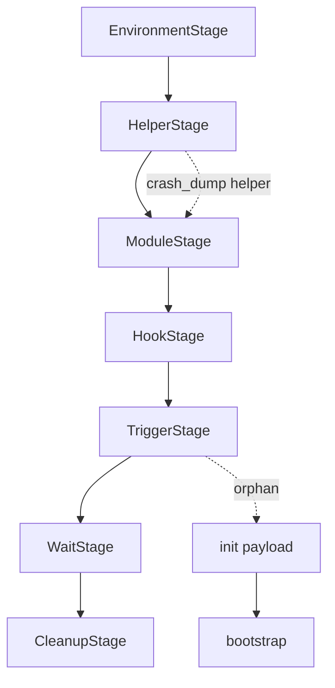

> 已被 `docs/analysis/43284-refactor-design-v4.md` 取代；仅保留评审历史。

> 已被 `docs/analysis/43284-refactor-design-v3.md` 取代；本文件仅保留评审历史。

# 43284 重构设计：按 DFRoot 符号分类

## 0. 约束

- C++ 只做纯库函数：无 `KernelAccess`、无会话、无多态 backend。
- Kotlin 持有编排、SA、序号、计划、错误策略。
- JNI 只做 Kotlin ↔ C 参数/返回值转换。
- 上游顺序以 DirtyFrag/DFRoot 源码为准：helper → module → libc++ → trigger → cleanup。

## 1. 符号分类

### A. 环境准备

| DFRoot 符号 | 归属 | 说明 |
|---|---|---|
| `setup` / `usage` | Kotlin | 参数/会话初始化，不再由 C main 解析 |
| `hex_to_bytes` | Kotlin | key 解析 |
| `detect_ko_target` | Kotlin | carrier 选择策略 |
| `read_device_versions` | C++ 纯函数 | uname → android/major/minor |
| `select_ko_image` / `KoImage` | C++ 纯函数 | KMI 选择，只按 android/major/minor |
| `read_prefs` / `pref_true` | 子进程 | bootstrap 读 SharedPreferences |
| `adopt_zygote_env` | 子进程 | bootstrap 环境继承 |
| `should_ro` / `set_partitions_ro` | 子进程 | bootstrap 分区只读 |
| `disable_modules` | 子进程 | bootstrap 禁用 KSU 模块 |
| `late_load_running` / `run_ctx` / `touch` | 子进程 | bootstrap 上下文与 marker |

### B. app 内核心攻击流程

| DFRoot 符号 | 归属 | 说明 |
|---|---|---|
| `main` / `exploit` | Kotlin `PageCacheEngine` | 阶段编排，不再 C main |
| `patch_helper` | Kotlin + C++ 纯函数 | 写 helper 并回读验证 |
| `patch_ko` | Kotlin + C++ 纯函数 | 选 KO、写 carrier |
| `patch_hook` | Kotlin `KotlinElfPlanner` | site/first-inst/jumpback |
| `find_hook_target` / `find_code_cave` | C++ 纯函数 | ELF 解析/落点 |
| `patch_file_cbc` | C++ 纯函数 | 16B 块写循环 |
| `do_one_write_cbc` | C++ 纯函数 | vmsplice/splice/UDP |
| `compute_iv` | Kotlin 或 C++ 纯函数 | AES-ECB-DEC XOR desired |
| marker 轮询 | Kotlin | `/dev/df`、`/dev/dfm*` |

### C. 子攻击进程

| DFRoot 符号 | 归属 | 说明 |
|---|---|---|
| `spawn_crash_dump` | C++ 纯函数 | vfork/exec crash_dump helper |
| `read_vendor_content` | C++ 纯函数 | helper 读 vendor 16B |
| `createOrphanProcess` | C++ 纯函数 | 双 fork 孤儿，等 init 收尸 |
| `splicehelper start_c` | 载荷 | helper 可执行代码 |
| `libcxx` clone worker/grandchild | 载荷 | init 域内的子进程 |
| `bootstrap main` 及子函数 | 子进程载荷 | 独立 bootstrap 可执行体 |

### D. 载荷

| 符号/文件 | 形态 | 说明 |
|---|---|---|
| `libcxx.S` + `libcxx_*` | 字节载荷 | 464/472B，按目标构建结果取长度 |
| `splicehelper.c` + `start_c` | 可执行载荷 | 写入 crash_dump64 offset 0 |
| `dirtyfrag.ko` | 模块载荷 | 按 KMI 选择 |
| `pad16` | 纯函数 | 载荷对齐，归 payload builder |
| `ko_target` 字符串 | 载荷数据 | 由 Kotlin 注入 carrier 路径 |

### E. 收尾

| DFRoot 符号 | 归属 | 说明 |
|---|---|---|
| `cleanup` | Kotlin `finally` | 恢复 trampoline → shellcode |
| `g_libcxx_r` | Kotlin 状态 | 保存原始 site/stage，不再 C 全局 |
| `patch_file_cbc` 恢复 | C++ 纯函数 | 写回原始块 |
| `fadvise_drop` / crash_dump 页缓存 | C++ 纯函数 | 丢弃 helper 页缓存 |
| close socket / zero key / seq | Kotlin | 资源终结点 |
| 删除 `/dev/df*` marker | Kotlin | 失败/成功都清理 |

## 2. 目标分层

```text
Kotlin 编排层
  PageCacheEngine
  EnvironmentStage / HelperStage / ModuleStage / HookStage / TriggerStage / CleanupStage
  PageCacheAccess（唯一抽象）

JNI 薄层
  NativeEnv / NativeRawEsp / NativeHelper / NativeModule / NativeHook / NativeVerify

C++ 纯函数库
  lib/env.cpp        uname/KMI/carrier
  lib/pagecache.cpp  IV/ESP/vmsplice/splice
  lib/elf_plan.cpp   ELF/sentry/cave
  lib/payload.cpp    pad16/build/retag
  lib/helper.cpp     helper exec/read
  lib/verify.cpp     readback/compare
  lib/cleanup.cpp    restore/drop
```

禁止出现在 C++：

```text
KernelAccess
initialize/shutdown 虚接口
backend 会话对象
device/43284 编排
```

## 3. 阶段流程



顺序理由：

1. helper 先落，vendor 读写才有桥；
2. KO 在 libc++ 之前，init 命中时模块已就绪；
3. site 最后写，避免提前触发；
4. cleanup 在 finally 中无条件执行。

## 4. Kotlin 阶段契约

```kotlin
interface Stage { suspend fun run(): StageResult }

data class StageResult(
    val ok: Boolean,
    val reason: String = "",
    val evidence: Map<String, String> = emptyMap(),
)
```

每个阶段：

- 只依赖 `PageCacheAccess` / JNI；
- 成功必须带回读证据；
- 失败必须具名；
- 清理阶段幂等。

## 5. 纯函数签名（示例）

```cpp
bool gl_env_select(const GlEnvInput&, GlEnvOutput*, GlError*);
bool gl_pagecache_write_block(const GlPageCacheArgs&, GlError*);
bool gl_elf_plan_sentry(const uint8_t* elf, size_t, GlSentryPlan*, GlError*);
bool gl_payload_build(const GlPayloadInput&, uint8_t* out, size_t*, GlError*);
bool gl_helper_install(const GlHelperArgs&, GlError*);
bool gl_verify_range(const GlVerifyArgs&, GlError*);
bool gl_restore_range(const GlRestoreArgs&, GlError*);
```

无全局状态；输入输出用 POD；错误用 `GlError{stage, errno/refusal}`。

## 6. 资源归属

| 资源 | 所有者 | 终结点 |
|---|---|---|
| SA/socket | Kotlin | shutdown |
| raw fd/handle | Kotlin `PageCacheAccess` | close |
| payload bytes | Kotlin | 阶段结束 |
| KO image | Kotlin | 写入后释放 |
| site/stage 原状 | Kotlin | CleanupStage |
| helper 页缓存 | 内核 | drop page cache |

## 7. 迁移批次

1. 新增 C++ 纯函数（env/pagecache/elf/payload/helper/verify/cleanup）。
2. JNI 只导出上述函数。
3. Kotlin 建阶段编排，替换 `TypedBackendProbe`。
4. 删除 `interface.hpp` / `access_params.hpp` / 43284 factory 分支。
5. 最后接设备门禁。

