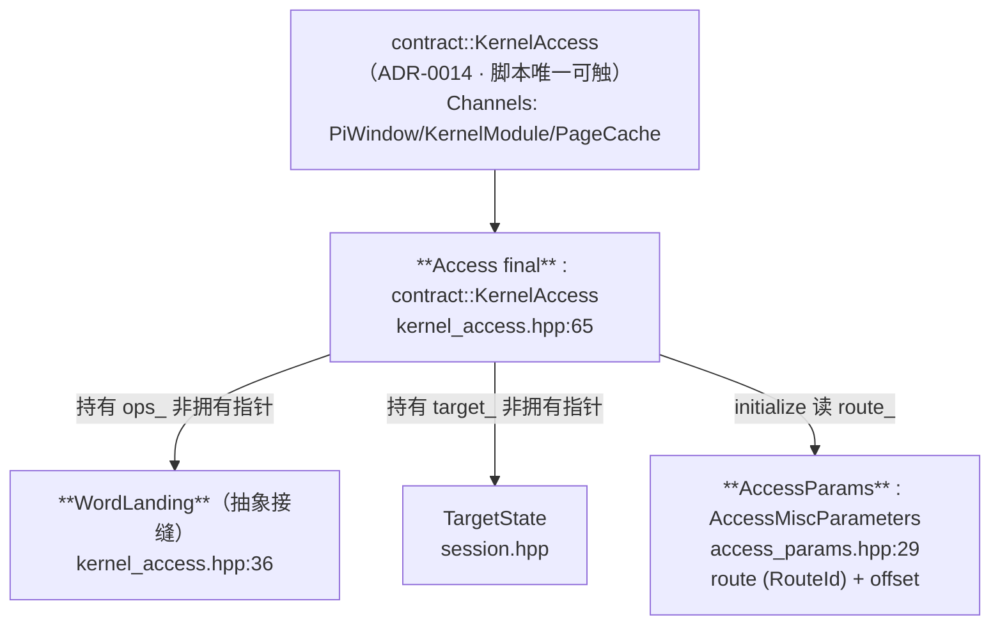
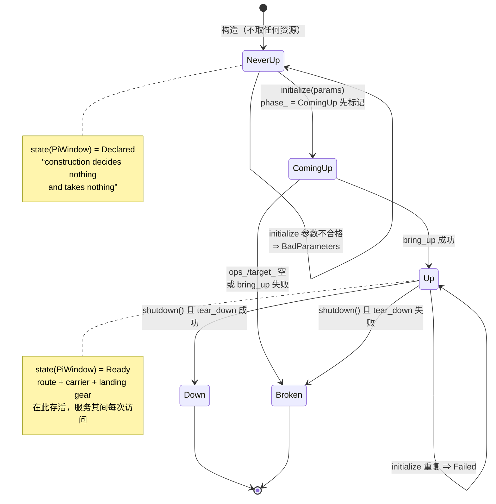

# 43499 KernelAccess 的结构与生命周期管理

> 依据：`core/src/backend/cve_2026_43499/kernel_access.hpp`（238 行）与 `access_params.hpp`（109 行）。

## 一、类型结构（三层）



## 二、生命周期状态机（phase_）



## 三、phase_ ↔ 对外状态（唯一映射）

| `phase_` | `state(PiWindow)` | 含义 |
| --- | --- | --- |
| `NeverUp` | `Declared` | 存在，未上电（构造后） |
| `ComingUp` | `Initializing` | 正在上电 |
| `Up` | `Ready` | 可用 |
| `Down` | `Closed` | 曾上电、被主动关闭 |
| `Broken` | `Failed` | 曾上电但坏了 / 上电失败 |

其余通道一律 `Unsupported`（`state()` 首行）；`supports(PiWindow)=true`、`supports(KernelPage)=true`、
`supports_width(8)=true`（其它宽度 false ——「One whole word, and nothing narrower」）。

## 四、所有权与生命周期（AGENTS §5 口径）

| 对象 | 创建 | 所有者 | 借用者 | 访问区间 | 终结点 | 释放者 |
| --- | --- | --- | --- | --- | --- | --- |
| `Access` | 工厂 `create(BackendId)` | 调用方（`unique_ptr`） | — | 全程 | 析构 | 调用方 |
| `WordLanding` | 本 backend 的 route 实现 | **外部**（非拥有） | `Access::ops_` | `initialize`→`shutdown` | `tear_down()` | **route 实现方** |
| `TargetState` | 本 backend 会话 | **外部**（非拥有） | `Access::target_` | 全程 | — | 外部 |
| route 及其载体/“着陆装置” | `ops_->bring_up()` | **landing** | `Access` 经 landing | `initialize`→`shutdown` | `ops_->tear_down()` | **landing** |
| 一次访问的 window | 每次 `land_word` 内 | **landing** | `land_word` | **单次访问内** | 该次访问的**每条出口** | **landing** |

关键不变量（文档逐字）：

- 「**One object per backend, not per route**」：route 在**参数**里选，不是对象；
- 「the route … **brought up inside initialize and reclaimed inside shutdown**, and **construction does
  none of that work**」；
- 「The route, its carrier and the landing gear **live from initialize to shutdown** and serve every
  access in between」；
- 「**the window inside one access is scoped to that access** because it is a **race scope** and
  **reclaims on every exit path**」← 与 AGENTS §5「覆盖成功/失败/重试/取消/提前返回」同义；
- 「**Owns nothing at construction**; everything it owns it took in initialize and gives back in shutdown」。

## 五、接缝四方法（＝旧实现要接的四个点）

| `WordLanding` 方法 | 语义 | 旧 C 对应（`backend/legacy43499/`） |
| --- | --- | --- |
| `bring_up(RouteId, const TargetState&)` | 上电，备好可写 | `select_offsets` → `init_cpu_config` → `apply_iomem_cache` → `spawn_victim` → `perf_find_task` |
| `tear_down()` | 下电并回收 | `kill(-child, SIGKILL)` ＋ `waitpid` ＋ close(pipes) ＋ 路由侧清理 |
| `land_word(address, value, offset)` | **写一个字**（“The whole point of the backend”） | `do_one_write(target, mode, leaf)` |
| `can_read()` / `read_word(...)` | 默认 **false**（“honest answer for a window that only writes”） | 待 route 声明；`kernelsnitch` 具备读能力后由 landing 覆写 |

## 六、能力诚实性（为什么是 state 而非 bool）

```
a window write is the **bootstrap** and works **as soon as a route is up**；
而 **arbitrary reads need the object found and a page prepared**，
故 read 侧在 readiness 说可以之前**按名拒绝**（refused by name），而不是假装成功。
宽度同理：window 写的是 **one whole word** ⇒ `supports_width` 只对 8 字节答 yes。
```

## 七、与目标的连接（GAP-1）

```
现在：main.cpp 直驱执行层（MulticastRoute + payload_page + write_encoder）⇒ Access/WordLanding **空转**
目标：「逐步将旧实现接入 kernel access」=
   ① 写一个 `WordLanding` 的实现（如 `MulticastLanding`）⇒ `bring_up/tear_down/land_word` 内部调 legacy43499 ✓
   ② 由此 main.cpp 的直驱改为经 `Access::write64`（粒度天然一致 ✓）
   ③ 一个 route 一个 route 地接（文档逐字：“ported one route at a time without touching it”）
```
