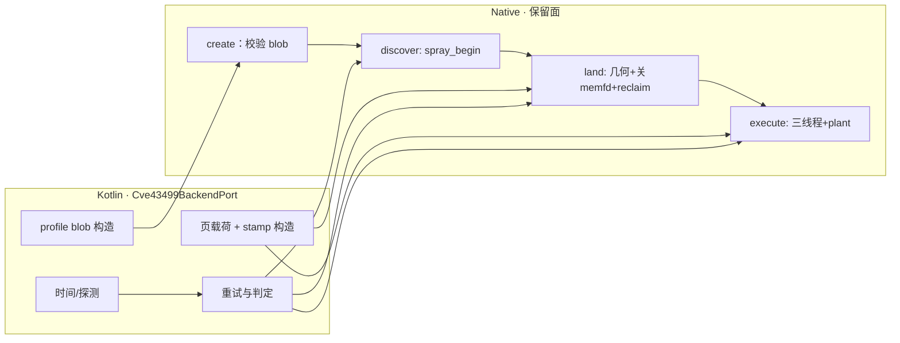

# 43499：把可搬运逻辑重写到 Kotlin 的计划（2026-10-25）

> **状态**：草案，待 design-critic 评审 + 用户认可。**本轮只改了 JNI 声明面，未改攻击路径逻辑**。
> **基线**：分支 `dev-nocpp`，HEAD `be0f2737`；JNI 面 12 项（8 原有 + 4 新增），Kotlin↔C 契约 12/12 匹配。
> **关系**：延伸 `43499-route-plant-primitives-plan.md` §8 与 `jni-six-targets-params-plan.md` §8；
> JNI 命名/handle 归 `43499-approval-status.md` §4.1。
> **已被取代（2026-10-25）**：§1.4 的 12 项 JNI 面 与 §三 的 P-1…P-4 分批，
> 由 `43499-jni-v5-atomic-primitives-design.md` 取代（原子单位＝一次写尝试，
> `discover`/`land`/`execute` 切分撤销）。本文保留 §九 守卫记录，作为历史证据。

## 一、现状与基线

### 1.1 工具口径（本次全量分析）

```bash
# 13 个 TU（core/*.cpp + jni43499.c + ks_bridge.c）→ aarch64 -O0 对象
$NDK/.../aarch64-linux-android24-clang++ -std=c++23 -O0 -fPIC -D__ARM -I core -c core/<x>.cpp
# 调用边：R_AARCH64_CALL26/JUMP26 重定位 + 同段直接 bl，再 llvm-cxxfilt
$NDK/.../llvm-objdump -dr --no-show-raw-insn <x>.o
```

- 根 = `glk43499_api_*` + `Java_..._Native43499Jni_*`（26）→ 可达 **290 个项目函数 / 13,637 条指令**
- `-O0` 保留层级；`-O2` 会把 60% 的层内联掉（入口 237 → 71 条，实测）

### 1.2 调用链分层（到 JNI 的最短距离）

| depth | 函数数 | 指令 | 代表（指令数） |
|---|---|---|---|
| 0 边界 | 27 | 950 | `build_dev_515_profile` 265 · `api_create` 155 · 8×JNI ≤26 |
| 1 事务骨架 | 22 | 2,752 | `spray_begin` 778 · `run_main_route_threads` 507 · `land_with` 398 · `kernelsnitch_setup` 284 |
| 2 装配/载荷/地址 | 68 | 4,608 | `race_run_params_from_session` 519 · `prepare_skb_payload` 514 · `page_spray_inputs_from_session` 339 · `detect_target_soc` 207 |
| 3 编码/算法 | 89 | 3,145 | `__collision_pass` 551 · `fill_profile_cred_copy` 165 · `encode_compact_waiter` 104 |
| 4–6 叶子工具 | ~92 | ~2,180 | `span_store64` 88 · `elapsed_ms` 126 · profile accessor 各 27 |
| leaves | 110 | — | `__run_mm_leak_pass`、`payload_write_layout`、`pin_to_core` λ |

### 1.3 桶表（项目可达指令占比）

| 桶 | 函数 | 指令 | 判定 |
|---|---|---|---|
| 0 JNI/C-API 胶水 | 27 | 950 | 留（边界） |
| 1 会话适配器（`*_from_session`） | 11 | 1,005 | **搬** |
| 2 载荷/编码（纯） | 7 | 1,003 | **搬** |
| 3 profile/地址 | 86 | 2,739 | **大部分搬**（探测除外） |
| 4 kernelsnitch | 18 | 2,248 | 留（general DSO） |
| 5 时间 | 6 | 403 | **搬** |
| 6 plant/生命周期 | 60 | 3,196 | 留 |
| 7 其它（模板/RAII） | 75 | 2,093 | 混合 |

去掉 std 与 kernelsnitch 后，**core 自有 6,035 条指令里约 78% 是数据/算术**。

### 1.4 当前 JNI 面（本轮已接好）

> **TODO(superseded-20261025)**：本节 12 项面已被
> `43499-jni-v5-atomic-primitives-design.md` §五 判定删除；保留作对照，不再扩写。

```text
create()                                  // dev profile（P-1 改为传参）
discover(target) -> mm
land(mm, target) -> base                  // payload 由 native 构造
landWithPayload(mm, target, byte[]) -> base   // payload 由 Kotlin 给（新增）
executeMulticast(target) -> int
executeSelect(target) -> int              // -ENOSYS（无门禁，占位）
executeTcp(target) -> int                 // -ENOSYS（同上）
runMulticast(target) -> int               // 单入口，仅对拍
skbPayloadSize() -> int                   // 页载荷字节数（新增）
lastStep() / lastErrno() / close()
```

契约检查：Kotlin `external fun` 12 项 ↔ `.so` 符号 12 项 → **PASS**。

### 1.5 已证明的行为

| 路径 | 结果 |
|---|---|
| 直连 `main_dev` → `attack_write` | PASS（多次） |
| `.so` dlopen 单入口 | PASS |
| 静态链接探针 | PASS |
| `.so` 分步（discover→land→execute） | PASS |

对拍抓到并修掉两个真缺陷：页接受判据只在直连循环里；`land_with` 未回写 `current->base`。
**已复验**：本轮新增 4 个 JNI 入口后的 `.so` 冷机 PASS（2 次页拒收后第 3 次命中，`routed=1 enforce_after=0`）；
此前 2 次 panic 归入当日高发的 `KERNEL-PANIC-01` 型（同构建可复现 PASS）。

## 二、目标与约束

**目标**：按 §1.3 的桶表，把「数据/算术」类逻辑移到 Kotlin，C 侧只剩 plant 与生命周期；每批都可被设备或 host 判据验证。

**非目标**：不改 `kernelsnitch/`；不合并三条 route；不做多实例 handle；不动 `very_legacy/`；不在本计划里改 wire schema（P-1 只定义 43499 自己的 profile blob）。

**硬约束（不可搬，逐条有证据）**：

1. plant 落点 = 执行该 syscall 的线程内核栈（`route_multicast.cpp:111`、`route_tcp.cpp:385`、`route_select.cpp:457`）。
2. 关 memfd → reclaim 必须同一次 native 调用（`support.cpp` 的 close 序列）。
3. arm→walk 依赖三线程共享原子（`race.cpp`）。

## 三、改动清单

> **TODO(superseded-20261025)**：P-1…P-4 的搬运量按"可跨 JNI 切分"估算；原子粒度改为
> "一次写尝试"后，载荷（P-2）与 profile 的跨调用交接不再成立。以新稿 §七 J1–J6 为准。

| 批 | 文件 | 改动 | 搬运量 |
|---|---|---|---|
| **P-1 profile blob** | `core/params.h`、`core/api.cpp`、`core/profile.h`、Kotlin `Flow43499Layouts` | 定义 `43499ProfileBlob`（version/magic/字段表）；`create(byte[])` 取代 `build_dev_515_profile`；删两个 `*_from_session` | 265 + 1,005 + ~2,300 |
| **P-2 页载荷** | `core/support.cpp`、Kotlin `flow/` | Kotlin 构造 `skbPayload`（`skbPayloadSize()` 给的 1 MiB）+ 264B stamp；native 只 memcpy | ~1,003 |
| **P-3 时间与探测** | Kotlin `flow/`、`core/memory.cpp` | `detect_target_soc`/`elapsed_ms` 由 Kotlin 提供（system property + `nanoTime`） | 610 |
| **P-4 策略** | Kotlin `Cve43499BackendPort` 实现 | discover→land→execute 的重试、页拒收判定、fast-repair 开关 | ~300 |

## 四、数据流/控制流差异



不变量：`plant→arm` 零 syscall；`land` 的 0 = 页被拒收（调用方重试）；`discover→land→execute` 三段必须在同一后台线程、中间不得有其它写。

## 五、兼容性与回滚

- 每批一个 commit，回滚 = 同 commit 双端（native + Kotlin）回退。
- P-1 之前：`create()` 仍装 dev profile；P-1 之后：blob 缺字段即拒绝（不猜默认值）。
- P-2 双实现期（native 构造 vs Kotlin 构造）以 **字节等价** 为判据；不等价不得删 native 构造。

## 六、验证矩阵

| 批 | 命令/条件 | 预期 |
|---|---|---|
| P-1 | host：blob 编解码往返 + 缺字段/越界负例；设备：冷机 W1 | 往返逐字节相等；`routed=1 enforce_after=0` |
| P-2 | host：`skbPayload` 与 native 构造逐字节比对（`skbPayloadSize()` 长度）；设备：`landWithPayload` 冷机 W1 | 逐字节相等；`routed=1` |
| P-3 | host：探测值/时间换算对照表 | 一致 |
| P-4 | 设备：页拒收 → 重试 → 命中（现有 probe 已演示 1/6 形态） | 重试后 `routed=1` |

真机固定条件：A301SO · `5.15.189-android13-8-00016-g51bba4309aac` · KernelSU 未加载 · cold boot · CPU 0/1 · 唯一文件名 + 运行前 md5。

## 七、明确保留（指令数为 `-O0` 实测）

| 函数 | 指令 | 理由 |
|---|---|---|
| `support::spray_begin` | 778 | clone/memfd/kill 顺序；leak child 必须在 `pre`/`post` 之间 fork |
| `support::land_with` | 398 | 关 memfd → reclaim 同调用；页几何与接受判据 |
| `race::run_main_route_threads` | 507 | 三线程 + arm→walk 时序 |
| `multicast::MulticastRoute::execute` | ~240 | plant 与 arm 相邻（`setsockopt` 拷贝） |
| `select_stack::SelectStackRoute::prepare/execute` | ~470 | arm 在 plant 之前；逐发重喷页 |
| `tcp_zerocopy::TcpZerocopyRoute::prepare/execute` | ~560 | `getsockopt` 写回；punch 线程 |
| kernelsnitch（`glk_ks_dev_*`） | 2,248 | 独立 DSO，Kotlin 经 JNI 调 |
| `api.cpp` / `jni43499.c` | 950 | 边界：参数校验 + 句柄 |

## 八、进度

- [x] JNI 保留面接好（12 项，契约 12/12）
- [x] 全量调用链分析（§1.1–1.3）
- [ ] design-critic 评审
- [ ] 用户认可
- [ ] P-1 profile blob（最大一块，前置）
- [ ] P-2 页载荷（含 `landWithPayload` 冷机对拍）
- [ ] P-3 时间与探测
- [ ] P-4 重试/策略
- [x] 新增 JNI 入口的真机复验（冷机 PASS，2 次页拒收后命中）
- [x] P0 守卫（§9.3 五项）：实现 + 守卫自检通过（step 70/71 = `-EALREADY`，不 exit）
- [ ] P0 守卫的冷机正例（当日 panic 高发：守卫后 warm PASS 1 次、cold 2 次 panic，未取得干净门禁）

## 九、自审：完整性与幂等性（2026-10-25）

### 9.1 现有 JNI 面能完成"完整攻击"吗

**不能。** 现面等价于"**一次 multicast W1 写**"（且在 P-1 之前还绑定死 5.15.189 dev profile）。

| 完整攻击所需 | 现面 | 证据 |
|---|---|---|
| profile 选择（机型/版本） | ✗ `create()` 无参，装死 dev profile | `core/api.cpp:66-90`、`core/dev_profile.h` |
| W1 写（`WriteMode::Zero`） | ✓ | `api.cpp` `run_mcast` |
| W2 cred 修复（`WriteMode::Credential`） | ✗ 无入口；`attack_write<M>` 也未暴露 | `backend.h:59` |
| W2 快修（prebuild/activate + `fast_repair` latch） | ✗ | `route_multicast.cpp:212-251` 无 JNI 入口 |
| W3 链（多次写 / per-step target） | ✗ | 无 per-step 入口 |
| `Cve2026_43499Policy::run`（W1→W2→W3 链） | ✗ 本树**只有声明没有定义** | `backend.h:50`，`grep "::run("` 为空 |
| victim spawn/probe/finish、handoff | ✗（Kotlin 拥有 victim，但 finish/handoff primitive 不在 C 面） | `43499-production-victim-plan.md` §2 |
| select / tcp | ✗ 返回 `-ENOSYS` | `api.cpp` `execute_select/tcp` |
| 写后验证 | ✓（Kotlin 读 `/sys/fs/selinux/enforce`） | — |

### 9.2 跨调用状态：前一次调用会影响下一次（同参数也不同结果）

| 入口 | 读 | 写 | 幂等 | 重复调用的后果 |
|---|---|---|---|---|
| `create` | — | 进程级：`set_limit/set_unbuffer/pin_to_core(0)`；session profile/heap/addresses | ✓ 有守卫 | 第二次返回 `-EALREADY` |
| `discover` | `s.created` | **销毁上一页**（`payload.destroy()` → base/fake_* 清零，`memory.cpp:168-180`）；重开子进程/memfd；`s.mm_struct` | ✗ | 上一页作废（含其 `land`/`execute` 句柄）；**并会解除调用线程绑核**：leak 末尾 `reset_cpu_pin()` 把 affinity 设成全核（`glgeneral/kernelsnitch/kernelsnitch.h:590`） |
| `land` | `s.target`、`s.mm_struct` | 页几何 + `skb_buffer` + `reclaim.fd`（`socketpair` **覆盖**旧 fd）+ `current->base` | ✗ **无守卫** | 第二次 `land`：旧 reclaim 对泄漏；随后 `SYSCHK(close(-1))` → `pr_error` → **`exit(-1)`**（`log.h:96-101`、`support.cpp` land_with 的 close 序列） |
| `execute` | `s.landed` | 三线程、session 原子、`fast_repair`（保持）、页上的 fake 对象被 PI 链消耗 | ✗ **无守卫** | 第二次 `execute` 在已消耗的页上重跑 → 未定义（实测同族会 panic） |
| `close` | — | 只清 `ApiState` 标志；**不销毁页/不关 fd** | ✓ | 页与 reclaim fd 存活到下一次 `create`（`HeapContext::init()` 才 destroy，`memory.cpp:237-251`） |
| `lastStep/lastErrno` | 最近一次 `execute` 的记录 | — | ✓ | `discover`/`land` 失败时**仍是上一次的旧值**（只有 `record()` 在 execute 里调） |

### 9.3 守卫（已实现，2026-10-25）

1. `discover` 置 `land_pending=1`；`land` 消费后置 0；重复 `land` → `-EALREADY`（禁止覆盖 `reclaim.fd`）。
2. `land` 置 `exec_pending=1`；`execute` 消费后置 0；重复 `execute` → `-EALREADY`。
3. `close` 销毁 `heap.current`（与 `create` 的 `heap.init()` 同效），不留 fd。
4. `discover`/`land` 失败也写 `lastStep/lastErrno`；同时把 `land` 的地址不匹配与页拒收分成不同 step。
5. 泄漏结束后**恢复绑核**（`pin_to_core(main_cpu)`），使"第一次调用"与"后续调用"的前置状态一致。

实现位置：1/2/4 在 `core/api.cpp`（`land_pending` / `exec_pending` / `refuse(step, errno)`），
3 在 `glk43499_api_close`（销毁 current/prebuilt/quarantine），5 在 `support.cpp::spray_begin`
（`restore_pin` scope_exit，覆盖所有返回路径）。

**守卫自检（真机，warm run）**：

```text
probe attempt=1 routed=1 step=0 errno=0                    ← 正常写成功
probe guard land-again base=0x0  step=70 errno=114          ← -EALREADY，不覆盖 reclaim.fd
probe guard exec-again routed=0  step=71 errno=114          ← -EALREADY，不在消耗过的页上重跑
exit=0                                                      ← 没有 exit(-1)
```

新增 step 码（API 边界，不属 route）：70 = land 重复、71 = execute 重复、72 = 喷页/泄漏失败、
73 = 地址不匹配、74 = 页拒收（可重试）。
