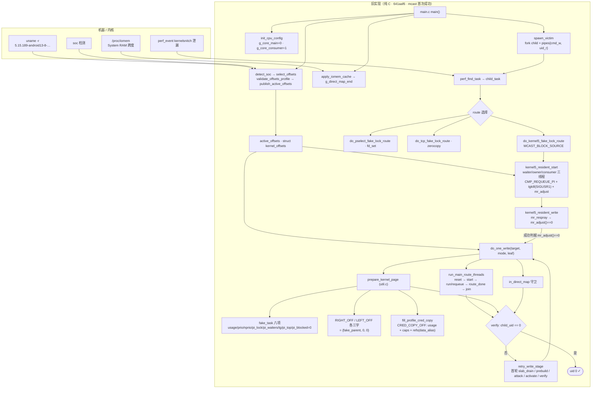
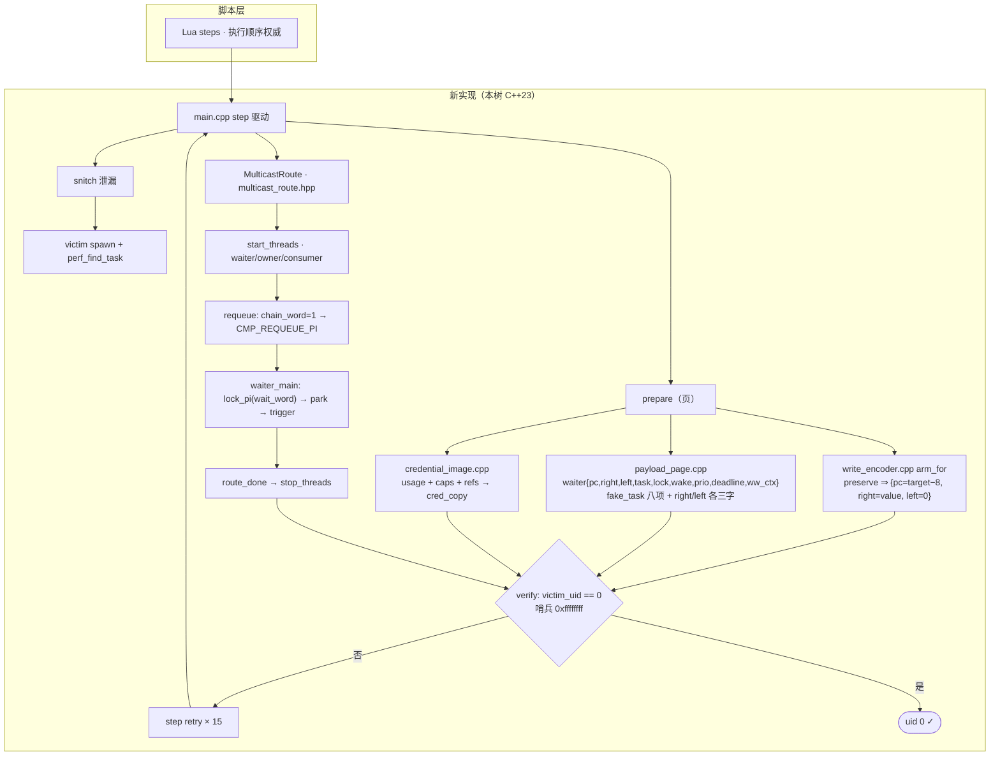
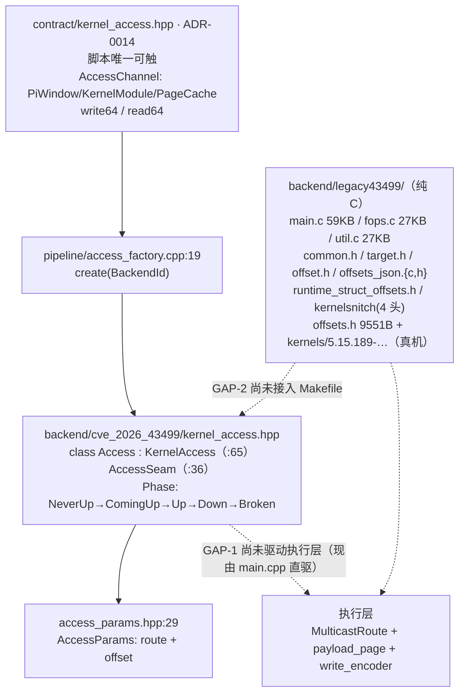

# 新旧实现数据流图（Mermaid）· 43499

> 旧 = `ghostlock-app-ref/src/core/{main,util,fops}.c`（纯 C，`641aaf6` = mcast 首次成功）；
> 新 = 本树 `core/src/**`（C++23）。

## 一、旧实现（纯 C）

## 二、新实现（本树 C++）

## 三、契约层与两处 GAP（本目标）

## 四、两处 GAP 与下一步

| # | 缺口 | 现状 | 下一步 |
| --- | --- | --- | --- |
| **GAP-2** | `legacy43499` 未编译 | 未进 `Makefile`；`-fsyntax-only` 两处报错 | ① `-DTARGET_CONFIG_H=` 指向 **5.15.189**；② `kernels/offsets.h:111` 仍 include `6.1.115-…` ⇒ 改指真机那份 |
| **GAP-1** | `kernel_access` 未驱动执行层 | `Access` / `AccessSeam` 已在；`main.cpp` 直驱 | 让 `write64` 走 `do_one_write` |
