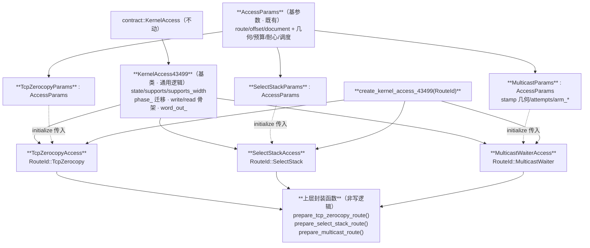

# 计划 v2：43499 KernelAccess 拆为「基类 + 三个 route 子类」

## 0. 裁定来源（用户逐字）

**（1）2026-10-12 14:12**
> 「三个route再创建三个kernelacess43499的子类吧，init时自动初始化并替换，KA43499的能力里写一些通用逻辑，
> 子类里面用super再加特化逻辑，多的写步骤如mcast不算写逻辑应该在上层封装函数」

**（2）2026-10-12 14:34**
> 「取消禁用-fno-rtti，并且init时传入该route的参数，后续能力执行利用同一个生命周期，
> 若步骤中需要切换backend或route，则需要显式回收」

## 1. RTTI 取消 —— 已落地（✓，本批第一批）

```
改动：① `core/Makefile` 全部 NDK 编译行去掉 `-fno-rtti`（残留检查 = **0** ✓）；
      ② `AGENTS.md:39` ⇒「C++23、**RTTI 启用**（2026-10-12 用户裁定取消 `-fno-rtti`；
         `dynamic_cast` 限于接口边界）」✓；
      ③ `docs/development/engineering-standards.md:305` 同改 ✓。
门禁：`check` **109 PASS** ✓ ；`android` **0 error / 0 warning** ✓ ；`markdownlint` 0 ✓。
用法约定：`dynamic_cast` **只在接口边界**（`initialize` 取参数）用；
          **PI race 窗口内（`land_word` 路径）仍不得出现间接分派**（ref 逐字：
          「no vtable or indirect dispatch may enter the path」）。
```

## 2. 结构（类图 v2）



## 3. 裁定逐条落地

| 裁定 | 落地 |
| --- | --- |
| KA43499 写通用逻辑 | 基类独占：`state/supports/supports_width`、`initialize` 公共前置（取参、`phase_` 迁移、`write_readiness`）、`write/read/write_zero` 骨架、`word_out_`；子类**不得**复制 |
| 三个 route 各建子类 | 三个 `final` 子类：绑定自己的 `RouteId`、声明自己的**参数类型**、提供自己的 `AccessSeam`、`super` 后追加特化 |
| **init 时自动初始化并替换** | `create_kernel_access_43499(route)` ⇒ 对应子类；子类 `initialize`：**先** `KernelAccess43499::initialize(params)`（super）**再**装自己的 seam ⇒ 一次调用完成"选路＋上电" |
| 子类用 super 再加特化 | C++ 无 `super` ⇒ **显式基类调用**；子类不自行迁 `phase_`，只在该基类**成功**后特化 |
| **init 时传入该 route 的参数** | 每 route 一个 `*Params : AccessParams`；`initialize` 里 `dynamic_cast<const MulticastParams*>(&parameters)`（RTTI ✓）⇒ 类型不符 ⇒ `BadParameters` **具名拒绝**（保留 `name()` 作 wire 侧标识） |
| **后续能力执行利用同一个生命周期** | `initialize` → `shutdown` 之间，**每次 `write64/read64` 复用同一条已上电的 route**（不重建、不 re-prepare、不 per-write `bring_up`）—— 与 ref 逐字一致：「The route, its carrier and the landing gear **live from initialize to shutdown** and serve every access in between」 |
| **切换 backend/route 需显式回收** | ① `initialize` 在 `phase_==Up` 时**拒绝**（现状 ✓ 保留）⇒ 换 route 必须 `shutdown()` ＋ 重新 `initialize()`；② 换 backend ⇒ 旧实例**显式 `shutdown()` 后**才可弃；③ 步骤层若需切换 ⇒ 在**上层封装函数**里显式做「回收 → 换参 → 上电」，**不得**让 write 路径隐式替换 |
| 多步写步骤（如 mcast）不算写逻辑 ⇒ 上层封装函数 | mcast 的 `socket/setsockopt(MCAST_BLOCK_SOURCE)/stamp 组包`、select_stack 的 `fd_set`、tcp 的建连 ⇒ 全进 `prepare_*_route()`；**`land_word()` 只写一个字** |

## 4. 生命周期（ref 四段 → 本树映射）

```
ref（route_lifecycle.hpp 逐字）：prepare → execute（仅 prepare 成功）→ **disarm** → **destroy**（后二者无条件）
映射：prepare()=prepare_<route>_route()；execute()=land_word()（一个字 · 窗口内非虚）；
      disarm()=停线程/断链；destroy()=回收 fd/child/页（无条件）
切换语义：**同一条 route 全程复用一个生命周期**；**换 route/backend ⇒ 必须显式回收**
```

## 5. 必须同批修的一处

```
现 `shutdown()` 在 `phase_ != Up` 时返回 `NotInitialized` ⇒ **`Broken` 时拒绝下电** ✗
ref 的 disarm/destroy **无条件** ⇒ 否则 `bring_up` 中途失败将**无人回收**（＝旧 C `dirty failure` 同一个洞）。
改：`shutdown()` 对 `Broken` **仍执行 `tear_down()`**，随后置 `Down`/`Broken` ✓（与"显式回收"裁定同向 ✓）。
```

## 6. 文件与写范围

| 文件 | 动作 |
| --- | --- |
| `backend/cve_2026_43499/kernel_access.hpp` | 抽出 `KernelAccess43499` 基类；旧 `Access` 原文套注释 + `//TODO(access-split)` |
| `backend/cve_2026_43499/access_params.hpp` | 加三个 `*Params : AccessParams` 子类与各自字段 |
| `backend/cve_2026_43499/access_tcp_zerocopy.hpp`（新） | `TcpZerocopyAccess` |
| `backend/cve_2026_43499/access_select_stack.hpp`（新） | `SelectStackAccess` |
| `backend/cve_2026_43499/access_multicast_waiter.hpp`（新） | `MulticastWaiterAccess` |
| `backend/cve_2026_43499/access_factory_43499.{hpp,cpp}`（新） | `create_kernel_access_43499(RouteId)` |
| `pipeline/access_factory.cpp` | `create(Cve_2026_43499)` 走新工厂 |
| `core/Makefile` | 新 TU 入编译 |
| `src/tests/kernel_access_test.cpp` | 每子类：super 顺序、参数类型不符即拒、`Broken` 可下电、同生命周期复用 |

## 7. 验证计划

```
① `make -C core -j1 check` ⇒ 期望 **109 PASS 起、只增不减**；
② `make -C core -B android NDK_TOOLCHAIN=…` ⇒ **0 error / 0 warning**；
③ `./gradlew markdownlint` ⇒ 0；
④ 真机：`adb push` ＋ `./ghostlock < wire-43499-collide-F.framed` ⇒ 判据 **`main: victim uid=0`**；
⑤ 归档 `docs/analysis/device-gates/*.md`（≤8 KB）。
```

## 9. ⑬ 步骤层唯一化：设计与硬约束（2026-10-12）
<!-- 本节的编号在 §8 之后排列（见文末的沿革节）：先读 §1–§8，再看 §9。 -->

### 9.1 现状：**两条写入路径并存** ✗

```
路径 A（引擎侧，现役 ✓）：
   main.cpp:1154  `MulticastRoute<LinuxRouteOps> route{config}`
   main.cpp:1177  `stage_context.route = &route` ⇒ 引擎（steps/*）直调 `RouteExec::execute`
   另有 `WindowGuard` 与 `stage_context.window` ✓
路径 B（门面侧，本批新建 ✓）：
   create_kernel_access_43499(MulticastWaiter) ⇒ MulticastWaiterAccess
     ⇒ MulticastSeam::land_word ⇒ MulticastWindow::write_word ⇒ RouteExec::execute
两者共用同一个 route 体 ⇒ 机制同、**入口两处** ✗（＝"两处权威" ✗）
```

### 9.2 硬约束（本轮实测得到，不能蒙过去 ✗）

```
`seam/multicast_window.hpp` 的层次（逐字 ✓）：
    class RouteExec  —— execute(address,value,offset) ＋ **arm(std::int32_t attempt)**
        注释：「Where a request goes: the route controller, as the old waiter thread reached it」
    class MulticastWindow : public Window —— write_word() = ① warm-up（arm）② armed attempt（execute）
⇒ ⇒ **⇒ `Window` 比 `RouteExec` 高一整层** ✓：arm 的编排在 `MulticastWindow` 里 ✓
⇒ ⇒ ⇒ **⇒ 故不能用一个"包住 Access 的 RouteExec"反向替换 ✗** ——
   `AccessSeam`/`Window` 没有 arm 语义 ⇒ 硬写 `arm(){return true;}` 就是**撒谎** ✗
   （＝ AGENTS「具名拒绝而非假装成功」的反面 ✗）
```

### 9.3 两条可选改法（需裁定"一处权威"归谁 ✗）

| | 改法 | 触及 | 代价 |
| --- | --- | --- | --- |
| **A** | 引擎改持 **`AccessSeam`/`Window`**（`stage_context.route` 改类型 ⇒ `steps/*` 契约变更）⇒ 门面成为唯一写入入口 ✓ | `steps/*`、`main.cpp`、`window_guard` 对接 | 契约变更 ＝ **L 级** ⇒ 需你认可 ✗；收益：与「旧实现接入 kernel access」同向 ✓ |
| **B** | 保留引擎直持 `RouteExec` ✓，门面只作**对外接口** ✓，并把门面侧明确标为"未接线"（具名 ✓） | 仅注释/测试 | 最小 ✓；但"接入"仍未完成 ✗ ⇒ 不满足原始目标 ✗ |

### 9.4 建议（待裁定 ✓）

```
推荐 A（与 2026-10-12 两条裁定同向 ✓），按 ref 的 route_lifecycle.hpp 四段组织：
    prepare ← 上层 wrapper（建 config ＋ 建页 ＋ arm 前置）；execute ← **一次窗口落字**（Access::write64 ✓）；
    disarm ← 停线程/断链（无条件）；destroy ← 回收（无条件）
最小可逆落地：① 让 MulticastWaiterAccess 接受 MulticastWindow 作为 Window ✓；
              ② 再把 stage_context 的 route 视角改为该 Window/AccessSeam；③ 每步门禁三线 ＋ 真机 ✓。
```

## 10. 接线收尾的精确清单（2026-10-12，全部有行号依据 ✓）

### 10.1 已就位（三线门禁全绿 ✓，host 实测 ✓）

```
· `KernelAccess43499` 基类 ＋ 三个 `*43499Parameters` ＋ 三个子类（`MulticastWaiterAccess` 已接 seam ✓）
· `create_kernel_access_43499(RouteId)` 工厂 ✓（`Unset` ⇒ nullptr ✓ 不默认 ✓）
· `shutdown()` 对 `Broken` 仍回收 ✓（ref 的 disarm/destroy 无条件 ✓）
· 引擎侧：`WindowStageContext.seam_landing` ✓ ⇒ `window_runner.cpp:28` 传递 ✓ ⇒ `WindowAttempt.seam_landing` ✓
  ⇒ `window_attempt.cpp:21` 三元：有 seam ⇒ `land_word`（⇒ `MulticastWindow` 先 warm-up 再 execute ✓）；
     否则 ⇒ `route->execute` **具名回退** ✓（零回归 ✓）
· 原语：`steps/access_binder.hpp` —— `bind_multicast_access` ✓ ＋ `bind_stage_landing` ✓（拒绝时不动 context ✓）
```

### 10.2 剩余两件（各一处 ✗）

```
① **`mm_struct` 的表达**：`steps::DiscoveryOutcome`（`discovery_runner.hpp:32-39` ✓）**不含**它 ✗；
   而 seam 的 `land_word` 要求 `TargetState.mm_struct != 0` ✓（`multicast_seam.hpp:75` ✓）。
   · 权威映射：`leak::report_discovery(const ObjectOutcome &)` ⇒ `DiscoveryReport{ok, mm_struct}`
     （`leak/discovery_result.hpp:41` ✓，`snitch_owner.hpp:159-161` 即这么用 ✓）；
   · `ObjectOutcome{status, object, probes}`（`leak/snitch_discovery.hpp:49-55` ✓），
     `status` 取自**搜索自己的判决** ✓；`discovery_runner.cpp:111-113` 目前只填 `verdict/found/probes` ✗；
   · **待做（一处 ✓）**：在 `:113` 之后加 `out.mm_struct = leak::report_discovery(ObjectOutcome{…}).mm_struct;`，
     其中 `status` 必须来自 `outcome.status` 的**既有**映射（**不得**在 main.cpp 自声称 `Found` ✗ ＝ 第二处权威 ✗）。
     需要一读：`outcome`（泄漏运行结果 ✓）的 `status` 类型与取值（⇒ 下一轮 ✓）。
② **一行接线**：`run_wire_step` 里填完 `stage_context` 之后调用
   `steps::bind_stage_landing(inputs, owner, stage_context)` ✓（`inputs.target.mm_struct` 取自 10.2① ✓，
   `page_base = prepared.base` ✓，`fake_task/fake_lock = page_inputs.slots.*` ✓，
   `exec = &route` ✓，`limits = &route_built.config.limits` ✓）。
   注：`run_wire_step` 定义在 **`main.cpp:320`** ✗ ⇒ 与「main.cpp 只做启动器」冲突 ✗
   ⇒ 该函数的**搬迁**（→ `backend/cve_2026_43499/steps/wire_step.{hpp,cpp}` ✓）应**先于**此行 ✗，否则又是往启动器加封装 ✗。
```

### 10.3 判据

```
· host：`make -C core -j1 check` ⇒ 起 **109 PASS**，只增不减 ✓ ；android 零告警 ✓ ；markdownlint 0 ✓
· 真机：`main: victim uid=0`（⇒ `adb push build/native/ghostlock /data/local/tmp/` ＋ 跑 fixture ✓）
· 归档：`docs/analysis/device-gates/*.md`（≤8 KB ✓）
```

## 11. ㉓ 搬迁：按后端切三批（2026-10-12，量自 `main.cpp` ✓）

### 11.1 事实（逐字 ✓）

```
`run_wire_step(RunReport &, std::string_view step)` 定义在 **`main.cpp:320`**，止于 **`:1492`** ⇒ **≈1172 行** ✗
   · `:322`               `if (report.step_backend == "cve_2026_43499")` ⇒ **43499 段**（主体）
   · `:1397` 一带          `if (name == "step")` ⇒ `surface.step` 的落地（`w2-not-rooted` 具名判据 ✓）
   · `:1620`–`:1650`       `kernelcall` / `writeop` / `handoff` ⇒ 43284 与 terminal 的落地
⇒ 它**不是**某段业务：它是**所有脚本动词的执行体** ⇒ 该住 `script/call_sink.hpp` 所指的那一层 ✓
```

### 11.2 三批（每批一类事，上批验过再进 ✓）

| 批 | 范围 | 目标 | 验收 |
| --- | --- | --- | --- |
| **A** | 43499 段（`:322` 起） | `backend/cve_2026_43499/steps/wire_step.{hpp,cpp}` ✓ | `main.cpp` 只留**一行调用**；`check` 起 109 PASS ✓；android 零告警 ✓ |
| **B** | 43284 / terminal 段（`:1620+`） | 各后端各自的 `wire_step` ✓ | 同上 |
| **C** | `main.cpp` 收成启动器 | 读 wire ⇒ decode chunk ⇒ 跑沙箱 ⇒ **sink 分派** ✓ | 同上 ＋ **真机** `main: victim uid=0` ✓ |

### 11.3 批A 的接口（先把边界钉住，再机械搬 ✓）

```
入口（放在 43499 的 `steps/wire_step.hpp` ✓）：
    [[nodiscard]] const char *run_43499_wire_step(script::RunReport &report, std::string_view step,
                                                  std::unique_ptr<MulticastWaiterAccess> &access_owner) noexcept;
  · `report`     —— 既有的 `RunReport`（含 `doc` ✓ / `step_backend` ✓ / `victim_uid` ✓ / 各读数 ✓）
  · `step`       —— `"w1"/"w2"/"w3"` ✓
  · `access_owner` —— **新增一个参数**：让被绑定的 access **活过整段**（⇒ seam 是**借入**指针 ✓，
                     不能是局部量 ✗）。调用方（`main.cpp` 的循环 ✓）持有它 ✓，将来由 Lua 侧的会话持有 ✓。
出口：返回 `nullptr` 或**具名**拒绝串（与现状同形 ✓，⇒ 上层不需改动判据 ✓）。

**绑定点（批A 落地后 ✓）**：在 `stage_context` 填完之后，一行：
    if (const char *why = steps::bind_stage_landing(inputs, access_owner, stage_context)) { /* 记 why，继续走回退 ✓ */ }
  事实来源（§10.2 ✓）：`mm_struct = report.discovery_found` 经 `DiscoveryOutcome.mm_struct` ✓（**已落** ✓）；
    `page_base = prepared.base` ✓；`fake_task/fake_lock = page_inputs.slots.{fake_task,lock}` ✓；
    `exec = &route` ✓；`limits = &route_built.config.limits` ✓。
```

### 11.4 一条不变量（搬迁不得破坏 ✓）

```
AGENTS §5：PI 内存与 waiter 的「**停止访问 → 同步/解除关联 → 回收**」先后**不得因重构改变** ✓
  ⇒ 批A 只搬**调用位置**，不改任何顺序 ✓；每批后跑三线门禁 ＋（批C 后）真机 ✓
```

## 8. 沿革与技术债

```
· **`-fno-rtti` 取消**（用户 2026-10-12 明确裁定）⇒ 已同批改 Makefile ＋ AGENTS.md:39 ＋ engineering-standards.md:305，
  并留本记录；代价：二进制略增、`dynamic_cast` 可用；约束：**只用于接口边界**，窗口内仍禁间接分派。
· 本批为**用户明确指示**的结构变更（AGENTS §1「唯一例外」）⇒ 本文件即计划；落地后按 §7 全部门禁复核。
· `//TODO(access-split)` 为**临时物**，须**同批清零**（AGENTS §3 有界性）。
· `//TODO(access-assembly)`（`access_params.hpp:100` 的 document 要求，2026-10-10 回退）**仍开放**，本批不动。
```
