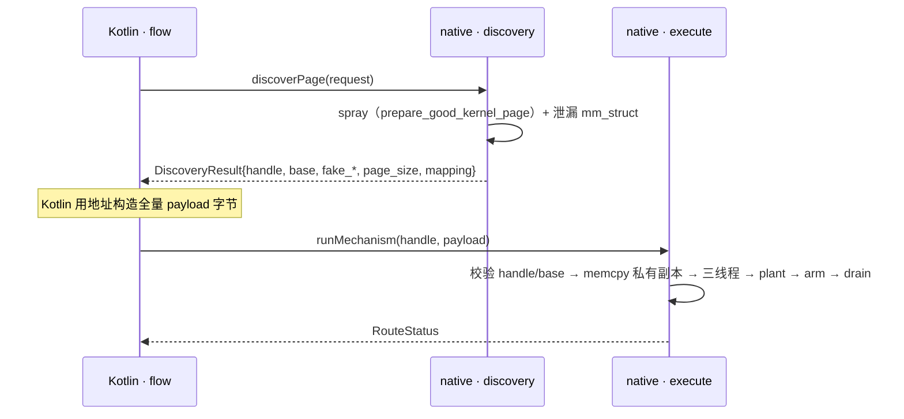

# 43499 路由边界：Discovery / Execute 两阶段（2026-10-25 · v3）

> **状态**：草案 v3。v2 的「模板 + 重定位表」按 design-critic D1 备选② + 用户 2026-10-25 指令
> 「地址获取和使用也要拆开，Kotlin 调用 discovery 获取地址，再传入执行」**改写为两阶段**。待复审 + 用户认可。
> **基线**：分支 `dev-nocpp`，HEAD `be0f2737`（`2.0.7`），2026-10-25T22:05Z。工作树内 `gl43499/**` 均未跟踪。
> **与在办计划的关系**：延伸 `jni-six-targets-params-plan.md` §3/§8；JNI **命名与 handle 归属**归
> `43499-approval-status.md` §4.1（三命名 mechanism entry + typed handle，2026-10-23 已批准），本件只定义**调用形状与数据面**。

## 一、现状与基线

用户 2026-10-25 两条指令逐字：

> 「所以三种 route 一定不能把 route 特有攻击逻辑拆到 kotlin 只留一个核心吗」
> 「还有，他说的地址获取和使用也要拆开，kotlin 调用 discovery 获取地址，再传入执行」

冻结标识（未跟踪文件，`HEAD` 复现不出）：

| 文件 | sha256（前 16） | 文件 | sha256（前 16） |
|---|---|---|---|
| `core/route_multicast.cpp` | `af87dcfbb2b45f3b` | `core/route_select.cpp` | `033ccda6849ba87e` |
| `core/route_multicast.h` | `ae30ff9e37348f49` | `core/memory.cpp` | `748e33813947ef79` |
| `core/route_tcp.cpp` | `49502985d62475ee` | `core/params.h` | `39dc5b730e661434` |

产物：`build/ghostlock-core-dev` 1,141,552 B / 2026-10-25 17:23:29 / sha256 `065bd752…77a8b2`。

事实表（区分测量对象）：

| 对象 | 事实 | 证据 |
|---|---|---|
| 路由**入口** `do_mcast_fake_lock_route` | 外部符号只剩 `printf` | `llvm-objdump -dr`，重构后产物 |
| 重构**前**单体 `do_kernel5_fake_lock_route` | {`socket`,`setsockopt`,`close`,`memset`} | 同工具，`build/ghostlock-core-dev-baseline-c`（`62b6b8ca…42845`） |
| 三条 route 直接调用交集 | 仅 `printf` | `-O0` 调用图 |
| plant 落点 | 执行该 syscall 的**线程内核栈** | `route_multicast.cpp:111`；`route_tcp.cpp:385`；`route_select.cpp:457/466` |
| select 的 arm 时机 | **plant 之前**（445 → 457/466） | `route_select.cpp:445,457,466` |
| 地址来源 | `fake_*` 由 spray 的 `payload_base` 派生；tcp `zc` 含 native `mmap` 地址；select 每次 attempt 重喷页后重建 | `support.cpp:601-603`、`route_tcp.cpp:374-380`、`route_select.cpp:426-437` |
| **KernelSnitch 归属** | 算法在 `glgeneral/kernelsnitch/`（DSO `ghostlock_general`，6 个 JNI 入口，`static` header-only）；43499 另有**第二份** `core/kernelsnitch.h`（1116 行，`context_*` + `KernelSnitchOwner`，依赖 `log.h/target.h`）。两份 **API 与实现都不同** | 670 行 vs 1116 行；函数名对照见 §十 决策 4 |
| copy↔walk 之间不得有 syscall | 本会话实测：插一条 `pr_info`（实为 `__android_log_print` → logd 写，`log.h:127-129`）后 `ro.boot.bootreason=kernel_panic` | **未归档**；同类见 `c-to-cpp-stability-gap.md:78`。补档列入 P-A 前置 |

## 二、目标与约束

**目标**：地址**获取**（discovery）与地址**使用**（execute）拆成两次 native 调用；Kotlin 拿到地址后自行构造
**全量载荷**（含地址）再传入执行；C 只保留 plant 与生命周期。

**结论（v3）**：

1. **两阶段**：
   - `discovery`：run spray → 返回地址集 + **页 handle**（`base / fake_lock / fake_w0 / fake_task / fake_parent /
     fake_right / fake_left / fake_fops / page_size`；tcp 另含 `mapping_base / mapping_length`）。
   - `execute`：Kotlin 传 **页 handle + 全量 payload 字节**；native 校验 handle/base 后 plant。
2. **重定位表只对 select 有意义**：mcast/tcp 地址一次成型；select 每 attempt 重喷页（`route_select.cpp:426-437`）
   ⇒ 本版**不外置 select**（§六 P-C）。
3. **不变量改写**（v2 的「一次写一次 JNI」作废）：
   - **一次 PI transaction = 一次 native call**（三线程 + plant + arm + drain 必须在同一调用内）；
   - discovery 与 execute 是**两个**调用，各自一次；
   - 两者之间页面**独占**：不得有别的写/重喷；execute 用 handle + `base` 双校验，不匹配即拒绝。
4. `plant → arm` 相邻性仍搬不走；arm 时机按机制（select 预置、mcast/tcp 后置），**不抽共享执行器**。
5. **KernelSnitch + 子进程 + 地址获取都归 Kotlin（用户 2026-10-25 裁定）**：victim/rootchild 子进程由 Kotlin
   新建 → Kotlin 触发 spray → 调 general leak → 把 `mm_struct` 地址传进 43499。43499 只做「按地址建载荷 →
   按组关 memfd 释放 → reclaim → PI 三线程 plant」，并删 `core/kernelsnitch.h`。数据面与窗口守卫见 §十 决策 4。

**非目标**：不改 profile schema；不动 `very_legacy/`；不新建 Kotlin route 模型；**不删** select 的 C 编码器；
JNI 函数名/handle 表示归 §4.1。

## 三、改动清单

| 文件 | 改动 | 理由 |
|---|---|---|
| `core/params.h` | 新增 `LandingInputs`：`mm_struct` 地址 + `SprayFdSet{pre,spray,post}` + `page_size/page_order` + 全量 payload + `version/magic` | Kotlin→C++ 的落页面契约 |
| `core/support.h/.cpp` | 新增 `land_with(mm_struct, fds, payload)`：建载荷 → 按组关 memfd → reclaim；**不再**创建子进程、不再跑 KernelSnitch | 子进程与 leak 归 Kotlin/general |
| `glgeneral/general_jni.c` | （门禁前置）补 4 个 `default` 可见性 C 导出，让 dev/CLI 能直接调 leak | 否则 P-A 只能走 app 路径验证 |
| `core/kernelsnitch.h` | **已删除**（1116 行）；`KernelSnitchOwner`/`context_*` 全部由 `ks_bridge` 取代 | 消除第二份实现 |
| `core/route_multicast.cpp` | `execute()` 收 `RoutePayload`：校验 handle/base → memcpy 到私有副本 → plant；不匹配 `step=64` | 地址使用外置 |
| `core/route_tcp.cpp` | 同上；`zc`/`sendbuf` 由 Kotlin 给全量字节；mapping 地址来自 discovery | 同上（前置：tcp 门禁） |
| `core/route_select.cpp` | **不动**（逐发重喷页使全量载荷不成立） | 见 §二 结论 2 |
| `core/memory.cpp` | 删除 `encode_multicast_waiter` / `build_multicast_waiter_payload`（`payload_write_layout` 保留给 spray） | 单一实现（Kotlin） |
| `core/payload_encode.h`（新，双实现期） | `encode_multicast_waiter` 抽成无平台依赖 header | `memory.cpp` 依赖 `linux/futex.h`，不可 host 编译（实测） |
| `core/tests/host/payload_vectors.cpp`（新） | 全量 264B 向量 + 负例 | `core/tests` 目前不存在 |
| `core/ks_bridge.c/.h`（新，临时） | C 桥（`-std=gnu11`）：`glk_ks_dev_*` 8 个 opaque 句柄函数，走 general 的 `kernelsnitch_*` | 该头不可被 C++ include（`typeof`）；泄漏仍在 `spray_begin` 内，故桥在 core 而非 dev |
| `app/.../backend/cve43499/flow/` | 扩展 `Flow43499Layouts`/`Flow43499Route`：调 discovery、构造全量载荷、调 execute | 复用既有 Kotlin 权威 |

**同批漏项**（评审 I7）：`jni43499.c` 0 B 仍被 `CMakeLists.txt:80` 编译；`route.h:95-105` 与 `:354-358` 重复声明。

## 四、数据流/控制流差异

不变量（逐机制）：

| 不变量 | multicast | tcp | select |
|---|---|---|---|
| I1 arm 时机 | plant **之后** | plant **之后** | plant **之前** |
| I2 plant→arm 零 syscall | 必须 | 必须 | 不适用 |
| I3 hold 语义 | 等 `calls>0` 或耗尽 | 固定 `post_hold` 自旋 | 无（阻塞 syscall） |
| I4 载荷含地址 | 是（discovery 后一次成型） | 是 | **否**（逐发重喷，保留 C） |
| I5 syscall 写回缓冲 | 否 | 是（`getsockopt` 写回 `zc`） | 是（`pselect` 写回 fd_set） |
| I6 页面跨调用存活 | discovery→execute 之间独占 | 同左 | 同左（但重喷发生在 execute 内） |

统一规则：**native 永远在自己的可变副本上 plant**；Kotlin 的 payload 只读（I5 需求）。
**两阶段窗口的守卫**：`execute` 校验 `payload.page_handle == session 当前页 handle` 且
`discovery.base == current.base`，任一不符 ⇒ `step=64 EBUSY` 拒绝发射，不 plant。

## 五、兼容性与回滚

- P-A 一个 commit，回滚 = 同 commit 双端（native + Kotlin）回退。
- 双实现期（C 编码器 + Kotlin 构造器）以 host 向量为金标准；技术债：删除 C 编码器的批次 = P-A 合入后立即，
  判据 = host 向量逐字节一致 + 冷机 W1 PASS。
- 两阶段先例：W2 已是 prebuild→activate 两次调用（§十 决策 3）。

## 六、验证矩阵

| 批次 | 命令 | 预期 |
|---|---|---|
| P-A-0 host 向量 | `c++ -std=c++23 -I core core/tests/host/payload_vectors.cpp -o /tmp/pv && /tmp/pv; echo $?` | `0`（18 条断言，含边界负例） |
| P-A-1 地址守卫 | 伪造 `mm_struct`（0 / 越界 / 超 `direct_map_end`） | `land_with` 返回 0：不落页、不 panic |
| P-A-2 真机 W1 | A301SO 冷机 · KSU 未加载 · CPU 0/1 | `status=0 clean=1/1`；`routed=1 enforce_after=0` |
| P-B tcp 全量载荷 | 前置：tcp 自有冷机门禁 | 未满足 ⇒ **不可批准** |
| P-C select | 不外置（逐发重喷页） | — |

`cmp_disasm` 不作本批门禁（基线作废，`jni-six §8.3`）。

## 七、明确保留

- `race.cpp` 三线程与 `RaceRunParams`/`ThreadArgs`；spray 全链（地址唯一来源）。
- `run_route_lifecycle` 与三条 route 的资源 owner 规则（含 `retain_for_process_lifetime`）。
- select 的 `dup2`/stdio 备份、逐发重喷页、C 侧编码器；tcp 的 punch 线程。
- 三条 `execute()` 各自的 arm/hold/drain。
- JNI 命名、handle 表示、registry（归 §4.1）。

## 八、进度

- [x] design-critic v0.2（阻断 7 / 重要 7 / 建议 3）逐条处置
- [x] 用户 2026-10-25：地址获取与使用拆开 → 两阶段；KernelSnitch / 子进程归 Kotlin（U1–U5）
- [ ] design-critic 复审（D1–D7 关闭 + v3/v3.1/v3.2 追加）
- [ ] 用户认可
- [x] **P-A-0 host 向量**：`core/tests/host/payload_vectors.cpp` 18/18 PASS（exit 0，设备无关）
- [x] **P-A-1 契约**：`support::SprayResult{mm_struct, started}` + `land_with` 地址复核；`SprayFdSet` 推迟到喷页搬走时（否则是死字段）
- [x] **P-A-2 拆分**：`prepare_kernel_page` → `spray_begin` + `land_with`；`prepare_good_kernel_page` 直接驱动两段
- [x] **P-A-2 门禁**：冷机 W1 ×2 PASS（`routed=1 enforce_after=0`），产物 `build/ghostlock-core-dev` `3022b30b…`
- [x] **JNI v0**：`jni43499.c`（8 入口）+ `core/api.{h,cpp}` + `Native43499Jni.kt`；契约 8/8；`.so` 链接通过
- [x] **真机对拍 4/4 PASS**：直连 / 静态探针 / `.so` oneshot / `.so` split —— 均 `routed=1 enforce_after=0`
- [x] **对拍抓到 2 个真缺陷**：① 页接受判据只在直连循环里 → 下沉 `land_with`；② `land_with` 未回写 `current->base` ⇒ 刷新判据跳过 ⇒ 用 0 下毒 panic（根因）
- [x] **重试归属**：`land`=0 表示页被拒收，整页重来由 Kotlin 驱动（探针已验证 1/6 重试成功）
- [ ] **前置**：Kotlin 侧 victim/rootchild + spray 编排（子进程与 memfd 的 owner）
- [x] **P-A-3**：KernelSnitch 换 general（`core/ks_bridge.c`）+ 删 `core/kernelsnitch.h`；二进制内 `KernelSnitchOwner`/`context_*` 符号 = 0
- [x] **P-A-3 门禁**：冷机 4 次 = **PASS / panic / PASS / PASS**（panic `bootreason=kernel_panic,bug`，同构建可复现 PASS，属 `KERNEL-PANIC-01` 已知型）；产物 `9c3033bb…`
- [ ] P-B tcp（阻塞：无门禁） / P-C select（不外置）

## 九、评审处置

| 编号 | 处置 |
|---|---|
| D1 | discovery 回传地址；重定位表仅 select 保留（本版不外置） |
| D2 | 放弃共享执行器；arm/hold/drain 留各 `execute()`；§四 逐机制表（select 单列 pre-arm） |
| D3 | `RoutePayload` **包裹**现有 `MulticastInputs`/`TcpInputs`；Kotlin 落 `backend/cve43499/flow/*` |
| D4 | 本件只定调用**形状**；JNI 命名/handle 归 §4.1；`jni43499.c`(0 B)/`CMakeLists.txt:80` 列漏项 |
| D5 | 仅 multicast 可批准；tcp 前置门禁；select 不外置 |
| D6 | 判据限定三个 route 适配器符号 |
| D7 | §十 CBN 四决策 |
| I1–I7 | 全部采纳（字节级契约、私有副本、host 门禁+负例、证据拆行+哈希、先向量后删编码器、attempt 属一次 transaction、去 cmp_disasm 门禁+双端回滚） |
| S1–S3 | 行号 `283-347`；术语固定；返回类型统一 |
| U1 | 两阶段；JNI 粒度 = 一次 PI transaction |
| U2 | 核实为**两份不同实现** + CMake 禁止 backend 带第二份 ⇒ 决策 4 |
| U3 | KernelSnitch 归 general + Kotlin 调配 + 地址传参（→ 决策 4） |
| U4 | 用户 2026-10-25 追加裁定：**victim/rootchild 子进程由 Kotlin 新建；Kotlin 先 spray → 再 leak → 再传址进 C++**。冲突由此消解（leak 在 spray 之后），决策 4 改为最终形状 + 数据面 + 两窗口守卫 |
| U5 | 允许 43499 侧直接用 `kernelsnitch/`（不做 C 导出）；已落为 C 桥 + 技术债 |

## 十、CBN

**决策 1/2（保留每机制 `execute()`；载荷构造搬 Kotlin）** —— 抽共享执行器只省 ≈23 行且不减注册点（新增
第 4 条 route 仍改 7 文件 10 处），故不抽；载荷移走 ≈74 行布局知识、C 新增 ≈20 行校验，真实收益是控制权。
翻转条件：「非机制前段 > 60 行」「布局变更 > 1 次/版本」。

**决策 3：两阶段 vs 单阶段** —— 按用户指令取两阶段。收益：Kotlin 持全量地址，C 不需要重定位表（≈55 行归零）。
成本：跨调用窗口（handle+base 双校验）+ 多一次 JNI。翻转条件：真机 base 不匹配，或 JNI 次数成为瓶颈。

**决策 4（用户裁定 U3+U4）：Kotlin 建子进程 → 建喷页 → general leak → 地址传参进 C++**

裁定链：KernelSnitch 单一实现归 `glgeneral`；victim/rootchild 子进程由 Kotlin 新建；Kotlin 先 spray，再调
general leak，再把 `mm_struct` 地址传进 43499；43499 删 `core/kernelsnitch.h`、不再创建 spray 子进程。

时序不变量：leak 必须命中「本次喷页分配出来的那个 mm_struct」⇒ 调用序固定为
**spawn/spray → leak → C++ 落页**，不得把 leak 提到 spray 之前。

数据面（Kotlin → 43499）：

| 字段 | 含义 | 守卫 |
|---|---|---|
| `mm_struct` | general 泄漏到的地址 | 非 0、落在 direct map、`base` 由 C++ 复算 |
| `SprayFdSet{pre,spray,post}` | 三组 memfd 与数量（关闭顺序决定释放哪一页） | 数量与 `mm_objs_per_slab` 一致；fd ≥ 0；关后置 -1 |
| `payload` 全量字节 | Kotlin 用地址构造 | `len` 覆盖布局；`family_offset + 2 ≤ len` |
| `page_size/page_order` | 落页粒度 | 与 C++ 复算的 `base` 不符即拒绝 |

窗口与守卫：
- **Kotlin 侧**（spray→leak→C++）：子进程/memfd 必须存活，独占由 Kotlin 保证（C++ 只能校验形状）。
- **C++ 侧**（关 memfd→reclaim）：必须同一次 native 调用内完成，不得跨 JNI。

门禁（用户裁定 U5）：**允许临时让 43499 侧直接使用 `kernelsnitch/`**，不做 general C 导出。
**实测限制**：该头不可被 C++ TU 直接 include（`utils.h:144` 的 `SYSCHK` 展开出 GNU `typeof`，clang++ 报
`use of undeclared identifier 'typeof'`）⇒ 用 C 桥 `core/ks_bridge.c`（`-std=gnu11 -D__ARM -I glgeneral`）暴露
`glk_ks_dev_*`。泄漏仍在 `spray_begin` 内（顺序不可拆），故桥在 core；生产接线后由 Kotlin 调 general JNI。
**技术债**：同一算法在 dev 临时二进制里被编第二份；偿还 = general 导出 C API 后删 `dev/ks_shim.c`。

回退：真机出现地址与落页不符 ⇒ 退回单阶段。
