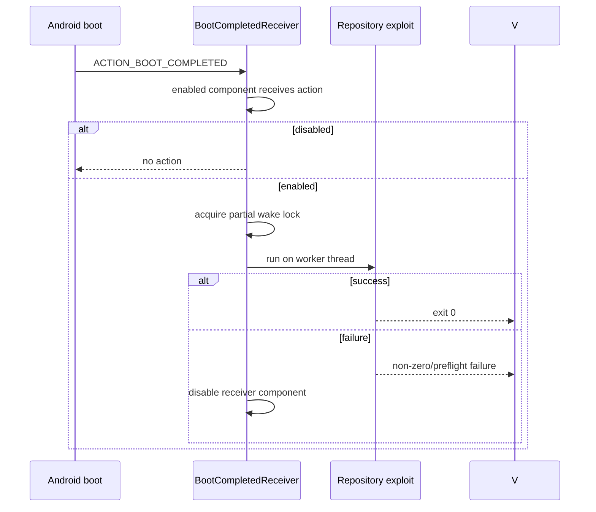

# Autoroot boot interlock plan (2026-10-25)

## Current state and baseline

Branch `main`, baseline commit `fe04721da98d0fea213c83b3203e1b4742b78cc5`.
`BootCompletedReceiver` opens `MainActivity`; `GhostlockViewModel.initialize()` then
starts the exploit whenever the autoroot preference is enabled. A failed boot run
does not clear the preference, so repeated boot attempts can recur. Manual app launch
also starts the exploit, which differs from DirtyFrag's boot-triggered autorun model.
The cloned reference enables/disables its receiver component, handles both direct-boot
actions, acquires a partial wake lock, runs on a worker thread, and disables the
receiver after a non-zero result.

## Goals and constraints

- Start one autoroot attempt directly from the enabled boot receiver.
- Disable the receiver component after any preflight or exploit failure, preventing a
  retry loop.
- Preserve manual Run behavior, profile selection, route selection, Shizuku handling,
  and the native attack implementation.
- Do not change GLK1, native code, routes, profile data, or KernelSU handoff behavior.

## Change list

- `BootCompletedReceiver.kt` → mirror the direct-boot actions, worker thread, wake
  lock, direct repository run, and receiver-disable failure interlock.
- `GhostlockApplication.kt` → allow a device-protected repository context.
- `AndroidGhostlockRepository.kt` → make receiver component state authoritative, with
  one-time legacy preference migration.
- `AndroidManifest.xml` → disabled-by-default direct-boot receiver and `WAKE_LOCK`.
- `MainActivity.kt` and `GhostlockViewModel.kt` → remove the activity-mediated autorun.
- `BootCompletedReceiverTest.kt` → verify accepted and unrelated boot actions.
- `docs/analysis/autoroot-dirtyfrag-plan_ZH.md` → synchronized plan.

## Data-flow/control-flow differences

Ordinary activity launch only initializes the ViewModel. Manual Run still calls the
same `runExploit()` path. A boot failure disables the receiver before the next boot.

## Compatibility and rollback

The receiver component state is authoritative; the old preference is migrated once.
Rollback is `git revert` of this batch; native and profile artifacts remain unchanged.

## Verification matrix

| Check | Command | Expected result |
|---|---|---|
| Kotlin unit tests | `./gradlew :app:testDebugUnitTest` | PASS |
| Android debug build | `./gradlew :app:assembleDebug` | PASS |
| Native host regression | `make -C src native-host-tests` | PASS |
| Native lint regression | `make -C src lint-tidy` | 0 findings |
| Scope | `git diff --check` | no output |

Device boot behavior requires a real device gate; this batch does not alter the
attack path or native binary, so `cmp_disasm` is not in scope.

## Explicit preservation

- `src/core/**`, `tools/**`, profiles, GLK1, routes, and KernelSU handoff are unchanged.
- `RunExploitUseCase` and the existing manual execution path are unchanged.
- Shizuku, dialogs, profile validation, logs, and activity UI structure are unchanged.

## Progress

- [x] Clone and inspect the DirtyFrag reference implementation.
- [x] Record baseline and approved design.
- [x] Implement.
- [x] Run available verification checks; Android/NDK checks are blocked by the local Gradle SystemInfo and missing NDK environment.
- [x] Record final results; host Android execution remains unverified because the
  local Gradle environment lacks the SystemInfo service and NDK_ROOT.
