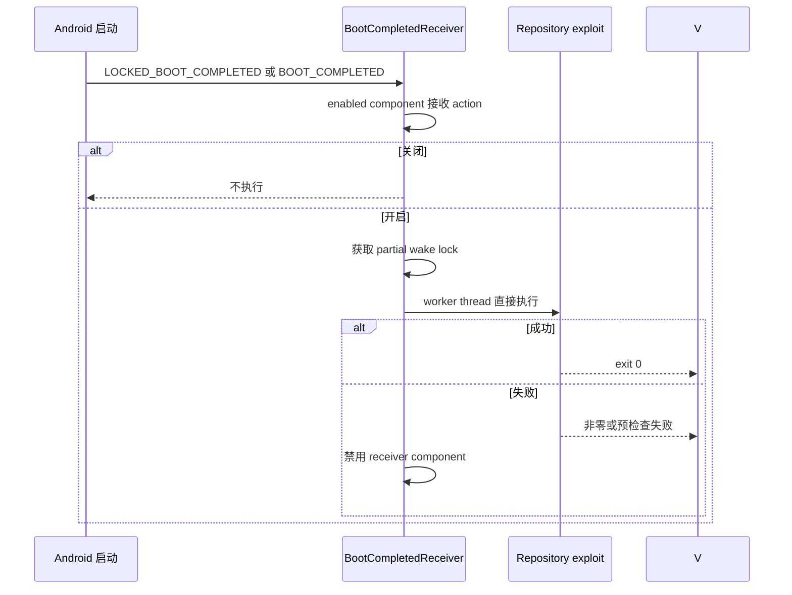

# Autoroot 启动互锁计划（2026-10-25）

English | [English](autoroot-dirtyfrag-plan.md)

## 当前状态与基线

分支为 `main`，基线提交为 `fe04721da98d0fea213c83b3203e1b4742b78cc5`。
`BootCompletedReceiver` 只打开 `MainActivity`，随后
`GhostlockViewModel.initialize()` 在 autoroot 开关打开时启动 exploit。启动失败
不会清除开关，因此可能重复尝试。普通打开应用也会启动 exploit，与 DirtyFrag 的
启动触发 autorun 行为不同。
已克隆的参考实现通过启用/禁用 receiver component，处理 direct-boot 的两个 action，
获取 partial wake lock，在 worker thread 中运行，并在非零结果后禁用 receiver。

## 目标与约束

- 由已启用的 boot receiver 直接执行一次 autoroot。
- 预检查或 exploit 失败后禁用 receiver，避免重试循环。
- 保留手动 Run、profile、route、Shizuku 与 native attack 行为。
- 不修改 GLK1、native、route、profile 或 KernelSU handoff。

## 改动清单

- `BootCompletedReceiver.kt`：实现 direct-boot action、worker thread、wake lock、
  直接执行 repository 与失败禁用互锁。
- `GhostlockApplication.kt`：支持 device-protected repository context。
- `AndroidGhostlockRepository.kt`：以 receiver component 状态为权威并迁移旧开关。
- `AndroidManifest.xml`：默认关闭的 direct-boot receiver 与 `WAKE_LOCK`。
- `MainActivity.kt`、`GhostlockViewModel.kt`：移除 activity 中介式 autorun。
- `BootCompletedReceiverTest.kt`：验证 boot action。
- 本计划的英文版与中文同步版。

## 数据流与控制流差异

普通打开应用只初始化 ViewModel。手动 Run 仍使用原路径。启动失败会在下一次
启动前禁用 receiver。

## 兼容性与回滚

receiver component 状态为权威；旧 preference 只迁移一次。回滚本批次即可恢复
基线行为；native 与 profile 产物不变。

## 验证矩阵

| 检查 | 命令 | 预期 |
|---|---|---|
| Kotlin 单元测试 | `./gradlew :app:testDebugUnitTest` | PASS |
| Android debug 构建 | `./gradlew :app:assembleDebug` | PASS |
| Native host 回归 | `make -C src native-host-tests` | PASS |
| Native lint 回归 | `make -C src lint-tidy` | 0 findings |
| 范围检查 | `git diff --check` | 无输出 |

本批次不修改 attack path 或 native binary，因此不执行 `cmp_disasm`。

## 明确保留

`src/core/**`、`tools/**`、profiles、GLK1、routes、KernelSU handoff、
`RunExploitUseCase`、手动执行、Shizuku、dialogs、profile 校验和日志均保持不变。

## 进度

- [x] 克隆并检查 DirtyFrag 参考实现。
- [x] 实现。
- [x] 记录最终结果；本地 Gradle 缺少 SystemInfo service，NDK_ROOT 未设置，因此
  Android host 执行仍未验证。

- [x] 探索现有实现与 DirtyFrag 行为。
- [x] 记录基线并获得设计批准。
- [x] 实现。
- [x] 执行可用验证；Android/NDK 检查因本地 Gradle SystemInfo 与 NDK 环境缺失未执行。
- [ ] 记录最终结果。
