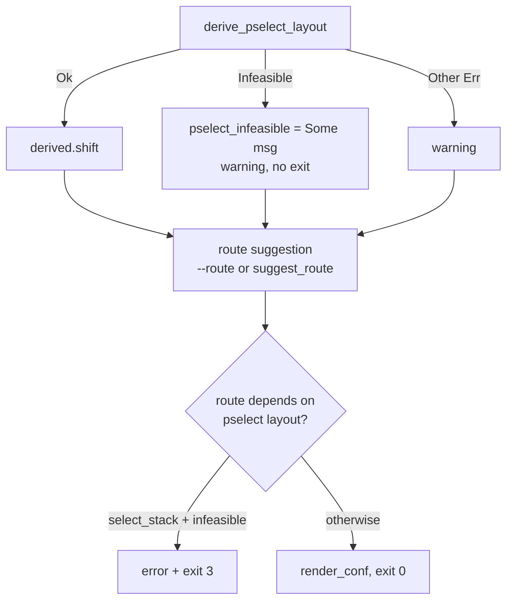

[中文](extract-pselect-fallback-plan_ZH.md) | English

# Extractor route fallback and TCP probe fix (2026-10-01)

## Status and baseline

- Historical pre-change baseline: `9c581b26`. Implementation: `81b25c01`.
- Branch `very-not-stable-dev`. Scope: the `--format conf` path in `tools/extract_rs`.
- Before implementation, when `derive_pselect_layout` returned `ExtractError::Infeasible`,
  `main` immediately executed `return Ok(3)`, before route suggestion.
- As a result, the 6.1 `tcp_zerocopy` fallback in `analysis.rs`'s `suggest_route` never ran.
  An explicit `--route tcp_zerocopy` was also blocked. The `--analysis` path recorded
  the same result as `PselectOutcome::Infeasible` without treating it as fatal.
- The affected device ran `6.1.157-android14-11-o-g6d1e9edf2721`, on a OnePlus Nord CE 6 Lite, MTK.
  The CVE-2026-43499 primitive was present, with `remove_waiter@0x10009c4` unpatched, but
  the futex waiter was 13 qwords above the fd_set buffer (`shift=13 > 3`). The extractor exited with code 3.
- The developer had verified all three paths, Multicast, TCP, and Select, on real devices (2026-10-01).

## Problem

An infeasible pselect/futex stack layout was treated as making the entire kernel unusable.
It rules out only `select_stack` and should not block tcp_zerocopy or an explicit route.

## Goals and constraints

Goal: reject only when the final selected route depends on the pselect layout.

Non-goals:

- Change native exploit code, the GLK1/profile binary format, wire, or the app.
- Add tcp layouts for new families. The tcp branch in `conf_route_geometry` still
  recognizes only `STRUCT_OFFSETS_6_1`.
- Extend the controllable pselect window for `shift=13`.

## Changes implemented

| File | Change |
|---|---|
| `tools/extract_rs/src/analysis.rs` | Add `route_depends_on_pselect_layout(route)`, which returns `true` for `select_stack`, and unit tests |
| `tools/extract_rs/src/main.rs` | Downgrade pselect `Infeasible` from fatal to `warning` and store the message in `pselect_infeasible` |
| `tools/extract_rs/src/main.rs` | Disable the family fallback for `pselect_shift` when `pselect_infeasible` is set |
| `tools/extract_rs/src/main.rs` | After route selection, apply the final check: report an error and `return Ok(3)` when `route_depends_on_pselect_layout(route) && pselect_infeasible` |
| `tools/extract_rs/src/derive.rs` | Add `tcp_zerocopy_receive_inlined()` to confirm a direct `bl tcp_zerocopy_vm_insert_batch` in `do_tcp_getsockopt`/`do_tcp_setsockopt` |
| `tools/extract_rs/src/analysis.rs` | Pass `kernel`/`rel_symbols`/`sorted_offsets` to `probe_paths`. Detect tcp by a symbol match or confirmed inlining |

No changes to `report.rs`, whose geometry rules were already correct, native, or Kotlin.

### TCP probe missed an inlined function (2026-10-01)

For `boot-2.img` (`6.1.157-android14-11-o-gc2dad16af736`), `--analysis` reported
`path tcp_zerocopy missing`. kallsyms recovery was complete, with 107662 symbols.
`tcp_recvmsg_locked`, `tcp_zerocopy_vm_insert_batch`, and
`tcp_zerocopy_vm_insert_batch_error` were present. Only `tcp_zerocopy_receive` was missing.

Disassembly of `do_tcp_getsockopt`, with 1019 instructions, showed a direct
`bl tcp_zerocopy_vm_insert_batch`. Only `tcp_zerocopy_receive` calls this helper.
The optname comparison uses a `w` register, so detection uses the direct call rather than
`cmp xN, #0x15`. Native `tcp_zerocopy_route.cpp` calls
`getsockopt(..., TCP_ZEROCOPY_RECEIVE, ...)`.

Conclusion: `tcp_zerocopy_receive` was inlined. Its symbol disappeared, but the functionality
remained. Detection by symbol name alone produces a false negative.

## Control flow

Invariants:

- Exit code 3 still means that the selected route is infeasible on this kernel.
- The full set of profile fields and the route list are unchanged.
- `--no-disasm` behavior is unchanged. It performs no derivation, so there is no `Infeasible` result.
- 6.6/6.12 have no tcp fallback. When pselect is infeasible, `suggest_route` still selects
  `select_stack`. The final check exits with code 3, preserving the previous behavior.

## Compatibility and rollback

The app handles only the exit code and needs no changes. To roll back, revert the new function
in `analysis.rs` and the three changes in `main.rs`. There is no persistent state or format migration.

## Verification evidence

- [x] Unit tests: `cargo test --release`, 38 passed. `cargo fmt --check` was clean.
- [x] Regression: `--format conf` on `6.6.127-android15-8` → `select_stack` /
  `waiter_shift=-2` / exit 0.
- [x] Offline extraction (`boot-2.img` = `6.1.157-android14-11-o-gc2dad16af736`):
  `--format conf` → `tcp_zerocopy` / `compact_waiter = 1` / exit 0, with pselect downgraded
  to a warning. This image lacks the `tcp_zerocopy_receive` symbol. The device's original build,
  `g6d1e9edf2721`, differs from the downloaded image. Reverification with a `boot.img` exported
  from the device is required.
- [x] TCP probe fix: `boot-2.img --analysis` → `path tcp_zerocopy available`.

## Remaining work

- [ ] Device gate: a cold device, a fixed CPU pair, only route `tcp_zerocopy`, and KernelSU
  not loaded. Confirm `route_done status=0`, `child is root!`, and handoff. Archive logs in the
  `docs/analysis/device-gates/` format. That directory has been deleted from the working tree.
  For its history, see `git show 064cd1e5^:docs/analysis/device-gates/`. Do not mark this route
  `supported` before it passes the gate.
