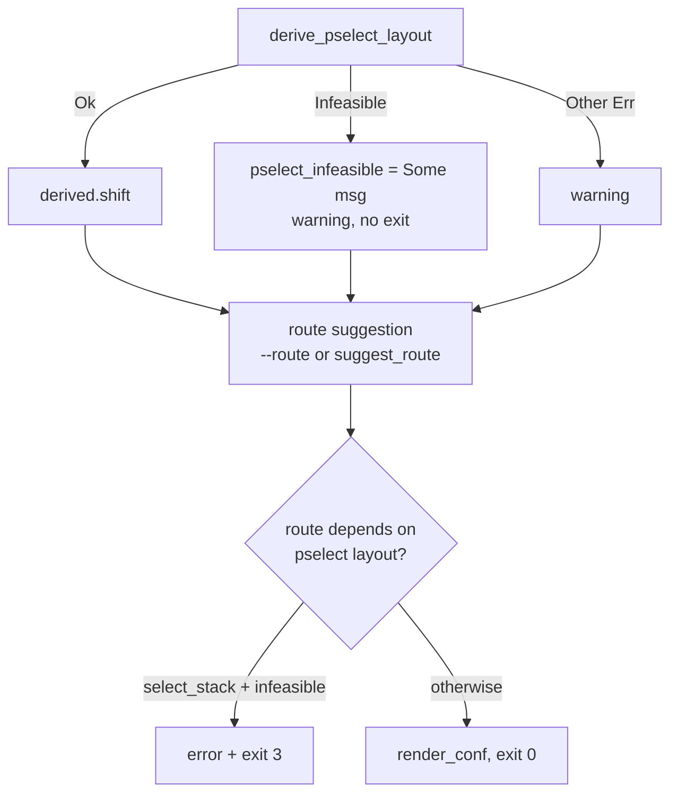

[English](extract-pselect-fallback-plan.md) | 中文

# 提取器 route 回退与 TCP probe 修复（2026-10-01）

## 状态与基线

- 历史改动前基线：`9c581b26`。实现提交：`81b25c01`。
- 分支 `very-not-stable-dev`；对象是 `tools/extract_rs` 的 `--format conf` 路径。
- 实施前：`derive_pselect_layout` 返回 `ExtractError::Infeasible` 时，`main` 直接
  `return Ok(3)`，发生在 route 建议之前。
- 后果：6.1 的 `tcp_zerocopy` 回退（`analysis.rs` 的 `suggest_route`）不会执行；
  显式传 `--route tcp_zerocopy` 也被拦截；`--analysis` 路径则把同一结果记为
  `PselectOutcome::Infeasible`，不致命。
- 触发设备 `6.1.157-android14-11-o-g6d1e9edf2721`（OnePlus Nord CE 6 Lite，MTK）。
  CVE-2026-43499 原语存在（`remove_waiter@0x10009c4` 未修复），但 futex waiter
  位于 fd_set 缓冲区上方 13 个 qword（`shift=13 > 3`），extract exit 3。
- Multicast、TCP、Select 三条路径均已由开发者真机验证（2026-10-01）。

## 问题

pselect/futex 栈布局不可行被当成整颗内核不可用。它只否定 `select_stack`，
不应阻止 tcp_zerocopy 或显式 route。

## 目标与约束

目标：只有最终选中的 route 依赖 pselect 布局时才拒绝。

非目标：

- 不改 native 攻击代码、GLK1/profile 二进制格式、wire、app。
- 不为新的 family 增补 tcp 布局（`conf_route_geometry` 的 tcp 分支仍只认
  `STRUCT_OFFSETS_6_1`）。
- 不为 `shift=13` 扩展 pselect 可控窗口。

## 改动（已实施）

| 文件 | 改动 |
|---|---|
| `tools/extract_rs/src/analysis.rs` | 新增 `route_depends_on_pselect_layout(route)`，`select_stack` 返回 `true`；加单测 |
| `tools/extract_rs/src/main.rs` | pselect `Infeasible` 由 fatal 降为 `warning`，消息存入 `pselect_infeasible` |
| `tools/extract_rs/src/main.rs` | `pselect_infeasible` 时禁用 `pselect_shift` 的 family fallback |
| `tools/extract_rs/src/main.rs` | route 决策后终判：`route_depends_on_pselect_layout(route) && pselect_infeasible` 时输出 error 并 `return Ok(3)` |
| `tools/extract_rs/src/derive.rs` | 新增 `tcp_zerocopy_receive_inlined()`：在 `do_tcp_getsockopt`/`do_tcp_setsockopt` 中确认直接 `bl tcp_zerocopy_vm_insert_batch` |
| `tools/extract_rs/src/analysis.rs` | `probe_paths` 接收 `kernel`/`rel_symbols`/`sorted_offsets`；tcp 判据改为符号命中或内联确认 |

不改 `report.rs`（geometry 规则已正确）、native、Kotlin。

### TCP probe 内联漏判（2026-10-01）

`boot-2.img`（`6.1.157-android14-11-o-gc2dad16af736`）的 `--analysis` 报
`path tcp_zerocopy missing`。kallsyms 恢复完整（107662 符号），
`tcp_recvmsg_locked`、`tcp_zerocopy_vm_insert_batch`、
`tcp_zerocopy_vm_insert_batch_error` 都在，唯独 `tcp_zerocopy_receive` 缺失。

反汇编 `do_tcp_getsockopt`（1019 条指令）显示直接 `bl tcp_zerocopy_vm_insert_batch`，
该 helper 只被 `tcp_zerocopy_receive` 调用。optname 比较用 `w` 寄存器，所以判据取
直接调用，不依赖 `cmp xN, #0x15`。native 的 `tcp_zerocopy_route.cpp` 调用的正是
`getsockopt(..., TCP_ZEROCOPY_RECEIVE, ...)`。

结论：`tcp_zerocopy_receive` 被内联，符号消失但功能保留；只按符号名判断会产生
false negative。

## 控制流

不变量：

- exit code 3 仍表示所选 route 在该内核不可行。
- profile 字段全集与 route 列表不变。
- `--no-disasm` 行为不变（不推导，因此没有 `Infeasible`）。
- 6.6/6.12 无 tcp 回退，pselect 不可行时 `suggest_route` 仍落 `select_stack`，
  终判触达并 exit 3，与旧行为一致。

## 兼容性与回滚

app 只按 exit code 处理，无需改动。回滚时还原 `analysis.rs` 新增函数与 `main.rs`
三处改动即可，无持久化状态、无格式迁移。

## 验证证据

- [x] 单测：`cargo test --release` 38 passed；`cargo fmt --check` 干净。
- [x] 回归：`6.6.127-android15-8` 的 `--format conf` → `select_stack` /
  `waiter_shift=-2` / exit 0。
- [x] 离线提取（`boot-2.img` = `6.1.157-android14-11-o-gc2dad16af736`）：
  `--format conf` → `tcp_zerocopy` / `compact_waiter = 1` / exit 0，pselect 降为
  warning。该镜像缺少 `tcp_zerocopy_receive` 符号；设备原版 build 为
  `g6d1e9edf2721`，与下载镜像不同，需用设备导出的 `boot.img` 复验。
- [x] TCP probe 修复：`boot-2.img --analysis` → `path tcp_zerocopy available`。

## 剩余工作

- [ ] 真机门禁：冷机、固定 CPU 对、单 route `tcp_zerocopy`、KernelSU 未加载，
  确认 `route_done status=0`、`child is root!`、handoff。日志按
  `docs/analysis/device-gates/` 格式归档（该目录在当前工作树已删除，历史见
  `git show 064cd1e5^:docs/analysis/device-gates/`）。未过门禁前该 route 不得标
  `supported`。
