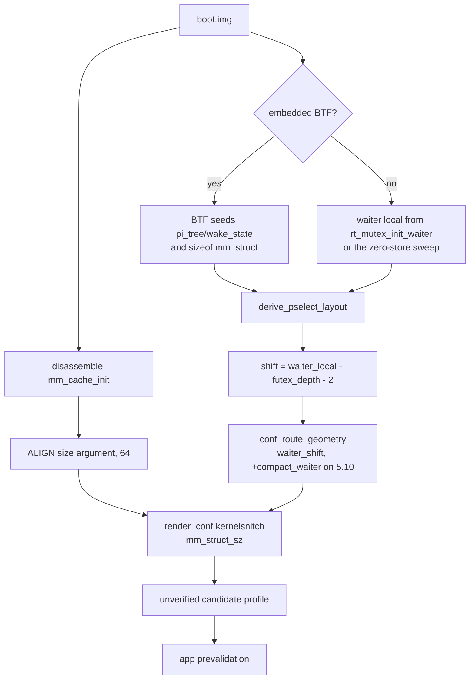

[中文](extractor-5.10-support-plan_ZH.md) | English

# Extractor support for android12-5.10: plan (2026-10-30)

> Level: L, covering the extractor's derivation path and the profile field contract
> (`route.select_stack.compact_waiter`). Status: implemented; the native flat-waiter path is
> fixed, the Poco F5 profile is included, and its device run is still pending.
> Review revision (2026-11-08): the waiter layout is profile-authored, not inferred from the
> release. The Sony 5.10 profile keeps its device-verified values, the 5.10 flat-waiter
> defaults were removed from the extractor, an unmeasured 5.10 falls back to the Sony-verified
> 1280 while a measured stride wins, the legacy JSON converter stays 6.x, and the native
> prebuilt-profile offset check was removed.
> Extends [Extractor structure derivation without BTF](extractor-no-btf-struct-derivation-plan.md),
> which owns the general no-BTF derivation design. This document covers only what
> android12-5.10 adds to it.

## Status and baseline

- Baseline commit `437b3b25`.
- `kernel_struct_macro` (`tools/extract_rs/src/symbols.rs`) knows only 6.1, 6.6 and 6.12,
  so `pselect_waiter_shift_for` (`tools/extract_rs/src/report.rs`) returns `None` for every
  5.10 release and `render_conf` emits `mm_struct_sz = 1024` for every 5.x release, which is
  the 5.15 stride.
- `derive_pselect_layout` and `derive_nf_logger_registration` take `btf: &Btf` and hard-fail
  when the image has no embedded BTF. Vendor 5.10 images often ship without one.
- No `mm_cache_init` reference exists anywhere in the extractor, so nothing measures the
  `mm_struct` SLUB stride. Native falls back to `MM_STRUCT_SZ` in
  `src/core/kernel/constants.hpp`, which is `0x500`.
- `route.select_stack` in `CONF_ROUTE_FIELDS` carries only `waiter_shift`. Native
  `kRouteSelect` already reads `compact_waiter` (`src/core/profile/binary.cpp`), and a flat
  5.10 `rt_mutex_waiter` needs the compact word table, so a 5.10 profile has no way to state
  that through the select branch.
- Baseline evidence on `5.10.226-android12-9-00047-g4968e29b7f92-ab12786767` (a BTF-less
  image): `pselect_waiter_shift = null`, `mm_struct_sz = 1024`, every `task_struct` field
  `null`, no `cred` block, and a `multicast_waiter` branch whose geometry fails the project's
  own fit rule (`waiter_off + lock_offset + 8 <= buffer_size`).

## Goals and constraints

Goal: on a BTF-less 5.10 image the extractor derives the pselect shift and the `mm_struct`
SLUB stride from the image instead of emitting `null` and a wrong 1024, the select branch
states the flat waiter, and native stamps prio at that waiter's 0x40 word so the profile can
run.

Non-goals:

- Change the GLK1/wire format or add a version. `compact_waiter` already exists in the v2
  `route` section and in `kernel`; only the select branch gains the key.
- Port `--register`, `--format c`, `--name`, `--force`, `src/kernels/` output, or
  `derive_sigreturn_layout`. Those belong to a downstream format, not upstream.
- Add a `--btf <blob>` flag. Upstream has no such flag and no other way to hand the
  extractor a reference vmlinux, so on this tree the no-BTF path is the only path. The BTF
  branch of `derive_pselect_layout` and the BTF gate on `derive_nf_logger_registration` stay
  as they are, but only an image with embedded BTF reaches them.
- Derive the `task_struct` or `cred` layout of 5.15 and 6.x without BTF. The 5.10 family
  uses the carried android12-5.10 layout; the other families remain unstarted.

## BTF-less images: 5.10 is complete, other families stay geometry only

A BTF-less android12-5.10 image gets the carried 5.10 `task_struct`/`cred` layout from
`STRUCT_DEFAULTS_5_10`, and the credential template from the image's `init_cred` through
`derive_cred_5x_without_btf`. The generated conf carries every required field and runs
without a built-in profile. The cred size is the `init_groups - init_cred` gap (168 on the
Poco image), the caps run comes from `init_cred + 40..72`, and the refs come from
`+0x80/+0x88/+0x90`. The v1 JSON report carries the same `cred` object, and the legacy
converter drops the BTF-only `struct_fields` group, so the JSON import path is complete as
well.

A BTF-less 5.15 or 6.x image still yields route geometry plus symbol offsets only. Those
families do not have a carried layout in the extractor, so the built-in profile or a
same-KMI source supplies the rest.

## Limitation: upstream cannot express a short pselect window

Upstream has no `pselect_waiter_off` or sigreturn route (`git grep pselect_waiter_off --
src/core` returns nothing). So when the pselect window on a
given 5.10 image stops short of the waiter, there is no way to say so in a profile and no
fallback transport to name. `conf_route_geometry` returns an empty geometry when the
derivation is infeasible, `main.rs` exits 3 for `select_stack`, and the app rejects the
result, so this fails safe. The cost is that such a kernel gets no route at all from the
extractor.

## Change list

| File | Change | Reason |
|---|---|---|
| `tools/extract_rs/src/symbols.rs` | `kernel_struct_macro` maps `(5,10)` and `(5,15)`; `kernel_layout_verified` accepts `-android12-` for 5.10 | Family selection needs the 5.10 arm |
| `tools/extract_rs/src/symbols.rs` | `off_slide_loggers_0_1` fallback is `loggers + 8` | `nf_log_register` indexes `loggers[pf][type]`; `NFPROTO_UNSPEC` is 0 and `NF_LOG_TYPE_ULOG` is 1, so the slot is the second pointer of the row. The old `+0x10` was one word high |
| `tools/extract_rs/src/derive.rs` | `derive_mm_stride` / `mm_cache_size_arg` / `shift_of`: disassemble `mm_cache_init`, take the size argument it passes to `kmem_cache_create_usercopy`, return `ALIGN(size, 64)` | The SLUB stride is `ALIGN(sizeof + cpumask_size(), 64)`, not the BTF `sizeof`. Only the image knows the argument |
| `tools/extract_rs/src/derive.rs` | `derive_pselect_layout` takes `btf: Option<&Btf>`; when `pi_tree`/`wake_state` are missing, including a partial BTF, it seeds the waiter local from the `add x0, sp, #imm` before `bl rt_mutex_init_waiter`, then falls back to the zero-store sweep | The waiter local is the only thing BTF supplied for the frame arithmetic, and a flat 5.10 waiter can expose only one of the two fields |
| `tools/extract_rs/src/analysis.rs` | Call `derive_pselect_layout` with `input.btf` instead of gating on `Some(btf)` | Same reason; `--analysis` must report the derived layout on a BTF-less image |
| `tools/extract_rs/src/symbols.rs` | `STRUCT_DEFAULTS_5_10` and `fill_struct_defaults` fill the verified 5.10 task/cred layout when the image has no BTF | Every registered 5.10 build uses the same family layout, so a BTF-less image can emit a complete profile |
| `tools/extract_rs/src/derive.rs` | `derive_cred_5x_without_btf` reads `init_cred` with the 5.10 cred layout and the `init_groups - init_cred` size | The credential template no longer needs BTF |
| `tools/extract_rs/src/main.rs` | A BTF-less verified 5.10 image fills the family structs and the no-BTF cred before the conf is rendered | The generated conf runs without a built-in profile |
| `tools/extract_rs/src/derive.rs` | Seed the waiter local from `rt_mutex_init_waiter` whenever `pi_tree`/`wake_state` are missing, including a partial BTF | The call evidence is valid even when a BTF object exists |
| `tools/extract_rs/src/report.rs` | `pselect_waiter_shift_for` returns `-2` for `STRUCT_OFFSETS_5_10` / `_5_15` | Both frames put the waiter two words below the `fd_set` base |
| `tools/extract_rs/src/report.rs` | `mm_default` maps 5.10 to `0x3c0`, 5.15/6.1 to `0x400` and 6.6/6.12 to `0x500`; `build_report` takes `mm_stride` and emits the measured value or the family default, with the 5.10 arm gated on `kernel_layout_verified` | The JSON report carried no stride for 5.x and a hardcoded 1024 in conf. Every shipped 5.10 profile and every measured 5.10 image uses 0x3c0, but it is a family assumption |
| `tools/extract_rs/src/report.rs` | `CONF_ROUTE_FIELDS["select_stack"]` gains `compact_waiter`; `conf_route_geometry` writes `compact_waiter = 1` for the flat-waiter family only | A flat 5.10 waiter needs the compact word table; 5.15 and 6.x keep their geometry |
| `tools/extract_rs/src/report.rs` | `multicast_geometry_fits` drops geometry that cannot fit the option buffer, with a warning | The 5.x multicast branch was emitting a stamp the kernel cannot copy |
| `tools/extract_rs/src/report.rs` | `render_conf` splits the KernelSnitch block by family: 5.10 `collisions = 4` + measured stride, 5.15 `collisions = 8` + stride, other 5.x keeps the shipped 8/1024 | 1024 is the 5.15 stride and is wrong for 5.10 |
| `tools/extract_rs/src/main.rs` | pselect and mm-stride derivation run unconditionally; `mm_stride` threads into `build_report` and `ConfInputs` | Same |
| `tools/extract_rs/src/iomem.rs` | The implicit search reads `/proc/iomem` only on Android; host builds use only the cached device dumps | On a desktop `/proc/iomem` describes the build machine, and its `dram_base = 0` was emitted as `kernel_phys_offset` |
| `profile-core/.../ProfileMerger.kt` | Copy the shared tuning and route preset maps before merging | The exporter reuses one map across profiles, so one profile's execution overrides leaked into later exports |
| `app/src/test/resources/remote-main-6x-offsets.json`, `ProfileMigrationEquivalenceTest.kt` | Add the four built-in 6.x profiles the fixture was missing | The fixture must cover every current 6.x built-in |
| `app/.../LegacyProfileConverter.kt` | A 5.10 legacy report gains `compact_waiter = 1` on its inferred select branch and `kernel_major = 5`; 5.15 stays split | The v1 report cannot carry `compact_waiter` because the key means the 6.1 tcp arm, and the import must satisfy the 5.10 validation |
| `tools/extract_rs/src/report.rs`, `main.rs` | The v1 JSON report carries a top-level `cred` object for 5.10 | The in-app conf already had the template; the JSON import path did not |
| `app/.../LegacyProfileConverter.kt` | Drop the BTF-only `struct_fields` group after moving the schema keys | A leftover group fails the top-level key check |
| `app/src/main/kotlin/com/ghostlock/app/data/AndroidProfileConfigController.kt` | `select_stack` validates `compact_waiter` and requires it as 1 for 5.10; `RouteBranchFields["select_stack"]` lists it | The editor seeds the branch from that list and a flat waiter needs the compact table |
| `app/src/main/assets/kernel_profiles/5.15-template.conf`, `docs/kernel_profiles/templates/kernel-5.x.template.conf` | `select_stack` gains `compact_waiter = null`; the 5.x template also exposes `waiter_prio_off = null` | Templates list every field of each branch, and a copied 5.10 template must state the flat prio offset |
| `docs/kernel_profiles/PROFILE_SCHEMA.md` / `_ZH.md` | Row for `route.select_stack.compact_waiter` and `waiter_prio_off` | Field contract documentation |
| `tools/extract_rs/src/report.rs` | `waiter_prio_default` emits `waiter_prio_off = 64` in the JSON report and the conf header only for a verified 5.10 release | The 5.10 flat waiter has no `wake_state`, so prio takes the 0x40 word. Every split family omits the key and native keeps 0x44 |
| `src/core/profile/model.h` | `KernelMisc::waiter_prio_off` and `TargetProfile::waiter_prio_offset(fallback)` | The offset is per-family, so it has to reach native through the profile |
| `src/core/profile/binary.cpp` | `kKernel` gains `waiter_prio_off` | Wire field for the same value |
| `src/core/kernel/target.h` | `FAKE_WAITER_PRIO_OFF_SPLIT = 0x44` | The compiled default for a profile that omits the field |
| `src/core/support/util.cpp` | Compact spray writes `wake_state` at 0x40 only for the split waiter, and prio at the profile's offset | On a flat waiter the old stamp left prio at 0 and failed the `prio > 120` gate |
| `src/core/route/select_stack_route.cpp`, `select_stack_route.h` | Waiter word 10 is `compact_prio_word(split, prio)`: packed for the split waiter, bare prio for the flat one | Same gate, second write site |
| `profile-core/.../NativeProfile.kt`, `ProfileResolver.kt` | Carry `waiter_prio_off` on the wire and accept it as a top-level key | Kotlin mirrors the native transport |
| `app/.../AndroidProfileConfigController.kt` | 5.10 requires `waiter_prio_off = 0x40`; a split profile may omit the field or state 0x44, and must not state 0x40; complete the field as `null` | Native has word shapes only for those offsets, and a split profile must not select the flat shape |
| `app/src/main/assets/kernel_profiles/5.10.236-...conf` | Sony 5.10 states `compact_waiter = 1` and `waiter_prio_off = 64` | The only shipped 5.10 profile was running the 6.6 rb_node table on a flat waiter |
| `app/src/main/assets/kernel_profiles/5.10.198-...conf` | Poco F5 profile with the measured route geometry and stride, the carried 5.10 task offsets, and this image's `init_cred` values | The 5.10 family had no runnable profile |
| `src/core/tests/profile_test.cpp`, `profile_binary_test.cpp`, `select_stack_route_test.cpp` | Pin the accessor fallback, the wire round trip, and both word shapes | The prio word is the load-bearing value |

## Data flow

Invariants:

- A family default is written only when `kernel_layout_verified` accepts the release; a
  measured value wins over it. A BTF-less image that cannot be disassembled yields no
  measured stride, and 5.10 then keeps the family value of `0x3c0`.
- `compact_waiter` in a v1 JSON report means the 6.1 tcp arm to
  `LegacyProfileConverter.inferRoute`, so a 5.x report still does not carry it. Only the
  `--format conf` select branch states it.
- `derive_pselect_layout` still rejects a non-unique waiter candidate. The no-BTF seed adds
  candidates, and the self-store filter still applies to the ones it did not source.

## Compatibility and rollback

The 6.x output is unchanged: 6.6 emits no `mm_struct_sz` (the layout macro carries 0x500),
6.1 keeps `compact_waiter = 1` and `mm_struct_sz = 1024`, 6.12 emits neither. The measured
6.6 stride (0x500) equals the family default, so it is not emitted. Reverting this change is
a straight revert of the listed files; no persistent state, no format migration, and no 6.x
profile changes. The Sony 5.10 profile is corrected from 1280 to the family stride.

A 5.10 image whose `mm_cache_init` cannot be read emits `mm_struct_sz = 0x3c0`, the stride
every shipped 5.10 profile and every measured 5.10 image uses. The Sony profile is updated
from 1280 to 960, which removes the last outlier in the family.

Two behavior changes outside 5.10. The `loggers` fallback corrects a value that native never
reads (`slide_loggers_0_1` has no runtime consumer on this tree), so its impact is confined
to the emitted profile. The implicit iomem search no longer reads the host's `/proc/iomem`
on non-Android builds, which used to emit the build machine's `dram_base` as
`kernel_phys_offset`. An explicit `--iomem` or a cached device dump still works.

## Native flat-waiter support

`src/core/support/util.cpp` wrote the compact spray's `prio` at waiter byte 0x44
(`wake_state` at 0x40), and `src/core/route/select_stack_route.cpp` wrote
`(FAKE_WAITER_PRIO << 32) | 3` to waiter word 10. On a flat 5.10 waiter prio is 0x40, so that
word put `3` in `prio` and 140 in `deadline`, and the `prio > 120` gate the spray relies on
failed.

Both sites now read a `waiter_prio_off` profile field through
`TargetProfile::waiter_prio_offset`, defaulting to `FAKE_WAITER_PRIO_OFF_SPLIT` (0x44) when
the profile omits it. A 5.10 profile states `64`. The value rides `KernelMisc` and the
`kernel` wire section, so `src/core/profile/model.h`, `src/core/profile/binary.cpp`,
`NativeProfile.kt` and `ProfileResolver.kt` all carry it.

A `kernel_major == 5 && compact_waiter` gate was rejected: 5.15 is major 5 and compact but
keeps `wake_state` at 0x40, so the arm has to come from the profile.

The flat-waiter path is device-proven on hardware running 5.10, where every tested build
roots with `compact_waiter = 1` and `waiter_prio_off = 0x40`. This change reproduces that
mechanism on the upstream contract; the wire value is carried from those device runs, not
re-measured here.

## Credential caps value for a 5.10 profile

The shipped Sony 5.10 profile uses `caps_value = -1` with `caps_count = 5`.
`fill_profile_cred_copy` writes that value into every one of the `caps_count` words, so
`cap_inheritable` and `cap_ambient` become all-ones as well as the three middle words. The
image's real `init_cred` holds zero in those two and `0x1ffffffffff` in the middle three.

The extractor already prefers the real value: `select_cred_caps` starts at the first non-zero
slot and takes the contiguous run, so a 5.10 image with BTF yields `0x1ffffffffff` with
`caps_count = 3`, matching the 5.15 profiles. The Poco F5 profile carries that run, not
`-1`. Both reach root, but only the measured run is a state `init_cred` actually holds. The
Sony profile keeps its device-proven `-1`.

## Verification matrix

| Stage | Command | Expected result |
|---|---|---|
| Unit | `cargo test --release --features http` in `tools/extract_rs` | 55 passed |
| Build | `cargo build --release --features http` in `tools/extract_rs` | Clean |
| 5.10 acceptance | `ghostlock-extract boot.img --format json` on a BTF-less 5.10 image | `"pselect_waiter_shift": -2`, `"mm_struct_sz": 960`, and an `info:` line naming `mm_cache_init` |
| 5.10 conf | `ghostlock-extract boot.img --xbl-config xbl_config.img --format conf` | `select_stack { waiter_shift = -2 compact_waiter = 1 }`, `kernelsnitch { collisions = 4 mm_struct_sz = 960 }`, a complete `task_struct` and `cred` |
| 5.10 no built-in | Import the generated conf or JSON for a verified 5.10 release not in the index | No `invalidPaths`; the profile runs without a built-in profile |
| 6.x regression | Same two commands on 6.6.77 and 6.1.145 images | 6.6: `-2`, no `mm_struct_sz`. 6.1: `1`, `mm_struct_sz = 1024`, `compact_waiter = 1` |
| 5.15 regression | Same on a 5.15 image | `-2` from the family fallback, `mm_struct_sz = 1024`, `collisions = 8` |
| App | `./gradlew :app:testDebugUnitTest` | 98 tests, all pass |
| App build | `./gradlew :app:assembleDebug` | Pass |
| Native host | `make -C src native-host-tests` | Pass (`tcp_zerocopy_route_test` needs an AArch64 host; it fails to assemble on x86 too on the baseline) |
| Device | Carried | The flat-waiter path is device-proven on hardware. Nothing here re-runs it |

`ExporterAgreementTest` and `ProfileMigrationEquivalenceTest` failed on the baseline from
two unrelated causes. The exporter reused one execution map across profiles, so a profile's
`w1_attempts` leaked into later exports. The migration fixture was also missing four 6.x
profiles the built-in index now carries. Both are fixed here.

## Explicit preservation

The BTF code path (reachable only from an image with embedded BTF, since there is no
`--btf` flag), `derive_nf_logger_registration`'s BTF gate, the `kernel_layout_verified` gate,
the v1 JSON shape, `LegacyProfileConverter.kt` and its v1 conversion, the GLK1 wire format,
`kernelsnitch/`, and every profile already shipped except the Sony 5.10 one, which gains the
two fields its flat waiter needs and now states the 0x3c0 family stride.

## Progress

- [x] 5.10/5.15 family mapping and the `-android12-` verified train
- [x] `derive_mm_stride` from `mm_cache_init`
- [x] `derive_pselect_layout` without BTF
- [x] 5.10 shift and stride in the JSON report and the conf renderer
- [x] 5.10 stride family default 0x3c0, with the Sony profile aligned to it
- [x] `select_stack.compact_waiter` in the profile contract (Kotlin, schema doc, template)
- [x] `loggers` fallback corrected to `+8`
- [x] Unit tests for the new derivation and report paths
- [x] Native flat-waiter prio path: `waiter_prio_off` through the profile, both write sites
- [x] Sony 5.10 profile states `compact_waiter = 1` and `waiter_prio_off = 64`
- [x] Poco F5 profile: carried 5.10 task offsets, measured route and stride, and this
  image's `init_cred` values (included; device verification pending)
- [x] Legacy 5.10 JSON imports gain the flat select layout and `kernel_major = 5`
- [x] BTF-less 5.10 images carry the family task/cred layout and the image `init_cred`
