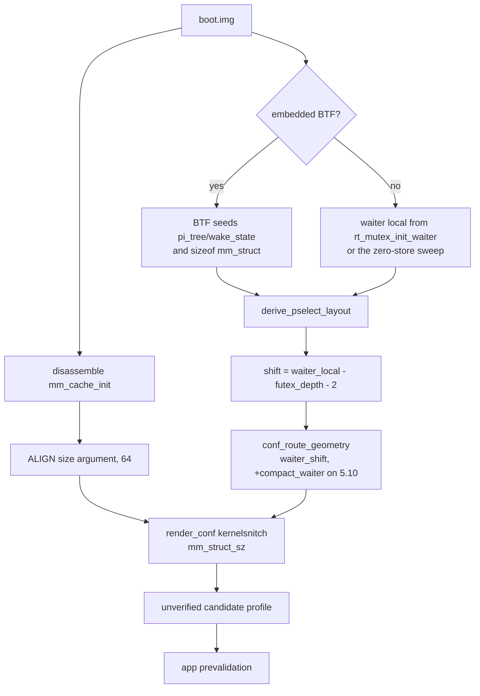

[中文](extractor-5.10-support-plan_ZH.md) | English

# Extractor support for android12-5.10: plan (2026-10-30)

> Level: L, covering the extractor's derivation path and the profile field contract
> (`route.select_stack.compact_waiter`). Status: implemented, native blocker open.
> Extends [Extractor structure derivation without BTF](extractor-no-btf-struct-derivation-plan.md),
> which owns the general no-BTF derivation design. This document covers only what
> android12-5.10 adds to it.

## Status and baseline

- Branch `5.10-extractor-support`, baseline commit `437b3b25`.
- `kernel_struct_macro` (`tools/extract_rs/src/symbols.rs`) knows only 6.1, 6.6 and 6.12,
  so `pselect_waiter_shift_for` (`tools/extract_rs/src/report.rs`) returns `None` for every
  5.10 release and `render_conf` emits `mm_struct_sz = 1024` for every 5.x release, which is
  the 5.15 stride.
- `derive_pselect_layout` and `derive_nf_logger_registration` take `btf: &Btf` and hard-fail
  when the image has no embedded BTF. Vendor 5.10 images often ship without one.
- No `mm_cache_init` reference exists anywhere in the extractor, so nothing measures the
  `mm_struct` SLUB stride. Native falls back to `MM_STRUCT_SZ` in
  `src/core/kernel/constants.hpp`, which is `0x500`.
- `route.select_stack` in `CONF_ROUTE_FIELDS` carries only `waiter_shift`. Native
  `kRouteSelect` already reads `compact_waiter` (`src/core/profile/binary.cpp`), and a flat
  5.10 `rt_mutex_waiter` needs the compact word table, so a 5.10 profile has no way to state
  that through the select branch.
- Baseline evidence on `5.10.226-android12-9-00047-g4968e29b7f92-ab12786767` (a BTF-less
  image): `pselect_waiter_shift = null`, `mm_struct_sz = 1024`, every `task_struct` field
  `null`, no `cred` block, and a `multicast_waiter` branch whose geometry fails the project's
  own fit rule (`waiter_off + lock_offset + 8 <= buffer_size`).

## Goals and constraints

Goal: on a BTF-less 5.10 image the extractor derives the pselect shift and the `mm_struct`
SLUB stride from the image instead of emitting `null` and a wrong 1024, and states the flat
waiter in the select branch.

Non-goals:

- Change native exploit code. The native flat-waiter prio path is a separate change; see
  "Open blocker" below.
- Change the GLK1/wire format or add a version. `compact_waiter` already exists in the v2
  `route` section and in `kernel`; only the select branch gains the key.
- Port `--register`, `--format c`, `--name`, `--force`, `src/kernels/` output, or
  `derive_sigreturn_layout`. Those belong to the branch format, not upstream.
- Add a `--btf <blob>` flag. Upstream has no such flag and no other way to hand the
  extractor a reference vmlinux, so on this tree the no-BTF path is the only path. The BTF
  branch of `derive_pselect_layout` and the BTF gate on `derive_nf_logger_registration` stay
  as they are, but only an image with embedded BTF reaches them.
- Derive `task_struct` or the `cred` layout without BTF. That is the parent plan's stage 2/3
  and remains unstarted; this change leaves those fields `null` on a BTF-less image.

## Limitation: a BTF-less image yields geometry only

`resolve_structs(None)` sets all fifteen `task_struct` fields and every `cred` scalar to
`None`, and `derive_cred_5x` is called through `btf.as_ref().and_then(...)`, so it never runs
without BTF. `ProfileResolver.validateMerged` requires all fifteen `task_struct` fields and a
non-zero `cred.copy_size` and `cred.caps_count`, and the app blocks a run while
`invalidPaths` is non-empty. A profile generated from a BTF-less image is therefore route
geometry plus symbol offsets, and stays unrunnable until an author fills `task_struct` and
`cred` from the matching source. That is the documented candidate contract, not a defect in
this change, but it is the whole of what the extractor delivers for such an image.

## Limitation: upstream cannot express a short pselect window

The hantu fork carries `pselect_waiter_off` and a sigreturn route. Upstream has neither
(`git grep pselect_waiter_off -- src/core` returns nothing). So when the pselect window on a
given 5.10 image stops short of the waiter, there is no way to say so in a profile and no
fallback transport to name. `conf_route_geometry` returns an empty geometry when the
derivation is infeasible, `main.rs` exits 3 for `select_stack`, and the app rejects the
result, so this fails safe. The cost is that such a kernel gets no route at all from the
extractor.

## Change list

| File | Change | Reason |
|---|---|---|
| `tools/extract_rs/src/symbols.rs` | `kernel_struct_macro` maps `(5,10)` and `(5,15)`; `kernel_layout_verified` accepts `-android12-` for 5.10 | Family selection needs the 5.10 arm |
| `tools/extract_rs/src/symbols.rs` | `off_slide_loggers_0_1` fallback is `loggers + 8` | `nf_log_register` indexes `loggers[pf][type]`; `NFPROTO_UNSPEC` is 0 and `NF_LOG_TYPE_ULOG` is 1, so the slot is the second pointer of the row. The old `+0x10` was one word high |
| `tools/extract_rs/src/derive.rs` | `derive_mm_stride` / `mm_cache_size_arg` / `shift_of`: disassemble `mm_cache_init`, take the size argument it passes to `kmem_cache_create_usercopy`, return `ALIGN(size, 64)` | The SLUB stride is `ALIGN(sizeof + cpumask_size(), 64)`, not the BTF `sizeof`. Only the image knows the argument |
| `tools/extract_rs/src/derive.rs` | `derive_pselect_layout` takes `btf: Option<&Btf>`; with no BTF it seeds the waiter local from the `add x0, sp, #imm` before `bl rt_mutex_init_waiter`, then falls back to the zero-store sweep | The waiter local is the only thing BTF supplied for the frame arithmetic |
| `tools/extract_rs/src/analysis.rs` | Call `derive_pselect_layout` with `input.btf` instead of gating on `Some(btf)` | Same reason; `--analysis` must report the derived layout on a BTF-less image |
| `tools/extract_rs/src/report.rs` | `pselect_waiter_shift_for` returns `-2` for `STRUCT_OFFSETS_5_10` / `_5_15` | Both frames put the waiter two words below the `fd_set` base |
| `tools/extract_rs/src/report.rs` | `mm_default` maps 5.15/6.1 to `0x400` and 6.6/6.12 to `0x500`; 5.10 has no entry. `build_report` takes `mm_stride` and emits the measured value or the family default | The JSON report carried no stride for 5.x and a hardcoded 1024 in conf. 5.10 strides are not uniform, so there is no default to borrow |
| `tools/extract_rs/src/report.rs` | `CONF_ROUTE_FIELDS["select_stack"]` gains `compact_waiter`; `conf_route_geometry` writes `compact_waiter = 1` for the flat-waiter family only | A flat 5.10 waiter needs the compact word table; 5.15 and 6.x keep their geometry |
| `tools/extract_rs/src/report.rs` | `multicast_geometry_fits` drops geometry that cannot fit the option buffer, with a warning | The 5.x multicast branch was emitting a stamp the kernel cannot copy |
| `tools/extract_rs/src/report.rs` | `render_conf` splits the KernelSnitch block by family: 5.10 `collisions = 4` + measured stride, 5.15 `collisions = 8` + stride, other 5.x keeps the shipped 8/1024 | 1024 is the 5.15 stride and is wrong for 5.10 |
| `tools/extract_rs/src/main.rs` | pselect and mm-stride derivation run unconditionally; `mm_stride` threads into `build_report` and `ConfInputs` | Same |
| `app/src/main/kotlin/com/ghostlock/app/data/AndroidProfileConfigController.kt` | `select_stack` validates an optional 0..0xff `compact_waiter`; `RouteBranchFields["select_stack"]` lists it | The editor seeds the branch from that list and validates every field it carries |
| `app/src/main/assets/kernel_profiles/5.15-template.conf`, `docs/kernel_profiles/templates/kernel-5.x.template.conf` | `select_stack` gains `compact_waiter = null` with a comment | Templates list every field of each branch, and the docs copy mirrors the asset body |
| `docs/kernel_profiles/PROFILE_SCHEMA.md` / `_ZH.md` | Row for `route.select_stack.compact_waiter` | Field contract documentation |

## Data flow

Invariants:

- A family default is written only when `kernel_layout_verified` accepts the release; a
  measured value wins over it. A BTF-less image that cannot be disassembled yields no
  stride at all, never a guess. 5.10 has no family default, so an unmeasurable 5.10 image
  emits `null` and native keeps `MM_STRUCT_SZ`.
- `compact_waiter` in a v1 JSON report means the 6.1 tcp arm to
  `LegacyProfileConverter.inferRoute`, so a 5.x report still does not carry it. Only the
  `--format conf` select branch states it.
- `derive_pselect_layout` still rejects a non-unique waiter candidate. The no-BTF seed adds
  candidates, and the self-store filter still applies to the ones it did not source.

## Compatibility and rollback

The 6.x output is unchanged: 6.6 emits no `mm_struct_sz` (the layout macro carries 0x500),
6.1 keeps `compact_waiter = 1` and `mm_struct_sz = 1024`, 6.12 emits neither. The measured
6.6 stride (0x500) equals the family default, so it is not emitted. Reverting this change is
a straight revert of the listed files; no persistent state, no format migration, and no
profile already shipped changes meaning.

A 5.10 image whose `mm_cache_init` cannot be read now emits `mm_struct_sz = null` rather
than a family guess. Native then uses `MM_STRUCT_SZ = 0x500`, which is what the one shipped
5.10 profile states. Three unrelated 5.10 images measure 0x3c0, so the family is not
uniform and the Sony value may be copied from the compile-time default rather than measured.
A maintainer with the Sony device should settle that before any 5.10 profile ships.

The one behavior change outside 5.10 is the `loggers` fallback. It corrects a value that
native never reads (`slide_loggers_0_1` has no runtime consumer on this tree), so the
impact is confined to the emitted profile.

## Open blocker

Native cannot run a 5.10 flat waiter yet. `src/core/support/util.cpp` writes the compact
spray's `prio` at waiter byte 0x44 (`wake_state` at 0x40), and
`src/core/route/select_stack_route.cpp` writes `(FAKE_WAITER_PRIO << 32) | 3` to waiter word
10. On a flat 5.10 waiter, prio is 0x40, so that word puts `3` in `prio` and 140 in
`deadline`, and the `prio > 120` gate the spray relies on fails.

The extractor change does not depend on that fix and is worth landing alone. Until it lands,
no Poco F5 profile ships in this change: the extractor can produce the geometry, and the app
will accept it, but the native stamp would be wrong. The fix belongs in its own change with a
device gate, and the shape it needs (a `waiter_prio_off` profile field, or deriving the arm
from `kernel_major == 5 && compact_waiter`) is a separate contract decision.

## Verification matrix

| Stage | Command | Expected result |
|---|---|---|
| Unit | `cargo test --release --features http` in `tools/extract_rs` | 48 passed |
| Build | `cargo build --release --features http` in `tools/extract_rs` | Clean |
| 5.10 acceptance | `ghostlock-extract boot.img --format json` on a BTF-less 5.10 image | `"pselect_waiter_shift": -2`, `"mm_struct_sz": 960`, and an `info:` line naming `mm_cache_init` |
| 5.10 conf | `ghostlock-extract boot.img --format conf` | `select_stack { waiter_shift = -2 compact_waiter = 1 }`, `kernelsnitch { collisions = 4 mm_struct_sz = 960 }` |
| 6.x regression | Same two commands on 6.6.77 and 6.1.145 images | 6.6: `-2`, no `mm_struct_sz`. 6.1: `1`, `mm_struct_sz = 1024`, `compact_waiter = 1` |
| 5.15 regression | Same on a 5.15 image | `-2` from the family fallback, `mm_struct_sz = 1024`, `collisions = 8` |
| App | `./gradlew :app:testDebugUnitTest` | 88 tests, 86 pass. `ExporterAgreementTest` and `ProfileMigrationEquivalenceTest` fail on the baseline commit too (see below) |
| App build | `./gradlew :app:assembleDebug` | Pass |
| Device | Not attempted | The native blocker above prevents it |

The two app failures reproduce on a clean checkout of `437b3b25` with no local
changes. `ProfileMigrationEquivalenceTest` wants a fixture release set that the built-in
index no longer matches, and `ExporterAgreementTest` then disagrees with the app on one
6.1.138 profile. Both are fixture drift in the upstream tree, unrelated to this change.

## Explicit preservation

The BTF code path (reachable only from an image with embedded BTF, since there is no
`--btf` flag), `derive_nf_logger_registration`'s BTF gate, the `kernel_layout_verified` gate,
the v1 JSON shape, `LegacyProfileConverter.kt` and its v1 conversion, the GLK1 wire format,
all native code, `kernelsnitch/`, and every profile already shipped.

## Progress

- [x] 5.10/5.15 family mapping and the `-android12-` verified train
- [x] `derive_mm_stride` from `mm_cache_init`
- [x] `derive_pselect_layout` without BTF
- [x] 5.10 shift and stride in the JSON report and the conf renderer
- [x] `select_stack.compact_waiter` in the profile contract (Kotlin, schema doc, template)
- [x] `loggers` fallback corrected to `+8`
- [x] Unit tests for the new derivation and report paths
- [ ] Native flat-waiter prio path (separate change, device gate required)
- [ ] Poco F5 profile (blocked on the above)
