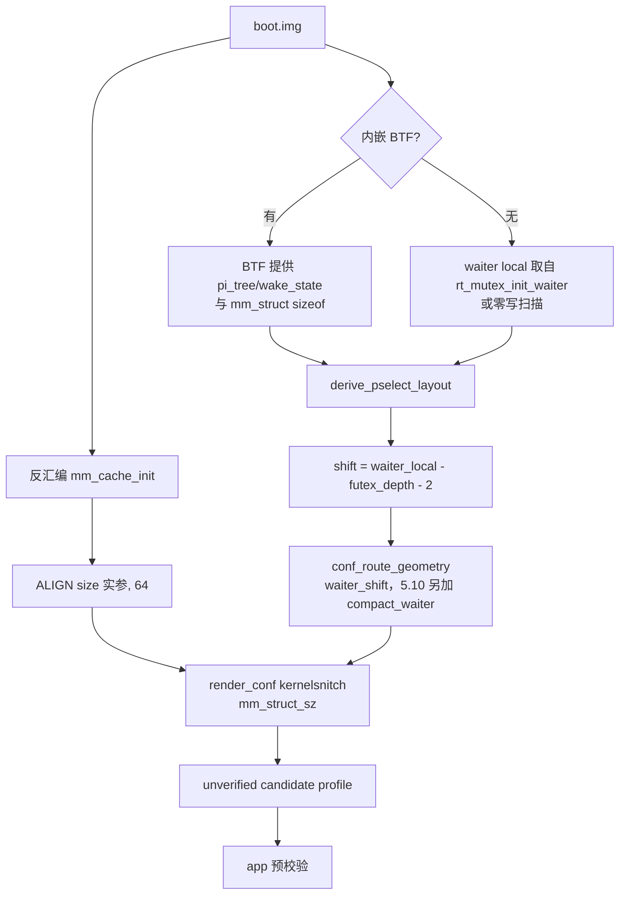

[English](extractor-5.10-support-plan.md) | 中文

# 提取器支持 android12-5.10 计划（2026-10-30）

> 级别：L（提取器推导路径 + profile 字段契约 `route.select_stack.compact_waiter`）。
> 状态：已实施；native 平坦 waiter 路径已修复，Poco F5 profile 已随本次改动加入，
> 真机验证仍待完成。
> 评审修订（2026-11-08）：waiter 布局由 profile 显式声明，不再按 release 推断。Sony 5.10
> profile 保留真机验证值；提取器移除 5.10 平坦 waiter 默认值；未测量的 5.10 回退到 Sony
> 验证的 1280，测量值优先；legacy JSON converter 只处理 6.x；native 预构建 profile 的
> 偏移检查已移除。
> 本文接续[提取器无 BTF 结构推导计划](extractor-no-btf-struct-derivation-plan_ZH.md)，
> 通用无 BTF 推导设计由那份文档负责；这里只记录 android12-5.10 新增的部分。

## 状态与基线

- 基线 commit `437b3b25`。
- `kernel_struct_macro`（`tools/extract_rs/src/symbols.rs`）只认 6.1、6.6、6.12，
  所以 `pselect_waiter_shift_for`（`tools/extract_rs/src/report.rs`）对所有 5.10 返回
  `None`，`render_conf` 对所有 5.x 写死 `mm_struct_sz = 1024`（这是 5.15 的 stride）。
- `derive_pselect_layout` 与 `derive_nf_logger_registration` 的签名是 `btf: &Btf`，
  镜像没有内嵌 BTF 时直接失败。vendor 5.10 镜像经常没有 BTF。
- 提取器里没有任何 `mm_cache_init` 引用，因此无人测量 `mm_struct` 的 SLUB stride。
  native 回退到 `src/core/kernel/constants.hpp` 的 `MM_STRUCT_SZ`，值为 `0x500`。
- `CONF_ROUTE_FIELDS` 里 `route.select_stack` 只有 `waiter_shift`。native 的
  `kRouteSelect` 已经会读 `compact_waiter`（`src/core/profile/binary.cpp`），而 5.10 的
  平坦 `rt_mutex_waiter` 必须走紧凑字表，select 分支却无法表达这一点。
- 基线证据（`5.10.226-android12-9-00047-g4968e29b7f92-ab12786767`，无 BTF）：
  `pselect_waiter_shift = null`、`mm_struct_sz = 1024`、`task_struct` 全 `null`、
  没有 `cred` 块，并且 `multicast_waiter` 分支的几何不满足项目自己的 fit 规则
  （`waiter_off + lock_offset + 8 <= buffer_size`）。

## 目标与约束

目标：在无 BTF 的 5.10 镜像上，提取器从镜像推导 pselect 位移与 `mm_struct` SLUB stride，
而不是输出 `null` 和错误的 1024，select 分支声明平坦 waiter，native 在该 waiter 的 0x40
字写入 prio，使 profile 可以运行。

非目标：

- 不改 GLK1/wire 格式，不新增版本号。`compact_waiter` 在 v2 的 `route` 段与 `kernel`
  段中已存在，只有 select 分支新增该键。
- 不移植 `--register`、`--format c`、`--name`、`--force`、`src/kernels/` 输出、
  `derive_sigreturn_layout`。那些属于另一套格式，不属于 upstream。
- 不新增 `--btf <blob>` 开关。upstream 没有这个开关，也没有别的办法把参考 vmlinux 交给
  提取器，所以本树只有无 BTF 一条路径。`derive_pselect_layout` 的 BTF 分支与
  `derive_nf_logger_registration` 的 BTF 门保持原样，但只有内嵌 BTF 的镜像才会走到。
- 不在无 BTF 时推导 5.15 与 6.x 的 `task_struct` 或 `cred` 布局。5.10 使用沿用的
  android12-5.10 布局；其他族尚未开始。

## 无 BTF 镜像：5.10 已完整，其他族仍只有几何

无 BTF 的 android12-5.10 镜像会从 `STRUCT_DEFAULTS_5_10` 取得沿用的 5.10
`task_struct`/`cred` 布局，并通过 `derive_cred_5x_without_btf` 从镜像的 `init_cred`
生成凭据模板。生成的 conf 字段齐全，无需内置 profile 即可运行。cred 大小取自
`init_groups - init_cred` 的差值（Poco 镜像为 168），caps 段取自 `init_cred + 40..72`，
引用指针取自 `+0x80/+0x88/+0x90`。v1 JSON 报告同样携带 `cred` 对象，legacy converter
会丢弃 BTF-only 的 `struct_fields` 组，因此 JSON 导入路径也完整。

无 BTF 的 5.15 或 6.x 镜像仍只产出路由几何与符号偏移。提取器没有这些族的沿用布局，
需要内置 profile 或同 KMI 来源补齐。

## 限制：upstream 无法表达 pselect 窗口不够深

upstream 没有 `pselect_waiter_off` 与 sigreturn 路由
（`git grep pselect_waiter_off -- src/core` 无结果）。因此当某个 5.10 镜像的 pselect
窗口够不到 waiter 时，profile 无法表达这一点，也没有可指定的回退传输。
`conf_route_geometry` 在推导不可行时返回空几何，`main.rs` 对 `select_stack` 退出码 3，
app 随即拒绝该结果，所以是安全失败。代价是这类内核从提取器拿不到任何路由。

## 改动清单

| 文件 | 改动 | 原因 |
|---|---|---|
| `tools/extract_rs/src/symbols.rs` | `kernel_struct_macro` 增加 `(5,10)`、`(5,15)`；`kernel_layout_verified` 对 5.10 接受 `-android12-` | family 选择需要 5.10 分支 |
| `tools/extract_rs/src/symbols.rs` | `off_slide_loggers_0_1` 回退改为 `loggers + 8` | `nf_log_register` 索引 `loggers[pf][type]`；`NFPROTO_UNSPEC` 为 0、`NF_LOG_TYPE_ULOG` 为 1，槽位是行的第二个指针。原来的 `+0x10` 高了一个字 |
| `tools/extract_rs/src/derive.rs` | 新增 `derive_mm_stride` / `mm_cache_size_arg` / `shift_of`：反汇编 `mm_cache_init`，取传给 `kmem_cache_create_usercopy` 的 size 实参，返回 `ALIGN(size, 64)` | SLUB stride 是 `ALIGN(sizeof + cpumask_size(), 64)`，不是 BTF 的 `sizeof`；只有镜像知道实参 |
| `tools/extract_rs/src/derive.rs` | `derive_pselect_layout` 改收 `btf: Option<&Btf>`；`pi_tree`/`wake_state` 缺失时（包括部分 BTF）用 `bl rt_mutex_init_waiter` 之前的 `add x0, sp, #imm` 作为 waiter local，再退回零写扫描 | waiter local 是 BTF 在帧算术里唯一提供的东西，而平坦 5.10 waiter 可能只暴露其中一个字段 |
| `tools/extract_rs/src/analysis.rs` | `derive_pselect_layout` 改为直接传 `input.btf`，不再以 `Some(btf)` 为门 | 同上；`--analysis` 也要在无 BTF 镜像上报出推导结果 |
| `tools/extract_rs/src/symbols.rs` | `STRUCT_DEFAULTS_5_10` 与 `fill_struct_defaults`：无 BTF 时补齐已验证 5.10 的 task/cred 布局 | 所有已注册 5.10 版本共用该族布局，无 BTF 镜像也能产出完整 profile |
| `tools/extract_rs/src/derive.rs` | `derive_cred_5x_without_btf`：按 5.10 cred 布局读取 `init_cred`，大小取自 `init_groups - init_cred` | 凭据模板不再需要 BTF |
| `tools/extract_rs/src/main.rs` | 无 BTF 的已验证 5.10 镜像在渲染 conf 前补齐族布局与凭据 | 生成的 conf 无需内置 profile 即可运行 |
| `tools/extract_rs/src/derive.rs` | 只要 `pi_tree`/`wake_state` 缺失，就都从 `rt_mutex_init_waiter` 取 waiter local，包括只有部分 BTF 的镜像 | 即使存在 BTF 对象，这条调用证据仍然有效 |
| `tools/extract_rs/src/report.rs` | `pselect_waiter_shift_for` 对 `STRUCT_OFFSETS_5_10` / `_5_15` 返回 `-2` | 两个族的帧都把 waiter 放在 `fd_set` 基址下方两个字 |
| `tools/extract_rs/src/report.rs` | `mm_default` 映射 5.10→`0x3c0`、5.15/6.1→`0x400`、6.6/6.12→`0x500`；`build_report` 新增 `mm_stride` 参数，写测量值或 family 默认，5.10 分支仅在 `kernel_layout_verified` 接受时输出 | JSON 报告对 5.x 不带 stride，conf 又写死 1024。所有已发布的 5.10 profile 与所有测得镜像都使用 0x3c0，但这是族级假设 |
| `tools/extract_rs/src/report.rs` | `CONF_ROUTE_FIELDS["select_stack"]` 增加 `compact_waiter`；`conf_route_geometry` 只对平坦 waiter 族写 `compact_waiter = 1` | 5.10 平坦 waiter 需要紧凑字表；5.15 与 6.x 保持原有几何 |
| `tools/extract_rs/src/report.rs` | 新增 `multicast_geometry_fits`，放不进 option buffer 的几何直接丢弃并告警 | 5.x multicast 分支此前会写出内核拷不进去的 stamp |
| `tools/extract_rs/src/report.rs` | `render_conf` 的 KernelSnitch 块按 family 拆分：5.10 `collisions = 4` + 测量 stride，5.15 `collisions = 8` + stride，其他 5.x 保留 8/1024 | 1024 是 5.15 的 stride，对 5.10 是错的 |
| `tools/extract_rs/src/main.rs` | pselect 与 mm stride 推导改为无条件执行；`mm_stride` 传入 `build_report` 与 `ConfInputs` | 同上 |
| `tools/extract_rs/src/iomem.rs` | 隐式查找只在 Android 上读 `/proc/iomem`；host 构建只用缓存的设备转储 | 桌面上的 `/proc/iomem` 描述的是构建机，其 `dram_base = 0` 会被当成 `kernel_phys_offset` 输出 |
| `profile-core/.../ProfileMerger.kt` | 合并前复制共享的 tuning 与 route preset map | 导出器在多个 profile 间复用一个 map，某个 profile 的 execution 覆盖会泄漏到后续导出 |
| `app/src/test/resources/remote-main-6x-offsets.json`、`ProfileMigrationEquivalenceTest.kt` | 补上 fixture 缺少的四个内置 6.x profile | fixture 必须覆盖当前全部 6.x 内置项 |
| `app/.../LegacyProfileConverter.kt` | 5.10 legacy report 在推断出的 select 分支上补 `compact_waiter = 1`，并从 release 推出 `kernel_major = 5`；5.15 保持 split | v1 report 不能携带 `compact_waiter`（该键对 importer 表示 6.1 tcp 分支），导入结果必须满足 5.10 校验 |
| `tools/extract_rs/src/report.rs`、`main.rs` | 5.10 的 v1 JSON 报告携带顶层 `cred` 对象 | in-app conf 已有该模板；JSON 导入路径此前没有 |
| `app/.../LegacyProfileConverter.kt` | 移动 schema 键后丢弃 BTF-only 的 `struct_fields` 组 | 残留的组会触发顶层键校验失败 |
| `app/src/main/kotlin/com/ghostlock/app/data/AndroidProfileConfigController.kt` | `select_stack` 校验 `compact_waiter`，5.10 必须为 1；`RouteBranchFields["select_stack"]` 列出该键 | 编辑器按该列表补齐分支，平坦 waiter 必须走紧凑字表 |
| `app/src/main/assets/kernel_profiles/5.15-template.conf`、`docs/kernel_profiles/templates/kernel-5.x.template.conf` | `select_stack` 增加 `compact_waiter = null`；5.x 模板同时给出 `waiter_prio_off = null` | 模板列出每个分支的全部字段；复制出的 5.10 模板必须写明平坦 prio 偏移 |
| `docs/kernel_profiles/PROFILE_SCHEMA.md` / `_ZH.md` | 增加 `route.select_stack.compact_waiter` 与 `waiter_prio_off` 行 | 字段契约文档 |
| `tools/extract_rs/src/report.rs` | `waiter_prio_default` 只对已验证的 5.10 release 在 JSON 报告与 conf 头部写 `waiter_prio_off = 64` | 5.10 平坦 waiter 没有 `wake_state`，prio 占用 0x40 字；split 族省略该键，native 保持 0x44 |
| `src/core/profile/model.h` | `KernelMisc::waiter_prio_off` 与 `TargetProfile::waiter_prio_offset(fallback)` | 偏移按族不同，必须经 profile 传给 native |
| `src/core/profile/binary.cpp` | `kKernel` 增加 `waiter_prio_off` | 同一值的 wire 字段 |
| `src/core/kernel/target.h` | `FAKE_WAITER_PRIO_OFF_SPLIT = 0x44` | profile 省略该字段时的编译期默认值 |
| `src/core/support/util.cpp` | 紧凑 spray 只对 split waiter 在 0x40 写 `wake_state`，prio 写到 profile 的偏移 | 平坦 waiter 上旧写法让 prio 为 0，无法通过 `prio > 120` 门 |
| `src/core/route/select_stack_route.cpp`、`select_stack_route.h` | waiter 第 10 字改为 `compact_prio_word(split, prio)`：split 打包，平坦只写 prio | 同一道门，第二个写入点 |
| `profile-core/.../NativeProfile.kt`、`ProfileResolver.kt` | 在 wire 上传递 `waiter_prio_off`，并接受为顶层键 | Kotlin 镜像 native transport |
| `app/.../AndroidProfileConfigController.kt` | 5.10 必须为 `waiter_prio_off = 0x40`；split profile 可省略或写 0x44，不得写 0x40；缺失时补 `null` | native 只为这两个偏移提供字形状，split profile 不得选择平坦形状 |
| `app/src/main/assets/kernel_profiles/5.10.236-...conf` | Sony 5.10 写 `compact_waiter = 1` 与 `waiter_prio_off = 64` | 唯一已发布的 5.10 profile 此前在平坦 waiter 上跑 6.6 rb_node 表 |
| `app/src/main/assets/kernel_profiles/5.10.198-...conf` | Poco F5 profile：测量路由与 stride，沿用 5.10 task 偏移，使用本镜像的 `init_cred` 值 | 5.10 族此前没有可运行的 profile |
| `src/core/tests/profile_test.cpp`、`profile_binary_test.cpp`、`select_stack_route_test.cpp` | 固定 accessor 回退、wire 往返与两种字形状 | prio 字是关键值 |

## 数据流

不变量：

- 只有在 `kernel_layout_verified` 接受该 release 时才写 family 默认值，测量值优先。
  无 BTF 且无法反汇编的镜像不产生测量 stride，5.10 此时保留 family 值 `0x3c0`。
- v1 JSON 报告里的 `compact_waiter` 对 `LegacyProfileConverter.inferRoute` 只意味着
  6.1 的 tcp 分支，所以 5.x 报告仍不带它；只有 `--format conf` 的 select 分支声明。
- `derive_pselect_layout` 仍要求 waiter 候选唯一。无 BTF 的种子只是增加候选，
  非种子候选仍要过自存储过滤。

## 兼容与回滚

6.x 输出不变：6.6 不写 `mm_struct_sz`（布局宏自带 0x500），6.1 保持
`compact_waiter = 1` 与 `mm_struct_sz = 1024`，6.12 两者都不写。6.6 的测量 stride（0x500）
等于 family 默认值，因此不输出。回滚就是整体 revert 上述文件；没有持久状态、
没有格式迁移，6.x profile 不变。Sony 5.10 profile 从 1280 修正为 family stride。

无法读取 `mm_cache_init` 的 5.10 镜像写 `mm_struct_sz = 0x3c0`，即所有已发布 5.10
profile 与所有测得镜像使用的 stride。Sony profile 从 1280 改为 960，消除了该族最后一个
例外。

5.10 之外有两项行为变化。`loggers` 回退修正的值 native 从不读取
（`slide_loggers_0_1` 在本树没有运行时使用者），影响只限于输出 profile。隐式 iomem
查找在非 Android 构建上不再读取宿主机的 `/proc/iomem`，此前会把构建机的 `dram_base`
当成 `kernel_phys_offset` 输出。显式 `--iomem` 或缓存的设备转储仍然有效。

## native 平坦 waiter 支持

`src/core/support/util.cpp` 的紧凑 spray 原先把 `prio` 写在 waiter 字节 0x44（0x40 写
`wake_state`），`src/core/route/select_stack_route.cpp` 把 `(FAKE_WAITER_PRIO << 32) | 3`
写到 waiter 第 10 字。平坦 5.10 waiter 的 prio 在 0x40，这个字会把 `3` 写进 `prio`、把 140
写进 `deadline`，spray 依赖的 `prio > 120` 门槛随之失效。

两处现在都通过 `TargetProfile::waiter_prio_offset` 读取 profile 的 `waiter_prio_off`，
profile 省略时回退到 `FAKE_WAITER_PRIO_OFF_SPLIT`（0x44）。5.10 profile 填 `64`。该值经
`KernelMisc` 与 `kernel` wire 段传递，因此 `src/core/profile/model.h`、
`src/core/profile/binary.cpp`、`NativeProfile.kt` 与 `ProfileResolver.kt` 都要带上它。

按 `kernel_major == 5 && compact_waiter` 判断被否决：5.15 也是 major 5 且紧凑，但
`wake_state` 仍在 0x40，所以分支必须由 profile 给出。

平坦 waiter 路径已在 5.10 真机上验证：每个受测版本都以 `compact_waiter = 1` 与
`waiter_prio_off = 0x40` 拿到 root。本次改动是在 upstream 契约上复现该机制，
wire 值沿用那些真机结果，未在此重新测量。

## 5.10 profile 的凭据 caps 值

已发布的 Sony 5.10 profile 使用 `caps_value = -1`、`caps_count = 5`。
`fill_profile_cred_copy` 会把这个值写进 `caps_count` 个连续字，因此 `cap_inheritable` 与
`cap_ambient` 也会变成全 1，而不只是中间三个字。镜像里真实的 `init_cred` 这两个字为 0，
中间三个为 `0x1ffffffffff`。

提取器已经优先采用真实值：`select_cred_caps` 从第一个非零槽位起取连续等值段，因此带 BTF 的
5.10 镜像会得到 `0x1ffffffffff` 与 `caps_count = 3`，与 5.15 profile 一致。Poco F5 profile
使用该测量值而非 `-1`。两者都能拿到 root，但只有测量值对应 `init_cred` 真实持有的状态。
Sony profile 保留其真机验证过的 `-1`。

## 验证矩阵

| 阶段 | 命令 | 预期结果 |
|---|---|---|
| 单测 | `tools/extract_rs` 下 `cargo test --release --features http` | 55 passed |
| 构建 | `tools/extract_rs` 下 `cargo build --release --features http` | 无告警 |
| 5.10 验收 | 无 BTF 的 5.10 镜像 `ghostlock-extract boot.img --format json` | `"pselect_waiter_shift": -2`、`"mm_struct_sz": 960`，并有一行指名 `mm_cache_init` 的 `info:` |
| 5.10 conf | `ghostlock-extract boot.img --xbl-config xbl_config.img --format conf` | `select_stack { waiter_shift = -2 compact_waiter = 1 }`、`kernelsnitch { collisions = 4 mm_struct_sz = 960 }`，以及完整的 `task_struct` 与 `cred` |
| 5.10 无内置 | 导入未在内置索引中的已验证 5.10 release 的生成 conf 或 JSON | 无 `invalidPaths`；无需内置 profile 即可运行 |
| 6.x 回归 | 6.6.77 与 6.1.145 镜像跑同样两条命令 | 6.6：`-2`，无 `mm_struct_sz`。6.1：`1`、`mm_struct_sz = 1024`、`compact_waiter = 1` |
| 5.15 回归 | 5.15 镜像同上 | family 回退得 `-2`、`mm_struct_sz = 1024`、`collisions = 8` |
| App | `./gradlew :app:testDebugUnitTest` | 98 项全部通过 |
| App 构建 | `./gradlew :app:assembleDebug` | 通过 |
| native host | `make -C src native-host-tests` | 通过（`tcp_zerocopy_route_test` 需要 AArch64 主机；基线在 x86 上同样汇编失败） |
| 真机 | 沿用既有证据 | 平坦 waiter 路径已在真机验证；本次未重跑 |

`ExporterAgreementTest` 与 `ProfileMigrationEquivalenceTest` 在基线上失败，原因有两项。
导出器在多个 profile 间复用了同一个 execution map，导致某个 profile 的 `w1_attempts`
泄漏到后续导出；迁移 fixture 也缺少内置索引里的四个 6.x profile。两者均已修复。

## 明确保留

BTF 代码路径（只有内嵌 BTF 的镜像会走到，因为没有 `--btf` 开关）、
`derive_nf_logger_registration` 的 BTF 门、`kernel_layout_verified` 门、v1 JSON 形状、
`LegacyProfileConverter.kt` 及其 v1 转换、GLK1 wire 格式、`kernelsnitch/`，
以及除 Sony 5.10 之外所有已发布的 profile（Sony 那份补上了平坦 waiter 所需的两项，
并改用 0x3c0 的 family stride）。

## 进度

- [x] 5.10/5.15 family 映射与 `-android12-` verified train
- [x] 由 `mm_cache_init` 推导 `derive_mm_stride`
- [x] 无 BTF 的 `derive_pselect_layout`
- [x] JSON 报告与 conf 渲染中的 5.10 位移与 stride
- [x] 5.10 stride family 默认值 0x3c0，Sony profile 同步改为该值
- [x] profile 契约中的 `select_stack.compact_waiter`（Kotlin、schema 文档、模板）
- [x] `loggers` 回退修正为 `+8`
- [x] 新增推导与报告路径的单测
- [x] native 平坦 waiter 的 prio 路径：`waiter_prio_off` 经 profile 传递，两处写入点均已分支
- [x] Sony 5.10 profile 补上 `compact_waiter = 1` 与 `waiter_prio_off = 64`
- [x] Poco F5 profile：沿用 5.10 task 偏移，测量路由与 stride，使用本镜像的 `init_cred` 值（已加入，真机验证待完成）
- [x] 5.10 legacy JSON 导入补上平坦 select 布局与 `kernel_major = 5`
- [x] 无 BTF 的 5.10 镜像产出完整 task/cred 布局与镜像 `init_cred` 凭据
