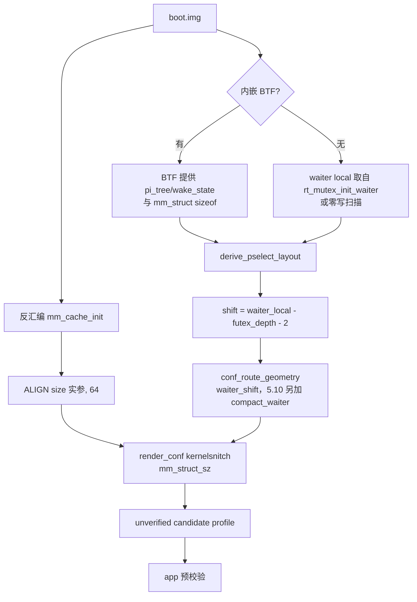

[English](extractor-5.10-support-plan.md) | 中文

# 提取器支持 android12-5.10 计划（2026-10-30）

> 级别：L（提取器推导路径 + profile 字段契约 `route.select_stack.compact_waiter`）。
> 状态：已实施，native 侧阻塞未解。
> 本文接续[提取器无 BTF 结构推导计划](extractor-no-btf-struct-derivation-plan_ZH.md)，
> 通用无 BTF 推导设计由那份文档负责；这里只记录 android12-5.10 新增的部分。

## 状态与基线

- 分支 `5.10-extractor-support`，基线 commit `437b3b25`。
- `kernel_struct_macro`（`tools/extract_rs/src/symbols.rs`）只认 6.1、6.6、6.12，
  所以 `pselect_waiter_shift_for`（`tools/extract_rs/src/report.rs`）对所有 5.10 返回
  `None`，`render_conf` 对所有 5.x 写死 `mm_struct_sz = 1024`（这是 5.15 的 stride）。
- `derive_pselect_layout` 与 `derive_nf_logger_registration` 的签名是 `btf: &Btf`，
  镜像没有内嵌 BTF 时直接失败。vendor 5.10 镜像经常没有 BTF。
- 提取器里没有任何 `mm_cache_init` 引用，因此无人测量 `mm_struct` 的 SLUB stride。
  `src/core/common.h` 的 `MM_STRUCT_SZ` 是 6.x 常量。
- `CONF_ROUTE_FIELDS` 里 `route.select_stack` 只有 `waiter_shift`。native 的
  `kRouteSelect` 已经会读 `compact_waiter`（`src/core/profile/binary.cpp`），而 5.10 的
  平坦 `rt_mutex_waiter` 必须走紧凑字表，select 分支却无法表达这一点。
- 基线证据（`5.10.226-android12-9-00047-g4968e29b7f92-ab12786767`，无 BTF）：
  `pselect_waiter_shift = null`、`mm_struct_sz = 1024`、`task_struct` 全 `null`、
  没有 `cred` 块，并且 `multicast_waiter` 分支的几何不满足项目自己的 fit 规则
  （`waiter_off + lock_offset + 8 <= buffer_size`）。

## 目标与约束

目标：在无 BTF 的 5.10 镜像上，提取器从镜像推导 pselect 位移与 `mm_struct` SLUB stride，
而不是输出 `null` 和错误的 1024，并在 select 分支里声明平坦 waiter。

非目标：

- 不改 native 攻击代码。native 平坦 waiter 的 prio 路径是另一项改动，见下文"未解阻塞"。
- 不改 GLK1/wire 格式，不新增版本号。`compact_waiter` 在 v2 的 `route` 段与 `kernel`
  段中已存在，只有 select 分支新增该键。
- 不移植 `--register`、`--format c`、`--name`、`--force`、`src/kernels/` 输出、
  `derive_sigreturn_layout`。那些属于分支自己的格式，不属于 upstream。
- 不在无 BTF 时推导 `task_struct` 或 `cred` 布局。那是父计划第 2/3 阶段，尚未开始；
  本次改动在无 BTF 镜像上仍让这些字段保持 `null`。

## 改动清单

| 文件 | 改动 | 原因 |
|---|---|---|
| `tools/extract_rs/src/symbols.rs` | `kernel_struct_macro` 增加 `(5,10)`、`(5,15)`；`kernel_layout_verified` 对 5.10 接受 `-android12-` | family 选择需要 5.10 分支 |
| `tools/extract_rs/src/symbols.rs` | `off_slide_loggers_0_1` 回退改为 `loggers + 8` | `nf_log_register` 索引 `loggers[pf][type]`；`NFPROTO_UNSPEC` 为 0、`NF_LOG_TYPE_ULOG` 为 1，槽位是行的第二个指针。原来的 `+0x10` 高了一个字 |
| `tools/extract_rs/src/derive.rs` | 新增 `derive_mm_stride` / `mm_cache_size_arg` / `shift_of`：反汇编 `mm_cache_init`，取传给 `kmem_cache_create_usercopy` 的 size 实参，返回 `ALIGN(size, 64)` | SLUB stride 是 `ALIGN(sizeof + cpumask_size(), 64)`，不是 BTF 的 `sizeof`；只有镜像知道实参 |
| `tools/extract_rs/src/derive.rs` | `derive_pselect_layout` 改收 `btf: Option<&Btf>`；无 BTF 时用 `bl rt_mutex_init_waiter` 之前的 `add x0, sp, #imm` 作为 waiter local，再退回零写扫描 | waiter local 是 BTF 在帧算术里唯一提供的东西 |
| `tools/extract_rs/src/analysis.rs` | `derive_pselect_layout` 改为直接传 `input.btf`，不再以 `Some(btf)` 为门 | 同上；`--analysis` 也要在无 BTF 镜像上报出推导结果 |
| `tools/extract_rs/src/report.rs` | `pselect_waiter_shift_for` 对 `STRUCT_OFFSETS_5_10` / `_5_15` 返回 `-2` | 两个族的帧都把 waiter 放在 `fd_set` 基址下方两个字 |
| `tools/extract_rs/src/report.rs` | `mm_default` 映射 5.10→`0x3c0`、5.15/6.1→`0x400`、6.6/6.12→`0x500`；`build_report` 新增 `mm_stride` 参数，写测量值或 family 默认 | JSON 报告对 5.x 不带 stride，conf 又写死 1024 |
| `tools/extract_rs/src/report.rs` | `CONF_ROUTE_FIELDS["select_stack"]` 增加 `compact_waiter`；`conf_route_geometry` 只对平坦 waiter 族写 `compact_waiter = 1` | 5.10 平坦 waiter 需要紧凑字表；5.15 与 6.x 保持原有几何 |
| `tools/extract_rs/src/report.rs` | 新增 `multicast_geometry_fits`，放不进 option buffer 的几何直接丢弃并告警 | 5.x multicast 分支此前会写出内核拷不进去的 stamp |
| `tools/extract_rs/src/report.rs` | `render_conf` 的 KernelSnitch 块按 family 拆分：5.10 `collisions = 4` + 测量 stride，5.15 `collisions = 8` + stride，其他 5.x 保留 8/1024 | 1024 是 5.15 的 stride，对 5.10 是错的 |
| `tools/extract_rs/src/main.rs` | pselect 与 mm stride 推导改为无条件执行；`mm_stride` 传入 `build_report` 与 `ConfInputs` | 同上 |
| `app/src/main/kotlin/com/ghostlock/app/data/AndroidProfileConfigController.kt` | `select_stack` 校验可选的 0..0xff `compact_waiter`；`RouteBranchFields["select_stack"]` 列出该键 | 编辑器按该列表补齐分支并校验其携带的每个字段 |
| `app/src/main/assets/kernel_profiles/5.15-template.conf`、`docs/kernel_profiles/templates/kernel-5.x.template.conf` | `select_stack` 增加 `compact_waiter = null` 与注释 | 模板列出每个分支的全部字段；docs 副本与 asset 正文保持一致 |
| `docs/kernel_profiles/PROFILE_SCHEMA.md` / `_ZH.md` | 增加 `route.select_stack.compact_waiter` 行 | 字段契约文档 |

## 数据流

不变量：

- 只有在 `kernel_layout_verified` 接受该 release 时才写 family 默认值，测量值优先。
  无 BTF 且无法反汇编的镜像不产生 stride，绝不用猜测值。
- v1 JSON 报告里的 `compact_waiter` 对 `LegacyProfileConverter.inferRoute` 只意味着
  6.1 的 tcp 分支，所以 5.x 报告仍不带它；只有 `--format conf` 的 select 分支声明。
- `derive_pselect_layout` 仍要求 waiter 候选唯一。无 BTF 的种子只是增加候选，
  非种子候选仍要过自存储过滤。

## 兼容与回滚

6.x 输出不变：6.6 不写 `mm_struct_sz`（布局宏自带 0x500），6.1 保持
`compact_waiter = 1` 与 `mm_struct_sz = 1024`，6.12 两者都不写。6.6 的测量 stride（0x500）
等于 family 默认值，因此不输出。回滚就是整体 revert 上述文件；没有持久状态、
没有格式迁移，已发布的 profile 语义不变。

5.10 之外唯一的行为变化是 `loggers` 回退。它修正的值 native 从不读取
（`slide_loggers_0_1` 在本树没有运行时使用者），影响只限于输出 profile。

## 未解阻塞

native 目前还跑不了 5.10 平坦 waiter。`src/core/support/util.cpp` 的紧凑 spray 把
`prio` 写在 waiter 字节 0x44（0x40 写 `wake_state`），
`src/core/route/select_stack_route.cpp` 把 `(FAKE_WAITER_PRIO << 32) | 3` 写到 waiter
第 10 字。平坦 5.10 waiter 的 prio 在 0x40，这个字会把 `3` 写进 `prio`、把 140 写进
`deadline`，spray 依赖的 `prio > 120` 门槛随之失效。

提取器改动不依赖该修复，可以单独合入。在修复落地前，本次不附带 Poco F5 profile：
提取器能产出几何、app 也会接受，但 native 的 stamp 是错的。修复应作为独立改动并附真机门禁，
它所需的形态（新增 `waiter_prio_off` profile 字段，或按 `kernel_major == 5 && compact_waiter`
判断）属于另一项契约决策。

## 验证矩阵

| 阶段 | 命令 | 预期结果 |
|---|---|---|
| 单测 | `tools/extract_rs` 下 `cargo test --release --features http` | 48 passed |
| 构建 | `tools/extract_rs` 下 `cargo build --release --features http` | 无告警 |
| 5.10 验收 | 无 BTF 的 5.10 镜像 `ghostlock-extract boot.img --format json` | `"pselect_waiter_shift": -2`、`"mm_struct_sz": 960`，并有一行指名 `mm_cache_init` 的 `info:` |
| 5.10 conf | `ghostlock-extract boot.img --format conf` | `select_stack { waiter_shift = -2 compact_waiter = 1 }`、`kernelsnitch { collisions = 4 mm_struct_sz = 960 }` |
| 6.x 回归 | 6.6.77 与 6.1.145 镜像跑同样两条命令 | 6.6：`-2`，无 `mm_struct_sz`。6.1：`1`、`mm_struct_sz = 1024`、`compact_waiter = 1` |
| 5.15 回归 | 5.15 镜像同上 | family 回退得 `-2`、`mm_struct_sz = 1024`、`collisions = 8` |
| App | `./gradlew :app:testDebugUnitTest` | 88 项，86 项通过。`ExporterAgreementTest` 与 `ProfileMigrationEquivalenceTest` 在基线 commit 上同样失败（见下） |
| App 构建 | `./gradlew :app:assembleDebug` | 通过 |
| 真机 | 未执行 | 受上文 native 阻塞限制 |

这两项 app 失败在 `437b3b25` 的干净检出上可复现，与本次改动无关。
`ProfileMigrationEquivalenceTest` 要求 fixture 的 release 集合与当前内置索引一致，
而 fixture 已过期；`ExporterAgreementTest` 随之在一份 6.1.138 profile 上与 app 不一致。
两者都是 upstream 树里的 fixture 漂移。

## 明确保留

BTF 路径、`derive_nf_logger_registration` 的 BTF 门、`kernel_layout_verified` 门、
v1 JSON 形状、`LegacyProfileConverter.kt` 及其 v1 转换、GLK1 wire 格式、全部 native 代码、
`kernelsnitch/`，以及所有已发布的 profile。

## 进度

- [x] 5.10/5.15 family 映射与 `-android12-` verified train
- [x] 由 `mm_cache_init` 推导 `derive_mm_stride`
- [x] 无 BTF 的 `derive_pselect_layout`
- [x] JSON 报告与 conf 渲染中的 5.10 位移与 stride
- [x] profile 契约中的 `select_stack.compact_waiter`（Kotlin、schema 文档、模板）
- [x] `loggers` 回退修正为 `+8`
- [x] 新增推导与报告路径的单测
- [ ] native 平坦 waiter 的 prio 路径（独立改动，需真机门禁）
- [ ] Poco F5 profile（被上一项阻塞）
