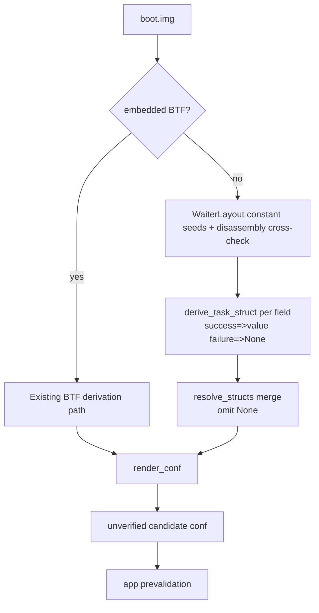

[中文](extractor-no-btf-struct-derivation-plan_ZH.md) | English

# Extractor structure derivation without BTF: plan (2026-09-30)

> Level: L, covering the extractor's core derivation path and profile field contract. Status: planned, not implemented.
> Related issue: YuKongA/ghostlock-app#213, OPPO A3x 5G / PKD130,
> `5.15.180-android13-8-o-g88bbcb96ee5e`, a kernel without BTF.

## Status and baseline

- Branch `vr-ko-bypass-dev`, baseline commit `deff0b1` (Merge branch
  'ancillary-architecture').
- Without BTF, `resolve_structs(None)` at `tools/extract_rs/src/symbols.rs:147` sets
  all `task_struct`, `rt_mutex_waiter`, `cred`, and `seccomp` fields in `STRUCT_FIELDS`
  (`symbols.rs:24`) to `None`, along with the derived entries for `page`, `slab`, and `mm_struct`.
- Existing disassembly derivations all use BTF as a seed:
  - `derive_pselect_layout` needs `rt_mutex_waiter.pi_tree` and `wake_state`
    (`derive.rs:380`).
  - `derive_nf_logger_registration` needs the type and 4-byte width of `nf_logger.type`
    (`derive.rs:673`).
  - The waiter fields for `multicast_waiter_off` come from BTF (`derive.rs:197`).
  - `derive_cred_5x` needs the size and pointer member layout of `cred` (`derive.rs:902`).
- The project already treats key `rt_mutex_waiter` offsets as a stable ABI. `main.rs:651`
  hardcodes `RT_MUTEX_WAITER_PI_TREE_ENTRY = 0x18` for multicast derivation without using BTF.
- `--format conf` omits missing fields, and app prevalidation rejects the result.
  The extractor does not fill gaps with guesses from neighboring families
  (`docs/kernel_profiles/README.md:64-68`).

## Problem

Vendor kernels without BTF currently cannot produce route derivations and a complete set of
conf fields. Manual completion is required. The goal is to recover fields using ABI constant
seeds and targeted disassembly data flow, producing an **unverified candidate**.
The app still validates its semantics.

## Goals and constraints

Non-goals:

- Fully decompile arbitrary structs.
- Introduce Ghidra/rizin/radare2. The extractor must remain self-contained and run on
  `aarch64-linux-android` (`build.gradle.kts:135`).
- Change the GLK1/wire/profile format, native code, or BTF path behavior.
- Cover 100% of fields. Each field can fail independently and is omitted on failure.

Constraints:

- Derivation must work for `task_struct` modified by vendor hooks. The issue device uses an
  MTK OEM kernel. Do not apply fixed AOSP GKI offsets. Recover values from the target image's machine code.
- Prefer field-by-field comparison against ground truth from images with BTF disabled during
  derivation, rather than relying only on device trial and error.

## Planned changes

| File | Change | Reason |
|---|---|---|
| `tools/extract_rs/src/derive.rs` | Add `WaiterLayout`, an `rt_mutex_waiter` ABI constant table keyed by `major.minor`, and cross-check it against disassembly. 5.15 has no `wake_state`, while 6.1+ does | Waiter offsets are ABI constants and can replace BTF as seeds |
| `tools/extract_rs/src/derive.rs` | Change `derive_pselect_layout` and multicast-related signatures from `btf: &Btf` to `layout: &WaiterLayout` or a `struct_fields` abstraction | Remove the BTF dependency. Have the BTF path construct the abstraction |
| `tools/extract_rs/src/structs.rs` (new) | `derive_task_struct(kernel, symbols, waiter) -> BTreeMap<String, Option<u32>>`, with anchors for each field | Recover `task_struct` without BTF |
| `tools/extract_rs/src/symbols.rs` | Have `resolve_structs` call derivation first when `btf=None`, with failed fields falling back to `None` | Preserve omission on failure |
| `tools/extract_rs/src/main.rs` | Call derivation in the no-BTF branch and distinguish `derived` from `missing` in logs | Make results observable and auditable |
| `tools/extract_rs/src/derive.rs` | For `nf_logger.type` in `derive_nf_logger_registration`, use constant `0` with a 4-byte check when BTF is absent | Remove the last hard BTF dependency in route derivation |
| `tools/extract_rs/src/report.rs` | Add comments or logs for derived fields without changing the format | Preserve the output contract |

### Field anchor tables

`rt_mutex_waiter` seed constants (`struct rb_node` = 24 bytes, pointer = 8):

| Field | 5.15 | 6.1+ |
|---|---|---|
| `tree` | 0x00 | 0x00 |
| `pi_tree` | 0x18 | 0x18 |
| `task` | 0x30 | 0x30 |
| `lock` | 0x38 | 0x38 |
| `wake_state` | Absent | 0x40 |
| `prio` | 0x40 | 0x44 |
| `ww_ctx` | 0x48 | 0x48 |
| `ww_waiter` | 0x58 | 0x58 |

`task_struct` anchors, using symbols from kallsyms and pattern matching cross-checked against data flow:

| Field | Anchor function | Derivation basis |
|---|---|---|
| `cred` / `real_cred` | `commit_creds` | Two consecutive `str` instructions to `[task, #off]`, with `task` from `sp_el0` and adjacent offsets (±8) |
| `pid` / `tgid` | `__arm64_sys_getpid` / `__arm64_sys_gettid` | `mrs xN, sp_el0; ldr wN, [xN, #off]` immediately followed by `ret` |
| `tasks` | `copy_process` or `release_task` | The same offset in `add x1, init_task_symbol, #off` and `add x0, p, #off` |
| `prio` / `normal_prio` | `effective_prio` / `__sched_setscheduler` | Read `[p, #prio]`. Write `normal_prio`/`prio`, whose offsets differ by 8 |
| `pi_lock` / `pi_waiters` / `pi_blocked_on` / `pi_top_task` | `task_blocks_on_rt_mutex`, `rt_mutex_adjust_prio_chain`, `rt_mutex_setprio` | Seed with `waiter->task` (0x30). Use `plist_add(&waiter->pi_list, &task->pi_waiters)`, `raw_spin_lock(&task->pi_lock)`, `task->pi_blocked_on = waiter`, and `task->pi_top_task` |
| `seccomp` | `__secure_computing` (`CONFIG_SECCOMP`) | `ldr wN, [task, #seccomp]`, with `mode` as the first field of `struct seccomp` |
| `comm` | `__set_task_comm` | `add xD, task, #comm` followed by 16-byte `stp`/`str` or inlined `memcpy` |
| `sched_task_group` | `sched_move_task` | Inlined access to `[tsk, #sched_task_group]` |
| `atomic_flags` | Undecided (`set_task_cpu` / scheduler migration path) | No single stable anchor. Omit and report if it cannot be uniquely anchored |

`cred` layout (5.x): in the `commit_creds` context, seed with the `task->cred` pointer and
read the `init_cred` buffer. Recover caps and references with the existing `derive_cred_5x`
algorithm (`select_cred_caps` / `select_cred_refs`). Determine the size from the complete
layout of pointer members after `cred->cap_ambient`. Omit it if that layout cannot be completed.

## Invariants

- Field sources do not change the meaning of profile bytes. Derived values do not set any verified flag.
- The BTF and derivation paths produce the same `ResolvedStructs` shape.
- No changes to the exploit runtime or wire format.
- Unresolved fields remain `None`, are omitted from conf, and cause app prevalidation to reject the result.

## Compatibility and rollback

All new code is in the `btf=None` branch. BTF behavior is unchanged. The plan includes a
`--no-struct-derivation` switch for rollback. The branch can also be reverted directly.
Do not touch `kernelsnitch/`, `LegacyProfileConverter.kt`, or v1 conversion.

## Verification matrix

| Stage | Command | Expected result |
|---|---|---|
| Unit | `cargo test --release --manifest-path tools/extract_rs/Cargo.toml` | Fixed disassembly vectors produce the expected offsets. No regressions in existing tests |
| Ground-truth comparison | Use an image with BTF, such as 5.15.189 / 6.6.89, disable BTF, and run the new derivation | Derived values match BTF ground truth, or anchor review explains any differences |
| Build | `./gradlew exportKernelProfiles` / NDK build | Zero warnings |
| Device gate | Target device (issue 213), cold device, single route, KernelSU not loaded | Selected route confirmed and write verification passes. Archive logs in the `docs/analysis/device-gates/` format |

Prerequisite: check the anchors for stages 2/3 against the target image or a similar image,
comparing no-BTF results against BTF ground truth. This requires a `5.15.180` image or any image
whose BTF can be disabled. Without an image, work must stop at stage 1 and unit tests.

## Explicitly preserved

BTF parsing and the BTF-first path, the `derive_pselect_layout` algorithm and invariants,
`unverified candidate` semantics, the profile/GLK1 format, all native code, and the
`kernel_layout_verified` gate.

## Progress

- [ ] Stage 1: `WaiterLayout` and waiter field cross-checks. Remove the BTF dependency from `derive_pselect_layout`
- [ ] Stage 1: the no-BTF constant path for `nf_logger.type`
- [ ] Stage 2: derive the main `task_struct` fields (cred/real_cred/pid/tgid/tasks/prio/normal_prio/seccomp/comm + PI group)
- [ ] Stage 3: `sched_task_group`, `atomic_flags`, `cred` layout, `page`/`slab`/`mm_struct`
- [ ] Ground-truth comparison and archived device gate evidence
