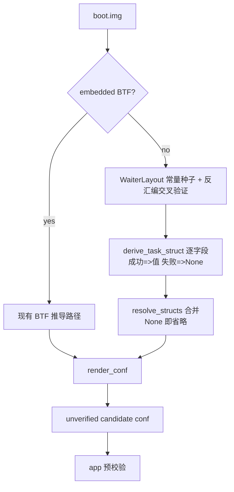

[English](extractor-no-btf-struct-derivation-plan.md) | 中文

# 提取器无 BTF 结构推导计划（2026-09-30）

> 级别：L（提取器核心推导路径 + profile 字段契约）。状态：计划，未实施。
> 关联 issue：YuKongA/ghostlock-app#213（OPPO A3x 5G / PKD130，
> `5.15.180-android13-8-o-g88bbcb96ee5e`，内核无 BTF）。

## 状态与基线

- 分支 `vr-ko-bypass-dev`，基线 commit `deff0b1`（Merge branch
  'ancillary-architecture'）。
- 无 BTF 时 `resolve_structs(None)`（`tools/extract_rs/src/symbols.rs:147`）把
  `STRUCT_FIELDS`（`symbols.rs:24`）里 `task_struct`、`rt_mutex_waiter`、`cred`、
  `seccomp` 的字段，以及 `page`、`slab`、`mm_struct` 的推导项全部置 `None`。
- 现有反汇编推导都以 BTF 为种子：
  - `derive_pselect_layout` 需 `rt_mutex_waiter.pi_tree` 与 `wake_state`
    （`derive.rs:380`）。
  - `derive_nf_logger_registration` 需 `nf_logger.type` 的类型与 4 字节宽度
    （`derive.rs:673`）。
  - `multicast_waiter_off` 的 waiter 字段来自 BTF（`derive.rs:197`）。
  - `derive_cred_5x` 需 `cred` 的 size 与指针成员布局（`derive.rs:902`）。
- `rt_mutex_waiter` 的关键偏移已被项目当作稳定 ABI：`main.rs:651` 硬编码
  `RT_MUTEX_WAITER_PI_TREE_ENTRY = 0x18` 供 multicast 推导，未走 BTF。
- `--format conf` 对缺失字段是省略，app 侧预校验拦截；提取器不用邻居 family
  的猜测补齐（`docs/kernel_profiles/README.md:64-68`）。

## 问题

没有 BTF 的 vendor 内核目前产不出 route 推导和完整 conf 字段，只能人工补。
目标是用 ABI 常量种子加定向反汇编数据流恢复字段，产出
**unverified candidate**，语义仍由 app 校验。

## 目标与约束

非目标：

- 不做通用 struct 全反编译。
- 不引入 Ghidra/rizin/radare2。提取器保持自包含，可在
  `aarch64-linux-android` 上运行（`build.gradle.kts:135`）。
- 不改 GLK1/wire/profile 格式、native 侧、BTF 路径行为。
- 不追求覆盖 100% 字段。每个字段独立可失败，失败即省略。

约束：

- 推导必须对 vendor hook 改过的 `task_struct` 生效（issue 设备是 MTK OEM 内核），
  不能套用 AOSP GKI 固定偏移，必须从目标镜像机器码取数。
- 真值验证优先用有 BTF 镜像屏蔽 BTF 后逐字段对拍，而不是只靠真机试错。

## 计划改动

| 文件 | 改动 | 理由 |
|---|---|---|
| `tools/extract_rs/src/derive.rs` | 新增 `WaiterLayout`（按 `major.minor` 的 `rt_mutex_waiter` ABI 常量表，5.15 无 `wake_state`，6.1+ 有）并做反汇编交叉验证 | waiter 偏移是 ABI 常量，可替代 BTF 作种子 |
| `tools/extract_rs/src/derive.rs` | `derive_pselect_layout` / multicast 相关签名从 `btf: &Btf` 改为 `layout: &WaiterLayout` 或 `struct_fields` 抽象 | 解耦 BTF 依赖，BTF 路径改为构造该抽象 |
| `tools/extract_rs/src/structs.rs`（新增） | `derive_task_struct(kernel, symbols, waiter) -> BTreeMap<String, Option<u32>>`，逐字段锚点 | 无 BTF 时恢复 `task_struct` |
| `tools/extract_rs/src/symbols.rs` | `resolve_structs` 在 `btf=None` 时先调用推导，失败字段回落 `None` | 保持失败即省略 |
| `tools/extract_rs/src/main.rs` | 无 BTF 分支调用推导，日志区分 `derived` 与 `missing` | 可观测、可审计 |
| `tools/extract_rs/src/derive.rs` | `derive_nf_logger_registration` 的 `nf_logger.type` 在无 BTF 时用常量 `0` 加 4 字节校验 | 移除最后一个 route 推导的 BTF 硬依赖 |
| `tools/extract_rs/src/report.rs` | 字段来源为推导时补注释或日志，格式不变 | 不改输出契约 |

### 字段锚点表

`rt_mutex_waiter` 种子常量（`struct rb_node` = 24 字节，指针 = 8）：

| 字段 | 5.15 | 6.1+ |
|---|---|---|
| `tree` | 0x00 | 0x00 |
| `pi_tree` | 0x18 | 0x18 |
| `task` | 0x30 | 0x30 |
| `lock` | 0x38 | 0x38 |
| `wake_state` | 不存在 | 0x40 |
| `prio` | 0x40 | 0x44 |
| `ww_ctx` | 0x48 | 0x48 |
| `ww_waiter` | 0x58 | 0x58 |

`task_struct` 锚点（符号取自 kallsyms，模式匹配加数据流交叉验证）：

| 字段 | 锚点函数 | 推导依据 |
|---|---|---|
| `cred` / `real_cred` | `commit_creds` | 相邻两条 `str` 到 `[task, #off]`，`task` 来自 `sp_el0`，两偏移相邻（±8） |
| `pid` / `tgid` | `__arm64_sys_getpid` / `__arm64_sys_gettid` | `mrs xN, sp_el0; ldr wN, [xN, #off]` 后立即 `ret` |
| `tasks` | `copy_process` 或 `release_task` | `add x1, init_task_symbol, #off` 与 `add x0, p, #off` 同偏移 |
| `prio` / `normal_prio` | `effective_prio` / `__sched_setscheduler` | 读 `[p, #prio]`；写 `normal_prio`/`prio`，两者相差 8 |
| `pi_lock` / `pi_waiters` / `pi_blocked_on` / `pi_top_task` | `task_blocks_on_rt_mutex`、`rt_mutex_adjust_prio_chain`、`rt_mutex_setprio` | 以 `waiter->task`(0x30) 为种子；`plist_add(&waiter->pi_list, &task->pi_waiters)`、`raw_spin_lock(&task->pi_lock)`、`task->pi_blocked_on = waiter`、`task->pi_top_task` |
| `seccomp` | `__secure_computing`（`CONFIG_SECCOMP`） | `ldr wN, [task, #seccomp]`，`mode` 是 `struct seccomp` 首字段 |
| `comm` | `__set_task_comm` | `add xD, task, #comm` 后 16 字节 `stp`/`str` 或内联 `memcpy` |
| `sched_task_group` | `sched_move_task` | 内联访问 `[tsk, #sched_task_group]` |
| `atomic_flags` | 待定（`set_task_cpu` / 调度迁移路径） | 无稳定单锚点；无法唯一锚定则省略并报告 |

`cred` 布局（5.x）：在 `commit_creds` 上下文以 `task->cred` 指针为种子，读取
`init_cred` 缓冲，按 `derive_cred_5x` 的既有算法（`select_cred_caps` /
`select_cred_refs`）恢复 caps 与引用。size 由 `cred->cap_ambient` 之后的指针成员
排列闭合，无法闭合则省略。

## 不变量

- 字段来源不改变 profile 字节语义；推导值不写任何已验证标记。
- BTF 路径与推导路径产出同一个 `ResolvedStructs` 形状。
- 攻击 runtime 与 wire 格式零改动。
- 未命中字段仍为 `None`，conf 省略，由 app 预校验拦截。

## 兼容性与回滚

新增代码全部在 `btf=None` 分支，BTF 行为不变。计划保留
`--no-struct-derivation` 开关用于回滚，也可直接 revert 该分支。不触碰
`kernelsnitch/`、`LegacyProfileConverter.kt` 与 v1 转换。

## 验证矩阵

| 阶段 | 命令 | 预期 |
|---|---|---|
| 单元 | `cargo test --release --manifest-path tools/extract_rs/Cargo.toml` | 固定反汇编向量得到期望偏移；既有测试不回退 |
| 真值对拍 | 取有 BTF 的镜像（如 5.15.189 / 6.6.89），屏蔽 BTF 后跑新推导 | 推导值等于 BTF 真值，或差异可在锚点审查中解释 |
| 构建 | `./gradlew exportKernelProfiles` / NDK 构建 | 零警告 |
| 真机门禁 | 目标设备（issue 213）冷机、单 route、KernelSU 未加载 | route 命中、写验证通过；日志按 `docs/analysis/device-gates/` 格式归档 |

前置依赖：阶段 2/3 的锚点必须用目标或同类镜像核对（无 BTF 真值与 BTF 真值
对拍），需要 `5.15.180` 或任一可屏蔽 BTF 的镜像文件。无镜像只能停在阶段 1
加单元测试。

## 明确保留

BTF 解析与 BTF 优先路径、`derive_pselect_layout` 的算法与不变量、
`unverified candidate` 语义、profile/GLK1 格式、native 全部代码、
`kernel_layout_verified` 门限。

## 进度

- [ ] 阶段 1：`WaiterLayout` + waiter 字段交叉验证；`derive_pselect_layout` 去 BTF
- [ ] 阶段 1：`nf_logger.type` 无 BTF 常量路径
- [ ] 阶段 2：`task_struct` 主要字段推导（cred/real_cred/pid/tgid/tasks/prio/normal_prio/seccomp/comm + PI 组）
- [ ] 阶段 3：`sched_task_group`、`atomic_flags`、`cred` 布局、`page`/`slab`/`mm_struct`
- [ ] 真值对拍与真机门禁归档
