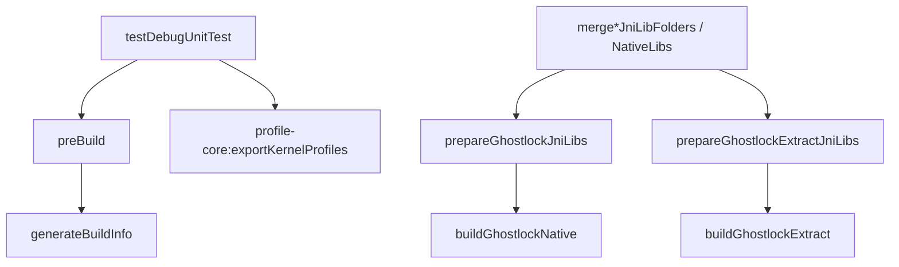

[中文](gradle-test-decoupling-plan_ZH.md) | English

# Decouple app unit tests from arm64 native builds (2026-10-01)

## Status and baseline

- Historical pre-change baseline: `81b25c01`. Implementation: `15f34caf`.
- Branch `very-not-stable-dev`. Scope: the root `build.gradle.kts` and `app/build.gradle.kts`.
- Before implementation, `preBuild` in `app/build.gradle.kts` depended on
  `prepareGhostlockJniLibs`, `prepareGhostlockExtractJniLibs`, and `generateBuildInfo`.
- The first two tasks depended on `:buildGhostlockNative` (`make -C src ghostlock`, requiring
  the NDK) and `:buildGhostlockExtract` (`cargo --target aarch64-linux-android`, requiring
  Rust's Android std), respectively. As a result, the JVM-only `:app:testDebugUnitTest`
  also triggered an arm64 native build.
- Development machines without the NDK or `aarch64-linux-android` std could not run app unit tests.
- No tests under `app/src/test/**` called `System.loadLibrary` or depended on `.so` files.

## Problem

Unit tests do not need native binaries, but the build wired them into `preBuild`.

## Goals and constraints

Goal: `:app:testDebugUnitTest` must not trigger an arm64 native build.
`assemble*` / `bundle*` must still build and package `.so` files.

Non-goals:

- Change test code, native code, profiles, or wire.
- Change the inputs, outputs, or implementation of the native tasks.
- Change `:profile-core:exportKernelProfiles`, which `ExporterAgreementTest` depends on.

## Changes implemented

- Keep only `generateBuildInfo` on `preBuild`.
- Attach `prepareGhostlockJniLibs` / `prepareGhostlockExtractJniLibs` to
  `merge*JniLibFolders` / `merge*NativeLibs`. `tasks.matching` covers matching tasks for
  debug/release and androidTest.
- Preserve
  `tasks.withType<Test>().configureEach { dependsOn(":profile-core:exportKernelProfiles") }`.
- Leave task definitions in the root `build.gradle.kts` unchanged.

Invariants:

- `.so` files are still packaged only in arm64-v8a APK/AAB outputs. Output paths are unchanged.
- Native task inputs, outputs, and cache keys are unchanged.
- `generateBuildInfo` still runs before compilation.

## Verification evidence

- [x] `./gradlew :app:testDebugUnitTest --dry-run`: no `buildGhostlock*` /
  `prepareGhostlock*` tasks appeared. `:profile-core:exportKernelProfiles` was still present.
- [x] `./gradlew :app:assembleDebug --dry-run`: `buildGhostlockNative` /
  `buildGhostlockExtract` / `prepare*JniLibs` were still present.
- [x] `./gradlew :app:testDebugUnitTest`: BUILD SUCCESSFUL, with no native build logs.
- [x] `./gradlew :app:assembleDebug`: BUILD SUCCESSFUL. The APK contained
  `lib/arm64-v8a/libghostlock.so` and `libextract.so`.

## Rollback

Attach both `prepare*JniLibs` tasks to `preBuild` again.
