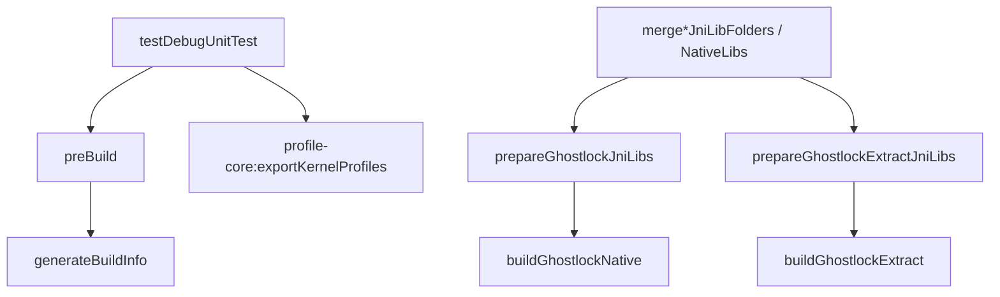

[English](gradle-test-decoupling-plan.md) | 中文

# app 单元测试与 arm64 native 构建解耦（2026-10-01）

## 状态与基线

- 历史改动前基线：`81b25c01`。实现提交：`15f34caf`。
- 分支 `very-not-stable-dev`；对象是根 `build.gradle.kts` 与 `app/build.gradle.kts`。
- 实施前 `app/build.gradle.kts` 的 `preBuild` 依赖
  `prepareGhostlockJniLibs`、`prepareGhostlockExtractJniLibs`、`generateBuildInfo`。
- 前两个任务分别依赖 `:buildGhostlockNative`（`make -C src ghostlock`，需 NDK）与
  `:buildGhostlockExtract`（`cargo --target aarch64-linux-android`，需 Rust android
  std）。因此纯 JVM 的 `:app:testDebugUnitTest` 也会触发 arm64 native 构建。
- 后果：没有 NDK 或 `aarch64-linux-android` std 的开发机无法运行 app 单元测试。
- `app/src/test/**` 没有任何测试调用 `System.loadLibrary` 或依赖 `.so`。

## 问题

单元测试不需要 native 二进制，但构建接线把它们绑在 `preBuild` 上。

## 目标与约束

目标：`:app:testDebugUnitTest` 不触发 arm64 native 构建；`assemble*` / `bundle*`
仍构建并打包 `.so`。

非目标：

- 不改测试代码、native 代码、profile、wire。
- 不改 native 任务本身的输入输出与实现。
- 不改 `:profile-core:exportKernelProfiles`（`ExporterAgreementTest` 依赖它）。

## 改动（已实施）

- `preBuild` 只保留 `generateBuildInfo`。
- `prepareGhostlockJniLibs` / `prepareGhostlockExtractJniLibs` 改挂到
  `merge*JniLibFolders` / `merge*NativeLibs`（debug/release、androidTest 同名任务由
  `tasks.matching` 覆盖）。
- `tasks.withType<Test>().configureEach { dependsOn(":profile-core:exportKernelProfiles") }`
  保留。
- 根 `build.gradle.kts` 的任务定义不变。

不变量：

- `.so` 仍只打进 arm64-v8a APK/AAB，产出路径不变。
- native 任务的输入输出、缓存键不变。
- `generateBuildInfo` 仍在编译前执行。

## 验证证据

- [x] `./gradlew :app:testDebugUnitTest --dry-run`：不再出现 `buildGhostlock*` /
  `prepareGhostlock*`，仍有 `:profile-core:exportKernelProfiles`。
- [x] `./gradlew :app:assembleDebug --dry-run`：仍出现 `buildGhostlockNative` /
  `buildGhostlockExtract` / `prepare*JniLibs`。
- [x] `./gradlew :app:testDebugUnitTest`：BUILD SUCCESSFUL，无 native 构建日志。
- [x] `./gradlew :app:assembleDebug`：BUILD SUCCESSFUL，APK 内含
  `lib/arm64-v8a/libghostlock.so` 与 `libextract.so`。

## 回滚

把两个 `prepare*JniLibs` 重新挂回 `preBuild`。
