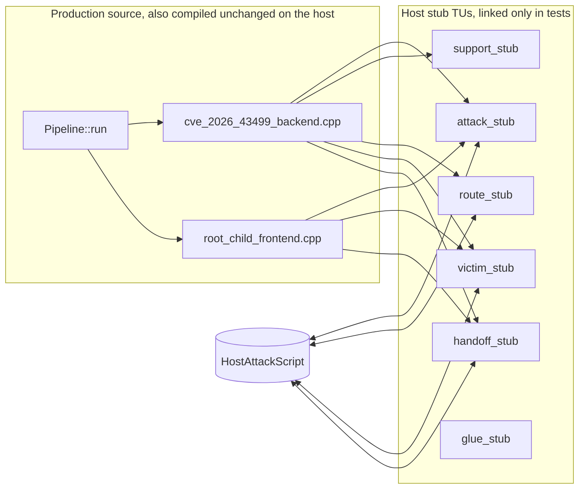

[English](host-attack-dataflow-plan.md) | [简体中文](host-attack-dataflow-plan_ZH.md)

# Host attack dataflow tests (2026-10-01)

## Status and baseline

- Historical pre-change baseline: `81b25c01`. Implementation: `15f34caf`.
- The attack dataflow starts at `runtime::Pipeline<F,B,M>::run` in `route/pipeline.hpp`.
  It first runs `Backend::run<M>`, the W1→W2/W3 chain in `cve_2026_43499_backend.cpp`,
  then passes `VictimChain` to `Frontend::run`, the handoff in `root_child_frontend.cpp`.
- These steps directly call operations with side effects: `attack::*`,
  `support::prepare_good_kernel_page`, `route::middleware::run_middleware_route`
  for the real PI race, `victim::spawn_victim` for fork, `victim::verify_*`,
  `handoff_probe_run`, and `config::runtime_config_snapshot()`.
- Before implementation, the host only had `backend_contract_test`, which checks
  the concept, and `component_catalog_test`. No test executed `run<M>`.
- Constraints: changes to the attack path require `cmp_disasm` for 8 functions.
  `g_exploit_session` is the only mutable global. The `ExploitSession` field
  layout is fixed. No indirect dispatch may be added within the PI window.

## Problem

The full attack dataflow cannot run on the host, so tests cannot assert stage
order, retries, W3 chain rounds, or the park and handoff branches.

## Goals and constraints

Goal: run W1→W2/W3 chain→handoff to `RunResult::Completed` on the host, while
replacing real attack operations with nops and scripting `verify*` and route results.

Non-goals:

- Do not change Android attack path source. Production TUs in `attack/`, `route/`,
  and `session/` stay unchanged, so the Android binary stays unchanged and
  `cmp_disasm` is IDENTICAL by construction.
- Do not add mutable globals to production or change the `ExploitSession` field layout.
- Do not perform real kernel writes, fork real victim processes, or load KernelSU
  on the host.

## Design: link-time stubs

Host tests compile the unchanged `cve_2026_43499_backend.cpp` and
`root_child_frontend.cpp` directly. Host stubs replace the TUs that provide their
side effects through ODR replacement. The stubs use the same symbol names and
signatures. Android builds do not link these stubs.

### Script API in `src/core/tests/host/host_attack_script.hpp`

- `verify_selinux` / `verify_w2` / `verify_seccomp` / `verify_leaf`:
  `std::deque<int32_t>`. Each call pops the front value. An empty queue uses
  the corresponding `*_default`.
- `route_results`: `std::deque<Status>`. Each `run_middleware_route` call pops
  one result, defaulting to `true`.
- `spawns`: `std::deque<{pid, task}>`. Each `spawn_victim` call pops one entry.
- `handoff_ready`: controls `handoff_probe_run().ready()`.
- `calls`: `std::vector<std::string>`. Records call order for assertions.
- `selinux_off_initial` / `enforce_readable_value` / `process_has_seccomp_value`
  and `page_base`: fixed probe values and a fake page base address.

The script object is a host-only singleton inside the stub TUs. It exists only
in the test binary, never in production, so it is not a production mutable global.

### Stub inventory

| Stub TU | Symbols provided | Host behavior |
|---|---|---|
| `attack_stub.cpp` | `in_direct_map`, `check_selinux_off`, `enforce_readable`, `process_has_seccomp`, `log_execution_settings`, `resolve_profile_addresses`, `install_profile`, `apply_iomem_cache`, `slab_drain`, `write_root_script`, `perf_find_task`, `timer_reset`, `timer_mark` | `in_direct_map` returns true, probes use script values, and the rest are nops |
| `support_stub.cpp` | `log_sync`, `log_startup_context`, `init_p0_profile`, `disable_rseq_for_thread`, `prepare_good_kernel_page`, `discard_prebuilt_page`, `quarantine_reclaim_sockets`, `release_quarantined_reclaim_sockets` | Fake page base address, constant true, and nops |
| `route_stub.cpp` | `middleware::run_middleware_route`, `reserve_standard_io`, `do_pselect_fake_lock_route`, `do_tcp_fake_lock_route`, `do_kernel5_fake_lock_route` | The route returns a scripted `Status`, and the rest are nops |
| `victim_stub.cpp` | `victim::spawn_victim`, `verify_selinux_stage`, `verify_w2_stage`, `verify_seccomp_probe_stage`, `verify_leaf_dir_stage` | Fake pid/task values. Verification uses script queues |
| `handoff_stub.cpp` | `handoff_probe_run`, `kernelsu_module_visible`, `ksu_root_owned`, `scan_ksu_log` | `ready()` follows the script. The rest return false |
| `glue_stub.cpp` | `sched_setaffinity` / `sched_getaffinity` / `sched_getcpu` on macOS | Empty implementations so inline `pin_to_core` can link |

The real TUs that are safe to link on the host are listed in
`HOST_ATTACK_DATAFLOW_SOURCES` in `src/Makefile`:
`runtime_config.cpp`, `exploit_session.cpp`, `address_space.cpp`, `pi_race.cpp`,
`native_resource.cpp`, `run_state.cpp`, and `heap_context.cpp`.

## Dataflow differences

In production, each `verify`/`attack_write` in `run<M>` triggers a real kernel
operation. On the host, the same source sequence calls stubs that return script
values. The `run_state` `enter/complete` transitions, retry counts, W3 chain
rounds, park branches, and handoff branches all execute their real logic.

Invariants:

- Production source is unchanged. The Android build and attack function bytes
  stay unchanged.
- Statement order, log text, retry logic, and fallback logic in `run<M>`
  stay unchanged.
- Stubs appear only in the test link set.

## Ownership and lifetime

- `ExploitSession`: constructed on the test stack. The session determines the
  lifetimes of `victim`/`heap`/`race`/`parked_*`, following the
  `exploit_session.hpp` contract. On the host, `race` starts no real threads
  and `victim` contains no real fds.
- `spawn_victim` stub: returns only value objects. It creates no fds or child
  processes, so there are no OS resources to reclaim.
- `VictimChain`: on the stack, used by a single thread. The backend writes it
  and the frontend reads it.
- Fake page pointer from `prepare_good_kernel_page`: never mapped or
  dereferenced. Only `session.heap.current.base` stores it, and the route
  stub does not read it.
- Endpoints: all test-local lifetimes end when the test function returns, with
  no dangling pointers. The stub singleton lives until the test process exits.
- UAF: no new heap allocations or ownership transfers.

## Compatibility and rollback

The change only adds test files and a `src/Makefile` target. Production
`OBJS` stays unchanged. Roll back by removing `src/core/tests/host/**`
and the Makefile target.

## Verification evidence

- [x] `src/core/tests/host/host_attack_script.hpp` and the stub TUs
  for attack/support/route/victim/handoff/glue.
- [x] Host shadow header `src/core/tests/host/include/attack/ops.hpp`
  and platform shims in `linux/futex.h`, `linux/memfd.h`, `sys/prctl.h`,
  and `sched.h`.
- [x] The `host-attack-dataflow-test` target in `src/Makefile`. Production
  backend/frontend source was unchanged.
- [x] Test cases: happy path, W2 retry, W2 exhaustion, and SELinux retry.
- [x] `make -C src host-attack-dataflow-test` printed `backend_dataflow_test: ok`
  and exited with 0. `make -C src native-host-tests` passed in full.

## Remaining work

None. Production source was unchanged, so the Android build and `cmp_disasm`
are unaffected.
