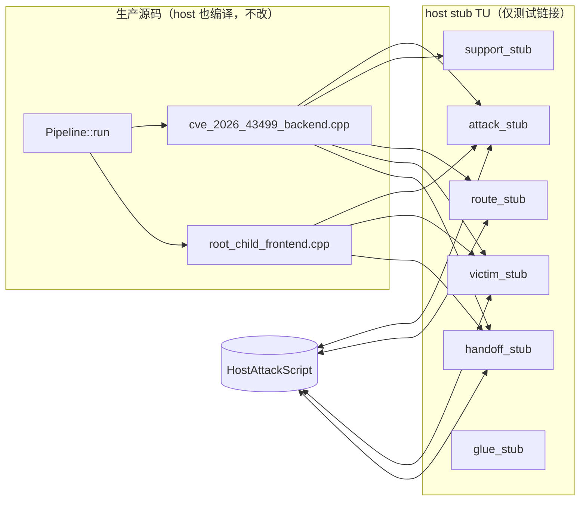

[English](host-attack-dataflow-plan.md) | [简体中文](host-attack-dataflow-plan_ZH.md)

# host 攻击数据流测试（2026-10-01）

## 状态与基线

- 历史改动前基线：`81b25c01`。实现提交：`15f34caf`。
- 攻击数据流入口是 `runtime::Pipeline<F,B,M>::run`（`route/pipeline.hpp`）：
  先跑 `Backend::run<M>`（`cve_2026_43499_backend.cpp` 的 W1→W2/W3 chain），
  再把 `VictimChain` 交给 `Frontend::run`（`root_child_frontend.cpp` 的 handoff）。
- 这些步骤直接调用副作用原语：`attack::*`、`support::prepare_good_kernel_page`、
  `route::middleware::run_middleware_route`（真 PI race）、`victim::spawn_victim`
  （fork）、`victim::verify_*`、`handoff_probe_run`、`config::runtime_config_snapshot()`。
- 实施前 host 侧只有 `backend_contract_test`（只验证 concept）与
  `component_catalog_test`，没有任何测试执行 `run<M>`。
- 约束：攻击路径改动必须跑 `cmp_disasm` 8 函数；只有 `g_exploit_session` 一个
  可变全局；`ExploitSession` 字段布局固定；PI 窗口不得引入间接分派。

## 问题

整条攻击数据流在 host 上不可执行，无法断言阶段顺序、重试、W3 chain round、
park 和 handoff 分支。

## 目标与约束

目标：在 host 上把 W1→W2/W3 chain→handoff 跑到 `RunResult::Completed`，同时
把真实攻击原语换成 nop，`verify*` 与 route 结果可脚本化。

非目标：

- 不改 Android 攻击路径源码（`attack/`、`route/`、`session/` 的生产 TU 不动），
  因此 Android 二进制不变，`cmp_disasm` 天然 IDENTICAL。
- 不新增生产可变全局，不改 `ExploitSession` 字段布局。
- 不在 host 上做真实内核写入、fork 真实受害进程或装载 KernelSU。

## 设计：链接期 stub

host 测试直接编译未修改的 `cve_2026_43499_backend.cpp` 与
`root_child_frontend.cpp`，用 host stub 替换它们依赖的副作用 TU（ODR 替换）。
stub 提供同名同签名的实现，Android 构建不链接这些 stub。

### 脚本 API（`src/core/tests/host/host_attack_script.hpp`）

- `verify_selinux` / `verify_w2` / `verify_seccomp` / `verify_leaf`：
  `std::deque<int32_t>`，每次调用弹出队首，空队列取对应的 `*_default`。
- `route_results`：`std::deque<Status>`，每次 `run_middleware_route` 弹出一个
  （默认 `true`）。
- `spawns`：`std::deque<{pid, task}>`，每次 `spawn_victim` 弹出一个。
- `handoff_ready`：控制 `handoff_probe_run().ready()`。
- `calls`：`std::vector<std::string>`，记录调用顺序，供断言使用。
- `selinux_off_initial` / `enforce_readable_value` / `process_has_seccomp_value`
  与 `page_base`：固定探针值与假页基址。

脚本对象是 stub TU 内部的 host-only singleton，只存在于测试二进制，不进生产，
不属于生产可变全局。

### stub 清单

| stub TU | 提供的符号 | host 行为 |
|---|---|---|
| `attack_stub.cpp` | `in_direct_map`、`check_selinux_off`、`enforce_readable`、`process_has_seccomp`、`log_execution_settings`、`resolve_profile_addresses`、`install_profile`、`apply_iomem_cache`、`slab_drain`、`write_root_script`、`perf_find_task`、`timer_reset`、`timer_mark` | `in_direct_map` 返回 true，探针取脚本值，其余 nop |
| `support_stub.cpp` | `log_sync`、`log_startup_context`、`init_p0_profile`、`disable_rseq_for_thread`、`prepare_good_kernel_page`、`discard_prebuilt_page`、`quarantine_reclaim_sockets`、`release_quarantined_reclaim_sockets` | 假页基址、恒 true、nop |
| `route_stub.cpp` | `middleware::run_middleware_route`、`reserve_standard_io`、`do_pselect_fake_lock_route`、`do_tcp_fake_lock_route`、`do_kernel5_fake_lock_route` | route 返回脚本化 `Status`，其余 nop |
| `victim_stub.cpp` | `victim::spawn_victim`、`verify_selinux_stage`、`verify_w2_stage`、`verify_seccomp_probe_stage`、`verify_leaf_dir_stage` | 假 pid/task，verify 取脚本队列 |
| `handoff_stub.cpp` | `handoff_probe_run`、`kernelsu_module_visible`、`ksu_root_owned`、`scan_ksu_log` | `ready()` 按脚本；其余返回 false |
| `glue_stub.cpp` | macOS 上的 `sched_setaffinity` / `sched_getaffinity` / `sched_getcpu` | 空实现，供 inline `pin_to_core` 链接 |

实链接的 host 安全 TU 见 `src/Makefile` 的 `HOST_ATTACK_DATAFLOW_SOURCES`：
`runtime_config.cpp`、`exploit_session.cpp`、`address_space.cpp`、`pi_race.cpp`、
`native_resource.cpp`、`run_state.cpp`、`heap_context.cpp`。

## 数据流差异

生产：`run<M>` 的每个 `verify`/`attack_write` 触发真内核操作。
host：同一源码序列不变，调用落到 stub，返回脚本值。`run_state` 的
`enter/complete`、重试计数、W3 chain round、park、handoff 分支全部真实执行。

不变量：

- 生产源码零改动，Android 构建与攻击函数字节不变。
- `run<M>` 的语句顺序、日志文本、重试与回退逻辑不变。
- stub 只在测试链接集里出现。

## 所有权与生命周期

- `ExploitSession`：测试栈上构造。`victim`/`heap`/`race`/`parked_*` 的生命周期
  由 session 本身给出（同 `exploit_session.hpp` 契约）。host 下 `race` 不启动
  真实线程，`victim` 不含真实 fd。
- `spawn_victim` stub：只返回值对象，不创建 fd 或子进程，无需回收 OS 资源。
- `VictimChain`：栈上、单线程，backend 写 frontend 读。
- 假页指针（`prepare_good_kernel_page`）：不映射、不解引用，仅被
  `session.heap.current.base` 接住，route stub 不读它。
- 终结点：测试函数返回即全部结束，无悬空指针；stub singleton 存活到测试进程结束。
- UAF：无新增堆分配与所有权转移。

## 兼容性与回滚

纯测试侧新增文件加 `src/Makefile` 目标，生产 `OBJS` 不变。回滚时删除
`src/core/tests/host/**` 与 Makefile 目标。

## 验证证据

- [x] `src/core/tests/host/host_attack_script.hpp` 与各 stub TU
  （attack/support/route/victim/handoff/glue）。
- [x] host 影子头 `src/core/tests/host/include/attack/ops.hpp` 与平台 shim
  （`linux/futex.h`、`linux/memfd.h`、`sys/prctl.h`、`sched.h`）。
- [x] `src/Makefile` 的 `host-attack-dataflow-test` 目标，生产 backend/frontend
  未改动。
- [x] 测试用例：happy path、W2 重试、W2 耗尽、SELinux 重试。
- [x] `make -C src host-attack-dataflow-test` 输出 `backend_dataflow_test: ok`
  且 exit 0；`make -C src native-host-tests` 全绿。

## 剩余工作

无。未改生产源码，Android 构建与 `cmp_disasm` 不受影响。
