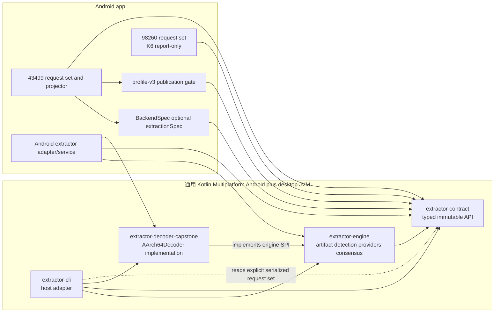
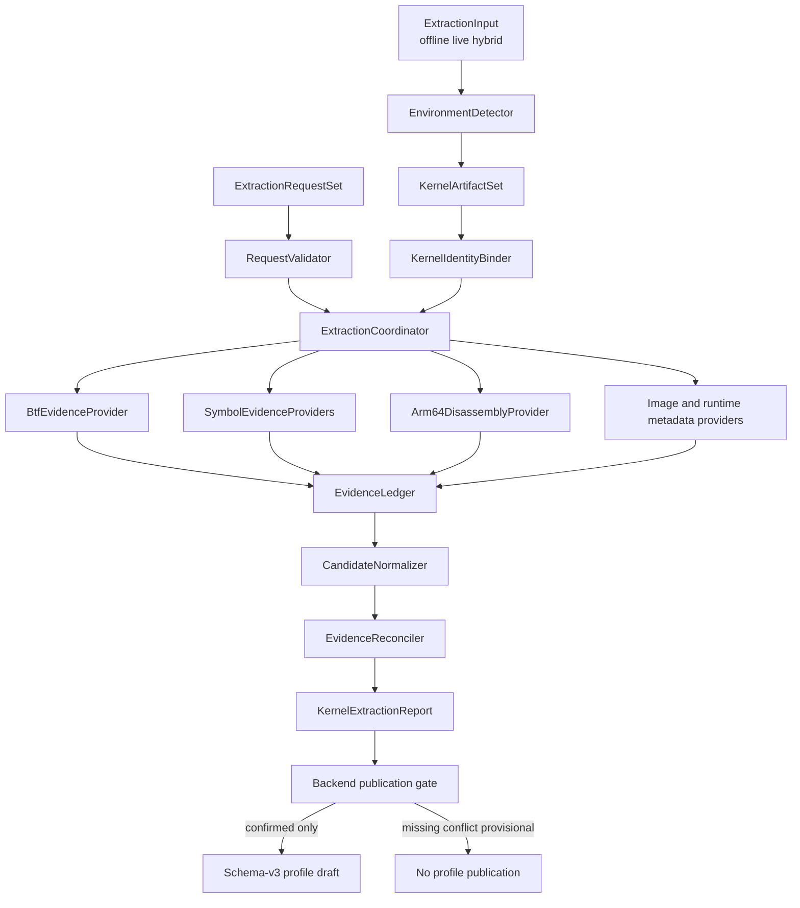
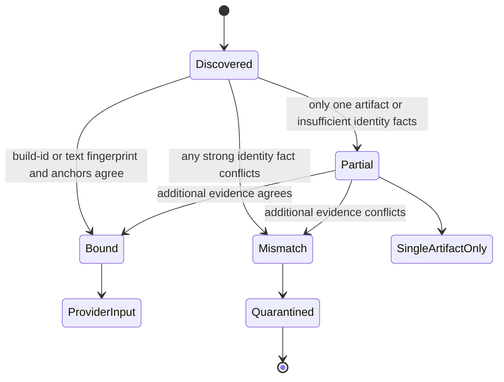
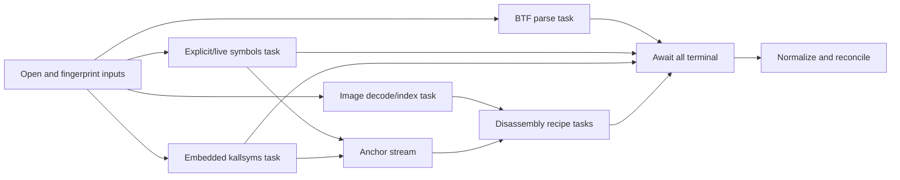
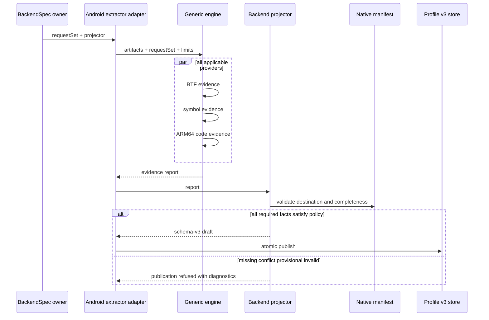
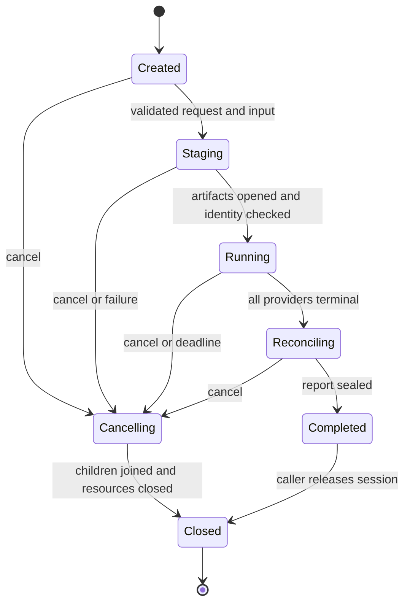

# Kotlin 通用 Kernel Extractor 架构与迁移计划（2026-11-03）

> 状态：L 级设计稿；Explore 与架构初稿已完成。2026-11-04 用户已裁定 ARM64 decoder 采用“路线 A（Capstone 5.0.9 + 项目自有窄 JNI adapter）”；该裁定只关闭 decoder 选型，不等于 G0/实现批准，尚未进入生产代码修改。
> 基线：branch `dev-nocpp`，HEAD `ffa6497adfc12938133e6338e2f95ddbf2ed54b9`；当前工作树含既有 D7/Kotlin/UI 未提交改动，本计划不得覆盖或吸收其内容。
> 需求：以 Kotlin 新写通用 extractor；旧 Rust extractor 弃用；BTF、symbol/kallsyms、ARM64 反汇编等所有可用方法同时取证并互验；extractor 不内置 CVE 或符号全集；43499、98260 各自传入自己的 request set。
> 权威：本文件是新 extractor 架构、批次和验证的唯一在办计划。旧 `plugin-extract-*.md` 仅保留历史；其“按顺序首个成功即短路”语义被本计划取代。

## 0. 活跃计划、冲突与阶段门

### 0.1 活跃计划判定

| 计划或现状 | 关系与裁定 |
|---|---|
| `docs/plan/kotlin-clean-architecture-ui-plan.md` D7 | D7 正在收敛 `BackendSpec`、backend owner 与 frontend 边界。本计划不创建第二 registry；新增 `BackendSpec.extractionSpec` 必须排在 D7.5 最终树门禁之后，或作为明确 amendment 重新获批。D7 writer 未停止前，本计划不得修改其文件面。 |
| `docs/plan/98260-backend-plan.md` | 98260 当前 compile-time header 仍是实验参数权威。本计划 K6 先做 report-only 对拍；只有另行完成 profile/native manifest 迁移与真机门，才允许 runtime 消费 extractor 输出。 |
| `docs/analysis/plugin-extract-spec-design.md`、`plugin-extract-disasm-design.md` | 复用 typed query 与 structured ARM64 pattern 的思想；冻结并取代 sequential fallback、profile-first、自带符号表和 first-success short-circuit。 |
| `tools/extract_rs/**` | K0 起冻结为 legacy oracle，只用于已知正确 corpus 的 differential test；禁止新增功能、禁止继续作为新 profile 的生产权威；K8 切换完成后删除源码与构建接线。 |
| `LegacyProfileConverter.kt` | 明确保留，只负责历史 v1/v2→3 导入；新 extractor 不调用、不修改、不把其 seeded defaults 当证据。 |

### 0.2 阶段门

1. **G0（设计 gate）**：本文件完成、design-critic 阻断为 0、用户明确批准架构；G0 前不得新增 module、contract 或 parser。
2. **G1（D7 gate）**：D7 writer 停止，最终树的 Kotlin unit/build/AVD 证据闭合；否则只允许开发不触碰 `:app`/`BackendSpec` 的 isolated core batch，且不得接入生产。
3. **G2（provider gate）**：contract、identity binding、fake-provider consensus 全绿后，才逐个移植 BTF、kallsyms、disassembly；禁止一次性重写三个 parser 后再找错误。
4. **G3（backend gate）**：43499 request set 与真实字段 manifest 对拍通过后才接 profile projector；98260 K6 只准 report-only。
5. **G4（cutover gate）**：真实 boot corpus、Android/AVD、profile v3 loader 与对应 backend 的设备门均通过后，才能把 Kotlin extractor 标为 production，并断开 Rust 生产入口。
6. **G5（retire gate）**：确认无 caller、无 Gradle/package 依赖、文档和 release 产物都不再引用 Rust 后，才删除 `tools/extract_rs`。旧 git 历史仍保留。

## 1. 现状与问题定义

### 1.1 已证实现状

- 当前工程只有 `:app` module；没有活动的 Kotlin kernel extractor。
- 当前实际 extractor 是 `tools/extract_rs` 的 Rust CLI。它同时承担 boot/OTA 解析、BTF、embedded/live kallsyms、ARM64 推导、43499 特定检查、默认值与 profile 输出。
- `tools/extract_rs/src/symbols.rs` 内置 43499 symbol/struct/member 表；`main.rs`、`report.rs` 还内置 route、credential、multicast geometry、patch predicate 与 profile 路径。因此它不是“通用引擎 + backend 输入”。
- 已冻结的 plugin spec 使用 `profile -> BTF -> kallsyms -> disasm` 顺序，首个成功值立即返回。该执行模型无法发现 BTF 与反汇编冲突，也不满足“所有可用方法同时运行并互验”。
- 当前无 BTF 路径会使用 `target.h` 或 kernel-family defaults 补缺；已有 5.10 门禁说明这不等于完成了反汇编提取。
- 98260 需要的不只是 symbol 地址，还包括 type size、member offset、call-site/instruction capture、derived address、静态符号和 runtime-only facts。裸 `List<String>` 不能表达这些语义。

### 1.2 核心问题

旧实现把以下五种职责压在一个程序里：

1. 获取 boot/vmlinux/BTF/kallsyms 等 artifact；
2. 判断 artifact 是否属于同一 kernel build；
3. 解析/分析 artifact；
4. 决定 43499 要什么值以及值是否足够可信；
5. 把结果写成 GhostLock profile。

这导致 symbol 表、fallback、profile owner 与 parser 相互耦合。新架构必须把“**通用取证机制**”与“**backend 要求什么、如何投影**”彻底分开。

## 2. 目标、非目标与不变量

### 2.1 目标

1. 用 Kotlin 实现新的 extractor contract、engine、parser/analyzer 与 Android/host adapter；generic engine 只依赖 vendor-neutral `Aarch64Decoder` SPI/immutable DTO，不调用 Rust、Capstone/JNI 入口或 `objdump`。Capstone/JNI 只存在于独立 decoder adapter implementation。
2. 自动探测 offline 与 live 环境中的所有可用证据源：embedded/external/live BTF、explicit/live/embedded kallsyms、vmlinux/System.map、boot/raw Image、OTA/payload 与可用 kernel metadata。
3. 所有 applicable provider 都被调度并运行到 terminal；任何 provider 成功都不得取消其他 provider。
4. 对同一 semantic fact 的 candidate 做 type-safe normalization、identity binding、dependency-aware reconciliation；冲突 fail-closed。
5. generic engine 不包含 CVE、backend、profile path 或具体 symbol/member 字面量；43499 与 98260 各自拥有并传入类型化 `ExtractionRequestSet`。
6. 支持 5.10 无 BTF：kallsyms 负责定位/边界，ARM64 structured disassembly 负责提取 backend 声明的值；不得回落到 kernel-family 常量。
7. extraction report 与 schema-v3 profile 分离。只有 backend-owned projector 和 publication gate 能把满足策略的 fact 写入 profile。
8. 同一输入、request set、limits 与 engine build 必须得到 deterministic report，不受 coroutine 完成顺序影响。

### 2.2 非目标

- v1 不实现所有 CPU 架构；先实现 ARM64 decoder SPI 与 ARM64 provider。
- v1 不承诺完整 C decompiler。这里的“反编译提取”指 decoded instruction + bounded control/data-flow recipe，不做反汇编文本正则。
- 不通过 kernel major/release 猜 offset、地址、KASLR slide 或 profile 值。
- 不修改 sysctl、SELinux、`kptr_restrict`，也不向 extractor 提供任意 shell command。
- 不把 extraction 成功等同 exploit 成功、KSU 成功或设备 supported。
- K6 不把 98260 从 compile-time header 偷换为 runtime profile；该迁移另立攻击关键路径批次。
- 不修改 `LegacyProfileConverter.kt`，不恢复旧 v1/v2 生成路径。
- 不碰 `kernelsnitch/`、waiter/race/payload/route/exec 算法。

### 2.3 强制不变量

- 一个 backend membership authority：`Backends.all`；不得新增 `ExtractionBackends.all`。
- 一个 fact 一个稳定 `FactId`，一个 backend 一份最终 request set；共享模板只能被显式组合，不能隐式扩展。
- provider 只返回证据，不写 profile、不改全局 map、不选择 winner。
- report 中 `MISSING`、`DENIED`、`REDACTED`、`FAILED`、`CONFLICT` 必须保持可区分，不能坍缩为 `0` 或默认值。
- live 与 offline artifact 未通过 identity binding 时，不能放入同一个 consensus set。
- profile 只能是 schema 3；输出 key 必须来自 native-generated manifest，而非 Kotlin 手抄跨端字段全集。
- extractor session 之外不得新增可变全局状态或长期 cache。

## 3. 总体架构

### 3.1 Module 与依赖方向



拟新增四个 Gradle module。`contract`、`engine`、`decoder-capstone` 使用同一 KMP target matrix：AGP 9.4.1 的 `com.android.kotlin.multiplatform.library` + KGP 2.4.20 `org.jetbrains.kotlin.multiplatform`，在 `kotlin { android { ... }; jvm("desktop") }` 中声明 Android 与单一 desktop JVM target；不使用已进入迁移期的 `androidTarget()`，也没有 macOS/Linux Kotlin/Native target。CLI 是 desktop JVM application frontend；`:app` 消费 Android variant。engine 的全部 production 源放 `commonMain`，只依赖 common API；platform loader/JNI 声明只放 decoder module 的 `androidMain`/`jvmMain`。decoder 依赖 engine 以实现 SPI，engine 永不反向依赖 decoder；composition root 为 engine 注入 decoder。

Android-KMP library plugin 不承担本路线的 CMake/external-native packaging：按 Android 官方 [KMP library plugin 文档](https://developer.android.com/kotlin/multiplatform/plugin) 的当前能力边界，KMP module 只交付 Kotlin Android variant；共享 native source/CMake 归 `extractor-decoder-capstone/src/native/**`，Android `arm64-v8a` adapter DSO 由现有 `:app` AGP `externalNativeBuild` include 同一 CMake chunk 并打包。desktop 五 classifier 则由 decoder module 的 Gradle KTS/CI runner 编译同一 native source。这样 Android app 与 desktop 不复制 adapter source，也不要求 KMP plugin 伪装支持 Android-specific native build。

| module | 职责 | 禁止依赖 |
|---|---|---|
| `:extractor-contract` | KMP common request、artifact identity、candidate、resolution、report 等纯不可变类型 | platform API、`:app`、CVE package、profile/wire、parser implementation |
| `:extractor-engine` | KMP common artifact normalization、environment probe、BTF/kallsyms/disassembly provider、`Aarch64Decoder` SPI、dependency graph、reconciler | platform API、JNI/Capstone、`:app`、`BackendSpec`、具体 symbol/CVE/profile path |
| `:extractor-decoder-capstone` | KMP adapter；common implementation + Android/JVM actual loader/JNI bridge；只把 Capstone 结果复制成 engine DTO | backend/CVE/profile、engine internal coordinator、JNA/Kotstone public type、文本 fallback |
| `:extractor-cli` | desktop JVM 文件/FD adapter、显式 request-set 输入、canonical diagnostics 输出；直接 CLI 进程也是可终止 worker | `:app`、backend registry、内置 CVE→spec switch |

Android source、`ContentResolver`、`ParcelFileDescriptor`、service lifecycle 与 profile projection 留在 `:app`。这样 backend 可以只依赖 contract，不会因声明请求而依赖完整 engine；只有 Android composition root 同时依赖 engine 与 decoder implementation。

### 3.2 为什么 CLI 不内置 backend catalog

CLI 接收显式 `ExtractionRequestSet` descriptor；它不提供 `--backend 43499` 后再维护一份 CVE switch。request set 的编译期 owner 仍是 backend，必要时由 app/Gradle 的专用导出任务产生 revision 3 descriptor。这样：

- `Backends.all` 不被复制；
- 98260 即使尚无 Kotlin `BackendSpec`，也能在 K6 显式把自己的 request set 交给 engine；
- generic CLI 不知道任何 CVE；
- descriptor 只是 extractor 输入，不是运行时 profile 权威。

### 3.3 组件职责



## 4. 公共 contract

### 4.1 不是裸字符串列表，而是类型化 request set

用户所说的“符号列表”在 API 中落为一组 typed requirements。extractor 仍不知道要提取哪些具体名字，但必须知道每个名字代表 address、field offset、size 还是 instruction capture，否则不同方法的值无法比较。

```kotlin
@JvmInline
value class FactId(val value: String)

data class ExtractionRequestSet(
    val id: String,
    val contractRevision: Int,
    val facts: List<FactRequirement>,
)

data class FactRequirement(
    val id: FactId,
    val valueType: FactValueType,
    val required: Boolean,
    val probes: List<ProbeSpec>,
    val constraints: List<ValueConstraint>,
    val verification: VerificationPolicy,
)
```

`contractRevision` 使用项目当前 revision 3；它不是另一套 profile version。engine 拒绝非 3 descriptor，profile projector 仍只产 schema 3。

### 4.2 值必须带 coordinate space

```kotlin
sealed interface FactValue {
    data class Unsigned(val value: ULong) : FactValue
    data class Signed(val value: Long) : FactValue
    data class Flag(val value: Boolean) : FactValue
    data class Text(val value: String) : FactValue
    data class Address(val value: ULong, val space: AddressSpace) : FactValue
    data class Offset(val value: ULong, val base: OffsetBase) : FactValue
}
```

`AddressSpace` 至少区分：

- runtime virtual address；
- link-time/static virtual address；
- image-relative offset；
- `_text`-relative offset；
- physical address。

`OffsetBase` 至少区分 struct member、type size、instruction PC 与 image base。禁止把这些值全部压成无语义 `Long`，也禁止在未知 slide 时把 runtime VA 当 static VA。

### 4.3 通用 probe 类型

```kotlin
sealed interface ProbeSpec {
    data class SymbolAddress(
        val symbolName: String,
        val requestedSpace: AddressSpace,
    ) : ProbeSpec

    data class BtfMemberOffset(
        val typeName: String,
        val memberPath: List<String>,
    ) : ProbeSpec

    data class BtfTypeSize(val typeName: String) : ProbeSpec

    data class BtfEnumValue(
        val typeName: String,
        val memberName: String,
    ) : ProbeSpec

    data class Arm64InstructionCapture(
        val anchor: DisassemblyAnchor,
        val scope: SearchScope,
        val pattern: InstructionPattern,
        val occurrence: OccurrenceSelector,
        val capture: CaptureRule,
        val maximumScanBytes: Int,
    ) : ProbeSpec

    data class DerivedExpression(val expression: CheckedExpression) : ProbeSpec
}
```

约束：

- 每个 disassembly probe 必须有 anchor、函数/区间边界、最大扫描字节、唯一/第 N 命中规则和 capture 类型。
- pattern 匹配 decoded opcode/operand，不匹配渲染后的反汇编文本。
- `DerivedExpression` 只做有界、checked 的表达式 DAG；它引用其他 `FactId`，不允许 backend 任意 Kotlin lambda，也不算独立证据。
- request 构造时拒绝重复 ID、空 required probes、类型不相容 normalization、无界 scan 与 dependency cycle。

### 4.4 provider contract

```kotlin
interface EvidenceProvider {
    val id: ProviderId
    val family: EvidenceFamily
    fun applicability(
        requests: ExtractionRequestSet,
        environment: KernelEnvironment,
    ): ProviderApplicability

    suspend fun collect(
        requests: ExtractionRequestSet,
        context: ProviderContext,
    ): ProviderResult
}
```

`ProviderResult` 只能包含不可变 observation：

- `Candidate`：值、method family、artifact root、byte/function location、dependencies、parser build；
- `Miss`：该 probe 在有效输入中没有命中；
- `Unavailable`：源不存在、不可读、被隐藏、架构不支持；
- `Failed`：源存在但损坏、越界、格式冲突或 provider bug；
- `Cancelled`：session 取消/deadline。

provider 不持有 profile writer，不访问 `BackendSpec`，也不写共享 mutable map。

### 4.5 report 不是 profile

```kotlin
data class KernelExtractionReport(
    val requestSetId: String,
    val identity: KernelIdentity,
    val environment: EnvironmentReport,
    val providerRuns: List<ProviderRun>,
    val facts: Map<FactId, FactResolution>,
    val diagnostics: List<ExtractionDiagnostic>,
)
```

canonical report 主体不含时间戳、本地绝对路径或 coroutine 完成顺序；这些信息只放在非 canonical run envelope。report 不能被 `LegacyProfileConverter` 当成旧 extractor JSON 导入。

## 5. Artifact 获取、环境探测与 identity binding

### 5.1 支持的输入

`ExtractionInput` 支持三种组合：

1. `OfflineArtifacts`：boot/vendor_boot、raw Image、vmlinux、BTF、System.map/kallsyms、OTA ZIP/payload；
2. `LiveSnapshots`：`/sys/kernel/btf/vmlinux`、`/proc/kallsyms`、`/proc/iomem`、kernel release/build metadata；
3. `Hybrid`：offline image + live snapshot，但必须先证同一 kernel build。

所有输入统一成只读 `KernelArtifactSet`。每个 `ArtifactRef` 保存：

- artifact kind 与 source kind；
- content fingerprint；
- 可重复读取的 bounded byte source；
- open/read/parse capability 状态；
- kernel identity evidence；
- parent artifact 与 byte range（例如 boot 中的 Image、Image 中的 BTF）。

### 5.2 自动探测不是路径存在检查

对每个潜在来源，环境探测必须记录以下互斥状态：

```text
ABSENT
DENIED
REDACTED
EMPTY
CORRUPT
UNSUPPORTED
AVAILABLE
```

具体规则：

- `/proc/kallsyms` 全零地址为 `REDACTED`，不能提供 address candidate；
- path 存在但 open/read 失败为 `DENIED`；
- BTF section 存在但 parser 失败为 `CORRUPT`，不是“设备没有 BTF”；
- 非 ARM64 image 让 ARM64 provider 变为 `UNSUPPORTED`，其他 provider 继续；
- explicit input 不会短路 embedded/live 探测；所有可用来源都保留为独立 observation。

### 5.3 identity gate



- `uname -r`/release 字符串只能作为弱提示，不能单独把 live `/proc/kallsyms` 与 offline boot 绑定。
- 强证据优先使用 build-id、kernel text fingerprint、BTF fingerprint、banner 与稳定 anchor tuple。
- `Mismatch` artifact 被隔离，不能进入同一 fact 的 consensus。
- `Partial` 可在单 artifact 内提取 candidate，但不得虚构跨 artifact 验证。

## 6. Provider 与“同时运行”的精确定义

### 6.1 provider 集合

1. `BtfEvidenceProvider`
   - embedded BTF；
   - explicit BTF；
   - live `/sys/kernel/btf/vmlinux`；
   - type/member/enum/size。
2. `SymbolEvidenceProvider`
   - explicit System.map/kallsyms；
   - live `/proc/kallsyms`；
   - embedded kallsyms recovery，覆盖 pre-6.4、6.4+、absolute/relative/percpu variants；
   - vmlinux ELF symbol table（若提供）。
3. `Arm64DisassemblyProvider`
   - 只依赖项目自有 `Aarch64Decoder` SPI 与 immutable typed DTO；production decode 由独立 Capstone adapter 提供；
   - bounded function/region scan；
   - typed instruction pattern、capture 与受限 data-flow；
   - 不执行外部 `objdump`，不解析工具文本。
4. `KernelMetadataProvider`
   - release/build-id/banner/image layout/FDT/iomem 等只读事实；
   - 只为明确请求的 facts 提供 observation。

### 6.2 concurrent DAG，不是平面抢跑

“同时运行”定义为：**所有 applicable lane 在同一 session 内被调度；任何 lane 成功都不会阻止或取消其他 lane；reconciliation 只在全部 lane terminal 或 session deadline 后进行。**



这允许显式 dependency：disassembly 需要 image index，某些 recipe 需要 symbol anchor；但 dependency 不会把整体退化成“BTF 成功就不跑 disasm”。

实现规则：

- `supervisorScope` 隔离 provider failure；禁止 `GlobalScope`。
- provider family 粒度并发，不对每个 fact 无界创建 coroutine。
- BTF、kallsyms、image/decompression 每个 artifact 每 session 只解析一次，批量回答 requests。
- 注入 IO dispatcher、CPU dispatcher 与 `Semaphore`；并发度和 scan budget 由 immutable `ExtractionLimits` 控制。
- user cancellation 传播给所有 child；provider exception 不取消 siblings。
- report 按 `FactId -> family -> providerId -> artifactId -> evidence location` 排序，绝不按完成时间排序。

### 6.3 Android 与大文件 limits

`ExtractionLimits` 至少限制：

- request 数、每 fact probe 数；
- boot/vmlinux/OTA/payload 最大输入字节；
- ZIP entry 数、单 entry 与总解压大小；
- BTF type 数、nesting depth、string table 大小；
- kallsyms 行数与行长；
- 每条 disassembly recipe 的最大扫描字节与命中数；
- provider 并发数、session deadline、临时空间。

所有 parser 用 checked arithmetic；任何 offset+length overflow、越界、解压炸弹或 recursion 超限都生成具名 `Failed`，不截断后继续。

## 7. 交叉验证与失败语义

### 7.1 证据依赖图

每个 candidate 必须带：

- `EvidenceFamily`：`TYPE_INFO`、`SYMBOL_TABLE`、`CODE_ANALYSIS`、`RUNTIME_OBSERVATION`、`IMAGE_METADATA`；
- `ArtifactRoot`：boot、vmlinux、live snapshot、external BTF 等根；
- `dependencies`：anchor、base、slide、parent candidate；
- byte range/function/pattern hit；
- normalized value 与 coordinate space。

例：以 embedded kallsyms 的函数地址为 anchor，再从同一 Image 反汇编出的 offset，确实是 `CODE_ANALYSIS` candidate，但它依赖该 kallsyms anchor。它不能被算成对“anchor 地址”的第二张独立票；对“field offset”则可以与 BTF 的同一 semantic value比较。

### 7.2 resolution 状态

```kotlin
sealed interface FactResolution {
    data class VerifiedCrossMethod(...) : FactResolution
    data class CorroboratedSameMethod(...) : FactResolution
    data class SingleSource(...) : FactResolution
    data class Missing(...) : FactResolution
    data class Conflict(...) : FactResolution
    data class Invalid(...) : FactResolution
    data class Cancelled(...) : FactResolution
}
```

| 状态 | 判据 | profile publication |
|---|---|---|
| `VerifiedCrossMethod` | 至少两种可比较、dependency policy 满足的方法得到同一值 | 允许，仍须 backend projector completeness gate |
| `CorroboratedSameMethod` | 同方法族的多个独立 recipe/root 得到同一值 | 仅当该 fact 的 backend policy 明确允许；必须保留降级标签 |
| `SingleSource` | 只有一个有效 candidate | 默认禁止生产 profile；可输出 report |
| `Missing` | 无 candidate，保留 unavailable/miss 原因 | 禁止 required fact publication |
| `Conflict` | 两个或更多有效 candidate 归一化后不同 | 一律 fail-closed；禁止多数票 |
| `Invalid` | request、identity、normalization、constraint 或 dependency 不合法 | 禁止 publication |
| `Cancelled` | session 未完成 | 禁止 publication |

### 7.3 verification policy

```kotlin
sealed interface VerificationPolicy {
    data class RequireIndependentFamilies(val minimum: Int) : VerificationPolicy
    data class AllowIndependentRecipes(
        val family: EvidenceFamily,
        val minimum: Int,
    ) : VerificationPolicy
}
```

- 不提供“first wins”或“majority wins”。
- 多个 parser 读取同一份截断 snapshot 不算多个 artifact roots。
- 旧 profile 只能作为 regression baseline，不能作为生成同一 profile 时的独立验证来源，避免循环证明。
- equality 默认 exact；只有事实本身有明确容差语义时才可声明 tolerance，kernel offset/address/size 不使用容差。

### 7.4 5.10 无 BTF

5.10 支持路径为：

1. symbol providers 恢复/读取 symbol table，定位函数与 text 边界；
2. backend 为一个 field 提供至少两个可审计、边界受限的 ARM64 recipe（若现实代码存在两个 witness）；
3. disassembly provider 保留 anchor dependencies；
4. 两个 recipe 同值时最多是 `CorroboratedSameMethod`，不能伪装成 BTF+disasm 的 `VerifiedCrossMethod`；
5. backend policy 决定该 fact 是否允许以 same-method corroboration 发布。未明确允许就保持 report-only；
6. 不存在第二 witness 时为 `SingleSource`，不得用 5.10 family default 补齐。

因此“支持无 BTF”指能实际分析并给出证据状态，不是保证每个任意字段都能自动变成 production-confirmed。

## 8. Backend-owned request set 与 profile projector

### 8.1 `BackendSpec` 接入

D7 完成后，标准化 outer contract 增加唯一可选能力：

```kotlin
interface BackendSpec {
    val extractionSpec: BackendExtractionSpec?
        get() = null
}

data class BackendExtractionSpec(
    val requestSet: ExtractionRequestSet,
    val projector: ProfileFactProjector,
)
```

- `BackendSpec` 只暴露能力，不执行 extraction、不保存 session。
- data adapter 从 composition root 已捕获的 `List<BackendSpec>` 读取能力；UI/domain 不 import `BackendSpec`。
- 不按 key/class 写 `when`，不新增 registry/map/list。
- 43499 object 传入 43499 request set；未来 98260 Kotlin object 建立后也走同一属性。
- 98260 在 object 建立前由测试/CLI/分析入口显式传入 request set，不冒充已注册 backend。

### 8.2 43499

`Cve43499ExtractionSpec` 拥有：

- 43499 需要的 symbol address；
- `task_struct`/`cred`/waiter 等 member/size；
- pselect、logger、waiter/trigger 前置条件的 ARM64 recipes；
- 43499-private geometry 与 patch predicate 所需 facts；
- 每个 fact 的 verification policy。

`Cve43499ProfileProjector` 拥有：

- `FactId -> native manifest field` 映射；
- backend completeness；
- vulnerability/route predicate；
- profile v3 draft 投影。

generic engine 中不得出现 `CVE-2026-43499`、`init_task`、`init_cred`、`rt_mutex_waiter` 或 43499 profile path 的字面量。共享 query 可以由 backend-side `CommonKernelAbiRequirements` 显式组合，但最终 request set 仍由 43499 owner 构造。

### 8.3 98260 两阶段

**K6a report-only：**

- `Cve98260ExtractionSpec` 声明 timer alloc/call sites、timer/slab geometry、task/cred/security layout、static symbols 与 trigger prerequisite；
- 与 `avd_61_params.h`、`a301so_515_params.h` 做逐字段 evidence diff；
- runtime-only facts（KASLR slide、trace event ID、PFN、当前 boot 的 dynamic address/calibration）明确标 `RUNTIME_DISCOVERED`，不得写入静态 request/profile；
- mismatch 输出 `Conflict`，不自动改 header。

**K6b profile/runtime migration：**

- 另立 L 级批次，先定义 native schema/manifest owner、98260 Kotlin `BackendSpec` 与 projector；
- profile 读取点只能有一个；compile-time header 在真机门后同批退役；
- 该批触及攻击关键路径，必须走 AVD/真机冷机门与 `device-gates/` 归档。

### 8.4 三种权威不得混合

| authority | 回答 | owner |
|---|---|---|
| `BackendParameterSchema` | backend 运行时需要哪些参数 | backend `BackendSpec` |
| `ExtractionRequestSet` | 哪些 artifact/method 能提取和验证这些 facts | backend `extract/` owner |
| native-generated manifest | profile/wire 真实允许哪些 field | native schema/export |

白盒 gate 必须证明：required `PROFILE` 参数都有 request；projector 只写 manifest field；`RUNTIME_DISCOVERED` 不被静态 extractor 伪造；有 result 但无 destination 的 fact 只留 report。

## 9. Profile projection 与 publication



规则：

- report 比 profile 信息更丰富；provenance、conflict、parser diagnostics 不进 runtime wire。
- required fact 未达 policy 时，不写“半份可执行 profile”。可以保存独立诊断 report。
- projector 必须 deterministic；同一 report 两次投影得到相同 canonical profile bytes。
- profile 写入采用 temp + fsync/close + atomic replace 的 app-private publication 语义；失败时旧 profile 不变。
- extractor 不读取 profile 作为事实来源；允许把旧 profile 放在 UI diff 中，但不得计入 consensus。

## 10. Android adapter、进程与资源所有权

### 10.1 进程边界

推荐把大镜像解析放入 app-private `:extractor` service process，而不是主 UI 或 `:flowhost`：

- `:flowhost` 是攻击执行 owner，不能混入大文件 parser 生命周期；
- 独立进程限制 parser crash/OOM 对 UI 和攻击 host 的影响；
- UI 只持 session token/progress，不持 boot bytes。

Binder 只传小型 DTO、session token 与 `ParcelFileDescriptor`；禁止传 boot/vmlinux/BTF/kallsyms 大 `ByteArray`。若初期只实现 host CLI，Android service 仍是 production cutover 的必过批次，CLI 不得成为生产旁路。

### 10.2 resource ownership

| resource | 创建者 | owner | 借用者/区间 | 终结顺序 |
|---|---|---|---|---|
| input PFD/channel | Android/host adapter | `ExtractorSession` | artifact resolver 与 providers，只读，session active | 取消/完成 providers → join → unmap/close channel → close PFD |
| decompressed/staged file | artifact resolver | session temp store | parser/provider | providers terminal → close mappings → delete temp |
| mapped/read window | artifact cache | artifact cache | provider task | task stop → release view → cache close |
| parsed BTF/symbol/image index | provider preparation | session analysis cache | same-family batch queries | all queries terminal → cache close/drop |
| packaged Capstone native library | decoder module build/release | immutable app/JAR resource | process loader，仅初始化时读取 | 进程生命周期内保持已加载；不尝试 JVM 内卸载 |
| desktop extracted native resource | desktop loader | digest-named app cache entry | `System.load` 前创建，进程内只读 | 当前版本进程存活期间保留；下一次启动只清理未加载的旧 digest，不删除 Windows 已加载文件 |
| Capstone `cs_handle` + options | `CapstoneAarch64Decoder.open` | 单个 decoder instance | 单一 provider worker；不跨 coroutine/线程共享 | provider terminal/finally → `cs_close` 一次 → CLOSED；重复 close 幂等且不再进 JNI |
| reusable `cs_insn *` | native open (`cs_malloc`) | 同一 decoder handle | 每次固定 4-byte `decodeOne` native frame，串行复用 | 每次先复制完整 typed result；decoder close 时 `cs_free`，随后 `cs_close`；异常/invalid 不转移 owner |
| JNI local references / pinned arrays | 每次 native call | 当前 JNI frame | 仅该次固定长度 decode | 所有返回/异常分支先 release/unpin、delete/pop local frame；不保留 global ref，不把 native pointer 暴露给 Kotlin |
| coroutine children | coordinator | session scope | providers | cancel signal → await terminal → close resources |
| report | reconciler | caller | projector/UI diagnostic | immutable value；不引用 live channel/mapping |

访问者必须先停止，再解除 mapping/stream 关联，再关闭 PFD/删除 temp。取消不能直接关底层 channel 后让仍运行的 provider 继续读。报告不得保存 live buffer slice。

### 10.3 lifecycle 状态机



`close()` 发出取消并进入 closing；suspend `shutdown()` 等待 children 后关闭资源。重复调用幂等。不得在 provider 仍读 mapping 时删除 staging file。每个 disassembly provider worker 独占一个 decoder/`cs_handle`；同一 handle 不共享、不并发修改 option。取消在当前固定 4-byte native decode 返回后生效，provider 在下一条指令前检查 cancellation，并在 `finally` 关闭 decoder。invalid/truncated input、JNI exception、Kotlin allocation failure、提前返回或 cancellation 均不得降级解析 `opStr`，也不得绕过 `cs_free`/`cs_close`。

固定长度 native call 若仍超过 hard deadline，不能在线程内安全关闭其正在借用的 handle/input，终态按 platform 分开：

- **Android**：`:extractor` service 进程内的 `ExtractorProcessWatchdog` 独立计时；超时写一条不含载荷的 terminal diagnostic 后调用 `Process.killProcess(myPid)`。app 进程的 repository 以 Binder death 把当前 session 封为 `Failed(DECODER_PROCESS_DIED)`，关闭自己持有的 PFD/token，并只为下一次显式 session rebind 新进程；不自动重放当前 request。OS 回收 stuck native handle/mapping，app 进程不得先从外部关闭其借用的底层资源。
- **desktop JVM CLI**：直接 CLI 进程就是 disposable worker；`JvmExtractorWatchdog` 在 hard deadline 后向 stderr 单次写 `EXTRACTOR_FATAL=CAPSTONE_NATIVE_HANG`，随后 `Runtime.halt(74)`。退出码 74 是该 frontend 的固定 fatal code，OS 回收 native 资源；不得在同一 JVM 继续运行或 fallback。未来 GUI/TUI 必须把 engine/decoder 放入 child JVM，并把同一 exit 74/diagnostic 映射为 failed session，不能在 UI JVM 内直接承诺 hung-call recovery。Android app 不经 CLI/该转换层。

`NativeHangWatchdogTest` 以独立 JVM 启动 `HangFixtureMain` 和 blocking decoder，断言 deadline 内得到 literal/exit 74、0 report publication、0 retry；Android instrumentation 以 test-only blocking decoder 断言 binder death、当前 session 失败、下一显式 session 才 rebind。普通 close/lifecycle tests 仍须逐条证明 `cs_free`→`cs_close`；process-fatal fixture 只验证无法安全 unwind 的最后终态，不替代正常释放门。

## 11. CBN 与冻结决策

| 决策 | A | B | C | 选择与翻转条件 |
|---|---|---|---|---|
| module 边界 | 所有代码塞 `:app`，文件少但 generic contract 可反向依赖 Android/backend | 4 个新 module：`contract`、`engine`、`decoder-capstone`、`cli`；app 只接 adapter | 再把每个 parser 拆 module，至少 7 个新 module | 选 B；首期新增 4 module，第二种 CPU/decoder 被独立发布时才再拆 provider module；每新增 backend 只在 app owner 增 1 extraction spec，不改 decoder module |
| request 形状 | `List<String>` | typed `FactRequirement + ProbeSpec` | 任意 Kotlin callback/脚本 DSL | 选 B；A 无法表达 offset/size/capture，C 无法审计和重放 |
| method 调度 | first-success fallback | 全 applicable provider concurrent DAG | 完全串行但保留结果 | 选 B；只有资源测量证明设备无法承受并发时降低 semaphore，不改变“全运行”语义 |
| ARM64 分析 | 调外部 `objdump` 并 regex 文本；0 native packaging，但文本/alias 不稳定 | pure Kotlin structured subset decoder；约 12–20 opcode family 的 encoding/alias/边界均由项目长期维护 | Capstone 5.0.9 + 项目自有窄 JNI adapter | 采用外部选型“路线 A”，即本表 C；v1 是 1 个 desktop JVM target + 5 个 OS/arch resource classifier、1 个 Android arm64-v8a artifact，共 6 个 native artifact。首期约 1 module、2 Kotlin platform loader、2 JNI source/header、1 CMake、5 类 gate；每次 Capstone 升级改 1 provenance lock 并重跑 6-artifact packaging+typed corpus+lifecycle。只有 v5 出现无法回避的正确性/安全缺陷，或 adapter/corpus 维护成本连续两次超过 decoder 子集实现，且替代/升级 corpus 全绿时翻转 |
| consensus | 第一票/多数票 | dependency-aware、冲突 fail-closed | backend 任意 callback 选值 | 选 B；没有翻转条件 |
| report/profile | engine 直接产 43499 HOCON | neutral evidence report + backend projector | report 全塞 profile | 选 B；没有翻转条件 |
| Android 运行位置 | UI 进程 | app-private `:extractor` process | 复用 `:flowhost` | 选 B；只有实测输入始终很小且无 OOM/crash 隔离收益才可复审，C 永不选择 |
| 98260 cutover | extractor 直接改 header/runtime | report-only 对拍，再独立迁移 | 永久保持双权威 | 选 B；真机门通过后进入单一 profile authority，禁止 C |
| 旧 Rust | 立即删除，失去 oracle/corpus | K0 freeze，K7 cutover，K8 删除 | 永久双实现 | 选 B；K8 gate 达到即删除，禁止 C |

### 11.1 2026-11-04 decoder 选型记录：路线 A

**裁定。** ARM64 语义解码采用 Capstone `5.0.9`，通过项目自有、AArch64-only 的窄 JNI adapter 接入；Android 与 desktop JVM 共用同一 Kotlin contract/engine，不增加 macOS/Linux Kotlin/Native target。desktop 仍只有一个 JVM target，但其 native binary 按 `macos-aarch64`、`macos-x86_64`、`linux-aarch64`、`linux-x86_64`、`windows-x86_64` 五个 runtime resource classifier 分发；Android v1 只交付 `arm64-v8a`，共 6 个 native artifact。上述平台是待 K5 packaging/load corpus 逐项验证的 target matrix，不是当前已证支持。GraalVM AOT 属于下游自行适配面，不进入本项目 target matrix。

**边界。** JNI 只负责把输入 byte window、起始 VA 与受限 decode options 交给 Capstone，并在 native allocation 释放前复制出项目自有 immutable DTO。DTO 必须覆盖 Rust 全链路已经依赖的 register id/width、immediate、PC-relative target、memory base/index/displacement、pre/post-index/writeback、shift/extend、alias 与 system-register 语义；`cs_insn`、`cs_detail`、裸指针、Capstone enum ordinal、JNA/Kotstone 类型均不得越过 adapter。recipe、evidence dependency、bounded scan、checked arithmetic、consensus 与 backend request set 继续由 Kotlin engine 拥有。

**未选方案。** 不把 external `objdump` 文本/regex 设为生产权威；不自行维护 pure Kotlin AArch64 decoder；不采用 Kotstone 作为生产 ABI 层。Kotstone 只可作为 API 参考或非权威试验输入，不能出现在公共 contract、evidence 或 profile 中。

**来源锁定。** 2026-11-04 以 Capstone 官方 [5.0.9 release](https://github.com/capstone-engine/capstone/releases/tag/5.0.9) 和 [version history](https://www.capstone-engine.org/changelog.html) 为外部事实来源：tag object=`841cee33c3c630cf7d321a64f47aefe7b0b8da99`，peeled commit=`022575848782a4801fd150fdbc927effcbca0864`；官方 tag archive bytes=`7654476`、SHA-256=`0619da31af08152600af95c481527ef6d756c0a8404fca7544a4fdf6dfc2c0f9`。首次实现只接受这个 digest 的 vendored source，并保留其 BSD-3-Clause `LICENSE.TXT`。CMake 固定 `BUILD_SHARED_LIBS=OFF`、`BUILD_STATIC_LIBS=ON`、`CAPSTONE_ARCHITECTURE_DEFAULT=OFF`、`CAPSTONE_ARM64_SUPPORT=ON`、`CAPSTONE_BUILD_DIET=OFF`、`CAPSTONE_BUILD_TESTS=OFF`、`CAPSTONE_BUILD_CSTOOL=OFF`、`CAPSTONE_BUILD_CSTEST=OFF`、`CAPSTONE_INSTALL=OFF`；adapter DSO/JNI library 自身按各 target 构建。官方 release page 在核实日仍把 v6 列为 alpha，因此 v6 不是首次实现基线；该外部状态在每次依赖升级评审时重新核实，不写成永久事实。

**代价与门禁。** 本路线新增 Android arm64-v8a 与 desktop JVM host native packaging、JNI 内存/异常边界、Capstone license/notice、版本锁定、跨平台同字节同 DTO corpus，以及与冻结 Rust oracle 的 differential test。K5 未完成 §11.2 的 packaging、typed parity、lifecycle、license 与 6-artifact publication 门前，不得把 decoder 标为 production。升级或更换 decoder 必须用同一 corpus、malformed/truncated input、operand-detail 与资源释放门重新评审。

**阶段语义。** 本记录只落实用户的库路线选择，并修正此前“选 pure Kotlin decoder”的设计冲突。G0 仍要求 design-critic 阻断归零和用户对完整架构的明确批准；D7 仍必须先完成，随后才允许新增 module、JNI adapter 或 `BackendSpec` extractor integration。

### 11.2 路线 A F2 技术债与偿还门

| 组件/未来扩展 | 当前技术债与风险 | owner | 产生批次 | 触发/验收 | 最迟偿还 |
|---|---|---|---|---|---|
| 6 个 native artifact | 当前尚无 Android/desktop classifier 构建、loader 与缺 ABI 失败语义 | `extractor-decoder-capstone` | K5 | 6 个声明 target 分别 build/load/decode 同一 word；缺失/错架构返回 typed init failure | K5 完成前 |
| typed operand parity | alias、W/X、SP/ZR、pre/post/writeback、PC-relative target 可能映射错误 | decoder adapter + engine corpus | K5 | 与冻结 Rust oracle 及官方 encoding vector 的 normalized DTO byte-for-byte 一致；不得比较文本 | K5 完成前 |
| native 生命周期 | handle/`cs_insn`/JNI ref 在异常、取消、重复 close、长循环可能泄漏 | decoder adapter | K5 | invalid/truncated、exception、cancel、early return、double close、独立 handle 并发、百万次循环 RSS/native allocation 有界 | K5 完成前 |
| source/provenance/license | vendored source、archive digest、BSD notice 可能漂移或漏包 | build/release owner | K0/K5 | provenance lock 对拍 tag commit/archive digest；APK/JAR/classifier 均含 license/notice | K5 完成前 |
| Capstone 升级 | v5 安全/正确性修复或未来稳定 v6 可能要求 ABI/enum 重映射 | decoder owner | future | 修改唯一 lock，重跑 6-artifact packaging、typed corpus、malformed input、lifecycle 与 Rust differential；vendor enum 不进公共 DTO | 首次需要升级的独立 L amendment |
| 第二 CPU 架构 | 当前 SPI 命名/DTO 只覆盖 AArch64，不能假装通用 ISA | engine owner | future | 第二架构有真实 backend request 后先增独立 decoder SPI/provider，不在 AArch64 DTO 塞条件字段 | 第二架构实现前 |

## 12. 预计文件清单

实现前一批一类事；下列是本设计允许触碰的最大文件面。某批若发现必须超出，先修订本计划并复审。

### 12.1 Gradle/module

- `settings.gradle.kts`
- `build.gradle.kts`
- `extractor-contract/build.gradle.kts`
- `extractor-engine/build.gradle.kts`
- `extractor-decoder-capstone/build.gradle.kts`
- `extractor-cli/build.gradle.kts`

三个 KMP module 的 `build.gradle.kts` 各自注册稳定 alias `verifyKmp`；该 alias 明确 `dependsOn(tasks.named("desktopTest"))`，并通过 `kotlin.android.compilations.getByName("main").compileTaskProvider` 依赖 Android main compilation，而不是猜测生成 task 字符串。`desktopTest` 执行 `commonTest`；Android actual/variant 至少必须编译。alias 完成后输出 `KMP_VERIFY=PASS MODULE=<name> DESKTOP_TEST=PASS ANDROID_MAIN_COMPILE=PASS`。Android native load/设备行为仍由 `:app` instrumentation gate 单独执行。实现批第一步必须用 `./gradlew tasks --all` 对拍 alias、`desktopTest` 与 Android compilation provider 已真实注册；缺任一 task/provider 立即失败，禁止创建空 alias。

### 12.2 Contract

- `extractor-contract/src/commonMain/kotlin/com/ghostlock/extractor/api/ExtractionRequestSet.kt`
- `extractor-contract/src/commonMain/kotlin/com/ghostlock/extractor/api/FactValue.kt`
- `extractor-contract/src/commonMain/kotlin/com/ghostlock/extractor/api/ProbeSpec.kt`
- `extractor-contract/src/commonMain/kotlin/com/ghostlock/extractor/api/VerificationPolicy.kt`
- `extractor-contract/src/commonMain/kotlin/com/ghostlock/extractor/api/ExtractionInput.kt`
- `extractor-contract/src/commonMain/kotlin/com/ghostlock/extractor/api/KernelIdentity.kt`
- `extractor-contract/src/commonMain/kotlin/com/ghostlock/extractor/api/Evidence.kt`
- `extractor-contract/src/commonMain/kotlin/com/ghostlock/extractor/api/FactResolution.kt`
- `extractor-contract/src/commonMain/kotlin/com/ghostlock/extractor/api/KernelExtractionReport.kt`
- `extractor-contract/src/commonMain/kotlin/com/ghostlock/extractor/api/ExtractionLimits.kt`

### 12.3 Engine

- `extractor-engine/src/commonMain/kotlin/com/ghostlock/extractor/engine/KernelExtractor.kt`
- `extractor-engine/src/commonMain/kotlin/com/ghostlock/extractor/engine/RequestValidator.kt`
- `extractor-engine/src/commonMain/kotlin/com/ghostlock/extractor/engine/environment/EnvironmentDetector.kt`
- `extractor-engine/src/commonMain/kotlin/com/ghostlock/extractor/engine/environment/KernelIdentityBinder.kt`
- `extractor-engine/src/commonMain/kotlin/com/ghostlock/extractor/engine/artifact/SeekableArtifact.kt`
- `extractor-engine/src/commonMain/kotlin/com/ghostlock/extractor/engine/artifact/ArtifactResolver.kt`
- `extractor-engine/src/commonMain/kotlin/com/ghostlock/extractor/engine/artifact/BootImageParser.kt`
- `extractor-engine/src/commonMain/kotlin/com/ghostlock/extractor/engine/provider/EvidenceProvider.kt`
- `extractor-engine/src/commonMain/kotlin/com/ghostlock/extractor/engine/provider/btf/BtfParser.kt`
- `extractor-engine/src/commonMain/kotlin/com/ghostlock/extractor/engine/provider/btf/BtfEvidenceProvider.kt`
- `extractor-engine/src/commonMain/kotlin/com/ghostlock/extractor/engine/provider/symbol/KallsymsParser.kt`
- `extractor-engine/src/commonMain/kotlin/com/ghostlock/extractor/engine/provider/symbol/EmbeddedKallsymsFinder.kt`
- `extractor-engine/src/commonMain/kotlin/com/ghostlock/extractor/engine/provider/symbol/SymbolEvidenceProvider.kt`
- `extractor-engine/src/commonMain/kotlin/com/ghostlock/extractor/engine/provider/disasm/Aarch64Decoder.kt`
- `extractor-engine/src/commonMain/kotlin/com/ghostlock/extractor/engine/provider/disasm/Arm64DisassemblyProvider.kt`
- `extractor-engine/src/commonMain/kotlin/com/ghostlock/extractor/engine/reconcile/EvidenceDependencyGraph.kt`
- `extractor-engine/src/commonMain/kotlin/com/ghostlock/extractor/engine/reconcile/CandidateNormalizer.kt`
- `extractor-engine/src/commonMain/kotlin/com/ghostlock/extractor/engine/reconcile/EvidenceReconciler.kt`
- `extractor-engine/src/commonMain/kotlin/com/ghostlock/extractor/engine/session/ExtractionSession.kt`

### 12.4 Capstone decoder adapter

SPI authority 是 §12.3 已列的 `extractor-engine/src/commonMain/kotlin/com/ghostlock/extractor/engine/provider/disasm/Aarch64Decoder.kt`；本节只列 adapter 自身文件，不重复登记该文件。
- `extractor-decoder-capstone/src/commonMain/kotlin/com/ghostlock/extractor/decoder/capstone/CapstoneAarch64Decoder.kt`
- `extractor-decoder-capstone/src/androidMain/kotlin/com/ghostlock/extractor/decoder/capstone/CapstoneNativeBridge.android.kt`
- `extractor-decoder-capstone/src/jvmMain/kotlin/com/ghostlock/extractor/decoder/capstone/CapstoneNativeBridge.jvm.kt`
- `extractor-decoder-capstone/src/jvmMain/kotlin/com/ghostlock/extractor/decoder/capstone/DesktopCapstoneLibraryLoader.kt`
- `extractor-decoder-capstone/src/native/CMakeLists.txt`
- `extractor-decoder-capstone/src/native/capstone_decoder_jni.c`
- `extractor-decoder-capstone/src/native/capstone_decoder_jni.h`
- `extractor-decoder-capstone/src/native/capstone_decoder_contract.h`
- `third_party/capstone-5.0.9/**`：只允许来自 §11.1 固定 archive digest 的 vendored source，目录内容由 provenance gate 全量对拍，不手改。
- `third_party/capstone-5.0.9/PROVENANCE.md`
- `third_party/capstone-5.0.9/LICENSE.TXT`
- `extractor-decoder-capstone/src/commonTest/resources/aarch64/capstone-v1-corpus.jsonl`
- `extractor-decoder-capstone/src/jvmTest/kotlin/com/ghostlock/extractor/decoder/capstone/CapstoneTypedParityTest.kt`
- `extractor-decoder-capstone/src/jvmTest/kotlin/com/ghostlock/extractor/decoder/capstone/CapstoneLifecycleTest.kt`
- `extractor-decoder-capstone/src/jvmTest/kotlin/com/ghostlock/extractor/decoder/capstone/DesktopNativePackagingTest.kt`
- `app/src/main/cpp/CMakeLists.txt`：只 include decoder module 的共享 CMake chunk，不复制 source。
- `app/src/androidTest/kotlin/com/ghostlock/app/data/extractor/CapstoneAndroidLoadTest.kt`
- `.github/workflows/extractor-native.yml`

Gradle/CMake 只把 native outputs 写入仓库真实 `build/`：Android 为 `app/build/intermediates/cxx/**/arm64-v8a/`，desktop 为 decoder module 的 `build/generated/capstoneResources/{macos-aarch64,macos-x86_64,linux-aarch64,linux-x86_64,windows-x86_64}/`。desktop JVM resource manifest 由 Gradle KTS 生成并纳入 JAR/classifier，不在 source tree 提交二进制。`verifyCapstoneProvenance` 对拍 tag/commit/archive digest；`verifyDesktopNativeResources` 对拍五 classifier 的 OS/arch、导出与 license。Android 仅 `arm64-v8a`；缺失 ABI/native resource 必须返回 typed initialization failure，不回落外部命令或文本 decoder。

五个 desktop classifier 禁止由单一 host 冒充跨平台验证；`.github/workflows/extractor-native.yml` 是唯一 release 汇聚 owner：

| classifier | build/load runner | toolchain | 单 job 输出 |
|---|---|---|---|
| `macos-aarch64` | matching macOS arm64 runner | Apple Clang + CMake/Ninja | dylib + manifest + BSD license |
| `macos-x86_64` | matching macOS x86_64 runner | Apple Clang + CMake/Ninja | dylib + manifest + BSD license |
| `linux-aarch64` | matching Linux arm64 runner | host Clang/GCC + CMake/Ninja | so + manifest + BSD license |
| `linux-x86_64` | matching Linux x86_64 runner | host Clang/GCC + CMake/Ninja | so + manifest + BSD license |
| `windows-x86_64` | matching Windows x86_64 runner | MSVC + CMake/Ninja | dll + manifest + BSD license |

每个 job 必须在同 OS/arch 上 smoke-load 并 decode corpus 后才上传；不以未经 load 的 cross-compile 产物替代。manifest 固定含 adapter ABI revision、classifier、OS/arch、library filename/bytes/SHA-256、Capstone tag/commit/archive SHA-256、adapter source digest、license digest、build type 与 signing state。local/debug 可标 `UNSIGNED_TEST_ONLY`，production publication 要求 release owner 提供该平台的有效 signing state；缺任一字段、重复 classifier、wrong runner、digest/ABI/license 不一致或未 smoke-load 均不上传。最终 aggregate job 下载五个 job artifact，由 `verifyDesktopNativeResources` 验证 `5/5` 后才生成 desktop JVM distribution；任何一个缺失则整个 publication fail-closed，不降级为“部分支持”。

### 12.5 CLI

- `extractor-cli/src/main/kotlin/com/ghostlock/extractor/cli/Main.kt`
- `extractor-cli/src/main/kotlin/com/ghostlock/extractor/cli/HostArtifactSource.kt`
- `extractor-cli/src/main/kotlin/com/ghostlock/extractor/cli/RequestSetCodec.kt`
- `extractor-cli/src/main/kotlin/com/ghostlock/extractor/cli/ReportWriter.kt`
- `extractor-cli/src/main/kotlin/com/ghostlock/extractor/cli/JvmExtractorWatchdog.kt`
- `extractor-cli/src/test/kotlin/com/ghostlock/extractor/cli/NativeHangWatchdogTest.kt`
- `extractor-cli/src/test/kotlin/com/ghostlock/extractor/cli/HangFixtureMain.kt`

### 12.6 App/backend integration

- `app/src/main/kotlin/com/ghostlock/app/backend/declarations/BackendExtractionSpec.kt`
- `app/src/main/kotlin/com/ghostlock/app/backend/declarations/BackendSpec.kt`
- `app/src/main/kotlin/com/ghostlock/app/backend/backends/cve43499/BackendCve43499.kt`
- `app/src/main/kotlin/com/ghostlock/app/backend/backends/cve43499/extract/Cve43499ExtractionSpec.kt`
- `app/src/main/kotlin/com/ghostlock/app/backend/backends/cve43499/extract/Cve43499ProfileProjector.kt`
- `app/src/main/kotlin/com/ghostlock/app/backend/backends/cve98260/extract/Cve98260ExtractionSpec.kt`
- `app/src/main/kotlin/com/ghostlock/app/backend/extract/common/CommonKernelAbiRequirements.kt`
- `app/src/main/kotlin/com/ghostlock/app/data/extractor/ExtractorRepository.kt`
- `app/src/main/kotlin/com/ghostlock/app/data/extractor/ExtractionPublicationGate.kt`
- `app/src/main/kotlin/com/ghostlock/app/data/extractor/android/AndroidArtifactSource.kt`
- `app/src/main/kotlin/com/ghostlock/app/data/extractor/android/ExtractorService.kt`
- `app/src/main/kotlin/com/ghostlock/app/data/extractor/android/ExtractorSession.kt`
- `app/src/main/kotlin/com/ghostlock/app/data/extractor/android/ExtractorProcessWatchdog.kt`
- `app/src/main/AndroidManifest.xml`

### 12.7 Tests/docs

- 各 module 对应 `src/test/kotlin/**` parser、provider、consensus、determinism 与 corpus tests；每批只新增对应测试文件。
- `app/src/test/kotlin/com/ghostlock/app/backend/backends/cve43499/extract/**`
- `app/src/test/kotlin/com/ghostlock/app/backend/backends/cve98260/extract/**`
- `app/src/androidTest/kotlin/com/ghostlock/app/data/extractor/**`
- `app/src/androidTest/kotlin/com/ghostlock/app/data/extractor/ExtractorProcessWatchdogTest.kt`
- `tools/extract_rs/README.md`
- `docs/analysis/plugin-extract-spec-design.md`
- `docs/analysis/plugin-extract-disasm-design.md`
- `docs/development/introduction.md`
- `docs/development/full-process-uml.md`
- `README.md` 与 `README_ZH.md`
- 本文件与 `docs/analysis/architecture-review-log.md`

## 13. 实施批次

### K0：冻结旧实现与 corpus ledger

- 给 Rust README 和旧 plugin 设计加 deprecated/superseded 指针；不改 Rust 行为。
- 盘点已知正确/错误/缺失的 boot/BTF/kallsyms 样本，建立不提交大镜像的 local fixture ledger（artifact fingerprint、来源、预期、许可/存放位置）。
- 核实 A301SO 5.15、AVD 6.1 外部样本身份；没有精确 fingerprint 不进入 golden。

### K1：contract + fake provider + reconciler

- 新增 contract/engine module skeleton；先实现 request validation、typed values、dependency graph、resolution 状态。
- 用 fake providers 证明：全 provider 启动、首个成功不短路、异常隔离、冲突不多数表决、输出 deterministic、取消关闭资源。
- K1 不解析真实 boot/BTF/kallsyms。

### K2：artifact/environment/identity

- 实现 bounded byte source、boot/raw Image normalization、capability 状态与 identity binding。
- 覆盖 offline/live mismatch；release 相同但 text fingerprint 不同必须拒绝合并。

### K3：BTF provider

- 只移植 BTF parser/provider；与 Rust 已知正确 corpus 对拍。
- 覆盖 anonymous/nested member、bitfield、enum64、endianness、truncation、cycle/depth/overflow。
- K3 完成前不进入 kallsyms。

### K4：symbol providers

- explicit/System.map/live `/proc/kallsyms`；再单独移植 embedded finder 的 pre-6.4 与 6.4+ variants。
- 零地址/redacted、重复 symbol、relative/percpu、table boundary、corrupt input 分别测试。

### K5：ARM64 structured disassembly

- 先冻结 43499/98260 实际需要的 opcode/pattern/capture inventory，再实现 `Aarch64Decoder` SPI/immutable DTO 与 Capstone 5.0.9 AArch64-only 窄 JNI adapter；generic engine/provider 不 import adapter、JNI 或 Capstone 类型。
- 按 §11.1 固定 tag/commit/archive digest 与 CMake options，构建 Android arm64-v8a 和五个 desktop JVM resource classifier；验证缺 ABI、wrong arch、native load 与 license/notice 失败语义。
- 每增加一个 opcode family，先加 official encoding vector 与旧 Rust golden，再映射 typed DTO。normalized parity 覆盖 register id/width、SP/ZR、immediate、PC-relative target、memory base/index/displacement、pre/post/writeback、shift/extend、alias 与 system register；不比较 rendered text。
- lifecycle gate 覆盖 invalid/truncated input、JNI exception、取消、提前返回、重复 close、独立 handle 并发与长循环 native allocation/RSS 有界；同一 handle 禁止共享。
- 加 5.10 no-BTF 双 recipe fixture；不使用 rendered text regex、`opStr` fallback 或外部工具。§11.2 全部 K5 debt 未清零时，K5 不得置完成。

### K6：backend request sets

- K6a：43499 typed request set、parameter/schema/manifest 覆盖测试、projector；旧 Rust 仅作 oracle，不把旧 default 当 golden。
- K6b：98260 request set，AVD 6.1 与 A301SO 5.15 对现有 header 做 report-only evidence diff；不改 header/runtime。
- 共享 ABI 只通过 `CommonKernelAbiRequirements` 显式组合。

### K7：Android/CLI production cutover

- CLI 接 explicit request descriptor，不内置 backend switch。
- Android `:extractor` service、PFD/session/cancellation/atomic publication。
- 43499 schema-v3 profile round-trip、native loader、AVD 与对应真机 gate。
- 98260 仍 report-only，除非另批 profile migration 已批准并通过门禁。
- 断开 Rust 生产入口，构建/release 只交付 Kotlin extractor。

### K8：删除 Rust legacy

- 查全 repo、Gradle、release、文档、CI、package caller 为 0。
- 删除 `tools/extract_rs` 与 Cargo/build 接线；保留 fixture expectation、迁移记录与 git 历史。
- 最终 UML、README/README_ZH、introduction 与 architecture log 同步。

每批只做一类事；同批 gate 连续失败两次立即停止并回 debug，不继续下一个 provider。

## 14. 验证矩阵

### 14.1 Contract 与架构守卫

| 用例 | 预期 |
|---|---|
| 空/重复 fact ID、required 无 probe、dependency cycle | request 构造失败，具名错误 |
| address/offset/type normalization 不相容 | validation 失败 |
| disasm 无 scan limit 或超 limit | validation 失败 |
| `:extractor-engine` import Android/app/backend/profile | architecture test 失败 |
| engine 出现 43499/98260/CVE/profile path/已知具体 symbol literal | source scan 失败，白名单为空 |
| second backend/spec registry | source/registry invariant test 失败 |

### 14.2 环境与 identity

| 输入 | 预期 |
|---|---|
| boot 含 BTF+kallsyms | BTF、symbol、disasm lane 都 applicable |
| 5.10 boot 无 BTF | BTF=`ABSENT`，symbol/disasm 继续 |
| `/proc/kallsyms` 全零 | `REDACTED`，无 candidate |
| path 存在但 EACCES | `DENIED`，不改系统设置 |
| corrupt BTF | BTF=`CORRUPT/Failed`，其他 provider 继续 |
| offline/live release 相同但 fingerprint 不同 | identity mismatch，禁止联合 |
| 非 ARM64 | disasm unsupported，其他 provider 继续 |

### 14.3 Parser/provider

- BTF：type/member 0/1/多，nested/anonymous、bitfield、enum/enum64、endian、truncation、cycle、depth/MAX、overflow。
- kallsyms：unique/missing/duplicate，0 address，absolute/relative/percpu，pre-6.4/6.4+，malformed/line limit/table boundary。
- ARM64：anchor 0/1/多、pattern 0/1/多、occurrence 越界、width/sign、ADRP+ADD、load/store displacement、branch/literal、undecodable word、function boundary、scan 0/1/MAX/MAX+1。
- 每个 parser 必须有 malformed/fuzz/property corpus；任何输入不触发 unclassified exception、OOM 或越界读取。

### 14.4 并发与 determinism

1. 随机延迟 provider，覆盖不同完成顺序；canonical report byte-for-byte 相同。
2. 第一个 provider 给出 candidate 后，其他 applicable provider 仍达到 terminal。
3. BTF 抛异常，symbol/disasm 仍完成；最终 report 保留 BTF failure。
4. cancellation/deadline 取消所有 children，先 join 后 close/unmap/delete。
5. 每个 artifact 的 BTF/kallsyms/image index 只构造一次。
6. provider 不写共享 fact map；race detector/高并发重复测试无不稳定排序。

### 14.5 Reconciliation

| candidate 集合 | 结果 |
|---|---|
| BTF offset 与 independent disasm offset 一致 | `VerifiedCrossMethod` |
| 两个独立 disasm recipes 一致、无 BTF | `CorroboratedSameMethod` |
| 单 candidate | `SingleSource` |
| 两个有效值不同 | `Conflict` |
| 两个一致、第三个不同 | 仍 `Conflict`，禁止多数票 |
| kallsyms anchor + 依赖该 anchor 的 disasm | 不算 anchor 地址的两份独立证据 |
| artifact identity 不同 | 不进入同一 resolution |
| static/runtime VA 未归一化 | `Invalid`，不能直接比较 |

### 14.6 Backend/profile

- 43499 required PROFILE parameter ↔ request fact ↔ native manifest destination 三向覆盖。
- 43499 不再使用 kernel-family default；旧 Rust 只对已知正确样本 differential。
- 98260 以 AVD 6.1 与 A301SO 5.15 逐字段对 header，runtime-only fact 不出现在静态输出。
- 只有满足 backend policy 的 facts 能进 draft；required `SingleSource/Missing/Conflict/Invalid/Cancelled` 不发布。
- schema 必须为 3；unknown/stale key 拒绝；diagnostics 不入 wire；`LegacyProfileConverter` 无新 caller。
- 同一 report 重复 projection 得到相同 canonical bytes。

### 14.7 Android/AVD/真机

- PFD/Content URI、大文件、caller death、service death、rotation/rebind、cancel、deadline、URI revoke、atomic output、mapping/PFD 关闭。
- AVD 同一 kernel 的 offline image 与 live BTF/kallsyms identity 绑定并互验。
- profile loader gate 通过不等于 attack gate；生产 profile cutover仍跑对应 backend 的 AVD/真实冷机 gate。
- 触及 43499/98260 攻击参数消费点时，固定 route、KernelSU 未预载、完整日志、写验证与 `docs/analysis/device-gates/` 记录缺一不可。

### 14.8 每批命令（实现时记录 literal output/exit）

```text
./gradlew :extractor-contract:verifyKmp
./gradlew :extractor-engine:verifyKmp
./gradlew :extractor-cli:test
./gradlew :app:testDebugUnitTest
./gradlew :app:compileDebugKotlin
./gradlew :app:assembleDebug :app:assembleDebugAndroidTest
make -C core check
make -C core android
git diff --check
```

K5 decoder 子批另有固定入口（任务由 `extractor-decoder-capstone/build.gradle.kts` 唯一定义）：

```text
./gradlew :extractor-decoder-capstone:verifyCapstoneProvenance
./gradlew :extractor-decoder-capstone:verifyKmp
./gradlew :extractor-decoder-capstone:verifyDesktopNativeResources
./gradlew :app:externalNativeBuildDebug :app:assembleDebug :app:assembleDebugAndroidTest
adb -s <ANDROID_SERIAL> shell am instrument -w -e class com.ghostlock.app.data.extractor.CapstoneAndroidLoadTest com.ghostlock.app.test/androidx.test.runner.AndroidJUnitRunner
```

expected literal 至少包含 `CAPSTONE_PROVENANCE=PASS TAG=5.0.9 COMMIT=022575848782a4801fd150fdbc927effcbca0864 ARCHIVE_SHA256=0619da31af08152600af95c481527ef6d756c0a8404fca7544a4fdf6dfc2c0f9`、`CAPSTONE_TYPED_CORPUS=PASS`、`CAPSTONE_LIFECYCLE=PASS`、子进程观测 `EXTRACTOR_FATAL=CAPSTONE_NATIVE_HANG`/exit 74 与 `CAPSTONE_HANG_WATCHDOG=PASS PUBLICATIONS=0 RETRIES=0`、`ANDROID_ABI=arm64-v8a LOAD=PASS`、Android binder-death/rebind fixture PASS，以及 `DESKTOP_NATIVE_RESOURCES=5/5 LICENSE=PASS`；任一 target 缺失、wrong-arch、loader fallback 到外部命令、native allocation 无界或 typed parity 不一致均 exit non-zero。K5 的 XML 从该 module 的 `build/test-results/**/*.xml` 全量统计；Android instrumentation 原始 stdout 和五 classifier manifest 同批归档，不以任务名存在冒充运行通过。

只运行与该批有关的最小门后，再在 cutover 最终树运行完整矩阵。测试结果以退出码和 `build/test-results/**/*.xml` 全量计数为准；不得只写“通过”。

## 15. 兼容、失败恢复与迁移语义

- K0-K6 期间旧 Rust 仅作为 oracle，生产 authority 仍保持现状；一个批次只能有一个 profile publisher。
- K7 切换必须是单点：先证明 Kotlin 输出与 loader/device gate，再把生产入口从 Rust 改到 Kotlin；不得长期自动 fallback 回 Rust。
- Kotlin provider failure 不调用 Rust fallback；它产生显式 report 状态。
- K7 后 Rust 不再生成 profile；K8 删除。恢复来源仅为 Git/Time Machine，由 owner 操作；本计划不授权工作树 git 写回。
- source/report mismatch、provider conflict、identity mismatch 或 required fact 未确认都保持旧 profile 不变。
- request descriptor、report 与 profile 不携带运行时 secret/SPI/port；runtime-only facts 继续通过既有 session/frame owner。

## 16. 明确保留

- `LegacyProfileConverter.kt` 原样保留。
- 现有 profile schema 3/JCS/GLKv3 authority 保留。
- D7 的 `BackendSpec` outer-contract、`Backends.all` 唯一 membership authority 与 neutral UI projection 保留。
- 43499/98260 现有攻击算法、route、waiter、race、payload、handoff 与资源顺序保留。
- 98260 `target_params.h`/target headers 在 K6 report-only 中保留为当前实验权威；不自动覆盖。
- `kernelsnitch/` 冻结状态保留。
- 不提交 boot/vmlinux/BTF/kallsyms 大样本、build 产物、`local.properties`。

## 17. 实时进度

状态约定：`[ ]` 未开始，`[~]` 当前唯一进行中，`[x]` 有证据完成，`[-]` 明确取消。每次状态变化同批更新本节。

- [x] E0：读取最高守则、设计/工程/文档规范与活跃计划。
- [x] E1：只读审计现有 Rust extractor、plugin spec、BTF/kallsyms/disasm、Kotlin/profile 接缝。
- [x] E2：形成 module/contract/provider/identity/consensus/backend/projector/lifecycle 架构。
- [x] E2a：用户裁定 ARM64 decoder 路线 A；Capstone 5.0.9 + 项目自有窄 JNI adapter 的边界、代价、翻转条件与非批准语义已记录于 §11.1。
- [~] E3：design-critic 冻结快照评审与阻断清零。
- [ ] G0：用户批准本 L 级计划。
- [ ] K0：冻结旧实现与 fixture ledger。
- [ ] K1：contract/fake provider/reconciler。
- [ ] K2：artifact/environment/identity。
- [ ] K3：BTF provider。
- [ ] K4：symbol/kallsyms providers。
- [ ] K5：ARM64 structured disassembly。
- [ ] K6a：43499 request set/projector。
- [ ] K6b：98260 report-only request set/header diff。
- [ ] K7：Android/CLI、profile cutover、设备门。
- [ ] K8：删除 Rust legacy 与最终文档/UML 收口。

## 18. 批准 gate

本文件只设计架构，不代表实现批准。design-critic 阻断清零后，等待用户明确批准 G0；用户批准后仍按 K0→K8 单变量推进，不把“批准架构”解释为批准跳过 provider、AVD、profile 或真机门。
