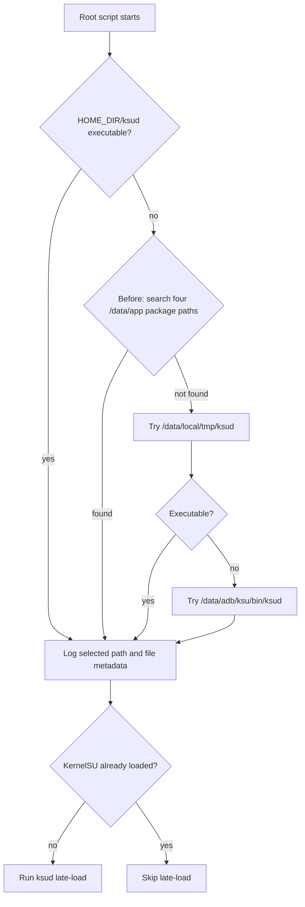

# ksud Package Fallback Removal Plan (2026-10-11)

## Current State and Baseline

- Branch: `main`; baseline commit: `2cf5ef7d5fd626f79f3c758cf4a164d43c77aacd`.
- Before-change binary: built from baseline commit `2cf5ef7d5fd626f79f3c758cf4a164d43c77aacd` with NDK `28.2.13676358`; its SHA-256 is `02fbd9c4c4206704a7ca56b7f22ea3e34ad291cb8ec8c21c94dbd12dd60a8dc1`. The previously recorded `/tmp/ghostlock-baseline/ghostlock-2cf5ef7d` was absent in this session, so it was rebuilt from that exact commit in a temporary worktree; the hash matched.
- The worktree already contains the uploaded arm64 executable at `app/src/main/jniLibs/arm64-v8a/libksud.so` and a pending Kotlin change that stages GhostLock's own `nativeLibraryDir/libksud.so` at `$HOME_DIR/ksud`.
- `src/core/attack/ops.cpp::write_root_script()` prefers `$HOME_DIR/ksud`, then searches four KernelSU-family `/data/app` paths, then checks `/data/local/tmp/ksud` and `/data/adb/ksu/bin/ksud`.
- Logs record the selected path, `ls -l` metadata, missing-binary status, and `late-load` exit code. The four package searches were introduced with the native source reorganization in commit `8ea6d4c`.

## Goal and Constraints

Remove only the four `/data/app` package searches. Keep the bundled binary as the primary source, retain the `/data/local/tmp` and `/data/adb` fallbacks and all ksud logging, and leave the root-child handoff, late-load arguments, exploit stages, and profile/wire formats unchanged.

If the bundled binary is unavailable, the script will no longer discover a copy inside an installed KernelSU-family APK; it may still use either existing explicit fallback path.

## Change List

- `src/core/attack/ops.cpp` — remove the four package-specific `find /data/app` branches only; retain path and late-load logs.
- `README.md` — clarify that GhostLock bundles `ksud`; KernelSU-family runtime installation remains required for module loading.
- `README_ZH.md` — keep the Chinese Quick Start statement synchronized.

## Control-Flow Difference

After the change, the package-search node is removed. If `HOME_DIR/ksud` is not executable, the script checks `/data/local/tmp/ksud`, then `/data/adb/ksu/bin/ksud`. The staged file remains owned by app-private `filesDir`; the root script reads it during handoff. Creation, permissions, handoff order, and file lifetime remain unchanged.

## Compatibility and Rollback

Devices with the bundled `ksud` continue to use `$HOME_DIR/ksud`. Devices relying only on a package-private `/data/app/.../libksud.so` lose automatic discovery; the two explicit path fallbacks remain. Rollback restores the four search branches in `ops.cpp` and the prior README wording.

## Verification Matrix

| Check | Expected result |
|---|---|
| `make -C src native-host-tests` | All host tests pass. |
| NDK build and `make -C src lint-tidy` | Build has zero warnings; tidy reports zero findings. |
| `tools/cmp_disasm.py <baseline-binary> build/native/ghostlock` | Review all eight attack functions; strict identity is preferred. For differences, inspect raw instructions and prove that address relocation does not change target identity or control-flow order. |
| Source check for `/data/app` package searches | No four package-search branches remain; selected path, metadata, missing-file, and late-load logs remain. |
| Clean-device gate | On a cold boot with a supported single route and KernelSU initially unloaded, verify the logged path is `$HOME_DIR/ksud`, the bundled file is executable, late-load succeeds, and the expected module-load/handoff markers appear. Archive the result using the device-gate template. |

## Verification Results (2026-10-11)

- NDK build: `ANDROID_NDK_HOME=/home/codespace/android-sdk/ndk/28.2.13676358 make -C src ghostlock` passed; changed `ops.cpp` compiled without warnings.
- Clean-source NDK build from a temporary worktree containing the approved `ops.cpp` patch passed.
- `make -C src lint-tidy` passed with the NDK configured; clang-tidy reported no findings (its generated-warning summaries are suppressed non-user/system-header diagnostics).
- `make -C src native-host-tests` did not complete: host x86 assembler rejected ARM `yield` in `tcp_zerocopy_route.cpp:47`.
- Source check and `git diff --check` passed. No `/data/app` package-search branch remains; both explicit fallbacks and ksud logs remain.
- `cmp_disasm.py` returned `FAIL`: `owner_thread` is strict-identical; five matched functions have address/layout differences; two multicast symbols are absent in both binaries. The clean-source builds have equal instruction counts for each matched function. Manual instruction-encoding review found no branch/call encoding changes; the 121 changed instruction bytes are address/load/add immediates. `.rodata` shrank by `0x208`, `.text` start shifted by `-0x210` with unchanged size, `.data`/`.bss` shifted by `-0x200`, and `g_exploit_session` plus `g_direct_map_end` shifted by the same `-0x200`. The relative session-global offsets and control-flow order remain unchanged. The comparator normalizes every `0x...` literal, so its layout result alone is not sufficient evidence.
- `./gradlew :app:assembleDebug :app:testDebugUnitTest`: APK assembly passed and packaged `libksud.so`, `libghostlock.so`, and `libextract.so`; unit tests had one failure in `ProfileMigrationEquivalenceTest` because the legacy fixture does not cover all current 6.x built-ins.
- Device gate: not run; `adb` is not installed in this container. No device-gate result is claimed or archived.

## Explicitly Preserved

- `$HOME_DIR/ksud` as the primary path and the Kotlin staging copy.
- `/data/local/tmp/ksud` and `/data/adb/ksu/bin/ksud` fallbacks.
- All ksud selection, metadata, failure, and late-load logs.
- `chmod 755`, `late-load --kmi "$KMI" --allow-shell`, module watch, root-child process lifecycle, and every exploit-stage operation.
- User worktree changes outside this plan and the files listed in the change list.

## Progress

- [x] Explore current script, history, and staging path.
- [x] Prepare design and verification plan.
- [x] Obtain user approval.
- [x] Remove package-search branches and update bilingual Quick Start text.
- [x] Run available source, native-build, lint, host-test, and disassembly checks; record outcomes above.
- [ ] Run the required cold-device gate and archive evidence; blocked until a device/ADB environment is available.