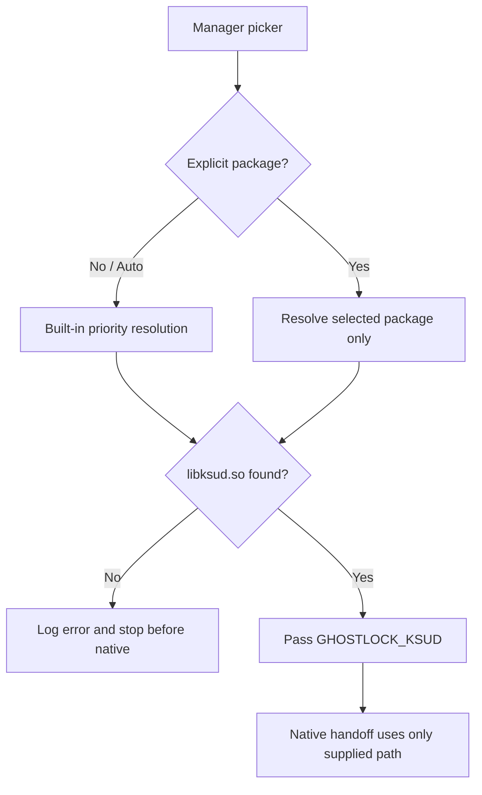

English | [简体中文](manager-selection-plan_ZH.md)

# Explicit manager selection plan (2026-10-25)

## Current state and baseline

Branch `main`, baseline `e7251a7`. The Android manager picker stores a selected package, but resolution still appends the built-in KernelSU-family packages. The native root script also has hard-coded `libksud.so` fallbacks and verifies the literal `kernelsu` module name. A selected manager can therefore fall through to another manager's `ksud` binary, while KernelSU-family implementations still share the `kernelsu` kernel-module identity.

## Goals and constraints

- When `Auto` is selected, preserve the existing built-in priority order.
- When a package is explicitly selected, use only that package's `libksud.so`; do not silently activate another manager.
- Keep the existing KernelSU-family handoff protocol and `kernelsu` module probe unchanged unless the selected implementation supplies the same protocol.
- Reject an explicit selection whose `libksud.so` is unavailable before entering the native attack path.
- Preserve W1/W2/W3 ordering, profile format, Shizuku behavior, and safe-mode behavior.

## Change list

- `app/src/main/kotlin/com/ghostlock/app/data/ManagerScanner.kt`: make `resolvePackages(chosen)` return only the explicit package when present; retain the built-in list for `Auto`.
- `app/src/main/kotlin/com/ghostlock/app/data/AndroidGhostlockRepository.kt`: fail the direct path before starting native when an explicit manager cannot resolve; keep auto resolution behavior.
- `app/src/main/kotlin/com/ghostlock/app/shizuku/GhostlockUserService.kt`: apply the same explicit-only resolution and report a clear error before starting native.
- `app/src/test/kotlin/com/ghostlock/app/data/ManagerScannerTest.kt`: assert that explicit selections do not append fallback managers.
- `src/core/attack/ops.cpp`: remove hard-coded manager fallback lookup from the generated root script; consume only the selected `GHOSTLOCK_KSUD` path.
- `docs/analysis/manager-selection-plan_ZH.md`: synchronized design record.

## Data-flow/control-flow differences

Before: `selected package → selected package + built-in fallbacks → first libksud.so → native root script`; missing environment path could trigger hard-coded KernelSU package lookup.

After: `Auto → built-in priority → first libksud.so`; `explicit package → that package only → native`; missing explicit path returns an error before native starts. The native handoff continues to use the common KernelSU-family `ksud late-load` protocol and module marker.

## Compatibility and rollback

Auto selection remains compatible with current built-in managers. Explicit selection becomes strict, preventing accidental fallback. Rollback is the single commit revert; no profile or wire-format change is required.

## Verification matrix

- `./gradlew :app:testDebugUnitTest`: manager resolution and repository/user-service behavior.
- `make -C src native-host-tests`: native host coverage.
- `make -C src ghostlock`: Android native build with zero warnings.
- `make -C src lint-tidy`: static analysis.
- `tools/cmp_disasm.py`: required because the root-script handoff code changes; compare the eight attack functions and inspect the generated script path.
- Device gate: Auto, KernelSU Next, and another supported manager selected independently; logs must show the selected `ksud` path and no fallback path.

## Explicit preservation

The exploit stages, route selection, profile binary format, seccomp logic, Shizuku readiness wait, and KernelSU-family module identity remain unchanged.

## Progress

- [x] Explore code and history.
- [x] Record baseline and design.
- [x] Implement strict selection.
- [ ] Run host/build/static verification (environment blockers recorded in `build/manager-selection-verification/VERIFICATION.txt`).
- [ ] Run device gates.
