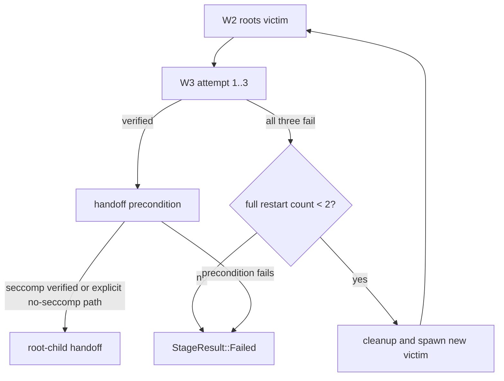

English | [简体中文](w3-fail-closed-retry-plan_ZH.md)

# W3 fail-closed retry plan (2026-10-25)

## Current state and baseline

Branch `main`, baseline `e7251a7` plus the uncommitted manager-selection batch. In `cve_2026_43499_backend.cpp`, a failed W3 verification returns `false`, but the outer W2/W3 loop can still return `StageResult::Continue`; the root-child frontend then runs with `chain.seccomp_ok == 0`. The current profile also controls the number of W3 attempts and chain rounds, so behavior is not the requested fixed retry policy.

## Goals and constraints

- Fail closed when W3 cannot be verified.
- Give each W3 bypass phase exactly three attempts before abandoning that phase.
- After three failed W3 attempts, perform up to two full W2+W3 restarts, including a new victim child and the existing cleanup/parking protocol; do not retry only the seccomp writes.
- Proceed to root-child handoff only when W3 verification succeeds, or when the process has no seccomp filter and W3 is explicitly skipped.
- Preserve W1, W2 credential writes, route selection, profile fields, Shizuku behavior, and resource ownership order.
- Do not add a new profile or wire-format version. Existing tuning fields remain available but the safety cap is enforced in the backend.

## Change list

- `src/core/session/backend/cve_2026_43499_backend.cpp`: cap W3 attempts at three, bound full W2/W3 restart rounds to the initial run plus two restarts, return `StageResult::Failed` when no seccomp-free child is verified, and make retry cleanup explicit before each full restart.
- `src/core/session/root_child_frontend.cpp`: add a defensive handoff precondition so the root child is not released when `seccomp_ok` is false and the process originally had a filter.
- `src/core/tests/host/backend_dataflow_test.cpp` and related host fixtures: cover W3 success, three W3 failures followed by a full restart, two failed full restarts, and fail-closed handoff; include the victim cleanup implementation in the host link.
- `src/Makefile`: include `victim_context.cpp` in the host data-flow harness.
- `src/core/tests/host/route_stub.cpp`: provide host-only no-op multicast repair hooks required by the backend instantiations.
- `docs/analysis/w3-fail-closed-retry-plan_ZH.md`: synchronized design record.

## Data-flow/control-flow differences

Before: `W2 → W3 attempts/profile count → W3 failure → Continue → root-child frontend`.

After: `W2 → W3 attempt 1..3 → success → handoff`; on three failures, `full W2+W3 restart 1..2`; after the second failed restart, `Failed` and no root-child release. A no-seccomp process keeps the existing explicit W3 skip and may proceed.

## Compatibility and rollback

Successful runs keep the same W1/W2/W3 ordering and handoff. Runs that previously continued after an unverified W3 now terminate without releasing the root child. Rollback is a single commit revert; no profile migration is needed.

## Verification matrix

- `make -C src native-host-tests`: host state-machine tests for success, retry, restart, and fail-closed paths.
- `make -C src ghostlock`: Android build with zero warnings.
- `make -C src lint-tidy`: static analysis.
- `python3 tools/cmp_disasm.py <baseline> build/native/ghostlock`: compare the eight attack functions; inspect W3 resource cleanup and handoff ordering.
- Device gate with Shizuku disabled: cold boot, fixed CPU pair, one route, KernelSU unloaded; record one successful W3 path and one bounded-failure path without reboot/panic.
- Device gate with Shizuku enabled: confirm the Shizuku path remains unchanged and does not enter in-process W3.

## Explicit preservation

The seccomp target offsets and write primitive are not redesigned by this batch. The batch changes retry bounds, cleanup, and handoff gating only. No web-derived bypass or new kernel primitive is introduced.

## Progress

- [x] Explore current W3 and handoff flow.
- [x] Define fixed retry and restart semantics.
- [x] Implement fail-closed retry state machine.
- [ ] Add host coverage.
- [ ] Run build, lint, disassembly, and device gates.
