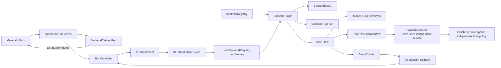
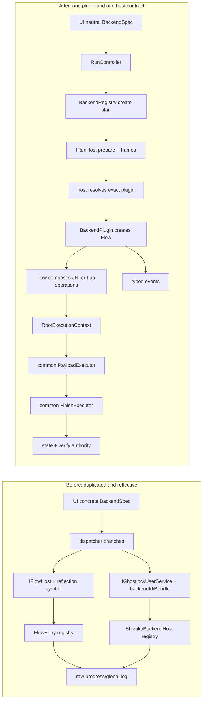

# 归档说明

- 原路径：`docs/plan/kotlin-core-backend-vertical-rewrite-plan.md`
- 归档日期：2026-11-04 19:35:20 -0500
- 归档原因：用户裁定本稿错误地把 Payload / Finish 设计成独立 executor，未按“单一落盘 root 脚本由各 backend 在自己的 root 点统一执行”的真实全流程建模，因此整稿失效，不得据此实施。
- 来源：2026-11-04 未提交工作树草案；正文保留为被推翻设计与评审沿革。现行需求入口为 [`../plan/backend-root-execution-unification-plan.md`](../plan/backend-root-execution-unification-plan.md)。

---

# Kotlin core / backend 垂直整理计划（KBR · L · 2026-11-04）

> 状态：**设计草案，尚未授权 production implementation**。
>
> 用户裁定（2026-11-04）：忽略现有 backend 连接兼容性；backend 与 app/core 一起改；现有 backend 均不可用，因此不保留旧 backend 功能测试、旧 wire ID 或旧行为 parity。
>
> 用户架构纠正（2026-11-04）：`Flow`是长期全流程编排层，未来负责组合拆开的backend JNI函数；Lua可直接调用JNI自行组合；当前Flow只有一个`run`并非冗余。backend随App同一产物发布，registry不绑定静态合同/版本digest。Payload与Finish都是backend之外、彼此独立的子系统；backend只负责取得root执行上下文，Flow再经公共post-root阶段依次消费Payload与Finish。
>
> 本文当时取代 [`20261104-1935-kotlin-core-observability-cleanup-plan.md`](20261104-1935-kotlin-core-observability-cleanup-plan.md) 及其附件的 compatibility-first 路线；本文自身现亦已失效，仅保留评审沿革。
>
> 基线：branch=`dev-nocpp`，HEAD=`21d9f53c00ee76891a993c8a2ecea1ea6f9be830`。本计划不修改native exploit算法、CVE参数值、PI/waiter生命周期或`LegacyProfileConverter.kt`；当前树尚无profile v3/JSON/JCS authority，因此它不是既成前提，必须由同一KBR计划的KBR-P0先落地后才能进入KBR1。

## 0. 先把口径说清楚

### 0.1 D7 没有“后续边界”

D7 的 BackendSpec source boundary 已经收口；A301SO gate 未完成只表示原 backend 功能未验证，不产生 D7.6。现在要做的是一个新的 **KBR 垂直重写**：frontend、core、transport、backend plugin 同批改成一套合同。

### 0.2 本次“不兼容”的精确定义

以下内容可以直接删除/替换，不建 adapter、fallback 或双轨：

1. `IFlowHost` / `IFlowHostCallback` 与 `IGhostlockUserService` / `IGhostlockCallback` 的旧方法集、transaction id 和 raw String callback；
2. `FlowSymbol`/JVM reflection descriptor作为跨进程公开wire，以及反射式`FlowEntryRegistry`；`Flow`、`FlowRequest/Result`、`SequentialFlow`和step模型保留；
3. `BackendRunDispatcher` 对旧 backend 的兼容分支；host改为由plugin直接创建`Flow`，不是删除Flow；
4. 旧 `FlowProgress`、全局 `log`、重复的 run/UI severity DTO；
5. concrete backend 泄漏到 UI/data/core 的 adapter；
6. 只验证旧 API/parity/旧 test count 的测试。

以下仍是权威，不能因为“不兼容”而绕过：

- `BackendSpec.key` 是稳定身份；registry 是唯一membership authority，但不生成/传输静态合同digest；App与host使用同一APK内同一registry factory；
- 配置值 authority 是 GLK profile v3（JSON source + JCS wire + schema）；
- `A301SoDebugConfig` 一类 concrete 配置只能留在自己的 backend package，通过中性 configuration spec 暴露；
- Payload设置拥有独立于backend profile/Finish的单一`PayloadDefinition` authority；root manager、safe mode、command/script/LKM及relay access行为都归Payload，不得塞进backend spec/profile；
- Finish设置拥有独立于backend profile/Payload的单一`FinishDefinition` authority；它只描述SELinux恢复、软重启与最终验证策略，不拥有payload列表或root manager；
- runtime secret/SPI/port 不写文档/profile，仍走 session frame并用后清零；
- native waiter/race/exploit-payload/route/exec、PI禁日志、victim资源终结顺序不在本整理批顺手重写；这里的native exploit payload与App的post-root Payload子系统不是同一authority。

### 0.3 关于“无需测试”

按用户裁定，本计划：

- **不保留**旧 backend compatibility tests；
- **不以**当前任何 backend 真机成功、旧 AIDL parity、旧 XML test count作为整理完成条件；
- **不宣称**重写后的 backend 已可用或 supported。

实现仍需最小的“产物是否成立”检查：Kotlin/AIDL/NDK能够构建、architecture guard无反向依赖、manifest无旧wire残留。它们不是旧 backend 功能测试。若后续要求连这些检查也跳过，须另行明确知情强制越过 `AGENTS.md` §2/§8；本文不预先登记该越权。

## 1. 活跃计划关系

| 现有文档 | KBR 关系 |
|---|---|
| `kotlin-clean-architecture-ui-plan.md` D7 | 保留 BackendSpec/neutral DTO/registry source成果；KBR不是D7续批，D7未通过的设备结果不继承为成功 |
| `backend-registry-unification.md` | 已交付的单一registry/key思想保留；其 Compose/config/flow旧接口形状由KBR取代 |
| `flow-process-launcher-plan.md` | cancel/handoff/destroy和one-shot/keepalive的资源语义保留；旧reflection/wire/API形状由KBR取代 |
| `43499-logging-integration-plan.md` | PI禁日志、ASCII/单行/敏感信息禁写保留；raw callback/双写/global logger取代 |
| `98260-*` plans | exploit算法、参数/profile证据保留；旧Kotlin wiring章节取代，98260以后也必须实现同一plugin合同 |
| `kotlin-core-observability-cleanup-plan.md` + annex | **整份 superseded**；compat IDs、逐旧backend parity、459→529 test ledger、双真机前置门均不再约束KBR |

## 2. 目标结构



### 2.1 package owner

| package | 唯一职责 | 禁止依赖 |
|---|---|---|
| `domain/backend/**` | UI/application可见的neutral `BackendSpec`、configuration/execution/parameter schema、catalog、selection、run state | Android、Compose、`backend/**`、concrete backend、JNI、AIDL |
| `core/run/**` | `RunEngine`、run state machine、cancel/terminal/resource owner | UI/data/concrete backend、Android transport |
| `core/flow/**` | 长期全流程编排合同：one-shot `Flow.run`、result、sequential step/retry/timing；既可由backend组合JNI步骤，也可由Lua自行组合 | Android transport、UI/data、反射class name wire、concrete backend |
| `core/observability/**` | `EventFact/Event`、formatter、bounded dispatcher | UI/backend concrete、全局 singleton |
| `domain/payload/**` | backend之外的neutral `PayloadDefinition`、item schema、repository/editor ports | Android、Compose、concrete backend、JNI、AIDL |
| `core/payload/**` | payload bundle校验、staging、script片段与effect verification；只消费已冻结Payload artifact | Context、SharedPreferences、concrete backend |
| `data/payload/**` | Payload持久化、Document URI解析与run artifact staging adapter | concrete backend、Flow实现 |
| `domain/finish/**` | backend/Payload之外的neutral `FinishDefinition`与repository/editor ports | Android、Compose、concrete backend、JNI、AIDL |
| `core/finish/**` | Finish script/render/verify；只消费已冻结Finish artifact，不编排Payload | Context、SharedPreferences、concrete backend、Payload repository |
| `domain/postroot/**` | 对等绑定Payload/Finish身份的`PostRootBinding`、result与receipt projection | Android、Compose、concrete backend、repository |
| `core/postroot/**` | `RootExecutionContext`线性转移、Payload→Finish公共编排、receipt authority | Context、SharedPreferences、concrete backend |
| `data/migration/**` | 旧混合prefs到Payload/Finish两个authority的一次性原子迁移 | UI、concrete backend、Flow |
| `core/victim/**` | pure victim protocol/session/port | `jni/**`、concrete backend |
| `backend/declarations/**` | `BackendPlugin`、`BackendRunPlan`、Flow factory result；plugin只构造`core.flow.Flow`，不拥有Payload/Finish定义 | UI、Compose、data store、Payload/Finish repository、反射symbol wire |
| `backend/registry/**` | 同一App产物内的immutable plugin membership/byKey；不做版本/静态合同digest | UI分支、backend-specific条件、运行时注册 |
| `backend/backends/<key>/**` | concrete config、plan assembler、JNI/native adapter、entry implementation | UI、其它backend、全局store |
| `backend/transport/**` | shared App/Shizuku wire codec与host/client adapters | backend-specific业务分支 |
| `data/**` | Android persistence/file/package adapters | concrete backend type |
| `ui/**` | neutral state/actions renderer | registry、concrete backend、AIDL/JNI |

## 3. 新的唯一 backend 合同

### 3.1 declaration 与 executable plugin 分离

```kotlin
data class BackendSpec(
    val key: String,
    val cveLabel: String,
    val displayName: String,
    val availability: BackendAvailability,
    val configuration: BackendConfigurationSpec,
    val execution: BackendExecutionSpec,
    val parameterRequirements: BackendParameterRequirements,
)

interface BackendPlugin {
    val spec: BackendSpec
    fun createRunPlan(input: BackendPlanInput): BackendPlanResult
    fun createFlow(input: BackendFlowFactoryInput): BackendFlowCreationResult
}
```

- `BackendSpec`及其configuration/execution/parameter子合同目标package是`domain.backend`；它是immutable neutral declaration，UI/catalog只能读它，domain不得反向import`backend/**`。
- `BackendPlugin` 是plan与Flow factory authority；UI/data不能持有或按concrete class分支。共享host只经registry拿plugin，再由plugin创建`core.flow.Flow`。
- `BackendExecutionSpec`只声明可选execution target、entry key和abort capability，不携带profile值、finish值、payload或任何配置值。
- `BackendConfigurationSpec`只引用人工维护的profile v3 schema字段ID及UI呈现类型，不复制默认值、合法值或当前值；当前值只来自profile snapshot。
- `BackendParameterRequirements`取代旧`BackendParameterSchema`：每项只引用profile v3 schema生成的typed field key并声明required/optional，不复制字段类型/默认值。runtime-discovered值不伪装成profile字段，由Flow在run内产生。
- `BackendRegistry` 保存 `BackendPlugin`，但只向catalog暴露同一个`BackendSpec` snapshot；`key`重复或空值在registry构造时fail-closed。host按`plan.backendKey`解析唯一plugin、核对`entryKey`属于该plugin，最后调用`plugin.createFlow`；业务代码不得直接拿另一plugin消费plan。
- 当前`backend/declarations/BackendSpec.kt`中的pure字段迁到`domain/backend`，plugin/run-plan合同留`backend/declarations`；不保留`flowSymbol`、`flowParams(Context)`、`rows()`、`saveConfig/restoreConfig`等旧混合职责。
- `A301SoDebugConfig`、其它device/config object留在对应 backend package，负责产生 neutral `BackendConfigurationSpec`/profile patch；UI只走generic renderer。

配置唯一流向固定为：`UI field action → profile edit use case → profile v3 schema校验/持久化 → immutable profile snapshot → plugin createRunPlan`。`A301SoDebugConfig`之类backend-private对象只能向profile builder提供候选patch，不能被UI/data直接读取，也不能在run时成为第二值源；`BackendConfigurationSpec`只让generic renderer知道“哪个profile field怎样编辑”。Payload与Finish都不在这条backend配置流里，见§5.2/§5.3。

四个neutral合同冻结为：

```kotlin
sealed interface BackendAvailability {
    data object Ready : BackendAvailability
    data object Diagnostic : BackendAvailability
    data class Unverified(val reasons: List<String>) : BackendAvailability
    data class Unavailable(val reasons: List<String>) : BackendAvailability
}

enum class BackendFieldUiKind { BOOLEAN, INTEGER, TEXT, ENUM, DOCUMENT }

data class BackendConfigurationField(
    val field: ProfileFieldKey<*>,
    val labelKey: String,
    val uiKind: BackendFieldUiKind,
    val order: Int,
)

data class BackendConfigurationSpec(
    val fields: List<BackendConfigurationField>,
)

enum class ExecutionTarget { APP, SHIZUKU }
enum class AbortPolicy { COOPERATIVE, NOT_ABORTABLE }

data class BackendEntrySpec(
    val key: String,
    val targets: List<ExecutionTarget>,
    val abortPolicy: AbortPolicy,
)

data class BackendExecutionSpec(val entries: List<BackendEntrySpec>)

data class BackendParameterRequirement(
    val field: ProfileFieldKey<*>,
    val required: Boolean,
)

data class BackendParameterRequirements(
    val fields: List<BackendParameterRequirement>,
)
```

- 所有传入`List`在构造时`toList()`冻结，返回时不暴露mutable collection；field/entry key必须匹配`[a-z][a-z0-9_.-]{0,63}`，reason必须匹配`[a-z0-9][a-z0-9._:-]{0,127}`。
- configuration按`order`升序且field唯一；execution entry key唯一，targets非空且按enum ordinal排序；parameter field唯一。非法/重复/乱序在构造时以稳定literal fail-closed。
- `ProfileFieldKey<T>`只由`app/src/main/assets/profile-v3/schema.json`生成；生成目标为`build/generated/source/profileV3/com/ghostlock/app/domain/profile/ProfileFieldKeysV3.kt`。`app/build.gradle.kts`中的typed `GenerateProfileV3SchemaTask`是唯一schema→Kotlin入口，unknown type/duplicate id/default不合类型时失败并输出`profile-v3-schema:<reason>:<field>`。
- domain architecture guard禁止`android.*`、Compose、`backend.backends.*`、`Context`、`R`资源ID、函数/callback字段；label只用稳定`labelKey`，本地化在outer presentation adapter。

### 3.2 frozen input、plan、Flow合同

```kotlin
class ImmutableBytes private constructor(private val storage: ByteArray) {
    fun copyBytes(): ByteArray = storage.copyOf()
    companion object {
        fun copyOf(source: ByteArray): ImmutableBytes = ImmutableBytes(source.copyOf())
    }
}

data class BackendPlanInput(
    val backendKey: String,
    val entryKey: String,
    val executionTarget: ExecutionTarget,
    val profileWireV3: ImmutableBytes,
)

sealed interface BackendPlanResult {
    data class Ready(val plan: BackendRunPlan) : BackendPlanResult
    data class Rejected(val reasons: List<String>) : BackendPlanResult
}

data class BackendRunPlan(
    val backendKey: String,
    val entryKey: String,
    val executionTarget: ExecutionTarget,
    val profileWireV3: ImmutableBytes,
    val abortPolicy: AbortPolicy,
)

data class BackendFlowFactoryInput(
    val postRootExecutor: PostRootExecutor,
)

data class BackendFlowInput(
    val plan: BackendRunPlan,
    val frames: BackendFrameView,
    val events: EventEmitter,
) : FlowRequest

sealed interface BackendFlowCreationResult {
    data class Ready(
        val flow: Flow<BackendFlowInput>,
    ) : BackendFlowCreationResult
    data class Rejected(val reasons: List<String>) : BackendFlowCreationResult
}
```

- `ExecutionTarget`只有`APP`与`SHIZUKU`；新增第三target必须修wire、registry capability与两个adapter，不能把未知值默认为APP。
- `AbortPolicy`只有`COOPERATIVE`与`NOT_ABORTABLE`。cooperative cancel只exact-once调用`Flow.stop()`，不kill/detach攻击子进程；最终结果仍由`Flow.run()`返回。
- `Flow`仍是唯一业务执行模型：保留`Flow<R>.run(request)`、`stop()`、`FlowResult`、`SequentialFlow`、step/retry/timing。host不另造`BackendProgram`状态机；host state只管理Flow的准备、worker、取消和终结。
- `createFlow`只接收已绑定本run但不暴露内容的公共`PostRootExecutor` port，不接收Payload/Finish definition、repository、artifact或当前值；失败返回`BackendFlowCreationResult.Rejected(reasons)`，不得抛异常或换plugin重试。host把`AttachedFrameSet`拆成互不重叠的`BackendFrameView(BACKEND_INPUT,SESSION_SECRET)`与`PostRootFrameView(PAYLOAD,FINISH_SCRIPT)`，concrete backend/Lua只能得到前者。Flow one-shot由现有`SequentialFlow`/具体实现保证；第二次run稳定失败。成功、失败、取消都执行Flow自己的cleanup；host只在最后借用者停止后释放Flow引用。
- plan是一次run的immutable snapshot；`ImmutableBytes.copyOf`在入口复制，`copyBytes`在codec边界再次复制，创建后backend config或调用方原数组变化不影响本run。
- profile bytes必须来自唯一profile authority；backend不得再读配置环境变量/SharedPreferences。
- `entryKey`只在plugin内部映射到实现，不把JVM class/descriptor作为wire ABI。
- profile、payload与finish分别保留自己的canonical JCS bytes；三者互不嵌入、互不反向写回。payload的大对象、backend input与runtime secret走§4 frame；`payloadWireV3`只描述顺序、kind、参数和frame引用，不携带大对象本体。
- retry属于Flow：`SequentialFlow`按`FlowStep.retry/timing`执行；Lua可绕过SequentialFlow直接组合JNI。host在失败后不自动换backend、target、entry或重跑Flow。
- concrete plugin的Android/JNI/process依赖只由各process composition root构造并注入，不进入`BackendSpec`、plan或wire。main process实例只调用spec/plan；`:runhost`与Shizuku实例获得backend-private factories并可创建Flow。意外在main调用`createFlow`必须返回`flow-host-services-unavailable`而不是读取global Context。

Flow的长期扩展点是JNI primitive而不是新增host接口：backend以后把当前整块JNI拆成具名operation，具体Flow用`FlowStep`组合；Lua Flow通过同一`JniOperationCatalog`按脚本自由调用operation，不经过backend registry逐项登记。`JniOperationCatalog`只列可调用JNI能力与typed argument/result，不决定步骤顺序，也不成为profile/Payload/Finish authority。无论backend Flow还是Lua Flow，取得`RootExecutionContext`后都只能把它交给注入的公共`PostRootExecutor`；concrete backend不得解释或改写Payload/Finish对象。

### 3.3 immutable registry 与当前 backend 处置

KBR原子切换时处理当前六个registry成员：

| 当前成员 | KBR处置 |
|---|---|
| `BackendCve43499Glued` | key=`43499-Glued`；实现新plugin；`availability=Unverified`，catalog可见但不可选择/执行 |
| `BackendCve43284Glued` | key=`43284Glued`；实现新plugin；`availability=Unverified`，catalog可见但不可选择/执行 |
| `BackendCve43284` | 与Glued重复且无可用基线，移出builtins；保留native历史不等于保留Kotlin plugin |
| `BackendCve43499` | 与Glued重复且无可用基线，移出builtins；其仍被新plugin复用的pure/runtime部件须迁入43499 package内部 |
| `BackendCustom`/Lua | key=`CUSTOM`；保留为静态built-in plugin与自定义Flow入口；当前无完整JNI operation surface时`Unverified`，以后由脚本自由组合JNI，不为每个脚本动态注册backend |
| `BackendDebugProbe` | key=`DEBUG-PROBE`；迁为debug-only `Diagnostic` plugin，用于观察新vertical path；可选择/执行，但不冒充exploit |

registry target是immutable builtins：release精确3项（`43499-Glued`,`43284Glued`,`CUSTOM`），debug精确4项（前三项+`DEBUG-PROBE`）；不再有`register/unregister/resetToBuiltins`。`BackendAvailability`行为固定如下：

| availability | catalog | 可选/可执行 | 用途 |
|---|---|---|---|
| `Ready` | 可见 | 是 | 仅后续独立backend bring-up真机门通过后可用 |
| `Diagnostic` | 仅debug可见 | 是 | 非exploit诊断plugin |
| `Unverified` | 可见 | 否 | 结构已接入但无设备证据 |
| `Unavailable(reasons)` | 可见 | 否 | 环境/能力缺失，原因可见 |

持久化selected key若不存在、或当前availability不可执行，selection adapter必须清为null；不回退到首项、不把旧key映射到新key。App/`:runhost`/Shizuku都调用同一APK内的`BackendRegistryFactory.create(BuildConfig.DEBUG)`；registry不生成、不传输、不比较membership/static-contract hash。未知key/entry仍fail-closed，但不为同一产物内不可能出现的“旧host合同错位”增加版本协议。

98260不做compat adapter；其Kotlin接入时直接新增`Backend98260Plugin`并创建自己的Flow。KBR结束时三个非诊断plugin均保持`Unverified`，host在接收frame、创建worker或调用`createFlow`前返回`ERR_BACKEND/backend-unverified`；将任一项改为`Ready`必须另开L级bring-up并完成该backend真机门。

## 4. App/Shizuku 共用的新 wire

### 4.1 删除旧双合同

同一批删除旧四个AIDL接口的方法形状，新增`com.ghostlock.app.run.IRunHost`、`IRunHostCallback`与typed `RunHostReply`。App `:runhost`和Shizuku UserService都直接暴露`IRunHost.Stub`，不再套第二层service接口：

```aidl
interface IRunHost {
    RunHostReply prepare(int schemaVersion, String backendKey,
                         String entryKey, int executionTarget,
                         in byte[] profileWireV3, in byte[] payloadWireV3,
                         in byte[] finishWireV3,
                         in byte[] frameManifestWireV3,
                         in @nullable ParcelFileDescriptor logFd,
                         in IRunHostCallback callback) = 1;
    RunHostReply attachFrame(int role, int index, long size, String sha256,
                             in ParcelFileDescriptor frameFd) = 2;
    RunHostReply start() = 3;
    RunHostReply snapshot() = 4;
    RunHostReply cancel() = 5;
    RunHostReply destroy() = 6;
}

oneway interface IRunHostCallback {
    void onEvent(int schema, long sequence, long elapsedMs,
                 int level, int origin, String component,
                 String message, String reason) = 1;
}
```

`RunHostReply`是AIDL parcelable，字段固定为`operationSequence:Long`、`code:Int`、`state:Int`、`reason:String`、`verificationWire:ByteArray`；构造时复制byte array。每次同步调用在同一reply内绑定code/reason/state，删除全局`lastReason()`，不会被另一Binder事务覆盖。`verificationWire`只在DRAINING/TERMINAL/HANDOFF返回冻结副本，其余为空。

- App `:runhost` service与Shizuku UserService实现同一个state/reason合同；只有process launcher不同。
- 不保留旧transaction id、legacy `onLog/onLine/onComplete`或raw fallback。
- `schemaVersion/backendKey/entryKey/executionTarget/profileWireV3/payloadWireV3/finishWireV3/frameManifestWireV3/logFd/callback`各自是独立AIDL字段；protocol/profile/payload/finish version统一为3，不再造外层JSON或Bundle。profile、payload、finish、frame manifest各由自己的canonical JCS codec负责。host必须证明executionTarget与自身process role一致且被plugin spec允许；`abortPolicy`由该entry的spec重新派生，禁止caller伪造。
- host只用`backendKey`查registry，再由plugin解析`entryKey`；未知key/entry/schema fail-closed。
- callback只承载typed event；run成功权威是`RunHostReply.state+verificationWire`，不是callback。
- service内只有一个command mutex/serialized executor。prepare/attach/start/cancel/destroy、Flow worker终态与callback death都在该线性化点读取前态并发布后态；外部I/O与Flow.run不在锁内执行。

### 4.2 wire预算与session frame

| 内容 | 预算/规则 |
|---|---|
| `profileWireV3` | canonical JCS，0禁止，最大131072 bytes |
| `payloadWireV3` | canonical JCS，0禁止，最大65536 bytes；只含item metadata/frame引用 |
| `finishWireV3` | canonical JCS，0禁止，最大65536 bytes |
| `frameManifestWireV3` | canonical JCS，最大32768 bytes、最多8项 |
| 单个frame | 最大16777216 bytes；所有frame合计最大33554432 bytes |
| `RunHostReply.verificationWire` | canonical JCS v3，最大65536 bytes；非DRAINING/terminal/handoff为空 |
| callback字段 | component ASCII 1..64 bytes；message UTF-8 1..2048 bytes；reason UTF-8 0..512 bytes |

一次`prepare`最多约288 KiB固定wire，加AIDL开销后仍远低于Binder约1 MiB事务边界；payload大对象不走Binder。frame role固定为`PAYLOAD=1`、`BACKEND_INPUT=2`、`FINISH_SCRIPT=3`、`SESSION_SECRET=4`，未知role拒绝。manifest每项为`role/index/size/sha256`；`role+index`唯一，index从0连续，size总和与数量都先做溢出安全检查。每个run必须恰有一个`FINISH_SCRIPT/0`，其digest同时出现在`finishWireV3`；每个启用且需要外部bytes的Payload item必须在`payloadWireV3`中以稳定item id绑定一个exact `PAYLOAD/index/size/sha256`，无引用frame、孤儿frame、重复引用或顺序不一致均拒绝。

verify canonical JCS唯一形状为`{"schema":3,"state":"terminal|handoff","result":"completed|failed|cancelled|handoff","reason":"…","evidence":{"key":"value"}}`；completed/handoff的reason必须空，failed/cancelled的reason必须为1..512 UTF-8 bytes，evidence最多64项且key为ASCII snake_case 1..64 bytes、value最多2048 UTF-8 bytes。未知/重复字段、非canonical bytes、非法state/result组合或超预算均是`ERR_IO`，不得把日志文本当verify回退。

`attachFrame`只接受manifest中尚未绑定的exact项，并且只接受seekable regular fd；入参current offset必须为0，`fstat.st_size`必须等于声明size，ordinary/finish frame至少可读，secret必须`O_RDWR`且`st_nlink=0`。pipe、socket、目录、non-seekable、非零offset、短/长文件、read-only secret均返回`ERR_FRAME`与稳定reason。

host从方法入口拥有收到的PFD，并在`finally`关闭；使用positional read从offset 0复制到run-owned buffer、计算digest，不推进共享file-description offset。成功只把owned buffer放入`AttachedFrameSet`，不把PFD借给Flow；失败不发布部分frame。调用方只传duplicate并在同步调用返回后关闭自己的duplicate。`SESSION_SECRET` producer写入后先清producer buffer；host消费后按`owned buffer→writable anonymous frame range→close`清零，producer同时负责其原始mapping/fd的清零与关闭。不能证明清零前提的secret frame直接拒绝。

### 4.3 code、state与调用矩阵

稳定返回码：`OK=0`、`ERR_ARGS=1`、`ERR_SCHEMA=2`、`ERR_BACKEND=3`、`ERR_ENTRY=4`、`ERR_STATE=5`、`ERR_FRAME=6`、`ERR_START=7`、`ERR_IO=8`、`ERR_NOT_ABORTABLE=9`、`ERR_DESTROYED=10`、`ERR_INTERNAL=11`。稳定state：`IDLE=0`、`PREPARED=1`、`RUNNING=2`、`DRAINING=3`、`TERMINAL=4`、`HANDOFF=5`、`DESTROYED=6`。

| 当前state | 方法 | 结果与下一state | reply reason literal |
|---|---|---|---|
| IDLE | `prepare` valid | `OK→PREPARED`；冻结plan/callback/log fd/manifest | 空 |
| IDLE | `prepare` backend unknown/unverified | `ERR_BACKEND`，仍IDLE，尚未接管fd/建worker/建Flow | `runhost:prepare:backend-unknown` / `runhost:prepare:backend-unverified` |
| IDLE | `attachFrame/start/cancel/snapshot` | `ERR_STATE`或只读snapshot，仍IDLE | `runhost:<op>:idle` |
| PREPARED | `attachFrame` exact | `OK`，仍PREPARED | 空 |
| PREPARED | `start` frames complete | plugin创建Flow与request成功后`OK→RUNNING` | 空 |
| PREPARED | `start` frame缺失/Flow拒绝 | `ERR_FRAME/ERR_START`，仍PREPARED | `runhost:start:frame-missing:<role>:<index>` / plugin reason |
| PREPARED | `cancel` | `OK→TERMINAL`，verify=`cancelled-before-start` | `runhost:cancel:before-start` |
| RUNNING | `cancel` cooperative | `OK`并exact-once调用`Flow.stop()`，保持RUNNING直至Flow终态 | `runhost:cancel:requested` |
| RUNNING | `cancel` non-abortable | `ERR_NOT_ABORTABLE`，保持RUNNING | `runhost:cancel:not-abortable` |
| RUNNING | Flow completed/failed/handoff | 冻结verify，停止producer，`→DRAINING` | 空或Flow reason |
| DRAINING | `snapshot` | 返回冻结verify；state仍DRAINING | 空或`runhost:drain:timeout-owned` |
| DRAINING | `destroy` | 只登记destroyRequested；不释放worker仍借用资源 | `runhost:destroy:drain-pending` |
| DRAINING | all workers ack | `→TERMINAL/HANDOFF`；若destroyRequested则随后清理`→DESTROYED` | 空 |
| TERMINAL/HANDOFF | `cancel` | `OK`幂等，state不变 | 空 |
| TERMINAL/HANDOFF | `snapshot` | 返回canonical verify JCS v3 | 空 |
| 任意非DESTROYED | `destroy` | 非RUNNING/DRAINING且无借用时清理→DESTROYED；RUNNING只登记并按policy请求stop | `runhost:destroy:pending`或空 |
| DESTROYED | `destroy/snapshot` | `OK`幂等 / DESTROYED | 空 |
| DESTROYED | 其它方法 | `ERR_DESTROYED` | `runhost:<op>:destroyed` |

线性化胜负固定为：`attachFrame`先于`start`则frame可见，`start`先于`attachFrame`则后者`ERR_STATE/runhost:attach:running`；`destroy`先于`start`则不创建Flow，`start`先于`destroy`则destroy只登记stop；`cancel`先于Flow terminal则exact-once stop，terminal先于cancel则cancel幂等；callback death与terminal同样按command sequence先后，death先到时禁止后续callback但不提前释放Flow资源。每次状态改变递增`operationSequence`；只读snapshot不递增。

同一个host只允许一个generation；第二次`prepare`返回`ERR_STATE`，不得复用DESTROYED实例。callback Binder death在PREPARED时直接清理到DESTROYED；在RUNNING时按abort policy发stop并禁止后续callback，Flow到终态后进入DRAINING，不提前kill、close或reap其仍访问的资源。1500 ms只设置`drainTimedOut=true`并保持DRAINING/owner；late ack或one-shot process最终退出才结束借用。App和Shizuku adapter只做bind/launch差异，调用矩阵、reply和reason由同一`RunHostStateMachine`实现。

### 4.4 process composition 与资源所有权

- main process：唯一AppContainer、registry snapshot、persistence、process log owner。
- `:runhost`：只创建host registry/runtime；不构造UI/data repository。
- Shizuku：只创建UserService host registry/runtime；不借main process singleton。
- 每个run独占state machine/dispatcher/fd/frame/Flow/worker；不使用process-global current run。

| 资源 | 创建者 | owner与借用区间 | 终结点 | 释放顺序 |
|---|---|---|---|---|
| callback/death recipient | `prepare` | host run scope；dispatcher只在OPEN借用 | terminal、death、destroy | 停producer→seal→unlink death→drop ref |
| log PFD | caller duplicate/prepare | host run scope；file sink借用 | terminal/destroy | seal/flush→close |
| received frame PFD | caller duplicate/attach | attach调用栈 | positional copy/digest完成 | 每条成功/失败路径finally close |
| frame owned buffer | attach成功 | host run scope；backend view只借用roles 2/4，PostRoot view只借用roles 1/3 | Flow/PostRoot终态或destroy | 停对应view访问→secret清零→释放buffer |
| `Flow`+request | registry plugin在start创建 | run worker唯一owner；state machine只发stop | terminal/handoff/destroy pending | run返回→Flow cleanup完成→释放引用 |
| `RootExecutionContext/Lease` | backend/Lua Flow | transfer前Flow唯一owner；transfer后PostRoot唯一owner | post-root failed/completed/handoff | transfer前失败由Flow close；transfer后只由PostRoot close/detach |
| PostRoot receipt authority | host prepare | host run scope唯一owner；backend/Lua不可见 | receipt consume或destroy | Payload→Finish验证完成后publish→host exact-once consume→清引用 |
| Flow native handle/child | concrete Flow | Flow内部；共享host不得偷关 | concrete terminal/handoff | 保持既有stop→detach/park/close/reap次序 |
| dispatcher queue/worker | start | run scope；producer到seal | terminal/handoff/destroy | stop producer→seal/drain→close |
| host process | launcher | launcher到DESTROYED | one-shot DESTROYED | 所有run资源终结后退出 |

destroy/keepalive沿用launcher权威：停止Flow访问→seal/drain/解除callback→关闭log fd→清frame buffer→回收process。KBR只换合同，不改native攻击对象、PI内存与waiter的终结顺序；transfer/handoff完成后旧owner不得再次close、kill或访问。

## 5. observability、Payload、Finish、victim 同步收口

### 5.1 observability

- 唯一模型：`LogLevel`、`LogOrigin`、`EventFact`、`Event`、`EventEmitter`。
- producer只emit一次；dispatcher负责UI/logcat/file fan-out。
- 新live RunHost/DebugProbe/UI路径只用EventEmitter，raw progress/global `log` caller为0；被冻结且Unverified不可达的旧attack/Lua island暂保留其原`FlowProgress/log`定义与caller，直到各backend真机bring-up同批迁移，architecture checker不得把冻结岛冒充live owner。
- native详细行继续走现有fd/logcat；不在本批解析成UI event，不改PI窗口。
- event schema固定v3；sequence由每run dispatcher从0单调分配。callback只是投影，失败只登记drop/failure，不改变Flow result。terminal owner先停止producer，再seal/drain dispatcher，最后发布terminal/handoff state；callback不得反向驱动control flow。
- 每sink queue固定256 events，UI current-run retention固定512 events与262144 formatted bytes双上限，terminal drain deadline固定1500 ms。queue满丢该sink newest incoming event并饱和增加drop count；seal后emit只计late-drop。deadline到期不提前释放仍被worker访问的queue/callback/fd，run scope继续持有到ack或one-shot process退出。

### 5.2 Payload

- Payload是backend与Finish之外的独立bounded context。`PayloadDefinition`是唯一持久化snapshot，拥有有序item列表；root manager、safe mode、inline command、script/LKM URI与参数、relay后kernel-access行为全部归Payload。backend profile、`BackendSpec`、`BackendRunPlan`与`FinishDefinition`均不得复制这些字段。
- `PayloadItemDefinition`只使用稳定`id/kind/enabled/order/parameters`；需要外部bytes的item在run冻结时解析成`PAYLOAD/index` frame。application生成`PayloadBundleArtifact(runId, payloadWireV3, items)`，其中每个item只绑定自己的frame index/size/sha256，不保存Android `Uri`、`Context`或可变列表。
- `PayloadRepository`负责prefs，`PayloadArtifactStager`负责Document URI/manager binary解析与frame生成，`PayloadExecutor`负责在已取得的root capability上按定义顺序执行；三者分别位于domain/data/core边界。当前UI即使继续把Payload编辑器画在“Finish”页面，也只是presentation grouping，不得继续共用`FinishState`或同一个持久化blob。
- backend/plugin不得直接读Payload ViewModel/SharedPreferences、选择root manager、重排item、生成payload命令或解释`payloadWireV3`；concrete Flow只能把opaque `PayloadBundleArtifact`连同root capability交给公共`PostRootExecutor`。
- `payloadWireV3`是Payload自己的canonical JCS；它与backend profile、Finish wire分别校验、分别冻结。Payload effect report由`PayloadExecutor`产生并绑定runId/item id，不能用日志文本或Finish marker伪造item成功。

Payload公共合同冻结为：

```kotlin
sealed interface PayloadItemDefinition {
    val id: String
    val enabled: Boolean
    val order: Int

    data class RootManager(
        override val id: String,
        override val enabled: Boolean,
        override val order: Int,
        val managerId: String,
        val safeMode: Boolean,
    ) : PayloadItemDefinition

    data class InlineCommand(
        override val id: String,
        override val enabled: Boolean,
        override val order: Int,
        val command: String,
    ) : PayloadItemDefinition

    data class Script(
        override val id: String,
        override val enabled: Boolean,
        override val order: Int,
        val documentToken: String,
    ) : PayloadItemDefinition

    data class Lkm(
        override val id: String,
        override val enabled: Boolean,
        override val order: Int,
        val documentToken: String,
        val parameters: String,
        val waitForKernelAccess: Boolean,
    ) : PayloadItemDefinition
}

data class PayloadDefinition(
    val schemaVersion: Int,
    val generation: Long,
    val items: List<PayloadItemDefinition>,
)

data class PayloadFrameRef(
    val itemId: String,
    val frameIndex: Int,
    val size: Long,
    val sha256: String,
)

sealed interface PayloadItemArtifact {
    val id: String
    val order: Int

    data class RootManager(
        override val id: String,
        override val order: Int,
        val managerId: String,
        val safeMode: Boolean,
        val binaryFrameIndex: Int?,
    ) : PayloadItemArtifact

    data class InlineCommand(
        override val id: String,
        override val order: Int,
        val command: String,
    ) : PayloadItemArtifact

    data class Script(
        override val id: String,
        override val order: Int,
        val frameIndex: Int,
    ) : PayloadItemArtifact

    data class Lkm(
        override val id: String,
        override val order: Int,
        val frameIndex: Int,
        val parameters: String,
        val waitForKernelAccess: Boolean,
    ) : PayloadItemArtifact
}

data class PayloadBundleArtifact(
    val runId: String,
    val definitionDigest: String,
    val wireV3: ImmutableBytes,
    val enabledItems: List<PayloadItemArtifact>,
    val frames: List<PayloadFrameRef>,
)
```

- `schemaVersion`必须精确为3，`generation>=1`；item最多32项，`id/managerId`匹配`[a-z][a-z0-9_.-]{0,63}`且唯一，`order`必须精确覆盖`0..<items.size`。所有`List`构造时`toList()`并逐项复制；`wireV3`使用`ImmutableBytes`。
- `InlineCommand.command` UTF-8为1..8192 bytes；`documentToken`为1..4096 bytes且只供data adapter解析，不进入run artifact；LKM parameters为0..4096 bytes。启用item缺必填字段、重复id/order、未知variant或超预算均以`payload-definition:<reason>:<id>`拒绝，不静默跳过。
- `PayloadBundleArtifact.enabledItems`只含definition中启用项并保持order；stager必须把`PayloadItemDefinition`投影成不含`documentToken`的`PayloadItemArtifact`。`Script/Lkm`各恰好绑定一个`PayloadFrameRef`，`RootManager`只有确需外部manager binary时绑定一个frame，`InlineCommand`不得绑定frame。frame规则不满足时返回`payload-bundle:<reason>:<id>`；architecture test禁止`PayloadBundleArtifact/PayloadItemArtifact`出现`uri/token/document`字段。

### 5.3 Finish

- Finish是backend与Payload之外的独立bounded context。`FinishDefinition`只描述SELinux恢复与软重启两个用户策略；marker/exit/evidence是`FinishExecutor`固定协议而非可配置authority。它不拥有payload列表、root manager、safe mode或外部payload URI。
- `FinishDefinition`是Finish唯一持久化snapshot；`FinishRepository`负责prefs，frontend只编辑neutral definition。旧`FinishConfig/FinishState`只在一次原子迁移入口读取一次，并同时写出新的Payload与Finish snapshots；迁移成功后旧blob不再是authority，失败则两边均不发布。
- run启动前application分别冻结Payload与Finish；Finish renderer只从`FinishDefinition`生成`FinishScriptArtifact(runId, definitionDigest, bytes, sha256)`，不读取Payload definition。script bytes经`FINISH_SCRIPT/0` frame传给host，metadata的digest/size/runId必须逐值匹配。
- `finishWireV3`只由`FinishDefinition`单向派生；Finish repository、renderer与executor都不得读取或覆盖Payload内容。Payload/Finish的本次绑定归中立PostRoot owner，见§5.4。

Finish公共合同冻结为：

```kotlin
data class FinishDefinition(
    val schemaVersion: Int,
    val generation: Long,
    val restoreSelinux: Boolean,
    val softReboot: Boolean,
)

data class FinishScriptArtifact(
    val runId: String,
    val definitionDigest: String,
    val bytes: ImmutableBytes,
    val sha256: String,
)
```

- `schemaVersion==3`、`generation>=1`；Finish没有Payload item、root manager、safe mode、URI或command字段。`FinishScriptArtifact.bytes`最大16777216 bytes且必须与`FINISH_SCRIPT/0`的size/digest相等；digest均为lowercase 64-hex。
- `FinishExecutor`固定成功判据为：root command exit=0、success marker内容精确等于runId、failure marker不存在、每个启用Payload item均有同runId/itemId的非Failed effect、声明restoreSelinux时最终enforcing=true。固定失败literal依次为`finish:exit:<code>`、`finish:success-marker-mismatch`、`finish:failure-marker-present`、`finish:payload-effect:<itemId>`、`finish:selinux-not-enforcing`；这些判据不进`FinishDefinition`且不能由backend覆盖。

### 5.4 PostRoot中立编排与不可绕过收据

```kotlin
data class PostRootBinding(
    val runId: String,
    val payloadDigest: String,
    val finishDigest: String,
    val finishScriptDigest: String,
)

data class PostRootPlan(
    val binding: PostRootBinding,
    val payload: PayloadBundleArtifact,
    val finish: FinishScriptArtifact,
    val frames: PostRootFrameView,
)

enum class RootContextState { OWNED, TRANSFERRED, CLOSED, HANDOFF }

data class RootCommand(
    val executable: String,
    val arguments: List<String>,
    val environment: Map<String, String>,
    val stdin: ImmutableBytes?,
    val timeoutMs: Long,
)

sealed interface RootCommandResult {
    data class Exited(val exitCode: Int, val evidence: Map<String, String>) : RootCommandResult
    data class Failed(val reason: String) : RootCommandResult
}

sealed interface RootTransition {
    data class Transferred(val lease: RootExecutionLease) : RootTransition
    data object Closed : RootTransition
    data object Handoff : RootTransition
    data class Rejected(val reason: String) : RootTransition
}

interface RootExecutionContext {
    val runId: String
    val state: RootContextState
    fun transferToPostRoot(): RootTransition
    fun closeContext(): RootTransition
}

interface RootExecutionLease {
    val runId: String
    val state: RootContextState
    suspend fun execute(command: RootCommand): RootCommandResult
    fun closeLease(): RootTransition
    fun handoffLease(): RootTransition
}

interface PostRootExecutor {
    suspend fun execute(root: RootExecutionContext): PostRootResult
}

sealed interface PostRootResult {
    data class Completed(val receipt: PostRootReceipt) : PostRootResult
    data class Handoff(val receipt: PostRootReceipt) : PostRootResult
    data class Failed(val reason: String) : PostRootResult
}

interface PostRootReceipt {
    val runId: String
    val payloadDigest: String
    val finishDigest: String
    val finishScriptDigest: String
}

interface PostRootReceiptAuthority {
    fun publish(binding: PostRootBinding): ReceiptPublishResult
    fun consume(binding: PostRootBinding): ReceiptConsumeResult
    fun abort(runId: String): ReceiptAbortResult
}

sealed interface ReceiptPublishResult {
    data class Published(val receipt: PostRootReceipt) : ReceiptPublishResult
    data class Rejected(val reason: String) : ReceiptPublishResult
}

sealed interface ReceiptConsumeResult {
    data class Consumed(val receipt: PostRootReceipt) : ReceiptConsumeResult
    data class Rejected(val reason: String) : ReceiptConsumeResult
}

sealed interface ReceiptAbortResult {
    data object Aborted : ReceiptAbortResult
    data class Rejected(val reason: String) : ReceiptAbortResult
}
```

- `PostRootPlan`与receipt实现归`core/postroot`，不归Payload、Finish或backend；`BackendFlowFactoryInput`只拿一个绑定当前run的`PostRootExecutor` interface，拿不到plan、frame view或receipt authority。`PostRootFrameView`只暴露`PAYLOAD/FINISH_SCRIPT`，`BackendFrameView`只暴露`BACKEND_INPUT/SESSION_SECRET`，两个view在host构造时对role做disjoint exact-set断言。
- `RootExecutionContext`由backend/Lua步骤创建并绑定同一runId，初态`OWNED`。`transferToPostRoot()`只允许`OWNED→TRANSFERRED`并返回lease；重复transfer返回`Rejected("root-context:transferred")`。`closeContext()`在OWNED执行`OWNED→CLOSED`、在CLOSED幂等返回`Closed`、在TRANSFERRED/HANDOFF返回对应`Rejected("root-context:transferred|handoff")`。转移前失败由Flow close，转移后成功/失败/cancel只由PostRoot lease owner处理。
- `RootExecutionLease.execute`只允许TRANSFERRED态，`RootCommand.executable`必须是host composition注入的allowlisted absolute executable，arguments最多64项/每项4096 UTF-8 bytes，environment最多32项且禁止secret持久化，stdin最大1MiB，timeout=1..300000ms；非法返回`RootCommandResult.Failed("root-command:<reason>")`。`closeLease()`执行TRANSFERRED→CLOSED并幂等；`handoffLease()`执行TRANSFERRED→HANDOFF并幂等；CLOSED/HANDOFF后execute分别返回`root-lease:closed|handoff`。Payload/Finish executor只能拿该neutral lease，禁止downcast concrete context。
- `PostRootReceipt`具体实现构造器与`PostRootReceiptAuthority`只在`core/postroot`可见；RunHost持有authority，plugin/backend/Lua都拿不到。`publish`只接受同一active binding一次，重复=`postroot-receipt:duplicate-publish`、digest/runId不符=`postroot-receipt:binding-mismatch`；`consume`exact-once，缺失=`postroot-receipt:missing`、重复=`postroot-receipt:already-consumed`、不符=`postroot-receipt:binding-mismatch`；`abort`清除未消费项，已消费返回`postroot-receipt:already-consumed`。Flow返回`FlowResult.Ok`后host必须consume匹配receipt；任何Rejected都转为`FlowResult.Failed(reason="postroot:receipt-missing-or-mismatch")`，不接受Flow evidence/log/marker回退。
- `PostRootExecutor`的业务顺序固定为Payload→Finish。Payload失败不执行Finish的成功动作，但必须执行已定义的root lease清理；Finish失败不得发布receipt。只取得uid 0、只执行Payload、只执行Finish、或只出现日志均不是成功。

### 5.5 原子迁移

- 旧物理源固定为SharedPreferences文件`ghostlock.finish`/key=`state`。新物理事务文件固定为`ghostlock.postroot.v3`，keys=`payload.bytes`、`payload.generation`、`finish.bytes`、`finish.generation`、`migration.completed`；新repository分别只拥有自己的bytes+generation key，completed marker只由`data/migration/LegacyFinishPayloadMigration`拥有。
- 首次启动若`migration.completed`不存在，neutral migration读取旧blob、完整解析两个definition、生成各自canonical bytes，然后使用同一个`SharedPreferences.Editor`的一次`commit()`同时写四个值与`migration.completed=3`。commit返回false时不删除旧key并返回`postroot-migration:commit-failed`；成功后repository才发布两个snapshot。重复启动看到marker=3只校验两份bytes/generation，不再读旧blob。
- repository读取时要求marker=3、两份bytes存在、各自schema=3且generation与对应key一致；任一不满足即`postroot-migration:incomplete`，不得以默认值补另一侧。迁移测试必须覆盖旧态、解析失败、commit失败、模拟仅有一份新值、重复启动和完整成功。

### 5.6 victim

- KBR只整理declaration/registry/transport/Flow公共合同，不移动、不改写43499/43284现有victim JNI、attack Flow、handoff与native operation ABI；这些文件在附件A标`KEEP_NONCOMPAT_REASON`。
- 两个exploit plugin与Lua保持`Unverified`，host在创建Flow前机械拒绝，因此本批不会进入现有victim/attack实现。
- 每个backend后续bring-up时再把自己的JNI primitive接成Flow steps，并逐条审核handle/token创建、临时owner、publish、close/detach/reap；该批必须完成对应冷机真机门后才能把availability改为Ready。

### 5.7 before/after control flow



KBR1是原子cutover：新registry、plan、wire、host state machine、Flow factory、独立Payload/Finish authority、Finish script artifact与observability live wiring同批可编译；该批结束时旧AIDL、reflection wire、旧dispatcher branch与raw callback的**live composition/registry/transport caller**为0。现有attack/victim JNI/Flow及其compile依赖保持字节冻结、Unverified不可达，不为清零名义改写；冻结岛的旧定义不算新authority，也不得被新composition root引用。KBR2不得再首次改变运行控制流。

## 6. 原子实施批次与 checkbox

> checkbox只跟踪交付物。旧backend test count、compat ID和历史真机结果不进入checkbox。

### KBR0 设计门

- [x] **KBR0.1 范围重置**：记录“不兼容、backend同改、旧测试不保留”的用户裁定。
- [x] **KBR0.2 活跃计划关系**：旧KC稿标superseded；D7不是前置续批。
- [ ] **KBR0.3 exact file ledger**：附件A正在按Flow保留、Payload/Finish独立、attack/victim/JNI冻结三项裁定重排；只有production、test、Gradle、AIDL、manifest、architecture、UML与文档文件都有exact disposition后才可勾选。
- [ ] **KBR0.4 design-critic**：新greenfield合同阻断为0。
- [ ] **KBR0.5 用户批准**：用户批准KBR1后才写production。

### KBR-P0 profile v3 authority foundation（先于KBR1）

- [ ] 人工维护的`app/src/main/assets/profile-v3/schema.json`、typed `GenerateProfileV3SchemaTask`与generated `ProfileFieldKeysV3`落地；schema是字段ID/类型/默认值唯一authority。
- [ ] built-in profile source从HOCON迁为version=3 JSON；`data/profile/v3`提供唯一repository/editor/resolver与canonical JCS codec，backend run只消费同一immutable snapshot。
- [ ] 当前`AssetConfigLoader/HoconSupport/ProfileMerger(schema1)/NativeProfile wire2/toBinary`逐文件标`DELETE`、仅legacy-import `KEEP`或迁到单一v3 adapter；production不得同时读两条authority。
- [ ] `LegacyProfileConverter.kt`保持唯一v1/v2→v3入口；legacy fixtures只验证converter，不得被production resolver直接读取。
- [ ] profile exact file/asset/test ledger写入附件B并过design-critic后才可把KBR0.3勾选；KBR-P0只改配置authority，不改CVE数值、攻击控制流或native resource order。

### KBR1 backend vertical cutover（不可拆compat阶段）

> 硬前门：KBR-P0必须先完成；在profile v3 schema/JSON repository/JCS codec和旧HOCON/v1/v2路径exact disposition未落地前，KBR1不可启动。

- [ ] 新`BackendSpec/BackendPlugin/BackendRunPlan/Flow factory`、immutable registry与彼此独立的profile/payload/finish/frame codec落地；不新增`BackendProgram`。
- [ ] UI/catalog/config/run只读neutral contract；frontend concrete backend import=0。
- [ ] App/Shizuku同批切到`IRunHost/IRunHostCallback`与同一state machine；旧AIDL定义为0，raw callback/reflection/fallback在live composition/registry/transport caller为0；冻结attack island保持不可达。
- [ ] 当前registry成员按§3.3全部迁移或移出，不留旧plugin wrapper。
- [ ] `BackendCve43499Glued`、`BackendCve43284Glued`与静态`CUSTOM`保持`Unverified`且不可执行；DebugProbe只经new plugin运行；dynamic registry API=0，Lua Flow/JNI组合能力不因删除动态registry而删除。
- [ ] Payload/Finish/victim/observability live callers同步切到§5唯一owner；backend profile/plan中的Payload/Finish字段为0，KBR1完成后不存在留给KBR2接线的runtime branch。
- [ ] 新合同的极端输入白盒测试按§8.2通过；它们不测旧backend行为或兼容性。
- [ ] full-process UML同步更新registry/class/sequence/process/resource四图。

### KBR2 compile-time unreachable cleanup（不得改runtime行为）

- [ ] 只删除KBR1之后compile-time caller=0的`core/access`、`nativehandle`等dead island及其专属旧测试。
- [ ] 只做不会改变控制流的package owner move/import机械修正；新增runtime wiring、fallback、codec、state或资源分支一律退回KBR1 amendment。
- [ ] architecture manifest/checker同步；旧码参考注释/TODO临时物在所属批次清零，不跨批保存。

### KBR3 authority final

- [ ] README/README_ZH、backend README、logging规范、full-process UML与计划指针一致。
- [ ] 旧KC/D7/launcher/logging文档标明“历史接口已由KBR取代”，不改写历史结果。
- [ ] 所有backend状态明确为`Unverified`或后续独立bring-up结果；KBR本身不把任何backend标supported。

## 7. 文件范围（KBR0.3 前置清单骨架）

KBR0.3当时的实施边界是[`20261104-1935-kotlin-core-backend-vertical-rewrite-annex-a.md`](20261104-1935-kotlin-core-backend-vertical-rewrite-annex-a.md)。本节只保留历史分类，不再授权实施。

### 7.1 必改根

- `app/src/main/kotlin/com/ghostlock/app/backend/declarations/**`
- `app/src/main/kotlin/com/ghostlock/app/backend/registry/**`
- `app/src/main/kotlin/com/ghostlock/app/backend/backends/{cve43284,cve43284glued,cve43499,cve43499glued,lua,debugprobe}/**`
- `app/src/main/kotlin/com/ghostlock/app/backend/{launcher,host,transport}/**`
- `app/src/main/kotlin/com/ghostlock/app/shizuku/**`
- `app/src/main/kotlin/com/ghostlock/app/{core,domain,data,ui}/**`中现有backend/run/payload/finish/victim/log直接caller
- `app/src/main/kotlin/com/ghostlock/app/{domain,data}/profile/**`、`data/{AssetConfigLoader,HoconSupport,NativeProfile,Profile}.kt`及所有production profile caller
- `app/src/main/assets/{kernel_profiles,profile-v3}/**`与profile schema/generator/exporter tests
- `app/src/main/aidl/com/ghostlock/app/{flow,shizuku,run}/**`
- `app/src/main/AndroidManifest.xml`、`AppContainer.kt`、`GhostLockApp.kt`、`AppViewModelFactory.kt`
- `tools/kotlin_architecture_d0.py`与architecture manifest
- `docs/development/full-process-uml.md`及§KBR3文档

上述是scope root，不是实施授权；附件A逐项展开实际命中文件与action。

### 7.2 明确保留

- `app/src/main/cpp/**` exploit实现、offset/profile解析、waiter/race/payload/route/exec；除非后续单独L计划批准，不因KBR改算法。
- `LegacyProfileConverter.kt`。
- `kernelsnitch/`。
- CMake target/artifact/JNI manifest authority；KBR不新建第二registry。
- CVE/profile字段的语义值与runtime secret规则；profile物理authority只在KBR-P0由HOCON/v1/v2迁到v3 JSON/JCS，不顺手改任何offset/参数值。

## 8. 验证范围（按本次裁定收缩）

### 8.1 KBR必须留下的最小事实

| 检查 | 目的 | 不是在证明什么 |
|---|---|---|
| `git diff --check` | 文本/patch完整 | 不证明backend可用 |
| Kotlin/AIDL debug compile | 新合同两侧能生成并链接 | 不证明旧wire兼容 |
| `nativeBuildAndroid` | Kotlin/JNI引用未破坏APK native artifact身份 | 不证明exploit成功 |
| `kotlin_architecture_d0.py --verify` | frontend/core/backend forbidden edge为0 | 不证明运行行为 |
| old symbol scan | 旧AIDL定义为0；raw/global/reflection在live source set caller为0；冻结attack island命中必须与附件KEEP exact-set相等 | 不证明设备路径成功 |

### 8.2 greenfield合同判据（不是旧backend回归）

用户裁定删除旧backend compatibility/parity测试成立；但`docs/development/design-philosophy.md` §6、`AGENTS.md` §2/§8要求L级新wire与资源合同必须可验证，故只保留下列新合同测试，不复用旧成功预期、不设总test count：

| case id | 黑盒/白盒与极端输入 | exact结果 |
|---|---|---|
| `KBR-RG-01..05` | release/debug member set、空/重复key、dynamic API缺席、stale/non-runnable selection | exact 3/4 keys；invalid registry构造失败；selection=null且无fallback |
| `KBR-PL-01..06` | source array后改、wrong plugin key/entry、Payload/Finish混入plan、repeated Flow run/stop | snapshot不变；创建拒绝；plan只含backend字段；Flow one-shot；stop幂等 |
| `KBR-WR-01..12` | profile/payload/finish/manifest JCS的0/1/MAX/MAX+1、noncanonical、unknown field/schema | 四个codec各按预算接收/拒绝；互不fallback/嵌套 |
| `KBR-FR-01..12` | 4个role、0/8/9 frames、0/MAX/MAX+1 size、duplicate/unknown/partial/digest mismatch、secret清零 | exact code/reason；Payload item/frame逐值绑定；所有收到fd有唯一owner并关闭 |
| `KBR-ST-01..12` | 每state的illegal call、cancel两种policy、callback death、destroy pending/idempotent、handoff | §4.3 exact state/code/reason；不提前释放 |
| `KBR-AD-01..04` | App/Shizuku adapter喂同一调用序列 | state/code/reason/verify逐值相同，只允许pid/uid/process域事实不同 |
| `KBR-EV-01..06` | empty/oversize/non-ASCII component、queue full、callback death、terminal seal | invalid/drop具名；event不改Flow result；terminal后无新event |
| `KBR-PF-01..08` | Payload/Finish分别读写、旧blob原子迁移、frame/item绑定、post-root顺序、只完成一侧 | 两个repository互不覆盖；Payload→Finish顺序唯一；缺任一验证均非Ok |
| `KBR-AR-01..10` | old symbol、forbidden import、dynamic registry、concrete frontend、旧AIDL、live global/reflection caller、双Payload/Finish model、backend读取Payload/Finish store | 旧AIDL definition=0；live caller=0；冻结岛命中exact等于附件KEEP集合 |

这些case id是required set而非总数authority；JUnit XML必须`failures=0/errors=0/skipped=0`，禁止用expected总数适配门禁。旧backend算法/设备成功测试全部`DELETE`或`KEEP_NONCOMPAT_REASON`，由附件A逐文件说明。

### 8.3 明确删除的验收要求

- 不要求旧transaction ID parity。
- 不要求旧backend runner/callback parity。
- 不维持459或任何固定unit test总数。
- 不以A301SO/AVD上的旧backend成功作为KBR前置或KBR完成条件。
- 不保留仅服务旧接口的test fixture。

因此KBR完成只能表述为“新结构已构建、旧live连接已清零、旧attack岛冻结不可达”；不能表述为“backend可用”。两个exploit plugin与CUSTOM都被`Unverified`机械禁用，DebugProbe是唯一可执行项；每个backend以后要变成`Ready/supported`，另开独立bring-up批并给自己的真机判据。KBR不以“整理”名义给攻击路径加可执行旁路。

## 9. 完成定义

1. `BackendRegistry`只有`BackendPlugin`成员，UI只看到neutral `BackendSpec`。
2. frontend/domain/core对concrete backend import=0；backend对UI/data concrete store import=0。
3. App/Shizuku共用一套run wire/state/event合同；旧四接口语义、raw line和fallback为0。
4. 所有registry plugin都实现完整`BackendRunPlan/Flow factory`合同；availability gate先于plan创建，`Unverified` exploit/CUSTOM plugin机械不可执行。
5. `A301SoDebugConfig`等concrete配置留在backend内，通过neutral spec/profile snapshot出边界。
6. Payload、Finish、victim、live observability各有唯一owner；Payload与Finish的repository/wire/DTO彼此独立。旧global logger只存在于附件KEEP冻结岛，新live caller为0。
7. native攻击算法、CVE参数值、PI/waiter资源顺序未被整理批顺手改写；profile物理authority只由KBR-P0完成一次HOCON/v1/v2→v3 JSON/JCS切换。
8. 文档只声明结构完成；没有设备证据的backend一律`Unverified`。

## 10. CBN：为什么选这条重写路线

| 决策点 | 备选 | 可度量收益 | 工程/边际成本 | 翻转条件 | 结论 |
|---|---|---|---|---|---|
| declaration+plugin vs 中央factory/当前混合Spec | A=`BackendSpec+BackendPlugin`；B=中央`when(key)` factory；C=保留当前Spec | A把UI可见类型从Android/Context/reflection依赖降为0，新增backend改1个plugin+1条registry；B每backend至少改factory+spec+host 3处；C保留约8类职责 | A新增约8个contract type；每backend边际1个plugin。B初始少约5个type但每backend多2个触点 | 连续2个backend完全不需要独立plan/Flow factory且A新增type无复用 | 选A；当前43499/43284/CUSTOM/DebugProbe已有4个复用者 |
| one shared AIDL vs App/Shizuku双接口 | A=1 host+1 callback；B=两套接口；C=共享Kotlin但双AIDL | A把service方法从当前约31个降到8+1个callback，状态矩阵从2份降1份 | A需同时改2个launcher；新方法边际1份。B/C每次wire变更边际2份 | Shizuku必须暴露App host无法表达的第2类并发/权限操作且≥3个方法 | 选A；当前差异只有process启动与身份 |
| separate JCS+PFD frames vs outer envelope/Binder bytes | A=4份JCS+PFD；B=outer JSON/Base64；C=全部Binder byte[] | A固定Binder请求≤约288KiB；0次Base64复制；最大32MiB frame不占Binder事务 | A新增manifest/attach方法与fd owner测试；每新role改1个allowlist+schema项。B/C实现短但大payload越界 | frame永远≤256KiB且连续2个release无secret/backend-input role | 选A；profile/Payload/Finish authority与大对象frame必须分离 |
| immutable builtins vs dynamic Lua registry | A=3 release/4 debug immutable，含静态`CUSTOM`；B=跨进程动态registry；C=main动态、host静态 | A把mutable registry authority从3进程降0，register/unregister API=0，同时保留Lua产品入口 | A在JNI operation catalog完成前把CUSTOM标Unverified；新增backend改1条builtins。B需版本同步/签名/撤销/死亡恢复至少4个机制 | 真正出现跨APK/运行期安装plugin需求并给出identity/signature/revoke合同 | 选A；Lua是静态Flow入口，不等于动态registry |
| atomic cutover vs compat bridge | A=一次切换live路径并冻结不可达attack岛；B=双wire bridge；C=逐backend adapter | A结束时旧AIDL定义与old live caller为0；少维护4旧AIDL+2 live registry+raw callback，同时不触碰需真机门的attack字节 | A单批write set大且暂留冻结定义；B/C至少新增1套临时authority且每backend多1 adapter | 存在至少1个已工作的backend必须无停机升级，或用户批准对应真机bring-up可同批迁移冻结岛 | 选A；当前backend均不可用且KBR不具备攻击真机门 |
| greenfield contract tests vs旧parity/完全无验证 | A=8组新合同；B=保留旧tests；C=只编译 | A覆盖wire/state/fd owner 8类合同且旧行为断言0；不绑定固定总数 | A新增约61个极端case；每新state/role边际至少1 case。C少写测试但无法证明资源顺序 | 用户明确知情强制越过`AGENTS.md` §2/§8并登记债，或合同改为纯编译期且无runtime状态/资源 | 选A；删除B，拒绝以C冒充合同成立 |

## 11. F2 技术债与偿还时机

| id | 未来功能/当前债 | 量化触发 | 偿还时机 |
|---|---|---|---|
| `TD-KBR-WIRE-V4` | v3只有固定primitive event与4类frame | 新增第5种frame role、event第9字段或跨版本consumer任一出现 | 独立wire L计划，版本协商与v3拒绝矩阵先过critic |
| `TD-KBR-LUA-JNI` | 静态CUSTOM保留但JNI operation catalog尚未完成 | 需要把CUSTOM从Unverified改为可执行 | 独立Lua/JNI bring-up；不引入dynamic registry |
| `TD-KBR-TARGET3` | target仅APP/SHIZUKU | 第3个真实launcher进入production | 同批扩ExecutionTarget、AIDL、adapter parity与资源表 |
| `TD-KBR-FLOW-RESOURCES` | frame最多8、总32MiB、Flow单worker | 第9个frame、总量超32MiB或并发Flow需求 | resource budget CBN + 新state/ownership设计 |
| `TD-KBR-BRINGUP-43499` | `43499-Glued`保持Unverified | 要求对用户可选 | 单backend L计划+冷机真机门后才改Ready |
| `TD-KBR-BRINGUP-43284` | `43284Glued`保持Unverified | 要求对用户可选 | 单backend L计划+冷机真机门后才改Ready |
| `TD-KBR-BRINGUP-98260` | 尚无Kotlin plugin | 98260进入app registry | 直接实现v3 plugin，不加compat adapter；独立设备门 |
| `TD-KBR-FINISH-EVENT` | finish/verify/event schema固定v3 | 新finish action或remote UI ack成为控制输入 | 独立schema/wire amendment；callback仍不得冒充terminal authority |

## 12. 决策记录

- 2026-11-04：用户取消existing-backend compatibility与旧测试约束，要求backend与app/core同批改；KBR取代compatibility-first KC草案。
- 2026-11-04：用户确认Flow保留为长期JNI编排层、Lua可自行组合JNI、registry不绑定同APK静态digest，Finish独立于backend。
- 2026-11-04：用户进一步确认Payload与Finish相同，也不属于backend；据此从旧`FinishState`拆出独立Payload authority，backend plan/profile不再携带Payload或Finish字段。
- 2026-11-04：当前树只有HOCON/schema1/native-wire2，不存在可直接复用的profile-v3 authority；选择在同一KBR内新增先行KBR-P0硬前门，而不是让KBR1建立在虚构前提上。KBR0.3继续未完成，直到profile附件B与逐case literal oracle闭环。
- 代价：无法用旧backend行为判断回归；KBR结束后所有backend仍需独立bring-up，未验证者不进入`Ready/supported`。
- 收益：删除双wire、compat adapter、旧runner、raw callback和frontend/backend交织，不再为不可用实现维护假兼容。
- 质疑记录（2026-11-04 · `docs/development/design-philosophy.md` §6、`AGENTS.md` §2/§8）：用户“不必考虑测试”与L级wire/资源合同验证门冲突；结论=删除全部旧backend功能/parity测试，但保留§8.2 greenfield合同与最小构建/architecture门。若要求连这些也跳过，须用户明确知情强制并登记债。
