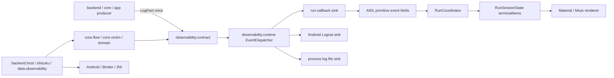
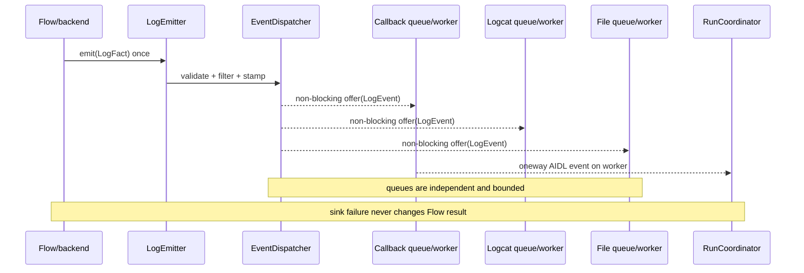

# 归档说明

- 原路径：`docs/plan/kotlin-core-observability-cleanup-plan.md`
- 归档日期：2026-11-04 19:35:20 -0500
- 归档原因：compatibility-first KC 路线先被 KBR 草案取代；KBR 又被用户裁定失效。其仍有价值的需求已重新核对并收敛到新的 root execution 需求入口，本文不再留在活动计划目录。
- 来源：2026-11-04 未提交工作树草案；正文保留为早期评审沿革。现行需求入口为 [`../plan/backend-root-execution-unification-plan.md`](../plan/backend-root-execution-unification-plan.md)。

---

# Kotlin core 边界与可观测性收敛计划（L · 2026-11-04 · 已取代）

> 状态：**曾由现已归档的 [`20261104-1935-kotlin-core-backend-vertical-rewrite-plan.md`](20261104-1935-kotlin-core-backend-vertical-rewrite-plan.md) 取代，不得据本文实施**。2026-11-04 用户裁定不保留 existing-backend compatibility、backend 与 app/core 同改、旧 backend tests 不作为约束，因此本文 compatibility-first wire/id/parity/test-ledger 路线只保留评审沿革。
>
> 基线：branch=`dev-nocpp`，commit=`21d9f53c00ee76891a993c8a2ecea1ea6f9be830`，日期=`2026-11-04`。
>
> 级别：L。原因：本计划会调整公共 Kotlin 数据结构、finish authority、App/`:flowhost`/Shizuku 的 AIDL 进度 wire；必须先经 design-critic 阻断归零和用户批准，之后才能写 production code。本计划不改native logger、DSO attach ABI/registry/分支；只按process role迁Kotlin caller wiring与fd来源。
>
> 依据顺序：`docs/development/软件工程守则.md` > `AGENTS.md` > `engineering-standards.md` / `design-philosophy.md` > 本计划。

## 0. 先纠正 D7 的口径

### 0.1 结论

**D7 没有新的“后续架构边界”。** D7 的批准目标始终只有：

1. configuration adapter 不再按 concrete backend 分支；
2. backend 不再反向 import `data.cve*` / UI；
3. `core/finish` 不再持有 concrete cve43499 request factory；
4. backend 能力只经标准化 `BackendSpec` 暴露。

`kotlin-clean-architecture-ui-plan.md` §9 已明确冻结 AIDL/wire/native/log/PI/waiter/finish behavior。当前 D7 形式上尚未关闭，只因为：

- `A301SO attack gate` 未通过；
- gate 通过后仍需执行 D7.5 的 authority/document final。

因此，之前把 core/log 整理称为“D7 后续边界”会造成 D7 范围继续膨胀，口径错误。本计划把它登记为 **D7 关闭后的新项目 KC（Kotlin Core & Observability Cleanup）**；D7 没有 D7.6。

### 0.2 活跃计划关系

| 文档 | 关系 | 本计划不得改写的权威 |
|---|---|---|
| `docs/plan/kotlin-clean-architecture-ui-plan.md` | 前置计划；D7 的 attack gate + D7.5 关闭后，本计划才可进入实现 | BackendSpec、Backends membership、domain/UI/backend 边界、D7 已完成的软件门 |
| `docs/plan/flow-process-launcher-plan.md` | 仍是 Flow 新进程、Binder 生命周期、cancel/handoff/destroy 的权威；本计划仅 amendment 进度事件 payload | reflection symbol、参数预算、executor 二选一、one-shot、terminal/verify、进程回收 |
| `docs/plan/43499-logging-integration-plan.md` | 保留为 43499 日志点位与 PI 禁区的历史实施证据；其 raw `String` + 双写架构由本计划取代 | PI 窗口零日志、ASCII/单行/≤512 B、敏感字段禁止、日志失败不改变攻击结果 |
| extractor/KMP 设计 | 无冲突；本计划只整理 Android `:app` 内的执行与日志边界 | extractor 的 KMP/common、CLI/TUI/GUI 前端和反编译库选型均不进入本计划 |

### 0.3 启动门

本计划可以现在完成设计和评审；**生产实现必须同时满足**：

1. D7 A301SO attack gate 已归档并 PASS；
2. D7.5 已关闭，D7 checkbox 全绿；
3. 本计划 design-critic 阻断为 0；
4. 用户以短语“批准 KC0”或同义无歧义表达批准。

上述 D7 gate 只证明原 43499 owner move，**不自动替代** Flow launcher 的 B4-real。真实基线按下表一次读取、禁止重复跑同一事实：

| 首次改动 | 改前 gate | 可共用条件 | 缺 gate 时 |
|---|---|---|---|
| KC1/KC4（dead code/UI capability，不改 Flow/attack 行为） | D7 已关闭即可 | 不适用 | 不启动对应批 |
| KC2（finish authority/renderer） | G-43499-real + G-43284-real | 必须分别覆盖当前 production finish/handoff；两者不可互代 | 停止 KC2，不以 golden/AVD 代替 |
| KC3（仅 Bundle codec owner，不改 entry descriptor/事件） | B4 fixture 软件门 | 复用既有 B4a/B4b fixture 记录 | 停止 KC3 |
| KC5（共享 structured-event 垂直迁移） | G-43499-real + G-43284-real | 43499只有在记录同时满足`flow-process-launcher-annex-b4-real.md`全literal时才可复用；43284必须绑定自己的Glued symbol/executor/profile/finish，二者不可互代 | 双门任一缺失都不改KC5代码 |
| KC6（victim JNI owner） | G-43499-real | 只复用同一 victim route/transport 的改前证据 | 停止 KC6 |
| 任一 43284 native logger 行为 | G-43284-real | 无 43284 改前真机记录时不得用 43499 代替 | 本计划不改43284 native logger；未来另立L批 |

本计划不改 `df_log`、43284 native capture 与 native DSO attach registry；但 KC2 会迁 finish authority/renderer，故仍需要 43284 finish route 的改前/改后真实门。该 gate 只约束 KC2，不扩张成 native logger 整理授权。

若用户明确知情强制越过前两项，必须同批在 `architecture-review-log.md` 记录越过条款、确认者、代价、技术债与偿还 gate；没有明确强制确认时不得实现。

## 1. 当前事实基线

### 1.1 `app/core` 不是 Gradle module

- `settings.gradle.kts` 只 `include(":app")`；`app/src/main/kotlin/com/ghostlock/app/core/**` 是 **一个 package 集合**，不是独立 Gradle module。
- 当前共有 47 个 Kotlin 文件、4,279 行。
- `core` 当前混合了 7 种职责：Flow 编排、FlowHost 反射/wire codec、finish 模型与持久化、payload 脚本、victim 协议与 JNI adapter、未接线 access 抽象、未接线 native handle 抽象。
- 因而“把 core 当纯 domain module”不是当前事实，也不是本计划目标；本计划先把 package owner 变成可机械检查的真实边界。

### 1.2 可直接删除的孤岛

当前 production caller scan 的结果：

| 路径 | 文件数 | production 外部调用 | 处置 |
|---|---:|---:|---|
| `core/NativeSession.kt`、`core/SessionPhase.kt` | 2 | 只被下列 `core/access` 孤岛使用 | KC1 删除 |
| `core/access/**` | 11 | 0 | KC1 删除 |
| `core/nativeabi/**` | 1 | 只被下列 `core/nativehandle` 与其测试使用 | KC1 删除 |
| `core/nativehandle/**` | 4 | 0；仅自身测试 | KC1 删除 |
| `core/victim/VictimScriptLauncher.kt` | 1 | 当前 production caller=0，但 98260 最新需求与现有验证脚本把它定义为 script-detach carrier | **保留**，不得按 dead code 删除 |

KC1 当时的 18 个 production 文件、3 个 test 文件与证据集见[归档附件 A §1](20261104-1935-kotlin-core-observability-cleanup-annex-a.md)。该集合只保留历史，不再作为删除授权。

### 1.3 真实保留的 core 能力

| 当前路径 | 真实职责 | 当前问题 | 目标 owner |
|---|---|---|---|
| `core/flow/**` | Flow/step/Result 与 reflection host contract | `Bundle`、raw line、全局 `log` 混入；`FlowHostEnv.context` 是既有 descriptor 例外 | pure Flow 与 reflection ABI 留 `core/flow`；只把 Bundle codec 移 `backend/host` |
| `core/victim/**` | 43499 helper protocol、mechanical session、capability/lifecycle；98260 预留 script-detach mechanism | `VictimNativeJni` 反向 import `jni/**`；script launcher虽零caller但有冻结保留合同 | 协议/session/launcher 留 core；JNI adapter移concrete backend且由composition注入 |
| `core/finish/**` | finish 模型、全局 state、SharedPreferences、Android package probe、script/file | domain/data/runtime 四责混合 | model 合并到 `domain/finish`；store/probe/file 到 `data/finish`；纯 script runtime 留 `core/finish` |
| `core/payload/**` | finish script 子实现与未接线 effect probe | 与 finish 分裂、wildcard/self import；`PayloadEffects` 无 production caller | script helper 合并进 `core/finish`；dead effect probe 删除 |

### 1.4 当前日志事实

1. Kotlin 有四套同义 severity/origin 模型：
   - `log.LogLevel` / `log.LogOrigin`；
   - `domain.run.RunLogLevel` / `RunLogOrigin` / `RunLogEntry`。
   - `domain.settings.TerminalLogLevel`（只有 severity，但仍需第三次手工映射）。
   - `ui.screen.run.RunTerminalLevel` / `RunTerminalOrigin` / `RunTerminalEntry`。
2. `BackendRunSessionAdapter` 为这两套枚举手工映射；`RunCoordinator.appendRuntimeLine` 把所有 host 行强制标为 `Kotlin + Info`，真实级别/来源已在 wire 前丢失。
3. Flow 进度链全是 raw `String`：`FlowProgress.onLine` → launcher `(String) -> Unit` → AIDL `onLine/onLog(String)` → `RunCoordinator`。
4. `Cve43499RunLog` 对一次事实做两次独立调用：`progress.onLine` 与全局 `log.invoke`；这是两个写入权威，不是一个 emitter 的多 sink。
5. `log` 是可变全局 object，持有 minimum/ring/sinks；`snapshot()`/`clear()` 无 production caller，`install()` 仅由 43499 测试改全局状态。
6. `NativeLogTailer` production caller=0；`LogExport.open` production caller=0，但设置页仍暴露自动导出与目录选择，功能合同与实现脱节。
7. `LogFile` 写死 application id、持有无显式 owner 的 fd，并保留互相冲突的“2 MiB 轮转/不再轮转”注释与未使用 `MAX_BYTES`。
8. `NativeLogBridge` 手写 DSO 名单与三个 JNI 分支；新增/删除 native target 时会漂移。
9. native 同时存在 `common/gl_log.*` 与 legacy `backends/43284/df_log.*` 两套级别/格式实现。
10. Kotlin 仍有多处直接 `android.util.Log.*`，绕过统一过滤、脱敏与文件 sink。

## 2. 目标与非目标

### 2.1 目标

1. 给 `core` 每个保留 package 一个单一职责和允许依赖，删除无 production owner 的脚手架。
2. 建立一套 pure Kotlin observability contract：producer 只 emit 一次，dispatcher 再 fan-out 到 terminal/logcat/file。
3. Flow progress 跨 App/`:flowhost`/Shizuku 保留 `level/origin/component/message/reason/elapsed/sequence`，禁止降格成 raw String。
4. UI、文件、logcat 使用同一 formatter/level/origin contract；运行页只展示当前 run 的事件，不把任意 app 调试日志混进 terminal；删除当前没有 production caller 的虚假 auto-export 入口，不在本计划顺手实现新导出功能。
5. 日志失败不进入 Flow 控制流，不改变 retry/timeout/cancel/handoff/成功判定。
6. Android/MediaStore/JNI/AIDL 只存在于 adapter/transport 层；唯一例外是原 FQCN `FlowHostEnv.context`。其余 pure contract、Flow、domain 可 JVM 测试。
7. 把边界写进 `kotlin_architecture_d0.py` 与测试，使 dead/forbidden edge/重复 enum/raw callback 漂移自动失败。

### 2.2 非目标与明确保留

- 不把 `:app` 在本计划中拆成多个 Gradle module；package 门稳定后，是否 module 化另立 CBN。
- 不把 observability 放进 extractor common；extractor 多模块 KMP 是独立计划。
- 不引入 Timber、SLF4J、Logback、spdlog 等外部日志框架；当前需求只有轻量 fan-out、稳定格式、fd/native 接入，外部框架成本高于收益。
- 不改变 BackendSpec key、`Backends.all` membership、flow symbol、selected backend、profile/schema/assets/offset、JNI operation ABI、victim binary wire、route、payload内容或真实finish脚本bytes/path/执行顺序；唯一有意行为差异是preview从`run.sh`迁到`preview.sh`，以关闭已确认的并发覆盖竞态，且纳入KC2双真机门。
- 不改变 FlowHost prepare/start/state/verify/cancel/destroy、AIDL 既有 transaction id、App/Shizuku executor 选择、host one-shot 与 handoff 终态；新 observability 方法只在尾部追加 id。
- 不改变 43499 waiter/race/actor/carrier/PI 生命周期和资源终结顺序；PI 窗口仍零日志。
- 不改 `LegacyProfileConverter.kt`；不碰冻结的 `kernelsnitch/`。
- 不以本计划重写 98260 或开始新的 exploit 实验。
- 不合并 `df_log`/`gl_log`，不改 43284 native capture，不新建 native-log manifest，不改 `NativeLogBridge` attach ABI；这些边界冻结在附件 A §A8。
- 不创建兼容双路径、runtime fallback、第二 ring、第二事件 registry 或临时 raw-line authority。process log 仅允许 §5.3 明定的 current + one previous 两文件保留策略。

## 3. 目标依赖结构



### 3.1 允许依赖

| package | 可依赖 | 禁止 |
|---|---|---|
| `observability/contract/**` | Kotlin/JDK 基础类型 | Android/Compose、domain/data/backend/core/jni/ui、全局状态 |
| `observability/runtime/**` | contract、Kotlin/JDK clock/atomic | Android/Compose、domain/backend/core/jni/ui、静态 singleton sink |
| `domain/**` | pure observability contract | Android/Compose/backend/core/data/jni/log |
| `core/flow/**` | observability contract、Kotlin/coroutines；仅 `FlowHostEnv.context` 可引用 Android `Context` | Android `Bundle`、其它 Android API、backend/data/jni、全局 logger |
| `core/victim/**` | Kotlin/JDK、victim pure contract | Android、`jni/**`、concrete backend |
| `core/finish/**` | `domain.finish`、Kotlin/JDK | Android/SharedPreferences/Context/backend concrete |
| `backend/host/**` | core flow、contract、Android/Binder | UI/domain presentation、concrete config state |
| `data/observability/**` | contract/runtime ports、Android sinks | Flow 决策、backend attack 逻辑 |
| `backend/backends/**` | core/domain/contract + backend private adapters | UI、全局 log object、data concrete store |

### 3.2 `FlowHostEnv` 是有界 ABI 例外，不迁 package

`FlowHostEnv` 已进入每个 `@FlowEntry` 的 JVM reflection descriptor。把它从 `com.ghostlock.app.core.flow` 搬到 `backend/host` 会改变参数 descriptor，即使 Kotlin 字段完全相同也不是“只改 owner”。因此本计划选择：

1. `FlowEntry`、`FlowHostEnv`、validator/registry/spec 全部保留原 FQCN；
2. `FlowHostEnv.context: Context?` 作为该单文件的显式 Android 例外保留，实际对象、nullable 语义与 `flow-host:context-required` reason 不变；
3. 只把 `FlowHostParams` 中的 `Bundle` codec 移到 `backend/host/FlowHostParamsBundleCodec.kt`；pure map model 留原路径；
4. `kotlin_architecture_d0.py` 把例外限定到 exact file + exact `android.content.Context` import，任何第二个 Android import 或第二个 core 文件命中即 FAIL。

exact descriptor、移动集与结构化事件接入点见[归档附件 A §A2](20261104-1935-kotlin-core-observability-cleanup-annex-a.md#a2-flow-reflection-abi-与-android-codec)。

## 4. 统一事件合同

### 4.1 public 数据结构

目标 package：`com.ghostlock.app.observability.contract`。

```kotlin
enum class LogLevel(
    val wire: Int,
    val letter: Char,
    val terminalMarker: Char,
    val token: String,
) {
    Verbose(0, 'V', 'V', "verbose"),
    Debug(1, 'D', '~', "debug"),
    Info(2, 'I', '*', "info"),
    Warn(3, 'W', '-', "warn"),
    Error(4, 'E', '!', "error"),
}

enum class LogOrigin(val wire: Int) {
    Kotlin(0),
    Native(1),
    Shell(2),
}

data class LogFact(
    val level: LogLevel,
    val origin: LogOrigin,
    val component: String,
    val message: String,
    val reason: String? = null,
)

data class LogEvent(
    val schemaVersion: Int,
    val sequence: Long,
    val elapsedMs: Long,
    val fact: LogFact,
)

fun interface LogEmitter {
    fun emit(fact: LogFact)
}
```

`LogFact` 是 producer 输入；`LogEvent` 是 dispatcher 加上顺序/时间后的唯一输出。两者不是两套同义 DTO：前者没有运行时 envelope，后者不可由业务 producer 自行编号。

| `LogLevel` 字段 | 唯一用途 |
|---|---|
| `wire` | AIDL 整数 0..4；不使用 ordinal |
| `letter` | fd/logcat 的 `V/D/I/W/E` |
| `terminalMarker` | UI terminal 行首 `V/~/\*/-/!` |
| `token` | lowercase 展示/解析 token；**不是** SharedPreferences storage literal |

### 4.2 不变量

- `schemaVersion=1`；未知 version fail-closed 为 dropped diagnostic，不投递 UI。
- `sequence>=0`、`elapsedMs>=0`；二者只用于顺序/显示/诊断，**不得参与攻击控制流**。
- `component` 是 ASCII token，正则 `^[A-Za-z][A-Za-z0-9_.-]{0,31}$`。
- `message` 必须非空单行 ASCII；`reason` 若存在也必须非空单行 ASCII；两者均拒绝 NUL/CR/LF/其它控制字符/密钥，不做替换或 normalize。
- V/D/I 的 `reason=null`；W/E 的 producer helper 必须给唯一非空 reason。本计划不把 raw native line 解析成 `LogEvent`，因此不存在从字符串猜测 level/reason 的 legacy adapter。
- canonical body 精确为：V/D/I=`message`；W/E=`message + " reason=" + reason`。terminal=`<marker/elapsed> component: body`，其中origin只选择括号（Kotlin`<>`、native`[]`、shell`()`），不再打印冗余origin token；fd=`[letter/elapsed] origin=<K|N|S> component: body`；logcat tag=`component`、body=`[letter/elapsed] origin=<K|N|S> body`。五级golden见附件A §A3.7。
- validation 对同一 event 的 terminal/fd/logcat 三种完整 UTF-8 rendering 都计算长度；三者最大值 `<=512 B` 才接受。不是只量 message，也不允许某个 sink自行截断。
- enum wire 使用显式整数，不读 ordinal；非法整数丢弃并计数。sequence 从 0 开始，`Long.MAX_VALUE` 接受一次后停止编号、后续 overflow-drop，绝不环回。
- invalid producer fact 不向业务线程抛异常，只增加 `invalidDropCount`；sink 抛异常由 dispatcher单独吞并计数，其他 sink继续；`emit` 不返回可用于业务分支的成功值。
- 不提供 production `LogEmitter.NONE`/默认丢弃实现；composition 缺 emitter 必须构建/测试失败。单测可直接注入局部 lambda fake，architecture gate拒绝 production discarding emitter。

### 4.3 RunSessionState

- 删除 `RunLogLevel`、`RunLogOrigin`、`RunLogEntry`。
- 删除 UI 的 `RunTerminalLevel`、`RunTerminalOrigin`、`RunTerminalEntry`；`RunUiState` 只把 domain 的 `RunTerminalItem.Notice/Event` 投影为同形只读 item，Event 直接引用唯一 `LogEvent`，不再枚举映射。
- 删除 `domain.settings.TerminalLogLevel`；`OperationalPreferences.logLevel` 直接使用 pure contract 的 `LogLevel`。现有持久化 authority 实际是 enum `.name`，继续读写 `Verbose/Debug/Info/Warn/Error`；`token` 只用于格式/展示，不改 storage literal、不新增 key。
- `RunSessionState.terminalItems` 改为 `List<RunTerminalItem>`，其中只有两种：`Notice(message)` 与 `Event(LogEvent)`。`Notice` 没有 level/origin/sequence，不是第二日志 DTO；只用于保留 fresh selection 的两条固定 greeting。
- `RunCoordinator` 只接受 `LogEvent`，不再把全部行覆盖成 Kotlin/Info。
- `initialRunTerminalItems()` 保留 literal `ghostlock terminal` / `waiting for execution` 两个 `Notice`，renderer继续按现有 Info 视觉显示，但它们不写file/logcat、不占host sequence；其它生命周期由 typed `BackendRunUiState` 表达。host run 的 sequence 只有host dispatcher一个编号authority。
- `BackendRunSessionAdapter.renderedTerminalLines` 使用唯一 formatter，不保留 enum mapping。
- 当前 run 同时限制 512 个 `Event` items 与 256 KiB formatted event bytes；两个固定 Notice 不计入配额。超限淘汰最旧 event；旧 generation event 不进入新 run，terminal state 不伪造成 `LogEvent`。

## 5. dispatcher、背压与资源所有权

### 5.1 唯一发射路径



- `EventDispatcher` 是 run-scoped 实例，构造时注入 monotonic clock、minimum level 和不可变 sink list；producer 只持有 `LogEmitter`。
- 单个 emitter 的线性化点只做 validation/filter/sequence/elapsed 与 non-blocking offer；producer 线程不执行 Binder、文件或 Logcat I/O。
- 每个 sink 独占容量 256 的 queue 与 worker；满时只丢该 sink 的 newest incoming event，饱和计数，不阻塞其它 sink。
- public runtime 合同固定为 `EventSink.accept/terminal/close`、`EventDispatcher.emit/seal/diagnostics` 与 `DrainReport.Drained/TimedOut(pendingSinkIds)`；`TerminalSignal` 只允许 `Completed(code)/Aborted/Handoff/Destroyed`。历史 exact signature 见[归档附件 A §A3](20261104-1935-kotlin-core-observability-cleanup-annex-a.md#a3-eventdispatcher-冻结合同)。
- dispatcher 正常状态为 `OPEN → SEALED → CLOSED`；单个超时 sink 进入 `DRAIN_TIMED_OUT_OWNED`，**不是**假装关闭。1500 ms 只能结束 owner 的等待，不能取消正在执行的 Binder/file 调用；queue、worker、Binder/fd 仍由该 sink runtime 持有，直到 worker acknowledgement 或所属 one-shot process 终结。所有 worker ack 前不得释放其仍可访问的资源。
- App callback 与 Shizuku callback 都使用 `oneway`；`Drained` 只证明本地 worker 已按 FIFO 提交 callback transaction，不声称远端 UI 已处理。run terminal 的权威仍是 host state/verify，不是 callback ack。
- `Cve43499RunLog` 可保留为 backend-private typed helper，但只构造一个 `LogFact`、只调用一次 emitter；删除当前 `progress.onLine + global log` 双写。
- `SequentialFlow` 由构造器注入 emitter；`FlowRequest` 仍只承载业务输入，不装 callback/handle/emitter。`FlowHostEnv.events` 是 host composition seam。

### 5.2 sink 与编号 owner

| 场景 | 编号 owner | sinks | receiver 行为 |
|---|---|---|---|
| app 一般日志 | `AppContainer` process dispatcher | app logcat + process file | 不进入 run terminal |
| App `:flowhost` run | host run dispatcher | callback + transferred fd + host logcat | app 只校验/存储，不重编号、不重复写 host file/logcat |
| Shizuku Flow run | UserService run dispatcher | `onFlowEvent` + transferred fd + shell logcat | 禁止回退 `onLog(String)` |
| legacy app-local run | app run dispatcher | terminal + app file/logcat | 不同时走 host callback |

每次 run 的 sink list 与 minimum level 在 run 开始冻结。设置变化只影响下一 run；threshold 不放进 profile/FlowRequest，也不从环境变量读取。

### 5.2.1 process role composition

manifest 的 `GhostLockApp` 会同时在主进程与 `:flowhost` 执行，故 composition 必须先判定 process role，再构造任何 repository/logger：

| 进程 | 唯一 composition | 明确创建 | 明确禁止创建 |
|---|---|---|---|
| package 主进程 | main-only `AppContainer` | `ProcessLogFile`、`NativeLogBridge.attach`、`ProcessLogController`、finish/backend/settings repository、UI ViewModel factory | `FlowHostProcessContainer` |
| `:flowhost` | `FlowHostProcessContainer` | `FlowHostService` 所需的最小 registry/codec；通过合法 observability configure/prepare且接管transferred fd后，按run创建dispatcher并对该fd调用既有`NativeLogBridge.attach` | `AppContainer`、finish/settings/backend UI repository、process root fd、startup attach |
| Shizuku UserService | UserService run scope | 每个 service/run 的 registry snapshot、run dispatcher、transferred fd | `GhostLockApp`/`AppContainer`、主进程 repository、process root fd |

- `GhostLockApp.onCreate()` 的顺序冻结为：`Application.getProcessName()`判role → main role调用`AppContainer.create()`；`:flowhost`只创建`FlowHostProcessContainer`，不在Application startup打开文件或attach。role未知时fail-closed，reason=`process-role:unknown`。
- main 的 `AppContainer.create()` 内部顺序冻结为：startup rotation/free-space检查 → 打开 root fd → 调用`NativeLogBridge.attach(fd)`并暂存返回事实 → 创建`ProcessLogController` → 由process emitter发出该attach事实 → 创建其余repository/use case。attach前不写业务日志。`container` accessor只在main role可取；错误进程访问具名失败`process-role:main-required`，不懒建第二份容器。
- `:flowhost` run顺序冻结为：合法configure → prepare接管transferred fd → `NativeLogBridge.attach(transferredFd)` → 创建run sinks/dispatcher → 执行业务。只迁caller时机与fd来源，不改`NativeLogBridge`的DSO名单、JNI分支、dup/close ABI；没有合法fd则保持既有“native attach不可用、Flow继续”的日志降级语义。
- `:flowhost`在run dispatcher发布前不持有nullable/no-op emitter，也不产生日志事实；configure/prepare前置拒绝只通过稳定返回码表达。dispatcher发布后`FlowHostService`才可emit，terminal seal后再emit一律late-drop。这样不需要bootstrap logger或第二process dispatcher。
- `FlowHostEnv` 的 reflection FQCN 不因 process composition 改变；该项只消除当前 `:flowhost` 构造完整 `AppContainer` 的副作用。

### 5.2.2 threshold 与现有 caller 的唯一处置

- main-only `ProcessLogController` 持有 `AtomicReference<LogLevel>` threshold 与 process emitter。`SharedPreferencesOperationalPreferencesAdapter` 初始化、保存、observe 时仍同步更新该 reference，保持当前“设置立即影响一般 app 日志”的行为；更新不重建 worker/fd，sequence 继续。
- run dispatcher 在 run 创建时读取一次 preference snapshot，随后冻结；run 中设置变化不改变该 run，也不由 host 再读 preference。
- 不新增 service locator/global logger。UI 通过 main composition 提供的 `LocalProcessLogEmitter` 取得 emitter；其 default 是具名构造失败，不是 silent discard。preview/test 必须显式注入局部 fake。
- direct/global caller 的逐文件处置冻结在附件 A §A3.6：一般 app/data/UI 诊断进入 process emitter；Flow/host/backend 里程碑进入 run emitter；唯一保留的直接 `android.util.Log` 是 `Cve43499RequestFactory.kt` 的 `GLK-FAILSTOP` 攻击相邻 fail-stop。KC5 machine gate 要求除此 exact whitelist 外 direct Android Log caller=0、旧 global `log` caller=0。

### 5.3 process file 与 fd owner

- `LogFile` singleton 收敛为由 main-only `AppContainer` 持有的 `ProcessLogFile` 实例；路径从 application `Context` 构造，删除写死 application id。`:flowhost`/Shizuku 不打开第二个 root file。
- 文件固定为`files/ghostlock-run.log`与最多一个`files/ghostlock-run.previous.log`。只在main process startup、尚无fd/worker/native borrower时依次执行：先取可用空间；足够后才检查current；current `>64 MiB`时先删除旧previous、再用同目录`Os.rename`原子改名并创建新current。当前run绝不truncate/rename。previous删除或rename任一步失败时保留现有证据并禁用本次file sink，不继续无界append。
- 可用空间authority为`Os.statvfs(filesDir.path)`的overflow-safe `f_bavail * f_frsize`；调用失败或`<16 MiB`时禁用本次file sink并保留logcat/callback，**不删除/rename任何证据腾空间**。64 MiB rotation threshold与16 MiB startup floor都是代码常量并有边界测试，不从profile/env读取。
- launcher 只 duplicate/transfer per-run fd；App host/Shizuku host 成为该 duplicate 的 owner，并在 terminal/destroy/onDestroy 关闭。
- native 已取得的 duplicate 仍由对应 DSO 按既有 close owner 释放；Kotlin refactor 不偷关、不改变 attach/close ABI。
- 一行一次 write，短写循环；`ENOSPC/EDQUOT/EIO` 或短写终结 Kotlin file sink并关闭其 descriptor，callback/logcat继续、Flow结果不变。native-owned duplicate只能由native owner关闭；其后续write失败不由Kotlin伪报成功。
- 该策略把已完成历史限制为一个 previous，且不在当前 run 丢证据；单次 run 的实际上界仍由产生量决定。若单次run超过64MiB，下一process startup才旋转；不得为过门在运行中截断。
- Rust 式资源表（dispatcher、queue/worker、Binder ref、root fd、transferred fd、native duplicate、retained list）固定在附件 A §A3.5。

### 5.4 当前虚假 auto-export 的处置

`LogExport.open` production caller=0，但设置页暴露 `autoExportLogs`/目录选择。直接“接通”会把一个当前无效开关变成新的后台 MediaStore 行为，不属于整理的行为保持范围。因此本计划选择：

1. KC4d 删除无 caller 的 `LogExport` API及 auto-export UI/domain preference；
2. 旧 preference key 只被忽略，不迁移、不复用成别的语义；
3. 不创建 `MediaStoreEventSink`；未来若用户重新要求导出，以 `TD-KC-EXPORT` 独立设计。

这使用户可见能力与真实实现一致，也避免将 dormant UI 当成实现授权。

### 5.5 删除/保留边界

- 删除 production caller=0 的 `NativeLogTailer`，不再保留 120 ms polling 方案。
- 删除 global logger ring、`snapshot/clear/install`；测试直接构造 dispatcher/fake sink。
- native 详细诊断继续走既有 logcat/file；UI只展示结构化 Kotlin/host里程碑，不声称逐字节镜像 native log。
- `NativeLogBridge`、`df_log`、`gl_log` 和现有 CMake artifact manifest **保留原样**；不得把 Kotlin 整理偷换成攻击相邻 native 重构。

## 6. AIDL/wire amendment

### 6.1 App `:flowhost`

`IFlowHostCallback.aidl` 当前隐式 transaction 1/2 改为显式 id，但不重排：

```aidl
oneway void onEvent(
    int schemaVersion,
    long sequence,
    long elapsedMs,
    int level,
    int origin,
    String component,
    String message,
    String reason
) = 1;

oneway void onTerminal(int code) = 2;
```

- `reason=""` 表示 Kotlin contract 的 null，避免 nullable/Parcelable/classloader 差异。
- callback 由独立 sink worker以 **oneway** 调用；terminal sentinel 使同一 worker先提交已接受 event，再提交 `onTerminal`。`onTerminal` 只提供诊断/FIFO边界，client 不以它决定成功；state/verify 仍是终态权威。
- `IFlowHost` 的 1..11 与 destroy 16777114 不动；仅追加同步 `configureObservability(schemaVersion, minimumLevel)=12`。新错误码只在现有 0..6 尾部追加：7=`flow-observability:schema`、8=`flow-observability:level`、9=`flow-observability:state`、10=`flow-observability:not-configured`。
- 新 host process 初始 `IDLE + observability=UNCONFIGURED`。只允许第一次、prepare 前配置：合法输入返回0且冻结配置，Flow state仍是IDLE；未知schema返回7、非法level返回8；重复配置或prepare后配置返回9；未配置就prepare返回10。prepare失败不解冻配置，仍按既有state规则允许或拒绝重试；callback rebind不重置配置；只有新host process回到UNCONFIGURED。
- `:flowhost` 是同一 APK 的 non-exported service；client/server 同批替换，不保留 `onLine` fallback。

### 6.2 Shizuku

`IGhostlockCallback` **保持 interface-level `oneway`**；既有 1..4 的 id/异步语义不动，在末尾追加同样 oneway 的 `onFlowEvent(...)=5`。Flow 分支只发新方法：

- `onLog(String)`：只允许 legacy `prepare/start/readLog` 分支；不得再承载 `prepareFlow/startFlow`。
- `onFlowEvent(...)`：只允许通用 Flow 分支，只由 callback sink worker调用；不提供同步 ack。
- `onStatus/onDropped/onComplete` 的 legacy 语义不动；Flow callback sink的`terminal()`只形成本地FIFO/close barrier，不调用legacy `onComplete`，Flow终态继续由`getFlowState/verifyFlow`取得。
- `IGhostlockUserService` id 1..20 与 16777114 不重排、不复用；仅追加同步 `configureFlowObservability(...)=21`，使用与 App host 相同的 7/8/9/10 code/reason/state matrix，在 `prepareFlow` 前恰一次。
- 每次 run 新 UserService instance 的既有策略保证 client/server 同版本；未知 schema/非法枚举仍在 app client fail-closed。

完整历史 transaction ledger、同步/异步型态、threshold authority、null/stale Binder 语义见[归档附件 A §A4](20261104-1935-kotlin-core-observability-cleanup-annex-a.md#a4-aidl-transaction-ledger)。

### 6.3 wire 极端值

| 输入 | 预期 |
|---|---|
| version=1、sequence=0、elapsed=0、合法最短 component/message | 接受一次 |
| version=0/2 | dropped+1；不进 terminal；Flow 不失败 |
| level/origin=-1 或 Int.MAX_VALUE | dropped+1；不崩溃 |
| sequence=-1、elapsed=-1 | dropped+1 |
| component 空、33 bytes、非法字符 | dropped+1 |
| message/reason 含 NUL/CR/LF/非 ASCII | dropped+1 |
| formatted 512 B | 接受；513 B | dropped+1 |
| callback 抛 RemoteException | host 继续 Flow，记录本地 sink failure |
| 连续事件 sequence 重复/倒退 | app 丢弃该 event 并记 diagnostic；不改变 terminal result |

上述“event callback failure 不改 FlowResult”不覆盖 launcher 既有 callback Binder-death 生命周期；UI 进程死亡后的停止编排/host退出仍以 `flow-process-launcher-plan.md` 为权威。

## 7. native 边界：本计划冻结，不整理

首轮设计把 `df_log`→`gl_log` 写成“机械替换”，同时提议新建 `native-log-targets` manifest；这两个判断均不成立：

1. `df_log` 与 `gl_log` 的输出目标、flush/格式、level 表达和 fd owner 不同，不能在无 43284 真机基线时按名称替换；
2. 当前 CMake 已从 target graph 导出 artifact/JNI manifest；再造一个 native-log manifest 会形成第二 authority。

因此 KC 的 native disposition 固定为：

- 保留 `common/gl_log.*`、`backends/43284/df_log.*`、所有 native 调用点与 PI 禁日志判据；
- 保留现有 CMake target/artifact/JNI manifest，禁止第二 registry；
- 保留 `NativeLogBridge` 的 attach 列表与 JNI ABI，本计划只保证 Kotlin fd owner refactor 不改变其输入/close 次序；
- native logger统一与 attach registry 归入附件 A §A8 的独立技术债，必须另立 L 计划并先有对应真实设备改前门。

## 8. core exact disposition

### 8.1 KC1 删除

- 删除附件 A §A1.1 冻结的 18 个 production 文件。
- 删除附件 A §A1.2 冻结的 3 个 test 文件/9 cases。
- `core/victim/VictimScriptLauncher.kt` 与其 6-case test 保留为 `KEEP`；不得再用 wildcard 将其卷入 KC1。
- machine disposition、当前权威文档与 class diagram 同批更新；外部 caller/反射/AIDL/JNI/manifest 任一非零则停止 KC1。

### 8.2 KC2 finish/payload

| 当前内容 | 目标 |
|---|---|
| `core.finish.PayloadKind/PayloadSlot/FinishState` + `domain.finish.FinishPayload*` 重复模型 | 合并为附件 A §A5.1 的 `FinishPayloadKind/FinishPayloadSlot/FinishDefinition`；backend/UI/data 共用 pure model |
| `FinishConfig` mutable object + SharedPreferences codec | `AppContainer` 唯一持有的 `data.finish.SharedPreferencesFinishRepository`；同一 `ghostlock.finish/state` 与 v1→v2 decoder，不新增 key |
| root manager catalog | pure `domain.finish.RootManagerCatalog`；Android 安装探测放 `data.finish.AndroidRootManagerProbe` |
| `FinishScriptStore` | `data.finish.FinishScriptFileStore` 实例，路径/写/删 owner 明确 |
| `FinishState.toRootScript` + `PayloadRequests` | `core.finish.FinishScriptRenderer`；payload helper private/internal，不另成 package |
| `PayloadEffects` | production caller=0，删除；若后续产品需要效果探针，先定义 domain port 与真实调用方 |

repository 在 main process composition 中只构造一次；constructor 在单锁内从 prefs decode 一次，之后 `read()` 只返回内存 snapshot，外部直接修改 prefs 不受支持，重启才重新读取磁盘。mutation 固定为 `read-transform-memory publish-apply`，保持当前“内存先可见、`SharedPreferences.apply()` 异步落盘”语义。`FinishEditorState` 精确为 `FinishEditorState(definition: FinishDefinition, rootManagers: List<FinishRootManagerOption>)`，不是复制 definition 字段的第二 authority；editor/settings/43284 三类 mutation 只能改附件 A §A5.2 列出的字段。

必须保留 persistence literal、payload 顺序、root manager args、真实脚本 bytes、marker、43499 handoff 与 43284 `kernelAccessAfterRelay` 语义。真实 prepare authority 仍是 `files/finish/run.sh`；preview 改用独立 `files/finish/preview.sh`，消除当前 preview 覆盖正在执行 run script 的真实竞态。单个 `FinishScriptFileStore` 锁分别串行每个路径的 write/read snapshot；43499 handoff 在锁内取得 `run.sh` bytes/path/digest 后才释放，之后 preview 不能改变 handoff 内容。write失败具名终止对应操作；真实脚本只由 finish terminal/failure owner best-effort删除，preview在下次preview/clear时best-effort覆盖/删除；app death残留由下次 prepare 覆盖。

### 8.3 KC3 flow host owner

- 保留 `core/flow`: `Flow`、`FlowRequest`、`FlowResult`、steps/retry/timing、`FlowSymbol`、pure `FlowHostParams`。
- **保留原 package/FQCN**：`FlowEntry` annotation、`FlowHostEnv`、entry spec/validator/registry；它们是 reflection ABI，禁止 owner move。
- 只移至 `backend/host`: `FlowHostParamsBundleCodec`。
- `FlowHostParams.kt` 拆成 pure model 与 Android codec 两文件；值白名单/预算/失败 reason 不变。
- KC3 只做 Bundle codec owner，不引入事件、不删 `FlowProgress`；reflection descriptor、registry 集合、flow symbol、Context nullable/失败 reason 均不变。
- `SequentialFlow` emitter、`FlowHostEnv.events`、所有入口和 `FlowProgress` 删除统一进入 KC5 的 structured-wire 垂直批；不留 raw-line wrapper或跨批兼容层。

### 8.4 KC6 victim owner

- 保留 `core/victim` pure protocol、result、capability、identity、session 与 `VictimNative` port。
- `VictimNativeJni.kt` 移到 `backend/backends/cve43499/victim/Cve43499VictimNativeJni.kt`，因为当前 JNI transport 与 43499 library/DTO 绑定。
- 43499 production factory 显式注入该 adapter；`VictimScriptLauncher` 去掉 default concrete transport，要求 backend composition root 注入 session factory；core 不再 import `jni/**`。
- valid handle 的 transfer 线性化点补成显式合同：adapter 在返回 `VictimResult.Ok(VictimSpawned)` 前临时持有 token；`VictimSession.start` 在锁内完成校验、`VictimProcess` 构造与 handle/state publish 后才接管。两处任一在 publish 前抛异常/失败，当前 owner 必须对已知 valid handle执行一次 `closeVictim`；invalid-pid unknown-process 情况仍按现状只 `detachVictim`，不得 kill。
- park/detach/close/reap 正常顺序 1:1；本批只迁 adapter owner并关闭既有 `VALID_TOKEN_UNTRANSFERRED` 泄漏窗，不改变 wire、timeout、kill、rooted handoff状态机。
- spawn incomplete/bad pid/valid-token-transfer-failure/normal close/timeout kill/rooted detach/repeat close 的资源表与 exact判据见附件 A §A6；改后必须执行 43499 真实设备 gate。

## 9. 分批实施与 checkbox

> checkbox 只跟踪可交付成果；不登记 hash、复读状态、重复扫描等流程动作。任一批失败两次，停止并回 debug；上一批全绿后才进入下一批。

### 9.1 设计与启动

- [x] **KC0.1 Explore**：冻结 `:app`/core/log/AIDL/current caller 的事实基线。
- [x] **KC0.2 活跃计划关系**：确认本计划不并入 D7；记录 launcher/logging 计划的保留与取代范围。
- [ ] **KC0.3 design-critic**：阻断 0，逐条回应重要/建议项。
- [ ] **KC0.4 用户批准**：用户批准 KC0；没有批准不写 production code。
- [ ] **KC0.5 D7 前置门**：A301SO gate + D7.5 已关闭，或已有明确强制越权沿革。

### 9.2 实现批

- [ ] **KC1 dead-island**：删除附件 A §A1 exact 18 production + 3 test files；machine disposition 与当前权威图同批更新。
- [ ] **KC2 finish vertical slice**：一次原子完成唯一 `FinishDefinition`、repository、Android probe/file owner与script renderer，删除zero-caller `PayloadEffects`；不留旧新模型/codec/store桥。persistence/script golden + G-43284-real/G-43499-real改后门全绿才关闭。
- [ ] **KC3 Flow params codec**：只迁 `Bundle` codec；Flow reflection ABI/FQCN/descriptor/registry exact 不变。
- [ ] **KC4 remove fake facilities**：删除无 caller 的 auto-export API/UI/preference surface和 `NativeLogTailer`；不实现 MediaStore sink，不动现有 logger/Flow。
- [ ] **KC5 structured observability vertical slice**：在一个批内落 contract+bounded dispatcher+sinks，并同时改 settings severity、RunSession/renderer、`FlowHostEnv.events`、所有 Flow producers、App+Shizuku callback AIDL/client/host、threshold配置与 RunCoordinator；最后删除 global ring/重复enum/`FlowProgress`/raw Flow callback；AVD + G-43499-real + G-43284-real改后门全部PASS才关闭。
- [ ] **KC6 victim JNI owner**：只迁 `VictimNativeJni` concrete adapter与注入点；owner/lifecycle tests + 43499改后真机门 PASS。
- [ ] **KC7 final matrix/authority**：两 renderer、所有 executor/level/origin/drop/terminal/abort/handoff复跑；README 双语、logging规范、review/device-gate index与旧计划指针收口；不首次改结构。

## 10. 每批 exact 文件范围

### KC1

- 删除 §8.1 production/test 文件。
- 修改 `tools/kotlin_architecture_d0.py` 与对应 architecture test/manifest。
- 不碰 flow/finish/victim production behavior。

### KC2

- `app/src/main/kotlin/com/ghostlock/app/domain/finish/**`
- `app/src/main/kotlin/com/ghostlock/app/data/finish/**`
- `app/src/main/kotlin/com/ghostlock/app/core/finish/**`
- 删除 `app/src/main/kotlin/com/ghostlock/app/core/payload/**`
- 只改直接调用的 43284/cve43499 request/finish adapter 与相应 tests。
- exact current/target文件、mutation owner与脚本资源见附件 A §A5/§A7.1。
- KC2 是不可拆的 finish authority 垂直迁移：domain model、唯一 repository、Android store/probe、renderer与所有直接caller必须同批切换；若拆开会留下旧 `FinishConfig` 与新 repository 两个 authority或compat mapper。
- 同批更新 `full-process-uml.md` 的 finish class/resource/sequence 三图；不得延后到KC7。改前双设备基线只读取一次，整批代码完成后执行一次G-43284-real+G-43499-real改后门。

### KC3

- 只拆 `core/flow/FlowHostParams.kt` 与新增 `backend/host/FlowHostParamsBundleCodec.kt`，修改其直接 host/launcher/UserService codec callers与 tests。
- `FlowEntry.kt`、`FlowHostEnv`、validator/registry/package、AIDL、events、`FlowProgress` 均不改。
- 同批更新 Flow params IPO/class 图；B4 fixture software gate 全绿。

### KC4

- 删除 `LogExport.kt`、`NativeLogTailer.kt` 与 settings中的 auto-export surface；旧 preference key ignored。
- 只移除虚假/无 caller 能力：`log.kt`、`LogFile`、severity/RunSession/Flow/AIDL均不改；fail-stop `GLK-FAILSTOP` 与攻击相邻直接 Android Log保留。
- 同批更新 settings capability表与两renderer fixture；不预建MediaStore interface。

### KC5

- exact vertical slice为附件 A §A2.3/§A4/§A7.1：新增 `observability/{contract,runtime}` 与 `data/observability`，统一 settings/RunSession/renderer，修改 `AppContainer`/`GhostLockApp`/旧 log runtime，两个 callback AIDL、两个 service AIDL尾部配置方法、App/Shizuku launcher/client/host、全部 Flow entry/producers、`RunCoordinator` receiver、`Cve43499RunLog`、`SequentialFlow`，并删除 `FlowProgress.kt`。
- 这是一个不可拆的 raw→structured 迁移：不得在中间批保留 String bridge、双写、compat callback或第二 registry。
- 不改 native logger、CMake manifest、attack参数、critical section、prepare/start/state/verify/cancel/destroy与既有 id。
- 同批更新 Flow state/sequence/wire表；先有G-43499-real与G-43284-real各自改前证据，后跑AVD App/`:flowhost`/Shizuku + 两backend各自冷机改后门。

### KC6/KC7

- KC6 exact owner/path/资源表见附件 A §A6；只改 `VictimNativeJni`、43499直接 composition/factory、`VictimScriptLauncher` default seam和直接 tests，同批更新 victim class/resource 图并执行 43499 改后门。
- KC7 只复跑 `app/src/androidTest/**` FlowHost/Shizuku/renderer matrix，归档 `docs/analysis/device-gates/**`，并收口 `docs/analysis/log-levels-and-sites.md`、README/README_ZH、本计划/旧计划指针与 `architecture-review-log.md`。
- `full-process-uml.md` 的结构变化已经逐批更新；KC7 只做 stale/duplicate consistency check。

## 11. 验证矩阵

### 11.1 每批共同门

| 门 | 命令/输入 | 预期 |
|---|---|---|
| source consistency | `git diff --check` | exit 0 |
| Kotlin architecture | `python3 tools/kotlin_architecture_d0.py --verify`（以脚本当前正式参数为准，不另造旁路） | missing/duplicate/stale/forbidden edge 全 0 |
| app Kotlin XML producer gate | `./gradlew :app:verifyDebugUnitTestXml --console=plain` | 从 root 唯一 `expectedKotlinTests` 读取本批 exact 值；debug unit XML 的 failures/errors/skipped 全 0，不在 app 脚本复制数字 |
| root all-XML authority | `./gradlew verifyAllTestXml --console=plain` | 全量读取 repo 内 `build/test-results/**/*.xml`，无忽略桶；literal=`ALL_TEST_XML=PASS FILES=<N> TESTS=<本批exact> FAILURES=0 ERRORS=0 SKIPPED=0` |
| aggregate | `./gradlew checkAll --console=plain` | 显式依赖 `verifyAllTestXml`；host/native/artifact/Kotlin aggregate 全绿，exit 0 |

### 11.2 KC1/KC2

- caller scanner：dead package/symbol 定义与 import 均 0；Shizuku/AIDL/reflection manifest 无引用。
- finish persistence golden：v1 legacy、v2、坏字段、空 payload、重复 payload、true/false/absent `kernelAccessAfterRelay` 的 literal 与改前一致。
- finish script golden：所有 fixture 的 UTF-8 bytes 与改前一致；路径、权限、marker、payload 顺序一致。
- 43499 request/finish + 43284 configuration tests 全绿。
- KC2 全部文件原子切换后分别执行43284/43499真实设备门；任一缺失则KC2保持未完成，不以golden/AVD替代。

### 11.3 KC3/KC4/KC5 contract

- `LogFact/LogEvent` 极端矩阵覆盖 §4.2 与 §6.3。
- fake dispatcher 证明：一个 producer call 产生每个启用 sink 恰好一次；sink A 抛异常时 B/C 仍各一次；FlowResult 不变。
- filters：V/D/I/W/E minimum；W/E 缺 reason 拒绝；ASCII/CR/LF/512/513 B。
- RunCoordinator 保留收到的 level/origin/elapsed/sequence；generation 过期事件不进入当前 run。
- Material/Miuix 同一 `LogEvent` fixture 的文本、颜色语义、timestamp 一致。
- auto-export 删除门：settings两 renderer与 domain state 不再暴露开关/目录；旧 preference key ignored；MediaStore open caller=0。
- `NativeLogTailer`、global ring、enum mapping、raw `FlowProgress` caller 数均为 0。

### 11.4 KC5 wire

- AIDL compile + App callback fake + Shizuku callback fake 覆盖 §6.3。
- generated Proxy/Stub 检查 callback ids App=1/2、Shizuku=1..5，且两组共七个callback method全部设置`FLAG_ONEWAY`；检查`IFlowHost`既有1..11/16777114、`IGhostlockUserService`既有1..20/16777114完全不变，新增同步配置仅为12/21。
- `configureObservability`/`configureFlowObservability` 覆盖合法0、schema7、level8、state9、not-configured10、重复、prepare后调用、prepare失败后的冻结、callback rebind、host process/UserService重建与下一 run 重新读取 threshold。
- `onLog(String)` 在 Flow 分支 caller=0；`onFlowEvent` 不被 legacy backend-host 分支调用。
- callback FIFO、queue full/drop、terminal drain、RemoteException、null/stale parcel、sequence duplicate/倒退、512/513 B全部有确定性 fake；1500ms fake blocking sink必须得到`TimedOut(pendingSinkIds)`且资源仍owned，worker acknowledgement后才转CLOSED。
- process-role fixture分别启动main/`:flowhost`：main只有一份AppContainer/finish repository/root fd/startup native attach；`:flowhost`的AppContainer/repository/root fd/startup attach均0，合法configure/prepare接管transferred fd后run attach与dispatcher各恰1。Shizuku无AppContainer。错误role取`container`具名失败。
- process threshold测试证明一般app emitter立即响应设置变化且不换fd/worker；已启动run保持旧snapshot。direct Android Log caller仅剩`Cve43499RequestFactory.kt:GLK-FAILSTOP` exact whitelist，旧global logger caller=0。
- native source/CMake/artifact manifest/`df_log`/`gl_log` diff必须为0；`NativeLogBridge`的external methods、`LIBRARIES`、内部load/branch/attach次序与close ABI diff为0（只允许KDoc及main/flowhost caller wiring）；`verify_no_log_in_pi`新增调用数=0。
- `./gradlew nativeTestHost nativeBuildAndroid checkAll --console=plain` 仍全绿，用来证明 Kotlin/wire整理未破坏现有 native gate，不把它写成 native logger已整理。

### 11.5 AVD 与真机

1. AVD：Material/Miuix 各跑 App `:flowhost` fixture，V/D/I/W/E、native/shell/Kotlin origin、512 B、callback drop、terminal、abort、handoff。
2. AVD/Shizuku 可用环境：同一 fixture 经 Shizuku，新 UserService instance、pid/registry identity、event fields、terminal lifecycle 保持。
3. 真机：KC2 finish分别跑受影响backend；KC5共享structured callback分别跑43499-Glued与43284-Glued；KC6 victim owner跑43499。每门均冷机、固定CPU对、single route、KernelSU未加载；日志确认无PI行、event sink故障不改变既有结果。
4. 真机日志与 profile/APK/ELF 身份归档到 `docs/analysis/device-gates/`；缺对应真机证据则相关批不置完成。

## 12. 完成定义

只有同时满足以下条件，KC 才完成：

1. `core` 中只剩有 production owner 的 Flow/victim/finish mechanism；dead islands 为 0。
2. core/domain 不 import Android Bundle、JNI concrete或global log；唯一 Android例外是原 FQCN `FlowHostEnv.context` 的 exact `Context` import，且 architecture guard拒绝扩散。
3. Kotlin 只有一套 `LogLevel/LogOrigin/LogFact/LogEvent`；RunSession 不再复制枚举。
4. 每个事实 producer 只 emit 一次；fan-out 只由 dispatcher 完成。
5. App/`:flowhost`/Shizuku Flow callback 不再以 raw String 传进度；wire 极端矩阵全绿。
6. global mutable logger/ring、NativeLogTailer、未接线 LogExport与虚假 auto-export设置均无残留；`NativeLogBridge`手抄 attach、`df_log`和`gl_log`按非目标保留并登记独立技术债，不伪称已整理。
7. finish persistence/script bytes、Flow lifecycle、victim owner/close、attack control flow 与明确保留项一致。
8. architecture/unit/native/Android artifact/AVD/真机门按批通过，失败与通过证据均归档。
9. 每个结构批已同批更新 `full-process-uml.md`；最终 README/README_ZH、logging规范、active-plan pointers与代码一致。
10. 没有旧码注释块、TODO 临时物、compat wrapper、第二 authority 或未登记技术债。

## 13. CBN（成本权衡）

| 决策 | 可量化比较 | 选择 | 翻转条件 |
|---|---|---|---|
| contract owner | 当前同义模型 4 组（`log`、`domain.run`、`domain.settings`、`ui.run`）+ 至少 2 个 mapper；顶层 contract改为1组，新增6个 contract文件，删除3组重复enum/entry与mapper | 顶层 pure `observability.contract`；domain/core/backend/UI都只依赖它 | 真正拆出第二 JVM/desktop consumer时，把同一 package搬最小 contract module，不先造空 module |
| wire 形状 | raw String只保真`message`=1/8字段；primitive v1初始触点=1 contract + 2 callback AIDL + App/Shizuku producer/consumer各1 codec/test group≈7；以后每加1 primitive字段约触及同7处。Parcelable v1初始约5类owner（contract/parcelable、2 AIDL import/endpoint、migration tests），但立即引入version/classloader/migration | 当前8个固定primitive字段；字段少、client/server同批、无classloader迁移 | 新增第9字段、nested/optional集合、第三方或跨版本consumer任一成立即转`TD-KC-EVENT-V2` |
| callback transport | 同步callback虽隔离在worker，单个remote call仍可无限挂住；oneway新增ack transaction=0、producer阻塞=0、仍只需既有1 callback worker/sink；另加显式ack会为App+Shizuku各增1 transaction id、receiver state和timeout测试（至少6触点），且与state/verify终态权威重复 | App/Shizuku event+terminal全部oneway；1500ms只返回TimedOut并保留owner，state/verify判终态 | 只有remote“已消费/已渲染”成为产品判据才开启`TD-KC-CALLBACK-ACK`，不得恢复同步Binder控制流 |
| dispatcher | 初始=1 dispatcher + 最多3 sink runtime/worker + 1 formatter + 1 pending registry；每新增sink边际=1 sink class+1 composition注册+1 test group。Timber/SLF4J至少新增2 dependency坐标+Android/file/Binder adapters，仍不解决AIDL/fd owner | bounded自有dispatcher：每sink queue256、retention512/256KiB、drain wait1500ms | 第4sink、并发run>2或queue实测>1MiB触发`TD-KC-SINK-SCALE`，不能直接调大常量 |
| auto-export | A=接通 dormant UI：新增MediaStore sink+权限/路径/close测试并改变默认行为；B=继续保留假开关：0实现但持续欺骗；C=删除约1 API+2 preference字段投影+两renderer设置项 | 选 C；旧key ignored，未来独立功能计划 | 用户明确提出导出产品需求并给出目录/生命周期/失败UX验收 |
| native logger | 合并会触及43284 logger、capture/runner、CMake、tests、真机门至少5类owner；保留则production diff=0 | 本计划保留 `df_log/gl_log/NativeLogBridge`，不造第二manifest | 有G-43284-real改前基线且独立L设计证明统一收益 |
| native UI 实时行 | polling现有production caller=0；JNI callback会新增PI邻近线程/背压；边界摘要复用当前Kotlin emit，无native改动 | 删除poller，仅结构化边界摘要 | 产品明确要求native逐行UI，先设计non-PI bounded pipe |
| file retention | 现码注释记录实测4.3MB且2MiB运行中truncate只剩79行；64MiB是该观测的14.8倍，startup floor16MiB是3.7倍。原地truncate丢当前证据；无限append无历史界；current+one previous只增加1固定文件名+startup rename | `statvfs`可用空间<16MiB禁用file sink；64MiB startup轮转；同目录atomic rename；rotation失败禁用；current run不截断；ENOSPC不改Flow | 连续3次run任一次>64MiB或需保留>1历史run，按`TD-KC-ROTATION`用容量证据另设归档 |
| finish preview path | 继续共用`run.sh`=0新文件但preview可覆盖正在handoff的脚本；全局锁且同路径会阻塞到执行结束或仍有覆盖窗；独立`preview.sh`=1个固定临时文件、0个新持久化字段，handoff bytes可在锁内冻结 | run/preview分路径；同store锁冻结write/read snapshot，真实`run.sh` ABI不变 | 出现第二进程writer/consumer时进入`TD-KC-FINISH-CONSUMER`，不把单进程锁伪称跨进程安全 |
| core Gradle module | 当前 `settings.gradle.kts` 只有`:app`；本批拆module会同时改settings/build/source-set/API可见性至少4类变量；package gate只改依赖检查 | 先package gate | forbidden-edge稳定且出现第二真实consumer后再拆 |

## 14. 失败处理与技术债

- 每批只允许一个结构变量；若行为 golden 改变，先判定 owner 迁移错误，不通过更新 expected 过门。
- wire batch必须 App/Shizuku 双侧同批；任何一侧未编译/未运行，KC5 失败，不留兼容 fallback。
- 真机门连续失败两次回 debug，不继续 KC6/KC7，不把 panic/park/强制重启写成 PASS。
- 技术债的 owner、当前处置、量化触发与新计划前置门以附件 A §A8 为唯一表；除 native/module/rotation/export 外，还覆盖 event-v2、sink-scale、第二 finish consumer 与 FlowHost ABI 例外。
- 任一债务触发前只保留登记，不预建 interface/manifest/compat path；触发后另立计划，不向已关闭 KC 扩批。

## 15. design-critic 首轮回应

2026-11-04 首轮冻结稿总判“仍需修订”，阻断 15、重要 2。当前修订逐项处置如下；只有同岗复评确认阻断 0 才可勾选 KC0.3：

| 首轮问题 | 当前处置 |
|---|---|
| B4-real 启动门缺失 | §0.3 区分 D7 gate 与 G-43499-real；普通 `Real43499GateTest` 不自动替代 launcher B4-real |
| 移动 `FlowHostEnv` 破坏 reflection descriptor | §3.2/附件A§A2 改为保留原FQCN，只迁Bundle codec |
| 先删 `FlowProgress` 会产生 raw bridge | KC5 改为唯一垂直批，producer/wire/receiver/删除同批 |
| dispatcher并发/背压/terminal/retention未定义 | 附件A§A3冻结queue=256、retention=512/256KiB、1500ms、overflow/drop/state/terminal barrier |
| 缺Rust式资源所有权 | 附件A§A3.5与§A6.2逐资源列创建/owner/访问/终结/释放 |
| threshold storage/transport错误 | §4.3与附件A§A4.3保留enum `.name`；新增尾部12/21配置方法、run-start一次读取 |
| callback id/null/oneway/stale未冻结 | 附件A§A4冻结App 1/2、Shizuku 1..5、service 12/21及null/stale/death语义 |
| finish DTO/repository/atomic mutation不足 | 附件A§A5冻结唯一模型、单实例锁、三类字段owner、apply语义、固定脚本路径 |
| victim JNI owner/lifecycle不足 | 附件A§A6冻结43499 concrete owner、script launcher注入与token状态表 |
| `df_log`→`gl_log`并非机械替换 | §7取消native合并，登记独立债务 |
| 新native manifest重复authority | §7取消新manifest，保留现有CMake target/artifact authority |
| KC1 wildcard/外部契约证明不足 | 附件A§A1列18+3 exact set、symbols、manifest/reflection/JNI负证据；VictimScriptLauncher明确KEEP |
| 批次混变量、UML延后 | §9/§10与附件A§A7拆为单变量；每个结构批同批更新UML |
| event非法输入/512/reason/sequence不完整 | §4.2/§6.3/附件A§A3冻结完整值域和失败语义 |
| CBN不量化、auto-export会偷偷激活 | §13按owner/文件/endpoint/queue量化；KC4选择删除虚假UI，不激活MediaStore |
| XML baseline循环定义（重要） | §11.1改为附件A§A7.2从459起的逐批exact ledger；补入valid-token transfer case后最终529，不要求维持旧总数 |
| 缺future debt table（重要） | 附件A§A8列owner/触发/前置门，禁止预建 |

## 16. design-critic 第二轮回应

第二轮在修订中的冻结快照上总判“仍需修订”，阻断12、重要1；该快照之后的编辑不覆盖原不通过记录。当前逐项回应如下，待同岗只读复评：

| 第二轮编号 | 当前处置 |
|---|---|
| KC-R01：KC5触及共享43284路径却只设43499门 | §0.3、§9、§11.5统一要求KC5改前/改后`G-43499-real + G-43284-real`，两门不可互代 |
| KC-R02：finish拆成多个attack批却只末尾验真机 | KC2合并为不可拆的finish vertical slice；旧模型/store/renderer/caller同批退役，只执行一次双backend改后门 |
| KC-R03：1500ms无法终止同步Binder/file worker却声称CLOSED | §5.1与附件A§A3新增`DrainReport`和`DRAIN_TIMED_OUT_OWNED`；deadline只结束等待，资源继续owned，ack/进程死亡才释放 |
| KC-R04：未按main/`:flowhost`/Shizuku区分composition | §5.2.1与附件A§A3.6冻结role-first创建顺序；`:flowhost`不建AppContainer/repository/root fd/native attach |
| KC-R05：process threshold及全部direct/global caller无处置 | §5.2.2与附件A§A3.6冻结`ProcessLogController`立即更新、run snapshot、逐文件process/run emitter与唯一`GLK-FAILSTOP` whitelist |
| KC-R06：configure state/code/reason与oneway flag未定义 | §6与附件A§A4冻结7/8/9/10、UNCONFIGURED/FROZEN、prepare/rebind/recreate后置条件；两组callback全oneway且generated flag有测试 |
| KC-R07：finish初始化/read/editor/file竞态不完整 | §8.2与附件A§A5冻结constructor decode一次、memory read、exact editor projection；preview独立`preview.sh`，handoff锁内冻结run bytes/digest |
| KC-R08：valid token未转移窗口无owner | §8.4与附件A§A6新增adapter→session publish线性化点、失败exact close once与`VO-03` deterministic case |
| KC-R09：exact path manifest缺action/build/checker/UML | 附件A§A7.1.1为所有路径标`ADD/MODIFY/MOVE/DELETE`，并列root/app Gradle、architecture checker/TSV/test、UML、计划/评审authority |
| KC-R10：event golden/非法值/三视图长度不完整 | §4.2与附件A§A3.7冻结V/D/I/W/E及K/N/S literal、reason规则、null/empty/control、三视图512/513；`terminalMarker`只由formatter消费 |
| KC-R11：逐批test ledger与all-XML owner不完整 | §11.1与附件A§A7.2冻结root唯一expected、逐批459→529、case ids及`verifyAllTestXml`全量literal；app不复制数字 |
| KC-R12：CBN缺callback、空间来源和边际成本 | §13量化oneway/sync/ack触点、字段/新sink边际成本、现码4.3MiB证据、64MiB/16MiB选择与翻转条件 |
| KC-R13（重要）：技术债缺owner及新结构债 | 附件A§A8增加owner列，并覆盖event-v2、sink-scale、finish-consumer、FlowHost ABI、callback-ack及量化触发/偿还门 |
