# 归档说明

- 原路径：`docs/plan/98260-backend-plan-delta-userservice.md`
- 归档日期：2026-11-04 22:24:59 -0500
- 归档原因：old backend/JNI/execution authority; preserve as history；用户于 2026-11-04 批准 Backend root execution D1–D9 与 R0→R1 收口，本文件不再作为活动实施 authority。
- 来源：`dev-nocpp` 当前工作树；正文原样保留。现行唯一后继为 [`../plan/backend-root-execution-unification-plan.md`](../plan/backend-root-execution-unification-plan.md)。

---

# 98260 计划·Delta（D2 修订）：Shizuku UserService 承载 Flow + JNI 控制 payload

> 状态：**L 级设计变更（取代，不叠加）**。日期 2026-10-28T09:20（rev2 09:40：N-26～N-29；rev3 09:43：R5-01～R5-09）。作者：Lead。
> 用户裁定原文：「**仍需使用jni，shizuku的服务是用来启动flow的**」；补充：「**Flow不是留在app进程，而是在app包里，shizuku启动不就不是同一个进程了**」。
> 本 delta **取代/修订**旧计划的执行通道部分；**payload 形态（独立静态 ET_EXEC）与 B1 不变**。

## 0. 取代映射（A2；N-26/N-37）

| 旧位置 | 处置 | 新权威 |
|---|---|---|
| 主计划 §2「不做 Shizuku UserService（TD-1）」 | 删除（沿革：用户裁定改由 UserService 承载） | 本 delta §2 |
| 主计划 §5 旧 `ShellChannel` 架构图 | 标「**已被本 delta §1 取代**」，旧图仅沿革 | delta §1 |
| 主计划 §7 ShellChannel/Installer/Launcher/LogPoller/Verifier 文件项 | 删除；新增/替换项以 delta §4 为准，其余条目仍主计划 §7 | delta §4 |
| 主计划 §11 B2/B3 范围与前置 | B2=service 侧（JNI/AIDL/RemoteExecutor）；B3=app 侧（client/Flow/UI）；前置 N-26～N-29 | 主计划 §11（改后） |
| 主计划 §12 TD-1（newProcess/API14） | **关闭**：newProcess 方案作废（用户裁定）；新增 TD-14～TD-21 | delta §6 / 附录 B §M |
| 附录 A §C（newProcess 两阶段 launcher） | 标沿革；新协议 delta §3 | delta §3 |
| 附录 A §D（boot_id 回退 `ShellChannel.run`） | 改为 app 直读 + AIDL `bootId()` 回退；journal 由 service 写 | delta §2/§F |
| 附录 A §F（命令载体 ShellChannel） | 载体表以 delta §F 为准 | delta §F |
| 附录 B §J/§K/§L/§O 的 ShellChannel 相关行 | 标沿革；通道/生命周期/门禁增量以 delta §4/§5 为准 | delta |

## 1. 修订后架构（三层 + JNI/AIDL）

```mermaid
flowchart LR
  subgraph APP["app 进程（uid=app）— 唯一 run 权威（ADR-0022）"]
    UI["UI / RunPage / BackendCve202698260"]
    BF["Flow98260Impl（SequentialFlow：validate→prepare→start→poll→verify→acceptance）"]
    BS["BootSafetyStore（must_reboot 唯一权威）"]
    CL["Cve98260ServiceClient（bind/AIDL + FlowProgress 回调）"]
  end
  subgraph SVC["Shizuku UserService 进程（uid 2000 / u:r:shell:s0；app 包代码）"]
    SV["Cve98260UserService（Service；destroy 约定）"]
    RE["Cve98260RemoteExecutor（幂等原语：prepare/start/readLog/queryState/verify；不自主轮询/不判终态/不重试）"]
    JN["JNI: libghostlock98260jni.so（spawnStatic/waitExit；只读 self/bootId）"]
  end
  subgraph PAY["payload 进程（独立 ET_EXEC）"]
    P["libghostlock98260_helper.so<br/>上游 timer port（exec-self/park）"]
  end
  UI --> BF --> CL
  CL -- AIDL（setCallback/prepare/start/readLog/queryState/verify/getState/bootId/ping） --> SV --> RE
  RE --> JN -- posix_spawn(SETSID)/waitExit --> P
  SV -- oneway onLog/onStatus/onComplete --> CL
  BF --> BS
```

### 1.1 所有权表（N-38）

| 事实 | 唯一所有者 | 其余角色 |
|---|---|---|
| run 状态（step/重试/超时/取消/终态） | app `Flow98260Impl`（ADR-0022） | service 只回执原语结果，不判终态 |
| `must_reboot`/`launch_pending`/prefs | app `BootSafetyStore`（唯一权威） | evidence 仅镜像 |
| 跨清数据证据（boot_id/pid/outcome） | service 侧 journal `/data/local/tmp/glk98260.run` | app 经 AIDL 预检结果只读取作证据 |
| payload pid | JNI `spawnStatic` 返回值 | service 回传 app；`processAlive` 用 `/proc/<pid>` |
| 日志文件 offset | service `Cve98260RemoteExecutor` | app 只消费 `readLog(offset)` 返回行 |
| SELinux/内核事实 | service 侧预检（delta §F） | app readiness 只做初筛，不读 /proc/modules |

## 2. 关键决策修订

| 项 | 修订后结论 | 依据/代价 |
|---|---|---|
| **D2′ 执行宿主** | **Shizuku UserService**（AIDL + `bindUserService`）为唯一 shell 域执行宿主；**取消 `newProcess`** | 满足"Flow 在 app 包、shell 身份启动"；成本≥350 行；翻转：UserService 不可用 ⇒ backend NotReady（不回退 newProcess，用户裁定） |
| **编排权威** | **app `Flow98260Impl` 是唯一 `SequentialFlow`**（steps：validate→prepare→start→poll→verify→acceptance；retry/timeout/cancel/one-shot/cleanup 及其语义全在 app）；service 类名 `Cve98260RemoteExecutor`，只暴露**幂等原语**与被动回调 | ADR-0022 决策 1/3（N-27）；消除双执行权威/两套超时语义 |
| **UserService 生命周期** | `UserServiceArgs(ComponentName(pkg, "com.ghostlock.app.cve98260.service.Cve98260UserService"))` + `.processNameSuffix("98260")` + `.daemon(false)` + `.version(BuildConfig.VERSION_CODE)` + `.tag("cve98260")`；终端 ⇒ `unbindUserService(args, conn, remove=true)`（触发 `destroy()`：只清 service 状态并 `System.exit`，**绝不 kill payload**）；`onServiceDisconnected` ⇒ app 落 `must_reboot/launch_pending`+具名终态；重连经 `getState()/ping()` | Shizuku 13.1.5 sources：daemon 默认 true、version 默认 1 会复用旧服务（N-28）；`remove=true` 语义 |
| **JNI 面最小化** | 仅 `spawnStatic(path, argv, outPath)`→pid（`posix_spawn`+`POSIX_SPAWN_SETSID`，`_GNU_SOURCE`）、`waitExit(pid,timeout)`；`selfUid/selfDomain/selfPid/bootId` 只读且可用 Kotlin 完成者优先 Kotlin；**无 kill/signal/fork API**；`processAlive` 用 `/proc/<pid>/stat`；JNI 目标**不挂** `--wrap=fork/vfork` | N-32；43499 零 fork 约束对象=app JVM/生产 JNI，本 JNI 属 UserService 进程，posix_spawn 不冲突；bionic 运行时支持列 TD-15/G9；fallback=payload `--setsid`（B1 已实现） |
| **boot_id / 预检** | app 直读 `/proc/sys/kernel/random/boot_id` 为唯一权威（失败 ⇒ NotReady；TD-19）；失败回退 AIDL `bootId()`；预检分工见 §3-8（载体 §F）；app readiness=初筛（Shizuku granted+getUid==2000+context shell+profile+store 无闸），不读 /proc/modules | N-29/N-31 |
| **AIDL 契约** | 见 §2.1；`prepare`/`start` 幂等；payload 实测 **931072 B**（debug APK，2026-10-28，binder 1 MiB 余量 ~117 KB）；`prepare` 入口 `size > 1 MiB - 64 KiB ⇒ ERR_ARGS`；`onLog` 单行 ≤512 B、单批 ≤64 行、溢出 `onDropped(int)`；release 更大/接近上限 ⇒ 分块/PFD（TD-20） | N-30/R5-04；R11 稳定码表 |
| **manifest/R8** | service 全路径统一 `com.ghostlock.app.cve98260.service.Cve98260UserService`；`exported=false` **标未核实**（Shizuku 源未给规范，G8 验证）；`proguard-rules.pro` 加 keep（service/AIDL Stub/callback/`Native98260Jni`）；旧 `IGhostlockUserService` 为孤儿（无实现/无 manifest，本批不注册不实现） | N-33/N-41 |

### 2.1 AIDL 方法表与稳定码

`ICve98260UserService`：`void setCallback(ICve98260Callback cb)`；`void clearCallback()`；`int prepare(in byte[] profileHex, in byte[] payload)`（payload>1 MiB-64 KiB ⇒ ERR_ARGS）；`int start()`（幂等：已启动返回同 pid 或 `ERR_STATE`）；`int getState()`；`byte[] readLog(long offset, int maxBytes)`（返回块，空数组=EOF）；`byte[] verify()`（Parcelable 证据可后续 append）；`String bootId()`；`void destroy() = 16777114`；`int ping()`。
`ICve98260Callback`（oneway）：`onLog(String line)`、`onStatus(int state)`、`onDropped(int count)`、`onComplete(int code)`。
稳定码：`OK=0, ERR_ARGS=1, ERR_PREFLIGHT=2, ERR_BUSY=3, ERR_JOURNAL=4, ERR_STAGE=5, ERR_SPAWN=6, ERR_STATE=7, ERR_IO=8, ERR_UNSUPPORTED=9`；`ERR_PREFLIGHT` 附带 reason 字符串（`cve98260:preflight:*`）。
`getState()`：`IDLE=0, PREPARED=1, RUNNING=2, TERMINAL=3, UNKNOWN=4`。

## 3. 启动/执行协议（取代附录 A §C；journal 顺序=安全闭环 N-29）

1. **app Flow validate**（app）：Gate/参数校验、`launch_pending=true`（commit）→ AIDL `setCallback` → `prepare(profileHex, payloadBytes)`。
2. **service prepare**（service）：预检 F1–F11（delta §F）→ JNI/File 写 `/data/local/tmp/glk98260-helper`（0755）+ 回读字节校验（sha 工具可用则 sha）→ **原子写 journal `outcome=installed`（boot_id,pid=0,ts）**；journal 写失败 ⇒ 返回 `ERR_JOURNAL`，**不进入 start**。
3. **app Flow start step**：AIDL `start()` → service：journal 原子更新 `outcome=launched`（失败 ⇒ `ERR_JOURNAL`，**不 spawn**）→ JNI `spawnStatic("…/glk98260-helper", ["--params",S,"--mode","fake"], logPath)`（`POSIX_SPAWN_SETSID`；失败 fallback 由 payload `--setsid`）→ 读 pid → `/proc/<pid>/stat` 存活校验 → 返回 pid。
4. **app Flow poll step**：循环 `readLog(offset)`/`getState()`；`onLog` 经 `FlowProgress` 回 UI；`GLK98260_ARMED=1` ⇒ journal 更新 `outcome=armed`（service）；超时 ⇒ 终态 `poll-window-timeout`（**不发信号**）。
5. **app Flow verify step**：AIDL `verify()`（service 侧 `/proc/modules` 含 kernelsu + `ksud --version`，`su -c id` 辅助）→ evidence；app 不读 /proc。
6. **app Flow acceptance**：成功(KSU 判据+独立验证)或不确定(park/timeout) ⇒ **先写 BootSafetyStore `must_reboot=true`**（成功也写）→ evidence 镜像 → `unbindUserService(remove=true)` → 返回 Ok/Failed。
7. **禁止**：任何路径向 payload 发信号；`destroy()` 只清 service 状态与 `System.exit`，payload 由 `setsid` 独立存活；`prepare`/`start` 幂等（重复 start 返回同 pid/`ERR_STATE`）。
8. **F9/F11 分工（R5-06）**：**F9（store 无 must_reboot/launch_pending）只在 app Flow validate 做**；service `prepare` 只做 F11（journal）+F1–F8/F10/F12，并把 F11 结果回传；app 合并 F9 与 F11，任一危险 ⇒ Refused。service 读不到 app prefs，不得声称执行 F9。
9. **取消/解绑顺序（R5-07）**：`start()` 发出后取消 ⇒ NonCancellable 先落 store `must_reboot`，**等待 binder 返回或服务死亡**，期间不得 `unbind(remove=true)`；`onServiceDisconnected` ⇒ 先写 store 再返回具名终态、不调用 unbind；仅正常 terminal 才 unbind(remove=true)；`waitExit` 不得用于 parked payload（只轮询 `/proc`）。
10. **`--setsid` 语义（R5-09）**：仅作为 `POSIX_SPAWN_SETSID` 不可用时的 fallback，且只在非 `wait` 顶层进程生效（`timer.c` 已实现）；JNI 正常路径必须 SETSID。

## 4. 改动清单（精确；旧清单中 ShellChannel 相关项全部作废）

**新增**
| 路径 | 内容 |
|---|---|
| `app/src/main/aidl/com/ghostlock/app/cve98260/ICve98260UserService.aidl`、`ICve98260Callback.aidl` | §2.1 契约 |
| `app/src/main/kotlin/com/ghostlock/app/cve98260/service/Cve98260UserService.kt` | Shizuku Service（destroy 约定 + AIDL Stub + 生命周期） |
| `.../cve98260/service/Cve98260RemoteExecutor.kt` | 幂等原语（prepare/start/readLog/queryState/verify/bootId；**不轮询/不判终态/不重试**） |
| `.../cve98260/client/Cve98260ServiceClient.kt` | app 侧 bind/AIDL/回调→FlowProgress；`onServiceDisconnected` 处理 |
| `.../cve98260/flow/Flow98260Request.kt`、`Flow98260Impl.kt` | app 唯一编排（SequentialFlow；步骤见 §3） |
| `.../jni/Native98260Jni.kt` | `spawnStatic/waitExit`（+只读 self/bootId 如需要） |
| `app/src/main/cpp/gl98260/jni98260.c`、`jni_ops.c/h` | JNI 机械面（posix_spawn SETSID/waitExit；无 kill/signal/fork） |
| `.../data/cve98260/{BootSafetyStore,Cve98260ProfileConfig,Cve98260ReadinessProbe}.kt`、`core/preflight/Cve98260Preflight.kt`、`core/flow/FlowProgress.kt`、`ui/backend/BackendRunUiState.kt`、`ui/screen/module/backends/{BackendCve202698260,Cve98260RequestFactory}.kt` | 状态/参数/预检/UI/注册 |
| `app/src/debug/assets/profile/98260/debug-plz110.conf` | 目标参数（unverified 候选） |
| `AndroidManifest.xml` service 条目；`proguard-rules.pro` keep | §2 生命周期/R8 |

**修改**：主计划 §7 已列的 BackendId/BackendSpec/BackendRunGate/BackendRunViewModel/RunPage/GhostLockApp/BackendPage/strings/CMakeLists（payload target + B2 再加 JNI target）/FlowRequestTest/REMAINING-PLAN/architecture-review-log/execution-architecture/full-process-uml；另加 manifest/proguard。
**明确不动**：43499/43284 攻击语义与生命周期、Finish 链、主 profile 资产、`gl43499/**`、`gl43284/**`、旧 `IGhostlockUserService`（孤儿，不注册）。
**B1 边界（N-36）**：B1 只写 `app/src/main/cpp/gl98260/{timer.c,params.h,params.c,markers.h}` + CMake **payload target**；JNI DSO/AIDL/service 属 B2；B1 已实现 `--setsid` fallback、`-Werror`。

## 5. 验证增量（离线 + 真机；并入附录 B §L 为唯一矩阵）

**离线**：`:app:externalNativeBuildDebug` 构建 payload（B1 已绿：0 warning、static ET_EXEC、16KB、APK 含 931072 B helper）；B2 再加 JNI target 后同样零告警；AIDL 生成编译；`testDebugUnitTest`：app Flow（fake client）+ service executor（fake JNI）+ 预检（fake 事实）+ journal 顺序 + marker；静态守卫：JNI 源无 `kill(`/`signal(`/`fork(`、payload 源无绝对内核地址、service 无 `ProcessBuilder` 启动 payload。

**真机（唯一矩阵=附录 B §L 的 G0–G13；新增/改写项）**
- G8：bind 成功；service 自检 uid=2000/context=`u:r:shell:s0`；`System.loadLibrary("ghostlock98260jni")` 成功（失败⇒TD-14 备选：app 传 .so→`System.load(path)`）。
- G9：prepare/start 成功；journal 顺序 `installed→launched→armed`；payload pid 存活、日志写入；`POSIX_SPAWN_SETSID` 生效（与 payload `--setsid` fallback 分别验证）。
- G10：app force-stop 三变体（prepare 后未 start / start 后 pre-armed / armed 后）⇒ 不 kill、不 panic；`onServiceDisconnected` 路径终态正确。
- G11：`daemon(false)`+version/tag：app 死服务停（unbind）→ payload 仍存活；app 重启可重新 bind；版本升级重建服务。
- G12：`destroy()` 后 payload 存活、journal 保留；Shizuku 服务停止时的日志/状态。
- G13：独立验证（`/proc/modules`+`ksud --version` 主判据；`su` 辅助，`--allow-shell` 必含）；重启恢复。
- 归档 `docs/analysis/device-gates/98260-*.md`；**未过真机不得标 supported/可用**。

## F. 预检新载体表（N-31；取代附录 A §F 的 ShellChannel 命令表）

- **app 初筛**（readiness）：Shizuku granted + `getUid()==2000` + `getSELinuxContext()` 含 shell（F10）；profile 可解析；BootSafetyStore 无 `must_reboot/launch_pending`（F9）；boot_id app 直读为主、失败经 AIDL `bootId()` 回退且两值不等价 ⇒ NotReady（F12/TD-19）。**app 不读 `/proc/modules`。**
- **service F1–F8/F10–F12**（prepare 内重跑；F9=app）：F1 身份=`Process.myUid()`+`/proc/self/attr/current`（或 JNI selfUid/selfDomain）；F2 `System.getProperty("os.version")`==profile.release；F3 tracefs 可写=Kotlin File `canWrite()`；F4 slab order=读 `/sys/kernel/slab/posix_timers_cache/order`（备选 `/proc/slabinfo`）；F5 页/CPU=`Os.sysconf(SC_PAGESIZE)`/`availableProcessors`；F6 KSU 未加载=读 `/proc/modules`（读不到⇒Refused）；F7 manager=读 `/data/app/**` 解析 APK+`lib/arm64/libksud.so`（`pm path` 不可用候选，未核实）；F8 `Build.DEVICE`/profile；F9+F11=store/journal；F12 boot_id。
- 所有 carrier **未在目标设备核实**（TD-22/G8/G9）；失败一律具名 Refused、不自动降级、不当作 exploit 失败。`ksud --version`/`su -c id` 用 JNI `spawnStatic`（只读参数、输出重定向）或 service 进程 Kotlin `ProcessBuilder`（静态守卫白名单，不启动 payload 以外命令）。

## 6. 技术债（已并入附录 B §M；此处只留指针）

## 7. 对已批准计划的影响声明

- 只改 **执行通道/进程拓扑与编排归属**；不改攻击原语、终局、`must_reboot` 安全语义、payload 形态。B1 已按原计划完成并通过离线门禁。
- B2=service 侧（AIDL/JNI/RemoteExecutor/预检/journal）+ app Flow；B3=app client/UI/注册/状态；B4=文档与门禁归档（execution-architecture 用 §1 三层图 + Class/Sequence；UML 只 IPO/状态图互链）。
- 本 delta rev2 属 L 变更，须 design-critic 增量复评；未关闭项按 TD-14～TD-21 挂账。
