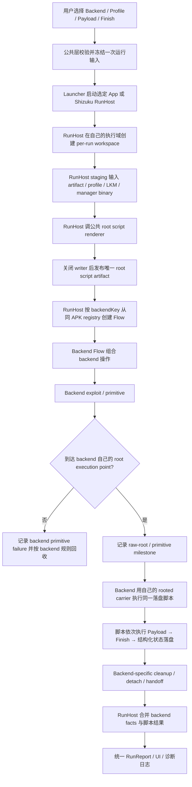
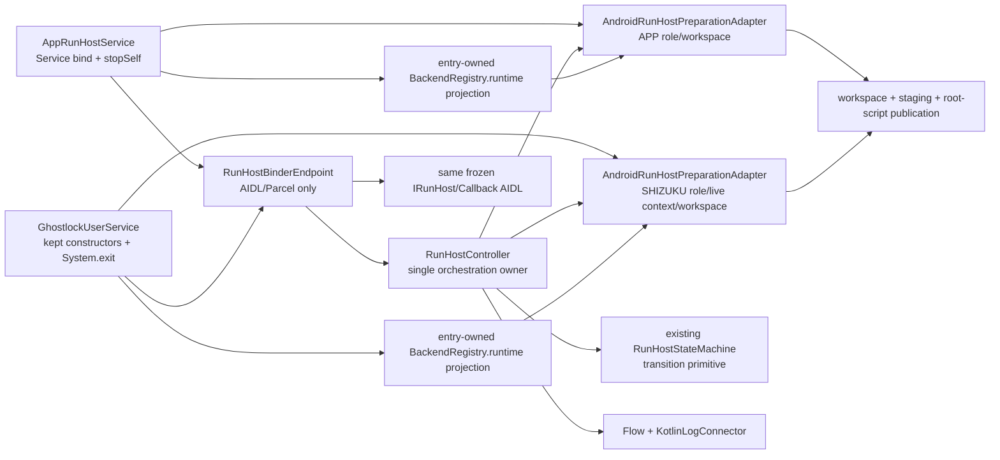

> **历史归档，非当前计划入口** · 原路径：`docs/plan/backend-root-execution-unification-plan.md` · 日期：2026-11-21 · 原因：有效设计/批准/验收完整迁入 Beads，旧计划/OpenSpec退出执行 · 来源：`f882e670:docs/plan/backend-root-execution-unification-plan.md` · 后继：Beads（gl-ind为迁移记录；具体主题从工程代号入口直达）。下方原状态、指令、checkbox及链接仅按当时语境解释，不恢复被取代设计或当前批准。

# Backend root execution 统一整理计划（需求基线 · L · 2026-11-04）

<a id="p-run-x-001"></a>

> **2026-11-21 状态入口切换**：本文件的设计正文、批准、scope、验收矩阵与旧号映射继续有效；原有checkbox/进度/运行状态文字仅作切换前历史快照，不再更新或作为当前调度依据。当前状态与证据唯一入口见 [MASTER-PLAN](20261121-1301-MASTER-PLAN.md#active-task-routing) → OpenSpec → Beads；旧未勾选项不自动成为待办。最新构建修复优先项见 [E-BUILD-X-001](20261121-1301-openspec/changes/build-closure-repair/design.md)，B1原批准不因此撤销。

> **计划代号**：`P-RUN-X-001` 是整份执行统一计划的容器身份；决策/批次按实际模块与领域使用各自语义代号，定义仍在本文件。旧 D/R 号仅作来源和兼容别名，映射见[本计划代号表](#plan-semantic-identifiers)。本次改号不拆计划、不重排工作、不改变内容、批准、进度或门禁。

> 状态：D1–D9 与 R0→R4B source implementation 已落地；**automatic export 产品项仍为未完成**。source architecture、Gradle debug compile/unit XML、native host、Android zero-target build、exact instrumentation、AVD真实MediaStore automatic/manual byte gate及Shizuku shell-domain AVD runtime均已通过；真实设备门与最终验收仍为 NOT_RUN。R2 root-script host fault matrix与6.6 AVD ordinary-file staging/identity gate已通过，真实carrier设备门仍为 NOT_RUN。2026-11-06 用户选定 P-LOG-X-001/批次02 的全流式双流模型，并进一步指定 raw/processed+dispatcher 尽快处理、各 sink 独立积压、`RunReport` 展示行只是普通 Info 且服从统一阈值；这取代下文 v2.1 journal candidate；v3 design-critic 阻断=0；2026-11-06 用户批准按 v3 实施，并要求将非必要的 RunLog* 命名收敛为 Log*，LS-D4 已关闭。P-LOG-X-001/批次01的既有门禁仅为旧容量合同证据，不关闭新批。2026-11-05 用户取消 R5-S2/S3 carrier 纵向并要求先断开全部真攻击 backend；当前 Kotlin registry 与 APK native target graph 均不含 43499-Glued、43284-Glued 或 98260。
>
> 本文件冻结产品目标、公共能力、backend 私有边界、owner、文件处置、批次与验证候选。用户已裁定 future native binding 改用 JNA。2026-11-05 用户再次回复“不要验证，继续”，知情强制越过 R3 的标准验证门并授权 R4 source cleanup；该裁定不授权进入 R5，也不把未执行门写成 PASS。
>
> **2026-11-05 用户纠正**：automatic export 是未完成的产品能力，不是应删除的 dead closure。R4 中“删除 LogExport 及设置闭包即完成”的产品判断失效；旧 caller-zero 平台 object 继续退役，但能力、设置语义和完成责任必须以 neutral domain port + data/run adapter 重建，并由 R4A 接入 current RunCoordinator。当前 source 已接线也只表示实现进行中；在 gates 与验收关闭前，automatic export 始终记为 **UNFINISHED**，不得归入“删除完成”或“产品完成”。
>
> **2026-11-05 R5 终止裁定**：用户要求“先断开连接所有真攻击 backend”，并将 R5 收口为“旧 backend 断开 + 必要删除，不改旧 backend 实现”。该裁定取代 R5 child 的 native carrier/Disabled plugin 实施授权。R5-S1 已写入的 neutral common source保持无真实 backend caller；它不构成接线或攻击能力。沿革记录：`2026-11-05 · AGENTS §2 单一活动计划/变更控制 · R5-S2/S3 取消，真攻击 backend build/registry membership 清零`。
>
> **2026-11-07 账本收口，2026-11-17后继证据更新**：后继P-LOG-X-001/批次02 LS-V3与P-RUN-HANDOFF-001/批次01 HND-V1的current-tree 4 KiB/16 KiB AVD证据覆盖旧wire/UI/runtime欠账；P-RUN-X-001/批次03又以同一6.6 AVD命令执行App/Shizuku smoke与lifecycle/cancel/host-death五个exact class并返回`OK (5 tests)`，因此三个专属class欠账已关闭。真实process-kill、真实carrier设备门及automatic export真实设备门/最终产品验收仍未关闭；未执行项继续记`NOT_RUN`，不恢复任何真实攻击backend。
>
> **2026-11-07 Backend／图标／日志 connector 二次纠正**：用户否定未实施的通用 semantic menu graph，改为一个后端一个 `BackendDefinition` 组合权威，由它引用纯领域 `BackendDescriptor`、运行端 `BackendRuntime` 与 Android `BackendUi`；官方后端使用具名 Compose UI，Custom 后端未来统一使用 ZIP+Lua+WebUI。低层配置字段保持文件化，不从 schema 自动生成 Compose。日志源改经统一 `LogConnector` 接入，source-local FIFO 与 LogHub acceptance/commit order 分离，Unix 时间戳不作为排序权威。原 `P-BACKEND-CORE-001/决策02+批次01` 和 `P-DIAG-NATIVE-001/批次02` 的旧 critic PASS 仅保留沿革，不再授权旧菜单图、旧直接 callback ingress 或旧 stress exact scope。当前顺序改为 `P-UI-ICON-001/批次01` → 修订后的 `P-BACKEND-CORE-001/批次01` → `P-LOG-X-001/批次03` → 重新细化的 `P-DIAG-NATIVE-001/批次02` → 最终 lifecycle/automatic-export 门；真实 carrier 设备门继续 `NOT_RUN`。
>
> 权威顺序：docs/development/软件工程守则.md > AGENTS.md > engineering-standards.md / design-philosophy.md > 本计划。

## 0. 沿革、取代关系与实时进度

### 0.1 为什么重建，而不是修补旧稿

2026-11-04，用户裁定旧 KBR 计划失效。旧稿把 Payload 与 Finish 建模为 `PayloadExecutor`、`FinishExecutor`、`PostRootExecutor`，进而虚构了通用 `RootExecutionContext`。这与本项目真实攻击链相反：

1. Payload 与 Finish 先由公共层渲染成**同一份落盘 root 脚本**；
2. 每个 backend 只在自己实际取得 root 的位置执行该脚本；
3. backend 并不把 root 交给一个脱离攻击路径的 JVM executor；
4. Payload 是取得 root 后真正要启动的用户目标，Finish 是其后的附加收尾。

因此旧稿不是局部命名错误，而是中心控制流错误，整稿及附件已归档：

- [`../archive/20261104-1935-kotlin-core-backend-vertical-rewrite-plan.md`](20261104-1935-kotlin-core-backend-vertical-rewrite-plan.md)
- [`../archive/20261104-1935-kotlin-core-backend-vertical-rewrite-annex-a.md`](20261104-1935-kotlin-core-backend-vertical-rewrite-annex-a.md)
- [`../archive/20261104-1935-kotlin-core-observability-cleanup-plan.md`](20261104-1935-kotlin-core-observability-cleanup-plan.md)
- [`../archive/20261104-1935-kotlin-core-observability-cleanup-annex-a.md`](20261104-1935-kotlin-core-observability-cleanup-annex-a.md)

四件只保留沿革，不再提供实施 authority。本文件是唯一新的需求入口；它不继承旧稿中的 executor、post-root lease/receipt、兼容性 parity 或静态 contract digest。

### 0.2 checkbox

- [x] 用户大致批准新的端到端需求清单。
- [x] 补充裁定：raw uid 0 可作为 backend 原语可用性验证，但不单独等于产品成功。
- [x] 归档失效 KBR/KC 主计划及附件，活动目录不保留平行 authority。
- [x] 把需求、共性边界、成功语义与开放问题写入本文件。
- [x] 用户裁定 native binding 改用 **JNA**；未实现 backend 不作为迁移/兼容基线，约束见 §9。
- [x] 完成 current-tree Kotlin/AIDL/UI/data/native/CMake/JNI 只读 ownership inventory。
- [x] 写入 §10 推荐语义、§11 目标架构、§12 exact ledger、§13 生命周期、§14 批次与 §15 门禁候选。
- [x] 生成逐文件候选 ledger：[`backend-root-execution-unification-ledger.tsv`](20261121-1301-backend-root-execution-unification-ledger.tsv)；每行含 `path/action/target/batch/scope/reason`，未列 production 文件冻结。
- [x] 冻结 RunHost wire/state 附件：[`backend-root-execution-runhost-wire.md`](../development/backend-root-execution-runhost-wire.md)。
- [x] 生成 80 行活跃计划逐文件处置表：[`backend-root-execution-plan-disposition.tsv`](20261121-1301-backend-root-execution-plan-disposition.tsv)；批准前不执行归档。
- [x] 按 design-critic 首轮 BREU-01..08 修订：每批 caller closure、future native 零写冻结、build/tool closure、同一 opened object 身份、typed wire、exact plan disposition、JNA license/loader、技术债触发器。
- [x] design-critic 对冻结快照复评并关闭全部阻断项（第六轮：阻断/重要/建议均为 0）。
- [x] 用户裁定 §10 D1–D9 推荐语义并批准 §14 的 R0→R1 顺序（2026-11-04：回复“批准”）。
- [x] 用户批准首个 production implementation 批次 R1；R0 机械门全绿后方可开始。
- [x] 用户批准继续 R2（2026-11-04：“不要验证，继续”）；不做扩展/重复验证、AVD 或设备门。实施后为关闭实际 compile/manifest 阻断，只在最终树单次执行 Kotlin compile、unit XML 与 architecture manifest gate；未把这些结果外推为 runtime/device 结论。
- [x] 用户知情强制越过 R2 新增 fault-injection、AVD 与设备关闭门并批准进入 R3（2026-11-04：“持续推进，我确认你的任何计划，我们有git历史和timemachine兜底不用怕出问题”）；代价是 R3 在缺少新增 runtime evidence 的情况下先行，欠账最迟须在 R4/release 前偿还，且不得把未执行门禁写成 PASS。
- [x] 用户在 R3 实施中再次裁定“不要验证，继续”（2026-11-05）；本轮只推进 source/fixture/UML/plan 交付，不执行 Gradle、unit、AVD、Shizuku 或设备门，所有 runtime gate 保持 NOT_RUN。
- [x] 用户随后再次要求“不要验证，继续”（2026-11-05）；知情强制越过 R3 标准阶段门进入 R4 source cleanup。代价是 R2-R4 compile/runtime evidence 继续欠账；最迟在 release 或未来重新批准的首个真实 carrier 前偿还。原 R5 后续已被断开裁定取代。
- [x] 用户纠正 automatic export 的处置（2026-11-05）：“不是要删的是没做完的”；撤销“dead feature”结论，R4 重新打开并新增 R4A 纵向补全批次。

<a id="plan-semantic-identifiers"></a>

### 0.3 语义代号与旧号兼容（只改身份显示，不改实施内容）

本表是旧号到现行代号的唯一映射；新标题和当前引用使用语义码，不再以统一 RUN 前缀包装所有条目。词义仍只定义在[工程短词表](../development/documentation-standards.md#engineering-identifiers)，MASTER 只登记根和定义入口。下表顺序沿用原决策/批次顺序，不构成新的排期或批准。

| 旧号（原 P-RUN-X-001 内） | 现行主代号 | 原条目／定义 |
|---|---|---|
| D1 | `P-PAYLOAD-CORE-001/决策01` | [Payload fail-fast](#p-payload-core-001-decision-01) |
| D2 | `P-FINISH-CORE-001/决策01` | [Finish 严重度](#p-finish-core-001-decision-01) |
| D3 | `P-PAYLOAD-CORE-001/决策02` | [Payload 成功判据](#p-payload-core-001-decision-02) |
| D4 | `P-PAYLOAD-IO-001/决策01` | [detached Payload 与 retention](#p-payload-io-001-decision-01) |
| D5 | `P-RUN-IO-001/决策01` | [staging policy](#p-run-io-001-decision-01) |
| D6 | `P-BACKEND-CORE-001/决策01` | [BackendDescriptor 最小领域描述](#p-backend-core-001-decision-01) |
| D7 | `P-BACKEND-X-001/决策01` | [旧 backend disposition](#p-backend-x-001-decision-01) |
| D8 | `P-RUN-CORE-001/决策01` | [结果 authority](#p-run-core-001-decision-01) |
| D9 | `P-RUN-CORE-001/决策02` | [取消、host death 与不确定终态](#p-run-core-001-decision-02) |
| R0 | `E-DOC-X-001/批次01` | [设计与 authority 收口（当前批；docs only）](#e-doc-x-001-batch-01) |
| R1 | `P-BACKEND-X-001/批次01` | [删除 disabled manual-JNI / original-backend closure](#p-backend-x-001-batch-01) |
| R2 | `P-RUN-IO-001/批次01` | [Payload / Finish / root-script 单一 authority](#p-run-io-001-batch-01) |
| R3 | `P-RUN-X-001/批次01` | [新 execution spine 纵向替换](#p-run-x-001-batch-01) |
| R4 | `P-RUN-CORE-001/批次01` | [dead generic core 与守卫收口](#p-run-core-001-batch-01) |
| R4A | `P-LOG-IO-001/批次01` | [automatic export 纵向补全（历史设计；运行时拓扑由 R4B 取代）](#p-log-io-001-batch-01) |
| R4B | `P-LOG-IO-001/批次02` | [日志 sink 简化重写（取代 R4A runtime topology）](#p-log-io-001-batch-02) |
| R4C | `P-LOG-X-001/批次01` | [单一日志中枢与 Flow 结果归属修复（取代 R3/R4B 的双轨展示，保留 R4B sink 拓扑）](#p-log-x-001-batch-01) |
| R5 | `P-BACKEND-X-001/批次02` | [真攻击 backend 断开收口（取代首个 carrier 纵向）](#p-backend-x-001-batch-02) |
| R6 | `P-DIAG-NATIVE-001/批次01` | [Diagnose：首个真实 JNA/shared-library 纵向（已完成）](#p-diag-native-001-batch-01) |
| R7 | `P-BACKEND-NATIVE-001/批次01` | [43284-Glued carrier（未来独立 L 子计划）](#p-backend-native-001-batch-01) |
| R8 | `P-BACKEND-NATIVE-002/批次01` | [98260 carrier（未来独立 L 子计划）](#p-backend-native-002-batch-01) |

**兼容边界**：

- 原批准原话、日期记录、literal 命令/输出、历史 finding 和已取代拓扑保留原号；旧 HTML 锚点继续可达。它们是历史证据，不是新码下再次批准。旧 R5 的 carrier 接线授权与后来断开裁定仍按原文取代关系区分，不能以同一映射抹平。
- 原 `D1–D9` 指上表九项决策；原 `R2–R4C` 等区间仍指原批次顺序覆盖范围，不是不同语义根之间的数值区间。当前显示改为语义端点，范围不增减。
- `R2-H1`、`R4A-S5` 等已发生的纠错/运行记录保留为所属语义批次内的旧证据子号，不重新编造执行顺序。
- 文档 ledger 的 `batch` 列改用本表主代号；其余字段和行顺序保持不变。下表只保留三个既有子项的来源区别，不新建工作或改变动作。

| 文档 ledger 旧 batch | 现行显示／归属 | 含义保持 |
|---|---|---|
| R5-S1 | `P-BACKEND-X-001/来源S1` | 旧 carrier child 已交付的 neutral common source；不是断开批次新建，也不恢复接线 |
| R5-DISCONNECT | `P-BACKEND-X-001/批次02/断开` | 原断开子项，不与冻结候选行混为新动作 |
| R4B-S6B-RUNTIME | `P-LOG-IO-001/批次02/运行验证` | 原 runtime 修复/验证子项，四行内容及状态保留 |

工具及 `app/src/test/resources/architecture/` 中的 batch/fixture 字段继续使用原机器键：`R3`、`R4`、`R4A`、`R4B`、`R4C` 按主表定位，`R5-S1` 按来源子项定位；`tools/kotlin_architecture_d0.py` 的精确比较不因显示改号改变。更早 `D1e/D2/D3a/D7.2/D7.4` 属旧 Kotlin 计划，不能套用本表。历史归档、device gates、既有审核记录、已终止 child 与专用任务清单不批量改号。

## 1. 最高目标与产品成功

### 1.1 最高目标

GhostLock 的最高目标是：**通过用户选择的 backend 取得足以执行用户目标的 root 权限，并实际执行用户选择的 Payload**。

这里的“获取 root”不是只把某个进程的数值 UID 变成 0，也不是只证明一次 kernel read/write、cred overwrite、UMH 或 rooted child。它是一个面向产品结果的完整链：

```text
backend 原语成功
  → 到达该 backend 的 root execution point
  → 执行公共层生成并落盘的 root 脚本
  → 用户 Payload 达成请求的效果
  → 执行用户配置的 Finish 附加动作
  → 回报可区分的结果并完成 backend 资源收尾
```

### 1.2 raw uid 0 的准确地位

`getuid()==0`、rooted child、cred 已替换或等价事实可以作为 **backend primitive milestone**：

- 它证明对应 backend 的“取得 root 原语”在该次运行中可用；
- 它适合真机 bring-up、回归定位与 CVE 原语验证；
- 它必须能与脚本派发、Payload、Finish 和 cleanup 结果分别记录。

但 raw uid 0 **不单独等于产品成功**，因为仍可能发生：

- root 进程无法读取或执行脚本；
- SELinux / seccomp / mount namespace / capability 状态不满足 Payload；
- 脚本未派发、shell 启动失败或工作目录已失效；
- Payload 启动失败、目标守护进程未确认、LKM 未加载或用户命令返回失败；
- backend 在 raw uid 0 后崩溃或提前回收了承载进程。

产品成功至少需要**用户 Payload 的成功判据**成立；Finish 的成败按其策略单独回报，不能把 raw uid 0 或“脚本已启动”冒充 Payload 成功。

### 1.3 Payload 与 Finish

- **Payload**：root 权限最终要启动的用户目标，例如 root manager / `ksud`、用户命令、用户脚本或 LKM。它是产品主结果。
- **Finish**：Payload 之后的附加功能，例如恢复某种状态、软重启、写最终标记或其它结束动作。它不拥有 Payload，也不决定 backend 如何拿 root。
- Payload 与 Finish 都不属于具体 backend；二者各自拥有设置、持久化、校验与脚本片段生成。
- 只有需要系统内核偏移信息的 backend 配置才来自 GLK profile v3；43284、Diagnose 等不需要系统内核偏移的 backend 使用自己的具名 typed authority。Payload 与 Finish 继续独立于 backend，内部持久化按 P-SETTINGS-IO-001 直接序列化完整 data class；各权威分别冻结、互不嵌入、互不反向写回。
- 运行时把 Payload 片段与 Finish 片段按固定顺序合成**一份脚本文件**。不存在运行时 `PayloadExecutor` / `FinishExecutor` / `PostRootExecutor` 对象链。

## 2. 统一端到端流程



### 2.1 固定顺序

一次运行的固定顺序是：

1. UI/application 冻结 Backend、Profile、Payload、Finish；
2. launcher 启动所选 App/Shizuku RunHost，并只传 typed run input 与文件描述符；
3. RunHost 在自己的 uid/SELinux/mount namespace 中建立 per-run workspace；
4. RunHost staging 所需普通文件；
5. RunHost 调用公共 renderer 生成一份 root 脚本，关闭 writer 后发布 artifact；
6. RunHost 只按 `backendKey` 从同一 APK 的 immutable registry 创建 Flow；
7. Flow 组合该 backend 的原语和生命周期步骤；
8. backend 到达自己的 root execution point；
9. backend 执行该脚本；
10. 脚本内部执行 Payload，再执行 Finish，再写结构化状态；
11. backend 完成自己的 detach / cleanup / handoff；
12. RunHost 合并 backend facts 与脚本结果并发布分层结果。

顺序修订的原因是执行域可达性：App 私有目录中的文件不能先验地被 Shizuku shell、rooted child 或独立 ELF 读取。workspace 与最终脚本必须由实际 RunHost 执行域拥有；UI 进程只冻结输入和传递文件描述符，不先写一份“可能不可达”的权威脚本。预览使用内存或独立 preview workspace，绝不覆盖 production run artifact。

不允许把第 9 步搬成一个与 backend 分离的通用 executor，因为只有 backend 知道：

- 哪个进程/线程/child 此刻真正有 root；
- 该 root 所在 SELinux domain、namespace、seccomp 与 capability 状态；
- 承载进程能否阻塞等待脚本、必须 detach，还是会在返回后立即被回收；
- 哪些资源在脚本启动前后必须继续存活。

### 2.2 脚本是公共协议，不是公共执行器

公共层统一的是**脚本 artifact 合同**与**结果协议**：

- 运行唯一标识；
- 普通文件路径与访问前提；
- Payload 片段；
- Finish 片段；
- shell 入口；
- 状态文件/退出码/必要确认事实；
- 清理时机所需的最少信号。

backend 统一消费同一类脚本 artifact，但执行动作位于各自 root point。对于不同 backend，实际 carrier 可以是 rooted victim、当前进程、fork child、UMH 或独立 exploit ELF；不能为了表面统一把它们伪装成一个 JVM root session。

## 3. Backend 的共同部分：应抽离复用

### 3.1 BackendDefinition、BackendDescriptor 与 catalog

所有随 App 发布的 built-in backend 由外层 `composition/backend` 的一个不可变 `BackendDefinition` 列表注册。每个 definition 组合三项，但不把它们混入同一层：

- `BackendDescriptor`：domain 中的稳定 `key`、selection、abort、execution-domain 与 capability；
- `BackendRuntime`：backend 层的 dynamic availability 与 fresh `Flow` 创建；
- `BackendUi`：UI 层的 Android 文案、项目图标和可选具名设置页面。

`BackendRegistry` 与 `BackendDefinition` 均位于允许同时装配 domain/backend/UI 的外层 `composition/backend`，不是 `backend/declarations`。registry 私有持有唯一 definition list：RunHost／Shizuku只通过 `runtime(key)` 获得backend层定义的 `BackendRuntimeEntry(descriptor, runtime)`；AppContainer只从同一snapshot取得UI层定义的 `BackendUiEntry(descriptor, ui)` 并构造唯一 `BackendUiCatalog`。两个entry都是由definition即时派生的只读投影，不保存第二份membership/key表。普通inner caller不得import outer registry/definition；唯一例外是框架直接构造的`RunHostService.kt`与`GhostlockUserService.kt`两个物理入口，它们只可调用`BackendRegistry.runtime(key)`并立即只持有`BackendRuntimeEntry`，不得访问definition、UI projection、snapshot/list或其它outer API。现有data层 `BackendCatalogAdapter` 及domain `BackendCatalogPort/GetBackendCatalogUseCase/BackendRegistrySnapshot` 随旧presentation DTO一并删除，Home／Path／BackendPage只消费UI层catalog，data层selection/run adapter只消费descriptor/runtime投影。architecture guard须把上述两个绝对路径作为唯一窄allowlist；除此以外任何inner production source import outer registry/definition均FAIL。现行 `backend/data/core → ui` 与 `ui → backend/data/core` 禁边保持不变，不得因本批放宽。

built-in backend 与 App 同产物发布，不增加 contract digest、interface version、size/reserved 或旧兼容分支。registry拒绝空/重复/unknown key，不支持运行时 `register/unregister/resetToBuiltins`。Lua脚本是数据，只调用受限 operation catalog；它不动态注册新的 built-in definition。

2026-11-08开发者进一步裁定：当前没有需要配置的真实backend，故本批不预建GLK profile repository、manual schema或selected-backend JCS freeze。现有最小diagnostic profile fixture保持原行为，只随`BackendSpec→BackendDescriptor`做必要的类型名迁移；待某个具体backend提出真实配置字段、consumer与运行映射时，再恢复BD-I3并按该backend的实际需求设计。offset/waiter等字段继续只存在于既有backend文件，不进入`BackendDescriptor`或通用Compose模型。现有 `BackendSpec/BackendPlugin` 是本批实施前的current source名；本节与P-BACKEND-CORE-001/决策01-02是下一动作唯一authority，旧spec/plugin模型不得再作为未来重建模板。

### 3.2 一次运行的准备

以下由公共层统一：

- immutable run input；
- per-run workspace；
- Payload/Finish/依赖 artifact staging；
- 单一 root 脚本的 render、write、close 与只读发布；
- launcher / host / transport；
- 结构化日志与 UI run state；
- 结果分层与最终展示；
- 不含攻击资源的普通文件清理。

公共层不得在多个 backend 中重复生成 KernelSU 启动脚本、重复解析 Payload 设置或重复硬编码 Finish。

### 3.3 Flow

`Flow` 保留。它是 backend 全流程的编排层，不因为当前只有 `run` 就删除：

- 当前：一个 backend Flow 可把现有粗粒度入口组织成完整运行；
- 未来：backend 拆成多个由 JNA 暴露的独立 native operation 后，Flow 组合顺序、重试、条件分支与 cleanup；
- Lua：可按允许的 operation catalog 自行组合这些 native operation，最终仍把同一 root 脚本交给选定 backend/root carrier 执行。

Flow 负责逻辑编排；不可暂停、时序敏感、需要共享 native 资源或 PI/waiter 连续性的物理事务仍保持在单个 native operation 内。

### 3.4 统一 root script generator

公共 root script generator 是本次最直接的复用点：

```text
prologue / run metadata
  → Payload fragment
  → Payload status
  → Finish fragment
  → Finish status
  → epilogue / final marker
```

它只负责生成文件，不执行文件。Payload 与 Finish 可以各有 renderer/fragment model，但最终只有一个 script writer 和一个落盘 artifact。

### 3.5 统一结果模型

一次运行至少区分下列事实，禁止压成单个 Boolean：

1. `backend_primitive`：原语是否到达预期 root milestone；
2. `root_script_dispatch`：backend 是否实际请求 rooted carrier 执行脚本；
3. `payload`：用户目标是否满足自身成功判据；
4. `finish`：附加动作是否完成、跳过或降级；
5. `backend_cleanup`：攻击资源是否按 backend 生命周期完成回收/移交；
6. `run_terminal`：本次运行最终状态及是否需要重启/人工处置。

`backend_primitive=success` 可以成为 backend 可用性证据，但只有 `payload=success` 才能进入产品成功判定。Finish 和 cleanup 是否改变最终等级由 §10 的待裁策略决定。

## 4. 必须留在具体 backend 的部分

以下没有足够共同语义，不能放入公共 core：

- waiter / race / spray / reclaim / leak / fake cred / kernel R/W；
- CVE-specific offsets、结构布局与 route；
- native handle、fd、mapping、thread、child、socket、perf sampler 的所有权；
- PI 窗口与不可暂停物理事务；
- “何时已经取得可执行 root”的判据；
- rooted carrier 的实际形态；
- 脚本启动前后的存活、detach、wait 与回收顺序；
- backend-specific failure recovery 与 reboot requirement。

这些部分可以在**同一个 backend 内**抽小 operation 供其 Flow/Lua 组合，但不能为了共享名字外提到通用层。

## 5. Victim 的处置

公共 `core/victim` 不再作为架构组件保留。

- 若某个 backend 的真实攻击原理需要 victim/helper，它属于该 backend 的私有实现；
- victim protocol/session/transport 与该 backend 的生命周期一起审查；
- 其它 backend 不通过公共 victim façade 复用它；
- 若旧 43499 路径被整体淘汰，其 Kotlin/JNI/helper chain 一起删除，不为“可能以后有用”留公共壳。

这里删除的是错误的公共 ownership，不是提前裁定所有 backend 永远不能 fork helper。

## 6. 脚本落盘与执行域要求

### 6.1 文件必须对真实 rooted carrier 可访问

脚本“已经写到磁盘”不等于 backend 能执行。stager 必须按选定执行域证明：

- carrier 能解析路径；
- carrier 能读取脚本及依赖 artifact；
- mount namespace 中路径指向预期文件；
- SELinux domain 允许必要的 open/read/execute 或 `/system/bin/sh <path>`；
- parent cleanup 不会在 carrier 打开前删除 workspace；
- detached payload 需要的文件不会被过早回收。

因此不能默认使用 App 私有 `filesDir`，也不能为所有 backend 硬编码同一个 `/data/local/tmp`。公共层提供 staging policy 与 artifact 合同，具体执行进程/域决定可用 staging adapter。

### 6.2 普通文件语义

目标语义是：生成完成后关闭 writer，发布绑定 object+bytes identity 的 ordinary file artifact，然后由 backend 执行**同一个已发布文件对象**；不能只凭 path 或发布时 digest 推断 carrier 最终消费了同一对象。

固定不变量：

1. host 以 `O_CREAT|O_EXCL|O_NOFOLLOW` 或平台等价方式创建 temp regular file，完成 write/flush/close/permission 后才发布；workspace directory 不对非 owner 开放写权限。
2. publish identity 至少记录 `device/inode/byteCount/SHA-256/mode`；`contentDigest` 只证明 bytes，不单独证明 object identity。
3. backend 在自己的 namespace 中以 `O_NOFOLLOW` 打开，`fstat` 核对 regular/owner/mode/device/inode/size，并对**同一已打开 fd**重算 bytes identity；随后优先通过 `/proc/self/fd/<fd>` 或等价 pinned handle 交给 shell。
4. carrier 若物理上无法继承同一 fd，backend-specific L 子计划必须提供等价的 pinned-object 证明与 rename/truncate/symlink/namespace replacement 负例；未证明就保持 NotReady。
5. result file 由 host 在不可被非 owner 替换的 workspace 中预创建并记录 identity；脚本只写该 object，RunHost 解析前重验 identity。partial/malformed 不从日志补猜。

这些是 artifact 合同，不是 root executor/lease/receipt。

## 7. 当前实现与目标的差距（只作现状证据）

当前树已经存在部分正确形状，但 authority 分散：

- `app/src/main/kotlin/com/ghostlock/app/core/finish/FinishScript.kt:17-65` 已按 Payload 后接 Finish 的顺序渲染脚本；这证明共同产物应是脚本，不是两个 runtime executor。
- `app/src/main/kotlin/com/ghostlock/app/core/finish/FinishScriptStore.kt:11-44` 把脚本写进 App 私有目录；它不能自动满足 shell/rooted child 的 SELinux 与 namespace 可达性。
- `app/src/main/kotlin/com/ghostlock/app/backend/backends/cve43499/request/Cve43499RequestFactory.kt:52-97` 已生成并保存脚本，但 43499 又保留自己的 handoff 复杂度。
- `app/src/main/kotlin/com/ghostlock/app/backend/backends/cve43499/flow/Flow43499Impl.kt:1545-1679` 在 rooted victim 路径执行脚本，说明执行点天然属于 backend。
- `app/src/main/cpp/backends/43499glued/session/victim_process.cpp:109-166` 已采用 rooted child 执行 `/system/bin/sh <script>` 的正确方向。
- `app/src/main/cpp/backends/43499glued/attack/ops.cpp:226-430` 又在 native 内重复生成整套 KSU 脚本，应改成消费公共层落盘产物。
- `app/src/main/cpp/backends/43284glued/bootstrap.c:13-54,212-268` 硬编码 DFRoot/KSU/soft reboot，仍把 Payload/Finish 塞在 backend。
- `app/src/main/cpp/backends/98260/timer/timer.c:1045-1165,2220-2275` 硬编码 `ksud` 准备、执行与 SELinux 收尾，尚未消费公共 root 脚本。
- `app/src/main/kotlin/com/ghostlock/app/backend/launcher/FlowLaunchParent.kt:55-87` 仍向 launcher 发送空 payload/artifact，公共落盘产物尚未形成完整 transport。

这些只证明需求与重构目标，不证明任一 backend 当前可用，也不授权直接修改攻击路径。

## 8. 明确排除的错误方向

本需求基线排除：

- 通用 `PayloadExecutor`、`FinishExecutor`、`PostRootExecutor`；
- 与真实 backend root carrier 脱节的 `RootExecutionContext` / root lease；
- backend 内再次读取 UI/settings 或生成自己的 KSU/Payload/Finish 脚本；
- 把 raw uid 0、kernel write、脚本 dispatch 或 native exit 0 单独标成产品成功；
- 把 victim、waiter、race、route、cred、native handle 抽成所有 backend 共用的大一统 façade；
- 因当前 Flow 只有 `run` 就删除 Flow；
- 为同 APK 内的 backend registry 增加静态 contract digest/version handshake；
- 在本计划未获批准前修改 production source、启用 backend 或把诊断结果写成产品成功。

## 9. Native binding 裁定：JNA

### 9.1 用户裁定与范围

2026-11-04，用户裁定 future backend native binding 从手写 JNI 改为 **JNA**。

- 未实现 backend 不作为迁移、兼容或行为 parity 基线；不能因旧 `external fun` / `JNIEXPORT` 数量扩大新架构。
- 新 backend 不再新增业务型 `JNIEnv` / `jobject` bridge，也不在 C/C++ 中读取或写回 Kotlin/Java object 字段。
- JNA 只取代 JVM↔native 的 binding/marshalling 层；Flow、root script、Payload/Finish、backend lifecycle 与攻击物理事务的 owner 不因换 binding 改变。
- current-tree inventory 已确认旧 original 43499/43284、KernelSnitch 与全局 NativeLogBridge 不构成可用产品基线；P-BACKEND-X-001/批次01 按闭包删除，不建立兼容桥。

### 9.2 唯一目标边界

```text
Kotlin domain / Flow / Lua operation
  → backend-private Kotlin JNA adapter
  → JNA binding types and library interface
  → extern "C" fixed ABI
  → C/C++ backend implementation
```

边界约束：

1. Kotlin domain DTO 不继承 JNA `Structure`，不暴露 `Pointer` / `Memory`；backend-private adapter 是唯一 domain↔JNA 转换点。
2. JNA binding 只描述普通 C ABI，不映射 C++ class、虚函数、模板、`std::string`、`std::vector`、`std::span` 或异常。
3. C/C++ export 使用 `extern "C"`、固定宽度整数、小型 POD struct、buffer+length 与 opaque handle。
4. C/C++ 不知道 Kotlin package、class、property、JVM descriptor；production backend C/C++ 中不得新增 `JNIEnv*`、`jobject`、`GetFieldID`、`Set*Field` 等业务转换。
5. C++ exception 必须在 C ABI 内截获并转换成稳定状态码；异常、allocator object 与 STL ownership 不跨 ABI。

### 9.3 JNA 负责与不负责的内容

JNA 负责同步调用期间的常规 marshalling：

- primitive 与固定宽度 C 字段；
- JNA `Structure` 调用前写入与调用后读回；
- primitive array 的调用期 buffer；
- `Pointer` / `ByReference` 形式的指针参数；
- native symbol 调用与返回值转换。

JNA 不成为资源 owner，也不替代：

- native handle / fd / child / mapping / thread / waiter 的生命周期；
- native allocation 对应的显式 free/destroy；
- native 在调用返回后继续持有 input pointer 时的 memory owner；
- attack transaction、PI 窗口、停止访问→解除关联→回收顺序；
- Payload/Finish/root script 的业务合同。

### 9.4 内存与调用纪律

- primitive array、String 或临时 `Structure` 对应的 native memory 默认只允许在本次同步调用期间使用；native 需要跨调用保存时，必须在调用内复制到 native-owned storage，或由明确的长期 `Memory` owner 持有。
- variable-length output 优先由 JVM caller 提供 buffer+capacity，native 返回 required/written length；若 native 分配内存，ABI 必须同时提供唯一匹配的 free 函数。
- C++ object 只通过 opaque handle 暴露；create/close/destroy、generation 与并发规则仍显式建模，不能依赖 JVM GC/finalizer。
- callback 不是默认日志/状态通道；跨线程 callback 会重新引入 JVM attach 与生命周期问题。backend 默认返回结果、轮询状态或使用既有 fd/file sink。
- `long`、`size_t`、C++ `bool`、bit-field 与隐式 enum 不进入公共 ABI；使用 `int32_t` / `uint32_t` / `int64_t` / `uint64_t` / `uint8_t` 与显式 padding/version。
- struct field order、alignment、`sizeof` 与 `offsetof` 必须在后续实施设计中形成双侧机械对拍；JNA 自动 marshalling 不等于布局天然一致。

### 9.5 调用粒度

JNA operation 保持粗粒度。不可暂停、时序敏感或共享 native 资源的序列仍封装为一次 native operation；禁止把 race/waiter 内循环拆成 Kotlin 高频 JNA 往返。Flow/Lua 组合的是有物理意义的 operation，而不是 native 内部的每个微步骤。

### 9.6 依赖事实与非目标

JNA 官方说明 interface mapping 会自动处理 `Structure` 字段的调用前后复制，并通过 `libjnidispatch` / libffi 调用 ordinary native symbol；primitive array 若要在函数返回后继续使用，必须改用长期 `Memory` 或 direct buffer。Android artifact 在 Maven Central 发布。

参考：

- [JNA README](https://github.com/java-native-access/jna/blob/master/README.md)
- [JNA Functional Description](https://github.com/java-native-access/jna/blob/master/www/FunctionalDescription.md)
- [JNA Default Type Mappings](https://github.com/java-native-access/jna/blob/master/www/Mappings.md)
- [JNA Pointers and Arrays](https://github.com/java-native-access/jna/blob/master/www/PointersAndArrays.md)
- [JNA Structures and Unions](https://github.com/java-native-access/jna/blob/master/www/StructuresAndUnions.md)
- [Maven Central: net.java.dev.jna:jna:5.19.1](https://central.sonatype.com/artifact/net.java.dev.jna/jna/5.19.1)

本裁定的目标是删除手写 JNI object/memory marshalling，不是宣称所有 native ownership 会自动消失，也不是现在开始 implementation。

### 9.7 JNA 不替代 executable carrier

current tree 的三类 native 产物必须先按角色区分：

| 角色 | 当前例子 | 新边界 |
|---|---|---|
| `JNA_DSO` | 尚无合格 production 例子；旧 original 43499/43284 DSO 是未完成 JNI 岛 | future coarse operation 才建立 `SHARED_LIBRARY + extern "C"`，由 backend-private JNA adapter 调用 |
| `EXEC_CARRIER` | `43499glued`、`43284glued`、`98260` | 保持独立 ELF / self-reentry / park 语义；由 RunHost 的 process carrier 启动，不强改成 DSO |
| `HELPER_EXEC` | `43284glued` bootstrap、旧 victim helper | 只在对应 backend 的真实物理事务需要时保留为 backend-private helper |

因此“换 JNA”的准确含义是：

1. 删除未实现 original 43499/43284 与 KernelSnitch 的手写 JNI bridge，不做 37 个 `external fun` 的一比一迁移；
2. future backend 若拆出可由 Flow/Lua 组合的 native operation，新增真实 shared operation DSO，并只通过 JNA 调 ordinary C symbol；
3. 现有 executable carrier 不通过 `Native.load`，JNA 不替代进程启动、stdout/stderr、park 或 `/proc/self/exe`；
4. 不先加入无业务 consumer 的 probe DSO/JNA dependency。JNA AAR、P-DIAG-NATIVE-001/批次01 shrink/loader gates、artifact verifier、C ABI 与首个真实 operation 必须在同一个纵向批次进入，避免永久临时物。

需要独立可替换 native port 或跨调用 handle 的 JNA backend 私有包使用：

```text
backend/backends/<key>/nativeapi/
  <Key>NativePort.kt          # Flow/Lua 使用；不 import JNA
  <Key>NativeOperation.kt     # 粗粒度 operation/result
  jna/<Key>JnaLibrary.kt      # ordinary C symbol mapping
  jna/<Key>JnaStructs.kt      # wire-only Structure
  jna/<Key>JnaAdapter.kt      # 唯一 DTO↔JNA 转换点/Native.load owner
  jna/<Key>NativeHandle.kt    # 显式 close/destroy owner
```

C/C++ 侧每个 shared operation DSO 使用 backend-private `api/<key>_api.h` 与一份 symbol authority；它同时生成 declaration、linker export list、CMake manifest 与 JNA method 对拍输入，禁止在 C header/CMake/Gradle/Kotlin test 四处手抄 symbol。

P-DIAG-NATIVE-001/批次01 的 Diagnose operation是单一caller、同步、无handle的当前例外：它直接使用纯mapping `DiagnoseJnaLibrary` 与 concrete owner `DiagnoseNativeBinding`，不创建只转发一次的`NativePort`、`NativeOperation`或`NativeHandle`。`DiagnoseFlow`构造器直接构造binding，binding构造器负责constant-name load；调用期fd与Native log注入仍由binding的方法管理。未来出现第二个实现、Lua consumer或跨调用native资源时，再按当时owner建立相应边界；不得把上面的完整目录骨架机械套给无对应生命周期的operation。

### 9.8 JNA 分发许可与两 execution-domain loader owner

JNA 5.19.1 的 Maven POM 与上游 README 都声明 LGPL-2.1-or-later / Apache-2.0 双许可。本项目选择 **Apache-2.0** 作为分发依据；P-DIAG-NATIVE-001/批次01 首个真实 JNA operation 子计划必须在同批完成：

1. 固定 `net.java.dev.jna:jna:5.19.1@aar` 的 dependency verification metadata；不得用动态版本。
2. strict校验Maven POM与AAR；在 APK 的 third-party inventory 中记录 group/artifact/version、上游 URL、Apache-2.0 选择，并逐字打包JNA `5.19.1` source tag中的`LICENSE`、`AL2.0`与`LGPL2.1`。实物核验确认5.19.1 AAR不含许可正文或NOTICE；不创建空NOTICE。若以后所取release/AAR附带NOTICE则逐字保留并纳入APK；缺失inventory/license时release gate失败。
3. 指定 dependency 升级 owner=`backend/native-binding`；触发条件是 CVE/Android ABI 修复、目标 API/16 KiB 不兼容或项目主动升级。升级必须重跑 AAR ABI、license、export/layout 与两execution-domain load gate，不得只改版本号。

原设计在没有真实JNA consumer时为Shizuku预设了PFD staging与独立boot path。P-DIAG-NATIVE-001/批次01现以实际Diagnose consumer取代该推测性分支：两个RunHost都只从同一APK、同一常量library name加载，不向Flow传Context/path，也不扩RunHost wire。加载路径只有下表这一条；AVD失败时停批回设计，不在运行时fallback。

| 进程角色 | loader owner | 唯一路径策略 | 失败语义 |
|---|---|---|---|
| App `:flowhost` | `DiagnoseFlow`构造器中的`DiagnoseNativeBinding()` | JNA Android AAR从APK native-library set加载`libjnidispatch.so`；binding只用常量`ghostlock_diagnose`调用`Native.load` | `plugin.createFlow()`抛错，prepare返回`RunHostCode.IO_FAILURE`；不生成RunReport，不fallback JNI/自由path |
| Shizuku UserService | 同一个`DiagnoseFlow`/binding构造约定 | 使用UserService的APK classloader与相同常量名；不读取App私有路径、不staging、不改system property | prepare返回`RunHostCode.IO_FAILURE`；停止本批并以AVD证据重开loader设计 |

App `:flowhost` load成功不能替代UserService load证据，UI App process不加载该Flow DSO。当前只允许`Native.load("ghostlock_diagnose", ...)`这一处literal调用；禁止`Native.load(userInput)`、任意目录扫描或失败后换路。若以后production backend需要不同DSO/loader lifecycle，由对应L级计划基于P-DIAG-NATIVE-001/批次01实测决定，不预建公共`JnaLibraryLoader`。

<a id="p-run-x-001-decisions"></a>

## 10. 待用户批准的九项推荐语义

以下是本计划的**推荐值**，不是既成用户裁定。它们决定 `RunReport`、脚本协议、workspace retention 与取消语义；design-critic 关闭阻断后，由用户一次批准或逐项修改。

<a id="p-payload-core-001"></a>

<a id="p-payload-core-001-decision-01"></a>

<a id="p-run-x-001-d1"></a>

### P-PAYLOAD-CORE-001/决策01 Payload fail-fast

- 所有 enabled Payload item 默认 `required=true`；按用户顺序执行。
- 首个 required item 出现非成功终态（`FAILED` / `UNKNOWN` / `CANCELLED`）后停止后续 Payload，后续项记 `SKIPPED_DEPENDENCY`，不让不确定或失败状态继续触发更多 root 动作。
- Finish 仍进入 finally-style 阶段；其中 `alwaysRun=true` 的恢复动作必须尝试执行。
- 若未来需要 best-effort item，必须由 item 显式 `required=false`，不能由 renderer 猜测。

<a id="p-finish-core-001"></a>

<a id="p-finish-core-001-decision-01"></a>

<a id="p-run-x-001-d2"></a>

### P-FINISH-CORE-001/决策01 Finish 严重度

- 普通 Finish 失败：保留 `payload=SUCCESS`，run terminal=`DEGRADED`。
- `SAFETY_CRITICAL` Finish 失败：terminal=`NEEDS_ATTENTION` 或 `REBOOT_REQUIRED`，不得显示 Success。
- 每个 Finish item 在 definition 中显式声明 `NORMAL` / `SAFETY_CRITICAL` 与 `alwaysRun`；禁止按命令文本或名称推断。
- backend 自己的 kernel/attack safety cleanup 不属于 Finish；例如 98260 的 kptr/SELinux/readback/park 顺序永远留在 backend cleanup。

<a id="p-payload-core-001-decision-02"></a>

<a id="p-run-x-001-d3"></a>

### P-PAYLOAD-CORE-001/决策02 Payload 成功判据

| Payload 类型 | required success |
|---|---|
| inline command / user script | shell 实际退出码为 0 |
| root manager / daemon | 启动命令成功，且 manager-specific acknowledgement 或 observable daemon state 成立 |
| LKM | load 命令成功，且 `/proc/modules`、`/sys/module/<name>` 或显式声明的等价事实成立 |
| detached process | 启动成功，且 takeover acknowledgement 成立 |

`UNKNOWN`、只看到 stdout 文本、只返回 pid、只 dispatch 脚本均不升级为 Payload 成功。所有 required item 成功才有 `payloadOverall=SUCCESS`。

<a id="p-payload-io-001"></a>

<a id="p-payload-io-001-decision-01"></a>

<a id="p-run-x-001-d4"></a>

### P-PAYLOAD-IO-001/决策01 detached Payload 与 retention

- rooted carrier 只有在目标写出 takeover acknowledgement 后才可把 detached item 记成功。
- RunHost 持有 workspace 到 terminal；detached target 后续仍需要的文件列入 `retainedArtifacts`，由显式 retention policy 回收。
- host 退出、Binder 断开或“已 fork”本身都不是接管证明；缺 acknowledgement ⇒ `UNKNOWN/NEEDS_ATTENTION`。
- 不引入 root lease；retention 只是普通文件 owner 与删除时机。

<a id="p-run-io-001"></a>

<a id="p-run-io-001-decision-01"></a>

<a id="p-run-x-001-d5"></a>

### P-RUN-IO-001/决策01 staging policy

- 不设全局固定目录；App RunHost、Shizuku shell RunHost、backend-private rooted child/ELF 各有 staging adapter。
- UI/application 通过 typed request + `ParcelFileDescriptor` 提供 profile 与输入 artifact；不通过任意 `Bundle`、自由 path 或 reflection class name。
- RunHost 在自己的执行域创建 workspace、复制并核验输入、生成唯一 root script。
- path-based artifact 是默认合同；仅当 carrier 明确继承 fd 且生命周期可证时才使用 inherited read-only fd。
- 每个 backend 设备门必须证明 target carrier 的 path、mount namespace、SELinux open/read、open-before-cleanup；App `filesDir` 与 `/data/local/tmp` 都不是全局默认。

<a id="p-backend-core-001"></a>

<a id="p-backend-core-001-decision-01"></a>

<a id="p-run-x-001-d6"></a>

### P-BACKEND-CORE-001/决策01 BackendDescriptor 最小领域描述（已批准）

现有 `BackendSpec` 同时承载领域执行属性、展示文案、配置 schema 与参数要求，已经跨越 domain、Android UI 和 backend 私有配置三个 owner。本决策把它机械改名并收窄为 `BackendDescriptor`；旧标题与旧字段表只保留历史来源，不再指导下一批。

`BackendDescriptor` 只保存同一 APK 内稳定、无 Android/Compose/JNA 对象的领域事实：

1. `key`；
2. `BackendSelectionPolicy`；
3. `AbortPolicy`；
4. `ExecutionDomain`；
5. `RunCapability`。

动态 readiness、`Flow` 构造、配置文件解析、JNA binding、展示名称、图标、页面与本地化均不进入 descriptor。Payload、Finish、mutable runtime state、`Context`、`@Composable`、`ImageVector`、JNA `Pointer/Structure` 与兼容版本字段同样不进入 descriptor。

<a id="p-backend-core-001-decision-02"></a>

### P-BACKEND-CORE-001/决策02 BackendDefinition 组合权威与 Custom UI 边界（已批准；配置实现延后）

2026-11-07 的旧候选把复杂 backend 设置建模为通用 semantic menu graph，并由 schema 自动投影 Compose。用户随后否定该方向：内置 backend 需要表达复杂状态，但不应把 Compose 节点塞入领域声明，也不应维护一套通用 schema→Compose DSL。该旧候选及其 critic PASS 只保留沿革；本节以更直接的同 APK 组合根取代它。

#### P-BACKEND-CORE-001/决策02.1 唯一 Kotlin 组合根

```text
BackendDefinition
  descriptor: BackendDescriptor
  runtime: BackendRuntime
  ui: BackendUi
```

- `BackendDefinition` 是一个内置 backend 在 Kotlin 侧的唯一注册与导航入口；每个内置 backend 在外层 `composition/backend` 只有一个具名 root definition 文件。由该文件及其显式引用可到达领域描述、运行实现与 Android UI 实现。
- `BackendRuntime` 位于 backend 层，只负责动态 availability、每次 accepted run 创建新 `Flow`，以及读取/转换该 backend 私有配置所需的运行依赖；它不import或渲染 UI。
- `BackendUi` 位于 UI 层，是具名 Android 实现，拥有 selector 文案/图标和可选设置页面。它可直接组合项目现有 Compose 组件，但不把 `@Composable` lambda 或 UI 对象反向写入 `BackendDescriptor`。
- `BackendDefinition` 与 `BackendRegistry` 位于外层 `composition/backend`。registry私有保存一个不可变 `List<BackendDefinition>`；RunHost/Shizuku只取得backend层 `BackendRuntimeEntry`，AppContainer只取得UI层 `BackendUiEntry`并构造 `BackendUiCatalog`。投影不持有第二份membership/key authority，也不允许runtime/UI caller访问另一侧对象或outer definition。`RunHostService`与`GhostlockUserService`是分别由Android与Shizuku框架反射构造的物理入口，无法使用普通constructor injection；两者允许只调用outer registry的`runtime(key)`投影函数并立即持有`BackendRuntimeEntry`，不得取得`BackendDefinition`、UI projection或definition列表，也不为此新增service wrapper、全局locator或第二registry。
- `BackendUiCatalog` 是UI层的一个具体process-local对象：它只保存同一definition snapshot派生的UI entries，并通过AppContainer注入的`selectedKey`与`availability(key)`函数读取domain facts；它不import data/backend/composition实现、不做I/O、不复制本地化文案/图标/设置页为domain DTO。HomeViewModel、PathViewModel与BackendPage直接消费它；旧data catalog adapter与domain catalog port/use case/snapshot没有剩余职责，直接删除。
- `BackendDefinition` 是组合/注册 authority，不是 runtime state、配置值、日志或产品成功 authority。built-in backend 与 App 同版发布，不增加 digest、API version、size/reserved 或旧兼容分支；architecture guard继续拒绝 backend/data/core import UI，只有outer composition可同时引用三层。
- 现有 `BackendPlugin` 由外层 `BackendDefinition` 取代；现有 `BackendCarrierArtifact` 及只消费该声明的`PackagedBackendArtifactResolver`职责与通用 staging/artifact owner 重复，当前没有可运行的`PRODUCT_ROOT` consumer，故连同其测试直接删除，而不是改名重造等价wrapper。需要 carrier 的未来具体 backend 必须在其纵向设计中定义如何请求标准 frozen artifact，再由冻结边界打开、hash并持有，不再复制一层全局声明。

#### P-BACKEND-CORE-001/决策02.2 配置实现延后边界

2026-11-08开发者明确把BD-I3移出本批：当前Diagnose只需要具名信息UI，Custom仍是disabled占位，真实攻击backend全部断开，因此没有真实配置consumer。当前批只删除无consumer的generic `BackendConfiguration`/schema→Compose链，不新增`GlkProfileRepository`、manual schema、shared-reference resolver、selected-backend JCS wire、通用文本/树状editor或Diagnose设置开关，也不改变`LegacyProfileConverter.kt`与现有最小diagnostic profile fixture。

触发BD-I3的条件是某个具体backend进入实施并给出真实配置字段、共享字段、UI/文件入口及Flow/JNA消费关系。届时在同一主计划内重新细化该backend需要的source authority、引用模型、validation和freeze，更新exact ledger并重新经过critic与用户批准；本批不提前固定目录、递归模型或通用配置数据结构。

旧 `BackendConfiguration` 四变体、`BackendConfigurationSpec`、`BackendConfigSchema`、`BackendPresentationAdapter` 与四个generic card仍在本批删除，因为它们当前没有consumer，且保留它们只会继续把未来配置误表述成通用Compose DSL。删除旧DSL不等于BD-I3已经实施。

#### P-BACKEND-CORE-001/决策02.3 多语言与图标

内置 backend 的静态文案使用普通 Android `R.string`，但资源引用只存在于其 `BackendUi`，不进入 domain descriptor、profile、AIDL 或 JNA。动态证据继续使用运行时文本。图标统一引用 [P-UI-ICON-001](#p-ui-icon-001) 的项目 `Icons` 目录；backend 不直接 import Material/Miuix 图标库，也不另建自己的 resolver。

这避免了 stable text key catalog、反射资源解析、每 backend 翻译映射表与 domain 中的 Android resource ID。若未来 backend 真正迁入 KMP common 或跨 APK 传输，再以新的跨平台需求设计稳定 key；当前 Android/JVM 单 APK 不预建该层。

#### P-BACKEND-CORE-001/决策02.4 Custom backend 包边界

Custom backend 继续保持 disabled，当前批只冻结未来包边界，不实现 loader。未来外部格式采用用途明确的 `*.glbackend` ZIP，借鉴 KernelSU module 的 ZIP、manifest 与 `webroot` 组织方式，但不继承其 boot scripts、system overlay 或 sepolicy 语义：

```text
backend.json
flow/main.lua
config/default.json              # optional
webroot/index.html               # optional
webroot/**                       # optional assets
locales/**                       # optional
icon/**                          # optional
```

- `backend.json` 保存 package `formatVersion`、stable key、入口与资产相对路径；这个版本只服务第三方外部包解析，不扩散到同版发布的 built-in JNA 接口。
- Lua 只组合已发布 operation/JNA 能力；复杂设置统一进入固定 WebUI host。Custom 不声明任意 Compose 元素，也不要求项目维护 Lua→Compose 映射。
- 包内路径必须是相对路径并在解包根内；具体签名、安装、更新与权限模型等出现真实 consumer 后另立设计，不在本批预建。
- 当前 `BackendCustom` 只迁到 `BackendDefinition` 并显示 disabled/未完成入口；旧单一 `script_uri` 假设不再作为未来格式 authority。

<a id="p-ui-icon-001"></a>

<a id="p-ui-icon-001-decision-01"></a>

### P-UI-ICON-001/决策01 Material/Miuix 统一语义图标目录（已批准并落地）

项目新增唯一 `com.ghostlock.app.ui.icon.Icons`。在目录实现内部，把 Compose upstream `Icons` import alias 为 `MaterialIcons`；每个项目语义项显式映射一个 Material icon 与一个 Miuix icon，并由唯一 `resolve(UiMode)` 选择当前皮肤。交集与并集都允许：某一皮肤缺少对应项时只对该侧回退到问号/帮助图标，不影响另一侧。

P-UI-ICON-001采用人工维护的语义目录，不使用反射：Material 与 Miuix 图标主要以生成的 Kotlin extension property 暴露，反射会丢失 extension receiver、受 shrink/版本实现细节影响，并把编译期缺失变成运行时错误。本批只收录项目实际使用的语义，不为每个 screen 建第二 resolver。

P-UI-ICON-001/批次01将迁移当前所有直接 `androidx.compose.material.icons.Icons` 与 `MiuixIcons` callsite；批后只有 `ui/icon/Icons.kt` 可以直接引用两个上游目录。

<a id="p-ui-icon-002"></a>

### P-UI-ICON-002/需求01 Material/Miuix 全量图标目录（开发者需求已登记；设计待定）

2026-11-08开发者明确要求目录最终覆盖Material与Miuix当前依赖版本导出的每一个icon，而不是只覆盖项目current callsite。当前依赖静态证据为Material Extended 1.7.8共11,105个Kotlin图标源/类（五个普通style各2,083，加690个AutoMirrored），Miuix Icons 0.9.4共156个图标名、每个extended icon通常有default及Light/Normal/Regular/Medium/Demibold六个入口；对应上游Android archive约34 MiB与1.8 MiB。

该需求不回滚已批准的001语义入口和current caller迁移，但取代“项目目录永久只收录current usage”的长期结论。002须在单独设计中冻结style/weight命名、Material与Miuix并集配对、单侧fallback、生成输入权威、依赖升级重生成、R8可达性/APK体积与编译时间判据；在这些合同和逐文件scope获批前，002只作为后续需求，不把全集引用夹入001 source。

<a id="p-backend-x-001"></a>

<a id="p-backend-x-001-decision-01"></a>

<a id="p-run-x-001-d7"></a>

### P-BACKEND-X-001/决策01 旧 backend disposition

- **original 43499 / original 43284**：未实现 Kotlin/JNI/public-victim closure 从 production source、registry、CMake option 与测试中删除，不做 parity migration；Git 历史保留研究来源。
- **43499-Glued / 43284-Glued / 98260**：保留 backend-private native attack/core executable 形态，但先从 selectable registry 与默认 APK native graph 移除；只有完成本计划纵向接线与设备门后再启用。
- 旧 Glued Kotlin connector 不作为接口兼容基线；对应 backend 纵向批按外层 `BackendDefinition`、纯 `BackendDescriptor`、具名 `BackendRuntime + Flow + RunHost` 重建。
- **Lua**：保留为 operation-composition frontend；删除任意 Java reflection/constructor bridge，只能调用 registry 发布的 typed operation catalog。
- **DebugProbe**：保留为 `RunCapability.DIAGNOSTIC_ONLY` 的 debug-only RunHost/transport fixture；它只能产出 typed `DiagnosticOutcome.PASS/FAIL/UNKNOWN`。即使结果是 `PASS + DIAGNOSTIC_COMPLETE`，产品 success projector 仍为 false。
- 首个 carrier 纵向推荐选择 43499-Glued，因为现有 rooted child 已有 `/system/bin/sh <script>` 执行点；这只减少接线变量，不继承其 KSU hardcode 或旧成功语义。

<a id="p-run-core-001"></a>

<a id="p-run-core-001-decision-01"></a>

<a id="p-run-x-001-d8"></a>

### P-RUN-CORE-001/决策01 结果 authority

- 产品结果由两份 typed facts 合成：① backend 返回的 primitive/dispatch/cleanup facts；②唯一 root script result file 中的 Payload/Finish item facts。
- diagnostic 结果走独立 typed `DiagnosticOutcome`，只在 `RunCapability.DIAGNOSTIC_ONLY` 合法；它不进入上述产品合成，也不能升级为产品 Success。
- stdout/stderr/logcat/全局 `LogFile` 只做诊断，不参与成功判定。
- marker、daemon acknowledgement、module state 是对应 verifier 的输入，不单独等于整次成功。
- result file 是简单 versioned 状态协议，不建立 receipt/lease/executor object graph；RunHost 解析后通过 typed AIDL snapshot 回传。

<a id="p-run-core-001-decision-02"></a>

<a id="p-run-x-001-d9"></a>

### P-RUN-CORE-001/决策02 取消、host death 与不确定终态

- 只有 backend `AbortPolicy` 声明当前阶段可安全取消时，Flow 才调用 backend cancel；不可中止的物理事务只记录 cancel request，不 kill carrier。
- Binder death、poll timeout、park、保留资源、未知 child 状态映射 `UNKNOWN` / `NEEDS_ATTENTION` / `REBOOT_REQUIRED`，绝不伪装成“cleanup 已完成”的 Failed 或 Success。
- terminal 后晚到 callback 按 `runId + generation` 丢弃。
- workspace retention 由 terminal 分类决定；异常态不得为了显示干净而提前删除唯一证据。

## 11. 目标架构与唯一控制流

### 11.1 组件与 owner

| owner | 唯一职责 | 明确不拥有 |
|---|---|---|
| `domain/backend` | 纯 `BackendDescriptor`、selection/capability/abort/execution-domain 事实 | Compose、resource ID、Flow factory、配置文件、JNA |
| `backend/declarations` / `backend/backends/<key>` | `BackendRuntime`接口、`BackendRuntimeEntry`只读投影与具名runtime实现；profile→typed request、JNA/ELF、root point与cleanup | UI、membership list、Payload/Finish renderer |
| `ui/backend` | `BackendUi`接口、`BackendUiEntry`/唯一`BackendUiCatalog`与具名Android实现 | runtime factory、JNA、profile文件I/O、membership authority |
| `composition/backend` | 每backend一个 `BackendDefinition` root；唯一immutable definition list与runtime/UI投影 | mutable runtime state、第二key表、动态register/unregister |
| `domain/payload` | 用户主目标、顺序、required、acceptance 与持久化接口 | backend root 原语、Finish |
| `domain/finish` | Payload 后附加动作、severity/alwaysRun 与持久化接口 | Payload、backend cleanup |
| `core/rootscript` | 合并 Payload/Finish、render 一份脚本、result codec | 执行脚本、选择 workspace |
| `data/run` | per-run workspace、输入 staging、App/Shell adapter、preview 隔离 | exploit/root carrier |
| `core/flow` | backend logical orchestration、step/retry/stop；关闭的 option 不返回对应 step | reflection symbol、UI、具体 CVE |
| `backend/transport` | App/Shizuku RunHost、typed AIDL、进程生命周期与 RunHost 日志转运 | 漏洞算法、全局日志排序、产品成功推断 |
| `domain/run` / `core/run` | immutable run input、typed report、单一 `LogHub` commit/fan-out | backend 私有解析、native ownership |
| `ui/icon` | 项目语义 `Icons` 到 Material/Miuix 的唯一人工映射 | backend 状态、导航、字符串资源 |
| log connectors / sinks | source FIFO 接入与独立流式消费 | 产品成功、Flow 控制、跨 source 时间戳重排 |

### 11.2 最小运行数据结构

以下名称是实施 authority；字段新增必须先改本计划/对应 batch：

```kotlin
data class FrozenRunInput(
    val runId: String,
    val generation: Long,
    val backendKey: String,
    val profile: ProfileSnapshot,
    val payload: PayloadDefinition,
    val finish: FinishDefinition,
    val inputArtifacts: List<RunInputArtifact>,
)

data class RootScriptArtifact(
    val runId: String,
    val generation: Long,
    val scriptPath: String,
    val resultPath: String,
    val scriptIdentity: PublishedArtifactIdentity,
    val resultIdentity: PublishedArtifactIdentity,
    val retainedArtifacts: List<String>,
)

data class PublishedArtifactIdentity(
    val device: ULong,
    val inode: ULong,
    val byteCount: Long,
    val sha256: String,
    val mode: UInt,
)

data class BackendRunFacts(
    val primitive: StageResult,
    val scriptDispatch: StageResult,
    val cleanup: StageResult,
    val terminalHint: BackendTerminalHint,
    val diagnosticOutcome: DiagnosticOutcome,
)

data class RunReport(
    val runCapability: RunCapability,
    val diagnosticOutcome: DiagnosticOutcome,
    val backendPrimitive: StageResult,
    val rootScriptDispatch: StageResult,
    val payloadItems: List<PayloadItemResult>,
    val payloadOverall: StageResult,
    val finishItems: List<FinishItemResult>,
    val finishOverall: StageResult,
    val backendCleanup: StageResult,
    val terminal: RunTerminal,
)
```

`BackendDescriptor.runCapability` 是 `RunCapability` 唯一 authority；`BackendRunFacts` 只报告该 run 的 diagnostic outcome，不能改 capability。`PRODUCT_ROOT` 必须报告 `DiagnosticOutcome.NOT_APPLICABLE`；`DIAGNOSTIC_ONLY` 只能按 wire 附件得到 `PASS/FAIL/UNKNOWN/NOT_RUN`。应用层产品成功 projector 只接受 `PRODUCT_ROOT + RunTerminal.SUCCESS`，因此 DebugProbe 的 PASS 不能进入 Home/Run 的产品成功状态。

runtime SHA-256 在 publish 与 carrier 对同一 opened object 验证时各计算一次；它与 device/inode/size/mode 共同证明 identity。它不是普通源码 SHA 清单，也不得被重复轮询。

### 11.3 Flow 合同

`Flow` 概念保留并去掉 reflection/KClass 身份：

```kotlin
interface Flow {
    suspend fun run(input: BackendFlowInput): BackendRunFacts
    fun stop()
}
```

- `BackendFlowInput` 只含 run identity、host-local `RootScriptArtifact`、profile snapshot、typed event sink 与 cancellation view；不含 Android UI/Context。
- 外层 registry 的 `runtime(key)` 投影调用 `BackendRuntime.createFlow()`，每次 run 创建新 Flow；Flow 不跨 run 复用 mutable state，RunHost不接收 `BackendUi`。
- backend 将复杂 native 工作拆成**粗粒度且物理上可暂停的 operation**。PI race、waiter 生命周期、shared handle transaction、98260 self-reentry/park 等不可拆序列仍是单个 operation。
- Lua 通过 `LuaOperationCatalog` 获取批准 operation，不获得 JNA library name、symbol lookup、raw address、`Pointer` 或 `Native.invoke*`。

### 11.4 typed RunHost wire

字段、范围、方法签名、状态转移、稳定错误码与极端值的唯一 authority 是附属设计：[`backend-root-execution-runhost-wire.md`](../development/backend-root-execution-runhost-wire.md)。主计划只保留控制流摘要；两者一起过 E-DOC-X-001/批次01 批准，附件不得自行增加业务能力。

旧 wire `symbol + Bundle + optional byte[] payload + registry digest` 被下列合同取代：

```text
RunHostRequest
  runId
  generation
  backendKey
  FrozenRunInputParcel（只含有界标量/小型列表）
  List<RunInputArtifactParcel>(logicalId, byteCount, digest, read-only PFD)

IRunHost
  setCallback(runId, generation, callback)
  prepare(request)
  start(runId, generation)
  getSnapshot(runId, generation) -> RunHostSnapshotReply
  cancel(runId, generation)
  requestClose(runId, generation)
  destroy()  # 仅 Shizuku framework 固定 transaction
```

- user script、LKM、manager binary、profile 等大内容只走 read-only PFD；Binder 不承载任意大 `ByteArray`。
- request 不含 class name、method name、arbitrary `Bundle`、registry digest 或自由文件 path。
- App 与 Shizuku 使用同一 request/result schema；差异只在 client/binding/workspace adapter。
- host 顺序固定：validate request → duplicate/own fd → stage → close input fd → render/publish script → resolve backend key → create Flow → run → parse result → cleanup/retain → terminal callback。
- 所有 callback/snapshot/control 都用 `runId + generation`；`NEW→PREPARED→RUNNING→TERMINAL→DESTROYED`、重复/并发调用与 Shizuku framework `destroy()` 服从 wire 附件，不由实现临时决定。

### 11.5 root script result protocol

`GLR1` 的唯一 grammar、稳定整数、exit kind/range、unknown/duplicate/partial 规则、reboot durable handoff 与六层 facts→terminal 合成表全部位于 [`backend-root-execution-runhost-wire.md` §6–§7](../development/backend-root-execution-runhost-wire.md#6-稳定数值合同)。主计划不保留第二套字段表或示例整数；任何协议变更先改附件 authority 与 codec golden，再改实现。

用户文本、命令正文、路径与日志不进入 result protocol。writer/flush/fsync/parser 任一失败不影响 backend safety cleanup，但 product terminal 必须按附件降为 UNKNOWN/NEEDS_ATTENTION，不能从 stdout/logcat 补猜。

### 11.6 executable carrier 与 JNA operation 并列

```mermaid
flowchart LR
  F[Backend Flow]
  F -->|shared coarse operation| J[backend-private JNA adapter]
  J --> DSO[extern C operation DSO]
  F -->|independent carrier| P[common process carrier]
  P --> ELF[backend-private ET_EXEC/helper]
  DSO --> RP[root point]
  ELF --> RP
  RP --> SH[/system/bin/sh host-local script]
```

JNA 与 process carrier 是两种 native 形态，不是新旧两条产品路径；每个 backend 只选择其真实物理形态。common process carrier只统一 spawn/fd/stdout/stderr/process-death 观测，不知道 CVE、不生成脚本、不冒充 root executor。

## 12. Current-tree 文件处置 ledger

逐文件 authority 是 [`backend-root-execution-unification-ledger.tsv`](20261121-1301-backend-root-execution-unification-ledger.tsv)。列固定为 `path/action/target/batch/scope/reason`；同一文件跨批出现时，`scope` 必须是互不重叠的语义边界，不能用第二行暗中扩大第一批。未列出的 production 文件冻结。本节是其人类可读摘要；任何目录 closure 都不能直接作为删除输入，implementation 只消费用户批准后的 exact TSV rows。

action 只有六种：

- `ADD`：该批新增且当前路径不存在；
- `MOVE_REWRITE`：源路径当前存在，目标路径当前不存在，同批删除源且不留 typealias/compat wrapper；
- `MODIFY` / `DELETE`：只作用于具名 `scope`；
- `FREEZE`：本批显式零写，用于证明 build/test closure 不要求修改该文件；
- `FREEZE_FUTURE_CANDIDATE`：**不是 future 修改授权**。本计划对该文件零写；未来若用户重新批准具名 backend，必须另建 L 子计划、重跑 current-tree inventory，并生成只含实际最小 delta 的新 ledger。

ledger 中已不存在 `MODIFY_LATER`；43499-Glued、43284-Glued、98260 native tree 的旧 P-BACKEND-X-001/批次02/P-BACKEND-NATIVE-001/批次01/P-BACKEND-NATIVE-002/批次01 行现在只记录 source-only 冻结沿革，不形成排期或修改授权。旧 Glued Kotlin connector 已在 P-RUN-X-001/批次01 明确删除，不借“future”保留第二条执行路径。

### 12.1 ADD

#### contracts / run / script

- `app/src/main/kotlin/com/ghostlock/app/backend/declarations/BackendPlugin.kt`
- `app/src/main/kotlin/com/ghostlock/app/core/flow/BackendFlowInput.kt`
- `app/src/main/kotlin/com/ghostlock/app/core/flow/BackendRunFacts.kt`
- `app/src/main/kotlin/com/ghostlock/app/domain/payload/PayloadDefinition.kt`
- `app/src/main/kotlin/com/ghostlock/app/domain/payload/PayloadRepository.kt`
- `app/src/main/kotlin/com/ghostlock/app/domain/payload/PayloadDocumentV3.kt`
- `app/src/main/kotlin/com/ghostlock/app/data/payload/PayloadDocumentCodec.kt`
- `app/src/main/kotlin/com/ghostlock/app/domain/finish/FinishDefinition.kt`
- `app/src/main/kotlin/com/ghostlock/app/domain/finish/FinishRepository.kt`
- `app/src/main/kotlin/com/ghostlock/app/domain/finish/FinishDocumentV3.kt`
- `app/src/main/kotlin/com/ghostlock/app/data/finish/FinishDocumentCodec.kt`
- `app/src/main/kotlin/com/ghostlock/app/core/rootscript/RootScriptArtifact.kt`
- `app/src/main/kotlin/com/ghostlock/app/core/rootscript/PublishedArtifactIdentity.kt`
- `app/src/main/kotlin/com/ghostlock/app/core/rootscript/RootScriptResult.kt`
- `app/src/main/kotlin/com/ghostlock/app/core/rootscript/RootScriptResultCodec.kt`
- `app/src/main/kotlin/com/ghostlock/app/domain/run/FrozenRunInput.kt`
- `app/src/main/kotlin/com/ghostlock/app/domain/run/RunReport.kt`
- `app/src/main/kotlin/com/ghostlock/app/domain/run/RunEvent.kt`
- `app/src/main/kotlin/com/ghostlock/app/core/run/RunInputFreezer.kt`
- `app/src/main/kotlin/com/ghostlock/app/data/run/AndroidRunWorkspace.kt`
- `app/src/main/kotlin/com/ghostlock/app/data/run/RootArtifactStagingAdapter.kt`

#### typed RunHost

- `app/src/main/aidl/com/ghostlock/app/run/IRunHost.aidl`
- `app/src/main/aidl/com/ghostlock/app/run/IRunHostCallback.aidl`
- `app/src/main/aidl/com/ghostlock/app/run/RunHostRequest.aidl`
- `app/src/main/aidl/com/ghostlock/app/run/RunHostSnapshot.aidl`
- `app/src/main/aidl/com/ghostlock/app/run/RunHostSnapshotReply.aidl`
- `app/src/main/aidl/com/ghostlock/app/run/RunInputArtifactParcel.aidl`
- `app/src/main/aidl/com/ghostlock/app/run/PayloadItemParcel.aidl`
- `app/src/main/aidl/com/ghostlock/app/run/FinishItemParcel.aidl`
- `app/src/main/aidl/com/ghostlock/app/run/{RunHostEvent,StageResultParcel,ItemResultParcel}.aidl`
- `app/src/main/kotlin/com/ghostlock/app/backend/transport/RunHostProtocol.kt`
- `app/src/main/kotlin/com/ghostlock/app/backend/transport/RunHostRequest.kt`
- `app/src/main/kotlin/com/ghostlock/app/backend/transport/RunHostSnapshot.kt`
- `app/src/main/kotlin/com/ghostlock/app/backend/transport/RunHostSnapshotReply.kt`

#### Lua

- `app/src/main/kotlin/com/ghostlock/app/backend/backends/lua/LuaOperationCatalog.kt`
- `app/src/main/kotlin/com/ghostlock/app/backend/backends/lua/LuaFlowInput.kt`

JNA-specific Kotlin/C files不在 cleanup 批预建；它们只在 §14 P-DIAG-NATIVE-001/批次01 的首个真实 operation 独立 L 子计划中加入。

### 12.2 MOVE / REWRITE

| current | target | disposition |
|---|---|---|
| `backend/declarations/BackendSpec.kt` | `domain/backend/BackendSpec.kt` | 去 Android Context/R/FlowSymbol/save/restore；变为 immutable neutral spec |
| `backend/registry/Backends.kt` | `backend/registry/BackendRegistry.kt` | immutable plugin map；删除 dynamic mutation |
| `backend/launcher/RunCoordinator.kt` | `core/run/RunCoordinator.kt` | application-scoped lifetime；消费 `RunReport/RunEvent` |
| `backend/host/FlowHostService.kt` | `backend/transport/RunHostService.kt` | key lookup + host-owned workspace；无 reflection |
| `backend/host/HostProcessExec.kt` | `backend/transport/BackendProcessCarrier.kt` | 只统一 executable spawn/observe；保留 no-forced-kill policy |
| `backend/launcher/AppProcessFlowLauncher.kt` | `backend/transport/AppRunHostClient.kt` | typed request/client |
| `backend/launcher/ShizukuProcessFlowLauncher.kt` | `backend/transport/ShizukuRunHostClient.kt` | typed request/client |
| `core/finish/FinishScript.kt` | `core/rootscript/RootScriptRenderer.kt` | Payload→Finish 唯一 renderer；只生成 |
| `core/payload/PayloadRequests.kt` | `core/rootscript/PayloadScriptRenderer.kt` | 从全局 FinishConfig 解耦；只消费 frozen PayloadDefinition |
| `core/payload/PayloadEffects.kt` | `core/rootscript/PayloadVerifier.kt` | typed per-item acceptance |
| `domain/finish/FinishEditor*.kt` + use cases | `domain/payload/**` | 当前所谓 Finish editor 实际编辑 Payload，归还正确 owner |
| `data/finish/FinishEditorAdapter.kt` | `data/payload/PayloadDocumentRepository.kt` | version=3 Payload document/JCS persistence；不读写 backend profile |
| `data/finish/FinishSettingsAdapter.kt` | `data/finish/FinishDocumentRepository.kt` | version=3 Finish document/JCS persistence；不读写 backend profile |
| `backend/backends/debugprobe/FlowDebugProbeEntry.kt` | `backend/backends/debugprobe/DebugProbeFlow.kt` | transport diagnostic only |
| `backend/backends/lua/LuaScriptSelectionStore.kt` | `data/lua/AndroidLuaScriptRepository.kt` | I/O 归 data；Lua backend 只依赖 port |

移动实施时须列出每个源文件/目标文件，不保留 typealias/compat wrapper。

### 12.3 MODIFY

- `core/flow/Flow.kt`：移除 `backendClass: KClass`，改为 §11.3 统一输入/结果；保留 `run/stop`。
- `core/flow/SequentialFlow.kt`：删除 KClass/反射依赖；保留 step/retry/cleanup。
- `core/flow/FlowResult.kt`：改为 backend facts；`Ok` 不再直接等于产品成功。
- `core/flow/FlowProgress.kt`：改 typed `RunEventSink`；text formatting 只在 log/UI 末端。
- `core/flow/{FlowRequest,FlowStep,FlowStepRun,RetryPolicy,Step,StepContext,StepResult,StepTiming}.kt`：按新 input/result 机械适配，职责保留。
- `data/backend/{BackendCatalogAdapter,BackendPresentationAdapter,BackendSelectionAdapter,BackendSessionStore,AndroidBackendConfigurationAdapter}.kt`：只依赖 neutral spec/schema，无 concrete backend import。
- `data/backend/BackendRunSessionAdapter.kt`：冻结 run input、选择 host、提交 typed request、映射 typed report；不再把 Flow `Ok` 直接升为 Success。
- `domain/run/{RunCommand,RunBackendUseCase,RunSessionPort,RunSessionState}.kt`：从仅 `backendKey` 改成 frozen run identity/report。
- `backend/launcher/BackendRunGate.kt`：只保留 neutral readiness/selection/abort gate，不再内置 dispatcher。
- `backend/backends/debugprobe/BackendDebugProbe.kt`：新 spec/plugin；terminal 只能 diagnostic。
- `backend/backends/lua/{BackendCustom,FlowLuaImpl,FlowLuaRequest}.kt`：接 operation catalog；无 arbitrary reflection/JNA pointer。
- `AppContainer.kt`、`AppViewModelFactory.kt`：组合新 repositories/registry/RunHost；`GhostLockApp.kt` 已在 P-BACKEND-X-001/批次01 清除历史 JNI attach，P-RUN-X-001/批次01 不再修改。
- `shizuku/GhostlockUserService.kt`：只实现新 `IRunHost`，删除旧 backend host 与 reflection Flow 双轨。
- Run/Home/Backend/Finish UI/ViewModel：只消费 neutral state/actions；显示六层结果，raw uid0 不显示产品成功。
- `log/{log.kt,FileSink.kt,LogFile.kt,LogOrigin.kt}`：保留 diagnostic；run report export 不再解析全局日志。
- `app/build.gradle.kts`：仅按 P-RUN-X-001/批次01 最终 XML 实数更新四桶 unit-test 精确门，不改弱 verifier。
- `app/proguard-rules.pro`：删除旧 FlowHost/Shizuku AIDL keep，仅保留 typed `IRunHost`/`IRunHostCallback` release 边界；后续 JNA 规则归 P-DIAG-NATIVE-001/批次01 独立子计划。
- `docs/development/full-process-uml.md`：P-BACKEND-X-001/批次01 同批改 membership/native graph，P-RUN-IO-001/批次01 同批改 root-script IPO，P-RUN-X-001/批次01 同批改 Class/Sequence/State，P-RUN-CORE-001/批次01 只做最终 pointer/residue audit；只在该文件保存权威结构图。
- `app/src/main/kotlin/com/ghostlock/app/backend/README.md` 与双语 README：同步新目录/owner/启用判据。

### 12.4 DELETE

#### reflection / digest / dynamic contract

- `core/flow/FlowEntry.kt`
- `core/flow/FlowEntryRegistry.kt`
- `core/flow/FlowHostParams.kt`
- `core/flow/FlowSymbol.kt`
- `backend/declarations/BackendFlowParams.kt`
- `backend/declarations/BackendRegistryIdentityFactory.kt`
- `backend/declarations/FlowEntryRegistryAssembly.kt`
- `backend/declarations/UnfinishedBackend.kt`
- `backend/diagnostics/DiagnosticFlowEntries.kt`
- `backend/host/FlowEntryParams.kt`
- `backend/host/FlowHostProtocol.kt`
- `backend/host/HostRunPaths.kt`
- `backend/launcher/BackendExecutionState.kt`
- `backend/launcher/FlowLaunchParent.kt`

#### old AIDL / Shizuku dual path

- `app/src/main/aidl/com/ghostlock/app/flow/IFlowHost.aidl`
- `app/src/main/aidl/com/ghostlock/app/flow/IFlowHostCallback.aidl`
- `app/src/main/aidl/com/ghostlock/app/shizuku/IGhostlockCallback.aidl`
- `app/src/main/aidl/com/ghostlock/app/shizuku/IGhostlockUserService.aidl`
- `shizuku/ShizukuBackendClient.kt`
- `shizuku/ShizukuFlowHostClient.kt`
- `shizuku/host/ShizukuBackendHost.kt`

#### dead generic core / public victim

- `core/NativeSession.kt`
- `core/SessionPhase.kt`
- `core/access/**` 的 11 个 current files
- `core/nativeabi/NativeCallResult.kt`
- `core/nativehandle/{NativeHandlePort,NativeHandleState,OwnedNativeHandle,RunResourceScope}.kt`
- `core/victim/{VictimCapability,VictimIdentity,VictimNative,VictimNativeJni,VictimProtocol,VictimResult,VictimScriptLauncher,VictimSession}.kt`

这些 generic façades 没有跨 backend 成立的 owner；future native handle/victim 全部 backend-private。

#### old mixed Payload/Finish authority

- `core/finish/FinishConfig.kt`（Payload/Finish repositories 上线后删除）
- `core/finish/FinishScriptStore.kt`（run-scoped workspace 上线后删除）
- `domain/finish/PreviewFinishScriptUseCase.kt`（由 production renderer 的独立 preview use case 取代）
- `data/backend/SharedPreferencesBackendConfigStore.kt`（GLK profile v3 config authority 接管后删除；不迁到另一个 preferences store）

#### manual JNI / dead native bridge

- `jni/Native43499Jni.kt`
- `jni/NativeKernelSnitch.kt`
- `log/NativeLogBridge.kt`
- `log/NativeLogTailer.kt`
- `log/LogExport.kt`：旧 object 在 current RunCoordinator 上 caller-zero，且把 Android MediaStore I/O 放在根级 log 包；该具体实现继续保持 R4 `DELETE/ABSENT`。2026-11-05 用户保留的是 automatic-export 产品能力，不是旧平台 object；R4A 以 `domain/run` neutral port + `data/run/AndroidRunLogExportAdapter` 重建，不能把删除旧实现混写成删除功能。
- automatic-export closure 不是删除项：`OperationalPreferences` 的 auto-export/path 字段、port/use case、SharedPreferences keys/path normalization/tree picker、Settings ViewModel/state/actions、Material/Miuix controls、双语 strings 与 UI fixture 均由 P-LOG-IO-001/批次01 恢复，并与真实 exporter 同批接线；不得先恢复一个仍然无效的开关。显式 diagnostic report 与 manual share 继续独立触发，但三者复用同一 typed formatter，不能各自维护第二份结果格式。
- `app/src/main/cpp/glgeneral/general_jni.c`
- original 43499/43284 的 `jni*.c` 与只服务该 bridge 的 CMake target；不迁成 JNA。

#### original unfinished backend Kotlin closure

- `backend/backends/cve43284/**` 的 3 个 current files。
- `backend/backends/cve43499/**` 的 current Kotlin closure（包括 config/finish/flow/generator/lifecycle/owned/perf/port/request/victim/w3）。
- 对应只服务旧 closure 的 unit/android tests 与 `@UnfinishedBackend` guard。

具体删除执行只以用户批准后的逐文件 TSV 为输入；本节的“directory closure”不能直接喂给删除命令。

#### Lua unsafe bridge

- `backend/backends/lua/LuaReflect.kt`
- `backend/backends/lua/LuaNew.kt`

### 12.5 KEEP / FREEZE

- `LegacyProfileConverter.kt`：继续是 v1/v2→3 唯一迁移点。
- `app/src/main/cpp/backends/43499glued/kernelsnitch/**`：随 43499-Glued native tree 冻结；`app/src/main/cpp/glgeneral/kernelsnitch/**` 与 caller-zero general JNI façade则在 P-BACKEND-X-001/批次01 同 closure 删除，二者不能用同一简称混淆。
- `backends/43499glued/**`、`backends/43284glued/**`、`backends/98260/**` native attack/core：在本计划中逐文件标成 `FREEZE_FUTURE_CANDIDATE`，只保留 executable/self-reentry/park 物理语义且默认 build 关闭；未来子计划重新 inventory 后才可授权实际 delta。
- `backend/backends/cve43499glued/**` 与 `backend/backends/cve43284glued/**` 旧 Kotlin connector **不在冻结集**，P-RUN-X-001/批次01 同执行 spine 删除；未来只按修订后的 `BackendDefinition + BackendDescriptor + BackendRuntime + Flow` 重建。
- `common/gl_log.*` 与 current native aggregate test infrastructure：保留，日志仍不作成功 authority。
- automatic export 产品能力、既有 `ghostlock.log` 的 `auto_export`/`export_location` keys、Downloads-relative destination 语义与两套 Settings UI：保留并在 P-LOG-IO-001/批次01 补完；旧 `log/LogExport.kt` 路径本身不在保留集，不能把 caller-zero 旧实现与产品能力混为同一对象。
- `ui/component/**`：本计划不顺手重写视觉组件。
- profile v3 JSON source/JCS wire/manual-schema authority：2026-11-08开发者把BD-I3移出P-BACKEND-CORE-001/批次01；当前不实施repository/schema/freeze，待具体配置backend出现真实consumer后重新设计与批准。

## 13. 所有权与生命周期表

| 资源 | 创建者/owner | 借用者 | 终结点 | 失败/取消 |
|---|---|---|---|---|
| `FrozenRunInput` | application `RunInputFreezer` | launcher 只读 | RunHost `prepare` 接受并 own 后，application copy 随 session 结束 | prepare 失败立即关闭 sender PFD；不建 workspace |
| input PFD | launcher sender，Binder duplicate 后转 RunHost | stager | stage 完成且 byte count/digest 校验后关闭 | 任一错关闭全部未消费 fd，删除未发布 staging temp |
| per-run workspace | RunHost | renderer、Flow、carrier | terminal+retention policy | Unknown/NeedsAttention 保留具名证据；不伪清理 |
| script writer/temp | RunHost renderer | 无 | flush/close/permission 完成后才 publish | write/close/publish 任一错，不把 path交给 backend |
| `RootScriptArtifact` | RunHost workspace | Flow/backend carrier 只读 | carrier 已打开且 detached retention 已接管后 | dispatch unknown 时按 policy 保留 |
| root result file | root script 写，RunHost读 | report merger | parse 完成后随 workspace | partial/malformed⇒Unknown，不读日志补猜 |
| Flow instance | RunHost | coordinator | `run` terminal 后 `stop` no-op并释放 | only safe cancel；finally 执行 backend cleanup |
| executable carrier process | backend Flow | process observer | backend-specific wait/detach/park | 不能取消的 carrier不得 `destroyForcibly` |
| JNA `Library` | backend JNA adapter，process lifetime | adapter calls | process end | load/version失败⇒backend NotReady/Failed，不 fallback JNI |
| JNA transient `Structure`/array/String | adapter call scope | native同步调用 | call return | native若需跨调用必须在调用内 copy |
| JNA `Memory` | 显式 backend owner | native按合同借用 | owner close且native停止访问后 | 不由 GC/finalizer决定 correctness |
| opaque native handle | backend Flow/session | coarse operation | 停止访问→join/unlink→`destroy` | double close/stale generation fail-closed |
| waiter/race/mapping/fd/thread | concrete backend native transaction | transaction 内部 | backend审查过的反向顺序 | 只有漏洞目标允许 intentional UAF；辅助对象不得外扩 |
| diagnostic log sink | RunHost/application log owner | UI/export | run/session end | 日志失败不改变攻击控制流或 success facts |
| automatic-export session | `data/run/AndroidRunLogExportAdapter` 为 accepted run 创建；RunCoordinator 是 session owner | dedicated single-consumer I/O worker借用 output stream；coordinator只提交 immutable command | ACTIVE→CLOSING→CLOSED exactly once；timeout/失败走 FAILED；进程死亡由 OS 关闭并保留当时可见的 canonical byte prefix | orphan URI清理；首次失败锁存；成功文件逐行完整且与manual bytes一致；失败文件的最后一行允许因provider partial write而不完整；presentation-only warning≤1且不进canonical document；不得改变 RunReport、terminal、Payload/Finish 或 cleanup |

### 13.1 不可拆物理事务

1. script publish：freeze → stage → render temp → close → permissions → publish path → carrier-domain open proof → backend start。
2. 43499 PI race：consumer/owner/waiter 创建、stop、waiter→owner→consumer join 与 borrowed request lifetime 保持一个 native operation。
3. 43499 rooted handoff：settle → command → fd close → rooted child fork/setsid/open/exec → parent park 不拆成 JNA 往返。
4. 43284：patch helper/KO/libc++ → orphan/root helper → script dispatch → marker/result observation 同一纵向批替换，禁止先删 bootstrap product logic 留空 root point。
5. 98260：trigger → stale timer/held zombie → stage writes → cred/cap/SELinux → child commit → `/proc/self/exe` worker → script dispatch → kernel state restore → report/park 保持 executable transaction。

<a id="p-run-x-001-batches"></a>

## 14. 实施批次与实时 checkbox

每批是可独立编译/验证的 caller closure；定义的 DELETE/MOVE 与全部 production caller 同批，禁止跨批 typealias/compat wrapper 维持假绿。上一批绿并记录后才进入下一批。同一时刻一条 writer；Gradle/native gate 串行。

<a id="e-doc-x-001"></a>

<a id="e-doc-x-001-batch-01"></a>

<a id="p-run-x-001-r0"></a>

### E-DOC-X-001/批次01 设计与 authority 收口（当前批；docs only）

- [x] 需求基线、JNA 决策、current-tree inventory。
- [x] 推荐语义、owner、wire/state ledger、file ledger、lifecycle、批次、验证候选。
- [x] design-critic 阻断归零（第六轮冻结候选总判：可进入用户批准 gate）。
- [x] 用户批准 D1-D9 与 R1（2026-11-04：回复“批准”）。
- [x] 按 [`backend-root-execution-plan-disposition.tsv`](20261121-1301-backend-root-execution-plan-disposition.tsv) 归档/标注 72 件被取代 authority，更新三个 pointer 与唯一计划索引；production source 零改动。

<a id="p-backend-x-001-batch-01"></a>

<a id="p-run-x-001-r1"></a>

### P-BACKEND-X-001/批次01 删除 disabled manual-JNI / original-backend closure

- [x] `Backends.kt` 同批移除 original 43499/43284 membership/import；Glued/debug/Lua 暂沿 current execution spine，故删除原版 closure 后仍可编译。
- [x] 删除 original 43499/43284 Kotlin+native/JNI、只服务该 closure 的 `core/access`/`core/nativehandle`/public victim、dead KernelSnitch/general JNI 与 `GhostLockApp` 历史 attach。
- [x] 同批处置 root/app Gradle、CMake、host tests、verifier、architecture fixture、native-test disposition 与所有非历史引用；不留指向被删目录/DSO 的 stale gate。
- [x] 实施闭包补正（2026-11-04）：同批删除仅覆盖被删 `core/access` / `core/nativeabi` 类型的两个单测，将两个保留 registry 守卫的 original membership 断言收缩为 Lua-only，并将 `LogFile` 从已退役 `NativeLogBridge` 共享-fd 描述收口为 Kotlin/Shizuku 所有权；不改日志 fd 的现行 Shizuku 传递。
- [x] Glued/98260 native attack source与物理事务完全冻结；P-BACKEND-X-001/批次01 未改其算法、script hardcode或默认行为（三目录 diff exit 0）。
- [x] 已更新 UML/backend README 中的 membership/native graph；`UNIT_TEST_XML=PASS 30/152/0/0/0`、`NATIVE_TEST_HOST=PASS 29/0`、`NATIVE_ARTIFACTS=PASS 3/AArch64/JNI=0`、androidTest Kotlin compile 均为 exit 0。

<a id="p-run-io-001-batch-01"></a>

<a id="p-run-x-001-r2"></a>

### P-RUN-IO-001/批次01 Payload / Finish / root-script 单一 authority

- [x] 分离 PayloadDefinition/Repository 与 FinishDefinition/Repository；persistence 是各自 version=3 typed document/JCS，不建 SharedPreferences 或 backend profile 副本。
- [x] 建唯一 renderer、published identity、result codec 与 `RootScriptResult` domain model；production run 与 preview workspace 分离。六层 `RunReport` 及其合成只属于 P-RUN-X-001/批次01 execution spine，不在 P-RUN-IO-001/批次01 建半成品。
- [x] 同批改完 `AppContainer`、`AppViewModelFactory`、`MainActivity`、`BackendPage`、Payload/Finish ViewModel/UI/use case/data adapter 全 caller closure，再删除 `FinishConfig` 与旧 editor/store。
- [x] R2-H1 Android 15/内核6.6 AVD纠错：同一故障取得 `avc: denied { link }`、`link failed: EACCES` 与 `RootScriptRenderer.publishExclusiveLink` 崩溃栈；保持“exclusive temp完整write/flush/fsync/close/chmod后才发布、发布后inode/bytes identity不变”合同，只把被`untrusted_app` SELinux禁止的hard-link改为0700 fresh workspace内的同目录atomic move。`PayloadViewModel.savePreview` 同批返回标准`Result<String>`，Material/Miuix共享成功/失败Toast投影，任何publish失败不再越过UI边界杀死进程。验证结果：targeted renderer test与current exact unit gate均exit 0，literal=`UNIT_TEST_XML=PASS FILES=33 TESTS=96 FAILURES=0 ERRORS=0 SKIPPED=0`；architecture verifier exit 0，literal=`D0_VERIFY=PASS`、`ARCH_VIOLATIONS=0`、`UNCLASSIFIED=0`；`:app:assembleDebug`生成1348 APK并成功安装到`GhostLock_6_6`（Android 15、kernel `6.6.30-android15-8-gdd9c02ccfe27-ab11987101-4k`）。最终APK的真实Payload Save显示`Saved: /data/user/0/com.ghostlock.app/files/root-script-preview/...`，进程PID 3838保持存活且`topResumedActivity`仍为`MainActivity`，crash buffer为空；fresh workspace为0700，`root-script.sh`为0500且含预期shebang/result路径，预创建`root-result.glr1`为0600，目录无`.tmp`残留。
- [x] per-item success、required fail-fast、Finish alwaysRun/reboot durable handoff、artifact inode/symlink/path replacement、canonical publish failure、malformed/duplicate/out-of-order/reserved/oversize result 的机械矩阵已执行。2026-11-06 host定点命令exit 0，literal=`ROOT_SCRIPT_MATRIX=PASS FILES=8 TESTS=31 FAILURES=0 ERRORS=0 SKIPPED=0`；`emulator-5556`为Android 15/kernel `6.6.30-android15-8-gdd9c02ccfe27-ab11987101-4k`，exact instrumentation覆盖真实PFD、打开后path replacement、0400/0500 mode、pipe/size/digest/duplicate catalog拒绝、mutation/new-inode/symlink拒绝与失败workspace清理，exit 0，literal=`OK (3 tests)`。
- [x] 本批只生成 artifact，不接 backend root point；已同步更新 UML 的 Payload/Finish/root-script IPO。R2-H1发布路径与本轮host/AVD fault matrix均已验证；真实carrier设备门继续保持`NOT_RUN`，不把AVD结果外推为root或真实backend产品成功。

<a id="p-run-x-001-batch-01"></a>

<a id="p-run-x-001-r3"></a>

### P-RUN-X-001/批次01 新 execution spine 纵向替换

- [x] 用户单独批准 R3，并知情强制暂缓 R2 新增运行时门禁；R3 按 exact ledger 单 writer 实施，不把 Git/Time Machine 恢复能力当成功证据。
- [x] 一批内完成 neutral immutable BackendSpec + internal BackendPlugin/readinessProbe/flowFactory、immutable registry、统一 Flow input/facts。`runtime-reflection` guard只覆盖backend execution spine及其`AppContainer` composition owner；Android/OEM/display compatibility utility不属于该合同，也不使用逐文件allowlist伪装全局禁令。
- [x] 一批内完成 typed RunHost AIDL/state machine、App/Shizuku clients、host-owned workspace/staging/render、process carrier、RunReport application/UI/log 投影；terminal callback 之外由 getSnapshot 轮询 durable authority。
- [x] 同批删除 dynamic registry、reflection `FlowSymbol/KClass`、digest、old AIDL/host/launcher 与 arbitrary Bundle；不留双轨，并把 no-reflection/no-backend-product-script 纳入 architecture source guard。
- [x] `BackendConfig*` 移到neutral domain并删除`SharedPreferencesBackendConfigStore`；该历史批实际只让`BackendSessionStore`拥有selection，`RunInputFreezer`仍发布diagnostic fixture，**没有**完成canonical GLK profile v3 editor/repository。旧句“由BackendSessionStore收口profile”由本句纠正；2026-11-08开发者又把真实JSON source/JCS wire/manual schema closure延后到具体配置backend实施时，当前P-BACKEND-CORE-001/批次01不再拥有该source范围。
- [x] 删除旧 Glued Kotlin connector（native source继续冻结）；registry 仅保留 diagnostic DebugProbe 与受限 Lua，production backend 数量可为 0。
- [x] `RunCommand` 只携 selected stable key，并在 dispatch 前由唯一 `RunInputFreezer` 原子冻结 backend/profile/Payload/Finish；设置漂移不影响 in-flight run；late callback按 `runId+generation+sequence+terminal state` 丢弃；RunCapability只由命中的BackendSpec投影，request不可伪造。
- [x] DebugProbe source 链贯通 bind→prepare→stage→render→Flow→snapshot→requestClose/destroy，只返回 typed `DiagnosticOutcome`；`PASS + DIAGNOSTIC_COMPLETE` 的产品 success projector 固定为 false；UI显示六层产品结果与独立 diagnostic 结果，raw uid0不等于产品成功。
- [x] UML 的 Class/Sequence/State 与 backend README 已同步。
- [x] 后继P-RUN-HANDOFF-001/批次01 current-tree证据已关闭Gradle、unit与正常App/Shizuku transport/runtime欠账：debug/release exact unit各`111/111`，4 KiB/16 KiB AVD的App/direct-JNA/Shizuku full exact class各为`OK (3 tests)`。
- [ ] `RunHostLifecycleTest`、`RunHostCancellationTest`、`RunHostHostDeathTest`专属exact AVD证据及真实carrier设备门仍为`NOT_RUN`；正常Diagnose/Handoff纵向不替代这些判据。

<a id="p-run-core-001-batch-01"></a>

<a id="p-run-x-001-r4"></a>

### P-RUN-CORE-001/批次01 dead generic core 与守卫收口

- [x] 删除 caller-zero `SessionPhase`；proguard/manifest 的 old host symbol 定向审计没有发现待删 row，因此未制造空改动。
- [x] architecture source guard 已加入 UI/domain/core concrete-backend edge、old AIDL transaction、manual JNI object marshalling 与 backend product-script authority；43284-Glued、43499-Glued、98260 frozen candidate 以具名前缀排除。
- [x] 2026-11-05 已把双语 README、backend README、introduction、ledger 与 UML 中“automatic export 永久删除/不恢复”的错误结论改为 R4A 未完成状态；历史上已发生的 R4 删除事实仍保留，不倒写成从未发生。
- [x] automatic-export capability与settings closure已由批准后的P-LOG-IO-001/批次01 source同批重建；旧`log/LogExport.kt`保持退役，neutral port、`data/run` exporter、设置、UI与current run caller已接通。current AVD运行证据已由后继P-LOG-IO-001/批次02/P-LOG-X-001/批次02关闭；真实设备门与最终产品验收仍为`NOT_RUN`。
- [x] 2026-11-05 architecture verifier 已经“首轮 reflection 误覆盖失败 → 第二轮 R5-S1 八个文件未分类失败 → 定点 debug”闭环；R5-S1 主authority已接管 exact 八个 production rows、resolver exact-argv test 与 KSU execution-contract fixture。最终 exact command=`python3 tools/kotlin_architecture_d0.py verify --repo "$PWD" --fixtures app/src/test/resources/architecture`，exit=0，literal=`D0_VERIFY=PASS ... RUNTIME_REFLECTION=0 ... UNCLASSIFIED=0 FILE_ACTION_ROWS=452 ... REMOVE_RESIDUE=0 KEEP_DRIFT=0`。

<a id="p-log-io-001"></a>

<a id="p-log-io-001-batch-01"></a>

<a id="p-run-x-001-r4a"></a>

### P-LOG-IO-001/批次01 automatic export 纵向补全（历史设计；运行时拓扑由 P-LOG-IO-001/批次02 取代）

> 现状注（2026-11-05）：R4A 恢复的产品语义、设置、GLLOG1 格式权威与 canonical document 继续有效；R4A.1/R4A.2 的双队列、显式 opening handoff 与 terminal bounded wait 被 R4B 取代。以下内容保留为沿革，不再作为 current runtime architecture。

- [x] **产品语义**：沿用 2.0/2.0.3 已存在的“每个已接受 run 自动创建 Downloads/MediaStore 日志、逐行 flush、异常退出保留部分日志”语义；`auto_export` 缺省仍为 true，`export_location` 缺省仍为 `Download/ghostlock-log`，不静默改变历史默认。
- [x] **唯一依赖链**：`AppContainer` 构造一个 `data/run/AndroidRunLogExportAdapter`，以 `domain/run/RunLogExportPort` **直接注入 `RunCoordinator` 构造器**；`BackendRunSessionAdapter` 只冻结 `runId/generation/backendKey/autoExport/path/showTimestamp`，并把不含行为对象的纯数据 `RunLogExportRequest` 传给 `RunCoordinator.start(context, exportRequest, execute)`；RunCoordinator 独占每个 run 的 session生命周期。Android `Context`、ContentResolver、MediaStore URI 与 output stream不能上移到domain/core，旧 `log/LogExport.kt` 保持R4 `DELETE/ABSENT`。
- [x] **唯一格式权威**：新增纯 Kotlin `RunLogDocumentFormatter` 与 immutable `RunLogDocumentSnapshot`。RunCoordinator 保留独立于 presentation clear 的 canonical entry ledger；`clearTerminal()` 只清 UI rows，不删除 canonical export rows。manual share 与 automatic export 调同一 formatter 原语，不得从 stdout、logcat 或文本反推产品成功。
- [x] **历史内容边界**：R4A 导出 current coordinator 已接受的 typed `RunLogEntry`、terminal phase 与完整 `RunReport`；全局 `LogFile`/logcat 只进入显式 diagnostic report，不是第二导出源。当前 RunEvent 被 coordinator 投影成 Kotlin origin 就如实写 Kotlin；若未来需要 native/shell origin，必须扩 typed wire，不能从正文猜。R4A 只恢复产品语义，不宣称与 2.0.3 AttackService callback 文件逐字兼容。
- [x] **设置闭包**：恢复 `OperationalPreferences`、port/use case、SharedPreferences keys/path normalization/tree picker、Settings state/ViewModel/actions、Material/Miuix controls、双语 strings 与 UI fixture；真实 exporter caller 与 UI 同批落地，禁止再次出现无 caller 开关。
- [x] **历史边界**：不恢复已删除的 AttackService，不在 RunHost/App/Shizuku 各建一份 exporter，不恢复 `AtomicLong` 或其它可变全局。App 与 Shizuku typed clients 继续汇入同一 application RunCoordinator。

#### R4A.1 acceptance、session 状态与资源终结点

`RunCoordinator.start` 在锁内成功保留 `activeToken`/active slot 是 accepted-run 线性化点。线性化前的 gate reject、selection mismatch、freeze failure、request assembly failure 或 already-running rejection均为 **zero open / zero close**。线性化后，coordinator coroutine 在调用 App/Shizuku host client 前提交一次 export-open；MediaStore open 不在 UI thread 或 coordinator lock 中执行。

每个 run 的唯一状态机固定为：

```text
NEW -> OPENING -> ACTIVE -> CLOSING -> CLOSED
  \       \          \           /
   +-------> FAILED ---+----------+
```

- `NEW→OPENING` 恰好一次；disabled preference 直接形成 no-session，不创建 MediaStore row，也不记失败。
- open task 由 dedicated I/O worker 执行；coordinator把`OPEN_WAIT_MS=2000`传给opening的`awaitWithin(timeoutMs)`，由opening只对**raw open result**执行bounded wait。timeout/external cancellation先原子设置`abandoned=true`并保持document未claimed；只有bounded wait已经返回raw success后，opening才在timeout scope之外线性化claim并构造ACTIVE session。显式失败或超时进入 FAILED，host execution继续。不可中断的ContentResolver调用若迟到成功，必须观察abandoned、关闭local stream并删除刚插入的URI，不能发布ACTIVE或留下孤儿文件；第二次await只能返回`OPEN`失败，不能清理第一次已发布的ACTIVE stream。
- insert 成功但 `openOutputStream` 失败时必须删除 URI。R4A 不使用 `IS_PENDING`：ACTIVE 文件立即可见，逐行 flush 后进程死亡可保留已完成行；open 阶段失败/放弃则删 URI，ACTIVE 后的 write/flush failure 保留 partial file。
- ACTIVE session 的 stream 只归 dedicated worker 所有；producer从不close或直接访问。session含原子 `acceptingCommands`、`failureLatched` 与 `closeAttempted`。首次 enqueue/write/flush failure锁存FAILED并把 `acceptingCommands=false`；RunCoordinator只向presentation state追加至多一条warning，**不写canonical document，也不经过exporter**，避免failure→warning→export failure递归。
- ordered `TerminalFormatWork` 只能由唯一coordinator formatter drainer处理：它成功`trySend(trailer)`后才调用`channel.close()`；queue overflow/write failure同样以out-of-band `channel.close(cause)`通知data worker，不依赖向已满queue再enqueue close command。data worker排空已接受canonical prefix后用`closeAttempted.compareAndSet(false,true)` **调用stream.close恰好一次**。close抛错只记录`CLOSED(closeFailure=true)`并产生presentation-only warning，绝不重试close。
- Completed、Refused、TransportFailure、Aborted、Cancelled 与 HandoffRequested都走统一finally。只有曾进入ACTIVE的stream由上述worker终结；FAILED/open-timeout/no-session不伪造第二次close。ACTIVE后write/flush/overflow failure立即停止接收，worker排空可写前缀并执行同一个CAS-guarded close终结点，不等未来terminal。
- late-open abandoned cleanup使用独立local stream/URI和独立`lateCleanupAttempted` guard：迟到open结果从未发布为ACTIVE，只允许close local stream一次并delete URI；它不能触碰ACTIVE session的`closeAttempted`或形成第二个close owner。
- `clearTerminal()` 不结束 session；selection refresh 不接管 active run；terminal 后新的 selection/run 才替换 canonical document owner。应用进程死亡由 OS 关闭 fd，visible partial file 保留。

#### R4A.2 非阻塞 feed 与 bounded worker

RunCoordinator 在自身 lock 内同时更新 `RunSessionState`、canonical document，并为每次canonical mutation分配严格递增的per-run `documentSequence`，把immutable `FormatWork(sequence, payload)` 追加到有界ordered `formatWorkQueue`。同一lock保护`nextDocumentSequence`、queue与`formatDrainActive`；enqueue方只有在lock内把`formatDrainActive`从false置true时才成为唯一formatter drainer。drainer在lock内按sequence pop、在lock外用唯一`RunLogDocumentFormatter`生成UTF-8/LF row bytes并`trySend`，直到queue为空后在同一lock内把active置false；因此不存在empty-check/新enqueue的lost wakeup，也不存在A先改canonical、B却先发bytes的重排。纯格式化不接触平台I/O；callback/poll/terminal coroutine绝不执行MediaStore write/flush。每个ACTIVE run只有一个coordinator formatter drainer和一个data I/O consumer，保证header→entries→terminal/report顺序。

- command queue capacity 固定为 `512`：current typed host 的 event hard cap 为 256，另加 header、initial entries、terminal 与单一 report command后仍有明确余量；该数字是 runtime resource contract，不是文档长度限制。
- coordinator `formatWorkQueue` 同样固定capacity=512。超出时canonical state仍按typed事实更新，但automatic export原子进入FAILED并以out-of-band channel close终止；不得阻塞或删除canonical facts。`documentSequence`从1开始、每个accepted run重置，溢出Long时fail-closed为export failure，不影响RunReport。
- queue full 立即锁存FAILED并走一次presentation-only warning；`channel.close(cause)`是不占queue slot的终结通知，不阻塞callback、snapshot poll、timeout、cancel或backend attack timing。worker排空已接受command后执行一次CAS-guarded close，留下canonical prefix。
- 每个entry command携带formatter生成的一条完整row bytes；worker一次写整行并flush。terminal时coordinator从immutable final snapshot生成尚未输出的trailer/report row list并作为单一command提交，worker逐row write+flush，不重复entries，也不在data层维护第二个formatter。
- terminal不是调用方直接close channel：terminal canonical mutation只enqueue最后一个`TerminalFormatWork`；唯一formatter drainer按sequence成功发送trailer后才执行`channel.close()`。如果该work发送失败，则同一drainer执行`channel.close(cause)`。terminal之后禁止新的canonical work；export-side-effect diagnostic仍只进presentation state。
- terminal close 请求后最多等待 `TERMINAL_DRAIN_MS=2000`；超时不阻塞 RunReport/terminal 发布，session进入 FAILED，worker晚到时只允许完成 close，不再接受新 command。不得用 StateFlow collector 替代显式 command feed，因为 StateFlow 可合并中间状态。

#### R4A.3 GLLOG1 唯一 byte contract

编码固定 UTF-8、换行固定 LF、完成文件固定 final LF。转义顺序固定为 `\\→\\\\`、CR→`\\r`、LF→`\\n`、TAB→`\\t`；其它 Unicode按 UTF-8保留，任一物理 row 内不得出现原始 CR/LF/TAB。`RunLogFormatConfig(showTimestamp)` 在 accepted run 时冻结；true 时 entry 的 elapsed 字段写十进制毫秒，false 时写 `-`。

canonical row 顺序固定为：

1. `GLLOG1`；
2. `meta\trun_id=<id|->\tgeneration=<positive n|0>\tbackend=<escaped key|->`；只有从未接受过run的manual snapshot使用`-/0/-`，automatic export永远使用完整identity；
3. 每个 canonical entry：`entry\torigin=<enum>\tlevel=<enum>\telapsed_ms=<n|->\tmessage=<escaped>`；
4. `session\tphase=<RunSessionPhase>`；
5. report按下列literal grammar写；任何未列字段都禁止输出；
6. `end\tcomplete=true`。

```text
report\tpresent=false

# 或 report存在时严格按以下顺序：
report\tpresent=true
report\trun_capability=<RunCapability.name>
report\tdiagnostic_outcome=<DiagnosticOutcome.name>
stage\tname=backend_primitive\tstate=<StageState.name>\treason=<ResultReason.name>\texit_kind=<ExitKind.name>\texit_value=<Int>
stage\tname=root_script_dispatch\tstate=<...>\treason=<...>\texit_kind=<...>\texit_value=<Int>
payload\tindex=<zero-based Int>\titem_id=<escaped>\tstate=<ItemState.name>\treason=<ResultReason.name>\texit_kind=<ExitKind.name>\texit_value=<Int>
# payload rows按list order重复0..n-1
stage\tname=payload_overall\tstate=<...>\treason=<...>\texit_kind=<...>\texit_value=<Int>
finish\tindex=<zero-based Int>\titem_id=<escaped>\tstate=<ItemState.name>\treason=<ResultReason.name>\texit_kind=<ExitKind.name>\texit_value=<Int>
# finish rows按list order重复0..n-1
stage\tname=finish_overall\tstate=<...>\treason=<...>\texit_kind=<...>\texit_value=<Int>
stage\tname=backend_cleanup\tstate=<...>\treason=<...>\texit_kind=<...>\texit_value=<Int>
report\tterminal=<RunTerminal.name>
report\tproduct_success=<true|false>
```

`RunReport` 与 item/stage字段均非null；因此report grammar没有隐式空值。唯一optional对象是整个report，只能用exact `report\tpresent=false` 表达；meta的未运行值只能用上面的`-/0/-`，不能用空串、`null`或省略列。enum使用exact `.name`，整数用无前导加号的十进制；只有backend key、message与item_id走上述转义。

`RunLogDocumentFormatter.format(snapshot)` 与 streaming 的 `formatHeader/formatEntry/formatTrailer` 必须由同一实现组成。对**任意 terminal kind**，同一冻结final snapshot且exporter成功完成时，automatic export与manual share必须byte-identical。失败文件只保证是该canonical byte stream的**字节前缀**：每个已经成功返回的row write+flush位于完整LF边界，但正在失败的provider write/flush可能已暴露当前row的部分字节，因此最后一个可见物理row允许不完整且不以LF结尾；不得宣称Java/MediaStore提供整行原子写。export open/write/flush/close/overflow diagnostic只进入presentation state，不进入`RunLogDocumentSnapshot`、GLLOG1或RunReport，避免trailer后晚失败改变canonical bytes。产品成功仍只读取typed `RunReport.isProductSuccess`，formatter没有反向parse API。

#### R4A.4 文件 identity 与 failure 语义

目录保持 `<normalized Download-relative path>/<yyyyMMdd-HHmmss>/`，display name 固定 `ghostlock-run-<runId>-g<generation>.log.txt`；`.txt`与`text/plain`一致，避免Android MediaProvider把请求的`.log`静默改写为`.log.txt`后使查询合同与实际行名分叉。runId/generation消除同秒碰撞，不需要全局 sequence。MediaStore open/append/flush/close、queue overflow、timeout或目录不可用均只影响 diagnostic export；它们不能修改 backend primitive、root-script dispatch、Payload、Finish、backend cleanup、terminal、host cancel/destroy或 `isProductSuccess`。

- [x] exact ledger、UML、current pointers 与 R4A validation matrix 已经 design-critic round 4 复评冻结；AE-R4A-01..08 全部 CLOSED，阻断/重要/建议均为0，可进入用户批准 gate。
- [x] 2026-11-05 用户以“批准R4A和R5”批准 R4A 具体结构与 production source 实施。
- [x] R4A-S1：新增 neutral export port、唯一 GLLOG1 formatter、`data/run` MediaStore worker，并由 application RunCoordinator 独占 session 与 canonical document。
- [x] R4A-S2：BackendRunSessionAdapter 冻结纯数据 request；manual share 改用同一 canonical formatter；旧 `log/LogExport.kt` 保持 ABSENT。
- [x] R4A-S3：恢复 historical preferences、Downloads picker、Material/Miuix 设置、双语资源与 UI action fixture。
- [x] R4A-S4：已补齐ledger指定的五组测试source、architecture generator/current fixture与文档source-state投影；所有运行门仍保持`NOT_RUN`。
- [x] R4A-S5：关闭显式abort与backend同步返回的竞争窗。`RunCoordinator`不再只依赖`CancellationException` catch发布`Aborted`；统一在`finally + NonCancellable`中幂等发布abort terminal、提交最后trailer并走同一个bounded close。新增source regression覆盖“同一execute内requestAbort后立即return”的无挂起路径，禁止session永久停在`Aborting`或漏close。该项修复approved R4A lifecycle的实现偏差，不新增route、wire或第二owner。
- [x] R4A-S6：关闭export worker终止与producer `tryWrite`的竞争窗。`trySend`已关闭不再先锁存伪`QUEUE_OVERFLOW`；worker异常退出时先停止接收、关闭command channel并丢弃已无法消费的排队副本，再由worker执行唯一stream close。补充normal close后的late write=`CLOSED`以及write failure后的late write=`FAILED` source判据，避免无consumer channel继续接收或把正常close误报成overflow。结构、容量与stream owner不变。
- [x] R4A-S7：关闭open timeout与ACTIVE publish的交接竞争。neutral opening contract改为`awaitWithin(timeoutMs)`；Android opening只在raw-result bounded wait确定成功之后claim/创建session，timeout与外部cancel在claim之前统一abandon，迟到open仍由local cleanup close/delete。第二次await返回`OPEN`失败且不触碰第一次ACTIVE owner。补充blocked-open timeout late cleanup与double-await source判据；不新增第二stream owner。
- [x] R4A-S8：R4A-S5新增一个普通unit test后，同批把`verifyDebugUnitTestXml.expectedTests`从168更新为169；R4A-S6/S7新增的是instrumentation methods，不计入该debug unit XML桶。该数值仍须未来实际读取XML确认，当前只完成source inventory闭包。
- [x] R4A-S9：移除每行后立即flush却没有收益的额外`BufferedOutputStream`层，worker直接对MediaStore stream执行一次row write再flush，使WRITE/FLUSH分类对应实际调用点并避免close阶段重放本地buffer。修正失败文件合同为canonical **byte prefix**而非LF-boundary prefix；新增provider写入当前row部分字节后抛错的source判据，允许失败文件最后一行不完整，成功文件合同保持byte-identical/final-LF不变。
- [ ] 按用户“不要验证”指令，R4A 实施后也先保持 compile/unit/AVD/device 为 NOT_RUN，不能以 source presence 记 PASS。

<a id="p-run-x-001-r4a-review"></a>

#### R4A.5 design-critic 首轮逐条回应

| finding | 回应与当前处置 | 状态 |
|---|---|---|
| AE-R4A-01 | fixture 已恢复 current `log/LogExport.kt=DELETE/ABSENT/R4`；planned target只留 ledger；新增 `tools/kotlin_architecture_d0.py` R4A row，source存在时才同批改 generator/fixture | round 2 CLOSED |
| AE-R4A-02 | 固定 `AppContainer` 把neutral port直接注入RunCoordinator；BackendRunSessionAdapter只传pure `RunLogExportRequest`；data/run实现平台I/O | round 3 CLOSED |
| AE-R4A-03 | 增加active-stream worker唯一owner、`closeAttempted` CAS、channel.close out-of-band终结、close抛错不重试与独立late-open cleanup guard | round 3 CLOSED |
| AE-R4A-04 | round 3新发现锁外formatter多producer重排；已增加lock内documentSequence+ordered FormatWork queue、CAS-elected single formatter drain、terminal final work与A/B强制交错判据 | round 4 CLOSED |
| AE-R4A-05 | 补齐每种GLLOG1 report/stage/item literal row、optional token、enum/int/escape规则；export diagnostic改为presentation-only，不改变canonical bytes | round 3 CLOSED |
| AE-R4A-06 | 目标内容收窄为current typed coordinator entries/terminal/report；全局LogFile/logcat仍只属diagnostic report，不宣称旧AttackService内容兼容 | round 2 CLOSED |
| AE-R4A-07 | §15补exact storage/picker结果、clearTerminal canonical稳定、new accepted owner replacement、late close diagnostic判据，并同步test rows | round 3 CLOSED |
| AE-R4A-08 | 四个current入口与R5 child同步为“R5 design沿革有效、production source仍阻断；当前single-writer为R4A” | round 2 CLOSED |

评审记录：`2026-11-05T13:25:01Z | R4A automatic export v1 | 总判=不可批准 | 阻断=7 | 重要=1 | 已完成逐条修订，等待同岗复评`。

复评记录：`2026-11-05T13:34:17Z | R4A automatic export v2 | 总判=不可批准 | 阻断=4 | 重要=0 | AE-01/04/06/08 CLOSED；AE-02/03/05/07 已再次修订，等待同岗定点复评`。

第三轮记录：`2026-11-05T13:42:41Z | R4A automatic export v3 | 总判=不可批准 | 阻断=1 | AE-01/02/03/05/06/07/08 CLOSED；AE-04因锁外formatter producer重排新缺口重新打开，已增加documentSequence/single-drain方案，等待round 4`。

第四轮记录：`2026-11-05T13:46:05Z | R4A automatic export v4 | 总判=可进入用户批准 gate | 阻断=0 | 重要=0 | 建议=0 | AE-R4A-01..08全部CLOSED；运行门保持NOT_RUN`。

<a id="p-log-io-001-batch-02"></a>

<a id="p-run-x-001-r4b"></a>

### P-LOG-IO-001/批次02 日志 sink 简化重写（取代 P-LOG-IO-001/批次01 runtime topology）

#### 现状、基线与计划冲突结论

- 基线：branch=`dev-nocpp`，HEAD=`21d9f53c00ee`。P-LOG-IO-001/批次01 source 已接线但全部运行门仍为 `NOT_RUN`。
- 当前实现同时维护 coordinator `FormatWork` queue 与 data I/O channel，并把 `OPENING` claim/timeout、`documentSequence`/single-drain、terminal drain timeout 暴露给 application owner。两层排队只为修补锁外 formatter 重排；opening handoff 又引入 claim/abandon/late cleanup 竞争，复杂度已经高于产品语义本身。
- 活跃计划核对结论：不新建平行日志计划。本节直接并入唯一 active plan，并明确取代 P-LOG-IO-001/批次01.1/P-LOG-IO-001/批次01.2；P-LOG-IO-001/批次01 的历史评审记录保留，不能再用于证明 P-LOG-IO-001/批次02 topology 已获运行验证。
- [x] 2026-11-05 用户以“按你的推翻旧日志然后重新实施”批准推翻旧 runtime topology，并实施下述单队列 streaming sink；该批准不把任何 `NOT_RUN` gate 改成 `PASS`。

#### 目标与约束

- 保留 UI 实时 typed rows、每个 accepted run 的可选 Downloads 自动导出、manual share、异常退出时已落盘 prefix、GLLOG1 byte contract、historical preferences/path/defaults。
- automatic export failure 仍只形成至多一条 presentation warning；它不得改变 `RunReport`、root 权限事实、Payload、Finish、backend cleanup、terminal 或 `isProductSuccess`。
- `RunCoordinator` 只拥有 canonical document 与当前 sink handle；Android stream/URI/MediaStore 仍只存在于 `data/run`。
- producer 不执行平台 I/O、不等待 open/flush/close、不等待 terminal drain；唯一可能的同步工作是 coordinator lock 内的纯 formatter 与 bounded `tryEmit`。
- 非目标：不改 backend、RunHost wire、profile、攻击算法、设置 UI、GLLOG1 grammar、文件名/path 语义，也不恢复旧 `log/LogExport.kt`。

#### Current contract 与唯一数据流

旧 topology 删除以下对象与状态：`RunLogExportOpening`、`RunLogExportOpenResult`、`awaitWithin`、`abandon`、claim/abandoned flags、`OPEN_WAIT_MS`、`TERMINAL_DRAIN_MS`、coordinator `FormatWork` queue、`documentSequence`、`formatDrainActive`、`lastDequeuedSequence`、terminal drain wait。

新 neutral contract 只有：

1. `RunLogSinkFactory.create(request, onFailure): RunLogSink`：立即返回；factory/create 路径只能分配owner/channel并把worker调度到I/O dispatcher，禁止inline/`UNDISPATCHED` gateway调用与同步failure callback。
2. `RunLogSink.tryEmit(rows): RunLogSinkEmitResult`：只做 immutable copy 与 bounded channel `trySend`，结果收敛为 `ACCEPTED/REJECTED`。queue full由sink内部同一个first-failure authority锁存`QUEUE_FULL`并回调一次；normal `finish`后的reject不产生warning。
3. `RunLogSink.finish()`：幂等停止接收并 out-of-band close channel；无failure参数、不等待worker。
4. `onFailure(RunLogSinkFailure)`：由sink的`firstFailure` CAS authority至多调用一次；kind只有`OPEN/WRITE/FLUSH/QUEUE_FULL/CLOSE`。删除completion result/await API、per-run monitor coroutine、timeout/drain-timeout与coordinator侧第二failure状态机。

accepted-run 线性化后，coordinator 在同一 lock 内依次：建立 canonical identity/initial entry → `factory.create` → `formatHeader` → `tryEmit`。每个 event 也在同一 lock 内完成 canonical append → `formatEntry` → `tryEmit`；terminal 同一 lock 内提交 additions、final phase/report → `formatTrailer` → `tryEmit` → `finish`。因此 canonical commit order 与 channel enqueue order天然相同，不再需要第二 queue、sequence 或 drainer。

Android sink 自创建起只有一个 capacity=512 channel 和一个 IO worker。worker 自己执行 path validate、MediaStore insert/open，再 FIFO 消费已经接受的 rows；stream只由 worker write/flush/close。一个sink只有一个`firstFailure` CAS：首次失败决定kind并回调一次，后续失败只完成URI/stream/channel清理，不改kind、不再次回调。

- insert成功而open失败时删除同一URI一次并丢弃queue；insert本身失败时没有URI可删。
- `finish`发生在blocked open期间时，channel先正常关闭；open后来成功后worker排空关闭前已接受prefix，再close stream一次。
- queue-full发生在blocked open期间时，`QUEUE_FULL`先赢并关闭channel；open后来成功仍排空已接受prefix再close，open后来失败仍执行URI cleanup，但不能把首失败改成`OPEN`。
- write后close也失败时`WRITE`保持首失败；close仍只调用一次。provider在write/flush失败前暴露的字节只保证canonical byte prefix。
- platform insert/open若永久不返回，worker、cleanup与相应callback只能延后到provider返回或应用进程死亡；当前Android API没有可证明的中断终结点。本批如实登记该平台债，不再用timeout或monitor伪造bounded cleanup。

failure callback捕获run token并进入coordinator现有lock；只在token仍为current时发布至多一条非canonical warning，新run自动忽略旧sink迟到failure。active slot释放、abort finalization与terminal publication完全不依赖sink完成。

#### 逐文件改动清单

| 文件 | 动作 | 目的 |
|---|---|---|
| `domain/run/RunLogExportPort.kt` | DELETE | 删除旧 opening/session/timeout topology。 |
| `domain/run/RunLogSink.kt` | ADD | 定义 request、factory、sink、两值emit与first-failure callback的最小 neutral contract。 |
| `domain/run/RunLogDocumentFormatter.kt` | MODIFY | 承接 `RunLogFormatConfig`；GLLOG1 grammar与row primitives不变。 |
| `data/run/AndroidRunLogExportAdapter.kt` | DELETE | 删除 claim/abandon/opening wrapper与旧session。 |
| `data/run/AndroidRunLogSinkFactory.kt` | ADD | 单channel、单worker、worker-owned MediaStore lifecycle。 |
| `core/run/RunCoordinator.kt` | MODIFY | 锁内纯格式化+nonblocking emit；删除第二queue/open wait/terminal wait/completion monitor；token callback只投影warning。 |
| `AppContainer.kt`、`data/backend/BackendRunSessionAdapter.kt` | MODIFY | 注入factory并冻结新的pure request；manual share不变。 |
| `RunCoordinatorLogExportTest.kt`、`AndroidRunLogExportAdapterTest.kt`、`RunLogExportParityTest.kt` | DELETE | 删除只证明旧 opening/double-queue topology 的source。 |
| `RunCoordinatorLogSinkTest.kt`、`AndroidRunLogSinkFactoryTest.kt` | ADD | 保留accepted/rejected/next-accepted/already-running、typed terminal、running/terminal clear、order、abort、single warning、insert/open/write/flush/queue/close与canonical-prefix source判据。 |
| `RunHostDebugProbeSmokeTest.kt` | DELETE | 物理domain verifier生效后，app UID直接构造`GhostlockUserService`只能正确返回`EXECUTION_DOMAIN_MISMATCH`；删除伪装成shell vertical smoke的重复测试，不为测试注入假UID/domain seam。 |
| `RunCoordinatorMediaStoreIntegrationTest.kt` | ADD | 在AVD用真实`AndroidRunLogSinkFactory`接受一次diagnostic run，读取其MediaStore文件并与同一coordinator manual bytes逐字节比较。 |
| architecture fixture/generator、UML、计划/ledger/remaining/review log | MODIFY | 删除旧 delivered-target names，登记P-LOG-IO-001/批次02 current topology与 `NOT_RUN` 边界。 |

#### 兼容性、失败恢复与明确保留

- 这是app内部source contract替换，不保留旧Kotlin接口兼容层；仓库内caller必须同批迁完，禁止双路径。
- 用户可见兼容边界保持：pref keys/defaults、Downloads-relative normalization、directory/display name、GLLOG1 bytes、manual share、partial-file语义不变。
- source恢复只引用Git/Time Machine；仓库内不创建rollback artifact或fixture。
- 明确保留 `RunLogDocumentFormatter`、canonical document、`clearTerminal()`不删canonical、settings closure、MediaStore gateway可替换边界、旧 `log/LogExport.kt=ABSENT`、所有真攻击backend断开状态。

#### 验证矩阵与进度

| 层 | 未来命令/输入 | 预期 | 当前 |
|---|---|---|---|
| source architecture | `python3 tools/kotlin_architecture_d0.py verify --repo "$PWD" --fixtures app/src/test/resources/architecture` | old opening/double-queue symbols与旧文件rows为0；新sink rows齐全 | `PASS`；exit=0；`ARCH_VIOLATIONS=0 RUNTIME_REFLECTION=0 SUPERSEDED_RUN_LOG_TOPOLOGY=0 RUNHOST_CLIENT_LOG_SINK_OWNER=0 UNCLASSIFIED=0 REMOVE_RESIDUE=0 KEEP_DRIFT=0` |
| JVM unit | `./gradlew :app:verifyDebugUnitTestXml --console=plain`并全量读取XML | accepted/rejected/next-accepted/already-running、typed terminal、order、abort、warning与formatter通过且test inventory一致 | `PASS`；exit=0；`FILES=32 TESTS=93 FAILURES=0 ERRORS=0 SKIPPED=0` |
| Android instrumentation | exact class=`com.ghostlock.app.data.run.AndroidRunLogSinkFactoryTest`执行connected test | create先于blocked gateway返回；open/write/flush/queue/close、first-failure precedence、blocked-open finish与partial-prefix通过 | `PASS`；exit=0；XML=`TESTS=7 FAILURES=0 ERRORS=0 SKIPPED=0` |
| settings + App RunHost AVD | exact classes分别为`OperationalPreferencesExportContractTest`与`AppRunHostSmokeTest` | 历史export defaults/path合同通过；DebugProbe经production app client/service进入diagnostic terminal且不构成产品成功 | `PASS`；两命令均exit=0；XML分别=`4/0/0/0`与`1/0/0/0` |
| product runtime | exact class=`RunCoordinatorMediaStoreIntegrationTest`；AVD真实MediaStore accepted diagnostic run | terminal不等待MediaStore；successful automatic bytes与同一coordinator manual bytes一致；测试只删除自身唯一URI | `PASS`；exit=0；XML=`TESTS=1 FAILURES=0 ERRORS=0 SKIPPED=0` |
| Shizuku shell AVD runtime | 用户在已连接Shizuku的Android 14 arm64 AVD从产品界面运行Debug Probe并提供完整typed report与event stream；命令/进程exit未提供 | process uid=2000、SELinux=`u:r:shell:s0`、primitive success、script/payload/finish skipped、cleanup success、diagnostic complete、product success=false | `PASS (USER-OBSERVED)`；literal=`uid=2000`、`domain=u:r:shell:s0\0`、`Diagnostic=PASS`、`Terminal=DIAGNOSTIC_COMPLETE`、`Product success=NO` |

- [x] R4B-S0：唯一active plan已记录取代关系、目标、不变量、exact file scope与验证矩阵。
- [x] R4B-S1：design-critic三轮只读审查已关闭v0.3与P-LOG-IO-001/批次02全部阻断。
- [x] R4B-S2：替换domain/data contract并迁移composition/caller。
- [x] R4B-S3：简化RunCoordinator并删除旧并发状态。
- [x] R4B-S4：重写对应test source与architecture inventory。
- [x] R4B-S5：同步UML/current pointers/review log并移除旧runtime source symbols/files。
- [x] R4B-S6a：用户回复“继续”后恢复 source architecture gate；经两次可定位失败与定点 debug，最终 verifier exit=0。
- [x] R4B-S6b-a：Gradle debug compile/unit XML exact gate已执行并通过；command=`./gradlew :app:verifyDebugUnitTestXml --console=plain`，input=current tree + `expectedTests=93`，exit=0，literal=`UNIT_TEST_XML=PASS FILES=32 TESTS=93 FAILURES=0 ERRORS=0 SKIPPED=0`与`BUILD SUCCESSFUL in 6s`。
- [x] R4B-S6b-b：native host=`NATIVE_TEST_HOST=PASS TOTAL=29 FAILED=0`、Android zero-target build=`NATIVE_ARTIFACTS=PASS COUNT=0 ABI=none JNI=0`、androidTest Kotlin compile、sink instrumentation 7项、settings contract 4项及App RunHost smoke 1项均已exit=0。
- [x] R4B-S6b-runtime：删除无法成立的app-process direct shell-service smoke；首轮真实MediaStore test观测Android把`text/plain + .log`改写为`.log.txt`后超时，机械固定`.log.txt`并重跑通过。exact command的exit=0，XML=`1/0/0/0`，automatic bytes与同一coordinator manual bytes完全一致且唯一URI已删除。
- [x] R4B-S6b-c：用户在已连接Shizuku的AVD完成production Debug Probe运行；typed report与event stream证明UID 2000、shell SELinux domain、diagnostic PASS、cleanup success、diagnostic terminal及product success=false。记录为用户观察的runtime PASS，不补造未提供的命令或exit status。
- [ ] R4B-S6b-d：真实设备门与最终产品验收尚未执行。

R4B-S6b-runtime为M级验证闭包：动机是generic connected suite同时包含必须传`suite`参数的UI capture、只有真实Shizuku shell环境才可运行的smoke，以及一个在物理domain校验后必然被拒绝的direct UserService假shell测试；继续为后者注入假身份会扩大生产接口且违反严防过度设计。影响文件只限删除该伪smoke、新增一个真实MediaStore integration test、把`text/plain`对应display name机械固定为`.log.txt`，以及本计划/ledger/current pointers。攻击/terminal行为不变；文件名从会被MediaProvider现场改写的`.log`输入改为与实际输出一致的`.log.txt`，测试行为从“app UID伪装shell”改为“真实AVD MediaStore + coordinator canonical/manual byte authority”。验收命令固定为exact class connected test，必须读取XML并得到1 test、0 failure/error/skipped，同时查询到唯一display name、automatic bytes与`renderCanonicalDocument()`完全一致并由测试删除自身URI。

source复评按v0.3“严防过度设计”删除了`RunLogSinkParityTest`：该测试把同一个formatter helper调用两次后分别标成App/Shizuku，既没有经过两个client，也没有验证第二条行为路径。为这种标签制造transport seam会增加纯测试抽象；当前直接判据改为architecture guard禁止`AppRunHostClient`/`ShizukuRunHostClient`拥有或构造sink，而canonical byte authority继续由coordinator/formatter测试覆盖。原先的`expectedTests=168`只是断开旧backend前的source投影；批准的backend closure删除完成后，current tree精确为32个test source、93个`@Test`，首轮XML也观测到32个suite、93个test且93项全通过。`expectedTests`据此改为93后exact XML gate已通过。

source最终定点复评记录：`2026-11-05 | R4B-FINAL-03 CLOSED；R4B-FINAL-04 CLOSED；新增阻断=0；总阻断=0 | R4B source批可结束`。该结论只覆盖source、测试source、guard、UML与current pointers；没有执行Gradle、architecture verifier、unit、instrumentation、AVD或device gate。

<a id="p-run-x-001-r4b-review"></a>

#### R4B design-critic round 1 回应

| finding | 回应 | 状态 |
|---|---|---|
| V03-01 | CBN已收窄为复杂方案举证工具；选择direct solution且机制数量严格下降时只填§0.3，不再重复造第二套流程。 | CLOSED |
| R4B-01 | 删除`RunLogSinkCompletion`、`awaitCompletion()`与per-run monitor；改为sink first-failure一次性token callback。 | CLOSED |
| R4B-02 | 固定create无inline I/O、first-failure precedence、blocked-open finish/queue-full、URI cleanup、close-once与永久provider block真实边界。 | CLOSED |
| R4B-03 | §15与current pointers改成R4B；ledger补build inventory、MASTER与ROADMAP。 | CLOSED |
| R4B-04 | emit收敛为`ACCEPTED/REJECTED`，`finish()`无failure参数；failure只由sink CAS authority发布。 | CLOSED |

round 1记录：`2026-11-05T16:30:21Z | design-review-principles v0.3 + R4B v1 | v0.3阻断=1；R4B阻断=3、重要=1 | 已逐条修订，等待同岗复评`。

round 2记录：`2026-11-05T16:38:58Z | design-review-principles v0.3 + R4B v2 | v0.3阻断=0；R4B阻断=1（R4B-03 current pointer） | 其余findings CLOSED`。

round 3定点记录：`2026-11-05 | R4B v3 | R4B-03 CLOSED；总阻断=0 | 可开始production source；所有运行门保持NOT_RUN`。上表V03-01与R4B-01..04现均为`CLOSED`。

<a id="p-log-x-001"></a>

<a id="p-log-x-001-batch-01"></a>

<a id="p-run-x-001-r4c"></a>

### P-LOG-X-001/批次01 单一日志中枢与 Flow 结果归属修复（取代 P-RUN-X-001/批次01/P-LOG-IO-001/批次02 的双轨展示，保留 P-LOG-IO-001/批次02 sink 拓扑）

#### 沿革、动机与取代边界

- 2026-11-05 用户先后裁定：日志系统必须是“一个日志中枢统一收集日志源，按时间排序，再统一分发到各个 sink”；`RunReport` 属于 Flow 结果，不是第二个日志源/子系统；控制方向只能是 `RunHostService` / `GhostlockUserService -> Flow.run(input)`，Flow 不调用任何 service。用户随后以“紧急修日志系统”批准本批立即实施。
- 活跃计划核对：不新建平行计划。本节直接并入唯一 active plan，取代 P-RUN-X-001/批次01 中“typed report 单独渲染 + event rows”及 P-LOG-IO-001/批次02 中 coordinator 将所有 RunHost event 硬投影为 Kotlin/Debug 的部分。P-LOG-IO-001/批次02 已简化的“一个 bounded channel + 一个 Android I/O worker + GLLOG1 唯一 byte contract”保持不变。
- 紧急修复不恢复任何真攻击 backend，不改 profile/root-script/attack 协议，不增加 queue、drainer、monitor、executor 或第二份 report state machine。

#### 唯一目标结构

```text
Flow / RunHost / application
        |
        | RunLogRecord(origin, level, message, hubElapsedMs)
        v
RunCoordinator = 唯一应用日志中枢
  - 单锁内验证、过滤、accept/commit sequence、canonical append
  - 不推断产品成功；RunReport 只作 typed terminal authority
        |
        +--> StateFlow entries --> Material3 / Miuix 同一 terminal renderer
        +--> RunLogDocumentFormatter --> manual share
        +--> RunLogSink -----------> automatic MediaStore export
        +--> diagnostics -----------> 同一 canonical snapshot
```

`RunHostService` 与 `GhostlockUserService` 仍是 Flow 的 caller/transport owner；它们只准备不可变输入、调用 `Flow.run(input)`、转发 Flow 返回的 `RunReport`。Flow 仅依赖注入的 `RunLogEmitter`、纯数据 `FlowReportContext`与一个中立 `FlowTerminalClaim` port；不依赖 Binder、Android service、Compose 或 sink。

唯一 terminal/cancel 线性化点保留在现有 RunHost lifecycle owner：`FlowTerminalClaim.claim()` 在同一 state-machine lock 内执行 `RUNNING -> TERMINAL` 并返回 `cancelledBeforeClaim`；它只是 Flow input 的中立函数 port，不暴露/传入 service 对象。`FlowReportContext` 固定 `runCapability`、PRODUCT_ROOT 时的 `RootScriptExecutionPlan`、已有 `RootScriptArtifact` 与 result identity；Flow 得到 backend facts 后先 claim，再用 claim 的 cancellation 结果一次组合最终 `RunReport`。App/Shizuku 使用同一 input/完成函数，两个 service 不再自行组合 report。Flow 未捕获异常也由同一 Flow completion helper 产生 internal-failure facts、执行同一 claim 并组合 report，不复制第二状态机。

#### 最小合同与行为差异

1. 删除 `RunEventKind` / `RunEventStage` / `RunEventDraft` 这条“进度事件再转日志”双重表达；producer 只发 `RunLogDraft(origin, level, message)`，RunHost wire 只传 `RunHostLogRecord`，通过真实 Binder 边界后投影为唯一 canonical `RunLogRecord`。旧 `RunLogEntry` 同批删除，不与 record 并存。
2. 唯一全局顺序 authority 是 `RunCoordinator` 单锁内的 acceptance/commit list order。RunHost 的 per-run `sequence` 只用于拒绝重复/逆序 callback，`elapsedRealtimeMs` 只作已验证诊断元数据；中枢在 accept 时统一计算 `hubElapsedMs`。不按源时间回溯重排，禁止 reorder buffer/第二 queue。UI、手动导出与自动导出均使用这同一 list order。
3. `Flow.run` 直接返回 `RunReport`。PRODUCT_ROOT 使用现有 `RunReportComposer` 与 root-script result codec；DIAGNOSTIC_ONLY 在同一 Flow 完成边界组合。两个 host 不再复制 report 组合分支。
4. Flow 只返回 typed `RunReport`，不发 report-summary 日志。`RunCoordinator` 在它的同一 lock 内、terminal commit 前一次性把 report 派生为普通 log records 并统一分发。`RunSessionState.report` 继续保留为结果/lifecycle authority，GLLOG1 structured trailer 继续保留，但 UI 删除 `RunReportRows` 的特殊无前缀渲染。threshold 只过滤 records，永远不删除 typed report authority。
5. 唯一中枢根据 frozen `TerminalLogLevel` 在所有 sink 之前统一过滤；旧 `app/log` Kotlin singleton/file sink 不再作第二个活跃中枢。
6. terminal 默认颜色固定为 Verbose=深灰、Debug=浅灰、Info=白、Warn=黄、Error=红。message 可含有界 ANSI SGR 前景色覆盖；reset 回到该级别默认颜色，非法/不支持序列不得破坏 Compose 渲染或伪造级别前缀。
7. 导出保留原始受验证 SGR，GLLOG1 级别/源前缀仍是语义 authority；日志失败永远不修改 `RunReport` 或 `isProductSuccess`。

#### RunHost log wire 与 ANSI exact contract

`RunHostLogRecord.aidl` 字段顺序固定为：`runId:String`、`generation:Long`、`sequence:Long`、`elapsedRealtimeMs:Long`、`origin:Int`、`level:Int`、`message:String`。`IRunHostCallback` 只保留 `onLog(record)` 与 `onTerminal(snapshot)`。snapshot 的诊断计数重命名为 `logSequence` / `droppedLogs`。

- origin wire：`KOTLIN=1`、`NATIVE=2`、`SHELL=3`；level wire：`VERBOSE=1`、`DEBUG=2`、`INFO=3`、`WARN=4`、`ERROR=5`，禁止使用 enum ordinal。
- `runId/generation` 复用现有 exact grammar；sequence 从 1 严格递增，上限 256；message 上限 8 KiB US-ASCII；record parcel 上限 12 KiB。host 侧 validation、budget、parcel 或 callback delivery 失败时 drop 该 record 并增加 host-owned `droppedLogs`；client 对 identity、sequence、timestamp、enum、message 或 parcel 的独立复验失败只在本地忽略，不反向改写 immutable host snapshot，也不改 terminal。
- plain 字符只允许 `0x20..0x7e`。唯一允许的 ESC 形式为 SGR：`ESC [` + 1..4 个十进制参数（每个 1..3 位，`;` 分隔）+ `m`，整个 sequence 最多 16 bytes。允许参数集只有 `0`、`30..37`、`39`、`90..97`；其它 ESC、C0（包括 NUL/CR/LF/TAB）、C1、空参数、超长、未终止或不支持参数全部拒绝。
- Compose 纯 parser 只解释上述集合；`0/39` 回到该 record 级别默认色。前缀在 message 之外单独渲染，所以 message 永远不能伪造前缀颜色。绕过 wire 直接传给 renderer 的 malformed sequence 也只被去除控制序列并安全显示文本，不执行任何其它 ANSI 动作。

#### Exact source ledger（P-LOG-X-001/批次01 唯一写入范围）

| action | exact files | 责任 |
|---|---|---|
| ADD | `domain/run/RunLogRecord.kt`; `aidl/.../RunHostLogRecord.aidl`; `backend/transport/RunHostLogCursor.kt`; `ui/screen/run/AnsiRunLogText.kt`; `test/.../ui/screen/run/AnsiRunLogTextTest.kt` | 最小 producer/canonical/wire record、真实 Binder cursor、纯 ANSI renderer/test。 |
| DELETE | `domain/run/RunEvent.kt`; `aidl/.../RunHostEvent.aidl`; `backend/transport/RunHostEventCursor.kt`; `core/flow/FlowProgress.kt`; `log/FileSink.kt`; `log/LogFile.kt`; `log/LogOrigin.kt`; `log/log.kt`; `core/run/RunReportComposer.kt` | 删除 event-as-log、未使用 progress wrapper、第二 Kotlin hub/file owner；report composer 迁入 Flow owner。 |
| ADD/MOVE | `core/flow/RunReportComposer.kt` | 保留算法不变，改由 Flow package 拥有。 |
| MODIFY domain/core | `domain/run/RunSessionState.kt`; `domain/run/RunLogDocumentFormatter.kt`; `core/flow/{Flow.kt,BackendFlowInput.kt,SequentialFlow.kt,FlowResult.kt}`; `core/run/RunCoordinator.kt` | canonical record/级别过滤、Flow report context+terminal claim、单中枢派生/分发。 |
| MODIFY producers | `backend/backends/debugprobe/DebugProbeFlow.kt`; `backend/backends/lua/FlowLuaImpl.kt` | 直接发 log draft，返回 Flow-owned report；清除 proc NUL/其它非法控制字符。 |
| MODIFY transport | `aidl/.../{IRunHostCallback,RunHostSnapshot}.aidl`; `backend/transport/{RunHostProtocol,RunHostSnapshot,RunHostService,RunHostProductPipeline,AppRunHostClient,ShizukuRunHostClient}.kt`; `shizuku/GhostlockUserService.kt`; `data/backend/BackendRunSessionAdapter.kt` | 两个 host/client 同构；唯一 claim；host 只调用/转运。 |
| MODIFY app/data | `GhostLockApp.kt`; `AppContainer.kt`; `data/settings/SharedPreferencesOperationalPreferencesAdapter.kt`; `data/diagnostics/AndroidDiagnosticReportBuilder.kt` | 断开旧 singleton/file；threshold 由 run context 冻结；diagnostics 读 coordinator canonical bytes。本批不增 logcat sink；现有 Android system logcat capture 仅是外部诊断输入，不是 GhostLock 日志 owner。 |
| MODIFY UI | `ui/screen/run/{RunUiState,RunPage}.kt`; `ui/viewmodel/RunViewModel.kt`; `res/values/strings.xml`; `res/values-zh-rCN/strings.xml` | 删除第二 report renderer/不再读 report labels，两皮肤共用 ANSI-aware record 渲染。 |
| MODIFY tests | `test/.../core/flow/FlowRequestTest.kt`; `test/.../core/run/RunCoordinatorLogSinkTest.kt`; `test/.../domain/run/RunLogDocumentFormatterTest.kt`; `test/.../backend/transport/{RunHostProtocolTest,RunHostStateMachineTest,RunHostSnapshotContractTest,RunHostProductPipelineTest,RunHostSharedWireTest}.kt`; `androidTest/.../backend/transport/{RunHostTestFixtures,AppRunHostSmokeTest,ShizukuRunHostSmokeTest,RunHostCancellationTest,RunHostHostDeathTest,RunHostLifecycleTest}.kt`; `androidTest/.../architecture/UiBaselineFixtures.kt`; `androidTest/.../data/run/RunCoordinatorMediaStoreIntegrationTest.kt` | 迁移现有判据并补顺序、threshold、origin/level、SGR、Flow ownership、App/Shizuku parity。 |
| MODIFY guard/docs | `tools/kotlin_architecture_d0.py`; `test/resources/architecture/*` 中由该 generator 命中的 current rows；`docs/plan/{backend-root-execution-unification-ledger.tsv,backend-root-execution-runhost-wire.md,backend-root-execution-unification-plan.md}`; `docs/development/full-process-uml.md`; `docs/plan/{MASTER-PLAN.md,REMAINING-PLAN.md,ROADMAP.md}` | 删除旧拓扑 authority，固定唯一新结构与 current pointer。 |

实施时若发现新的 production caller，先补本 ledger 并重过 critic；不在 source 中顺手扩范围。

#### 实施批次与 checkbox

- [x] R4C-S0：核对唯一 active plan，记录用户裁定、取代边界、不变项与最小结构。
- [x] R4C-S1：design-critic 只读审查两轮完成；第一轮 R4C-01..05 共 5 个阻断，修订顺序 authority、Flow terminal claim/report context、coordinator-only report projection、exact wire/ANSI 与 source ledger 后，同岗复评 5 项全部 CLOSED，阻断=0，可进入 production source。
- [x] R4C-S2：用最小 typed log record/emitter 取代 event-as-log domain/AIDL/client/host 链，两个 RunHost 保持同构。
- [x] R4C-S3：令 Flow 在中立 terminal claim 后返回最终 `RunReport`，product/diagnostic report 组合归 Flow；两个 service 只调用与转运，report-summary 只由 coordinator 在 terminal commit 内派生。
- [x] R4C-S4：以现有 `RunCoordinator` 充当唯一日志中枢，统一排序/过滤/分发；断开旧 Kotlin `app/log` 中枢与 legacy file sink。
- [x] R4C-S5：删除 report 特殊 UI 通道，Material3/Miuix 共用一个 ANSI-aware terminal renderer，并修正五级默认色。
- [x] R4C-S6：同步 unit/instrumentation fixtures、architecture guard、RunHost wire 文档与 `full-process-uml.md`；不增加为未实现 backend 预留的抽象。
- [x] R4C-S7：执行 current-tree Kotlin/unit、architecture、native host/Android 门，全量读 XML；真攻击 backend 仍断开，因此不运行攻击真机门。

#### P-LOG-X-001/批次01 current-tree 验证记录（2026-11-05）

- Kotlin/unit/androidTest compile：`./gradlew clean :app:testDebugUnitTest :app:verifyDebugUnitTestXml :app:compileDebugAndroidTestKotlin --no-build-cache --rerun-tasks --console=plain`，exit=0，literal=`UNIT_TEST_XML=PASS FILES=33 TESTS=96 FAILURES=0 ERRORS=0 SKIPPED=0` 与 `BUILD SUCCESSFUL`。
- architecture：`python3 tools/kotlin_architecture_d0.py verify --repo "$PWD" --fixtures app/src/test/resources/architecture`，exit=0，literal=`D0_VERIFY=PASS ARCH_VIOLATIONS=0 ... SUPERSEDED_RUN_LOG_TOPOLOGY=0 RUNHOST_CLIENT_LOG_SINK_OWNER=0 ... UNCLASSIFIED=0`。
- native：clean 后首次直接执行 `./gradlew nativeTestHost nativeBuildAndroid --console=plain` 因 CMake manifest 输出被 root `build/` 清除、持久 `.cxx` 未重新生成该外部输出而 exit=1；用 AGP `build_model.json` 的原始 `configurationArguments` 执行一次 CMake configure 后，原 gate 同树重跑 exit=0，literal=`NATIVE_ARTIFACTS=PASS COUNT=0 ABI=none JNI=0`、`NATIVE_TEST_HOST=PASS TOTAL=29 FAILED=0`、`BUILD SUCCESSFUL`。该 producer dependency 属 build gate debt，不改变日志实现结果。
- 2026-11-07账本收口：P-LOG-X-001/批次02 LS-V3已在current tree通过4 KiB AVD storage/UI 7项及App/Shizuku各1项；P-RUN-HANDOFF-001/批次01 HND-V1又在4 KiB/16 KiB AVD通过App/direct-JNA/Shizuku full exact class各3项。两组后继证据共同关闭本批旧wire/UI/runtime复验欠账；本结论不外推为automatic export真实设备/最终验收、真攻击backend或root产品成功。

#### 验收矩阵

| 输入 | 必须观测结果 |
|---|---|
| Kotlin/Native/Shell 各一条 V/D/I/W/E record，并发乱序到达 | coordinator 以单锁提交顺序产生一份 entries；UI/manual/automatic 的记录顺序、origin、level、body 一致；无第二 queue |
| threshold=Info，输入 V/D/I/W/E | V/D 在任何 sink 之前同时被过滤，I/W/E 在 UI 与两种导出中一致 |
| Info 内嵌绿色 SGR + reset + 普通文本 | 前缀与未覆盖文本为 Info 白色，仅指定 span 为绿色；malformed/unsupported SGR 安全退化，不崩溃 |
| Debug Probe diagnostic report | 全部 report summary 都是带 origin/level 前缀的普通日志行；UI 没有独立 `RunReportRows`；typed `RunReport` 仍为 `DIAGNOSTIC_COMPLETE` 且 product success=false |
| PRODUCT_ROOT `primitive=SUCCESS` 但 Payload 失败 | 日志可正确呈现成功/失败色，但 `RunReport.isProductSuccess` 仍为false |
| legacy global logger/file sink symbol scan | production caller=0；diagnostics 只读 coordinator canonical snapshot，不读第二个 log file |

#### 明确保留与不修改

- 保留 P-LOG-IO-001/批次02 `RunLogDocumentFormatter`、`RunLogSinkFactory/RunLogSink`、Android single-channel/single-worker MediaStore lifecycle、manual/automatic GLLOG1 byte 同源与 first-failure 语义。
- 保留 `RunSessionState.report` 作为结构化结果/lifecycle authority；删除的只是它作为第二套日志展示。
- 保留 current Debug Probe/Lua Flow 与所有真攻击 backend 断开状态；不改 root-script schema、Payload/Finish 成功判据、MediaStore path/pref key。
- 不创建 rollback/baseline/diff/verification fixture；恢复来源仍只是用户所有的 Git 历史与 Time Machine。

<a id="p-run-x-001-r4c-review"></a>

#### R4C design-critic 记录

- `2026-11-05T21:30:27Z | R4C v1 | 总判=不可进入 production source | 阻断=5 | R4C-01 顺序双权威；02 terminal/cancel 线性化未冻结；03 Flow/report 展示双 owner；04 wire/ANSI 未冻结；05 exact scope 未闭合`。
- `2026-11-05 | R4C v2 定点复评 | R4C-01..05 全部 CLOSED | 总判=可进入 production source | 阻断=0`。本结论只批准 source gate，不把任何 compile/unit/instrumentation/AVD/device 门标记为 PASS。

<a id="p-log-x-001-batch-02"></a>

### P-LOG-X-001/批次02 旧 v2.1 journal candidate（已由用户全流式裁定取代；仅保留评审沿革）

#### 用户要求、取代关系与范围

- 2026-11-06 用户要求：`256/512` 的既有限额不满足需求；单次执行日志应当为 10 MiB+ 准备，累计记录数与累计字节数不设产品级硬上限；`512` command queue 直接换为 stream 一类的累计无上限结构，并增强 sink 性能。
- 活跃计划核对：不建立平行日志计划。本节是 P-LOG-X-001 的第二批，定点取代批次01的 `sequence<=256` 总条数预算、全量内存 canonical list，以及 P-LOG-IO-001/批次02的 `Channel(capacity=512)`/逐行 flush runtime topology。批次01的一中枢、Flow-owned `RunReport`、origin/level/SGR、commit order 与 GLLOG1 语义继续保留。
- “累计无上限”固定解释为：有效 run 不因记录条数或累计字节达到某个常量而正常截断，至少以 10 MiB+ 为普通验收规模，最终累计上界只来自真实可用存储与平台错误。单条 message 的 8 KiB、单条 Binder parcel 的 12 KiB 以及内存工作集仍有界；超长单行由 producer 拆为多条合法记录。
- 本批不使用 `Channel.UNLIMITED`、无界 `MutableList`、无界 `ByteArrayOutputStream` 或无界 callback backlog。它们不是磁盘 stream，只会把累计日志转成 OOM 风险。
- 本批只改变日志 transport budget、storage 和 presentation projection；不恢复真攻击 backend，不改变 Flow/RootScript/Payload/Finish/产品成功语义，也不把日志故障写回 `RunReport`。

#### direct solution：一个 byte-chunk stream，一个 journal writer

`LogHub` 继续是唯一 acceptance/commit-order authority；Android data 层的一个 run-scoped writer 是唯一文件资源 owner。旧的“每条 record 对应一个 command，最多 512 commands”改为连续 byte stream：producer 只填当前 64 KiB chunk，sealed chunks 由唯一 worker 依序写入 app-private staging journal。

```text
App/Shizuku onLog(record)
        |
        | wire identity/sequence/message validation
        v
LogHub commit lock
  - threshold + hub commitId + elapsed
  - ArrayDeque live viewport
  - format exactly one GLLOG1 row
        |
        | non-blocking append into current 64 KiB byte chunk
        v
RunLogJournal producer ---- Channel<JournalChunk>(15) ---- one IO worker
  no file I/O                    max 960 KiB queued bytes    sole file I/O owner
  no per-record command                                      staging -> finalized
  no cumulative count cap                                   terminal export/snapshot
```

精确工作集为：一个 64 KiB producer chunk，加最多 15 个排队的 64 KiB sealed chunks，再加一个已被worker取出但尚未写完的64 KiB chunk，即最多17 chunks/`1,114,112` bytes 的 journal payload buffer；channel 可重复通过任意数量的 chunks，故它不是累计日志条数/字节上限。chunk 满时 producer 只执行一次 `trySend`，不等待文件 I/O。若瞬时 writer backlog 真的占满该固定工作集，则 journal 锁存 `BACKPRESSURE` first failure、停止接受后续 journal bytes并标为 incomplete，但 `LogHub` 继续提交 bounded viewport、Flow继续运行、terminal继续发布；这属于真实资源故障，不是“第 N 条必截断”的产品策略。10 MiB验收必须证明普通负载不触发它。

worker 对 staging journal 每个 sealed chunk 至多一次 `write(byte[])`，只在活动 snapshot barrier 或 terminal 执行 flush；不逐行 flush。terminal finalized 后，automatic export 使用固定 256 KiB copy buffer复制到一个 `IS_PENDING=1` MediaStore row，close成功且 provider update成功才发布；任何失败都删除未发布 row。禁止再增加第二 record queue、第二日志中枢、数据库、Paging、PFD/batch wire或native reader线程。

#### 顺序、finalization 与 failure 合同

1. 删除 `MAX_QUEUED_LOGS=256` 及所有 `sequence<=256` producer/client/snapshot断言。transport `sequence` 为正 `Long`、从1严格递增；只有 `Long.MAX_VALUE` 物理耗尽时才拒绝新序号并增加 `droppedLogs`。
2. `IRunHostCallback.onLog(record)` 继续是 App/Shizuku 共用的当前 oneway transport。本批不为尚未观测到的 Binder throughput问题加入第二协议；shared cursor/parcel tests覆盖16,384条同构records，真实 App/Shizuku Diagnose smoke继续覆盖两执行域，但因现有Diagnose只合法产生少量日志，本批不伪造“Shizuku 10 MiB端到端”证据。若以后真实volume producer暴露Binder瓶颈，再单独设计wire batch。
3. `LogHub` 锁内只做验证、过滤、commitId、viewport更新、row格式化和非阻塞chunk append；open/write/flush/close/copy/rename/MediaStore操作全部在data-layer worker，不进入hub锁或RunHost callback栈。
4. writer先写同目录不可分享的 `*.staging`。terminal trailer与 `end\tcomplete=true` 写入后，必须依次成功drain、flush、close，再用同文件系统atomic move生成 `*.gllog`；只有finalized路径加marker共同表示complete。任何失败都不得把staging当complete分享。
5. 进程死亡或finalization失败留下的staging在下次store初始化时截断到最后一个完整LF、移除可能存在的complete row并atomic move为 `*.incomplete.gllog`；它成为可分享的previous document，同时UI加入一条Warn说明有恢复的incomplete日志。只保留active/current与immediately previous journal；更旧路径在没有计划中的copy后清理。
6. first failure由单一writer按实际操作顺序CAS锁存exact一次并带run token回调；旧run callback不得污染新run。journal `OPEN/WRITE/FLUSH/CLOSE/FINALIZE/BACKPRESSURE` 与export `INSERT/COPY/PUBLISH` 均只影响日志完整性投影，不改变Flow report、terminal或product success。
7. automatic export只从finalized journal顺序copy并在成功后发布，不再把运行中的partial row暴露到MediaStore。旧P-LOG-IO-001“进程死亡时可能留下公开partial MediaStore文件”的语义由“下次启动恢复可分享的app-private incomplete journal”取代；这是本次性能/完整性方案的明确行为变化，必须包含在LS-D2用户批准中。

#### snapshot、retention 与消费者

1. 活动期manual share/diagnostic不直接暴露正在增长的path。请求先通过同一chunk stream放置barrier；writer flush此前prefix，随后在rotation/rename之前打开本地只读`FileChannel`并把`{openedHandle, exactByteLength, lastCommitId}`的所有权转交data层IO任务。任务只从该handle复制exact length并负责close；后续append、rename或unlink都不改变已打开handle所指的prefix，也不需要PFD wire、path lease或ref-count manager。
2. terminal后消费者使用finalized journal；若finalization仍在进行，ViewModel/diagnostic在IO coroutine等待同一个completion，不阻塞UI、LogHub或RunHost。incomplete run则使用已冻结的incomplete snapshot。
3. manual share变为`suspend` data operation，先生成immutable cache file再启动FileProvider chooser；不再执行`renderCanonicalDocument()->ByteArray->writeBytes()`。chooser获得的unique cache snapshot不受journal rotation影响，由Android cache生命周期回收。
4. diagnostic archive从相同immutable snapshot/finalized journal以256 KiB buffer流式copy，并在archive完成后删除它独占的临时snapshot；它不读取第二日志文件。
5. automatic export在finalized后立即打开source fd再允许rotation删除path；Unix opened fd保持read lifetime。没有打开reader时只保留current+previous，因而无需ref-count manager或额外retention数据库。

#### bounded viewport 与 UI 性能

- `RunSessionState`只携带`RunLogViewportEntry(commitId, record)`；完整历史只在journal。hub内部使用`ArrayDeque`，每行charge=`128 + ASCII message bytes`，同时强制`VIEWPORT_MAX_CHARGED_BYTES=1,048,576`与`VIEWPORT_MAX_ROWS=4,096`；任何0/1-byte消息也至少charge 128/129，不能用短消息绕过有界内存。
- 新record以O(1)入deque并从头淘汰，`clearTerminal()`只清viewport而不截断journal。LogHub最多每50 ms发布一次viewport snapshot；terminal、clear、selection change立即发布，且同时最多只有一个pending publish job。100,000条burst不会触发100,000次全量StateFlow copy。
- `RunViewModel`只在conflated viewport发布时映射；两个renderer共用`LazyColumn.items(key=commitId)`，只组合visible rows并只对visible message解析ANSI。自动滚动以`LazyListState`的last item执行，不再使用`Column + verticalScroll + forEach`。

#### formatter与职责边界

- `RunLogDocumentFormatter`仍是唯一GLLOG1 header/record/trailer编码authority，但删除完整文档一次构造`ByteArray`的API；writer、snapshot、manual、diagnostic、automatic只传/复制同一编码字节。
- `RunLogSink`/`RunLogSinkFactory`/`RunLogSinkEmitResult`/`QUEUE_FULL`删除，由`RunLogJournal` producer与finalization/export结果取代；不留compat wrapper或双实现。
- `RunReport`继续由Flow拥有。journal只持久化LogHub派生的记录和typed trailer；storage状态不得成为第七层执行结果。
- Diagnose exact 768-byte native probe仍是其ABI测试；本批不借日志存储修改扩张native ABI或生产Diagnose行为。

#### exact fixture与性能判据

固定writer fixture为：runId=`00000000000000000000000000000000`、generation=`1`、backend=`DIAGNOSE`、timestamp off、由`RunLogDocumentFormatter`直接编码16,384条`Native/Info` records、每条message为640个ASCII `A`，再编码phase=`Done`、report absent的trailer并交给journal writer；它不经过`LogHub.start()`，也不冒充产品run。每条entry row为693 bytes；header+trailer为140 bytes；finalized GLLOG1必须exact=`11,354,252` bytes（10.8282585 MiB）。

另设production-semantics LogHub volume fixture：使用正常`start(context, request, execute)`，`execute`发出同样16,384条records并返回固定的DIAGNOSTIC_ONLY completed `RunReport`。journal必须包含1条既有`backend run: <label>`、16,384条输入、9条既有report presentation records及真实typed trailer，即exact 16,394条entry rows；只要求完整输入、生产派生行、顺序、完整性与总bytes大于10 MiB，不复用writer-only的`11,354,252`数值，也不增加test-only生产开关。

| 场景 | exact PASS |
|---|---|
| formatter + writer exact fixture | 16,384 input rows全在唯一finalized journal，exact bytes=`11,354,252`，marker仅一次；journal `write(byte[])<=174`、flush=1、close=1。 |
| production-semantics LogHub volume fixture | exact 16,394 entry rows（1 initial + 16,384 input + 9 report presentation），input commitId单调，0 journal failure，finalized bytes>10 MiB；AVD从start到finalized不超过30 s。 |
| automatic sink syscall形状 | MediaStore copy buffer=256 KiB、writer-fixture write calls<=44、flush=1、close=1、publish update=1；禁止16,384次flush。 |
| 100,000条0/1-byte与8 KiB混合records | journal累计不按条数截断；resident viewport rows<=4,096且charged bytes<=1,048,576；in-flight journal payload<=1,114,112；viewport publish<=`ceil(durationMs/50)+2`。 |
| blocked writer/saturation | hub append与terminal调用均不等待worker；first failure=`BACKPRESSURE` exact一次；run/report/terminal继续，journal明确incomplete。 |
| active share/diagnostic | snapshot只含barrier前完整rows，byte length固定，后续append不改变snapshot；share/diagnostic byte-identical。 |
| terminal/failure race | trailer与最后record同一commit顺序；stale callback不污染新run；staging只有flush+close+atomic move全成功才finalized。 |
| crash recovery | staging截断到最后LF且无complete marker，以incomplete previous暴露；UI有Warn；不产生伪complete MediaStore文件。 |
| automatic export enabled/disabled | enabled时published MediaStore与finalized journal逐字节一致；disabled时journal/manual/diagnostic仍完整且不退回全量内存。 |
| 8 KiB+1或12 KiB+1单record | 仍按既有message/parcel grammar拒绝并计transport drop；累计总量无硬上限不放宽单record边界。 |

性能结论以结构性write/flush计数、固定工作集与30 s AVD deadline为准，不用易受GC/设备噪声影响的瞬时heap采样冒充证据。App/Shizuku现有smoke只证明执行域链路；large sink fixture证明本批storage性能，二者不得互相冒充。

#### exact scope authority

本批每一条production/test/tool/doc action均逐路径登记在`backend-root-execution-unification-ledger.tsv`的`P-LOG-X-001/批次02`行；该TSV是exact write scope，下面只概括责任，不再使用“相关tests/docs”等开放集合。实施发现额外caller时先补ledger并重新过critic。

- domain/core：`RunLogSink.kt -> RunLogJournal.kt`，修改`RunLogDocumentFormatter.kt`、`RunSessionState.kt`、`RunSessionPort.kt`、`RunBackendUseCase.kt`、`LogHub.kt`。
- Android data/composition：`AndroidRunLogSinkFactory.kt -> AndroidRunLogJournalStore.kt`，修改`BackendRunSessionAdapter.kt`、`AndroidDiagnosticReportBuilder.kt`、`AppContainer.kt`。
- wire：修改`RunHostProtocol.kt`、`RunHostLogCursor.kt`、`RunHostSnapshot.kt`、`RunHostService.kt`、`GhostlockUserService.kt`；AIDL shape保持不变。
- presentation：修改`RunViewModel.kt`、`RunUiState.kt`、`RunPage.kt`；不增加Paging依赖。
- tests/gates/docs：只改ledger逐路径列出的现有/新增测试、Gradle exact count、architecture fixture、wire/UML和current plan projections。

#### v1/v2 design-critic finding回应

- `LS-01 CLOSED IN CANDIDATE`：file I/O移出hub锁；唯一bounded byte-chunk stream+worker取代per-record 512 queue，backpressure失败不阻塞攻击。
- `LS-02 CLOSED IN CANDIDATE`：staging经flush/close/atomic move才finalized；MediaStore用pending row且仅成功后publish，失败row删除。
- `LS-03 CLOSED IN CANDIDATE v2.1`：active barrier在rename/rotation前转移opened local read handle+exact length，不再返回稍后打开的path；crash恢复为明确可分享incomplete previous；公开live partial语义列入LS-D2取代项。
- `LS-04 CLOSED IN CANDIDATE`：viewport冻结1 MiB+4,096双预算、nonzero charge、commitId、50 ms conflation与Lazy stable key。
- `LS-05 CLOSED IN CANDIDATE v2.1`：exact action进入主ledger；11,354,252-byte判据只属于formatter+writer，另以正常LogHub的1+16,384+9 production rows证明全路径>10 MiB；App/Shizuku与storage gate不互相冒充。
- `V2-BUF-01 CLOSED IN CANDIDATE v2.1`：channel改为15 slots；producer+queued+writer-held最坏17 chunks=`1,114,112` bytes，计划与验收一致。

#### batch02 design-critic记录

- `2026-11-06 | v1 | 总判=仍需修订 | 阻断=5`：LS-01..05分别指出hub锁内I/O、complete marker/finalization、active path snapshot、viewport短消息绕过与开放scope/performance判据。
- `2026-11-06 | v2 | 总判=仍需修订 | 阻断=2 | 重要=1`：LS-01/02/04关闭；LS-03要求barrier转移opened handle，LS-05要求writer exact fixture与production LogHub fixture分层，V2-BUF-01纠正worker-held chunk预算。
- `2026-11-06 | v2.1 | 总判=可进入用户批准及production source gate | 阻断=0`：LS-03、LS-05、V2-BUF-01全部关闭；只批准设计进入LS-D2，不把Gradle、AVD、MediaStore、App/Shizuku或性能门写成PASS。

#### 批次状态

- [x] LS-D0：完成current source、256/512、Binder、canonical/UI、manual/diagnostic消费者与active plan只读盘点；确认不建立平行计划。
- [x] LS-D1：design-critic复评candidate v2.1；owner、I/O隔离、finalization、snapshot、viewport、exact scope与性能阻断全部关闭，最终阻断=0。
- [ ] 旧 LS-D2：v2.1 未获批准；2026-11-06 用户明确选定下述 v3，全套 chunk/journal/viewport/final-copy 规则停止作为实施依据。
- [ ] 旧 LS-I1/LS-V1：v2.1 未实施、未执行对应门禁；实施与验收仅按下述 v3 重新定义。

#### 2026-11-06 用户裁定：v3 双流＋独立 sink 积压（当前唯一实施候选）

用户明确采用全流式双流模型，进一步要求未处理流和已处理/分发流尽最快速度推进，慢 sink 的积压归各 sink 自己；`RunReport` 的日志展示只是一组普通 Info 行，用户的全局阈值高于 Info 时不显示也不导出这些行。此裁定定点取代 v2.1 的 64 KiB/15-slot chunk、staging/finalized journal、bounded viewport、terminal后二次 MediaStore copy、恢复状态机及其 45 行旧 candidate ledger；旧 design-critic 的零阻断结论不自动批准 v3。

```text
Kotlin / Native / Shell -> RunHost typed onLog -> raw Channel.UNLIMITED
    -> one LogHub processor: validate, threshold, monotonic commit order, encode once
    -> processed Channel.UNLIMITED
    -> one nonblocking dispatcher
         |-> UI sink Channel.UNLIMITED -> full append-only rows + keyed LazyColumn
         |-> private file sink Channel.UNLIMITED -> buffered append stream
         `-> optional MediaStore sink Channel.UNLIMITED -> buffered append stream
```

这里的两个主流分别是 raw 与 processed；dispatcher 只做同一 immutable processed event 的非阻塞 `trySend` fan-out，不等待任何 sink `write/flush/close`，也不运行第三套 formatter/排序。不能用零缓冲 `SharedFlow.emit()`：它会等待最慢订阅者，违背用户要求。各 sink worker 是各自 I/O/展示资源的 owner；积压队列属于各 sink，不设人为记录数/累计字节上限。`Channel.UNLIMITED` 仍受进程实际内存约束，持续慢于 producer 的 sink 会在自身队列积压；这项成本是用户在获知 raw 无界积压与最慢 sink 代价后选定的不同权衡，不把它写成固定容量或吞吐保证。技术债 owner=`P-LOG-X-001/批次02`；若 >10 MiB gate出现OOM、应用/host因积压死亡或慢sink阻塞其它sink，下一批必须以实测trace重新裁定容量/磁盘spool，而非悄悄加隐藏阈值；本批不得把这种故障写成产品成功。

1. **接入与顺序控制**：保留现有 RunHost 的 runId/generation、单 record 8 KiB、单 parcel 12 KiB、source sequence递增与非法record诊断；删除 `MAX_QUEUED_LOGS=256` 及 producer/client/snapshot的累计条数上限。唯一raw FIFO事件联合为`Start(token, immutable SinkSet)`、`Record(token, validated record)`、`UiClear(token)`、`FileBarrier(token, completion)`、`End(token, phase)`；所有操作，包括clear/share/terminal，都经同一raw→processed→dispatcher顺序，没有第二控制队列。`SinkSet`仅含本次run的UI、private-file、可选MediaStore producer handles，不是registry；不把 Binder callback、native fd 或 typed report对象当作 sink。
2. **处理与跨run**：唯一 processor以 raw channel 的接收线性化顺序分配 commitId和 elapsed、应用冻结的 level阈值、调用一次 formatter 得到 immutable record row，再 `trySend` 到 processed channel。整个步骤不等待 sink，也不按不同进程的 source timestamp重排。LogHub必须在释放旧active run槽之前把旧run全部Info摘要及`End`按序写入raw；下一run的`Start`只能随后入队。processed dispatcher在匹配token的`Start..End`区间按 FIFO 把同一个event引用`trySend`到该run的SinkSet；`End` fan-out后立即detach该集合，但旧worker自行排空自己的queue，新`Start`必须在processed FIFO中旧`End`之后生效。每个sink发布、first-failure warning与UI state更新都带token，旧run迟到worker不能污染新run；同一encoded bytes不按sink重复复制。
3. **`RunReport`**：Flow继续拥有 typed `RunReport`，供 terminal、产品成功及非日志的执行结果读取；它不能改成仅靠文本重解析。LogHub在收到 Flow 完成事实后把既有 capability/diagnostic/primitive/dispatch/Payload/Finish/cleanup/terminal/product-success 摘要转成**九条普通 Kotlin/Info raw records**，按完全相同的 threshold、commitId、formatter和fan-out处理。没有独立 report renderer、report bypass或 report 专用 sink event；阈值为 Warn/Error 时，这九条 Info 在 UI、private file、MediaStore 与manual/diagnostic日志中都不存在。terminal phase与typed `RunReport` 本身仍独立于日志阈值。
4. **文件格式**：旧 GLLOG1 的 typed report trailer不能在 Info 被过滤后偷偷保留完整 report。新写入的日志使用下述唯一`GLLOG2`物理语法，`LogDocumentFormatter`独占所有row literal/escape规则；已有GLLOG1文件只按首行识别为历史版本，当前app不解析、不迁移，也不混用GLLOG2 formatter。File与MediaStore接收相同ordered encoded rows，各自写自己的buffered stream；不再构造完整文档`ByteArray`或terminal后二次copy。
5. **sink 生命周期与failure**：run接受时先创建 UI 与private-file sink，按 frozen setting决定是否创建 MediaStore sink，再投递 Start。每个sink按自己的 queue FIFO消费；失败只锁存本sink首次故障、取消并丢弃未消费积压，逐一完成其中等待的Barrier/End completion为失败，其他sink和两个主流继续。dispatcher无法投递Barrier时立即完成其completion为失败；成功/失败/取消/关闭都exactly-once完成，share/diagnostic不会无限等一个已死sink。processor或dispatcher意外终止时停止接受并关闭关联channels/等待者，不留下继续积压而没有consumer的流。End使每个sink写剩余记录、session/end、一次flush、一次close；LogHub/Flow terminal发布不等待最慢sink。输出是streaming prefix；`terminal_received`只表示该sink收到End，不证明close成功或已持久化。
6. **UI增量存储**：UI sink保留本次run全部已处理行，不设viewport淘汰。一个app-scoped append-only `ArrayList<LogRecord>`由UI sink独占写入，按批`addAll`；它只向`RunSessionState`发布普通只读view `LogRowsSnapshot(backingRows, fixedSize, token, revision)`，snapshot固定旧prefix长度、只能按index读取，不暴露可变集合。`LogRowsSnapshot`的identity/equality/hashCode只使用token/revision/size等O(1)标量，不递归比较或打印完整backingRows。旧snapshot的prefix从不修改，`UiClear`在UI sink FIFO位置切换到新的backing list，因此旧snapshot仍稳定；读写通过同一个轻量锁保护。`RunViewModel`只透传snapshot，不对完整历史`map`；两个renderer的keyed `LazyColumn.items(count)`按index读取，只转换/解析可见行。append摊销O(1)/record，snapshot O(1)，visible get O(1)，没有每条`entries + record`或全量重映射。页面重建直接订阅最新snapshot，无incremental handshake漏行。`UiClear(token)`在UI sink FIFO内清除其前全部rows；clear后的新row正常出现，private/MediaStore不清。UI queue与历史使用相应内存，不作固定容量承诺。
7. **分享/诊断**：private-file sink始终启用。活动期请求`FileBarrier(token, completion)`，file sink在此前row写完后flush并完成`{stablePath, exactByteLength}`；文件位于app-private稳定路径，本批不rename、不rotate、不在本次run可能的reader前删除。分享/诊断只复制这个长度的前缀到自己的目标，后续append不会进入本次快照，copy使用`use`在取消/错误时关闭文件handle。terminal后异步等待file sink处理End，再分享/复制文件；这些等待只发生在发起操作的coroutine，绝不阻塞processor、dispatcher、Flow或其它sink。sink失败时所有未完成barrier请求显式失败。不需要staging/rename/refcount/recovery状态机；进程死亡可能留下partial文件。
8. **导出**：自动导出只在本次run启用时订阅processed stream，直接写MediaStore buffered output，不读取private file。慢provider仅让MediaStore sink queue积压，不拖慢UI/file或processor。保留已有失败独立于产品结果的原则；失败文件允许是不完整prefix，不将其解释为攻击失败。无额外 logcat sink、数据库、Paging、PFD/batch wire、第二日志中枢或测试专用spam backend。

**当前验收**：用正常run路径发送16,384条640-byte ASCII记录（大于10 MiB）并确认全部合法记录和唯一terminal按顺序进入各启用sink；再以100,000短记录证明snapshot构造、StateFlow发布与ViewModel投影不复制旧prefix，ArrayList整体扩容搬迁总量为O(N)、每条append摊销O(1)，可见行只按index读取。Warn阈值下九条Info report行在所有日志sink均为零而typed `RunReport`与产品成功值不变；阻塞MediaStore fake时，processor/dispatcher可继续把terminal投递给UI/file并完成两者，不等待MediaStore；再检查旧run End排队后立即新run Start、UiClear前积压行不复现、手动Barrier成功/失败/取消exactly-once、文件/media成功时byte identity、每个sink故障隔离、进程死亡partial与close失败不伪称成功。App与Shizuku真实Diagnose smoke分别证明执行域链路，不能代替10 MiB端到端transport证明。性能以无逐行flush、无O(n²) UI append与慢sink不阻塞其它sink的可复现测试为判据，不引入任意吞吐数字或隐藏容量上限。

`GLLOG2` exact grammar（UTF-8、每个物理row恰好一个结尾LF，字段顺序固定）：

```text
GLLOG2
meta\trun_id=<runId>\tgeneration=<generation>\tbackend=<backendKey>
entry\tcommit_id=<positive Long>\torigin=<Kotlin|Native|Shell>\tlevel=<Verbose|Debug|Info|Warn|Error>\telapsed_ms=<nonnegative Long or ->\tmessage=<escaped body>
session\tphase=<RunSessionPhase.name>
end\tterminal_received=true
```

上述代码框每个显示行实际都以单个LF结束，显示的`\t`表示文件中的TAB而不是反斜杠+t；真实文件按该顺序写入header、零或多条entry、terminal时的session/end，最后也有LF且不插入空行。`runId`/`backendKey`与message沿用唯一formatter的反斜杠、CR、LF、TAB转义（分别为`\\`、`\r`、`\n`、`\t`），允许既有受验证SGR原字节；其他内容不被重新解析。未接受run的手动分享沿用`run_id=-/generation=0/backend=-`及两条既有greeting的相同formatter，greeting的commitId固定为1、2且后续idle条目递增，避免让原有idle分享失效。活动期Barrier prefix可以没有session/end；close失败即使已经写入`terminal_received`也仍只是failed/partial sink产物，绝不把marker当持久化证明。formatter/unit、private sink与MediaStore parity都用同一逐字节authority。

**exact source scope**：用户批准后，同批将存活的 `RunLogLevel/Origin/Draft/Record/Emitter`、`RunLogSink*`、`RunLogFormatConfig/DocumentIdentity/DocumentFormatter`、`RunLogMediaStoreGateway` 机械更名为相应 `Log*`；保留有运行域语义的 `RunHost*`、`RunSession*`、`RunReport`、`RunUi*`、`RunCancellationView`。4个日志源码文件和2个同名测试文件随符号更名，额外8个caller已加入ledger；定点只读复评（2026-11-06）无新增架构阻断。只按本计划同名 batch 的 v3 ledger 行实施：`LogSink.kt`、`LogDocumentFormatter.kt`、`LogRecord.kt`、`RunSessionState.kt`、`LogHub.kt`、`AndroidLogSinkFactory.kt`、`BackendRunSessionAdapter.kt`、`AndroidDiagnosticReportBuilder.kt`、`RunSessionPort.kt`、`RunBackendUseCase.kt`、`AppContainer.kt`、`RunHostProtocol.kt`、`RunHostLogCursor.kt`、`RunHostSnapshot.kt`、`RunHostService.kt`、`GhostlockUserService.kt`、`RunViewModel.kt`、`RunUiState.kt`、`RunPage.kt`，以及 ledger逐路径列出的现有测试、architecture fixture、wire/UML和当前进度文档。发现额外caller先补ledger并定点复审；本批不触碰真实攻击 backend。

**v3 design-critic沿革**：`2026-11-06 v3首轮 | 总判=仍需修订 | 阻断=3`；V3-01=跨run旧worker/clear/Barrier终结，V3-02=UI全量List复制，V3-03=GLLOG2字节语法。`2026-11-06 v3定点复评 | V3-01..03 CLOSED | 总判=可进入用户最终确认及production source gate | 阻断=0 | 重要=1`；V3-PERF-01要求把“旧row零复制”限定于snapshot/StateFlow/ViewModel并使用O(1)标量identity，本节已定点修订。此评审只有设计证据，不包含Gradle、AVD或>10 MiB运行PASS。

- [x] LS-D2-CHOICE：用户选定v3双流、两个主流最快处理、各sink自行积压、Info report遵守阈值；旧v2.1实施候选失效。
- [x] LS-D3：design-critic两轮定点复评关闭跨run、Barrier、UI增量表示与GLLOG2物理语法三个阻断；最终阻断=0。v3方案可进入用户最终确认门，但未执行产品门。
- [x] LS-D4：2026-11-06 用户在审阅47文件范围后明确批准实施，并要求同批机械重命名非必要的 RunLog* 日志类型；定点复评新增架构阻断=0，额外8个日志命名调用方及1个UI快照夹具已入ledger。
- [x] LS-I1：获批v3的56行exact scope已落地；日志专用`RunLog*`更名、raw/processed双流、独立sink、GLLOG2、O(1) prefix snapshot与文件Barrier均已接入，旧累计256/512、逐行flush及全量ByteArray路径已从current source移除。
- [x] LS-V1：unit/architecture/native host、>10 MiB sink/LogHub、4 KiB AVD MediaStore与App/Shizuku Diagnose smoke均PASS；用户删除原 native artifact verifier 后，替代的双 variant build/JNA distribution 门亦PASS；真实攻击backend仍断开。

**2026-11-06 统一 sink 定点更正（用户直接授权立即实施且明确免评审）**：上一实现的单个`LogSinkFactory`打包`file/mediaStore`，UI由`LogHub`单独构造，导致生命周期和fan-out仍硬编码三个字段；这与“各sink独立积压、统一分发”的模型不一致。本更正只改当前批次已列出的`LogSink.kt`、`LogHub.kt`、`AndroidLogSinkFactory.kt`、`AppContainer.kt`、三个相应单元/设备测试、Diagnose smoke、§11.14 UML及本计划/进度投影，不修改GLLOG2字节语法、RunHost wire、Flow/Report语义、真实backend或构建系统。`LogHub`构造器改为`List<LogSinkFactory>`；每个factory代表UI/private-file/MediaStore之一并在run接受时至多创建一个sink。UI也经factory创建，三者以带role的同一binding列表由dispatcher分发Start/Entry/End；`UiClear`只到UI、`FileBarrier`只到private-file。private-file的completion仍由具名role取得而非第二日志通道，MediaStore关闭则不创建sink；单sink失败不阻塞其它worker。验证沿用104项debug/release unit、architecture、10 MiB MediaStore/两皮肤UI/App-Shizuku AVD gate，并补核factory列表缺失/重复role、active barrier和慢sink隔离。免评审决定仅覆盖本次sink结构更正，不放宽LS-V1的既有未关闭门。

- [x] LS-I2：UI/file/MediaStore均由`List<LogSinkFactory>`按run创建、进入同一`LogSinkBinding`列表；caller、角色定向control与§11.14 UML已同步。
- [x] LS-V2：本更正的debug/release各104项unit、architecture、native host 30项、debug/test APK及4 KiB AVD 6+1+1项均PASS；用户删除原 native artifact verifier 后，替代的双 variant build/JNA distribution 门亦PASS。

**2026-11-06 用户二次简化裁定（LS-I3，直接实施）**：LS-I2把统一分发误推成LogHub构造器必须持有factory列表，增加了`LogSinkFactory`/`LogSinkContext`及factory-role校验。实际每次run的file/MediaStore由Android data adapter依据冻结的`LogSinkRequest`创建好，再作为`List<LogSinkBinding>`直接传给`LogHub.start`；LogHub仅在接受run后创建与自身StateFlow相连的UI sink，并将它加入同一列表。LogHub构造器只接收formatter，不保留factory；分发、End、UiClear、FileBarrier仍走原双流/role规则。`start`拒绝时必须abort预构造的外部sink，Android worker在收到Start前不得打开文件/MediaStore，以免拒绝run产生副作用；接受后单sink故障仍只报普通Warn，不改变Flow或产品结果。范围限于本批已列出的LogSink/LogHub/Android sink/BackendRunSessionAdapter/AppContainer、对应unit/AndroidTest、backend README、§11.14 UML与本计划进度投影；GLLOG2/RunHost/Native/真实backend均不动。验证覆盖拒绝run零I/O与abort、active barrier、慢MediaStore、>10 MiB parity、双皮肤及App/Shizuku AVD。此裁定取代LS-I2的**构造器factory**形态，但保留其**统一binding列表分发**结果。

- [x] LS-I3：移出LogHub factory注入，`start`接收已创建的存储sink实例，UI在接受后加入同一binding列表；拒绝run abort预构造sink，Android worker只在收到Start后启动。
- [x] LS-V3：最终树debug/release各104项unit、architecture、native host 30项、4 KiB AVD storage/UI 7项与App/Shizuku各1项PASS；适用普通门改为双 variant build/JNA distribution，已PASS；未宣称已执行被删除的 ELF/ABI/JNI verifier。

**2026-11-06 用户对 LS 准出更正**：`verifyDebugNativeArtifacts`、`verifyReleaseNativeArtifacts` 被裁定为不必要检查，直接删除 Gradle task/class、CMake target manifest 生成及 AGP 参数，不以空 manifest 或跳过标志伪造 PASS；`nativeBuildAndroid` 改为实际构建 debug/release 两个 variant 并保留现有 JNA distribution gate。历史 `NATIVE_ARTIFACTS=PASS` 与 manifest 缺失失败均保留为发生过的证据，不再作为当前 LS-V1/V2/V3 的待修 producer 工作。LS 准出继续要求已有 debug/release 104项 unit XML、native host 30项、architecture、>10 MiB 私有文件与 MediaStore parity、双皮肤 UI 以及 App/Shizuku Diagnose AVD 证据；本次 build-logic 变更后重新执行双 variant 构建与适用 source gate，不把 assemble 叫作 ELF/ABI/JNI 精确核验。范围仅 app/root Gradle KTS、app CMake manifest 尾段、AGENTS 当前普通门、§11.8 UML、introduction 当前指针及主/剩余/roadmap 进度投影；不修改 Diagnose JNA ABI、日志流或真实攻击 backend。

**LS-I3本轮证据（2026-11-06）**：`./gradlew :app:compileDebugKotlin :app:compileDebugAndroidTestKotlin --console=plain` exit=0；`./gradlew :app:testDebugUnitTest :app:testReleaseUnitTest :app:verifyDebugUnitTestXml :app:verifyReleaseUnitTestXml nativeTestHost --console=plain` exit=0，debug/release各`UNIT_TEST_XML=PASS FILES=34 TESTS=104 FAILURES=0 ERRORS=0 SKIPPED=0`、native=`NATIVE_TEST_HOST=PASS TOTAL=30 FAILED=0`；architecture verify exit=0、`D0_VERIFY=PASS ARCH_VIOLATIONS=0 ... UNCLASSIFIED=0`；debug/test APK构建与安装均exit=0。首次AVD storage测试是测试迁移遗漏MediaStore `Start`事件，literal=`FAILURES!!! Tests run: 7, Failures: 2`（`adb`自身exit=0）；补齐测试Start后重建、重装，最终storage/MediaStore/两皮肤UI exact class=`OK (7 tests)`，App和Shizuku Diagnose exact class分别=`OK (1 test)`，三者`adb` exit=0。新增测试核对预构造并abort的Android sink未创建私有目录、未调用MediaStore insert。`nativeBuildAndroid`的manifest producer缺口未修改，LS-V3普通门保持未关闭；本轮没有真攻击backend和root成功主张。

**统一sink更正的最终树验证（2026-11-06）**：clean后`./gradlew :app:assembleDebug :app:assembleDebugAndroidTest --console=plain`=`BUILD SUCCESSFUL in 7s`、exit=0；`./gradlew :app:testDebugUnitTest :app:testReleaseUnitTest :app:verifyDebugUnitTestXml :app:verifyReleaseUnitTestXml nativeTestHost --console=plain`=`NATIVE_TEST_HOST=PASS TOTAL=30 FAILED=0`且debug/release各`UNIT_TEST_XML=PASS FILES=34 TESTS=104 FAILURES=0 ERRORS=0 SKIPPED=0`、exit=0；architecture verify=`D0_VERIFY=PASS ... ARCH_VIOLATIONS=0 ... UNCLASSIFIED=0`、exit=0。AVD重新安装本次debug/test APK，storage/MediaStore/两皮肤UI exact class=`OK (6 tests)`，App/Shizuku Diagnose exact class各=`OK (1 test)`，三命令均exit=0。现有unit同时拒绝缺失/重复role，证明`UiClear`/`FileBarrier`不会泄漏至MediaStore。`nativeBuildAndroid`的两个manifest路径在本次clean+assemble后仍缺失；未动该build producer，原失败门继续开放。

**P-LOG-X-001/批次02 current-tree证据（2026-11-06，AVD `emulator-5556`，kernel `6.6.30-android15-8-gdd9c02ccfe27-ab11987101-4k`，page=4096）**：`./gradlew clean --console=plain` exit=0；`./gradlew :app:assembleDebug :app:assembleDebugAndroidTest --console=plain` exit=0、`BUILD SUCCESSFUL in 8s`；debug/release XML gate各为`UNIT_TEST_XML=PASS FILES=34 TESTS=104 FAILURES=0 ERRORS=0 SKIPPED=0`、exit=0；`nativeTestHost`为`NATIVE_TEST_HOST=PASS TOTAL=30 FAILED=0`、exit=0；`python3 tools/kotlin_architecture_d0.py verify --repo . --fixtures app/src/test/resources/architecture --section all`为`D0_VERIFY=PASS ARCH_VIOLATIONS=0 ... SUPERSEDED_RUN_LOG_TOPOLOGY=0 ... UNCLASSIFIED=0`、exit=0。安装同一current-tree debug/test APK均返回`Success`；exact instrumentation指定`AndroidLogSinkFactoryTest,LogHubMediaStoreIntegrationTest,RunPageLogStreamTest`返回`OK (6 tests)`，覆盖阻塞/失败sink、16,384条640-byte记录的>10 MiB私有文件与MediaStore逐字节一致、两套UI的5000行末尾可见；App与Shizuku的`DiagnoseJnaSmokeTest`各返回`OK (1 test)`，均exit=0。此处只证明Diagnose/日志链路，非root产品成功。

**历史普通门失败（已按用户裁定退役）**：`./gradlew nativeTestHost nativeBuildAndroid verifyDebugUnitTestXml verifyReleaseUnitTestXml --console=plain`及重试`./gradlew nativeBuildAndroid --console=plain`均exit≠0，Gradle `VerifyNativeArtifactsTask.manifestFile`输入`build/app/native-artifacts/{debug,release}/manifest.tsv`不存在。CMake的`file(GENERATE)`只在configure时产出该路径，而AGP的`app/.cxx` configure cache在`./gradlew clean`后仍在、`build/`下manifest已被清除；单独`externalNativeBuildDebug/Release --rerun-tasks`不会恢复该输入。此段仅保留当时失败事实；本次用户已删除这两个 verifier 与仅服务它们的 manifest，不再排队修 producer，也不把历史失败改写为 PASS。

**LS 最终收口证据（2026-11-06）**：旧任务在本轮 `./gradlew clean --console=plain` exit=0 后，`./gradlew nativeBuildAndroid --console=plain` exit=0、`JNA_DISTRIBUTION=PASS VERSION=5.19.1 ABI=arm64-v8a LICENSE=3 NOTICE=ABSENT`、`:app:assembleDebug`/`:app:assembleRelease`/`:nativeBuildAndroid` 均实际执行、`BUILD SUCCESSFUL in 31s`；构建任务图不再出现 `verifyDebugNativeArtifacts` 或 `verifyReleaseNativeArtifacts`。`./gradlew :app:testDebugUnitTest :app:testReleaseUnitTest :app:verifyDebugUnitTestXml :app:verifyReleaseUnitTestXml nativeTestHost :app:assembleDebugAndroidTest --console=plain` exit=0，debug/release 各 `UNIT_TEST_XML=PASS FILES=34 TESTS=104 FAILURES=0 ERRORS=0 SKIPPED=0`、`NATIVE_TEST_HOST=PASS TOTAL=30 FAILED=0`。architecture verifier exit=0、`D0_VERIFY=PASS ARCH_VIOLATIONS=0 ... UNCLASSIFIED=0`。本次 debug/test APK 重新安装到 `emulator-5556` 均为 `Success`；storage/MediaStore/两皮肤 UI exact class=`OK (7 tests)`，App 与 Shizuku Diagnose exact class各=`OK (1 test)`，三次 adb 命令 exit=0。新的 build gate 只证双版 APK 构建与 JNA distribution，不证被删除 verifier 的 ELF/ABI/JNI 精确集合；LS-V1/V2/V3 按用户修订准出关闭，真攻击 backend 和产品 root 仍未接通。

<a id="p-log-x-001-batch-03"></a>

### P-LOG-X-001/批次03 LogConnector、动态 source 与全局顺序（已完成）

#### 取代与保留

本批只重构日志 ingress，不改已经完成的双流/sink 结果：仍只有一个应用 `LogHub`，raw 与 processed 使用 `Channel.UNLIMITED`，每个 sink 有独立 unlimited queue；`RunReport` 摘要仍只是普通 Info 行并服从统一阈值，typed report 仍是产品结果 authority。旧的 Flow/RunHost client 直接调用 `(LogRecord) -> Unit` 入口被统一 connector 取代。

#### 最小 connector 合同

```kotlin
sealed interface LogConnectorEnd {
    data object Drained : LogConnectorEnd
    data class Incomplete(val reason: String) : LogConnectorEnd
}

interface LogConnector : AutoCloseable {
    suspend fun collect(emit: suspend (LogDraft) -> Unit): LogConnectorEnd
}
```

- `LogDraft` 是尚未全局提交的来源记录；只有LogHub single processor创建 `LogRecord`、`commitId` 与run-relative `elapsedMs`。`LogConnectorEnd` 只报告日志source是否完整drain，不进入 `RunReport` 或产品成功。
- LogHub拥有独立run-scoped `CoroutineScope(SupervisorJob + background dispatcher)`。attach为connector启动一个collect job；**正常detach不先调用 `close()`**，而由producer owner先停止新写入并形成该source的完成条件，LogHub/forwarder等待collect返回 `Drained/Incomplete`，随后才调用 `close()` 释放reader/transport资源并移除job。`close()` 是终结释放，不是正常stop请求；只有run abort/coroutine cancel才允许取消collect并提前close，此时结果视为partial/incomplete。
- `KotlinLogConnector` 的producer/write-side owner是Flow或producer coroutine group；owner调用implementation-private `finishInput()` 关闭内部channel写端，collect排空channel后返回 `Drained`。producer throw/cancel先关闭写端并保存reason，collect排空已接受draft后返回 `Incomplete`。
- `FdLogConnector` 的write-side owner是native binding或shell child；正常顺序固定为stop producer→join thread/reap child→关闭write fd→reader读至EOF并处理完整尾行→collect返回→关闭read fd。reader不得为normal detach主动关闭read fd；EOF前peer/error、残缺尾行或read失败返回 `Incomplete`。RunHost forwarder可动态attach/detach多个FD connector，但它不是第二hub，只给每条转发记录分配source-private transport sequence。
- `RunHostLogConnector` 的远端producer owner是App/Shizuku RunHost，应用侧connector只读typed transport。RunHost必须在全部本地Kotlin/FD source drain后发送连续final sequence与terminal-delivery marker；应用collect仅在序列连续且marker到达时返回 `Drained`。typed terminal snapshot仍由callback/poller独立取得，但poller看到terminal不能立即关闭transport：client现有唯一completion deadline负责等待terminal snapshot与日志marker两者；deadline届满、gap/inversion/duplicate、Binder peer death或lifecycle关闭transport而无marker时，connector排空已接收prefix后返回 `Incomplete`。LogHub不另建第二deadline。
- LogHub不认识FD/PFD、AIDL、JNA、shell grammar或具体backend；connector/forwarder负责边界解析与origin/level校验。`Incomplete`或connector throw只提交一条普通Warn/Error draft并继续关闭该source，不改变攻击流程或产品成功。
- reader、raw、processed与sink queue都不设累计记录/字节上限；实际进程资源是唯一物理边界。每行仍服从现有单条wire/parcel/ASCII规则，不把“不限累计”解释成单条消息无限大。

#### 顺序 authority

1. 每个 connector 必须保留自身 source FIFO；同一 native FD、Kotlin channel 或 RunHost transport 内不重排。
2. RunHost transport sequence 只在 `RunHostLogConnector` 内检测 drop、duplicate、inversion 与 terminal delivery，不参与不同 source 的排序，也不成为 UI/file commit ID。
3. 多 connector 的全局顺序以 draft 被 raw ingress 接受的先后为唯一 authority；single processor 按该顺序分配连续 `commitId`。
4. source Unix timestamp、native clock、transport arrival timestamp只作为可选元数据展示/诊断；不回溯重排，不增加 watermark、reorder window 或跨时钟校准。
5. 结束run时，producer owner先停止新写入并关闭write side/发送terminal marker；connector collect先drain并返回end状态，随后owner关闭reader资源。single processor再提交剩余draft、任何Incomplete warning、普通Info `RunReport` 行与End；dispatcher把同一processed order交给所有sink。慢sink只积压自己的queue，不能拖慢connector、processor或其它sink。

#### 批次边界与验收

本批修改 `LogHub`、日志 source contract、App/Shizuku client/RunHost forwarder、Diagnose现有短日志 adapter、相应 unit/AVD fixtures、architecture guard 与唯一日志 UML；不加入 async stress producer、不改变 JNA ABI、不接回真攻击 backend。

验收必须证明：动态attach/detach前缀不丢不重；Kotlin与RunHost两source并发时各自FIFO、global `commitId`连续且只按raw acceptance；Unix时间倒退不导致重排；Kotlin channel partial buffer、FD read suspend/EOF/残缺尾行、transport gap/duplicate/inversion、Binder peer death、close与collect并发均得到唯一Drained/Incomplete结果；terminal snapshot早于callback marker时client仍等待marker，唯一completion deadline届满才把已接收prefix终结为Incomplete；单connector异常不终止其它connector；>10 MiB累计日志经UI/private/MediaStore启用sink保持同一committed order；正常结束必须stop writer→drain collect→close reader→report/End；Info阈值过滤report行时typed `RunReport`不变。

- [x] LC-I1：加入返回 `Drained/Incomplete` 的最小 `LogConnector`、Kotlin/RunHost/FD实现与动态attach/detach，删除direct callback ingress。
- [x] LC-I2：把三类source的producer/write/read owner、stop→EOF/terminal marker→drain→close、peer-death/incomplete、source FIFO、transport-private sequence、raw acceptance/commit与report/End顺序同步到tests、guard和UML。
- [x] LC-V1：普通门、>10 MiB、App/Shizuku并发 source 与两套 UI/文件 sink 证据通过；结果不外推为Diagnose stress或root成功。

**LC current-tree证据（2026-11-08，AVD `emulator-5556`，kernel `6.6.30-android15-8-gdd9c02ccfe27-ab11987101-4k`，page=4096）**：debug/release unit XML各为`FILES=34 TESTS=120 FAILURES=0 ERRORS=0 SKIPPED=0`；`nativeTestHost`为`TOTAL=31 FAILED=0`；architecture all为`D0_VERIFY=PASS ARCH_VIOLATIONS=0 ... SUPERSEDED_RUN_LOG_TOPOLOGY=0 ... UNCLASSIFIED=0 FILE_ACTION_ROWS=507 COMPONENT_FILES=72 COMPONENT_API_ROWS=334`，并定点确认direct callback ingress、bounded log queue与source timestamp排序残留均为0。`nativeBuildAndroid`在删除用户否定的JNA distribution verifier后exit=0、`BUILD SUCCESSFUL in 22s`，只证明debug/release双variant构建，不恢复已删除的ELF/ABI/JNI或distribution精确核验。storage/MediaStore/两皮肤UI exact instrumentation为`OK (7 tests)`；其中16,384条640-byte记录生成的private file超过10 MiB并与MediaStore逐字节一致。direct-JNA、App RunHost及host-death connector路径先完成4项，Shizuku因server authorization为`permission=-1`发生2项assumption skip；在Shizuku Manager刷新授权后，两个Shizuku exact class复跑为`OK (2 tests)`。unit同时覆盖两source并发raw acceptance、各source FIFO、倒退source clock不重排、Kotlin/FD/RunHost的Drained/Incomplete与accepted-prefix保留。以上关闭LC-I1/I2/V1，但不证明P-DIAG-NATIVE-001/批次02压力编排、真攻击backend或root产品成功。

<a id="p-backend-x-001-batch-02"></a>

<a id="p-run-x-001-r5"></a>

### P-BACKEND-X-001/批次02 真攻击 backend 断开收口（取代首个 carrier 纵向）

- [x] 用户已知情强制越过“先偿还 R2-R4 evidence debt”顺序门并启动 [`43499-glued-product-carrier-plan.md`](20261121-1301-43499-glued-product-carrier-plan.md) 的 design；该沿革未被本次 automatic-export 纠正撤销。
- [x] 2026-11-05 用户以“批准R4A和R5”批准过 child exact ledger；后续“先断开所有真攻击 backend”裁定明确取代该 production 授权。
- [x] R5-S1 neutral common source已写入但没有真实 backend membership或native target；主authority接管八个 production source 的 current architecture inventory，并接管 `RootManagerArtifactResolverTest.kt` 与 `ksu-exec-keep-v1.tsv`，把 resolver 的 exact KMI/`--safe-mode` argv 明确记为 R5-S1 execution contract。这取代 child ledger 误挂到已取消 R5-S3 的 tool/fixture owner，不恢复 plugin、registry membership、Gradle/CMake target 或旧 native 实现。
- [x] `BackendRegistry` 不注册任何真攻击 backend；release 可保持 selectable PRODUCT_ROOT 数量为0。
- [x] `backends/CMakeLists.txt` 删除全部 real-attack option/include；Gradle 删除对应 properties、M0 staging/build task与marker wiring，不留开关旁路。
- [x] R5-S2 的局部新文件/编辑已清零，43499-Glued旧实现保持 source-only 且不修改；R5-S2/S3 checkbox关闭为`CANCELLED`。
- [x] child plan、ledger、backend README、UML、introduction、MASTER/REMAINING/ROADMAP同步为断开状态。

<a id="p-ui-icon-001-batch-01"></a>

### P-UI-ICON-001/批次01 全项目 Material/Miuix 语义图标收口（开发者验收完成）

#### 目标与 scope

先建立全项目唯一图标目录，避免 BackendUi 又产生第三套 resolver。新增 `ui/icon/Icons.kt`，人工声明当前实际使用的语义项与 Material/Miuix pair；把现有 30 个直接 upstream icon callsite 全部迁到项目 `Icons`。没有对应图标的一侧回退问号图标，另一侧仍使用真实映射。

本批只改变图标取得位置，不改页面布局、文案、click action、导航、状态判断或 backend 行为。exact callsite 由同批 ledger 固定；发现额外 production callsite 时先补 ledger，不顺手改其它 UI。

#### 验收

- production source 中 `androidx.compose.material.icons.Icons` 与 `MiuixIcons` 的直接引用只允许出现在 `ui/icon/Icons.kt`；测试可引用 fake pair，但不复制 production catalog。
- 每个已迁移语义在 Material3/Miuix 两套 UI 都能解析；至少一项验证单侧 fallback；RTL automirrored 图标语义不退化。
- 本批不使用反射、生成全库镜像、字符串图标名或 backend-private resolver；catalog 未设置人为数量上限。P-UI-ICON-002的全量生成需求独立设计，不在本批提前实现。
- 现有页面 screenshot/语义测试只验证图标选择与原 action 不变，不借本批重做页面视觉。

- [x] IC-I1：建立人工 `Icons` pair catalog、唯一 resolver 与 fallback。
- [x] IC-I2：迁移 ledger 中所有 current callsite，并增加禁止绕过目录的 architecture guard。
- [x] IC-V1：architecture/unit/androidTest compile/双variant assemble/host-native证据已通过；开发者完成Material3/Miuix页面目视检查并确认无显示错误，接受其作为本批UI验收。

#### 当前实施与验证边界（2026-11-08）

- `Icons.kt` 已提供88个current语义/变体pair；原30个production文件中的175条upstream icon import已归零，目录外import与fully-qualified引用均由architecture guard拒绝。`IconsTest`覆盖Material/Miuix选择、单侧Miuix Help fallback及AutoMirrored语义。
- `python3 tools/kotlin_architecture_d0.py verify --repo . --fixtures app/src/test/resources/architecture --section all`：exit 0，`D0_VERIFY=PASS`、`PROJECT_ICON_AUTHORITY=0`；`testDebugUnitTest`为114 tests / 0 failures / 0 errors / 0 skipped，`compileDebugAndroidTestKotlin` exit 0；`:app:assembleDebug :app:assembleRelease` exit 0；`nativeTestHost`为31/31。
- `nativeBuildAndroid`在clean前后均先于本批Kotlin编译失败于既有`verifyJnaDistribution`：current/HEAD `LGPL2.1` SHA-256均为`c38856d04dc924d23f8d18b83238c3d56c44a5ada7d33fc4e185a9430078c8da`，而current/HEAD `INVENTORY.txt`登记`eea173a556abac0370461e57e12aab266894ea6be3874c2be05fd87871f75449`。本批未修改JNA文件、Gradle gate或inventory；该矛盾保留为独立构建债，不再阻断开发者已经接受的图标UI验收，也不被独立assemble结果改写成JNA gate PASS。
- 2026-11-08开发者已手工检查当前UI并确认没有显示错误，明确关闭IC-V1；该用户观察只证明图标显示验收，不生成未执行的自动截图命令或JNA distribution PASS。

<a id="p-backend-core-001-batch-01"></a>

### P-BACKEND-CORE-001/批次01 BackendDefinition、BackendDescriptor 与具名BackendUi边界（已批准；BD-I3延后）

#### 目标、行为差异与 owner

本批把现有 `BackendPlugin + BackendSpec + generic configuration renderer` 三条并行权威收敛为外层 `BackendDefinition(descriptor, runtime, ui)`：

- `BackendSpec.kt` 改名为domain `BackendDescriptor.kt` 并删除 presentation/config/parameter 字段；`BackendPlugin.kt` 移到 `composition/backend/BackendDefinition.kt`，新增backend层 `BackendRuntime` 与UI层 `BackendUi` 接口。
- `backend/registry/BackendRegistry.kt` 移到 `composition/backend/BackendRegistry.kt`；Diagnose与Custom各把当前声明移成一个outer root definition，并分别引用backend runtime实现与UI实现。registry私有只列一次definitions；App/Shizuku RunHost两个框架入口只调用`runtime(key)`并取得backend层`BackendRuntimeEntry`，AppContainer取得UI层`BackendUiEntry`并构造`BackendUiCatalog`，任何inner caller都不接收完整definition或outer类型。
- architecture guard新增outer composition分类但不放宽现有 `backend/data/core → ui` 与 `ui → backend/data/core` 禁边；`composition/backend` 是唯一可同时import三层的装配点。
- `BackendCarrierArtifact.kt`、只消费它的`PackagedBackendArtifactResolver.kt`及测试删除；当前无可运行`PRODUCT_ROOT`，不预建替代请求wrapper。未来具体runtime的标准artifact请求与staging随该backend纵向批设计。
- generic `BackendConfiguration` 四变体、spec/schema UI wrapper、presentation adapter、旧data/domain catalog链、generic renderer 与四个 card 清零。Diagnose 使用一个具名 UI；Custom 使用 disabled 占位页，未来 WebUI 包不在本批实现。
- 本批不新增GLK profile repository、manual schema、shared-reference resolver或selected-backend JCS freeze；`RunInputFreezer`只随descriptor改名保持现有diagnostic fixture。BD-I3待具体配置backend出现真实consumer时重新设计、critic和批准。
- Diagnose Flow与RunHost输入行为保持现状；未接通且无consumer的product carrier自动注入分支随旧resolver删除。本批不建立配置`wire` class family，不改RunHost AIDL、Payload/Finish、LogHub或真攻击 backend。

#### Exact source scope 类别

| 类别 | 计划动作 |
|---|---|
| composition/domain | MOVE_REWRITE `BackendSpec.kt→domain/backend/BackendDescriptor.kt`、`BackendPlugin.kt→composition/backend/BackendDefinition.kt`、`backend/registry/BackendRegistry.kt→composition/backend/BackendRegistry.kt`；ADD backend层 `BackendRuntime.kt`、UI层 `BackendUi.kt`；DELETE `BackendCarrierArtifact.kt`及无consumer的声明式packaged resolver/test。 |
| built-in roots/registry | MOVE_REWRITE Diagnose、Custom current declaration为两个 `composition/backend/*BackendDefinition.kt` root；ADD两个backend-private runtime实现与两个UI实现；所有 `BackendSpec/BackendPlugin` caller机械迁移到descriptor/runtime或descriptor/UI投影。 |
| remove generic UI DSL | DELETE `BackendConfiguration.kt`、`BackendConfigurationSpec.kt`、generic UI `BackendConfigSchema.kt`、`BackendPresentationAdapter.kt`、`AndroidBackendConfigurationAdapter.kt`、`BackendConfigRenderer.kt` 与四个 config card。 |
| app/UI | MODIFY `AppContainer`/`AppViewModelFactory`、session/selection adapters、BackendPage/Home/Path caller；ADD UI-owned `BackendUiCatalog`；DELETE旧data catalog adapter与domain catalog port/use case/snapshot。UI只消费同一definition snapshot派生的`BackendUiEntry`与全局`Icons`，不import outer definition。 |
| tests/guards/docs | 改写 domain/registry/UI tests；guard要求零旧类型、零generic schema→Compose、零direct backend icon resolver；更新 backend README、current architecture说明与唯一 UML。 |

逐文件 scope 以 `backend-root-execution-unification-ledger.tsv` 为准；`developer-defined-tasks.md` 继续只接受开发者明确条目，本批不修改。

#### 验收矩阵

| 场景 | 必须观察 |
|---|---|
| registry/root | 每个 key恰有一个 definition；descriptor/runtime/ui均非空且同 root 可达；duplicate key fail-closed；runtime/UI entries均从同一snapshot即时派生且不形成第二membership/key authority；两个框架宿主入口只调用`runtime(key)`投影且不取得outer/UI对象；release PRODUCT_ROOT 可为0。 |
| 层级边界 | `domain/backend` 无 Android/Compose/JNA/resource ID、presentation/config schema或catalog DTO；Flow factory与availability只在runtime；backend/data/core仍不能import UI且UI不能import实现层；除`RunHostService.kt`与`GhostlockUserService.kt`只调用`BackendRegistry.runtime(key)`的exact allowlist外，inner source import outer registry/definition均FAIL；两个例外只收到backend-owned runtime entry且不能调用UI/list/definition API，UI caller只收到UI-owned catalog。 |
| UI | Material3/Miuix selector、Home状态与Backend页从同一 `BackendUiCatalog`/`BackendUi`取得本地化文案和项目Icons；Diagnose显示具名信息UI；Custom仍disabled且不伪装WebUI已实现。 |
| 配置延后边界 | 新profile repository/manual schema/shared resolver/selected-backend JCS及Diagnose配置开关均保持ABSENT；现有diagnostic fixture与`LegacyProfileConverter.kt`行为不变。 |
| cleanup | `BackendCarrierArtifact`、`PackagedBackendArtifactResolver`、`BackendPresentationFact`、generic configuration四变体、四个generic card、`BackendCatalogAdapter/Port/GetBackendCatalogUseCase/BackendRegistrySnapshot`与旧adapter/renderer命中0；无兼容 alias或等价carrier wrapper。 |
| regression | selection、RunHost prepare/Flow构造、Payload/Finish、LogHub、DIAGNOSTIC_ONLY与真攻击backend断开状态不变。 |

- [x] BD-I1：完成outer composition的definition/唯一registry、domain descriptor、backend runtime entry、UI-owned catalog及runtime/UI投影的机械迁移；删除旧data/domain catalog链，现有双向禁边保持。
- [x] BD-I2：删除 carrier wrapper及generic UI/config DSL，接通 Diagnose具名 UI 与 Custom disabled占位。
- **BD-I3（DEFERRED，不属于本批准出）**：待具体backend需要配置时，以其真实字段与consumer重新设计GLK v3 source/freeze；当前不预建repository、schema、shared reference或设置开关。
- [x] BD-V1：普通门、architecture、旧generic配置残留0、配置延后边界与两皮肤Backend页证据通过；不外推为async stress或root成功。

**P-BACKEND-CORE-001/批次01 current-tree实施证据（2026-11-08）**：75行exact ledger的source、caller与用户纠正闭包已落地；同岗source复评在逐token收紧两个framework service的`BackendRegistry.runtime(...)` guard后关闭`BACKEND-GUARD-01/BACKEND-UI-01`，静态阻断=0。debug/release unit各`111/111`、host native=`31/31`、debug/release APK及debug androidTest assemble、6.6 AVD `BackendUiTest`四项（中英资源、Material/Miuix、Backend页/Diagnose/Custom实际Compose）均PASS；architecture all为`D0_VERIFY=PASS ... BACKEND_COMPOSITION_BOUNDARY=0 BACKEND_RETIRED_CONTRACT=0 ... UNCLASSIFIED=0`，旧Kotlin合同与延后配置新文件的production命中均为0，真攻击registry命中0。首次普通门曾被既有`verifyJnaDistribution`阻断；开发者随后裁定该检查不必要并要求删除。current tree已删除task class、注册、两套verification-only configuration/POM依赖及root task dependency，保留普通JNA implementation和许可assets；`./gradlew clean --console=plain` exit=0，随后`./gradlew nativeBuildAndroid --console=plain`直接执行debug/release assemble并exit=0，literal=`BUILD SUCCESSFUL in 39s`、`95 actionable tasks: 54 executed, 39 from cache, 2 up-to-date`。因此BD-I1/I2/V1全部关闭；该结果只证明两variant构建，不声明JNA distribution、ELF、ABI或JNI精确核验。

<a id="p-diag-native-001"></a>

<a id="p-diag-native-001-batch-01"></a>

<a id="p-run-x-001-r6"></a>

### P-DIAG-NATIVE-001/批次01 Diagnose：首个真实 JNA/shared-library 纵向（已完成）

> **当前接口纠正**：本节保留初版沿革；其中 `*_v1`、version、size、reserved、layout/header 运行时检查及 Flow 侧独立 shell step 已由 [P-RUN-HANDOFF-001/批次01](#p-run-handoff-001) 明确取代，不得恢复为兼容层或 current gate。当前唯一接口是与 App 同版发布的非版本化 `gl_diagnose_run`。

#### P-DIAG-NATIVE-001/批次01.1 用户裁定、取代关系与边界

2026-11-05，用户明确要求把现有 debug-only `DebugProbe` 拓宽为正式 `Diagnose` backend：debug 与 release 都可用；它必须包含实际 C++ 代码与实际 `.so`，并由同一条 Flow 实际贯通 native、JNA、shared-library load、Native/Shell 日志及 handoff shell。该裁定使本节成为 R6 唯一候选设计，并产生一个当前真实 JNA consumer；§9.7“不得为不存在的 consumer 建 placeholder DSO”继续有效，但不再阻止本 Diagnose 纵向。

本批仍保持 `RunCapability.DIAGNOSTIC_ONLY`。它不取得 root、不执行 Payload/Finish、不接回 43499-Glued/43284-Glued/98260，也不把 native 调用、shell exit 0 或 `DIAGNOSTIC_COMPLETE` 投影成产品成功。旧 `DEBUG-PROBE` key、debug-only registry 分支与只读 Kotlin snapshot fixture由单一 `DIAGNOSE` key/实现取代，不保留双 key 或兼容 alias。

2026-11-05 后续裁定固定日志中枢命名为`LogHub`、`DiagnoseFlow`继承`SequentialFlow`。用户在获知公共`Flow.initialize`会扩散到Flow/Lua/两个RunHost，而构造器加载会发生在prepare、早于start之后，进一步裁定采用代码约定：native-backed Flow在构造器内构造backend-private binding，由binding构造器加载native library；同时明确本决定不再提交design-critic复评。两个RunHost都在prepare事务中执行`plugin.createFlow()`，所以本方案有意接受“prepare即load”：load失败由prepare异常边界返回`RunHostCode.IO_FAILURE`，不会提交PREPARED、不会形成`RunReport`或Flow日志；prepare成功但从未start时，只有process-lifetime DSO mapping，不创建调用期fd/process/thread。2026-11-06 实施检查发现旧顺序会先提交PREPARED再构造Flow，故本批同步修正为：锁外完成Flow/PreparedRun候选，随后在host lock内执行`lifecycle.prepare()`并原子发布`prepared + snapshot`；这是已批准构造器加载合同的必要闭包，不是新增生命周期。

#### P-DIAG-NATIVE-001/批次01.2 直接方案、`LogHub` 与构造器加载边界

具名 native caller 只有 `DiagnoseFlow`。直接方案只有 `DiagnoseJnaLibrary` 与 `DiagnoseNativeBinding` 两个 backend-private Kotlin 类型：前者只描述 JNA ordinary-C mapping，不含 singleton、`INSTANCE`、owner 或日志；后者是 concrete owner，构造时按常量名执行 `Native.load("ghostlock_diagnose", DiagnoseJnaLibrary::class.java)`，接收本次 `RunLogEmitter`，管理本次 native call 的 pipe/fd 与严格解码。DSO/process lifetime 不伪装成可 unload 资源；`DiagnoseNativeBinding.close()` 只终结它实际拥有的调用期资源。

`Flow`公共接口保持`run(input)`与`stop()`，不增加initialize phase；`FlowLuaImpl`保持不动。`BackendDiagnose.flowFactory`调用`DiagnoseFlow()`，而`DiagnoseFlow`主构造器立即创建唯一`DiagnoseNativeBinding()`；binding构造器只执行常量名`Native.load("ghostlock_diagnose", DiagnoseJnaLibrary::class.java)`并保存immutable mapping，不创建fd/process/thread、不接收`RunLogEmitter`。JNA/link/load throwable直接离开Flow构造器，由两个RunHost prepare catch映射为`IO_FAILURE`并删除本次workspace。两个RunHost只改同一处提交顺序：先完整构造本地`candidate`，再在既有host lock内把`lifecycle.prepare()`与`prepared/snapshot`发布合成一个临界区；`start()`观察到PREPARED后取得的`prepared`因此必非空。

Native日志注入不依赖构造器参数：第一项primitive step调用`binding.runProbe(logs = input.logs, nonce = ...)`，由binding在该方法内创建pipe、解码exact Native record并投递`RunLogEmitter`。因此binding同时管理native调用期生命周期与日志source adapter，但prepare-time load本身没有Flow emitter，也不伪造一条load日志。为保持unit test不触发真实Android loader，binding只增加internal构造入口接收一个已映射的`DiagnoseJnaLibrary`；production无参构造器仍是唯一`Native.load` literal，Flow不接收library name/path/loader lambda。

`DiagnoseFlow : SequentialFlow` 只声明两项有物理意义的 step：`diagnose-native` 对应 `BACKEND_PRIMITIVE`，`diagnose-shell-handoff` 对应 `ROOT_SCRIPT_DISPATCH`；它覆盖 `cleanup()` 终结 binding/process，覆盖新签名`diagnosticOutcome(runs, cleanupFact)`从两项step与唯一cleanup fact得出PASS/FAIL/UNKNOWN，并覆盖`stop()`仅设置取消事实、销毁当前active shell process。`SequentialFlow.assembleFacts()`只计算一次cleanup fact并把同一个值同时交给hook和最终`BackendRunFacts`，禁止DiagnoseFlow缓存第二份cleanup状态。shell process仍归Flow，不塞进native binding。

应用侧把现有 `core/run/RunCoordinator.kt` 与类名机械改为 `core/run/LogHub.kt` / `LogHub`，并同步 caller/test名称；其已批准的 accepted-run slot、canonical document、threshold、单锁 total order、report-to-record projection 与 sink fan-out 责任不变，不拆出第二 coordinator/session/interface。`LogHub` 是唯一应用日志中枢；RunHost sequence只拒绝重复/逆序传输，pipe与shell decoder只是 source adapter，不排序、不持久化、不 fan-out。P-LOG-X-001/批次01 的既有历史记录继续保留当时名称，但 P-DIAG-NATIVE-001/批次01 current source、UML、KDoc 与 current pointers不得再把 `RunCoordinator` 写成日志中枢。

此前 §9.8 为尚不存在的 Shizuku JNA consumer预设了“PFD staging + boot path”分支。本批仅验证更直接的同 APK 常量名候选：JNA AAR 与 `libghostlock_diagnose.so` 均由 AGP 合入 APK；binding不接收 Context、profile、环境变量或用户路径。Android JNA预期从 APK native-library set解析 `libjnidispatch.so`，随后按常量名解析项目 DSO；这只是待 runtime gate证实的候选，不在 source gate前写成已证明事实。App `:flowhost` 与 Shizuku UserService 两个实际 Flow execution domain必须分别在 debug/minified release AVD证明两次加载与 round-trip。任一域失败即该域 Diagnose FAIL并停批回设计；禁止临时 fallback、PFD staging或扩 RunHost wire。

本批不增加公共 `NativePort` interface、opaque handle、JNA callback、reader/collector thread、第二 queue、executor、动态 DSO registry、任意 path loader、host publish lock或第二日志中枢。native与shell各只产出一条远小于pipe容量的受控记录，因此同一 Flow在生产者返回后顺序 drain 即可，没必要为当前 caller制造并发机制。

#### P-DIAG-NATIVE-001/批次01.3 唯一控制流与日志流

```mermaid
flowchart TD
  UI[Run UI selects DIAGNOSE] --> HUB[LogHub accepts one run and owns canonical log]
  HUB --> CLIENT[App or Shizuku RunHost client]
  CLIENT --> HOST[RunHost prepare calls plugin.createFlow]
  HOST --> FLOWCTOR[construct DiagnoseFlow]
  FLOWCTOR --> BIND[construct DiagnoseNativeBinding]
  BIND --> LOAD[Native.load constant ghostlock_diagnose]
  LOAD --> CANDIDATE[complete PreparedRun candidate]
  CANDIDATE --> COMMIT[host lock: lifecycle prepare plus prepared/snapshot publish]
  COMMIT --> PREPARED[RunHost prepared]
  PREPARED --> FLOW[accepted start calls DiagnoseFlow.run via SequentialFlow]
  FLOW --> KLOG[Kotlin milestone log]
  FLOW --> JNA[DiagnoseJnaLibrary mapping]
  JNA --> DISPATCH[libjnidispatch.so from the same APK]
  DISPATCH --> DSO[libghostlock_diagnose.so]
  DSO --> CPP[extern C wrapper to C++ implementation]
  CPP --> NPIPE[exactly one gl_log record to borrowed pipe fd]
  NPIPE --> NINGRESS[bounded drain and strict decode as origin Native]
  FLOW --> SH[/system/bin/sh diagnostic-noop.sh]
  SH --> SINGRESS[bounded merged-output drain as origin Shell]
  KLOG --> EMIT[input.logs]
  NINGRESS --> EMIT
  SINGRESS --> EMIT
  EMIT --> PUB[existing RunHost sequence and callback]
  PUB --> HUB
  FLOW --> REPORT[DIAGNOSTIC_ONLY RunReport]
  REPORT --> HOST
  HOST --> HUB
```

顺序固定为：prepare staging → `plugin.createFlow()` → `DiagnoseFlow()` → `DiagnoseNativeBinding()` → constant-name `Native.load` → 完整构造本地`PreparedRun candidate` → host lock内`lifecycle.prepare()`与`prepared/snapshot`原子发布 → prepared；accepted start后才进入`SequentialFlow.run(input)` → Kotlin start → JNA/DSO round-trip → 关闭所有native write端 → 同一Flow bounded drain到EOF → shell handoff → 关闭shell stdin → wait/reap → bounded drain merged output到EOF → cleanup → `input.complete(facts)`。constructor load失败时prepare直接返回`RunHostCode.IO_FAILURE`并删除workspace，lifecycle仍为NEW，run与日志链均不启动；prepare成功后第一项物理step失败才进入typed diagnostic facts。

Native 与 Shell 共用现有 `[V|D|I|W|E/<elapsed>ms] body` grammar，但本纵向把输入冻结得更窄：native输出必须且只能是 ASCII `"[I/<0..9223372036854775807>ms] diagnose:native:roundtrip-ok\n"`，shell输出必须且只能是 `"[I/0ms] diagnose:shell:handoff-ok\n"`。每个stream完整字节数≤768（含最终LF），正文1..511字节；只允许一个最终LF，禁止CR/NUL/第二行/尾随字节。decoder用769字节上限的byte buffer持续drain到EOF，禁止无界`readLine()`；missing、extra、partial、overflow、malformed均在drain完毕后映射为`UNKNOWN/MALFORMED_RESULT/NONE/0`。source adapter显式注入origin并丢弃source elapsed；RunHost拥有transport sequence，`LogHub`在单锁commit时拥有唯一canonical order/time。日志解析/投递失败不得升级任何执行fact或PRODUCT_ROOT语义。

#### P-DIAG-NATIVE-001/批次01.4 C ABI、JNA mapping 与资源所有权

唯一 exported operation 为：

```c
int32_t gl_diagnose_run_v1(
    const gl_diagnose_request_v1 *request,
    gl_diagnose_result_v1 *result
) noexcept;
```

函数返回值是唯一status authority；result中不再重复status。header使用`extern "C"`、固定宽度整数与显式version/size/reserved；C++ wrapper为`noexcept`，不让异常、STL对象或allocator ownership跨ABI。

| struct | 字段顺序 | arm64 contract |
|---|---|---|
| `gl_diagnose_request_v1` | `uint32_t abi_version; uint32_t struct_size; uint64_t nonce; int32_t log_fd; uint32_t reserved;` | size=24、align=8、offset=`0/4/8/16/20` |
| `gl_diagnose_result_v1` | `uint32_t abi_version; uint32_t struct_size; int32_t uid; int32_t pid; uint64_t echoed_nonce; uint32_t reserved0; uint32_t reserved1;` | size=32、align=8、offset=`0/4/8/12/16/24/28` |

status固定为：`0 OK`、`1 NULL_REQUEST`、`2 NULL_RESULT`、`3 REQUEST_VERSION`、`4 REQUEST_SIZE`、`5 REQUEST_RESERVED`、`6 RESULT_VERSION`、`7 RESULT_SIZE`、`8 RESULT_RESERVED`、`9 LOG_ATTACH`、`10 INTERNAL_EXCEPTION`；unknown positive/negative status均保留原始32-bit值进入`ExitKind.NATIVE_STATUS`。caller先把两个struct全量zero，写入version/size、nonce与fd，再显式调用JNA `write()`；native按null→request header/reserved→result header/reserved顺序验证，失败时不修改result payload。成功时才写uid/pid/echoed_nonce，所有出口都detach native duplicate fd；catch-all把异常变为`INTERNAL_EXCEPTION`且不跨ABI。Kotlin在返回后先取function `Int`，再调用result `read()`；function status与result payload不存在第二authority。

JNA `Structure` 只存在于 backend-private `jna` package并显式`@FieldOrder`、`ByReference`；mapping方法返回`Int`，不使用JNA callback、String/native-owned allocation或跨调用pointer。Flow只接收binding返回的Kotlin value。`nonce`按unsigned raw bits逐位回显，contract正例固定覆盖`Long.MIN_VALUE/-1/0/1/Long.MAX_VALUE`；`uid/pid`必须与同一RunHost进程的Kotlin观测相同，reserved必须为0。native status非0、version/size/layout/echo不一致均为typed diagnostic failure。

资源顺序固定如下：

1. `DiagnoseFlow()`在prepare内构造一个`DiagnoseNativeBinding()`；binding无参构造器只完成constant-name load与immutable mapping保存，不持有log emitter或调用期资源。load失败发生在任何PREPARED提交前，抛回RunHost prepare并映射`RunHostCode.IO_FAILURE`，workspace删除、lifecycle保持NEW且没有`backendPrimitive` fact；load成功后Flow进入完整本地candidate，只有host lock内`lifecycle.prepare()==OK`时才与`prepared/snapshot`一起发布。并发同identity loser得到`ALREADY_APPLIED`并删除自己的workspace；其binding只有process-lifetime mapping，没有调用期资源。mapping随本次one-shot Flow存活，DSO本体随process存活。
2. `DiagnoseNativeBinding.runProbe()`创建pipe并独占read/write两端；JNA调用只借用原write fd。C++用现有`gl_log_attach_fd()`复制fd，写exact一条短记录，并在所有出口用`gl_log_attach_fd(-1, ...)`关闭自己的duplicate；native不得在返回后保存pointer/fd或启动线程。
3. JNA返回后binding关闭原write端，同一调用协程以≤769字节buffer把read端drain到EOF并关闭；没有reader thread、join或第二queue。exact一条记录小于pipe容量是该顺序无死锁的显式前提。
4. `DiagnoseFlow`核对host-published diagnostic script identity后只启动`ProcessBuilder("/system/bin/sh", scriptPath).redirectErrorStream(true)`；立即关闭stdin。process一创建即写入atomic active reference，随后立刻复查取消，关闭“start成功但stop先看到null”的竞态。Flow独占process与merged stream，输出由受控脚本冻结为一条短记录，因此先wait/reap、再bounded drain不会填满pipe。正常等待deadline=`5,000 ms`；超时依次执行`destroy()`→等待`1,000 ms`→仍存活则`destroyForcibly()`→等待`1,000 ms`。只有观察到终结并完成`waitFor`后才CAS清空active reference；仍存活则保留给cleanup继续终结并把dispatch记为`FAILED/TIMEOUT/NONE/0`。`stop()`只destroy当前active process，Flow仍是唯一reap owner。
5. `cleanup()`以non-cancellable顺序关闭残留fd/stream；对仍active process执行`destroyForcibly()`并再等待`1,000 ms`，观察到终结并reap后才CAS清空；随后调用binding `close()`。JNA DSO按process lifetime驻留，不建unload/handle状态机。任何不能证明终结的owner只改变cleanup为`FAILED/CLEANUP_INCOMPLETE/NONE/0`，不清空仍live的owner引用、不伪造成功。

同步`Native.load`与native operation都不能被Kotlin coroutine强行中断。load发生于prepare、早于可取消的RUNNING状态，只做linker工作；用户取消不能阻止已开始的constructor load，这是本裁定接受的成本。operation不得loop、sleep、wait、spawn thread或保留borrow。accepted start后在native call前、call返回并完成fd drain后各检查一次取消；若取消发生在native call中，则等待这个有界call返回，drain/close后跳过shell并完成cleanup。shell阶段的取消由`stop()` destroy active process解除阻塞，之后仍由Flow按上述deadline reap。

#### P-DIAG-NATIVE-001/批次01.5 结果语义

所有表项均写全`state/reason/exitKind/exitValue`：

constructor load属于RunHost prepare，不属于下表的Flow facts：成功才产生prepared Flow；失败为`RunHostCode.IO_FAILURE`、workspace删除、run未开始、无`RunReport`且无Flow log。不得把prepare failure伪造成`backendPrimitive`。

| 事实 | PASS值 | 失败值 |
|---|---|---|
| `backendPrimitive` | 已prepare的binding完成C ABI、round-trip与exact native ingress：`SUCCESS/NONE/NONE/0` | call/pipe为`FAILED/IO_FAILURE/NONE/0`；layout/echo/header为`FAILED/INTERNAL_CONTRACT_FAILURE/NONE/0`；malformed record为`UNKNOWN/MALFORMED_RESULT/NONE/0`；function status非0为`FAILED/REJECTED/NATIVE_STATUS/<raw int32>` |
| `rootScriptDispatch` | 非root diagnostic shell退出0且exact Shell ingress完成：`SUCCESS/NONE/PROCESS_EXIT/0` | 未到达为`SKIPPED/NOT_STARTED/NONE/0`；process start为`FAILED/IO_FAILURE/NONE/0`；deadline耗尽为`FAILED/TIMEOUT/NONE/0`；非0为`FAILED/PROCESS_EXIT_NONZERO/PROCESS_EXIT/<exit>`；identity不匹配为`FAILED/ARTIFACT_IDENTITY_MISMATCH/NONE/0`；malformed record为`UNKNOWN/MALFORMED_RESULT/NONE/0` |
| `backendCleanup` | 所有fd/stream/process终结：`SUCCESS/NONE/NONE/0` | 无法证明终结为`FAILED/CLEANUP_INCOMPLETE/NONE/0` |
| `diagnosticOutcome` | 三层均成功时`PASS` | typed `FAILED`或cleanup failure为`FAIL`；任一stage为`UNKNOWN`、取消或终结不确定为`UNKNOWN` |
| terminal/product | `DIAGNOSTIC_COMPLETE` / `false` | `FAIL`仍为`DIAGNOSTIC_COMPLETE/false`；malformed/取消等`UNKNOWN`分别为`UNKNOWN/false`或`CANCELLED/false`；任何日志文本不得升级结果 |

取消/失败矩阵固定如下，不允许靠异常覆盖已取得fact：

| 时间点 | primitive | dispatch | cleanup | outcome / terminal |
|---|---|---|---|---|
| prepare/constructor load失败 | 无Flow fact | 无Flow fact | 无调用期资源；RunHost删除workspace | prepare=`IO_FAILURE`，无RunReport/terminal/log |
| prepare成功后、start前cancel | Flow不进入`run()`；binding已load但无调用期资源 | Flow不进入`run()` | host按既有PREPARED取消路径终结 | 既有RunHost cancelled snapshot；无Flow RunReport |
| native record malformed/overflow/missing/extra | `UNKNOWN/MALFORMED_RESULT/NONE/0` | `SKIPPED/NOT_STARTED/NONE/0` | 按真实cleanup | `UNKNOWN / UNKNOWN` |
| native call前cancel | `CANCELLED/CANCELLED/NONE/0`，不call | `CANCELLED/CANCELLED/NONE/0` | 按真实cleanup | `UNKNOWN / CANCELLED` |
| native call中cancel | call返回、drain、close后保留已完成的native success/failure；不启动shell | `CANCELLED/CANCELLED/NONE/0` | 按真实cleanup | `UNKNOWN / CANCELLED` |
| native成功后、shell前cancel | `SUCCESS/NONE/NONE/0` | `CANCELLED/CANCELLED/NONE/0` | 按真实cleanup | `UNKNOWN / CANCELLED` |
| shell record malformed/overflow/missing/extra | `SUCCESS/NONE/NONE/0` | `UNKNOWN/MALFORMED_RESULT/NONE/0` | 按真实cleanup | `UNKNOWN / UNKNOWN` |
| shell start/wait中cancel | `SUCCESS/NONE/NONE/0` | destroy/reap后`CANCELLED/CANCELLED/NONE/0` | 按真实cleanup | `UNKNOWN / CANCELLED` |
| shell已完成、terminal claim前cancel | 保留两个已完成stage fact | 保留两个已完成stage fact | 按真实cleanup | terminal claim以现有single authority裁定；cancel胜出则`UNKNOWN / CANCELLED` |
| cleanup失败 | 保留此前stage fact | 保留此前stage fact | `FAILED/CLEANUP_INCOMPLETE/NONE/0` | 非取消为`FAIL / DIAGNOSTIC_COMPLETE`；取消为`UNKNOWN / CANCELLED` |

#### P-DIAG-NATIVE-001/批次01.6 Exact source ledger

| action | exact files | 责任 |
|---|---|---|
| ADD | `app/src/main/cpp/backends/diagnose/CMakeLists.txt`; `app/src/main/cpp/backends/diagnose/api/diagnose_api.h`; `app/src/main/cpp/backends/diagnose/diagnose.cpp` | C++实现、ordinary C ABI、`gl_common`日志与单一shared target。 |
| MODIFY | `app/src/main/cpp/backends/CMakeLists.txt`; `app/src/main/cpp/CMakeLists.txt` | 始终包含唯一非攻击 Diagnose DSO；manifest同时服务debug/release且列出ordinary exports。 |
| DELETE | `app/src/main/kotlin/com/ghostlock/app/backend/backends/debugprobe/BackendDebugProbe.kt`; `app/src/main/kotlin/com/ghostlock/app/backend/backends/debugprobe/DebugProbeFlow.kt` | 删除debug-only名称与Kotlin-only fixture，不保留alias。 |
| ADD | `app/src/main/kotlin/com/ghostlock/app/backend/backends/diagnose/BackendDiagnose.kt`; `app/src/main/kotlin/com/ghostlock/app/backend/backends/diagnose/DiagnoseFlow.kt`; `app/src/main/kotlin/com/ghostlock/app/backend/backends/diagnose/jna/DiagnoseJnaLibrary.kt`; `app/src/main/kotlin/com/ghostlock/app/backend/backends/diagnose/jna/DiagnoseNativeBinding.kt` | release可见spec、`SequentialFlow`两step、纯JNA mapping与constructor-load/lifecycle/log adapter。 |
| MODIFY | `app/src/main/kotlin/com/ghostlock/app/core/flow/SequentialFlow.kt` | `diagnosticOutcome(runs, cleanupFact)`消费唯一cleanup fact；公共Flow接口、Lua与两个RunHost不改。 |
| MODIFY | `app/src/main/kotlin/com/ghostlock/app/backend/registry/BackendRegistry.kt`; `app/src/main/kotlin/com/ghostlock/app/data/run/RootArtifactStagingAdapter.kt` | `DIAGNOSE`无build-type分支；diagnostic artifact只输出一条exact Shell record后退出。 |
| MODIFY | `app/src/main/kotlin/com/ghostlock/app/backend/transport/RunHostService.kt`; `app/src/main/kotlin/com/ghostlock/app/shizuku/GhostlockUserService.kt` | 两端先完成constructor-load candidate，再在host lock内原子提交lifecycle与`prepared/snapshot`；factory/load失败不得残留PREPARED。 |
| MOVE_REWRITE | `app/src/main/kotlin/com/ghostlock/app/core/run/RunCoordinator.kt` → `app/src/main/kotlin/com/ghostlock/app/core/run/LogHub.kt`; `app/src/test/kotlin/com/ghostlock/app/core/run/RunCoordinatorLogSinkTest.kt` → `app/src/test/kotlin/com/ghostlock/app/core/run/LogHubSinkTest.kt`; `app/src/androidTest/kotlin/com/ghostlock/app/data/run/RunCoordinatorMediaStoreIntegrationTest.kt` → `app/src/androidTest/kotlin/com/ghostlock/app/data/run/LogHubMediaStoreIntegrationTest.kt` | 机械命名收口，责任/锁/队列/ordering不变；无第二coordinator。 |
| MODIFY | `app/src/main/kotlin/com/ghostlock/app/AppContainer.kt`; `app/src/main/kotlin/com/ghostlock/app/data/backend/BackendRunSessionAdapter.kt`; `app/src/main/kotlin/com/ghostlock/app/domain/run/RunLogRecord.kt`; `app/src/main/kotlin/com/ghostlock/app/backend/transport/RunHostLogCursor.kt` | caller、字段、KDoc统一指向`LogHub`。 |
| MODIFY | `app/build.gradle.kts`; `app/proguard-rules.pro`; `build.gradle.kts` | pinned `net.java.dev.jna:jna:5.19.1@aar`、release keep、debug/release merged-native union verifier、release XML task与root native gate。 |
| ADD | `gradle/verification-metadata.xml`; `app/src/main/assets/third_party/jna/LICENSE`; `app/src/main/assets/third_party/jna/AL2.0`; `app/src/main/assets/third_party/jna/LGPL2.1`; `app/src/main/assets/third_party/jna/INVENTORY.txt` | strict dependency checksums；记录coordinate/upstream/Apache-2.0选择，并逐字打包JNA `5.19.1` source tag的LICENSE、AL2.0与LGPL2.1。Maven AAR实物只含classes、Android资源与各ABI `libjnidispatch.so`，不含许可正文或NOTICE；不创建空NOTICE。 |
| ADD/MODIFY native tests | `tools/tests/diagnose_abi_test.cpp`; `tools/tests/CMakeLists.txt`; `tools/tests/native-test-disposition.tsv` | host C ABI的status/layout/init/mutation/nonce矩阵进入`nativeTestHost`且disposition exact。 |
| ADD/MODIFY Kotlin tests | `app/src/test/kotlin/com/ghostlock/app/backend/backends/diagnose/DiagnoseFlowTest.kt`; `app/src/test/kotlin/com/ghostlock/app/backend/registry/BackendRegistryTest.kt`; `app/src/test/kotlin/com/ghostlock/app/backend/transport/{RunHostProtocolTest,RunHostRequestValidationTest,RunHostSharedWireTest,RunHostStateMachineTest}.kt`; `app/src/androidTest/kotlin/com/ghostlock/app/backend/transport/{RunHostTestFixtures,AppRunHostSmokeTest,ShizukuRunHostSmokeTest}.kt`; `app/src/androidTest/kotlin/com/ghostlock/app/backend/backends/diagnose/DiagnoseJnaSmokeTest.kt`; `app/src/androidTest/kotlin/com/ghostlock/app/architecture/UiBaselineFixtures.kt` | constructor-load/prepare failure、prepare/start交错原子发布、两step/cancel/cleanup、registry、旧key零残留、C/JNA layout、App/Shizuku/runtime/release/log/handoff纵向判据。 |
| MODIFY docs/guards | `README.md`; `README_ZH.md`; `app/src/main/kotlin/com/ghostlock/app/backend/README.md`; `tools/kotlin_architecture_d0.py`; `app/src/test/resources/architecture/kotlin-file-actions-v1.tsv`; `docs/development/introduction.md`; `docs/development/full-process-uml.md`; `docs/plan/backend-root-execution-runhost-wire.md`; `docs/plan/backend-root-execution-unification-ledger.tsv`; `docs/plan/backend-root-execution-unification-plan.md`; `docs/plan/MASTER-PLAN.md`; `docs/plan/REMAINING-PLAN.md`; `docs/plan/ROADMAP.md`; `docs/plan/developer-defined-tasks.md` | current图/名称/membership改为LogHub+Diagnose并保持根README双语；开发者清单只允许在实际完成后切换既有三个Diagnose checkbox，不改文字/增条目。 |

发现新production caller或必须扩RunHost wire时先回到本节改ledger并重过critic；不得在实施中顺手加入library staging、公共native抽象或第二日志通路。

#### P-DIAG-NATIVE-001/批次01.7 验证矩阵

> **2026-11-08 current-tree取代说明**：下表的`verifyJnaDistribution`、旧native artifact verifier及其literal只记录P-DIAG-NATIVE-001/批次01当时的历史准出。开发者已裁定这些额外检查不必要并从current Gradle task graph删除；当前普通Android门仅为`nativeBuildAndroid`直接构建debug/release两variant，不再要求或声称JNA distribution、ELF、ABI、JNI精确核验。

| 层 | 命令/输入 | 必须literal证明 |
|---|---|---|
| dependency/license | 分三次执行：`./gradlew --dependency-verification=strict :app:dependencies --configuration debugRuntimeClasspath --console=plain`；`./gradlew --dependency-verification=strict :app:dependencies --configuration releaseRuntimeClasspath --console=plain`；`./gradlew --dependency-verification=strict :app:verifyJnaDistribution --console=plain` | 两classpath各自只解析`net.java.dev.jna:jna:5.19.1@aar`；metadata checksum匹配；POM声明`LGPL-2.1-or-later`/`Apache-2.0`双许可；AAR含arm64`libjnidispatch.so`且不含LICENSE/LGPL2.1/NOTICE正文；APK assets与JNA `5.19.1` source tag逐字包含LICENSE/AL2.0/LGPL2.1；literal=`JNA_DISTRIBUTION=PASS VERSION=5.19.1 ABI=arm64-v8a LICENSE=3 NOTICE=ABSENT`。 |
| Kotlin/unit/architecture | `./gradlew :app:testDebugUnitTest :app:testReleaseUnitTest :app:verifyDebugUnitTestXml :app:verifyReleaseUnitTestXml --console=plain`；`python3 tools/kotlin_architecture_d0.py verify --repo "$PWD" --fixtures app/src/test/resources/architecture` | XML四桶全量0 failure/error/skipped；`DEBUG-PROBE`、BuildConfig gate、`RunCoordinator` current symbol、JNI export、第二hub、自由path loader、公共`Flow.initialize`命中0；`Native.load`只命中`DiagnoseNativeBinding` production无参构造路径；literal含`D0_VERIFY=PASS ... UNCLASSIFIED=0`。 |
| Native host | `./gradlew nativeTestHost --console=plain` | `diagnose_abi_test`进入CTest/disposition；null/version/size/reserved/status/result-unchanged、size/align/offset与五个raw-bit nonce全绿；literal=`NATIVE_TEST_HOST=PASS ... FAILED=0`。 |
| Native debug/release | `./gradlew nativeBuildAndroid :app:assembleDebug :app:assembleRelease --console=plain` | root task实际依赖两个variant verifier；merged union精确含`libghostlock_diagnose.so`与AAR `libjnidispatch.so`；arm64 ELF；project DSO ordinary export exact且无`Java_*`/意外mangled；两DSO 16KiB alignment；literal分别含`NATIVE_ARTIFACTS=PASS VARIANT=debug COUNT=2`与`... VARIANT=release COUNT=2`。 |
| C/JNA contract | arm64 instrumentation以`Long.MIN_VALUE/-1/0/1/Long.MAX_VALUE` nonce及wrong null/version/size/reserved输入 | JNA/C size/align/offset exact；合法nonce raw bits、uid、pid exact；非法输入返回固定status、result payload不变、fd/pointer不保留；prepare构造Flow时load exact一次，`run()`不重复load。 |
| App `:flowhost` debug AVD | `./gradlew :app:assembleDebug :app:assembleDebugAndroidTest --console=plain`；`adb -s SERIAL install -r -t <debug.apk>`；`adb -s SERIAL install -r -t <androidTest.apk>`；`adb -s SERIAL shell am instrument -w -e class com.ghostlock.app.backend.backends.diagnose.DiagnoseJnaSmokeTest#appFlowHostRoundTrip com.ghostlock.app.test/androidx.test.runner.AndroidJUnitRunner` | `Tests run: 1, Failures: 0`、instrumentation exit=0；Kotlin/Native/Shell三prefix进入同一LogHub；native/shell exact行各1；primitive/dispatch/cleanup=`SUCCESS`；terminal=`DIAGNOSTIC_COMPLETE`；product=false。 |
| Shizuku debug AVD | 同一debug/test APK执行`adb -s SERIAL shell am instrument -w -e class com.ghostlock.app.backend.backends.diagnose.DiagnoseJnaSmokeTest#shizukuRoundTrip com.ghostlock.app.test/androidx.test.runner.AndroidJUnitRunner` | `Tests run: 1, Failures: 0`、instrumentation exit=0；uid=2000/shell domain；constant-name候选在真实UserService成功；两DSO实际参与round-trip；无sequence inversion/drop；结果非产品root。 |
| App/Shizuku minified release AVD | `./gradlew :app:assembleRelease --console=plain`；`adb -s SERIAL install -r -t <release.apk>`；从production UI分别选择App与Shizuku执行域运行唯一`DIAGNOSE`并导出同一LogHub文档 | install=`Success`；release UI中DIAGNOSE可选；两域各出现一次Native/Shell exact行与完整typed report；project/JNA mapping未被P-BACKEND-NATIVE-002/批次01裁剪；product success=`NO`。记录`getconf PAGE_SIZE=16384`、variant、execution domain、`libjnidispatch`角色与project DSO load/round-trip证据；任一缺失为NOT PASS。 |
| failure/cancel | 两个RunHost均在Flow factory/load后才进入host-lock commit；source guard与prepare/start交错测试锁定顺序；binding internal mapped-library构造只服务host unit；decoder/process seam注入malformed/overflow native/shell bytes、native status非0、shell exit非0、各RUNNING取消时间点与cleanup failure | constructor load throwable→`IO_FAILURE`、不提交PREPARED、不进入RunReport/log、workspace删除且后续start不能进入RUNNING；成功commit后任何start观察到的`prepared`非空；其余exact映射到§P-DIAG-NATIVE-001/批次01.5四元组；drain到EOF后判错；无live fd/process/thread；无fallback/重试/第二路径；日志故障不创建产品success。production loader不增加missing/wrong DSO runtime seam或自由library name。 |

AVD只证明Diagnose机制与release包装，不证明任何CVE、root primitive或目标设备supported。真实攻击backend仍须自己的冷机真机门。

2026-11-06首次minified-release production UI运行得到`RunHost rejected: IO_FAILURE`；同次logcat只观测到`libjnidispatch.so`加载，未观测到project DSO round-trip。根因是本批最初只keep `com.sun.jna.Native`与项目mapping，R8仍可改写JNA的reflection/JNI surface。按JNA上游Android ProGuard规则保留`com.sun.jna.*`及其派生mapping类型后，release重新构建、安装并从production UI运行成功，页面逐项显示`diagnose:native:roundtrip-ok`、`diagnose:shell:handoff-ok`、primitive/dispatch/cleanup SUCCESS、`DIAGNOSTIC_COMPLETE`和`Product success: NO`。

同一天在`emulator-5556`（6.6.30、`PAGE_SIZE=4096`）启动真实Shizuku server并授权GhostLock后，debug exact class gate实际执行`shizukuRoundTrip`、`directJnaLayoutAndNonceRoundTrip`与`appFlowHostRoundTrip`，instrumentation输出`OK (3 tests)`、exit=0且`SKIPPED=0`。随后的minified-release production UI在Shizuku执行域也显示同一Native/Shell exact行与完整typed report；logcat证明UserService进程由uid 2000/`u:r:shell:s0`的`shizuku_server`启动、加载`libjnidispatch.so`并输出`GhostLockNative: diagnose:native:roundtrip-ok`。因此4 KiB App/Shizuku debug与release纵向均为PASS；该证据不得外推为16 KiB PASS。

随后安装Android 15 `google_apis_ps16k/arm64-v8a` system image并新建`GhostLock_6_6_16K` AVD。`emulator-5558`实测`PAGE_SIZE=16384`、kernel=`6.6.30-android15-8-gdd9c02ccfe27-ab11987101`。同一debug exact class gate输出`OK (3 tests)`、exit=0且`SKIPPED=0`；minified-release production UI先后以App与Shizuku执行域运行Diagnose，两次均显示Native/Shell exact行、primitive/dispatch/cleanup SUCCESS、`DIAGNOSTIC_COMPLETE`与`Product success: NO`。Shizuku次logcat同时显示UserService加载`libjnidispatch.so`与`GhostLockNative: diagnose:native:roundtrip-ok`，活体domain为uid 2000/`u:r:shell:s0`。因此16 KiB App/Shizuku debug/release runtime也为PASS，V1关闭。

#### P-DIAG-NATIVE-001/批次01.8 进度

- [x] R6-D0：核对active plan与current DebugProbe/JNA/native/log/shell边界，把用户要求写入唯一主计划候选。
- [x] R6-D1：三轮design-critic关闭所有非争议合同阻断；唯一剩余V2-01由用户在已知prepare-time load与公共initialize复杂度差额后，明确选择构造器加载并要求不再提交critic，按AGENTS §1知情强制例外关闭且登记技术债。
- [x] R6-D2：2026-11-06 用户以“继续我们的log/flow/diagnose backend施工”明确批准本批 source 实施；批准不外扩到真实攻击 backend 或绕过本节验证矩阵。
- [x] R6-I1：加入pinned JNA/许可、Diagnose DSO与debug/release artifact gate；strict distribution与两variant native artifact verifier已得到PASS literal。
- [x] R6-I2：以DIAGNOSE替换DEBUG-PROBE，由Flow/binding构造器在prepare加载DSO，并接通`SequentialFlow`两step、JNA/native pipe、production adapter→LogHub与shell handoff；6.6/4 KiB AVD的App/direct-JNA/Shizuku exact class gate=`OK (3 tests)`/`SKIPPED=0`。
- [x] R6-I3：机械改名`RunCoordinator`→`LogHub`并同步tests、architecture fixtures、UML与current pointers。
- [x] R6-V1：debug/release 34 files/102 tests、native host/Android、4 KiB与16 KiB AVD App/Shizuku debug exact gate及minified-release production UI全部PASS；Diagnose仍为`DIAGNOSTIC_ONLY`并且`Product success: NO`。

<a id="p-run-x-001-r6-review"></a>

#### R6.9 design-critic 沿革

- `2026-11-06T02:36:34Z | R6 v1 | 总判=仍需修订 | 阻断=8 | D1-01 thread/lock过度设计；02 C ABI双status与失败合同不完整；03 load/cancel/owner时点未冻结；04 record grammar/EOF未冻结；05 phase×failure/cancel矩阵不完整；06 exact TSV ledger/host ABI test缺失；07 §15.4 staging矛盾；08命令与literal gate不足；重要=constant-name仅为待验证候选`。
- `2026-11-05 用户修订 | R6 v2 candidate | LogHub命名；DiagnoseFlow继承SequentialFlow；选择Flow.initialize而非prepare-time constructor load；DiagnoseNativeBinding constructor在initialize内load并拥有native lifecycle/log ingress`。
- `2026-11-06T03:13:03Z | R6 v2 复评 | 总判=仍需修订 | 阻断=6 | D1-02 malformed tuple违反wire；03 load-cancel与shell deadline未闭合；05 cleanup fact不可见；06根README漏ledger；08命令/AL2.0不完整；V2-01 public Flow.initialize被判为相对首个primitive step的过度设计`。本轮继续关闭前五项；V2-01因直接涉及用户明确提出的Flow interface初始化要求，保留为唯一知情强制裁定点，不由Agent静默改成别的结构。
- `2026-11-06T03:26:36Z | R6 v3 定点复评 | D1-02/03/05/06/08=CLOSED | 新增阻断=0 | 总判=仍需修订 | 阻断=1`。唯一剩余`R6-V2-01`：首个primitive step可在accepted start内直接load，公共`Flow.initialize`会额外扩散到Flow/SequentialFlow/Lua/两个RunHost与专门测试；只有用户明确知情强制保留，或改用primitive-step直接方案，才可关闭并进入source批准gate。
- `2026-11-05 用户知情强制裁定 | R6 v4 | 选择native-backed Flow/binding构造器在prepare加载；删除公共Flow.initialize方案；接受start前load、load不可由RUNNING取消、失败只返回RunHost IO_FAILURE且无RunReport/Flow log；明确要求本决定不再提交design-critic`。由Lead按AGENTS §1记录沿革与技术债，不把“未复评”写成critic PASS；R6-D2 source批准仍独立未通过。
- `2026-11-06T05:43:42Z | R6 prepare-order定点复评 | 总判=仍需修订 | 阻断=2 | P-DIAG-PREP-01：仅把createFlow前移仍会留下prepare/start发布窗口，必须锁外构造完整candidate并在host lock内原子提交lifecycle+prepared+snapshot；P-DIAG-PREP-02：两个host、计划ledger与prepare/start交错判据必须同批补齐`。本批按该最小闭包实施，不增加rollback、loader层、公共接口或新状态。

<a id="p-settings-io-001"></a>

### P-SETTINGS-IO-001/批次01 全项目 typed DataStore 持久化收口（source 实施完成；Android exact runtime 待补）

#### 取代、保留与本批边界

**2026-11-08 用户裁定**：内部持久状态直接使用 `kotlinx.serialization` 序列化完整 Kotlin data class，并由 typed `DataStore<T>` 持有；不再保留“Preferences key 映射 + Payload/Finish 手写 canonical JSON/JCS codec”这两套内部机制。该裁定取代本节上一版的“两份 Preferences DataStore、两份保留 v3 文件格式的 typed DataStore、Hub 全局 mutex”设计；旧 `payload-v3.json`、`finish-v3.json` 的具体内部字节格式和纯内部 `*DocumentV3` wrapper 不再是目标合同。

**SETTINGS-REQ-CONFIG-01 已关闭（2026-11-08 用户规则修订）**：AGENTS §4 现只要求“需要系统内核偏移信息的 backend”以 GLK profile 为配置权威；Diagnose 与 43284 明确不在该集合。`stress_enabled` 因此可以由 Diagnose 自己的 serializable settings data class/typed DataStore 持久化，并在 run 前单向冻结为 immutable snapshot；GLK profile、SharedPreferences、环境变量和 native global 不得镜像该值。该修订是配置分类规则本身的收窄，不是知情越权，也不产生例外技术债。

继续保留的产品边界只有：Payload 与 Finish 仍是两个相互独立、且独立于 backend 的 domain authority；用户发起 Flow 前必须把当前编辑状态真正写入并等待完成；需要系统内核偏移信息的 backend profile 仍是该 backend 自己的 `.conf`/GLK profile 文件；Flow/RunHost 只消费一次冻结的输入，不直接打开应用设置存储。本批已按冻结职责完成 production source；未修改开发者定义任务清单的结构或新增条目。

#### 最小存储规则

1. **DataStore 只保存小型结构化状态**：应用设置、用户选择、不依赖系统内核偏移的 backend 设置、Payload 与 Finish。每个 aggregate 直接序列化自己的完整 data class；repository 只做 domain 校验和 Android 副作用，不再逐 key 搬运字段。需要系统内核偏移的 backend 配置仍进入自己的 GLK profile，不能在 DataStore 镜像。
2. **SettingsHub 只表示 UI 进程内的唯一装配/所有权入口**：它可以持有具名 typed stores，但不得增加 factory、反射注册表、第二缓存、revision、全局 mutex、后台重试队列、数据库或跨 store 事务协议。若直接由具名 repository 唯一持有 store 更简单，实施设计应删除空壳 Hub，而不是为名称保留一层。
3. **DataStore actor 是唯一写顺序 owner**：每次编辑都以 `updateData { current -> current.copy(...) }` 或具名 aggregate transform 直接提交，不从观察流取旧快照后整对象覆盖。一次用户命令仅在 repository 的 application-scoped `async(start = CoroutineStart.UNDISPATCHED)` 已进入对应 `updateData` 调用并返回 completion handle 后才算 `accepted`；因此 callback 返回前，命令已经交给同一个 DataStore actor，后续事件即使首个写仍在途也继续提交，不能静默丢弃。每个 repository 只跟踪未完成 completion handle 与首个写失败，用于 await/fail-closed；它不重排、不重放、不保存数据，也不是第二条 writer queue。不得增加全局 mutex、revision protocol 或“稍后自动落盘”。Payload 与 Finish 分别提交，不声称崩溃时跨文件原子性。
4. **进程边界固定**：UI/application 主进程是 typed DataStore 的唯一 reader/writer。当前 `:flowhost` 以及 Shizuku host 不构造 SettingsHub、不打开同一 DataStore，只接收已经冻结并完成身份绑定的请求/文件。
5. **内部格式不等于导出格式**：DataStore JSON 是实现细节，不能直接作为“导出 conf/备份包”交给用户。后续导出从 domain data class 生成明确的 `.conf`、JSON 或 ZIP 产品格式；修改导出格式不产生第二个运行时 authority。
6. **字节资产不塞进 DataStore**：字体、脚本、LKM、profile、custom backend ZIP/WebUI 文件和日志使用文件存储；DataStore 最多保存稳定 logical id、相对位置或选择状态。绝对 app-private path、短期 picker URI、fd、PID、运行时 token/端口均不进入持久 data class。
7. **启动与失败语义**：缺失 store 使用 data class 默认值；UI 首帧须等主题所需状态完成首次读取，不能先绘默认主题再闪变。可执行配置读取/校验失败时 preview 与 Flow fail closed；普通显示偏好损坏时允许回到默认并记录一条错误。不得静默拿旧缓存继续攻击。
8. **迁移只允许一次且不是双权威**：是否保留当前开发期 SharedPreferences/旧 Payload/Finish 数据在实施设计中作一次明确裁定；若迁移，只做单次 import，成功后 DataStore 是唯一 authority，不保留长期双写、legacy codec 或通用迁移框架。

#### 全项目持久化需求总表

| 数据类别 | 当前实现/位置 | 目标 authority 与介质 | 生命周期、备份和约束 |
|---|---|---|---|
| UI 外观与交互设置 | `ui-preferences.json` 中的完整 `UiPreferences` typed DataStore | `UiPreferences` 整体 typed DataStore | 跨进程重建/重启保留；主题字段首次读取前保持 splash；不由 `:flowhost` 打开。 |
| 日志、运行提示与开机行为设置 | `operational-preferences.json` 中的完整 `OperationalPreferences` typed DataStore | `OperationalPreferences` 整体 typed DataStore | 只保存选择与策略；日志内容、字体字节和运行结果不放入该对象。 |
| 权限执行器选择 | `app-selection.json` 的 `AppSelection.selectedExecutor` | 与 backend 选择共享同一个完整 `AppSelection` typed aggregate，但只以字段 transform 修改 | 只持久化 App/Shizuku 选择；binder 在线、permission、uid 等事实每次实时读取，禁止缓存为 authority。 |
| 当前 backend 选择 | `app-selection.json` 的 `AppSelection.selectedBackendKey`，`BackendSessionStore`只保留运行期投影 | 与执行器选择共享同一个完整 `AppSelection` typed aggregate，但只以字段 transform 修改 | 恢复 stable backend key；key 不存在或不可选时回退当前 registry 首个 selectable。backend membership/descriptor 本身不持久化。 |
| backend 设置 | Diagnose stress 等尚未落地；旧候选错误地强制使用 GLK profile | 不依赖系统内核偏移的 backend 使用自己的 serializable settings data class；需要系统内核偏移的 backend 使用 GLK profile | Diagnose `stress_enabled`以typed DataStore为唯一持久authority并单向派生run snapshot，禁止profile镜像。43284同样不被强制放入GLK。Custom backend当前只允许WebUI，其数据随package自管。 |
| Payload | `payload.json` 中的完整 `PayloadDefinition` typed DataStore | `PayloadDefinition` 整体 typed DataStore | 与 backend/Finish 独立；页面编辑可在内存实时显示，但 preview/Flow 前必须等待 durable save。内部不再要求 v3/JCS wrapper。 |
| Finish | `finish.json` 中的完整 `FinishDefinition` typed DataStore | `FinishDefinition` 整体 typed DataStore | 与 Payload 独立；内置动作更新必须保留同一 definition 中其它 action；preview 只读取 Payload，Finish 仅在完整 root script 生成时读取。 |
| 导入字体 | `files/fonts/terminal-font.ttf`，`OperationalPreferences`只保存`fonts/terminal-font.ttf`相对引用 | app-private durable asset + typed settings 中的稳定引用 | picker 后复制完整文件再发布选择；替换成功前旧文件仍可用。DataStore 不保存字体 bytes，也不依赖临时 URI。 |
| Payload/Finish 脚本与 LKM | data class 目前保存 `content://` URI，但未取得 persistable grant；freezer 当前明确拒绝这些 kind | app-private durable artifact library，data class 只保存 artifact id | 这是后续真实 consumer 需求；必须 copy-on-import 或持久 grant 二选一。为保证 run 冻结的 exact object，推荐 copy-on-import；未接 resolver 前继续显示 incomplete/fail closed。 |
| backend `.conf`/GLK profile | APK `assets/kernel_profiles/*.conf` 为内置只读；用户 profile repository 尚未落地 | backend-owned profile file library | kernel offset、`kernel_phys_load`、waiter 等继续是文件配置，不塞 Compose/DataStore。内置 asset 不可变；用户导入/生成文件有稳定 id，run 时复制/打开并冻结 exact bytes。设备专属 profile 默认不参加跨设备自动备份。 |
| extractor 输出 | KMP extractor/桌面 JVM 前端尚未落地 | extractor common 返回 typed result；Android/desktop frontend 显式导出 `.conf`/报告 | common 模块不持久化、不知道 Android DataStore。CLI 默认无状态；GUI 自己保存界面偏好，生成 profile 进入上述 profile library 或用户选择路径。 |
| custom backend 包 | 未来 ZIP（manifest、Lua、WebUI、资源），当前未实现 | package directory + package manifest | 包体不进 DataStore；DataStore 只可保存已选 package id/入口偏好。安装、升级、卸载和 WebUI 数据隔离随 custom backend 专项设计。 |
| run input 与 root-script workspace | `noBackupFilesDir/run-input`、app/shell `runhost/<run>`、`files/root-script-preview` | run-scoped ordinary files | 目标是lease/terminal/preview结束即清理且不参与backup；这是目标合同，不是current preview行为。 |
| backend persistent state | `runhost/backend-state/<backendKey>` 每次无条件创建，但当前没有 backend consumer | 暂无通用持久化需求 | 在真实 backend 声明跨 run 状态前不应创建通用目录或协议；未来由该 backend 独占、放在 no-backup 区，禁止借它保存 app 设置。 |
| Run 日志 | `files/run-logs` private GLLOG2 + 可选 MediaStore Downloads | append-only streaming file sink | 单次 run 不设累计上限并支持 10 MiB+；LogHub/`RunReport` 不另建数据库。private 日志的保留/清理是独立 retention policy；已成功发布的 MediaStore 文档归用户，app 不自动回收。 |
| 手动分享日志与诊断包 | `cacheDir/logs`、`cacheDir/diagnostic-*`、`.tar.gz` | cache/share artifact | 可重建、可被系统回收；分享/另存成功不令 cache 成为 authority。FileProvider grant 只覆盖一次分享。 |
| RunHost 状态、LogHub 流、设备/manager 探测 | 内存、binder、`/proc`/系统 API | 不持久化 | run lifecycle、在线状态、SELinux、安装包、root manager 可用性、fd/PID/timestamp 每次重新观察；`RunReport`只作为普通 Info 日志行进入现有 sink。 |
| Compose/SavedStateHandle 页面状态 | `remember`、`rememberSaveable`、`SavedStateHandle` | UI transient state | 只跨重组或系统保存恢复；弹窗、拖拽、滚动、搜索、临时编辑焦点不进入产品 DataStore。真正的用户配置仍由对应 typed repository 保存。 |
| APK/构建期资产 | kernel profile assets、WebView/JNA license assets、Gradle 生成物 | immutable packaged/build artifacts | 不属于运行时持久化中枢；更新随 APK。`build/`、`.so`、测试 fixture 不作为用户数据。 |
| 未来密钥/敏感会话 | 当前无可持久 secret | 默认不持久化；确需长期 secret 时单独使用 Keystore-backed owner | runtime key、SPI、端口、token 用会话帧并用后清零，禁止进入 DataStore、profile、日志或文档。 |

#### DS-D1 exact implementation design（2026-11-08 开发者要求实施）

本轮“实施 DataStore”授权取代本节此前的 `implementation 批批准待申请` 状态，但不放宽先完成 exact design、同岗 critic 与最终树门禁的顺序。实现只包含已有真实 consumer 的五个 aggregate，不建立 `SettingsHub`、反射注册表、第二缓存 authority、全局 mutex、迁移框架或尚无 consumer 的 Diagnose store：

| DataStore 文件 | 直接序列化的完整 data class | owner / consumer |
|---|---|---|
| `ui-preferences.json` | `UiPreferences` | 主进程 application scope；MainActivity/Settings/Home |
| `operational-preferences.json` | `OperationalPreferences` | 主进程 application scope；Settings/Run |
| `app-selection.json` | `AppSelection(selectedExecutor, selectedBackendKey)` | 主进程 application scope；Privilege 与 backend selection 以 `updateData` 分别只改自己的字段 |
| `payload.json` | `PayloadDefinition` | 主进程 application scope；Payload editor/preview/Run freezer |
| `finish.json` | `FinishDefinition` | 主进程 application scope；Finish settings/Run freezer |

`DiagnoseSettings` 仍是 P-DIAG-NATIVE-001/批次02 的已冻结需求，但当前没有 stress UI、Flow snapshot 或 ABI consumer；本批不预建空 store。P-DIAG 实施时必须按 AGENTS §4 新增自己的具名 typed DataStore authority，不能回到 GLK profile，也不能把它塞进上述五个 app aggregate。

1. **库与字节格式**：使用稳定版 `androidx.datastore:datastore:1.3.0` 与现有 `kotlinx.serialization-json`。一个最小 `KotlinxDataStoreSerializer<T>` 只做 immutable data class 的 JSON read/write 与注入的 domain validation；`encodeDefaults=true`、`ignoreUnknownKeys=false`、`explicitNulls=true`。不再写 version wrapper、canonical JCS、key mapper或兼容分支。
2. **旧数据裁定**：不迁移开发期 `settings`、`ghostlock.log/attack/boot/privilege` SharedPreferences，也不导入 `files/definitions/payload-v3.json`/`finish-v3.json`。旧文件可留在安装数据中但没有 production reader/writer；不保留 importer、marker或双写。首次没有新 store 时直接使用 aggregate default。
3. **默认与损坏语义**：UI、Operational、AppSelection 的 malformed store 经 DataStore corruption handler 记录一条 Android error 后原子替换为默认值；Payload/Finish malformed store不装 replacement handler，`read/save/preview/run`传播失败并 fail closed。Payload/Finish 保存前和读取后继续执行现有 identity/kind/shape/size domain validation，不再要求 canonical whitespace/key order。新 store 的 Finish default 精确包含 `finish-restore-selinux`，但显式 `FinishDefinition(items=emptyList())` 仍可用于 Diagnose/preview 的“无 Finish”输入。
4. **进程 owner**：`GhostLockApp` 只在 `Application.getProcessName()==packageName` 时构造 `AppContainer`；`:flowhost` 与 Shizuku host 不构造任何 repository/DataStore。`AppContainer` 自身对错误进程 fail fast，RunHost 继续只消费已冻结 wire/file。
5. **启动边界**：UI、Operational、AppSelection repository 各自只有一个 application-scoped read-only `StateFlow` 投影；`awaitInitial()` 先从真实 DataStore 读取并把该精确值写入投影，再返回。`AppContainer` 只有一个 application-scoped lazy `Deferred<Unit>` 初始化任务，所有 `initialize()` 调用等待同一任务，因此 Activity 重建或某个 caller 取消不会启动第二次读取或留下半初始化状态。该任务完成三个首次读取、恢复 backend stable key并刷新 privilege 后，`MainActivity` 才调用 `setContent`。非 corruption I/O 失败是终态：释放 splash、结束 Activity并记录错误，不用默认值继续，也不无限悬挂。首次非默认主题测试必须观察到 `setContent` 的第一份输入就是落盘值。
6. **顺序与并发**：DataStore actor 是唯一 writer/顺序 owner。Settings/Operational/AppSelection 的命令只提交字段 transform，Payload/Finish 的编辑命令也在当前 authority 上按稳定 identity 做 transform，禁止从 `StateFlow.value` 生成会覆盖其它已提交字段的 stale full snapshot。repository 的 submit 是非阻塞 acceptance 边界并返回 `Deferred`；ViewModel 可立即更新页面 draft，但 committed 投影、跳页或选择成功只在 handle 成功后发布。第二次事件在第一次 save 未完成时仍须被 accepted 并进入同一 actor，测试必须证明第二次 Payload 编辑最终胜出。Payload preview 在 callback 尚未让出主线程时提交当前完整 editor，随后直接使用该 exact transaction handle 返回的 immutable `PayloadDefinition`；不得完成后再 live-read，Finish 始终是显式空值。Run action 同样在 callback 尚未让出主线程时，向 Payload、Finish、Operational 各自的同一 DataStore actor 排入具名 cutoff snapshot transaction/fence；等待并直接使用这三个 fence 返回的 immutable aggregate，再冻结 exact objects、组装 RunHost request。cutoff 后的新编辑排在 fence 后，只进入下一次 run。任一此前已记录失败或 fence 失败都 fail closed。该 fence 只是同一 actor 的线性化读取，不得把普通 `data.first()`叫作barrier，也不得增加第二writer queue、全局mutex、revision或跨store transaction。
7. **字体引用**：Operational aggregate只保存 app-private 相对引用 `fonts/terminal-font.ttf`；picker先完整写入同目录临时文件并原子替换，再提交引用。Run/UI consumer在 `filesDir` 内解析并拒绝绝对路径或 traversal，不持久化 picker URI/绝对 path/font bytes。
8. **备份**：本批在 manifest 显式设置 `android:allowBackup="false"`；不把设备选择、URI、未来 profile 或攻击配置交给 Android cloud/device-transfer。本轮不启用现有未引用 sample backup XML，也不新增一套 include/exclude 规则。
9. **范围边界**：不实现 Diagnose stress、script/LKM artifact resolver、profile library/editor、custom package/WebUI persistence、preview workspace GC或日志 retention；不修改真攻击 backend。Preview workspace GC 的明确 owner 是 `data/run PreviewRootScriptPublisher`，触发器是首次实现重复/连续 preview 生命周期或页面关闭清理；届时同批关闭旧 workspace，不在本批顺手扩展。

逐文件 exact scope 以同批 ledger 的 `P-SETTINGS-IO-001/批次01` 行为唯一权威。验证固定覆盖：五个完整 aggregate round-trip/reopen/default；显示型 corruption→default、Payload/Finish corruption→fail closed；旧 authority production 命中0；主进程/`:flowhost` owner；application初始化幂等、失败有终态且首次非默认主题早于 `setContent`；backend/executor key恢复；两个不同字段并发 transform 不丢失；首写阻塞时接受第二次Payload编辑、preview fence后再接受第三次编辑，当前preview使用第二次而下次使用第三次；save/run交错时run等待已接受提交，run cutoff fence后再接受第三次编辑且当前run仍使用fence值；普通写失败不发布成功、不跳页、不preview/run；Payload-only preview对Finish零读取；manifest backup关闭。Android instrumentation只证明真实DataStore文件、picker和进程边界，不外推为root或真攻击成功。

#### 实施后保留边界

- `GhostLockApp` 已只在精确主进程构造 `AppContainer`；`:flowhost` 与 Shizuku host 不创建或打开上述 DataStore，未引入 multi-process DataStore。
- Payload/LKM/Finish script picker 当前只保存 URI 字符串，既没有 persistable grant，也没有 durable copy；在 artifact library 接通前它们仍不是可跨重启执行的输入。
- `PreviewRootScriptPublisher` 当前每次创建 `files/root-script-preview/<UUID>` 后只返回路径，没有页面结束、下一次preview替换或启动清理；本批只把 `PreviewRootScriptUseCase` 改为 durable Payload-only 读取并对 Finish 零读取。GC 债由 `data/run PreviewRootScriptPublisher` 持有，首次实现重复/连续 preview 生命周期或页面关闭清理时触发偿还；不把“preview结束即清理”写成current事实。
- `runhost/backend-state/<backendKey>` 当前无 consumer；它只是已存在的空 capability，不得被本批解释成已经批准的 backend persistence framework。
- private run log 支持无限累计写入，但当前没有明确 retention UI/策略；本批不以截断单次日志解决磁盘保留问题，retention 是否实现须单独裁定。
- manifest 已显式设置 `android:allowBackup=false`，未启用 sample backup XML。旧 SharedPreferences/旧 Payload/Finish 未迁移，production reader/writer与architecture命中均已归零。

#### 交付跟踪

- [x] DS-R1：记录“完整 data class + typed DataStore、内部格式不再保留 v3/JCS”用户裁定，并完成全项目持久/临时/导出/构建资产分类。
- [x] DS-D1：五个 aggregate、文件名、默认/损坏语义、不迁移、backup关闭、UI-process owner、幂等首帧加载、单actor写顺序、exact cutoff snapshot、失败终态与93行逐文件 scope 已冻结；2026-11-08同岗design-critic三次定点复审关闭SETTINGS-ORDER-01/FIRSTFRAME-01/LEDGER-01，阻断=0。开发者已直接要求“实施DataStore”，无需重复申请 implementation 批批准。
- [x] DS-I1：五个完整 data class typed stores 与 suspend repository 已落地；被取代的 SharedPreferences adapter、Payload/Finish手写内部codec/document repository/wrapper及无职责空壳层已清零。
- [x] DS-I2：主进程幂等启动加载、自动保存→Payload-only preview exact handle、Operational/Payload/Finish run cutoff、权限执行器与backend选择均已接通；当前无stress UI/Flow consumer的Diagnose setting仍留给重新批准的P-DIAG-NATIVE-001，同批新增其具名typed DataStore，不预建空store。本批未扩入真实攻击backend、script/LKM resolver、profile editor、custom package或log retention。
- [ ] DS-V1：JVM exact已证明完整data class round-trip/reopen、默认/损坏、幂等初始化、首帧输入、保存/preview/run顺序、owner隔离及旧authority归零；Android test Kotlin源码编译通过，但当前没有获准AVD，instrumentation runtime保持`NOT_RUN`，故本项不提前关闭。
- [x] DS-V2：普通§8门已通过：`nativeTestHost`=`TOTAL=31 FAILED=0`；`nativeBuildAndroid`在首次旧输出重复class失败后按既定规则执行`clean`并重跑，debug/release双variant构建exit=0。该证据只覆盖持久化与调用顺序相关回归，不外推为root、真攻击backend、设备profile或目标设备成功。

<a id="p-diag-native-001-batch-02"></a>

### P-DIAG-NATIVE-001/批次02 Diagnose 并发 source churn 与 >10 MiB 全链路压力（producer/lifecycle 需求保留；持久化切片已重开）

#### 取代与保留

旧候选把 stress 冻结成单个同步 `gl_diagnose_log_stress`、4×8192 records 与一次调用范围 reader；它已不足以覆盖用户要求的动态 connector 与“运行中停止旧 producer、同时新增 native/Kotlin producer”。旧 AS-D1 critic PASS 仅保留沿革，37-row source ledger已经撤销，不授权该ABI。本节v4依据已经落地的`LogConnector`、`BackendDefinition/BackendUi`与当前JNA binding冻结了producer/lifecycle候选。

**2026-11-08 持久化纠正**：v4 中过早冻结的通用 `profile-v3/schema.json`、`ProfileDocumentPort`、`FileProfileDocumentRepository`、`DiagnoseProfileCodec`、JCS `PROFILE` freeze 及相应51行exact ledger不再授权实施。用户已修订AGENTS §4：只有需要系统内核偏移信息的backend配置以GLK profile为权威，Diagnose不属于该集合；因此`stress_enabled`以Diagnose typed DataStore data class为唯一持久authority。native ABI、A/B producer churn、connector drain、handoff与>10 MiB判据仍作为候选保留；snapshot跨进程承载及逐文件scope须在DS-D1后重新细化并复审，不能拿旧critic PASS直接进source。

2026-11-08同岗critic对v2给出`仍需修订`、阻断5、重要1：独立`backend-config`形成第二配置authority；ABI域、数值status和result sentinel未冻结；取消时collector可能先停而让pipe写端与join死锁；A/B交错只证明B开始、未证明A两侧在B后仍被中枢接受；ledger含无consumer的component-api行且重复安排direct-JNA device stress；10 MiB又混用了body、canonical record与GLLOG2 file三种口径。本v3逐项改为同一PROFILE authority、完整ABI矩阵、collector-drains-first终结、四个accepted happens-before事实、单一runtime stress入口及三种字节计数分离；production仍保持`NOT_RUN`。

2026-11-08同岗critic对v3关闭`DIAG-CONFIG-01`、`DIAG-LEDGER-01`与`DIAG-EVID-01`，但保留三个精确终结缺口：partial thread create之后若清理join失败，`out=null`会遗失live owner；可恢复join持续失败会让write fd与collector互等；source validator只能证明validated/emitted，不能把返回`Unit`的`LogEmitter.emit`表述为LogHub committed。本v4让partial-start返回cleanup-only handle、把不可能的production `pthread_join`错误收敛到RunHost进程固定fatal exit并由既有host-death路径终结，同时把source事实与最终commit-order gate分开；不扩展`LogEmitter`，不增加ack、timeout、detached thread或第二状态机。

本批继续保持：Diagnose为 `DIAGNOSTIC_ONLY`、`DiagnoseFlow : SequentialFlow`、binding构造器constant-name加载、同版发布无version/size/reserved兼容层、正常 `gl_diagnose_run` 在native内完成fixed-home handoff、Payload/Finish跳过且产品成功恒false。stress关闭时，Flow返回的steps中完全不包含stress step，不执行no-op step。

#### 已冻结的场景需求

一次正常 Diagnose Flow 在stress选项开启时至少包含以下阶段，累计有效日志必须大于10 MiB，reader/connector/主流/sink不设累计上限：

1. **阶段A**：attach native FD source A；native启动多个producer线程；Kotlin同时启动多个协程producer，全部进入各自 connector并并发输出。
2. **阶段B**：A仍有输出时attach native FD source B，并新增native线程与Kotlin协程组B；同时请求停止部分A线程/协程，join已停止producer，再drain并detach source A。新增与中止必须真实交错，不能先全部停完再串行启动B。
3. **阶段C**：B继续输出；验证单个producer失败/取消不会停止其它source；随后停止并join全部producer、drain/detach全部connector。
4. **handoff**：connector drain完成后仍通过现有 `gl_diagnose_run` 在native侧执行fixed-home handoff，Flow组合完整typed facts；日志不是成功authority。

#### 设置 authority 与条件 step（SETTINGS-REQ-CONFIG-01 已关闭）

- Diagnose serializable settings data class 是 `stress_enabled` 的唯一持久 authority；具名 `DiagnoseBackendUi` 自动保存它。Flow启动前等待durable read，由P-DIAG批制作一次immutable backend-specific snapshot；GLK profile、SharedPreferences、环境变量和native global均不得镜像该值，Flow也不得回读live DataStore。
- `stress_enabled=false` 时，`DiagnoseFlow.steps(input)`不包含 stress step；true 时才加入一个真实 `DIAGNOSTIC_CHECK` physical step，原 primitive/handoff chain不变。缺失值使用最终获批authority的default false；已提交 snapshot 损坏或不一致则在调用stress ABI前fail closed。
- 本批不实现 kernel profile repository、profile引用、tree editor、custom package WebUI映射、export-conf或其它 backend codec。只有需要系统内核偏移信息的backend攻击参数由其具体`.conf`/GLK profile设计负责；Diagnose、43284等其余backend使用各自具名typed authority。

#### Native/JNA最小ABI与显式FD writer

current `gl_log`每个DSO只有一个process-global export fd，不能同时代表source A与B。把它在producer线程间反复attach会产生fd owner竞争，给每个source再建logger/queue又会重复LogConnector。因此本批只给common C logger增加一个无状态direct helper：

```c
int gl_log_write_fd_record(
    int fd,
    gl_log_level level,
    uint64_t source_elapsed_ms,
    const char *message
);
```

helper复用既有ASCII规整和`[级/毫秒] body\n`编码，要求NUL在第385字节前出现且规整后body为`1..384` ASCII bytes；越界或非法level在write前返回0。合法记录每条最多一次`write(2)`，只有完整写入才返回1，EINTR/partial/error均返回0且不补写第二片；不保存fd、不增加queue/thread/global或累计容量。现有`gl_log_write`行为不变，Diagnose producer group各自借用自己的duplicated pipe write fd调用该helper。stress单条canonical record固定小于448 bytes，reader/connector/run/sink累计不设记录数或字节cap。

不建立native session、registry或进程全局handle表。每个active native source只对应一个opaque `gl_diagnose_stress_group *`，由Kotlin binding的nested owner持有；same-release ABI固定为三个新增ordinary-C symbol：

```c
typedef struct gl_diagnose_stress_group gl_diagnose_stress_group;

typedef struct gl_diagnose_stress_request {
    int32_t log_fd;
    uint32_t group_id;
    uint32_t thread_count;
    uint32_t record_limit;
    uint32_t message_bytes;
    uint32_t delay_us;
    int32_t failure_thread_index;
    uint32_t failure_after_records;
} gl_diagnose_stress_request;

typedef struct gl_diagnose_stress_result {
    uint32_t threads_started;
    uint32_t threads_completed;
    uint32_t threads_failed;
    uint64_t records_written;
    uint64_t bytes_written;
} gl_diagnose_stress_result;

int32_t gl_diagnose_stress_start(
    const gl_diagnose_stress_request *request,
    gl_diagnose_stress_group **group
);
int32_t gl_diagnose_stress_request_stop(gl_diagnose_stress_group *group);
int32_t gl_diagnose_stress_join(
    gl_diagnose_stress_group *group,
    gl_diagnose_stress_result *result
);
```

没有version、size、reserved、runtime layout检查、旧symbol或兼容分支。字段合法域冻结为：`log_fd>=0`；`group_id=1..UINT32_MAX`；`thread_count=1..8`；`record_limit=0`或`1..1,000,000`；`message_bytes=64..384`；`delay_us=0..1,000,000`；`failure_thread_index=-1`表示无故障且必须搭配`failure_after_records=0`，否则index必须位于`0..thread_count-1`、failure-after必须大于0且在finite group中小于record-limit。所有counter加法与`thread_count×record_limit×message_bytes`使用checked `uint64_t`，任一溢出在创建fd/thread前以`INVALID_FIELD`拒绝；完整canonical record长度固定小于448 bytes，低于Android/POSIX pipe的512-byte最小原子写边界和FD parser单行预算。

三个symbol使用独立的`GL_DIAGNOSE_STRESS_STATUS_*`数值集合：`OK=0`、`NULL_REQUEST=1`、`NULL_OUT=2`、`OUT_NOT_NULL=3`、`INVALID_FIELD=4`、`DUP_FD=5`、`ALLOCATE=6`、`THREAD_CREATE=7`、`NULL_GROUP=8`、`NULL_RESULT=9`、`RESULT_SENTINEL=10`、`INTERNAL=11`。`start`要求非null request/out且输入`*out==NULL`。validation/dup/allocation以及首个`pthread_create`失败时没有live thread，关闭已取得资源并保持out为null；若第N个create失败且已有`1..N-1`个thread，native只原子置stop，把持有这些joinable threads、duplicate fd和thread args的cleanup-only group写入out并返回`THREAD_CREATE`，不在start内部join或释放。binding必须无可抛出间隙地接管这个non-null handle并执行同一stop→join→EOF路径，不能只按status丢弃out。全部创建成功才以`OK+non-null group`交付active owner。

`request_stop(NULL)=NULL_GROUP`，对仍由caller拥有的live group重复调用均为OK，只原子置stop，不join、不close。`join`要求live group、non-null result，且caller预置`threads_started/threads_completed/threads_failed=UINT32_MAX`与`records_written/bytes_written=UINT64_MAX`；sentinel不符返回`RESULT_SENTINEL`且不改变group/result。在single owner、joinable、non-self、每thread恰好join一次的不变量下，production `pthread_join`必须成功；任一非0返回表示所有权合同已破坏，native立即`_exit(86)`终止当前RunHost进程，依靠OS一次关闭fd/线程/地址空间，由既有App/Shizuku host-death路径形成terminal，不返回悬空handle、伪EOF或cleanup fact。host CTest在fork child中以test-only join seam制造该分支并断言exit 86；production不带seam。正常join逐个回收thread、关闭最后write fd、一次提交全部result并消费handle，旧pointer随即失效，JNA wrapper置null并拒绝重复调用。线程不detach，opaque pointer不进wire、日志、文件或全局表。

正常join结果冻结为：`threads_started`等于成功create的thread数；`threads_completed`只计finite自然结束或观察到stop后正常结束的thread；`threads_failed`只计注入fault或完整record write失败的thread；恒有`threads_completed + threads_failed == threads_started`。`records_written/bytes_written`包含所有thread在正常、stop或fault终结前已经完整写出的record及其canonical bytes，expected fault之前的完整prefix不得丢弃；producer fault不改变join的`OK`，只由result计数表达。

JNA以`Int`承载`uint32_t` raw bits、以`Long`承载`uint64_t` raw bits，以`PointerByReference`接收opaque group；Kotlin只通过`toUInt()/toULong()`解释raw bits并在转回有符号API前做范围检查，不增加size/layout/header检查。`record_limit=0`只用于A组“直到显式stop”；B组使用有限记录数保证终结。fault字段用于Diagnose真实隔离验证，不是兼容字段或用户可编辑数值；production UI只暴露一个stress开关。`records_written`只统计native完整canonical records，`bytes_written`只统计这些native canonical record的完整字节；Kotlin streaming validator另行累计native+Kotlin message body bytes，二者与最终GLLOG2文件byte count分别报告、不得相互替代。

#### Kotlin binding、Flow编排与可观察不变量

`DiagnoseNativeBinding`继续由构造器constant-name load并成为全部native生命周期owner。它新增private `NativeStressGroup`：创建Java pipe、把read端包装成`FdLogConnector`、把write fd借给start、成功后立刻关闭Java write端，只保留native duplicate。JNA start返回后先检查out：无论status为`OK`还是partial `THREAD_CREATE`，non-null pointer都先被局部owner接管并登记到active set，之后才解释status或执行其它可抛出操作；partial owner立即进入stop/join/drain并让diagnostic step失败。binding维护active group集合，正常join移除，`close()`对残留group执行request-stop→join并只在EOF后关闭reader。production join要么成功消费handle，要么native `_exit(86)`令RunHost host-death；不存在“返回后仍持有write fd、反复重试且让collector等待”的第三态。JNA mapping仍只是direct function/struct/pointer mapping，不增加loader、callback、executor或对象转换层。

`DiagnoseStressScenario`是backend-private具体编排，不是通用stress framework。它按以下固定preset执行：A为2个native thread+2个Kotlin coroutine，stop-controlled并带小延迟；各侧恰有一个producer在达到256条后按预期提前失败/取消，另一个继续。A connector与Kotlin producer都ready后attach B；B为3个native thread+3个Kotlin coroutine，每个6144条、384-byte body。先等B至少一条native和一条Kotlin record已被validator验证并调用现有`LogEmitter.emit`，再继续等待仍存活的A native和A Kotlin producer各自至少一条post-B record也完成同样的validated/emitted事实；只有这四个source-side事实齐全后才request-stop/cancel A。它们只决定producer编排，不冒充LogHub commit acknowledgement；同一run的最终commit order由下述sink gate独立证明。A join/drain期间B继续，随后等待B自然完成并join/drain。B planned body=`6×6144×384=14,155,776` bytes，独立大于10 MiB。

每条stress body包含`source/group/producer/ordinal`，但不携带全局序号。每个FD connector的streaming validator只保存“每producer下一ordinal、record/body-byte计数、ready/failure/post-B事实”，边收边转发到现有`LogEmitter`，不保存完整日志；Kotlin producer使用相同body grammar直接写RunHost Kotlin connector。validation必须观测：A/B各producer ready、B首条先于对应A post-B、A预期单producer failure/cancel、同组其它producer在其后继续、B finite count完整、每producer ordinal连续、所有FD connector=`Drained`、有效stress message body bytes>10 MiB。任一不成立使`DIAGNOSTIC_CHECK`失败；native canonical-record bytes、body bytes和GLLOG2 file bytes分别记录，日志本身仍不升级产品成功。

正常顺序固定为：创建pipe/read connector→启动structured collector并通过ready signal确认其已进入`withContext(NonCancellable + Dispatchers.IO)`的read循环→native start duplicate write fd→关闭Java write端→producer输出→request-stop（如需）→join native或cancel/join Kotlin→native最后write fd关闭→FD reader EOF→connector drain result→关闭read端。collector仍是scenario scope的child，不使用detached/global scope；只是它的collect临界区不可被父取消提前截断。取消或exception的`finally`也在`NonCancellable`清理区内：先cancel/join Kotlin，再request-stop所有native group，在collector仍持续读取时join native，最后await EOF并close reader。不得在EOF前以close模拟正常detach，也不得增加detached scope、第二timeout状态机或reader累计cap。pipe接近满载时取消、partial start及active-set登记窗口进入focused tests；unexpected production join error由forked host fatal-exit test和既有RunHost host-death class覆盖，不构造可恢复retry状态。stress step全部drain后才执行现有`gl_diagnose_run`，所以fixed-home handoff、short Native/Shell log和typed primitive/dispatch仍由原chain交付。

#### 故障、取消与结果矩阵

| 位置 | 必须行为 | 禁止结果 |
|---|---|---|
| settings snapshot false | stress step absent；现有chain不变 | no-op stress step、live UI/DataStore读取 |
| committed snapshot invalid/inconsistent | plan失败、binding cleanup、无stress/handoff调用 | 第二配置fallback、猜默认true、把GLK profile当设置 |
| pipe/JNA start/partial pthread create失败 | 0 thread时out=null且关闭资源；已有thread时返回cleanup-only handle，binding先登记owner再stop/join、drain已验证prefix、diagnostic check失败 | out=null同时遗失live group、live fd/thread、继续chain |
| 预期A producer fault | 只结束指定producer，其它A/B producer继续并留下after-fault记录 | supervisor取消全组、把预期fault当产品成功 |
| unexpected write/count/ordinal/EOF错误 | drain可证明prefix，connector/validator返回失败，chain不运行 | drop后仍PASS、timestamp重排 |
| Flow coroutine取消/exception | non-cancellable finally中collector继续drain；先cancel/join Kotlin，再request-stop/join native，再等EOF/close reader | collector先取消、reader先close、pipe写阻塞后join死锁、handle丢失 |
| unexpected production `pthread_join` error | `_exit(86)`终止仅承载当前Flow的RunHost进程；OS回收fd/thread/address-space，parent走既有host-death terminal | 返回live handle后永等EOF、detach、伪Drained、继续同host运行 |
| normal stress complete | diagnostic check SUCCESS，之后原chain primitive/dispatch/cleanup SUCCESS | stress代替handoff或新建RunReport authority |
| RunHost transport gap/host death | 既有RunHostLogConnector保留prefix并Incomplete；typed product success仍false | sequence当global sort、日志错误升级root |

#### Exact source ledger与守卫

旧51行ledger已因持久化owner纠正撤销；当前没有可实施的exact source ledger。重新细化时只允许一个concrete stress scenario和Diagnose typed-setting snapshot的必要闭包；不加入session manager、stress framework、第二hub、sink factory、generic settings schema或UI element DSL。architecture guard必须拒绝：Flow读取live DataStore、把Diagnose设置塞入GLK profile、JNA callback、native global handle表、detached producer、version/size/reserved/compat、第二日志queue、reader累计cap、timestamp排序及stress关闭仍返回step。

#### 准出顺序

1. v4 producer/lifecycle部分保留既有critic意见，但旧配置owner候选与逐文件ledger不再授权；SETTINGS-REQ-CONFIG-01已由用户规则修订关闭，下一步完成P-SETTINGS-IO-001/DS-D1，再重新细化Diagnose typed authority的run snapshot和exact scope并复审，之后才可申请production source批准。
2. source完成后先跑debug/release unit XML、architecture、`nativeTestHost`与只构建双variant的`nativeBuildAndroid`；不得恢复已删除的JNA distribution或native artifact verifier。
3. 4 KiB/16 KiB App/direct-JNA/Shizuku短链先证明现有handoff不回归；stress ABI边界由host CTest覆盖，不另做重复direct-JNA device stress。6.6 AVD分别以App和Shizuku走production Flow运行stress，证明真实A/B交错、expected producer fault隔离、有效stress body>10 MiB、零transport drop、typed report完整与product=false。
4. stress storage exact gate读取同一run的UI committed entries、private GLLOG2和MediaStore bytes：明确断言`B-native first commit < A-native post-B commit`及`B-Kotlin first commit < A-Kotlin post-B commit`，private/MediaStore逐字节一致、正文commit id连续、每producer ordinal连续、final End存在且文件>10 MiB；测试删除自己创建的MediaStore row。source-side validated/emitted只控制停启时机，这两条same-run commit关系才是LogHub接受顺序证据。
5. 最终树执行`RunHostLifecycleTest`、`RunHostCancellationTest`、`RunHostHostDeathTest` exact AVD欠账。automatic-export真实设备门与最终产品验收保持独立；真实carrier设备门继续`NOT_RUN`。

- [x] AS-R0：保留用户要求的native+Kotlin并发、运行中停旧增新、动态FD connector、>10 MiB无累计上限、正常handoff与产品false需求。
- [ ] AS-D1R：producer/lifecycle/ABI/故障矩阵候选保留；获批setting authority的run snapshot与逐文件ledger等待DS-D1后重写并复审，旧通用GLK/JCS配置切片不得实施。
- [ ] AS-I1：按获批exact设计实现并发producer churn与Flow条件step。
- [ ] AS-V1：普通门、4/16 KiB短链与6.6 AVD App/Shizuku >10 MiB场景通过。
- [ ] AS-V2：最终树三个RunHost exact AVD class通过。
- [ ] AS-V3：真实设备automatic-export与最终产品验收通过。
- [ ] AS-V4：真实carrier继续 `NOT_RUN`。

<a id="p-run-handoff-001"></a>

### P-RUN-HANDOFF-001/批次01：common 无参数脚本 handoff（已完成）

#### P-RUN-HANDOFF-001/批次01.1 用户裁定与取代关系

2026-11-06，用户纠正现有 Diagnose handoff：common `run_handoff` 不接收 `scriptPath`，脚本由统一发布者写入固定位置并带固定 magic，helper 自行定位、验证并执行；helper 不检查 uid，真实产品调用者仍必须是已经取得目标权限的攻击进程或其 victim 子进程，Diagnose 只用非 root 调用验证失败语义与全链路，不得外推为产品 root。用户随后进一步纠正：Flow 不保留独立 `diagnose-shell-handoff` physical step；真实攻击通常必须在仍持有提权上下文的同一次 native operation 内立即完成 handoff，Diagnose 应当复现该边界，而不是由 Kotlin 在第二步重新启动 shell。

本节只取代 P-DIAG-NATIVE-001/批次01 中“`DiagnoseFlow` 直接以 `ProcessBuilder` 接收自由 `scriptPath`、Kotlin 持有 shell process/timeout/cancel”的 current handoff 部分；已经完成的 JNA constant-name load、native round-trip、`SequentialFlow`、LogHub 与两端 RunHost 合同继续有效。历史段落保留沿革，不再作为 handoff current authority。本节并入同一 backend root execution 主计划，不建立第二份 active plan。

#### P-RUN-HANDOFF-001/批次01.2 固定定位、固定 magic 与 common API

固定位置不是一个跨 SELinux 域共享的设备绝对路径，而是唯一运行目录 authority 下的固定相对位置：

```text
GHOSTLOCK_HOME/root-script/root-script.sh
```

App `:flowhost` 与 Shizuku UserService 各自仍拥有 fresh per-run workspace；被接受的 run 在进入 `Flow.run` 前把自己的 `workspace.root.absolutePath` 写为该进程当前 `GHOSTLOCK_HOME`。同一进程不得重叠运行两个 Flow；后续 service 实例只能在前一 handoff child 已同步 reap 且 run 已 terminal 后覆盖此值。prepare loser、未被接受的 candidate 与预览路径均不得写环境。`Os.setenv` 与 `Flow.run` 位于同一 RunHost failure boundary；设置失败必须经唯一 terminal claim 形成失败报告，不得留下 RUNNING 无 terminal。

脚本固定以以下两个 ASCII 行开头：

```text
#!/system/bin/sh
# GHOSTLOCK_HANDOFF_V1
```

product `RootScriptRenderer` 与 diagnostic publisher 使用同一 marker 文本；现有 `root-result.glr1` 的 `GLR1` 是结果协议 magic，不替代脚本类型 marker。common 只提供：

```c
int32_t run_handoff(void);
```

`run_handoff` 只读 `GHOSTLOCK_HOME`，不接收 path、uid、计划、Payload、Finish 或日志对象；不扫描目录，不回退 `TMPDIR`、`/data/local/tmp` 或旧 `.ghostlock_root.sh`，不检查 uid。它用 `open/openat(..., O_NOFOLLOW)` 逐级打开 home、`root-script` 与 `root-script.sh`，在同一 script fd 上验证普通文件和 exact header；随后以 `posix_spawn` file-actions 把该 fd 复制到 child 固定 fd，并执行 `/system/bin/sh /proc/self/fd/<fd>`，避免验证后由 shell 重开路径。helper 不建立 queue、executor、callback、线程、取消协议或第二套 Payload/Finish 串行器；它只同步等待并 reap 自己创建的 shell child，child 自然继承调用进程的 uid/gid/capability/SELinux 上下文。

返回合同冻结为：`0`＝观察到 shell child exit 0；`1..126` 与 `128..255`＝观察到对应 child exit；`127`＝`GL_HANDOFF_CHILD_EXIT_127_AMBIGUOUS`，只记录观察值，不宣称能区分脚本自身、shell 或 Android/Bionic child setup/exec 失败；独立负值分别表示 `HOME_MISSING`、`HOME_INVALID`、`OPEN_HOME`、`OPEN_DIRECTORY`、`OPEN_SCRIPT`、`SCRIPT_TYPE`、`SCRIPT_MAGIC`、`SPAWN_CALL`、`WAIT`、`CHILD_SIGNALED` 与 `INTERNAL`。signal 终止不得伪装成 `128 + signal`，父侧 `posix_spawn` 返回错误不得伪装成脚本 exit。

#### P-RUN-HANDOFF-001/批次01.3 Diagnose 单次 native chain、typed facts 与日志所有权

`DiagnoseFlow : SequentialFlow` 只声明一个有物理意义的 `diagnose-native-chain` step。该 step 只调用一次 `DiagnoseNativeBinding.runChain()`；binding 只调用一次 ordinary-C `gl_diagnose_run(request, result)`。同一次 native operation 内固定执行：验证两个 borrowed log fd → 取得 uid/pid/nonce → Native record → detach Native fd → attach Shell fd → common `run_handoff()` → detach Shell fd → 一次提交 result。Flow 中不再存在 `diagnose-shell-handoff` step，Kotlin 不直接 `ProcessBuilder` shell，也不把 `scriptPath` 传入 native。

2026-11-06用户在实施开始后裁定JNA与project DSO始终随同一版本App发布，不保留旧兼容；因此本批删除request/result中的version、size与reserved字段，删除Kotlin运行时layout/header/size检查，并把唯一符号定为非版本化`gl_diagnose_run`。request只含`nonce`、`nativeLogFd`、`shellLogFd`；result只含`uid`、`pid`、`echoedNonce`、`handoffStatus`。caller仍把`handoffStatus`初始化为`INT32_MIN`，其稳定含义是`HANDOFF_NOT_RUN`，native在调用helper前只验证该执行语义sentinel。function return仍是唯一call status authority，与phase fact不重复：function status非OK时result payload全部不可采信，binding映射primitive failure/unknown与dispatch `SKIPPED/NOT_STARTED`；只有实际进入`run_handoff()`后，native才允许把local handoff return写入`handoffStatus`，helper失败仍是call OK加真实dispatch failure。所有fd与identity前置验证都发生在helper之前；helper返回后只进行无throw字段赋值、detach与return，不留下“已执行但仍标NOT_RUN”的窗口。

binding为一次call创建两条独立短pipe。native只在Native attach窗口向native pipe写一条record；common只能通过现有`gl_log_export_fd()`只读借用Shell attach窗口的fd，并只把它通过`posix_spawn` file-actions `dup2`为shell stdout/stderr，common不close、不保存、不写日志、不调用LogHub。JNA返回后binding分别关闭两条pipe的最后write end并bounded drain到EOF，严格解析后分别以`RunLogOrigin.Native`与`RunLogOrigin.Shell`各投递一次。因此日志仍只有`source fd -> binding decoder -> RunLogEmitter -> RunHost callback -> LogHub -> sinks`一条authority；某一record malformed只降低对应phase fact，不覆盖另一phase的真实结果。

一次physical native operation必须仍能向`RunReport`交付彼此独立的`backendPrimitive`与`rootScriptDispatch`，不能把raw primitive success与产品dispatch混成一个布尔值。为此`FlowStep`把单一`stage`字段最小替换为非空`produces: Set<FlowStage>`，`StepResult`与`FlowStepRun`携带typed `FlowStepFacts(primitive, scriptDispatch)`；facts必须exact覆盖该step声明的producer且不得写未声明fact。`SequentialFlow`在执行前验证整个plan内每个`FlowStage`最多一个producer，重复writer直接合同失败；全局无人生产的fact才是`SKIPPED`。执行前取消把本step全部producer记为`CANCELLED`；unexpected exception把全部producer记为`UNKNOWN/INTERNAL_CONTRACT_FAILURE`；backend已知失败必须显式返回两项fact，例如primitive失败且helper未调用时dispatch=`SKIPPED/NOT_STARTED`。Diagnose唯一step声明`{BACKEND_PRIMITIVE, ROOT_SCRIPT_DISPATCH}`、attempts=1、timeout=0；未来多个native函数仍可由多个互不重叠producer的Flow step顺序组装。

同步 JNA handoff 开始后不增加跨线程 native cancellation 状态；`DIAGNOSE` 的 `AbortPolicy` 因此由 `SAFE_DURING_RUN` 改为 `BEFORE_START_ONLY`。start 前取消仍由 RunHost 拒绝进入 Flow；start 后 helper 必须等待自己的受控短脚本终结并 reap。diagnostic script必须包含固定marker，并用一个受控非零子命令验证shell对失败exit的捕获，再只在捕获值正确时输出唯一`diagnose:shell:handoff-ok` record与exit 0。

#### P-RUN-HANDOFF-001/批次01.4 实施边界与验证

| 类别 | exact scope | 判据 |
|---|---|---|
| common native | 新增 `app/src/main/cpp/common/run_handoff.{h,c}`；修改 `app/src/main/cpp/common/CMakeLists.txt` | 无 path 参数、无 uid gate、无 fallback/scan；same-opened-fd magic 验证与 spawn/wait 返回合同进入 host CTest。 |
| publisher | 修改 `RootScriptRenderer.kt`、`RootArtifactStagingAdapter.kt` 及其 tests | product/diagnostic 都发布固定 `root-script/root-script.sh` 与 exact marker；现有 artifact identity/result authority 保持。 |
| RunHost | 修改 `RunHostService.kt`、`GhostlockUserService.kt` 及状态测试 | 只有 accepted running candidate 设置 `GHOSTLOCK_HOME`；setenv failure 取得 terminal；并发 prepare loser 不写；顺序 run 只能在前一 terminal 后覆盖。 |
| core Flow facts | 修改 `FlowStep.kt`、`StepResult.kt`、`FlowStepRun.kt`、`SequentialFlow.kt` 与 focused tests | `produces`保留计划期fact owner；每项fact最多一个producer；一次physical step可exact交付primitive+dispatch，不增加backend-private缓存或伪projection step。 |
| Diagnose native/JNA/Flow | 修改 Diagnose C ABI/implementation/CMake、JNA mapping/binding、`DiagnoseFlow.kt`、`BackendDiagnose.kt` 与 focused tests | 唯一JNA/native chain内部调用common handoff并返回两项phase fact；`diagnose-shell-handoff` step、Kotlin `ProcessBuilder`、active shell process与自由path seam命中0；Native/Shell独立pipe与origin各一次。 |
| docs/guards | 修改 exact ledger、architecture guard、UML 与 current pointers | 唯一图显示 RunHost home binding -> JNA wrapper -> common locator -> shell fd execution -> LogHub；不恢复任何真实攻击 backend。 |

source gate 至少执行 current exact Kotlin unit/architecture gate、`nativeTestHost`、debug/release Android native build，并在 4 KiB 与 16 KiB AVD 的 App/Shizuku execution domain 各证明：`run_handoff()` 无 path 参数实际到达；magic/缺失 home/错误 magic/脚本非零/exit 127/signaled 返回映射 exact；正常 diagnostic 仍是 primitive/dispatch/cleanup `SUCCESS`、terminal `DIAGNOSTIC_COMPLETE`、product success `NO`。这些结果只证明 handoff infrastructure，不证明 CVE、root primitive 或目标设备 supported。

#### P-RUN-HANDOFF-001/批次01.5 进度

- [x] HND-D0：核对唯一 active plan、现有 per-run workspace、publisher、Diagnose `ProcessBuilder` 与旧 `GHOSTLOCK_HOME/.ghostlock_root.sh` 事实；未建立平行计划。
- [x] HND-D1：五轮定点 design-critic 关闭 process-global single-writer、same-opened-fd、JVM fork、日志 fd、返回值歧义、Flow fact owner与ABI `HANDOFF_NOT_RUN` 阻断；最终总判“可批准进入实施 gate”，阻断数0。
- [x] HND-D2：2026-11-06 用户以“批准并继续P-RUN-HANDOFF-001/批次01”批准本节 exact source scope、固定location/magic、单次native chain与typed multi-fact step合同；批准不外扩到开发者定义的 Payload/Finish 产品任务或任何真实攻击 backend。
- [x] HND-I1：实现并接通 common locator/spawn、publisher marker、RunHost home binding、Flow fact owner与Diagnose单次JNA/native chain；同批current pointers、UML、guard与exact ledger已同步，真实攻击backend保持断开。
- [x] HND-V1：host contracts=`3/3`、native host=`31/0`、debug/release unit各`111/111`、architecture=`ARCH_VIOLATIONS=0`、clean后双variant native build/JNA distribution均PASS；6.6 4 KiB与16 KiB AVD在刷新Shizuku server状态后，App/direct-JNA/Shizuku full exact class各输出`OK (3 tests)`且无skip。真实攻击backend全程保持断开。

#### P-RUN-HANDOFF-001/批次01.6 design-critic 沿革

- `2026-11-06 | handoff v1 | 总判=仍需修订 | 阻断=3 | GHOSTLOCK_HOME process-global写入时点；path验证后重开TOCTOU；ART/JNA进程fork后child不满足async-signal-safe且删除既有取消/reap owner`。
- `2026-11-06 | handoff v2 | 改用same-opened-fd + posix_spawn；accepted run单写home；Diagnose第二JNA operation与BEFORE_START_ONLY | 总判=仍需修订 | 阻断=1 | exit 127与spawn child setup/exec歧义未冻结`。
- `2026-11-06 | handoff v3 | 127显式记为ambiguous；其余exit、signal与父侧错误分域；setenv失败终结及日志borrow闭合 | 总判=可批准进入实施 gate | 阻断=0`。
- `2026-11-06 用户纠正 | handoff v4 | 删除Flow独立shell step；同一次native operation内部调用common handoff；一次physical step仍须分别交付primitive与dispatch fact`。
- `2026-11-06 | handoff v4复评 | 总判=仍需修订 | 阻断=2 | 删除FlowStep.stage会丢失异常/取消时的计划期fact owner且允许last-write覆盖；ABI缺HANDOFF_NOT_RUN，call失败可能把零初始化伪装成dispatch success`。
- `2026-11-06 | handoff v5 | 增加non-empty produces与单producer gate；FlowStepFacts exact覆盖；v2 ABI用INT32_MIN sentinel且仅helper实际调用后提交handoffStatus | 总判=可批准进入实施 gate | 阻断=0`。
- `2026-11-06 用户实施纠正 | handoff v6 | 删除JNA/project DSO version、size、reserved与运行时layout/header检查；唯一同版发布符号改为gl_diagnose_run；保留HANDOFF_NOT_RUN执行语义sentinel与两phase fact`。
- `2026-11-06 | handoff v6定点复评 | 严防过度设计门通过；同版App/DSO不存在独立升级轴，非版本化最小结构可实施；function status、HANDOFF_NOT_RUN、两pipe所有权与单次提交继续保留 | 总判=可实施 | 阻断=0`。
- `2026-11-06 | handoff final gate | 首次connected重跑暴露androidTest等待函数返回类型错误，修正后编译通过；随后Gradle task虽exit=0但两份XML均记录Shizuku assumption failure，定位为APK重装后Shizuku server状态陈旧，单独pm grant不足。刷新两台AVD的Shizuku server后，4 KiB/16 KiB各自full exact class均为OK (3 tests)；host/unit/architecture门同步全绿 | HND-V1=PASS`。

<a id="p-backend-native-001"></a>

<a id="p-backend-native-001-batch-01"></a>

<a id="p-run-x-001-r7"></a>

### P-BACKEND-NATIVE-001/批次01 43284-Glued carrier（未来独立 L 子计划）

- [ ] native tree保持 `FREEZE_FUTURE_CANDIDATE`；独立 exact delta 只替换 bootstrap product hardcode→common script，root helper物理事务保留，同批完成不中断 root point。

<a id="p-backend-native-002"></a>

<a id="p-backend-native-002-batch-01"></a>

<a id="p-run-x-001-r8"></a>

### P-BACKEND-NATIVE-002/批次01 98260 carrier（未来独立 L 子计划）

- [ ] native tree保持 `FREEZE_FUTURE_CANDIDATE`；独立 exact delta 只替换 KSU product hardcode→common script，self-reentry/stage write/restore/park留在 executable。
- [ ] 43499/43284 若未来重建 shared operation，按 P-DIAG-NATIVE-001/批次01 规则另立子计划；不复活旧 JNI。

## 15. 验证矩阵

### 15.1 docs-only E-DOC-X-001/批次01

- local Markdown link、fence、Mermaid block balance；
- plan / wire / ledger / disposition 互相引用且 batch/action vocabulary 一致；
- disposition 的 80 行覆盖所有已识别平行 authority，批准前没有实际归档，批准后 old active-plan scan 必须为 0；
- ledger 每行 6 列、source/target existence 正确、move/add target 唯一、`MODIFY_LATER=0`、future carrier batch 只有 `FREEZE_FUTURE_CANDIDATE`；
- whitespace/diff check；
- design-critic 固定格式复评，阻断 0；
- 不运行攻击/Gradle/device gate，不声称 runtime validation。

### 15.2 每批机械门

| 批 | 核心正向门 | 必须能失败的负向门 | AVD/设备边界 |
|---|---|---|---|
| P-BACKEND-X-001/批次01 | original 43499/43284 Kotlin/native/JNI/test/tool/build caller closure；`Backends.kt` 先去 membership；normal host/build | 任一 deleted path/import/target/task/verifier 残留即 FAIL；恢复一个 `external fun`/`Java_`/`JNIEnv` 或 native-test disposition stale row 时 guard FAIL | 无攻击门；Glued/98260 native source字节零改动 |
| P-RUN-IO-001/批次01 | Payload/Finish v3 JCS round-trip；唯一 renderer golden；strict result codec；preview 使用 production renderer 但 workspace 隔离；所有 UI/composition caller 编译 | malformed/duplicate/partial/out-of-order/unknown item；write/flush/close/publish failure；rename/truncate/symlink/path replacement、inode mismatch、namespace mismatch必须拒绝 | AVD 只核 SAF/staging/preview 与普通文件 identity；不宣称 root |
| P-RUN-X-001/批次01 | neutral key→plugin→Flow；typed RunHost 方法×状态矩阵；App/Shizuku client；DebugProbe bind→prepare→stage→render→Flow→terminal；六层 UI；Lua catalog | empty/duplicate/unknown key；PRODUCT_ROOT empty/all-optional Payload、DIAGNOSTIC_ONLY non-empty Payload/Finish；FlowSymbol/KClass/reflect/digest/old AIDL/Bundle residue；oversize/count/digest/fd/path/host death/late callback；`primitive=success + payload=failed` 与 `diagnostic PASS + DIAGNOSTIC_COMPLETE` 都不得成为产品 Success | AVD 分别核 App/`:flowhost`/Shizuku pid、uid、domain、workspace、cancel/destroy；只能证明 transport/diagnostic |
| P-RUN-CORE-001/批次01 | dead generic core/guard/doc residue=0；旧 `log/LogExport.kt` 仍按 current fact 为 ABSENT；最终 UML/source/ledger pointer一致 | 恢复一个 old victim/nativehandle/JNI object marshalling/backend KSU generator 时 architecture guard FAIL | 无攻击门；automatic-export capability 由 P-LOG-IO-001/批次01 重建，不以恢复旧 object 过门 |
| P-LOG-IO-001/批次02 | neutral factory→coordinator lock内format/tryEmit→single-channel data/run worker；GLLOG1 completed bytes与manual share一致；legacy prefs保留 | create触发inline I/O、第二queue/opening/completion monitor残留、重复callback/close、first-failure被覆盖、orphan URI、terminal等待、bytes分叉或日志升级产品成功均FAIL | instrumentation只核 MediaStore/lifecycle；不接触攻击算法，不替代 P-RUN-IO-001/批次01 至 P-RUN-X-001/批次01（原批次范围）的 transport evidence |
| P-LOG-X-001/批次01 | Kotlin/Native/Shell/RunHost records→单一LogHub commit order→UI/manual/automatic/diagnostic sinks；Flow claim后返回RunReport；两皮肤统一五级色与有界SGR | 恢复RunEvent/legacy logger/独立report renderer、Flow依赖service、unknown origin/level、非法SGR、threshold分叉、source timestamp重排或日志升级产品成功均FAIL | AVD核App/Shizuku typed log callback、prefix/ANSI渲染与MediaStore parity；不接触攻击算法，不替代真实设备门 |
| P-BACKEND-X-001/批次02/断开 | registry=0 real backend；Gradle无backend/M0开关；CMake manifest target rows=0且merged native output为空；三个native tree零写 | 任一真实plugin、option/include、M0 task、攻击ELF或旧backend diff重新出现即 FAIL | 无攻击门；本批只证明断开，不证明漏洞或root能力 |
| P-DIAG-NATIVE-001/批次01 Diagnose JNA（已完成；handoff接口由 P-RUN-HANDOFF-001/批次01 取代） | pinned AAR/license、Flow/binding构造器prepare-time load、完整candidate后原子PREPARED发布、SequentialFlow、非版本化同版发布C call mapping、短Native fd log、common shell handoff与唯一LogHub | 公共Flow.initialize、run-time重复load、factory throwable后残留PREPARED、prepare/start观察空prepared、恢复version/size/reserved或旧兼容分支、reorder/missing/extra symbol、fd/process未终结、短链无理由reader、`RunCoordinator` current名称、自由path/fallback、sequence inversion或缺license inventory均FAIL | App `:flowhost`/Shizuku × debug/minified release + 16 KiB AVD全绿；Diagnose PASS不是exploit/root validation |
| P-UI-ICON-001/批次01（developer accepted） | 单一人工项目Icons目录；Material/Miuix pair与单侧问号fallback；全项目current callsite收口 | 反射、字符串图标名、全库镜像、backend-private resolver或目录外direct/fully-qualified upstream icon引用均FAIL | architecture/unit/androidTest compile/双variant assemble/host native已PASS；开发者目视两皮肤无显示错误并关闭IC-V1；既有JNA inventory checksum矛盾单独保留为构建债 |
| P-BACKEND-CORE-001/批次01（complete；BD-I3 deferred） | outer composition的BackendDefinition/唯一registry、纯BackendDescriptor、分层BackendRuntime/BackendUi及runtime/UI投影；删除carrier wrapper与generic UI DSL | descriptor含Android/Compose/JNA/config、第二registry/UI清单、schema→Compose、per-backend preference、旧alias、预建profile repository或Custom伪装WebUI均FAIL | source、unit、architecture、host native、双variant build与6.6 AVD两皮肤Backend页均PASS；BD-I3等待真实配置consumer |
| P-LOG-X-001/批次03（complete） | LogConnector统一source并返回Drained/Incomplete；Kotlin/RunHost/FD各自stop-write→drain→close；source FIFO、raw acceptance全局commit、动态attach/detach、unlimited累计流 | LogHub识别FD/AIDL/JNA、timestamp重排、第二hub、累计cap、direct callback ingress、close-before-drain、detach丢accepted prefix、peer death伪Drained或慢sink反压主流均FAIL | unit/architecture/host/双variant build、>10 MiB MediaStore、两皮肤UI及App/Shizuku exact connector路径均PASS；不外推为Diagnose stress或root成功 |
| P-DIAG-NATIVE-001/批次02（requirements frozen） | native+Kotlin并发producer churn、运行中停旧增新、动态FD connector、>10 MiB、drain后native handoff、产品false | 恢复旧单同步operation/32768固定scope、disabled no-op step、未join线程、detach丢日志、第二hub或日志升级成功均FAIL | 前置三批后补exact ABI/lifecycle/ledger并重新critic+用户批准；source与runtime均NOT_RUN |
| future executable carrier（未排期） | 若用户重新批准：具名backend自己的host/build、root-script identity、分层facts与完整物理事务 | raw uid0-only、dispatch-only、missing result或改变handoff/self-reentry/restore/park顺序均 FAIL | 对应目标设备冷机门与`device-gates`归档 |

普通 production 批最终树至少执行：

```text
./gradlew :app:testDebugUnitTest --console=plain
./gradlew nativeTestHost --console=plain
./gradlew nativeBuildAndroid --console=plain
```

未来若重新批准app release shrink/JNA或真实攻击路径，其新L级计划仍须分别执行minified release/两个实际Flow execution-domain binding门或AGENTS §8真机门，并归档`docs/analysis/device-gates/*.md`；AVD只能证明机制bring-up，不能替代目标设备supported结论。

### 15.3 P-LOG-IO-001/批次02 exact matrix（source architecture PASS；其余执行项 NOT_RUN）

| 层 | 正向/边界输入 | 必须 literal 证明的结果 |
|---|---|---|
| coordinator fake sink | gate reject、already running、accepted success、Refused、TransportFailure、Abort/Cancel、HandoffRequested；running前/terminal后`clearTerminal()`；rejected start与下一accepted start | reject为create=0/finish=0且不替换canonical owner；accepted为create=1/finish=1；clear只改presentation entries；terminal/abort发布与active slot释放均不等待sink；late callback的旧token不能污染新run；每个terminal保持原RunReport/phase |
| create/open boundary | gateway永久blocked；insert失败；insert成功/open失败；finish-before-open；queue-full-before-open且随后open成功/失败 | create先返回且coordinator lock内无gateway I/O；open失败时同一URI delete exact=1；finish后迟到成功只排空accepted prefix并close一次；queue-full保持首失败，迟到open failure只cleanup；永久blocked只声明等provider返回或进程死亡，不伪造bounded终结 |
| sink failure authority | queue-full→open-fail、write→close-fail、flush→close-fail、normal finish后late emit、failure后late emit | `firstFailure`只第一次CAS成功且callback exact=1；后续失败不改kind；normal closed reject无warning；failure reject不产生第二warning；stream.close调用≤1且close抛错不重试 |
| queue/order | 0、1、256 events；capacity-1、capacity、capacity+1；terminal同时到达；A/B并发event | canonical append、纯format、`tryEmit`在同一coordinator lock线性化；只有sink一个channel；输出commit order与snapshot byte-identical；producer只用nonblocking `trySend`；callback/poll/terminal不等待I/O |
| formatter | 0/1/64 Payload、0/1/32 Finish；report absent/完整；全部RunTerminal；showTimestamp两值；空串、反斜杠、CR/LF/TAB、非ASCII | 成功文件UTF-8/LF/final LF且exact GLLOG1 row grammar/order/escaping；任意terminal的成功完成snapshot与streaming bytes exact equal；presentation-only export diagnostic不进入snapshot；失败文件是canonical byte prefix，provider故障时最后一行允许不完整 |
| preferences storage normalization | 新安装/旧key absent；旧`auto_export=false`；`Download/custom`；空串；`foo`；`Download//ghostlock-log//x`；`.`/`..` segment | absent→`true + Download/ghostlock-log`；false保持false；合法Download path原样；空串或dot traversal→default；`foo`→`Download/foo`；重复slash→`Download/ghostlock-log/x`；不写第二key |
| directory picker | `primary:Download`、`primary:Download/custom`、`primary:`、`primary:Pictures`、`primary:Download/.`、`primary:Download/..` | 前两项返回true并写exact Downloads-relative path；其余返回false且保持此前path不变 |
| MediaStore | insert/open/write/flush/close各失败；ACTIVE进程死亡；同秒两个不同 runId | open孤儿清理；partial可见；display name按 runId/generation唯一；无 `IS_PENDING` 隐藏 partial |
| RunHost client ownership | 扫描`AppRunHostClient`与`ShizukuRunHostClient`的current source | 两client不得引用/构造`RunLogSink`、`RunLogSinkFactory`或`AndroidRunLogSinkFactory`；typed event/report统一进入同一个coordinator/formatter authority，不为测试标签增加第二transport seam |
| authority | `primitive=success + payload=failed`、diagnostic PASS、stdout含 success、export失败 | `isProductSuccess`仅来自 typed RunReport；formatter/export永远不能升级产品状态 |
| fixture/tool | current `log/LogExport.kt=ABSENT/delete/R4`；旧port/adapter/test与opening/FormatWork/await symbols absent；新 domain/data/test files present | planned ledger不冒充current fixture；P-LOG-IO-001/批次02同批更新generator/fixture；stale/missing/extra row或old topology symbol使verifier失败 |

P-LOG-IO-001/批次02/P-LOG-IO-001/批次01保留的exact test files由ledger固定为五组：`RunCoordinatorLogSinkTest`、`RunLogDocumentFormatterTest`、`AndroidRunLogSinkFactoryTest`、`OperationalPreferencesExportContractTest`与`RunCoordinatorMediaStoreIntegrationTest`。source复评删除了一个无真实双client路径的`RunLogSinkParityTest` method；随后批准的backend closure删除使current JVM tree精确变为32个test source、93个`@Test`。首轮XML已观测32个suite、93个test、93项通过，但任务因旧的`expectedTests=168`而失败；该值改为93后exact gate重跑通过，literal=`UNIT_TEST_XML=PASS FILES=32 TESTS=93 FAILURES=0 ERRORS=0 SKIPPED=0`。source architecture、Gradle debug compile/unit exact gate、sink/settings exact instrumentation与AVD MediaStore runtime均为PASS；Shizuku与真实设备判据仍为`NOT_RUN`，且`NOT_RUN`不等于删除判据。

### 15.4 JNA current边界

1. dependency继续固定为`net.java.dev.jna:jna:5.19.1@aar`，third-party许可assets继续随APK打包；current tree不再注册`verifyJnaDistribution`或为它单独解析AAR/POM，不把inventory checksum当构建门。
2. current普通门不维护merged native expected-set manifest，也不执行foreign ABI/so、symlink、ELF或导出符号精确检查；历史结果不得写成current verifier PASS。
3. `libjnidispatch.so`与project DSO在4 KiB/16 KiB AVD上的既有`Native.load`/round-trip证据继续有效，但不等于每次构建重新检查16 KiB alignment。
4. project JNA mapping继续只调用同版发布的ordinary C symbol；current构建不另设导出集合检查任务。
5. JNA `@FieldOrder`只描述当前同版发布的最小request/result字段顺序；接口不定义version、size或reserved，不做`Structure.size`、`sizeof/alignof/offsetof`兼容检查，也不保留旧符号/旧结构分支。direct call test只验证null、`HANDOFF_NOT_RUN`执行语义、字段回显、两条日志与handoff结果；function `int32_t` return是唯一call-status authority。
6. RunHost在prepare执行`plugin.createFlow()`，`DiagnoseFlow`/binding构造器当场constant-name load且只load一次；公共`Flow`不增加initialize，`run()`不重复load。constructor不创建调用期fd/process/thread，call-return后不保留transient pointer/fd；本Diagnose无opaque handle、callback或unload状态机。
7. 实际Flow execution domain只有App `:flowhost`与Shizuku UserService，两域分别在debug/minified release load/round-trip；不要求UI App process加载DSO。Shizuku同样只用APK constant-name候选，禁止PFD staging/fallback；任一域失败停批回设计，不能以另一域成功代表全部。
8. P-DIAG-NATIVE-001/批次02的旧“精确两个symbol、单调用reader、禁止handle/start-stop”候选已被动态producer churn需求取代。批次02须在LogConnector批完成后重新冻结最小session/producer lifecycle与exact symbol authority；同版发布无version/size/reserved兼容层、constructor constant-name load及handoff ABI继续保留。新exact设计获critic与用户批准前，current source不变。

## 16. 活跃计划关系与取代动作

本计划批准前是 candidate；旧计划只描述 current production/history，不得用于扩大本计划。逐文件唯一 authority 是 [`backend-root-execution-plan-disposition.tsv`](20261121-1301-backend-root-execution-plan-disposition.tsv)，而不是通配符或本节的自然语言概括。该表当前 80 行：

| action | 行数 | 批准 E-DOC-X-001/批次01 后的精确效果 |
|---|---:|---|
| `ARCHIVE_AFTER_APPROVAL` | 72 | 按每行 target 移至 `docs/archive/20261104-2030-*`，保留历史，不再是 active authority |
| `KEEP_AUTHORITY` | 3 | 只保留本计划、exact file ledger、RunHost wire 附件作为本重构 authority set |
| `UPDATE_POINTER` | 3 | 更新 `MASTER-PLAN.md`、`REMAINING-PLAN.md`、`ROADMAP.md`，删除被取代的实施指令并只指向本计划 |
| `UPDATE_INDEX` | 1 | 更新 `docs/archive/INDEX-plans.md`，逐项记录 archive target 与 successor |
| `ADD_AUTHORITY` | 1 | 把 disposition TSV 自身登记为 E-DOC-X-001/批次01 authority |

E-DOC-X-001/批次01 执行 disposition 后，机械扫描必须同时证明：

1. 72 个 source path 在 active `docs/plan/` 中不存在，72 个 exact archive target 均存在；
2. active `docs/plan/` 内关于 public victim、FlowSymbol/reflection/digest、backend-owned Payload/Finish、old JNI transport 的实施 authority 只命中本 authority set；
3. extractor/KMP 等 `KEEP` 外且与本次无重叠的计划没有被误归档；
4. 任一 source/target 缺失、重复 target、新发现平行 authority 都使 E-DOC-X-001/批次01 失败，先修 disposition 再继续，不在执行时临时猜测。

计划归档遵守 `docs/archive/YYYYMMDD-HHMM-*` 与索引规则，不删历史。E-DOC-X-001/批次01 之后发现新的平行 authority 时，必须提交独立 L 计划变更并重新过 critic/用户 gate，不能在 production 批顺手扩表。

<a id="active-technical-debt"></a>

## 17. 已登记技术债与偿还触发器

本表只登记当前设计为了单变量交付而主动延后的具体责任；不得把“future”当永久占位，也不得在触发后继续靠注释维持。

| debt | owner | 当前有界状态 | 触发器 | 最迟偿还批次/判据 |
|---|---|---|---|---|
| detached Payload retained artifact 回收 | `data/run` + `domain/payload` | P-RUN-IO-001/批次01/P-RUN-X-001/批次01 只支持显式 `retainedArtifacts` 与 terminal retention，不承诺后台自动 GC | 第一个 detached Payload 进入 production catalog | 对应首个 carrier 子计划；证明 takeover ack、owner 转移、重启后扫描与最终回收 |
| root result protocol evolution | `core/rootscript` | `GLR1` 只含稳定 ID/整数状态，unknown field fail-closed | 第二种 result producer 或现有字段无法表达一个 approved success fact | 单独 codec/schema 批；版本分派、golden、旧版只读策略与 malformed matrix 全绿 |
| Shizuku JNA/APK native-library resolution | Diagnose backend + release owner | **已偿还**；同APK常量名load在4 KiB/16 KiB、debug/minified release的Shizuku UserService均实际round-trip，未加staging/fallback | 2026-11-06已触发并关闭 | R6-V1已PASS；未来改JNA/AGP/ABI时按新批重跑同级门 |
| native-backed Flow 构造器提前 load | Diagnose backend owner | 用户知情强制选择prepare-time constructor load并取消本决定的critic复评；代价是start前已load、RUNNING取消不能阻止load、load失败只有RunHost `IO_FAILURE`且无RunReport/Flow log；构造器不得创建fd/process/thread | 出现第二个native-backed Flow、产品要求load失败进入typed RunReport/日志、或要求取消能阻止load | 触发后的首个L级native binding计划；比较constructor convention与显式统一lifecycle后一次偿还，不在P-DIAG-NATIVE-001/批次01内增公共Flow.initialize |
| operation catalog / C symbol authority codegen | `backend/registry` + `backend/native-binding` | 第一个真实 operation 可由一份手工审查的 generated-input authority驱动；禁止多处手抄 | 出现第3个operation、第二个DSO，或symbol/layout信息出现第2处重复 | 新JNA计划或其直接后继ADR；header/export/CMake/JNA/test由一处生成并做stale gate |
| parked/held carrier 的 UNKNOWN 恢复 | `backend/transport` + 对应 backend | P-RUN-X-001/批次01只保留durable terminal snapshot与`REBOOT_REQUIRED/UNKNOWN`，不自动kill/retry；当前无真实carrier | 未来重新批准的production backend可留下parked child/zombie/held kernel state | 对应新L级计划；冷机恢复、重启识别、证据保留与人工处置路径进入device gate |
| production backend catalog 为空的过渡期 | `backend/registry` | 当前production backend count=0，仅release-visible DIAGNOSE diagnostic与受限Lua；UI必须显示Not Ready而非伪成功 | 未来新L级计划通过target device gate | 同一新计划才把backend加回production registry；未过门不得提前selectable/supported |
| old active-plan authority 收口 | docs owner | R0 设计阶段仍保留 72 个待归档 source，只有 exact disposition 决定去向 | 用户批准 D1-D9 与 R0 disposition | R0 production 前置；72 source→72 archive target、pointer/index scan全绿 |
| R2-R4B 运行时门暂缓 | core/rootscript + data/run + backend/transport + log + release owner | source architecture、unit、native host/build、root-script、staging、日志与正常纵向均已有后继PASS；P-RUN-X-001/批次03已在6.6 AVD关闭lifecycle/cancel/host-death三个专属class欠账。真实process-kill、后续路径改动后的最终树regression、automatic export真实设备/最终验收及真实carrier仍未执行 | 后续package/producer批改变最终路径，或进入真实设备/最终产品验收 | AS-V2重跑最终树regression，AS-V3关闭真实设备automatic-export与最终验收；真实process-kill与carrier按各自具名门触发，不作为已完成结构批的前置 |
| MediaStore provider调用不可中断 | `data/run` | 单worker可在insert/open永久阻塞；finish关闭channel但cleanup/callback只能等provider返回或进程死亡；不增timeout/monitor伪造完成 | 观察到provider永久阻塞，或产品批准“导出终结必须有时限”的新需求 | 独立Android平台设计；只接受可证明取消provider调用或隔离进程的方案，并补URI/FD设备证据 |
| preview workspace 未回收 | `data/run PreviewRootScriptPublisher` | P-SETTINGS-IO-001只把preview收口为durable Payload-only读取，不改变current每次创建UUID workspace且不回收的行为 | 首次实现重复/连续preview生命周期，或页面关闭清理 | 触发后的同一批；定义唯一owner并证明旧workspace在不删除当前可见preview的前提下被清理 |

## 18. 下一道阶段门

P-RUN-CORE-001/批次01 的 automatic-export 部分已被用户纠正并重新打开。P-BACKEND-X-001/批次02 child只保留为被取代的历史设计；当前没有真实 carrier实施批。下一道门是：

1. R4B已获用户批准、design-critic阻断已清零且single-channel sink source已实施；source architecture、Gradle debug compile/unit XML、native host/Android zero-target、exact instrumentation、AVD真实MediaStore byte gate与Shizuku shell-domain AVD runtime均已PASS。automatic export只因真实设备/最终验收未完成而保持`UNFINISHED`。
2. 用户以“继续”恢复验证；用户随后在已连接Shizuku的AVD提供production Debug Probe完整typed report/event stream，关闭shell-domain AVD runtime门。当前未完成门为RunHost lifecycle/cancel/host-death专属exact AVD证据、release前真实设备证据与最终验收；generic connected suite仍不是判据，因为UI capture需要独立`suite`参数。
3. P-RUN-IO-001/批次01 root-script host fault matrix与6.6 AVD ordinary-file staging/identity gate已经PASS，真实carrier设备门仍保持`NOT_RUN`；P-RUN-X-001/批次01正常App/Shizuku AVD runtime与P-LOG-IO-001/批次02 export AVD runtime matrix已经PASS，但RunHost lifecycle/cancel/host-death专属exact AVD判据仍为`NOT_RUN`，且不把任何AVD结果外推为真实设备、真攻击backend或产品root成功。
4. 不修改或接回43499-Glued、43284-Glued、98260；未来若用户重新启动任一真实backend，必须建立新的L级计划并明确取代本次断开裁定。
5. 2026-11-05新增R6 Diagnose候选；三轮critic关闭全部非争议合同项，用户随后知情强制选择constructor load并要求该决定不再复评，沿革与技术债已登记。2026-11-06完成`P-DIAG-NATIVE-001/批次01` I1→I3与V1，4 KiB/16 KiB App/Shizuku debug/minified-release纵向全绿；真实攻击 backend 仍保持断开。
6. 2026-11-07用户再次纠正当前候选：旧semantic menu graph与单同步stress exact scope失效。新顺序是 `P-UI-ICON-001/批次01` → 修订后的 `P-BACKEND-CORE-001/批次01` → `P-LOG-X-001/批次03` → 重新细化 `P-DIAG-NATIVE-001/批次02` → 三个RunHost exact AVD class → automatic-export真实设备/最终验收。前三批修订候选已在2026-11-08同岗critic最终复评中关闭BRU-01/02与LOG-01，阻断=0；开发者同日批准P-UI-ICON-001/批次01进入source，并登记P-UI-ICON-002全量图标目录为独立后续需求。Diagnose只冻结需求，旧critic PASS不授权被取代结构，三.2真实carrier设备门继续`NOT_RUN`。
7. 2026-11-08开发者目视确认Material3/Miuix图标没有显示错误并关闭IC-V1；随后批准P-BACKEND-CORE-001/批次01和P-LOG-X-001/批次03，同时把BD-I3移到具体可配置backend出现真实consumer时再设计。本批Backend exact ledger已删除profile repository/manual schema/shared-reference/JCS及其tests/docs，只保留existing diagnostic fixture的descriptor机械迁移；Log批原42行scope在实施前caller闭包中补入`RunHostSnapshotPoller`及App/Shizuku/host-death三个既有instrumentation caller，现为46行并继续排在Backend批之后。既有JNA inventory checksum矛盾继续按真实失败记录，不阻断用户已接受的图标UI，也不被改写成JNA PASS。
8. 2026-11-17 P-RUN-X-001/批次03完成shared Host去重并在6.6 AVD以同一命令取得App/Shizuku smoke与lifecycle/cancel/host-death `OK (5 tests)`；这关闭三个专属class欠账，但不替代真实process-kill、真实设备automatic-export、carrier或PRODUCT_ROOT门。下一入口已转为P-BACKEND-CORE-001/批次02的独立设计/批准门。

当前仍不得把 preview、codec、raw uid 0、AVD、DIAGNOSE PASS、source guard implementation 或JNA load冒充真实backend Ready、supported、产品root成功或尚未执行的runtime gate PASS。

<a id="p-run-x-001-batch-02"></a>

## 19. Kotlin production tree Clean Architecture 纠正（2026-11-08 用户纠正）

### 19.1 取代关系、阶段与当前授权边界

用户本轮明确指出，前一轮只删除 `data/` 中旧 43499 HOCON/profile/route 残留并不构成完整整理；新的目标是扫描整个 production Kotlin tree，并按真实职责与依赖方向归位。该纠正：

- **保留**已经完成的 caller-zero HOCON/profile/wire/route 删除以及 typed DataStore、BackendDefinition、LogHub、Diagnose/Handoff 的产品合同；
- **取代** `introduction.md`、backend README 与本计划中把 `backend/transport`、混合 Android I/O 的 `core/run` 描述为合理 current owner 的条款；
- **暂停细化** `P-DIAG-NATIVE-001/批次02` 的逐文件 ledger，保留 native/Kotlin producer churn、动态 FD、>10 MiB、drain 后 handoff 与产品 false 的需求；Kotlin owner 清理完成后再按新路径重生 ledger；
- 不改 AIDL method/field/integer、RunReport 成功语义、Payload/Finish、JNA ABI、native source、攻击 backend 或设备支持结论。

本节经 design-critic 两轮复审在 2026-11-08 得到阻断=0、重要=0 的 PASS，随后用户明确批准 `P-RUN-X-001/批次02`进入实施。该批准只覆盖§19.4 和 exact ledger；后续批只登记需求与 owner，不因本节存在而自动获准。

### 19.2 全树事实与必须修复的问题

2026-11-08 对 `app/src/main/kotlin` 的当前工作树扫描得到 266 个 production Kotlin 文件、124 个 package；下列结论均来自显式 import/caller 与历史核对，而不是仅凭目录名：

1. `backend/transport` 有 15 个文件，却同时包含 pure RunHost contract/state、AIDL codec、App/Shizuku client、Android Service、host staging/root-script preparation、通用 FD reader 与 caller-zero process carrier；它不是 concrete backend implementation。
2. `backend.transport -> data.run -> backend.transport` 是直接 package 环；`core/run/RunInputFreezer.kt -> data.run.RootManagerArtifactResolver` 是 inner-ish core 对具体 Android adapter 的反向依赖。
3. `RunHostService.kt` 与 `GhostlockUserService.kt` 分别复制 prepare/start/cancel/close、snapshot、log publication 与 terminal callback。Shizuku 实现的 16 个 override/private 方法名全部能在 App 实现中找到；这不是两个独立业务实现。
4. `RunHostService.kt` 文件尾部拥有共享 wire encode/decode，Shizuku entrypoint 再跨 package import；共享 codec 被错误挂在 App framework class 上。
5. `BackendRunSessionAdapter.kt` 位于 `data/backend`，实际实现 `domain.run.RunSessionPort`，并同时承担 admission、input freeze、AIDL request mapping、host selection、LogHub 与 Android share；owner 与名称都失真。
6. `BackendProcessCarrier.kt`、`core/flow/FlowRequest.kt`、`backend/backends/lua/FlowLuaRequest.kt` 均无 production caller；前者只有自测，且全部真实攻击 backend 已断开。
7. `ui/component/profile/**`、`ui/component/rebootlistpopup/**` 与 `ui/component/miuix/effect/**` 在包外 production/test/androidTest caller 都为 0；旧 component fixture 仍把它们视为必须保留，不能继续用旧 fixture 证明其必要性。
8. UI 现有 `ui.screen <-> ui.viewmodel` 与 `ui.backend <-> ui.component <-> ui.kit` 包环；`ui/screen/module` 还是旧 KernelSU “module” 命名，不表达 Backend/Payload/Finish feature。
9. `tools/kotlin_architecture_d0.py` 目前硬编码多处 `backend/transport` 路径与 host allowlist；当前 `D0_VERIFY=PASS` 只验证旧规则，没有检查上述环、`core -> data` 或 caller-zero protected package。
10. 根 package 也混合了 framework、composition 与 presentation：`AppContainer.kt` 同时装配 backend/core/data/domain/UI，`AppViewModelFactory.kt` 属于 UI factory；Home、Run、Backend、Payload、Finish、Settings、ColorPalette 等页面又各自通过 `LocalContext -> GhostLockApp.container` 做 service location，形成 root/composition 对 UI 的依赖与 UI 对 root/container 的反向依赖。
11. `BackendRunSessionAdapter.kt` 同时承担 admission、freeze、wire request、transport selection、LogHub 与 Android share；`RunHostProductPipeline.kt` 同时承担 product plan 映射、staging、root-script publish 与 workspace。批次02只把它们移出错误 owner，不把“移动目录”冒充职责拆分；二者由后续 `P-RUN-CORE-001/批次02` 具名承接。

历史来源为 `64a56cd6 refactor(app): unify backend execution and run logging` 与后继 `f878ba08 refactor(run): finalize log hub and diagnose handoff`。前者把执行主干一次性放入按功能集合命名的 package，后者沿用该位置；这解释来源，但不使当前 owner 合理。

### 19.3 采用的最小目标边界

本轮不为了“看起来像教科书”而把 266 个文件全部换成 `presentation/application/infrastructure` 名称。项目继续使用已有的 `domain/core/data/backend/composition/ui/shizuku` 词汇，但每个词只表达一种职责：

~~~mermaid
flowchart LR
  UI[ui presentation] --> D[domain pure models ports use cases]
  UI --> C[core application orchestration]
  C --> D
  B[backend concrete implementations] --> D
  B --> C
  B -->|shared outer adapters such as data.log| DATA
  DATA[data shared Android file DataStore PFD IPC adapters] --> D
  DATA --> C
  APPHOST[runhost App framework entry] --> REG[composition root]
  SHI[shizuku framework entry] --> REG
  APPHOST --> DATA
  SHI --> DATA
  REG --> UI
  REG --> B
  REG --> DATA
~~~

固定边界：

- `domain/**` 继续持有纯 model、port 与当前 use case；它不得依赖 Android、Compose、AIDL、data、backend implementation 或 composition。本轮不做无行为收益的“把全部 UseCase 改放 application”大搬家。
- `core/**` 只持有 platform-neutral application orchestration、Flow、LogHub、pure root-script/runhost contract；不得 import `android.*`、AIDL Parcelable、`data/**`、Compose 或 `BackendRegistry`。
- `data/**` 持有跨 backend 复用的 Android/DataStore/file/PFD/Binder client/wire codec 等 outer adapter；它可以依赖 domain/core，但不得成为 backend membership authority。backend-private JNA binding 留在对应 concrete backend，只有出现多个 backend/application caller 的真实共享边界才提升到 `data`。
- `backend/**` 只持有 backend API 与 concrete Diagnose/Custom implementation；通用 RunHost、日志 transport 与 Android Service 不再放入 backend。concrete backend 可以消费具名且跨 backend 复用的 outer adapter，例如 `data.log.FdLogConnector`；不得依赖 RunHost framework entry、AIDL host implementation、membership 或 UI。
- `composition/**` 仍是唯一跨层装配与 backend membership owner。
- `runhost/AppRunHostService` 与 `shizuku/GhostlockUserService` 是 Android/Shizuku framework entrypoint；它们可以在 framework 构造边界调用 `BackendRegistry.runtime(key)`，但不得拥有第二份 membership/UI catalog。
- `ui/**` 只持有 presentation；按 feature 共置 Screen/ViewModel/UiState 可以消除 UI 内部环，不把所有 UI 文件改名为 `presentation`。
- 根 package 只保留 Android framework entry（`GhostLockApp`）；`AppContainer` 归 composition owner，`AppViewModelFactory` 归 UI composition owner，页面不再各自向上 cast Application 取得 container。

明确拒绝的过度设计：

- 不新增 Gradle module、DI framework、第二 registry、兼容 alias、旧 package facade、动态 class lookup 或 schema/codegen；
- 不移动 `app/src/main/aidl/com/ghostlock/app/run/**`，因为它已经是中立 same-APK wire namespace；
- 不批量删除所有 `RunHost` 前缀。`RunHostRequest/Snapshot/Code/State/Client` 与实际跨进程合同一致，继续保留；只改失真实现名；
- 不在 package move 同批重写 state machine/lifecycle；App/Shizuku 去重作为下一单变量批次；
- 不移动或修改 `LegacyProfileConverter.kt`、`ValueModel.kt`、native backend source、Payload/Finish data class 与 JNA ABI。

### 19.4 P-RUN-X-001/批次02：RunHost owner/package 收口（本次唯一细化批）

本批只改变 owner/package、共享 codec 的文件归属和失真名称；AIDL、状态转换、方法顺序、错误码、超时、日志顺序、workspace/root-script 行为逐项保持。App/Shizuku 两份 host orchestration 暂不去重，避免把机械归位与生命周期重写混为一个变量。

| current | target / action | 本批边界 |
|---|---|---|
| `backend/transport/RunHostProtocol.kt` | `core/runhost/RunHostProtocol.kt` | 类型名、整数与状态机不变；同时承接 App/Shizuku/FD producer 共用的单行 ASCII/SGR 校验和 source-sequence 预留，避免通用 FD adapter 反向依赖 client-private cursor |
| `backend/transport/RunHostRequest.kt` | `core/runhost/RunHostRequest.kt` | normalized model、validator、fingerprint 保持 |
| `backend/transport/RunHostSnapshot.kt` | pure model/invariant → `core/runhost/RunHostSnapshot.kt`；AIDL conversion → `data/runhost/wire/RunHostSnapshotWireCodec.kt` | RunReport 投影与合法组合不变 |
| `backend/transport/AppRunHostClient.kt` | `data/runhost/client/AppRunHostClient.kt` | 名称保留 |
| `backend/transport/ShizukuRunHostClient.kt` | `data/runhost/client/ShizukuRunHostClient.kt` | 名称、Shizuku lifecycle 与 service tag 不变 |
| `backend/transport/RunHostLogConnector.kt` | `data/runhost/client/RunHostLogConnector.kt` | connector drain/incomplete 合同不变 |
| `backend/transport/RunHostLogCursor.kt` | `data/runhost/client/RunHostLogCursor.kt` | 只保留 callback identity、parcel、连续序列与terminal-prefix检查；共用 message/sequence producer grammar 上移 `core/runhost`，规则本身不变 |
| `backend/transport/RunHostSnapshotPoller.kt` | `data/runhost/client/RunHostSnapshotPoller.kt` | completion deadline 不变 |
| `backend/transport/RunHostSnapshotReply.kt` | client outcome → `data/runhost/client/RunHostClientOutcome.kt`；reply decode → `data/runhost/wire/RunHostSnapshotWireCodec.kt` | 只拆 owner，不增 wrapper |
| `backend/transport/RunHostParcelBudget.kt` | `data/runhost/wire/RunHostParcelBudget.kt` | package 是唯一 wire owner；不把 request/snapshot/budget 强塞进一个 god codec |
| `backend/transport/RunHostProductPipeline.kt` | `data/runhost/host/ProductRunPreparer.kt`，类改 `ProductRunPreparer` | staging/render/plan 次序不变；删除含糊 pipeline 名 |
| `backend/transport/RunHostExecutionDomainVerifier.kt` | `data/runhost/host/ExecutionDomainVerifier.kt` | package 已表达 RunHost，去掉冗余前缀；role 数值/判断不变 |
| `backend/transport/RunHostService.kt` | framework class → `runhost/AppRunHostService.kt`，类改 `AppRunHostService`；request decode/PFD ownership → `data/runhost/wire/RunHostRequestWireCodec.kt`；snapshot encode → snapshot codec | manifest 与 App client 同步；framework entrypoint 与 Shizuku 名称明确区分 |
| `backend/transport/FdLogConnector.kt` | `data/log/FdLogConnector.kt` | 通用 FD source，不再冒充 backend/RunHost transport |
| `backend/transport/BackendProcessCarrier.kt` + test | DELETE | production caller=0；未来真实 carrier 出现实际 consumer 后重建 |
| `backend/launcher/BackendRunGate.kt` | `core/run/RunAdmissionPolicy.kt` | application/session admission，不下沉 domain；`RunPageContext` 改为中立 `RunAdmissionContext`，现有英文 reason 文案与规则本批不变 |
| `data/backend/BackendRunSessionAdapter.kt` | `data/run/AndroidRunSessionAdapter.kt` | 只改 owner/name与 import；职责拆分留给后续批次 |

必须同批迁移的直接 caller/fixture：

- `AppContainer.kt`、`AndroidManifest.xml`、`GhostlockUserService.kt`；
- `data/run/AndroidRunWorkspace.kt`、`RootArtifactStagingAdapter.kt`；
- `backend/backends/diagnose/jna/DiagnoseNativeBinding.kt`；
- `app/src/test/kotlin/**/backend/transport`、`app/src/androidTest/kotlin/**/backend/transport`、`DiagnoseJnaSmokeTest.kt` 中对应 package/import；
- `app/src/test/kotlin/com/ghostlock/app/core/run/LogConnectorTest.kt`、`app/src/androidTest/kotlin/com/ghostlock/app/data/run/RootArtifactStagingAdapterTest.kt` 与 `data/backend/BackendRunSessionAdapterTest.kt`；
- `tools/kotlin_architecture_d0.py` 与 `kotlin-file-actions-v1.tsv`；`component-api-v1.tsv`与其 exact-count test 在inventory证明数值不变后保持冻结；
- `backend/README.md` 只保留 backend 职责，新增 `runhost/README.md` 承接 current host/IPC 说明；
- `introduction.md`、`full-process-uml.md`、本计划与 `backend-root-execution-runhost-wire.md` 的 current path 指针；
- `docs/analysis/kotlin-clean-architecture-d0.md` 只在文件头标为历史分析并指向本节，不重写旧正文。

本批逐文件 MOVE/ADD/DELETE/MODIFY/FREEZE 的唯一权威是 `backend-root-execution-unification-ledger.tsv` 中 `P-RUN-X-001/批次02` 行；本节表格解释职责，不替代 ledger，也不允许实施时临时扩大 caller/test 闭包。

本批完成时：

- `app/src/main/kotlin/com/ghostlock/app/backend/transport/` 与 `backend/launcher/` 必须不存在；
- production/test/androidTest 中 `com.ghostlock.app.backend.transport` import/package 命中必须为 0；
- `data.run -> backend.transport` 与 concrete backend → RunHost AIDL/host implementation 反向边为 0；
- AIDL 文件集合、字段顺序、transaction ID、wire integer、state transition 与公开运行行为逐项不变；
- 不保留 deprecated typealias、转发类或旧 class 名兼容层。

#### 19.4.1 本批验证

1. 扩展现有 `kotlin_architecture_d0.py`，直接拒绝旧 package、`core/runhost -> data/android/AIDL`、`data.run -> backend` 和新旧双 owner；guard 须使用真实 target path，不以旧 fixture 白名单放行。其它 `core/run`/`core/rootscript` 已知 Android/data 债务由 `P-RUN-CORE-001/批次02` 承接，不在本机械归位批次伪造全局 PASS。
2. 执行 architecture inventory/verify，记录 literal。guard 的非法样例只复用已有测试设施；仅在发现判据可能 vacuous 时把定点证伪作为 debug 手段，不再作为通用准出门槛。
3. 执行 `:app:verifyDebugUnitTestXml`、`:app:verifyReleaseUnitTestXml` 与 `:app:compileDebugAndroidTestKotlin`，全量 XML 四桶为 0 failure/error/skipped；不预写改变后的 test 数。
4. 执行 `./gradlew nativeTestHost --console=plain` 与 `./gradlew nativeBuildAndroid --console=plain`。
5. AVD 只跑 App/Shizuku RunHost smoke，证明 manifest class、Shizuku service class、same AIDL 和 LogConnector 路径仍可达；本批不宣称 lifecycle 专项、真实设备、root 或攻击 backend 成功。
6. 同步 current UML；历史 §11.7 等只保留沿革，不批量改写。

#### 19.4.2 实时 checkbox

- [x] KT-D0：扫描全部 production Kotlin package/import，确认 `backend/transport` 混合六类职责、三组 package 环和 caller-zero 候选。
- [x] KT-D1：查 `64a56cd6`、`f878ba08` 与已归档 D7，确认本节是 current active plan amendment，不恢复旧 `BackendSpec`/KSU 方案。
- [x] KT-D2：design-critic 首轮提出 KT-CA-01..08，定点复审确认全部 CLOSED；74 行 exact ledger 路径唯一、直接 caller 闭包完整，总判 PASS、阻断=0、重要=0。
- [x] KT-D3：critic 阻断全部关闭后，用户明确批准 `P-RUN-X-001/批次02`；批准不扩展到§19.5后续批。
- [x] KT-I1：按上表原子移动 production/test/caller，删除 caller-zero carrier，同批更新 guard、fixture、README 与 current UML；74行exact ledger闭包失败数为0，旧package/类名与双owner清零。
- [x] KT-V1：architecture=`PASS/RUNHOST_OWNER_BOUNDARY=0/FILE_ACTION_ROWS=562`；debug/release unit各`128`且failure/error/skipped全为0；androidTest compile、native host=`31/31`、debug/release双variant build全绿，AIDL diff为0。
- [x] KT-V2：6.6 AVD `emulator-5554` 上 App/Shizuku exact smoke 各`OK (1 test)`；结果只证明 manifest/package/class/AIDL/LogConnector 接线没有回归，不证明lifecycle全矩阵、真实设备、carrier、root或产品成功。

### 19.5 后续需求：只登记边界，不自动实施

下列工作都由本轮全树扫描发现，但依照滚动细化规则不在批次02预写逐文件 ledger，也不以需求登记替代后续批准：

<a id="p-run-core-001-batch-02"></a>

#### P-RUN-CORE-001/批次02：core/data 依赖方向修复（完成；PRODUCT_ROOT 另门仍为 NOT_RUN）

##### 19.5.1 基线、取代关系与本批承诺

本设计基于 `4996d25c`。2026-11-08 的两路只读定点审计分别覆盖 application input/root-script 与 session/host preparation，均核对了当前 caller、资源 owner、失败路径和 `git log --all -- <path>`；没有运行 Gradle、AVD 或设备门。设计确认本批不是目录美化，而是关闭下列 current-tree 反向依赖和职责混合：

1. `core/run/RunInputFreezer.kt -> data.run.RootManagerArtifactResolver`，且 freezer/lease 直接依赖 Android `Context`、PFD、`Os` 与 `File`；
2. `core/rootscript` 同时拥有纯 plan/renderer/codec 与 Android ordinary-file publish、identity、result read；
3. `BackendFlowInput.complete()` 在 terminal claim 后直接构造 `File`、重复检查/读取 result object；
4. `AndroidRunSessionAdapter` 同时拥有 admission、cutoff、freeze、AIDL/PFD mapping、host selection、LogHub/sink、share 与字体路径；
5. `ProductRunPreparer` 同时拥有 pure request→plan mapping 与 Android staging/publication；
6. `core/run` 下的 `LogHub`/`KotlinLogConnector` 没有明确 log owner；`FlowRequest` 只有自测 caller。

本节把上一版“后续需求”细化成唯一 exact design；它不取代 §19.4 已完成的 owner 收口，也不开放后续 Host 去重。design-critic 阻断归零且用户明确批准后，production source 已按 106 行 exact ledger 实施；current-tree 证据见 §19.5.8，后续 Host 去重、backend/UI 与 Diagnose 批仍未获实施授权。

本批承诺：

- core 中清除 Android、generated AIDL、PFD、concrete data 与 physical file I/O；
- application `RunSessionCoordinator` 只认识 pure model/port，Android data adapter 独占 descriptor、Binder、FileProvider、workspace 与 filesystem；
- 保留当前 LogHub 单中枢、Flow-owned RunReport、Payload/Finish authority、同一 AIDL、JNA/native handoff 与 RunHost lifecycle；
- 只修复一个已证实的 admission/dispatch 时序缺口：同一次 admission 使用的 `AttackExecutorKind` 作为 immutable dispatch target，不在 freeze 后再次读取 live privilege state；
- physical result reader 改为一次 `O_NOFOLLOW` descriptor 上的 fstat→identity→有界读取→纯 decode，保留现有 outcome 与 terminal priority。

##### 19.5.2 最小目标边界

~~~mermaid
flowchart LR
  UI[RunBackendUseCase] --> SESSION[core.run RunSessionCoordinator]
  UI --> PRESENT[domain RunPresentationPort]
  SESSION --> HUB[core.log LogHub]
  SESSION --> SINK[core.run LogSinkProvider]
  SESSION --> DISPATCH[core.run RunDispatchPort]
  SESSION --> PRESENT
  ANDSINK[data.run AndroidLogSinkFactory] -. implements .-> SINK
  ANDPRESENT[data.run AndroidRunPresentationAdapter] -. implements .-> PRESENT
  ANDDISPATCH[data.runhost.client AndroidRunHostDispatchAdapter] -. implements .-> DISPATCH
  ANDDISPATCH --> FREEZE[data.run AndroidRunInputFreezer]
  ANDDISPATCH --> WIRE[data.runhost.wire RunHostRequestWireCodec]
  ANDDISPATCH --> CLIENTS[App or Shizuku RunHost client]
  HOST[AppRunHostService or GhostlockUserService] --> PREP[data.runhost.host ProductRunPreparer]
  PREP --> PLAN[core.runhost ProductRootScriptPlanMapper]
  PREP --> PUB[data.rootscript RootScriptArtifactPublisher]
  PUB --> TEXT[core.rootscript RootScriptRenderer]
  HOST --> FLOW[core.flow BackendFlowInput]
  FLOW --> READER[core.flow RootScriptResultReader]
  PREP --> ANDREAD[data.rootscript AndroidRootScriptResultReader]
  ANDREAD -. implements .-> READER
  ANDREAD --> CODEC[core.rootscript RootScriptResultCodec]
~~~

只新增三类 application run-start/presentation 边界，加一个 Flow root-result I/O 边界；图中的虚线 `implements` 表示 data 实现由 composition root 注入 core/domain port，不表示 core 对 data 的源码依赖。四类边界均有当前真实消费者，不引入 generic executor/framework：

1. `RunDispatchPort` 与单 owner `RunDispatchLease`：`prepare()` 返回最小 sealed result。`Prepared(lease)` 中的 lease 只暴露 `RunHostIdentity`、backend key、`dispatch(attach)` 与幂等 `close()`；`Failed(stage, causeTypeName)` 的 stage 只有 `FREEZE` 和 `REQUEST_ASSEMBLY`。前者映射现有 `Run input freeze failed: <type>`，后者映射现有 `Typed RunHost request assembly failed: <type>`；core 不依赖 data exception，也不按异常类名推断阶段。PFD、AIDL request 和 clients 全部留在 data implementation。
2. `LogSinkProvider`：按现有 `LogSinkRequest` 返回已经实例化但尚未启动的 storage sinks。它保留当前具名降级：private sink 构造失败时返回 `FailedFileSink`，optional MediaStore 构造失败时报告 failure 并省略该 sink，二者都不阻止 run；只有未被这些既有规则吸收而真正逃逸的异常，provider 才在抛出前 abort 已累计的 prebuilt bindings。它位于 LogHub 之外；`LogHub.start` 仍只接收实例，不恢复 factory 注入。
3. `RunPresentationPort`：把 Android-only 的 FileProvider/chooser、Abort disabled 本地化文案和 app-private terminal font 路径解析集中到一个 presentation I/O 边界；同一个实例同时注入 `RunSessionCoordinator` 与 `RunBackendUseCase`，不再为这三项建立三个小接口。`RunBackendUseCase` 继续提供同名 UI 方法，因此本批不改 Compose 调用合同。
4. `RootScriptResultReader`：PRODUCT_ROOT 的 Flow context 持有一个已绑定 artifact/plan 的单次读取器；DIAGNOSTIC_ONLY 不持有。它只返回现有 decode outcome，不暴露 path、File 或 descriptor。

明确不增加 `FileSystemPort`、`DescriptorPort`、artifact repository、session manager、第二 state machine、第二 registry、第二日志队列或同构 core/data DTO。`FrozenRunInput`、`RootScriptArtifact`、`PublishedArtifactIdentity` 继续是唯一 neutral value；physical methods 从 value 移走，不复制 value。

##### 19.5.3 application run 控制流与所有权

`RunSessionCoordinator.start()` 的固定顺序为：

1. 从 registry projection 解析 selectable descriptor；选择失配、无 descriptor 或 admission denied 时只更新 context 并返回 `false`，不得创建 cutoff、sink、connector 或 host binding。
2. 一次读取 privilege state，得到 admission 与 dispatch 共用的 immutable `AttackExecutorKind`；这关闭当前“admission 读一次、dispatch 稍后再读一次”的 TOCTOU。
3. 同步捕获 OperationalPreferences、Payload 与 Finish actor cutoff；PRODUCT_ROOT 使用 repository snapshot，DIAGNOSTIC_ONLY 保持空 Payload/默认 Finish，UNRESOLVED fail closed。Abort disabled 文案与 terminal font 通过同一个 `RunPresentationPort` 获取，core 不读取 Android resource、`filesDir` 或 `File`。
4. application coroutine 等待 preference cutoff；失败继续输出现有 `Operational settings snapshot failed: <type>` blocked reason，run 未被 LogHub 接受。
5. `RunDispatchPort.prepare(spec, target, cutoff)` 在 data 层完成 profile fixture、root-manager resolution、same-open input、freeze、AIDL request mapping与PFD duplicate；它以 `Failed(FREEZE, type)` 或 `Failed(REQUEST_ASSEMBLY, type)` 保留现有两种 blocked reason，任一失败都不让 run 被 LogHub 接受。
6. coordinator 用 lease identity 与 frozen preferences 创建 `LogSinkRequest`，经 `LogSinkProvider`取得 prebuilt storage sinks，再调用 `LogHub.start`。provider 保留 `FailedFileSink` 与 optional MediaStore omit 两个 modeled degradation；只有其它逃逸异常才 abort 已累计 bindings 后原样抛出。
7. `LogHub.start` 的线性化点是内部 accepted commit，不是方法返回：它在 execute coroutine 启动前完成 sink/context/token/job 的唯一提交。commit 前的 invalid sink、UI sink creation、token exhaustion与其它具名 throw 分支都必须 abort supplied sinks；`false` 或 commit 前 throw 时，dispatch lease仍由coordinator关闭且throw原样传播。accepted commit 后lease立即转移给execute closure，随后才启动coroutine；commit 后 `start()` 不得再向调用方抛异常。所有分支只终结一次，幂等 close 只作防御而不是双 owner。
8. LogHub 接受后 lease ownership 转移给 execute closure。lease 创建唯一 `RunHostLogConnector`，调用 admission 时已固定的 App 或 Shizuku client，等待 connector terminal/drain，映射现有 `RunExecutionResult`，最后关闭 request PFD。

资源终结顺序固定为：

```text
application cutoff handles
  -> AndroidRunInputFreezer owns private profile + source master PFD
  -> AndroidFrozenRunInputLease owns masters
  -> request mapper duplicates every PFD and then lease closes masters/profile
  -> RunDispatchLease owns request duplicates
  -> LogHub false or pre-commit throw: supplied sinks abort + lease.close
  -> LogHub accepted commit: lease transfers before execute starts
  -> accepted execute: client returns + connector drains -> lease.close
```

`AndroidRunInputFreezer.publishProfileFixture()` 在 exclusive create 后若 write/fsync/mode 失败，必须由该函数删除自己的半成品；不新增 GC。当前最小 profile fixture仍按原字节生成，且明确只是 disconnected-product limitation；本批不把 Diagnose 配置塞入 GLK profile，也不设计真实产品 profile encoder。

##### 19.5.4 root-script physical I/O 与 Flow completion

`core/rootscript` 最终只保留：

- `RootScriptExecutionPlan`、Payload/Finish normalized operation；
- `RootScriptRenderer.renderText()`；
- `RootScriptResultCodec.decode(bytes, plan)`；
- result/artifact/identity immutable model。

`data/rootscript` 独占：

- ordinary-file identity capture/match/same-object bounded read；
- 0700 workspace、0600 result、0500 script、fsync、atomic same-directory move 与失败清理；
- diagnostic fixed handoff artifact；
- preview workspace publication；
- Android result-reader implementation。

PRODUCT_ROOT 的 `FlowReportContext` 必须同时携带 plan 与已绑定 artifact/plan 的 `RootScriptResultReader`；DIAGNOSTIC_ONLY 二者必须同时为空。`BackendFlowInput.complete()` 保留“先 `terminalClaim.claim()`，再按 capability/report facts处理”的线性化顺序：dispatch 非 SUCCESS 不调用 reader；SUCCESS 恰好调用一次。

result reader 是预期物理/协议失败不抛出的总函数，只打开一次 result path：

1. `O_RDONLY|O_CLOEXEC|O_NOFOLLOW`；
2. 同一个 descriptor `fstat` 并比较 device/inode/mode；不再为 `matchesObject()` 先全量 hash 一次；
3. 在读取过程中以 `RootScriptResultCodec.MAX_RESULT_BYTES + 1` 为界，防止协议检查之前无界分配；
4. open/no-follow、fstat、非普通文件、device/inode/mode/path/object mismatch → 现有 `IdentityMismatch`；identity 已确认后的 read、size、overflow、codec、grammar或policy failure → 现有 `Malformed`；合法 bytes → `Complete`；
5. 上述预期失败全部在 reader 内吸收，不得在 terminal claim 后抛给 Host 并触发第二次 failure completion；异常结果不能覆盖已完成的唯一 terminal claim；
6. 不新增协议版本、partial salvage、streaming parser或新的 report outcome。

`ProductRootScriptPlanMapper` 放在 `core/runhost`，输入现有 `RunHostIdentity`、`RunHostRequestModel` 与 `PublishedFlowArtifact` catalog，输出唯一 `RootScriptExecutionPlan`。该位置避免 `core.flow <-> core.rootscript` 新包环；`ProductRunPreparer` 只保留 staging/catalog、profile检查、调用 pure mapper、physical publisher、组装 `PreparedProductRun`。`RunTerminal.requiresWorkspaceRetention()` 移入 pure `core/runhost` owner，terminal集合逐项不变。

##### 19.5.5 行为差异、明确保留与失败矩阵

| 场景 | 本批结果 | 保留/变化 |
|---|---|---|
| backend missing/selection changed/admission denied | `false`，无cutoff/sink/host | 保留 |
| preference cutoff失败 | blocked context，`false`，无accepted run | 保留 |
| freeze/profile/request partial duplicate失败 | data owner清理已取得资源，blocked context，`false` | 保留；补齐profile半成品清理 |
| admission后用户切换executor | 本次run仍使用admission时固定target | **修复TOCTOU**；下次run才读新值 |
| LogHub拒绝 | sinks abort，dispatch lease关闭 | 显式补齐线性owner，不改变返回值 |
| host prepare reject | accepted run内映射现有Rejected/TransportFailure | 保留，不与本地prepare失败合并 |
| connector无terminal marker | 现有Incomplete warning与drain顺序 | 保留 |
| result inode/mode/path替换 | `IdentityMismatch` | 保留，改单descriptor实现 |
| same-object超限/读失败/grammar错误 | `Malformed` | 保留；读取前置有界化 |
| share失败 | `false`；保持当前本次partial cache行为 | 保留；不夹入GC/typed error改造 |
| workspace delete返回false | 保留residue且不伪报已删除 | 保留；不增加retry/GC |
| preview | 继续生成现有0500 script但不dispatch | 仅移动owner；不顺手改变mode或处理既登记GC债务 |

明确冻结：

- `app/src/main/aidl/com/ghostlock/app/run/**` 的文件集合、method、field、transaction、integer、PFD owner语义；
- `AppRunHostClient`、`ShizukuRunHostClient` 的 bind/timeout/requestClose 行为与 `RunHostLogConnector` 的terminal marker；
- App/Shizuku 两套 framework entry 的 prepare/start/cancel/close/snapshot state machine；去重只属于 `P-RUN-X-001/批次03`；
- JNA、native common handoff ABI、`GHOSTLOCK_HOME`、`root-script.sh`、`# GHOSTLOCK_HANDOFF_V1`、GLR1字段/顺序、mode与terminal priority；其中直接承载该合同的 Diagnose JNA/API、native handoff与`RunReportComposer`列为定点FREEZE，其余native/攻击路径因不在本批action ledger而禁止修改；
- Payload/Finish data class、DataStore、LogHub双流/sink顺序、BackendDefinition/Descriptor/UI；
- 43499、43284、98260与所有真实攻击backend继续断开，`LegacyProfileConverter.kt`与`ValueModel.kt`不动。

##### 19.5.6 exact source ledger 摘要

逐文件唯一权威是 `backend-root-execution-unification-ledger.tsv` 中 `P-RUN-CORE-001/批次02` 的 106 行。摘要：

- MOVE/REWRITE：两个 log owner文件（`LogHub`在搬迁时补accepted commit前全分支abort）、两个 Android input owner文件、Flow contract test与对应 tests；
- ADD：`RunSessionCoordinator`、cutoff/dispatch/sink ports、share port、Android dispatch/presentation adapters、四个 data/rootscript owner、pure product plan mapper及其 tests；
- DELETE：`AndroidRunSessionAdapter.kt`、caller-zero `FlowRequest.kt`及旧伪owner test；
- MODIFY：composition、session/use-case contracts、wire mapper、host preparer、两端framework entry、Flow completion、root-script pure files、staging、architecture guard/fixtures与current docs；
- FREEZE：AIDL、clients/connector、pure plan/result models，以及直接承载JNA/native handoff/terminal priority的六个文件；其它native/攻击路径不在action ledger中，默认禁止修改，并以相对基线的定点zero-diff验收，不伪称已逐文件枚举整个native树。

实现时 ledger 任一 current path、target path或直接 caller 不匹配，整批停止并回到设计；不得临时扩大 scope。

##### 19.5.7 验证矩阵与设备边界

source/host：

1. architecture guard 要求 `core/** -> android.*|data/**|generated AIDL|ParcelFileDescriptor|java.io.File` 为0，旧/新 freezer、session adapter、publisher、LogHub双owner为0，`FlowRequest` production/test residue为0，exact ledger closure为0；
2. debug/release全量JVM XML，failure/error/skipped四桶为0，不预写变化后的test数；
3. exact tests覆盖 admission target冻结、cutoff顺序、FREEZE/REQUEST_ASSEMBLY两类prepare失败、partial PFD清理、provider escape前累计binding abort、`LogHub.start` false/pre-commit throw、accepted commit早于execute启动、lease单次/幂等终结、share prefix/no-prefix、pure plan mapping、publisher原子性、reader预期失败全不抛、same-object与256 KiB边界；
4. `PreviewRootScriptPublisherTest` 冻结Payload-only、空Finish、不触发dispatch及固定artifact/marker/mode；`RunHostSnapshotContractTest` 精确冻结 retention 仅为 `UNKNOWN`、`NEEDS_ATTENTION`、`REBOOT_REQUIRED`、`REBOOT_REQUESTED`，其余terminal均不保留；
5. `./gradlew nativeTestHost --console=plain` 与 `./gradlew nativeBuildAndroid --console=plain`；AIDL source diff必须为0；六个定点JNA/native/handoff/terminal-priority FREEZE文件及其余native/攻击路径相对本批基线必须zero-diff；
6. current UML、introduction、backend/runhost README与wire owner指针同批更新，但不把target结构提前写成source current事实。

Android/AVD：

1. 新 `AndroidFrozenRunInputLeaseDeviceTest` 与 `RootScriptPhysicalIoTest` exact class，无skip；
2. 现有 `RootArtifactStagingAdapterTest` 与 `AndroidLogSinkFactoryTest` exact class，无skip；后者冻结prebuilt rejection零I/O、`FailedFileSink`与MediaStore omit不破坏private log，以及真正逃逸异常前的累计binding清理；
3. 6.6 AVD上的App与Shizuku `DiagnoseJnaSmokeTest`、App/Shizuku RunHost smoke exact class，证明真实 freeze→PFD→staging→publisher→Flow/log路径；结果仍只代表DIAGNOSTIC_ONLY；
4. 因两端framework entry会修改reader/publisher接线，本批同树执行 `RunHostLifecycleTest`、`RunHostCancellationTest`、`RunHostHostDeathTest` exact class；P-DIAG最终树仍须按AS-V2重跑，不拿本批历史结果提前关闭后继门。

真实设备/产品边界：

- 在用户指定且记录serial的真实Android设备执行上述physical I/O exact class，验证真实`Os`/PFD/ordinary-file/mode/symlink语义；这不要求root，也不宣称PRODUCT_ROOT；
- 当前真实carrier为0，PRODUCT_ROOT获取root后执行脚本的真机门继续`NOT_RUN`，不能用AVD/Diagnose/host unit替代，也不阻止本架构批以“source+ordinary+AVD+非root physical-device gate”收口；
- automatic-export真实设备和最终产品验收继续由AS-V3拥有，本批不关闭。

##### 19.5.8 实时checkbox

- [x] KTC-D0：基于`4996d25c`完成两路只读定点审计，关闭current caller、history、owner、失败语义与过度设计候选调查。
- [x] KTC-D1：完成target boundary、控制流/所有权、行为差异、验证矩阵与exact逐文件ledger；本项只表示设计输入完整，不表示source获批。
- [x] KTC-D2：design-critic三轮只读审查关闭KTC-CORE-01..06；最终总判PASS，阻断=0、重要=0、建议=0，106行exact ledger机械闭包无重复/缺失/目标冲突。
- [x] KTC-D3：用户在design-critic最终PASS后以“批准”明确授权本批106行production implementation；授权不扩展到Host去重、backend/UI、Diagnose后续批。
- [x] KTC-I1：按exact ledger单写入流实施，不提前做Host去重/backend/UI/Diagnose后续批。
- [x] KTC-V1：architecture、双variant unit、androidTest compile、native host/build、AIDL zero-diff与docs/UML一致性通过；source critic提出的KTC-SRC-01..03全部关闭，最终总判PASS、阻断=0、重要=0。
- [x] KTC-V2：6.6 AVD exact physical I/O、sink provider降级、App/Shizuku smoke与lifecycle/cancel/host-death通过，无skip。
- [x] KTC-V3：具名真实Android设备non-root physical I/O exact class通过；真实carrier/PRODUCT_ROOT门继续`NOT_RUN`。

**P-RUN-CORE-001/批次02 current-tree 证据（2026-11-08/09）**：`python3 tools/kotlin_architecture_d0.py verify --repo . --fixtures app/src/test/resources/architecture --section all` exit=0，literal=`D0_VERIFY=PASS ARCH_VIOLATIONS=0 CORE_OUTER_DEPENDENCY=0 RETIRED_RUN_OWNER=0 UNCLASSIFIED=0 FILE_ACTION_ROWS=598`；debug/release unit XML各为`FILES=50 TESTS=155 FAILURES=0 ERRORS=0 SKIPPED=0`，`compileDebugAndroidTestKotlin`由fresh `assembleDebugAndroidTest`覆盖并exit=0；`nativeTestHost` exit=0、literal=`NATIVE_TEST_HOST=PASS TOTAL=31 FAILED=0`；`nativeBuildAndroid` exit=0、literal=`BUILD SUCCESSFUL in 21s`，语义只为debug/release双variant构建。相对基线`4996d25c`的31个FREEZE文件（含全部本批AIDL与六个定点JNA/native/handoff/terminal-priority文件）为`FREEZE_ZERO_DIFF=PASS FILES=31 EXIT=0`。6.6 AVD `emulator-5554`为`kernel=6.6.30-android15-8-gdd9c02ccfe27-ab11987101-4k`、`PAGE_SIZE=4096`；本节列出的physical I/O、staging/sink、direct/App/Shizuku Diagnose、App/Shizuku smoke与lifecycle/cancel/host-death共23项最终返回`OK (23 tests)`、无`-3` skip，其中新增三项provider用例分别覆盖private construction failure保留`FailedFileSink`、optional MediaStore construction failure只省略可选sink、逃逸setup异常前abort已累计binding。首轮device test使用Android runtime不存在的`Files.writeString`而失败，同批机械改为`File.writeText`；后续source修复后Gradle增量输出出现D8 duplicate class，按既定规则只执行`./gradlew clean --console=plain`并重建debug/test APK，未以源码绕过，整组复跑全绿。source critic最初提出KTC-SRC-01 accepted后execute body进入前取消可能泄漏lease、KTC-SRC-02 descriptor非普通事实可能被path metadata替换且close failure逃逸、KTC-SRC-03 sink provider降级覆盖缺失；修复后同岗增量复审三项均CLOSED，总判PASS、阻断=0、重要=0。具名真实non-root设备`b4541958`（`23013RK75C`、SDK 36、`kernel=5.10.252-gki-gabcbe4b2bc10`、shell uid=2000）重新安装current APK/test APK并执行两个physical I/O exact class，返回`OK (4 tests)`、无skip。上述结果不接回真实攻击backend，不证明root或产品成功；真实carrier/PRODUCT_ROOT仍为`NOT_RUN`。

<a id="p-run-x-001-batch-03"></a>

#### P-RUN-X-001/批次03：App/Shizuku Host 去重

> 状态（2026-11-17）：**完成**。用户在design-critic最终`PASS`后批准91行exact ledger；shared `RunHostController`、Android preparation adapter、Binder endpoint与两个thin entry均已落地。source critic首轮提出的`KTH-SRC-01/02/03`（非法report的quiescence、live-context错误优先级及focused覆盖）全部关闭，最终总判`PASS`、阻断/重要/建议/新增finding均为0。KTH-I1/V1/V2均由current-tree普通门、70个FREEZE零漂移与6.6 AVD五个exact class关闭；真实process-kill、carrier、root与`PRODUCT_ROOT`继续`NOT_RUN`。

##### 19.5.7 现状、目标与停止边界

批次输入树中`AppRunHostService.kt`为479行、`GhostlockUserService.kt`为490行；两份文件各自拥有一套lock、`RunHostStateMachine`、coroutine scope、prepared candidate、callback/snapshot、cancellation、log sequence/drop计数，以及prepare/start/cancel/requestClose/Flow/log/terminal helper。对orchestration tail归一化比较得到284行完全相同，两个尾部的序列相似度为0.9311。App entry是Android `Service + inner IRunHost.Stub`，Shizuku entry本身是`IRunHost.Stub`；重复来自同一业务编排，而不是两个不同产品合同。批次完成后这两套owner已由本节三组件取代。

本批唯一产品目标是让两条 framework 路径使用同一个 RunHost 会话编排 owner。AIDL、stable integer、状态转换、错误优先级、backend 投影、Flow、root-script、日志与终态 authority保持不变；current service 跨阶段捕获所有 `IllegalArgumentException` 并统一报 `ARTIFACT_INVALID` 的做法与现行 wire authority冲突，本批按 `ARTIFACT_INVALID / IO_FAILURE / INTERNAL_CONTRACT_FAILURE` 的既有阶段语义修复该实现漂移，并在测试中冻结可观察 code。

1. `RunHostController` 是 lock、状态机、prepared candidate、callback、snapshot、cancellation、Flow worker 与 host-side log 计数的唯一 owner。
2. `AndroidRunHostPreparationAdapter` 是 Android 进程域验证、workspace、PFD staging、product/diagnostic publication 与 fresh Flow materialization 的唯一 owner。
3. `RunHostBinderEndpoint` 是 Parcel budget/decode、AIDL callback 映射、wire log/snapshot encode 与 descriptor duplication closure 的唯一 owner。
4. `AppRunHostService` 与 `GhostlockUserService` 只保留各自真实 framework 构造、context/workspace 选择、六个一行 business-method delegate，以及各自本地的第七个 `destroy()` override。

本批明确停止于 Host 去重：不改 backend package、UI/root composition、Diagnose stress/JNA/native/handoff、Payload/Finish、DataStore、真实 backend 接线或产品成功语义；不触碰 `developer-defined-tasks.md`。`BackendRegistry.kt` 按 current tree 冻结，本批不会整理其现有未提交差异。

##### 19.5.8 直接方案比较与选型

| 方案 | 机制成本 | 当前收益／问题 | 结论 |
|---|---|---|---|
| A：一个 Android/data concrete controller 同时处理 AIDL、PFD、workspace 与会话 | 文件最少 | 仍把应用会话 owner 绑定到 Android/AIDL；App/Shizuku framework 差异、物理准备和业务状态继续混在一个类中；data 还会成为 application lifecycle owner | 不采用 |
| B：pure controller + Android preparation adapter + Binder endpoint | 新增 3 个 production 文件，窄类型同文件放置 | 三个组件分别对应 current tree 已真实存在的会话状态、Android 物理 I/O 与 AIDL 边界；两条 entry 共用同一编排，data 不反向依赖 composition | **采用** |
| C：BaseService／继承层次／反射式 generic host framework | 类型或魔法分派更多 | App 是 `Service`，Shizuku 是 `Stub`，构造、context 与 destroy 都不同；继承不能消除这些差异，只会隐藏它们 | 拒绝 |

B 是保持同一行为的最小可行分解，不为第三种 host、plugin 或未来 backend 预建机制。若实现时发现 controller 必须 import Android/AIDL，或任一 adapter 开始维护独立 lifecycle/prepared/callback/snapshot 状态，则本设计失效：在 source 写入前回到本节合并职责，不新增第四层补偿。

##### 19.5.9 组件与依赖边界



依赖规则：

- `core/runhost/RunHostController.kt` 只 import Kotlin coroutine、`core/flow`、`core/log`、`core/rootscript`、`core/runhost` 与 neutral `domain`；禁止 Android、AIDL generated class、data、composition、`File`、`ParcelFileDescriptor`。
- `data/runhost/host/AndroidRunHostPreparationAdapter.kt` 可以使用 Android/data/neutral core-domain，但不得 import `composition.backend.BackendRegistry`。两个 framework entry 各自保留一次 direct `BackendRegistry.runtime(key)`，立即映射成同文件内的窄 `AndroidRunHostRuntime` 值。
- `data/runhost/wire/RunHostBinderEndpoint.kt` 可以使用 AIDL generated class、Parcel helpers 与 controller surface；不得拥有 `RunHostStateMachine`、prepared state、Flow、workspace、registry、queue、timeout 或 retry。
- 两个 framework entry 不再拥有业务 lock、state machine、scope、staging/publisher/preparer、prepared data class、snapshot/log helper 或 Flow worker。

三个窄边界类型与 controller 同文件放置，避免为单一消费者扩散文件：

```kotlin
internal interface RunHostEventSink {
    fun publishLog(identity: RunHostIdentity, sequence: Long, draft: LogDraft): Boolean
    fun publishTerminal(snapshot: RunHostSnapshotModel): Boolean
}

internal interface RunHostWorkspaceLease {
    fun activateExecutionEnvironment()
    fun deleteAfterTerminal(): Boolean
}

internal data class RunHostPreparedCandidate(
    val identity: RunHostIdentity,
    val abortPolicy: AbortPolicy,
    val flow: Flow,
    val workspace: RunHostWorkspaceLease,
    val rootScript: RootScriptArtifact,
    val profile: ProfileSnapshot,
    val artifacts: Map<String, PublishedFlowArtifact>,
    val persistentStateDirectory: String,
    val reportContext: FlowReportContext,
)

internal sealed interface RunHostCandidateResult {
    data class Prepared(val candidate: RunHostPreparedCandidate) : RunHostCandidateResult
    data class Rejected(val code: RunHostCode) : RunHostCandidateResult {
        init { require(code != RunHostCode.OK && code != RunHostCode.ALREADY_APPLIED) }
    }
}

internal data class RunHostSnapshotResult(
    val code: RunHostCode,
    val snapshot: RunHostSnapshotModel?,
)
```

这些类型不是第二份 wire 或 registry：candidate 只携带本次 run 已解析的 neutral facts；capability 的唯一 authority 是 `candidate.reportContext.runCapability`，prepared/cancel/terminal snapshot都从该字段读取，不在 candidate 再保存镜像。controller 接受 `Prepared` 前必须确认 candidate identity 与本次 identity 相同、capability不是 `UNRESOLVED`，否则清理 candidate workspace并返回 `INTERNAL_CONTRACT_FAILURE`；`Rejected` 禁止携带 `OK/ALREADY_APPLIED`。`AndroidRunHostRuntime` 只是在 framework composition point 对 `BackendRuntimeEntry` 做的一次窄投影，包含 descriptor、availability closure 与 fresh-Flow factory，不保存 membership 或 mutable run state。

##### 19.5.10 controller surface、线性化与回调

controller 只暴露当前 AIDL 业务动作对应的直接方法；不增加 initialize、session registry、generic command、timeout、retry 或 background monitor：

```kotlin
internal class RunHostController(
    private val scope: CoroutineScope = CoroutineScope(SupervisorJob() + Dispatchers.Default),
) {
    fun setCallback(identity: RunHostIdentity, sink: RunHostEventSink): RunHostCode
    fun prepare(
        model: RunHostRequestModel,
        materialize: (RunHostRequestModel, RunHostIdentity) -> RunHostCandidateResult,
    ): RunHostCode
    fun start(identity: RunHostIdentity): RunHostCode
    fun snapshot(identity: RunHostIdentity): RunHostSnapshotResult
    fun cancel(identity: RunHostIdentity): RunHostCode
    fun requestClose(identity: RunHostIdentity): RunHostCode
    fun frameworkDestroyAuthorized(): Boolean
}
```

controller 的一个 mutex 包住 local state、所有 state-machine transition，以及一个最小 quiescence 事实：`inFlightPhysicalOperations` 计数与当前 0→1 epoch 的单次 completion barrier。该计数不是第二状态机或队列，只回答“是否仍有最后访问者”；materializer、`Flow.stop()`、workspace delete、event sink 与 coroutine launch 都在 mutex 外调用，barrier await 也必须先释放 mutex。materializer、worker、safe-stop 与 close cleanup 都只登记到这一份计数；不为任一动作再建状态、队列或第二 barrier。

- `prepare` 在 mutex 内做 structure、identity、fingerprint、`preparePreflight` 并登记一个 materializer in-flight owner，然后才在锁外执行物理工作。candidate 完整构造后，commit 在 mutex 内一次完成 `lifecycle.prepare + prepared + snapshot`；两个并发 materializer 的 winner 唯一，loser workspace在锁外清理。candidate ownership已转移或 loser cleanup完成后才减少 in-flight并完成epoch，故 `start` 不会观察到 PREPARED但candidate为null，`requestClose/destroy` 也不会越过未关闭PFD或workspace。
- `start` 在同一 mutex 内完成 transition、取得 candidate并登记一个 worker in-flight owner，随后在锁外启动唯一 worker。登记后若 launch 本身失败，同一 owner负责映射failure、发布terminal并终结计数，不能遗留永久非quiescent状态。
- `cancel` 在线性化点同时取得 before-state 与 candidate。NEW/PREPARED 仍提交唯一 CANCELLED snapshot；若已有materializer，cancel在锁外等待该epoch完成后才交付terminal callback并返回。RUNNING只在abort policy允许时设置cancellation，并在同一锁内先为本次safe stop登记一个in-flight owner，再在锁外按现有`runCatching`语义调用`Flow.stop()`；`finally`无条件终结该owner，stop异常仍被吞掉且不改已经接受的cancel code。不安全取消保持原code。
- worker 使用现有 `RunHostStateMachine.claimTerminal` 作为唯一 terminal claim；claim只禁止第二terminal，不代表资源已经静止。worker继续完成result compose、`finishInput → await collector → close`和terminal snapshot commit；`close`放进finally。它在mutex内提交snapshot、捕获当时event sink并终结worker in-flight，释放锁后才调用terminal callback，因此同步或跨线程callback触发`requestClose`时不可能等待同一个worker自己。
- `requestClose` 先在mutex内执行identity/state优先级。RUNNING且尚未claim terminal时仍立即返回`UNSAFE_TO_DESTROY`；NEW/PREPARED/TERMINAL若in-flight非零，则捕获当前epoch barrier、释放锁等待并从头重验。第一次close把lifecycle转成DESTROYED、分离candidate/callback，并在同一临界区、释放锁前为需要的workspace cleanup登记in-flight owner，故不存在DESTROYED但cleanup尚未登记的窗口。DESTROYED且in-flight非零的重复close也必须捕获同一epoch barrier、锁外等待并从头重验；达到quiescence后才允许返回`ALREADY_APPLIED`。cleanup在锁外删除workspace并于`finally`终结owner，第一次close只在cleanup quiescent后返回`OK`；删除返回false仍保留residue，不加retry/GC。因此任何`OK/ALREADY_APPLIED`都意味着close cleanup已经静止。
- `frameworkDestroyAuthorized` 只有在lifecycle为DESTROYED且in-flight计数为0时才为true。即使有另一线程在`requestClose`已转DESTROYED但仍执行workspace delete，premature framework `destroy()`也保持no-op；accepted `requestClose` 返回前，所有materializer、worker finalization、safe stop与close cleanup均已完成。

这个barrier不串行Flow步骤，不产生后台worker，也不等待RUNNING攻击事务：它在原合同已允许close的NEW/PREPARED/TERMINAL状态阻止终结者越过最后访问者，并在DESTROYED但第一次close cleanup尚未结束的窗口阻止重复close/destroy越过同一owner。每次等待后必须重新验证identity/state，防止materializer完成并被并发`start`抢先转入RUNNING。

controller 保持 log sequence/drop facts 的唯一 owner。它先按现有 grammar 校验 draft，再预留 sequence；没有 callback、wire 超限或 callback 失败都增加 dropped count。endpoint 在交付时创建 `SystemClock.elapsedRealtime()` 与 `RunHostLogRecord`，并返回 Boolean。失败只按 reference equality 清除同一个 captured sink；terminal sink在snapshot commit时捕获、在quiescence建立且mutex释放后调用。terminal callback失败不改已经提交的immutable snapshot，也不被当作产品失败。

##### 19.5.11 prepare 数据流与物理资源所有权

```mermaid
sequenceDiagram
    participant F as App/Shizuku entry
    participant E as Binder endpoint
    participant C as RunHostController
    participant P as Android preparation adapter
    participant R as entry runtime projection
    participant W as Android workspace/staging

    F->>E: prepare(RunHostRequest)
    E->>E: actual Parcel bytes + toModel
    E->>C: prepare(model, deferred descriptor closure)
    C->>C: structure/identity/fingerprint/preflight
    C->>C: register materializer in-flight owner
    C->>P: materialize(model, identity, duplicate closure)
    P->>R: resolve key, capability, domain, readiness
    P->>E: invoke duplicate closure only after gates
    E-->>P: owned PFD copies
    P->>W: create role-specific workspace
    P->>W: transfer all PFD ownership to staging
    P->>W: publish diagnostic or product artifacts + fresh Flow
    W-->>P: complete candidate
    P-->>C: Prepared(candidate)
    C->>C: atomic lifecycle/candidate/snapshot commit
    alt commit loser
        C->>W: delete candidate once
    end
    C->>C: transfer/cleanup complete; finish in-flight epoch
    C-->>E: stable RunHostCode
    E-->>F: wire integer
```

终结顺序另由同一个controller owner保证：

```mermaid
sequenceDiagram
    participant Q as cancel/requestClose/destroy caller
    participant C as RunHostController
    participant X as materializer or terminal worker
    participant W as workspace
    participant B as terminal callback

    X->>C: in-flight registered before external work
    Q->>C: requestClose(identity)
    alt lifecycle is RUNNING before terminal claim
        C-->>Q: UNSAFE_TO_DESTROY
    else NEW/PREPARED/TERMINAL, or DESTROYED cleanup, and in-flight exists
        C-->>C: capture epoch barrier; release mutex
        C->>X: await cleanup/finalization outside mutex
        X->>C: owner transfer or cleanup + snapshot commit
        C->>C: finish in-flight; capture sink; signal barrier
        C->>B: terminal callback outside mutex after quiescence
        C->>C: revalidate identity/state; requestClose
        C->>W: delete non-retained workspace outside mutex
        W-->>C: deletion result; finish close owner
        C-->>Q: OK only after quiescence
    end
    Q->>C: frameworkDestroyAuthorized
    C-->>Q: true only DESTROYED and in-flight=0
```

PFD owner 必须逐点唯一：

1. Binder request 仍拥有原 descriptor；endpoint closure 调用 `duplicateDescriptors(model)` 后，adapter 立即拥有全部副本。
2. workspace 创建前 adapter 保留副本 owner；创建失败时 adapter 逐一关闭副本。真实 filesystem／OS 创建失败映射`IO_FAILURE`，而已通过验证的 package/backend namespace仍触发`IllegalArgumentException`时属于`INTERNAL_CONTRACT_FAILURE`。这关闭当前两份 service 在 lines 204–208／216–220 之间的 confirmed leak。
3. 调用 `RootArtifactStagingAdapter.stage` 前，adapter 明确把整批副本 owner 转移给 staging；staging 现有 finally 继续负责成功／失败关闭，adapter 不做 double-close。
4. workspace 创建后任一 staging/publish/Flow factory/candidate build 失败，adapter 删除 workspace；candidate 返回 controller 后，只有 controller commit loser、requestClose 或终态 retention policy 能终结 workspace。
5. Shizuku 的 context/workspace closure 每次调用都读取当前 volatile `context`；禁止在 property initialization 时捕获初始 null。缺 context 保持 `NOT_READY`。

Android workspace 由 adapter 的 private lease wrapper 暴露 `activateExecutionEnvironment` 与 `deleteAfterTerminal`；`AndroidRunWorkspace.kt` 本批冻结，不为一个 wrapper 改写既有文件。

##### 19.5.12 故障矩阵

| 阶段 | 失败 | 对外结果 | owner 终态 |
|---|---|---|---|
| generated Binder | Parcelable在进入endpoint前解码失败 | transport exception，不伪装RunHostCode | endpoint未调用；未复制PFD |
| endpoint | 已生成对象的actual Parcel重测失败，或logical enum/null/reference decode非法 | `INVALID_REQUEST` | 未复制PFD、未建workspace |
| endpoint | actual request Parcel超限 | `LIMIT_EXCEEDED` | 未复制PFD、未建workspace |
| controller | structure／identity非法 | 现有validator code／`INVALID_REQUEST` | materializer不调用 |
| controller | lifecycle/fingerprint preflight拒绝 | 现有优先级code | materializer不调用 |
| adapter | key未命中 | `UNKNOWN_BACKEND` | 未复制PFD |
| adapter | capability shape非法 | 现有validator code | 未复制PFD |
| adapter | UID／SELinux／role不符 | `EXECUTION_DOMAIN_MISMATCH` | 未复制PFD |
| adapter | Shizuku context缺失／availability NotReady | `NOT_READY` | 未复制PFD |
| endpoint closure | descriptor duplication失败 | `ARTIFACT_INVALID` | wire codec关闭partial copies |
| workspace factory | mkdir/stat/chmod等物理失败 | `IO_FAILURE` | adapter关闭全部owned PFD并清残留workspace |
| workspace factory | 已验证namespace仍触发argument/precondition异常 | `INTERNAL_CONTRACT_FAILURE` | adapter关闭全部owned PFD并清残留workspace |
| staging | PFD type/size/digest/object identity/staging policy失败 | `ARTIFACT_INVALID` | staging关闭PFD；adapter删除workspace |
| staging | fstat/open/read/write/fsync等其它物理失败 | `IO_FAILURE` | staging关闭PFD；adapter删除workspace |
| product candidate | staged catalog/profile/plan在先前验证后仍不一致 | `INTERNAL_CONTRACT_FAILURE` | adapter删除workspace |
| diagnostic/product publication | render/write/fsync/move/result publication物理失败 | `IO_FAILURE` | adapter删除workspace |
| fresh Flow factory/native constructor | 任一构造或load异常 | `IO_FAILURE` | adapter删除workspace |
| runtime/candidate invariant | capability为UNRESOLVED、identity或capability不一致 | `INTERNAL_CONTRACT_FAILURE` | adapter/controller删除workspace |
| controller | concurrent prepare commit loser | lifecycle返回的现有code | loser workspace清理恰好一次 |
| worker | environment activation／Flow异常 | 现有`completeFailure`路径 | connector finally关闭；terminal claim仍唯一 |
| callback | null／oversize／Binder异常 | log drop；terminal snapshot不变 | 只清除同一captured sink |
| requestClose | RUNNING且worker未claim terminal | `UNSAFE_TO_DESTROY` | 不等待、不改状态 |
| safe cancel | `Flow.stop()`仍在执行或抛异常 | accepted cancel code保持；异常按现有语义吞掉 | stop调用先登记同一in-flight owner并在`finally`终结；close/destroy不得越过 |
| requestClose | NEW/PREPARED/TERMINAL但materializer/finalizer/safe-stop仍in-flight | 同步等待quiescence后重验，最终返回现有state code | 不越过PFD/workspace/result/log/backend最后访问者 |
| requestClose | retention terminal | `OK` | quiescent后workspace保留、candidate引用释放 |
| requestClose | non-retention terminal／prepared close | `OK` | quiescent后workspace删除一次；失败residue不伪报成功 |
| repeated requestClose | lifecycle已DESTROYED但第一次close cleanup仍in-flight | 等待同一epoch，cleanup完成后`ALREADY_APPLIED` | 不提前关闭binding；workspace delete恰好一次 |
| framework destroy | 未经requestClose或close cleanup仍in-flight | no-op | worker与资源不被framework kill |
| framework destroy | 已授权 | App `stopSelf()`／Shizuku `System.exit(0)` | 业务资源已由controller requestClose处理 |

`AndroidRunHostPreparationAdapter.materialize` 对上述每个阶段都是 total `Prepared/Rejected`：预期失败不得抛过 Binder；每段使用自己的 catch 边界，禁止恢复 current 跨 workspace/staging/publication/Flow factory 的一把 `IllegalArgumentException → ARTIFACT_INVALID`。该 current broad catch 是本批按既有 wire authority 修复的实现漂移，不再描述成“可观察失败行为完全不变”。Shizuku 当前 `destroy()` 中的第二次 workspace cleanup 在 authorized requestClose 后实际不可达，因为 requestClose 已清空 prepared；删除这段 dead repetition 不改变可观察行为，也不引入 controller cleanup API。

##### 19.5.13 framework entry 保留项

`AppRunHostService` 保留：Android `Service` 基类、private inner `IRunHost.Stub`、`onBind`、APP role、`applicationInfo.uid`、`AndroidRunWorkspace.createApp(this, ...)`、authorized `stopSelf()`，以及 Manifest 中 class/process/exported/stopWithTask 原值。

`GhostlockUserService` 保留：class 本身继承 `IRunHost.Stub`、default constructor、`@Keep constructor(context)`、volatile live context、SHIZUKU_SHELL role、`AndroidRunWorkspace.createShizukuShell(packageName, ...)`、authorized `System.exit(0)`，以及 client 的固定 `SERVICE_CLASS` 字符串。两者的 `setCallback/prepare/start/getSnapshot/cancel/requestClose` 六个 business override 只是 endpoint delegate；各自第七个 `destroy()` 只查询 controller 授权，再分别执行 `stopSelf()` 或 `System.exit(0)`。endpoint 不得拥有 framework identity 或进程终结动作；不通过共同基类、反射或隐藏 framework identity 去重。

##### 19.5.14 exact source ledger 与冻结边界

逐文件唯一authority是`backend-root-execution-unification-ledger.tsv`中`P-RUN-X-001/批次03`的91行（`ADD=6 / MODIFY=15 / FREEZE=70`）。批准后实施前核对发现`app/build.gradle.kts`已由前批改为fresh XML动态发现与四桶零失败门，不再存在可更新的固定总数；因此该行只作机械`MODIFY→FREEZE`收窄，不改路径数、测试判据或产品行为，也不恢复stale fixed count。六个ADD目标在批次输入时均不存在；MODIFY只允许本节具名职责，FREEZE不得产生本批新增diff，已有前序current-tree差异保持原样。

结构 guard 在既有 `runhost-owner-boundary` 内增强，不创建第二条同义规则：

- production `RunHostStateMachine()`、`BackendFlowInput(`、`KotlinLogConnector()` 与 prepared-candidate declaration 各只有 controller 内一处；
- `BackendRegistry.runtime(` 恰好两处，且只在两个 framework entry 的 direct projection lambda；
- 两个 service 中上述业务 owner、`duplicateDescriptors`、staging/preparer/publisher 与 snapshot/log helper 命中均为 0；
- controller 的 Android/AIDL/data/composition/`File`/PFD import 为 0；只允许一个 in-flight count 与一个当前epoch completion barrier，禁止第二 lifecycle、Channel/queue、timeout/retry/monitor；
- endpoint 的 state machine/registry/Flow/workspace/framework destroy owner为0；preparation adapter 的 lifecycle/callback/snapshot owner为0；`stopSelf()`与`System.exit(0)`只允许分别位于两个entry的本地`destroy()`；
- Manifest service identity、Shizuku `SERVICE_CLASS` 与 11 个 AIDL 文件零漂移；inventory 无 duplicate/missing/unclassified/target conflict。guard 不使用行数上限。

##### 19.5.15 测试与验证矩阵

新增三个 focused test 文件，不用 service copy 或第二套 fake lifecycle：

1. `RunHostControllerTest.kt`：真实controller的prepare原子发布、materialize failure不commit、并发loser cleanup一次、NEW/PREPARED/RUNNING safe/unsafe cancel、PREPARED cancel snapshot/callback/close、terminal race exactly once、Flow exception completeFailure、已claim后非法report fail-closed且quiescent、callback replace/failure、retention close、invalid/no-callback log/drop facts，以及`finishInput → drain → close → terminal`顺序。另用确定性latch覆盖四条quiescence竞态：materialize阻塞时`cancel → requestClose`不得完成close/destroy authorization，释放后PFD/workspace cleanup先完成；worker已claim terminal但result/drain阻塞时`requestClose`不得删除workspace或授权destroy，释放后只提交一次snapshot；第一次close阻塞于workspace delete时，第二次close不得提前返回`ALREADY_APPLIED`且destroy仍未授权，释放后一次`OK`、一次`ALREADY_APPLIED`、delete恰好一次；`Flow.stop()`阻塞且worker已完成terminal finalization时，close/destroy必须继续等待到stop返回。另证RUNNING未claim时`requestClose`仍立即`UNSAFE_TO_DESTROY`。
2. `AndroidRunHostPreparationAdapterTest.kt`：先冻结runtime key/capability、再取live environment/domain/readiness的错误优先级，并证明三种compound rejection均未duplicate descriptor；用injected duplication closure返回真实`ParcelFileDescriptor`，分别令workspace factory抛物理异常与`IllegalArgumentException`，断言得到`IO_FAILURE`和`INTERNAL_CONTRACT_FAILURE`且duplicate关闭；staging artifact-policy异常映射`ARTIFACT_INVALID`、真实staging I/O映射`IO_FAILURE`、diagnostic/product publication与Flow factory映射`IO_FAILURE`、PRODUCT_ROOT catalog/plan及runtime projection invariant映射`INTERNAL_CONTRACT_FAILURE`，每项都清理workspace。Robolectric只以test-local `Os.fstat` shadow补回host runtime遗漏的Unix regular-file type/size bits，production仍调用真实`RootArtifactStagingAdapter`，不新增production test-only factory层；candidate identity由真实controller test覆盖。
3. `RunHostBinderEndpointTest.kt`：invalid identity/model、已生成对象的actual request/log Parcel budget、callback throw/false、post-commit oversized snapshot的bounded typed-unknown fallback、terminal callback failure不改变durable snapshot及stable code mapping；generated Parcelable在endpoint前的transport decode不伪装业务code。

既有 `RunHostStateMachineTest`、request/wire/product tests全部冻结并作回归。现有 `RunHostLifecycleTest`、`RunHostCancellationTest`、`RunHostHostDeathTest` 直接实例化 state machine 或验证 client 首次 Binder call death，不宣称它们证明新 controller；它们只在最终树 exact class 中确认既有行为不回归。App/Shizuku smoke 才负责两种真实 wrapper → AIDL → controller → Flow → terminal 接线，Shizuku XML 的 skipped 必须为 0。真实 process kill 的完整 lifecycle 仍留在原后续最终门，不在本结构批伪造。

实施获批后的 gate：

| 判据 | 命令／证据 | 通过含义 |
|---|---|---|
| exact ledger/依赖边界 | `python3 tools/kotlin_architecture_d0.py verify --repo . --fixtures app/src/test/resources/architecture --section all` | 上述唯一 owner、两处 composition lookup、entry瘦身、inventory与禁止边全为0 finding |
| controller/adapter/endpoint | debug/release unit XML 全量计数，failure/error/skipped均0 | pure orchestration、Android resource failure与Binder mapping按矩阵工作 |
| Android test源码 | `:app:compileDebugAndroidTestKotlin` | 两个 framework wrapper和现有exact classes可编译 |
| 普通门 | `./gradlew nativeTestHost --console=plain` 与 `./gradlew nativeBuildAndroid --console=plain` | native 31项与debug/release双variant不回归；不声称ELF/JNA精确核验 |
| frozen contract | 11个AIDL、七个clients、Flow/log/backend/JNA/native/handoff与具名fixture相对本批输入零新增diff | 本批没有借去重改wire、client、backend或native |
| 6.6 AVD wrapper | exact运行 `AppRunHostSmokeTest`、`ShizukuRunHostSmokeTest`，总计2项且skip=0 | 两种真实framework入口都进入同一controller并得到terminal |
| 6.6 AVD regression | exact运行 `RunHostLifecycleTest`、`RunHostCancellationTest`、`RunHostHostDeathTest` | 既有client/state-machine行为不回归；不替代后续真实process-kill门 |
| 产品／攻击 | 保持 `NOT_RUN` | 本批不证明root、carrier、PRODUCT_ROOT或设备支持 |

不为本批创建 baseline/rollback/verification包装产物；实现完成时直接更新唯一 UML 的 RunHost controller/class/sequence view、简介、wire owner pointer和本计划证据。

##### 19.5.16 实时 checkbox

- [x] KTH-D0：核对唯一 active plan、历史演化、两份 service 直接 caller、AIDL/manifest identity、重复 ownership 与 PFD workspace-create leak；六个 ADD target均不存在。
- [x] KTH-D1：design-critic最终定点复审确认KTH-HOST-01/02/03全部关闭；总判`PASS`，阻断/重要/建议与新增finding均为0，可进入用户批准gate。
- [x] KTH-D2：用户于2026-11-17在critic PASS后明确批准本批91行production implementation。
- [x] KTH-I1：按exact ledger单写入流实施controller、preparation adapter、Binder endpoint与两个thin entry；未混入backend/UI/Diagnose后续批。
- [x] KTH-V1：architecture、debug/release unit、androidTest compile、native host/build、AIDL/frozen contract与docs/UML全部通过。
- [x] KTH-V2：6.6 AVD App/Shizuku smoke与既有lifecycle/cancel/host-death五个exact class通过且无skip；真实process-kill、carrier与PRODUCT_ROOT保持`NOT_RUN`。

**P-RUN-X-001/批次03 current-tree证据（2026-11-17）**：`python3 tools/kotlin_architecture_d0.py verify --repo . --fixtures app/src/test/resources/architecture --section all` exit=0，literal=`D0_VERIFY=PASS ARCH_VIOLATIONS=0 RUNHOST_OWNER_BOUNDARY=0 UNCLASSIFIED=0 FILE_ACTION_ROWS=604 COMPONENT_FILES=72 COMPONENT_API_ROWS=334 KEEP_DRIFT=0`；`:app:verifyDebugUnitTestXml :app:verifyReleaseUnitTestXml :app:compileDebugAndroidTestKotlin` exit=0，debug/release均为`ALLURE_GATE=PASS ... TOTAL=200 PASSED=200 FAILED=0 SKIPPED=0 UNKNOWN=0`，三个focused suite合计`43/43`；`nativeTestHost` exit=0、literal=`ALLURE_GATE=PASS SCOPE=host-native TOTAL=31 PASSED=31 FAILED=0 SKIPPED=0 UNKNOWN=0`；`nativeBuildAndroid` exit=0、literal=`BUILD SUCCESSFUL in 21s`；debug app/test APK assemble exit=0、literal=`BUILD SUCCESSFUL in 2s`。相对本批输入的70个FREEZE路径为`FROZEN_CONTRACT=PASS ROWS=70 DRIFT=0 MISSING=0`。6.6 AVD `emulator-5554`为`kernel=6.6.30-android15-8-gdd9c02ccfe27-ab11987101-4k`、`PAGE_SIZE=4096`、shell uid=2000、SELinux=`u:r:shell:s0`、ABI=`arm64-v8a`；安装同树app/test APK后，App/Shizuku smoke与lifecycle/cancel/host-death五个exact class命令exit=0、literal=`OK (5 tests)`。这些回归只证明两种wrapper接入共享controller及既有client/state-machine行为，不替代真实process-kill、carrier、root或`PRODUCT_ROOT`门。

<a id="p-run-x-001-batch-04"></a>

#### P-RUN-X-001/批次04：执行域可读的 RunHost framework entry 类名与包层级（M级）

> 状态（2026-11-17）：**完成**。用户明确要求实施并裁定为M级、无需独立design-critic；在类名完成后，用户纠正指出文件夹／package层级也必须直接表达执行权限。本节已将同一命名批收敛到最终对称结构，RunHost行为、owner与wire未改变。

动机：`AppRunHostService`只表达“App入口”，`GhostlockUserService`只表达“Shizuku UserService”；仅把类改成`AppUidRunHostService`与`ShizukuShellRunHostService`后，`runhost/`与`shizuku/`仍是不对称且不完整表达执行域的叶目录。最终采用以下名称与路径：

| 批次前类／文件 | 最终类／文件 | 类名与叶目录共同表达的执行身份 |
|---|---|---|
| `runhost/AppRunHostService.kt` / `AppRunHostService` | `runhost/appuid/AppUidRunHostService.kt` / `AppUidRunHostService` | package application UID及其已验证SELinux app domain |
| `shizuku/GhostlockUserService.kt` / `GhostlockUserService` | `runhost/shizukushell/ShizukuShellRunHostService.kt` / `ShizukuShellRunHostService` | Shizuku提供的shell UID 2000及`shell` SELinux domain |

结构选择：两个entry直接作为`runhost/`下的`appuid/`与`shizukushell/`对称叶目录；不再增加只有一层转发意义的`entry/`、兼容package、别名类或registry。`core/runhost`、`data/runhost/{client,host,wire}`继续表达职责层，不按权限域复制。

最小改动范围：机械移动两个Kotlin文件并更新package声明，同步Android Manifest component、App显式Intent import、Shizuku `SERVICE_CLASS`、R8 keep class、current architecture guard/inventory、current README/UML/owner文档和进度投影。AIDL、七个business/framework method、`:flowhost`进程名、exported/stopWithTask、Shizuku constructor/keep要求、`RunHostRole`、UID/SELinux机械校验、workspace、controller/adapter/endpoint、状态/错误码/资源终结与产品成功语义全部保持不变。历史记录保留当时旧名，不批量重写。

验证计划：中间package identity `com.ghostlock.app.runhost.AppUidRunHostService`与`com.ghostlock.app.shizuku.ShizukuShellRunHostService`在production、Manifest、R8和current guard中归零；运行architecture all、debug/release unit XML门、androidTest Kotlin compile、双variant Android build，并在6.6 AVD重跑App/Shizuku RunHost smoke。该M级命名批不触发design-critic，也不接入backend/UI/Diagnose后续实现。

完成证据：最终production component为`com.ghostlock.app.runhost.appuid.AppUidRunHostService`与`com.ghostlock.app.runhost.shizukushell.ShizukuShellRunHostService`；两个中间qualified identity在production、Manifest、R8、architecture fixture与guard中命中均为0。architecture all exit=0，literal=`D0_VERIFY=PASS ARCH_VIOLATIONS=0 BACKEND_COMPOSITION_BOUNDARY=0 RUNHOST_OWNER_BOUNDARY=0 UNCLASSIFIED=0 FILE_ACTION_ROWS=604 KEEP_DRIFT=0`。`:app:verifyDebugUnitTestXml :app:verifyReleaseUnitTestXml :app:compileDebugAndroidTestKotlin nativeTestHost nativeBuildAndroid`最终exit=0，debug/release各`TOTAL=200 PASSED=200 FAILED=0 SKIPPED=0 UNKNOWN=0`，native=`TOTAL=31 PASSED=31`，literal=`BUILD SUCCESSFUL in 21s`；首次构建由既有ignored `build/app`内数千个带空格冲突副本阻断，定向删除可再生`build/app`后同命令通过，source改动为0。6.6/4 KiB AVD安装同树debug app/test APK，App与Shizuku两个exact smoke exit=0、literal=`OK (2 tests)`且无skip；logcat观测`starting service com.ghostlock.app/com.ghostlock.app.runhost.shizukushell.ShizukuShellRunHostService`。

<a id="p-backend-core-001-batch-02"></a>

#### P-BACKEND-CORE-001/批次02：backend package 纯化

> 状态（2026-11-17）：**被 [P-BACKEND-X-002/决策01](#p-backend-x-002-decision-01) 取代，69 行候选不再是可批准或可实施入口**。本节保留已完成的 Explore、自检与 critic 沿革；用户随后明确要求完整 BackendPackage 插件化，并规定内置 backend 也作为内置插件分发。该要求改变了成员资格、公开 API、代码／native 装载、RunHost wire、版本兼容与生命周期，不能把旧 package move 冒充新目标的最小实现。production implementation 从未批准、从未开始；旧 69 行 ledger 只保留历史，不得执行其中 move/delete/modify。

##### 19.5.18 Explore 证据与唯一目标

current production backend Kotlin closure 共 10 个文件：`backend/declarations/BackendRuntime.kt`；Diagnose runtime、Flow 与两个 JNA 文件；Custom runtime、Lua Flow/input/catalog 与 `FlowLuaRequest.kt`。真实依赖链只有：

~~~text
composition/backend/*BackendDefinition
  -> BackendRuntime / BackendRuntimeEntry
  -> DiagnoseBackendRuntime -> DiagnoseFlow -> DiagnoseNativeBinding -> DiagnoseJnaLibrary
  -> CustomBackendRuntime -> FlowLuaImpl -> LuaFlowInput + LuaOperationCatalog
~~~

`Diagnose` 是 debug/release 均注册的 `DIAGNOSTIC_ONLY` backend；`Custom` 是已注册但 selection disabled、operation catalog 为空的产品身份，不因未接入真实 operation 而成为死代码。`FlowLuaRequest.kt` 则只有一个 `LuaFlowInput` 字段：current production/unit/androidTest 对其 import、类型或构造调用均为 0。历史核对显示 `64a56cd6^` 的旧泛型 Flow 仍消费该 wrapper；`64a56cd6` 将统一 Flow 改为直接持有 `LuaFlowInput + LuaOperationCatalog` 后只留下无 caller wrapper。因此本批删除的是被取代的包装，不删除 Custom、Lua typed input、operation allowlist 或未来能力。

唯一目标树固定为：

~~~text
backend/
  api/                 BackendRuntime + BackendRuntimeEntry
  diagnose/            DiagnoseBackendRuntime + DiagnoseFlow
    jna/                DiagnoseJnaLibrary + DiagnoseNativeBinding
  custom/              CustomBackendRuntime + FlowLuaImpl + LuaFlowInput + LuaOperationCatalog
~~~

不保留 `backend/backends`、`backend/declarations`、`backend/lua`、compat alias、转发 wrapper 或第二层 `custom/lua`。Lua 继续作为 Custom 内部实现技术由类型名表达；当前只有一个实现，不虚构新的 package 变化轴。

##### 19.5.19 选择、替代方案与依赖方向

| 方案 | 判断 |
|---|---|
| 保留 `backend/backends`，只把 `lua` 改成 `custom` | 拒绝；复数容器仍不表达 owner，`declarations` 仍是含糊杂物名。 |
| `backend/api` + `backend/diagnose` + `backend/custom` | **采用**；API 与两个产品 owner 直接可读，层级最短，既有类型名与行为无需重命名。 |
| 增加 `backend/impl/*`、`backend/custom/lua` 或兼容 package | 拒绝；没有第二实现或外部二进制 consumer，增加层级／alias 只制造双 owner。 |

最终依赖方向为：

- `backend/api` 只拥有 internal `BackendRuntime` / `BackendRuntimeEntry`，可依赖 neutral `core/flow` 与 `domain/backend`，不得依赖 Diagnose、Custom、composition、UI、data、Android 或 AIDL。
- `backend/diagnose` 可依赖 API、现有 core/domain、`data/log`、Android PFD 与 JNA；`jna` 仍是 Diagnose 私有叶节点。它不得依赖 Custom、composition、UI、Payload/Finish、产品 root-script renderer 或 AIDL。
- `backend/custom` 可依赖 API、现有 core/domain；不得依赖 Diagnose、composition、UI、data、AIDL、反射或自由 native symbol/path。
- `composition/backend` 是唯一同时依赖 API 与两个 concrete runtime 的 outer owner；registry membership、顺序、runtime/UI projection 与两个 framework entry 的窄 lookup 不变。production UI 继续不得 import concrete backend；`BackendUiTest` 的 Custom readiness 仅作为 androidTest caller 随包更新。

architecture 不另造平行脚本：扩展现有 `backend-composition-boundary`、retired-contract 与 inventory 逻辑，令 current main/test/androidTest/R8 中旧 package/FQN 与 `FlowLuaRequest` residue 为 0；同时保留历史 batch 常量及旧 fixture row 的来源语义。旧 Run Core validator 对 Diagnose unit/androidTest/JNA 路径的 `PRESENT` 要求必须接受“旧 path 为批次02 `ABSENT move-source-1to1`、新 target 为 `PRESENT move-target-1to1`”的后继链；旧 Backend Core validator也必须保留四个composition move-source关系，同时接受其current target与`BackendUiTest`被批次02重分类为`MODIFY`。批次02分类优先于 R6/Handoff/Backend Core/Run Core 的历史分类，不能以重写历史集合绕过。

##### 19.5.20 exact move、caller 与 runtime identity

| 当前路径 | 最终路径 | 允许改动 |
|---|---|---|
| `backend/declarations/BackendRuntime.kt` | `backend/api/BackendRuntime.kt` | path、package 与直接 import；接口、entry字段、visibility不变。 |
| `backend/backends/diagnose/DiagnoseBackendRuntime.kt` | `backend/diagnose/DiagnoseBackendRuntime.kt` | path、package/import；availability与fresh Flow factory不变。 |
| `backend/backends/diagnose/DiagnoseFlow.kt` | `backend/diagnose/DiagnoseFlow.kt` | path、package/import；step、cleanup、terminal与resource owner不变。 |
| `backend/backends/diagnose/jna/DiagnoseJnaLibrary.kt` | `backend/diagnose/jna/DiagnoseJnaLibrary.kt` | path/package；JNA field order、method、symbol与类型不变。 |
| `backend/backends/diagnose/jna/DiagnoseNativeBinding.kt` | `backend/diagnose/jna/DiagnoseNativeBinding.kt` | path/package；唯一 loader、pipes、drain、close与failure不变。 |
| `backend/backends/lua/CustomBackendRuntime.kt` | `backend/custom/CustomBackendRuntime.kt` | path、package/import；disabled reason与empty catalog不变。 |
| `backend/backends/lua/FlowLuaImpl.kt` | `backend/custom/FlowLuaImpl.kt` | path/package；operation order、cancel、facts与logs不变。 |
| `backend/backends/lua/LuaFlowInput.kt` | `backend/custom/LuaFlowInput.kt` | path/package；data shape不变。 |
| `backend/backends/lua/LuaOperationCatalog.kt` | `backend/custom/LuaOperationCatalog.kt` | path/package；allowlist、limits与resolution不变。 |
| unit `backend/backends/diagnose/DiagnoseFlowTest.kt` | unit `backend/diagnose/DiagnoseFlowTest.kt` | test package/import only；assertions不变。 |
| androidTest `backend/backends/diagnose/DiagnoseJnaSmokeTest.kt` | androidTest `backend/diagnose/DiagnoseJnaSmokeTest.kt` | test package/import only；三个runtime test与skip规则不变。 |

`FlowLuaRequest.kt` 直接删除，不创建替代类；未来 frontend 只在出现真实 consumer 且另获批准时消费现有 `LuaFlowInput`。五个非移动 Kotlin caller只改 import：`BackendDefinition.kt`、`BackendRegistry.kt`、`DiagnoseBackendDefinition.kt`、`CustomBackendDefinition.kt` 与 `BackendUiTest.kt`。

`app/proguard-rules.pro` 中 `DiagnoseJnaLibrary` 及 nested Structure keep 必须随新 FQN 改为 `com.ghostlock.app.backend.diagnose.jna.*`。没有 Manifest、AIDL、Gradle source-set、`Class.forName`、native header/symbol或DSO-name引用旧 package；`Native.load("ghostlock_diagnose", DiagnoseJnaLibrary::class.java)` 的逻辑名与 ordinary-C `gl_diagnose_run` 不变。由于 package-qualified keep 是 release runtime 合同，debug compile 不能单独关闭本批。

##### 19.5.21 数据、控制、兼容与失败语义

本批没有新的数据结构、持久化格式或跨进程字段。composition 仍构造相同两项 definition；RunHost 仍只经 `BackendRegistry.runtime(key)`取得相同 `BackendRuntimeEntry`；runtime 仍创建相同 fresh one-shot Flow。Kotlin `internal` 可见性、Custom disabled code/message、Diagnose constructor-load时点、prepare throwable→`IO_FAILURE`、typed facts、product-success projector、JNA/C layout、pipe与binding终结顺序全部保持。

package FQN 不是已批准的持久化/wire/public ABI；仓库也没有反射字符串 consumer，故不保留兼容类。若 architecture、compile 或 runtime 暴露遗漏 caller，回到本设计补 exact row，禁止用旧 package alias、wildcard keep、第二 loader或fallback过门。minified release 任一执行域不能 load/round-trip 时本批 FAIL并停在 debug；不得以 debug、另一执行域或历史 PASS 代替。

##### 19.5.22 exact ledger 与冻结边界

逐文件唯一 authority 是 `backend-root-execution-unification-ledger.tsv` 的本批 **69 行**：`MOVE_REWRITE=11 / DELETE=1 / MODIFY=18 / FREEZE=39`。fixture 把 11 个旧 current row 改为 `ABSENT move-source-1to1`，新增 11 个 final `PRESENT move-target-1to1`，`FlowLuaRequest` 改为 `ABSENT delete`，并把四个composition target与`BackendUiTest`重分类为本批`MODIFY`；若当前 604 行输入无其它变化，最终应为 615 行。第18个MODIFY是保全current未跟踪`tools/tests/test_kotlin_architecture_d0.py`并追加本批focused负例，不能覆盖其既有测试。MOVE_REWRITE只允许 path/package/import rewrite，MODIFY只允许 caller import、R8 FQN、current guard及其测试/inventory、current owner docs与计划投影；39个FREEZE相对**本批实施输入**零新增diff，不能拿 HEAD 覆盖当前已有改动。

明确冻结：build/Manifest；11个AIDL；Diagnose/native/common handoff的build、header与实现；Flow/SequentialFlow/report composer；BackendDescriptor/availability/RunReport；四个production BackendUi文件；RunHost controller/preparation/Binder/two framework entry；component/keep fixture；developer-defined task list。历史计划、历史命令与当时旧 FQN 保留原样；current README/introduction/UML只在实施后指向最终 owner，UML只补 package owner说明，不改现有调用边。

本批明确不做：接回 43499/43284/98260；改变 CMake/APK native graph；实现 BD-I3；改变 registry membership/order、Flow/JNA/RunHost/AIDL、Payload/Finish、日志、terminal或产品成功；开始 UI feature/root-composition批；删除或归类 ignored `.DS_Store` 等非产品元数据。

##### 19.5.23 实施后门禁（本设计阶段均为 NOT_RUN）

| 门 | exact 方法 | 关闭判据 |
|---|---|---|
| current residue / ledger | 对 main/test/androidTest与R8定向 `rg`；核对fixture source/target/delete链及69行ledger | 旧 `backend.backends`、`backend.declarations`、旧路径/FQN与`FlowLuaRequest` current命中0；11对move、1 delete、18 modify、39 freeze无遗漏/冲突；历史文档命中不冒充current residue。 |
| guard focused regression | `python3 tools/tests/test_kotlin_architecture_d0.py` | 全部unittest通过；至少证明旧package/FQN与`FlowLuaRequest`被拒绝、API→concrete/Android/data/AIDL禁边被拒绝、只有新binding的一次constant-name load被接受且旧路径/第二loader被拒绝、批次02current classification不抹除R6/Handoff/Backend Core/Run Core历史来源。 |
| architecture | `python3 tools/kotlin_architecture_d0.py verify --repo . --fixtures app/src/test/resources/architecture --section all` | `D0_VERIFY=PASS`、`ARCH_VIOLATIONS=0`、`BACKEND_COMPOSITION_BOUNDARY=0`、`BACKEND_RETIRED_CONTRACT=0`、`UNCLASSIFIED=0`；输入仍为604行时 `FILE_ACTION_ROWS=615`。 |
| Kotlin / Android source | `./gradlew :app:verifyDebugUnitTestXml :app:verifyReleaseUnitTestXml :app:compileDebugAndroidTestKotlin --console=plain` | debug/release fresh XML四桶 failure/error/skipped/unknown全0；androidTest compile通过。 |
| native / variants | `./gradlew nativeTestHost nativeBuildAndroid --console=plain` | host native全绿；debug/release两个variant构建通过，不外推为新的ELF/ABI/JNI精确核验。 |
| debug 6.6 AVD | 安装同树debug app/test APK，exact运行 `com.ghostlock.app.backend.diagnose.DiagnoseJnaSmokeTest` 与 `com.ghostlock.app.ui.backend.BackendUiTest` | 分别`OK (3 tests)`与`OK (4 tests)`、skip=0；App/direct-JNA/Shizuku与Custom readiness都经过新FQN。 |
| minified release 6.6 AVD | 安装同树release APK，从production UI以App与Shizuku执行域各运行一次DIAGNOSE | 两域均出现唯一Native/Shell exact行、primitive/dispatch/cleanup SUCCESS、`DIAGNOSTIC_COMPLETE`、`Product success: NO`；新R8 keep实际生效。 |
| frozen / 产品 | 核对39个FREEZE相对批次输入；root/carrier/PRODUCT_ROOT保持原门 | `FROZEN_CONTRACT=PASS/DRIFT=0/MISSING=0`；真实process-kill、root、carrier、PRODUCT_ROOT、automatic-export真实设备与最终验收仍为`NOT_RUN`。 |

当前仅允许完成设计门；不得运行上表产品门后把结果记成当前 PASS。实施时同一门连续失败2次即停并回debug，不添加临时兼容物。

##### 19.5.24 实时 checkbox

- [x] BPK-D0：核对唯一active plan、current backend树、直接caller、R8 identity、`FlowLuaRequest`历史与caller-zero、guard/fixture后继约束；最终owner候选为`api/diagnose/custom`。
- [x] BPK-D1：作者按 `ghostlock-author-self-check` 核对真实caller、JNA/R8运行identity、历史后继分类、失败／验证判据与exact scope；初始68行机械检查为`11/1/17/39`且路径／target无重复、source/freeze无缺失，critic指出focused guard test漏项后按原条件补为69行`11/1/18/39`并重新核对。
- [x] BPK-D2：非作者design-critic首轮总判阻断1；`BPK-GUARD-01`要求把current `tools/tests/test_kotlin_architecture_d0.py`纳入MODIFY并冻结四类negative/successor覆盖及exact unittest命令。该项被明确授权由Lead按原条件机械核对；69行ledger、验证矩阵与三份投影已同步，未改变关闭条件或改写历史集合，故该阻断机械关闭，当前阻断0，可进入用户批准gate。未把debug替代release或M级机械说法当作批准。
- [x] BPK-D3：用户在批准旧 69 行前改变目标为完整 BackendPackage 插件化；本 gate 以“未批准、被取代”关闭，不产生 production 授权。
- [x] BPK-I1：取消；旧 11 move、1 delete、18 modify、39 freeze 不执行，由 `P-BACKEND-X-002` 后续获批批次重新生成范围。
- [x] BPK-V1：取消；没有旧批实现，focused unittest、architecture、Gradle 与 frozen-contract 均保持 `NOT_RUN`，不得记 PASS。
- [x] BPK-V2：取消；没有旧批实现，AVD、minified release、设备与产品门均保持 `NOT_RUN`。

<a id="p-backend-x-002"></a>

#### P-BACKEND-X-002：Backend 插件分发、输入 provider、兼容与多架构 RunHost 执行

<a id="p-backend-x-002-decision-01"></a>

##### P-BACKEND-X-002/决策01：完整 code-bearing backend 插件模型（L级）

> 状态（2026-11-18）：**批准前被 [P-BACKEND-X-002/决策02](#p-backend-x-002-decision-02) 取代；production 从未批准、从未开始**。本节保留完整 code-bearing backend 单体包、durable lease/journal 与双域装载研究及其 critic 沿革，但不再作为当前可批准入口，也不把这里的完整机制和验证矩阵自动继承为首批实现义务。用户保留共享 API、内置插件、独立 provider、thin variant 与安全装载方向，同时要求把最小首批和远期规划分开，降低预建机制和验证广度。

###### 19.5.25 当前矛盾、目标与承诺边界

current `BackendDefinition`、`BackendRuntime`、`Flow`、`BackendUi` 都是 same-APK Kotlin/internal/Compose 合同；`BackendRegistry` 是静态 list，App 与 Shizuku RunHost 都只收到 `backendKey`，再从各自进程的 registry 重新选实现。这套设计无法表达以下新目标：

1. 一个 `.glbackend` 是**完整可执行 backend 包**：包含共享 `BackendDefinition` API 的具体实现、实现所需的私有 Java/Kotlin 依赖、`.so`、可执行文件、profile/data、图标／本地化／静态 UI 资产；包内没有需要宿主猜测的隐式文件。
2. `DIAGNOSE` 与当前 disabled `CUSTOM` 都生成第一方签名 `.glbackend`，随 base APK 作为 asset 交付，再走与外部包相同的安装、catalog、冻结、传输、装载和终结通路；main DEX、静态 registry 与普通 APK `lib/` 不再保留可旁路执行的内置实现。
3. `APP` 精确表示 GhostLock package application UID 下的隔离 RunHost 进程；独立插件 APK 的 UID 不满足该语义，因此不安装／bind 插件 APK。`SHIZUKU_SHELL` 仍表示 shell UID/domain。两域都由 GhostLock RunHost 装载同一已冻结包版本。
4. Shizuku／SAF／ADB 只可作为导入时的字节运输入口。运行时只读 app-private catalog 对象或通过本次 request 传入的精确 PFD，不依赖 ADB、外部共享目录、原始导入 URI 或 Shizuku 文件路径。

本决策当前只冻结跨版本模型、authority、生命周期和后续批次顺序。按“近细远粗”，用户认可本决策后才为 `P-BACKEND-X-002/批次01` 生成逐文件 ledger 与 exact 命令；本决策本身不授权新 module、AIDL、Gradle、Kotlin、Java、C/C++ 或资源实现。后续第三方导入管理、WebUI 和真实攻击 backend 迁移只登记目标与重访触发，不在本轮预造接口或逐符号清单。

###### 19.5.26 不可伪装的信任边界

BackendPackage 的 DEX 与 native code 在选定 RunHost 内拥有该 RunHost 的全部权限。单独进程提供崩溃和生命周期隔离，但**不是恶意代码安全沙箱**；同 UID／同地址空间代码可读写进程内存和该域可达文件，Shizuku 包更具有 shell 权限。签名只证明发布者身份和字节完整性，不证明安全。

- 第一方内置包只信任编译进 app 的第一方 publisher key digest；release 私钥不进仓库。
- 第三方包导入后默认 `INSTALLED_INACTIVE`；只有用户明确固定 publisher key 并启用后才能成为 catalog 成员。相同 `backendId` 的不同 signer/package 不自动替换或并存为两个候选；v1 激活时全局唯一，冲突具名拒绝。
- 插件返回的 `SUCCESS` 只是一条不可信运行事实，不能直接赋值 `RunTerminal.SUCCESS`。宿主仍按现有 root-script result、Payload、Finish、cleanup 与 capability 合同组合报告。
- 上一条防止普通错误绕过产品判据，但不能宣称恶意同进程代码“无法伪造”宿主状态。若未来要求运行不受信任的任意插件，必须另设计更低权限沙箱与能力代理；该目标与当前需要直接执行 exploit/native code 的模型冲突，不在本决策承诺内。

###### 19.5.27 唯一 authority 与不可变身份

`InstalledBackendCatalog` 取代 `BackendRegistry`，是运行时 backend 成员资格、active version 与用户启用状态的唯一 authority。Gradle 生成的 builtin asset index 只列 base APK 内待 seed 的 archive 与 digest，不是第二 registry；manifest 中的定义是包事实，catalog 才决定它是否安装、受信、active、可选。

每次 run 在 main process 截止点冻结以下身份，并把相同值与对应已打开 PFD 一起交给 RunHost：

~~~text
publisherKeySha256 + packageId + backendId + versionCode + manifestSha256
                    + code/component path + kind + byteCount + sha256
~~~

`backendId` 继续作为 profile 与产品语义 key；catalog v1 只允许一个 active package 提供某 `backendId`。安装新版本只原子切 active pointer，不覆盖旧目录；运行 lease 固定旧版本直到 terminal snapshot 已读回、日志 drain、所有 FD/classloader/native worker 与 workspace owner 终结，并且对应 RunHost 的进程死亡事实已经由下述 crash-stable guard 线性化确认。卸载活跃版本先进入 `PENDING_REMOVE`；只要任一 unresolved run仍指向该object，就不能把物理删除或“特权代码已停止”显示为完成。

catalog 的 `acquireActive(backendId, runId, domain)` 在同一持久事务／临界区解析 active record，并先写入包含 exact package identity、domain、boot identity 与状态 `ALLOCATED` 的 durable `RunLeaseRecord`，再返回 version lease；它不是只存在于 main process 内存的引用计数。update/remove只能在该线性化点之前胜出，胜出后旧object至少保留到 durable record 被安全关闭。freezer在该lease内打开全部manifest/code/component master FD并核身份，失败则以持久 abort 事务整体释放；因此RunHost不再自行查询catalog，也不需要以“active pointer是否刚变化”决定拼版或重试。

每个 `RunLeaseRecord` 都有 catalog metadata 下的专用 guard inode 与 append-only 状态 journal。v1 使用该 inode 上由内核维护、与 open-file-description 同寿命的共享 `flock(LOCK_SH)`：main取得锁后通过 PFD 把同一 guard FD交给RunHost；RunHost必须在entry class初始化前确认持有，main才关闭自己的副本并允许继续prepare。FD标记close-on-exec，但同一RunHost内未终结的fork/owner若仍持有它，锁也继续阻止回收。RunHost framework而非plugin在同一持久journal FD上按序写入并`fsync` `STAGED`、`PRIMITIVE_STARTED`、`SAFE_CLOSED`等固定记录；`PRIMITIVE_STARTED`是write-ahead marker，必须在调用`BackendRun.run()`或任何可能启动primitive的入口前append并`fsync`成功，失败则不得进入run。`SAFE_CLOSED`只能在backend cleanup、controller/workspace、plugin/run-data FD owner与in-flight quiescence全部确认后写入。journal在最后记录持久化后可关闭，但guard由framework process-lifetime owner继续持有，正常路径也不得显式提前关闭，只能随RunHost process death由内核释放；因此`SAFE_CLOSED → destroy/exit`窗口内main崩溃不会伪造process death。该journal是恢复事实，不把恶意同进程code排除在既有信任边界之外。

main重启后先读取全部 durable run records，再对相应guard inode尝试 `flock(LOCK_EX|LOCK_NB)`：失败即证明仍有RunHost／继承owner持有执行lease，记录保持 `LIVE_OR_QUARANTINED`，不得物理卸载、不得为同一backend/domain接纳下一run；能够按exact `runId + package identity + domain`重新bind并核对endpoint时可恢复观察，否则保守quarantine。独占锁成功只证明持有者已死：若从未出现 `PRIMITIVE_STARTED`，或已存在可信 `SAFE_CLOSED`，才可事务性关闭record；若primitive已开始但没有safe-close记录，则即使process已死也保持persistent quarantine，直到具名安全remediation或设备终结政策明确关闭。禁止TTL、PID存在性或main-side binder death单独清lease，避免PID复用与observer崩溃造成false release。

无论 builtin 或 import，最终对象位于：

~~~text
noBackupFilesDir/backend-packages/<publisher-sha256>/<package-id>/<version-code>-<manifest-sha256>/
~~~

pending transaction 使用同根随机目录；所有 entry 校验、写入、`fsync` 与目录 `fsync` 完成后才原子 publish catalog snapshot。startup reconciliation 只有在object无active pointer、无pending transaction、无unresolved `RunLeaseRecord`且对应guard均可取得独占锁时才可回收；main crash、无法重连或unknown journal一律保守保留。禁止从 `/sdcard`、`/data/local/tmp`、原始 URI 或 source APK 直接 `DexClassLoader`／`System.load`。

`packageId`、`backendId`、version与component path在进入目录拼接前按manifest grammar验证；`packageId`只允许bounded lowercase reverse-DNS ASCII segment，publisher与manifest digest固定为lowercase SHA-256。任何字段都不能直接携带 `/`、空segment、`.`/`..`或平台分隔符。

###### 19.5.28 `.glbackend` v1 容器与签名

v1 是 strict ZIP 容器，固定 top-level 语义如下；目录不表示每项必需，manifest 才是精确清单：

~~~text
META-INF/ghostlock/backend.json
META-INF/ghostlock/publisher.ed25519.pub
META-INF/ghostlock/signature.ed25519
code/backend.jar
native/<abi>/*.so
executable/<abi>/*
profile/**
data/**
ui/icon/**
ui/locales/**
ui/webroot/**
~~~

- `backend.json` 是 UTF-8 JSON；严格拒绝 duplicate key、非法 UTF-8、非整数 numeric identity、未知 security-critical enum 与 trailing content。Ed25519 签名覆盖 **manifest 原始字节**，不依赖 JSON 重新序列化；manifest 固定 signature scheme、publisher key SHA-256，并列出除三个 `META-INF` 控制文件外每个 payload entry 的规范相对路径、kind、byte count、SHA-256、ABI/domain、load group/order及 required/optional 属性。
- debug/test builtin可用仓库内明确标记的test publisher key，但该key不得进入release trust anchors；release packager必须从仓库外取得第一方私钥，且其public-key digest须与app内first-party trust anchor和builtin index一致，否则release构建失败。publisher identity就是key digest，v1不做透明key rotation；换key必须由后续app release显式迁移trust/identity，不能把新key静默视为旧publisher。
- archive 中每个 payload 必须恰好被 manifest 列一次，manifest 中每项也必须恰好存在一次。拒绝 duplicate/absolute/反斜杠/`.`/`..`/NUL/非 NFC 路径、case-fold collision、symlink/hardlink/device、encrypted entry、未知 compression method 与未列 payload。
- v1 上限先固定为 archive 256 MiB、总解压 512 MiB、单 entry 256 MiB、manifest 1 MiB、256 entries、规范路径 240 UTF-8 bytes、单 entry 解压比 100:1；任一上限在分配或落盘前检查。真实 backend 若有受证据支持的更大必需 component，须以本根后续决策修改一个 authority，不能在 importer/RunHost 各自放宽。
- object 文件创建后，持有写 FD 的同时立即切到只读权限，再经该 FD 写入、hash、`fsync`、close；publish 前重新打开只读并复算 digest。这样同时满足 target 34 对动态 DEX/JAR/APK 和 target 37 对 `System.load()` native 文件的只读要求；RunHost domain staging 重复同一顺序，不继承 source mode。
- `code/backend.jar` 是含 DEX 的唯一 code entry；entry class 由 manifest 精确给出，不扫描 classpath、不使用 `ServiceLoader`、不根据命名猜类。v1 每包恰好一个 backend，多个 backend 必须拆包。
- `ui/webroot` 只是保留的 component kind；`批次01` 不执行任意 WebUI。首批 UI 只消费 manifest 的 bounded metadata、本地化 read-only item 与受限 raster icon，由宿主 generic Compose renderer 绘制；插件不能把 Compose、Android resource ID 或任意 WebView bridge 变成公开 ABI。

###### 19.5.29 公开 API 与跨版本兼容

新建独立共享 module `:backend-api`，其 binary namespace 固定为 Java-only 的 `com.ghostlock.backend.api.v1`。宿主以 `implementation` 持有唯一 API classes，内置／外部插件只以 `compileOnly` 编译；package verifier 在 entry load 前枚举 DEX class definitions与type/method/field references，拒绝包内定义 `com.ghostlock.backend.api.*`、定义／引用`com.ghostlock.app.*`、伪造Java/Android platform或其它protected namespace，避免 API shadowing 与对宿主内部类的偶然链接。

manifest 的 `entryClass` **直接实现共享 `BackendDefinition`**，不再增加 `BackendPluginEntry` 转发层。共享合同保持与现有概念最短对应：

~~~text
signed manifest -> host constructs shared immutable BackendDescriptor
BackendDefinition.attach(BackendHost, BackendDescriptor) -> shared BackendRuntime
BackendRuntime.availability() / createRun() -> shared BackendRun
BackendRun.run(request) / requestStop() / cleanup()
~~~

manifest 是 static definition 的唯一 authority；shared `BackendDefinition` 不再用 `descriptor()`镜像同一份身份／权限字段。宿主只从已验签manifest构造一次shared `BackendDescriptor`并传入`attach`，插件不能靠返回另一份descriptor提高capability、改变domain或selection。current Kotlin `BackendDefinition(descriptor, runtime, ui)` 与 internal `BackendRuntime` 不能原样搬进共享 module：`ui` 指向 Compose/resource ID，runtime 返回宿主 `Flow`，二者都会把 app 内部重构锁成插件 ABI。迁移时保留 `BackendDefinition`、`BackendDescriptor`、`BackendRuntime` 这些准确概念名，但将其重塑为上述 public Java 合同；presentation 也来自同一 signed manifest metadata，宿主内部另有 adapter 把 shared runtime/run 接到现有 `Flow`/report。

公开面只允许 Java interface/final DTO、primitive、bounded `String`/`byte[]`、不可变 list/map、具名 logger/cancellation/state-store 与 ownership 明确的 duplicated-FD handle。禁止暴露 Kotlin `Flow`/coroutine、Compose、JNA type、Android `Context`/resource ID、host-private path、AIDL Parcel、C++/STL object 或宿主 singleton。插件可用 Kotlin 或其它 JVM 语言实现，但必须自行打包并重定位私有 runtime/dependency；不能偶然消费 GhostLock APK 已含依赖。

v1 生命周期固定为：RunHost 验证／staging → 从signed manifest构造shared `BackendDescriptor` → 建 classloader → 精确 load `entryClass`并验证其实现 shared `BackendDefinition` → public no-arg construction → `attach(host, descriptor)`取得 shared `BackendRuntime` → `availability()`／`createRun()` → one-shot `run()`／`requestStop()` → `cleanup()`。`<clinit>`/constructor 仍可能执行任意代码，因此只在 disposable RunHost、攻击 primitive 开始前发生；attach 前不得给予 run artifact/state-store handle。load/attach 超时只能通过终止这个尚未开始攻击的 RunHost 回收，不能在攻击开始后沿用 generic kill。

同一 `apiMajor` 内，插件实现的 `BackendDefinition`、`BackendRuntime`、`BackendRun` 不追加新的abstract method，不改变既有descriptor/DTO字段含义或枚举整数；新增行为用host-owned default method、向后保留的新增DTO/type或具名capability interface表达。新插件若静态引用新增type，manifest必须提高`minApiLevel`，使旧host在装载entry class前拒绝；旧插件在新host上继续由原method set运行。破坏这些规则必须升`apiMajor`与namespace，不能只抬`targetApiLevel`。

兼容版本分成五层，禁止把一个 `versionCode` 同时承担所有语义：

| 层 | v1 判定 |
|---|---|
| package format `formatMajor/formatMinor` | major 不同拒绝；security-critical top-level schema是closed set。更高minor只在全部`requiredFormatFeatures`已知且新增数据局限于具名`extensions`时接受；未知required feature拒绝，未知optional extension可忽略但不得改变身份/权限/组件解释。 |
| Java API `apiMajor/minApiLevel/targetApiLevel` | `apiMajor` 必须被宿主显式支持；`minApiLevel <= hostApiLevel`；`targetApiLevel`选择已文档化的兼容 adapter，不是 maximum。安全／完整性规则不因旧 target 放宽。 |
| required/optional capability IDs | required 必须是 host capability subset；optional 由 entry 查询后自行降级，不能靠版本号猜能力。 |
| private native/JNI | 属包私有实现，不是 host ABI；package 自带全部 `.so` 与依赖并声明 ABI/load order。若未来新增 host-native ABI，必须分配独立版本并按 KernelSU 式低层 UAPI 精确相等，不复用 Java API 的宽松 target 语义。 |
| RunHost wire protocol | GhostLock 内部协议，随 app 两端一起发布；不暴露给插件，不作为 package API。 |

该分层参考 [LSPosed modern API](https://github.com/LSPosed/LSPosed/wiki/Develop-Xposed-Modules-Using-Modern-Xposed-API) 的“显式 entry + `minApiVersion`/`targetApiVersion` + capability/作用域声明”思路，以及 KernelSU 的[显式 UAPI version](https://github.com/tiann/KernelSU/blob/main/uapi/supercall.h)、[kernel/userspace equality check](https://github.com/tiann/KernelSU/blob/main/userspace/ksud/src/ksucalls.rs)和[module identity/update](https://github.com/tiann/KernelSU/blob/main/website/docs/guide/module.md?plain=1)思路；不复制两者的包格式、权限模型或 API。第一版支持窗口在 `批次01` exact design 冻结；淘汰的 API level 必须返回 `PLUGIN_API_UNSUPPORTED`，禁止静默 fallback 到另一版本、另一 signer 或 same-APK implementation。

###### 19.5.30 classloader、native 与进程生命周期

每个 RunHost 只装载一个已冻结 package version，并在 authorized close 后退出进程；不在同一进程切换版本、不跨包引用、不依赖 `dlclose` 或 class unloading。

- v1的plugin loader明确使用 Android public [`DelegateLastClassLoader(dexPath, librarySearchPath, parent)`](https://developer.android.com/reference/dalvik/system/DelegateLastClassLoader)：`dexPath`只含该run已验明且只读的`code/backend.jar`，`librarySearchPath`只含该domain/ABI已验明的单一RunHost-owned native staging目录，parent是只向boot/platform与`com.ghostlock.backend.api.v1`委派的restricted API parent；`com.ghostlock.app.*`显式拒绝。API 31最低版本高于该public constructor的API 27起点，不使用隐藏的`Runtime.load(..., ClassLoader)`。JNA、LuaJ、Kotlin runtime等作为当前唯一插件的私有code component由plugin loader定义，不消费host版本。不同 signer/package 不共享 static、classloader 或 native namespace；任何跨边界对象仍只能使用shared Java API type。
- Android libcore 的 [`System.load*`/`Runtime.load0`](https://android.googlesource.com/platform/libcore/+/master/ojluni/src/main/java/java/lang/Runtime.java#895) 是caller-sensitive并把调用类的classloader交给native loader；v1禁止GhostLock host class或shared API default method替插件调用它。所有实际native load必须在由上述plugin loader定义的类的方法体／静态初始化器中发生：entry的`attach`可同步进入package-private native bootstrap，JNA则必须由plugin-private `com.sun.jna.Native`发起dispatcher与目标库装载。manifest的load group/order只列宿主必须staging和plugin必须按序触发的top-level logical library；每个root的`DT_NEEDED` closure必须是同一manifest、同一domain/ABI目录中的declared component或平台allowlist，禁止未声明绝对dependency与跨目录fallback。`JNI_OnLoad`因此与发起调用的plugin classloader绑定；任何load、dependency、symbol或`JNI_OnLoad`失败都在primitive前映射为`NATIVE_LOAD_FAILED`，终止未开始攻击的disposable RunHost并删除未publish workspace，不换host namespace重试。
- JNA builtin固定`jna.nounpack=true`并禁止classpath extraction、download、host `java.library.path` fallback与任意临时目录；`libjnidispatch.so`和`libghostlock_diagnose.so`都必须位于该loader唯一`librarySearchPath`且由manifest列出。若instrumentation不能证明当前JNA版本遵守这个caller/namespace合同，批次01必须改为同package、同plugin-loader发起的direct JNI，不能退回host-wide JNA。DEX scan/classloader只防误链接与普通越界，native或主动反射的恶意代码仍按信任边界处理，不宣称安全沙箱。
- manifest声明的native closure在建classloader前验证ABI、execution domain、ELF class/machine、`DT_NEEDED`、segment/page alignment、load order与每项digest；API 37 readonly规则在目录第一次对loader可见前完成。host API不暴露任意路径；受信plugin正常路径只能从唯一native search directory解析declared component。具备完整RunHost权限的恶意插件仍可直接调用平台API尝试装载其它可达库，这属于上一节明确的信任边界，不能用verifier/guard冒充沙箱。
- App-UID service 不能只 `stopSelf()` 后等待系统决定何时杀进程；Shizuku 也不能在未授权时直接 exit。两者都必须等 controller terminal ownership、backend cleanup、日志 drain、snapshot readback、RunHost workspace/FD owner release 与 in-flight quiescence 后，才由 framework entry 安排进程退出。攻击阶段 held-state 不明、cleanup 未完成或 abort policy 不允许时，不用 prepare-time timeout 的 generic kill 冒充安全停止。
- close handshake固定为：client读到terminal snapshot并完成log drain → `requestClose`使controller释放run workspace/owner并确认quiescent → RunHost framework写入并`fsync` durable `SAFE_CLOSED` → `destroy`只在framework authorization成立时安排process exit → client观察binder/process death且catalog reaper取得guard独占锁 → main-side事务最后关闭durable run record并释放package lease。main在任一点崩溃都由同一record/journal/guard恢复，不能只靠旧client callback；不能在terminal callback到达时提前删除package object，也不能为等待process death反过来阻塞RunHost内部cleanup owner。
- “每run最终退出process”只适用于cleanup已知完成且destroy获授权的路径。若attack runtime报告unknown held-state、仍有in-flight owner或cleanup不完整，RunHost进入quarantined terminal：不接下一run、不热卸载、不自动generic-kill，保留package lease与具名恢复要求，直到安全remediation或外部process/device终结被确认；不能为满足process-exit测试而改terminal判据。
- 插件不得让线程、child、mapping、FD 或 callback 越过 `cleanup()` 返回；宿主只能通过合同、first-party 测试与最终进程退出约束它，不能证明恶意 code 遵守。返回后仍观察到 owner 未终结时报告 `CLEANUP_INCOMPLETE`／unknown terminal，不卸载、不在同进程继续另一 run。

###### 19.5.31 安装、冻结与执行数据流

~~~mermaid
flowchart LR
  SRC["builtin asset / SAF / Shizuku-opened PFD"] --> INS["Package verifier + transactional installer"]
  INS --> CAT["InstalledBackendCatalog\nsole membership + active version"]
  CAT --> UI["generic host UI\nmanifest metadata only"]
  CAT --> FREEZE["run cutoff\npin package identity + open exact components"]
  FREEZE --> WIRE["typed RunHost request\nidentity + component PFDs"]
  WIRE --> APP["App-UID RunHost"]
  WIRE --> SHI["Shizuku-shell RunHost"]
  APP --> STAGE["domain-owned read-only staging\nrehash + classloader + native load"]
  SHI --> STAGE
  STAGE --> ENTRY["shared BackendDefinition v1\nhost descriptor + attach"]
  ENTRY --> FLOW["host-internal Flow adapter"]
  FLOW --> ROOT["plugin primitive/physical dispatch\nhost-published root script"]
  ROOT --> REPORT["host result decode + Payload + Finish\ncleanup + terminal projection"]
  REPORT --> EXIT["snapshot/log drain/lease release\nRunHost process exit"]
~~~

main process 通过catalog的原子lease解析 selected active record并冻结 exact version；不得只传 `backendKey` 让 host 再选 active version。组件 PFD 是本次 wire 的一部分：App RunHost 与 Shizuku RunHost 都把完全相同的 verified bytes 复制到各自 owner 的 workspace，重算 identity 后才装载。Shizuku 无法直接读取 app-private catalog 不构成第二路径或 fallback。

main UI 的availability只由catalog安装／签名／format/API静态兼容、用户enabled状态与当前executor平台事实组成；它不为显示页面而加载entry code。shared `BackendRuntime.availability()`只在RunHost prepare内执行并决定本次run admission；若将结果回传为UI cache，它只是带package identity与时间的观察值，不能成为后续run的授权或第二成员authority。

current `AppContainer`/`BackendUiCatalog`/`RunSessionCoordinator`捕获静态registry list的做法在cutover时删除：UI观察catalog snapshot，selection只保存v1全局唯一的`backendId`；`RunSessionCoordinator.start()`仍核对command与当前selection，但每次start都重新通过catalog取得descriptor和原子version lease，再把lease交给freezer/dispatch。UI snapshot、cached availability或启动时descriptor list都不能授权一次run；active version与component身份只在该run lease线性化一次。

signed manifest 的 `backendId`、selection/abort policy、execution domains、run capability 与 required capabilities 只转换为一次 shared `BackendDescriptor`；entry没有第二个静态definition返回面。`attach`返回null、错误runtime type或违反one-shot/lifecycle形状时为`ENTRY_CONTRACT_INVALID`。内部 `PluginFlowAdapter` 只把 shared `BackendRun` DTO 映射为现有 `BackendRunFacts`，并复用 host-owned terminal claim、root-result reader 与 `RunReportComposer`；public API 不复制产品成功算法。

###### 19.5.32 失败语义与无 fallback 原则

导入／catalog／prepare 至少区分：`MANIFEST_INVALID`、`SIGNATURE_INVALID`、`SIGNER_NOT_TRUSTED`、`PACKAGE_FORMAT_UNSUPPORTED`、`PLUGIN_API_UNSUPPORTED`、`REQUIRED_CAPABILITY_MISSING`、`BACKEND_ID_CONFLICT`、`EXECUTION_DOMAIN_UNSUPPORTED`、`COMPONENT_INVALID`、`PACKAGE_NOT_INSTALLED`、`ARTIFACT_IDENTITY_MISMATCH`、`CODE_LOAD_FAILED`、`ENTRY_CLASS_INVALID`、`ENTRY_CONTRACT_INVALID`、`NATIVE_LOAD_FAILED` 与 `PLUGIN_DIED`。`批次01` 须把这些分配到唯一 typed failure owner及稳定 wire/value；本决策不提前分配整数。

任何 signature/digest/API/domain/definition/load mismatch 都在 primitive 开始前 fail closed并删除未 publish workspace。运行中 package crash/death 保留 `HOST_DIED/PLUGIN_DIED` 与 unknown held-state；不自动重试，不换 active version，不回退 builtin，不换 executor，不把同 `backendId` 的另一 publisher 当替代。

版本安装与当前 run 并发时，先取得catalog transaction的线性化点决定胜者：完整lease胜出则本run继续旧immutable version，update/remove胜出则后续acquire看到新active或具名`PACKAGE_NOT_INSTALLED`。没有“取得一半lease再重试”的中间态，RunHost也绝不拼接两版组件；lease之后的remove只进入pending并等待本run。

###### 19.5.33 内置插件与迁移顺序

`P-BACKEND-X-002/批次01` 获本决策认可后再细化，目标必须是一条真实 benign vertical，而不是只落空 SDK：

1. 共享 Java `:backend-api` module、strict package verifier/packager、immutable installer/catalog、builtin asset seeder 与 exact package lease；
2. RunHost identity/component wire、两域 staging/classloader/native loader、public-run→internal-Flow adapter、authorized process exit；
3. `DIAGNOSE` 移出 main DEX 与普通 APK native graph，作为第一方 signed package运行；其 JNA classes、`libjnidispatch.so` 与 `libghostlock_diagnose.so` 都是package-private component，不消费host JNA。plugin `DelegateLastClassLoader`以该run唯一native staging目录作为`librarySearchPath`，实际`System.load*`只从plugin-defined JNA/bootstrap class发起；批次01须以`jna.nounpack=true`禁止classpath自行extract/download dispatcher、host path与temp fallback，只能绑定manifest已列、RunHost已验证的read-only component。若当前JNA装载机制无法满足caller/linker-namespace合同，则同批用package-private direct JNI替代，不能退回host-wide JNA或未列临时库；
4. 当前 disabled `CUSTOM` 同样作为 first-party package，保留 disabled policy与现有 Lua operation catalog语义；LuaJ 等依赖属于 package private，main app 不保留 static implementation；
5. catalog 接管 selection/UI/runtime membership 后删除 `BackendRegistry`、两个 same-APK definition、specific Compose backend UI 与 static runtime lookup；generic host UI只呈现manifest facts；
6. instrumentation-only external fixture的entry class必须不存在于base APK，用它证明真正 DCL、protected namespace拒绝、API min/target/capability矩阵及App/Shizuku两域一致。

后续需求只登记如下，不作为批次01交付：

| 后续批 | 目标与重访触发 |
|---|---|
| 批次02 | 第三方导入、publisher trust/pin、启用、更新、pending uninstall与用户可见风险文案；批次01 benign vertical全部门通过后细化。 |
| 批次03 | versioned bounded WebUI bridge；先有真实 plugin UI caller与权限/导航/文件访问需求，不以保留的 `ui/webroot` 目录自动触发。 |
| 批次04 | 43499 package迁移；先冻结其 profile/component/primitive/cleanup与真实设备门，不复活旧 countermeasure-hook ABI。 |
| 批次05 | 43284 package迁移；先拆清 LKM/helper/window owner与package component边界。 |
| 批次06 | 98260；现有 ET_EXEC/self-reentry 未重新设计前仅允许 `SHIZUKU_SHELL` 候选，不宣称 App domain兼容。 |

历史 `docs/analysis/plugin-runtime-integration-design.md` 与归档 countermeasure plugin计划处理的是攻击流水线内可选 hook，且已冻结/降级；它们不是完整 backend package authority，不因名称相同恢复其 stage/ABI/loader。

###### 19.5.34 设计验证矩阵与实现准出

| 风险／要求 | `批次01` 必须细化的验证 | 证明层级 |
|---|---|---|
| ZIP/parser/signature | duplicate key/path、traversal、Unicode/case collision、symlink、bomb/size/count、未知required、signature/key/digest/length mismatch、unlisted/missing entry | host/JVM unit；证明导入 fail closed，不证明 Android DCL。 |
| API兼容 | major、min、target adapter、required/optional caps、shared descriptor单一来源、entry contract、protected API shadow、constructor/attach throw与prepare-time hang | host + Android instrumented fixture；hang以未开始primitive的process death回收。 |
| immutable install/update | builtin/import走同一transaction；v1运行时安装v2、切active、pending uninstall；durable run record + journal + guard使旧run组件逐digest一致且main crash后仍不可回收 | unit + instrumentation；不以catalog row代替opened-object identity，也不以PID/TTL代替guard。 |
| DEX/native DCL | code class不在base APK；DEX/JAR与`.so`从第一次可见起只读；digest重验；`DelegateLastClassLoader`绑定唯一native `librarySearchPath`；load由plugin-defined class发起；private `DT_NEEDED`/top-level order/JNI_OnLoad/JNA nounpack；无host namespace/JNA/impl fallback | API 34+ DEX门、API 37+ native门与产物检查；同时记录发起类的defining loader与App/Shizuku各自namespace结果。 |
| 双执行域 | App UID/domain与Shizuku shell UID/domain各自staging、entry、native echo、terminal、cleanup；断开ADB/原URI后仍可run | 4 KiB与16 KiB AVD的同树APK/package + 可用真实non-root设备；不证明攻击backend支持。 |
| 进程/资源 | entry crash、native crash、callback death、cancel、requestClose、cleanup failure、background worker residue；验证`PRIMITIVE_STARTED` append/fsync失败绝不进入`BackendRun.run`，并在marker持久化→首个primitive边界crash；另在staging、running、terminal、`SAFE_CLOSED→destroy/exit`与quarantine各点kill main并并发update/remove，App与Shizuku都验证重连或persistent quarantine、guard持续到真实process death且旧object保留；安全路径一run后process exit且不复用classloader/native state | controller/unit + instrumentation +真实process observation；攻击开始后的unsafe kill保持禁止，unknown journal不因重启变成PASS。 |
| 产品判据 | forged public `SUCCESS`、缺root result、Payload/Finish/cleanup failure均不能仅靠plugin DTO得到`RunTerminal.SUCCESS` | internal adapter/report tests；只证明合同映射，不声称抵御恶意同进程篡改。 |
| 构建产物 | base main DEX不含builtin entry/implementation，普通APK `lib/`不含builtin private DSO；asset index、archive、manifest与component digest同构建对应 | Gradle exact artifact gate，debug/minified release各自验证。 |
| 真实攻击迁移 | 43499/43284/98260各自原resource owner、终结顺序、4/16 KiB与目标设备判据 | 各后续批独立真机门；批次01 benign结果不得外推。 |

Android [Dynamic Code Loading安全规则](https://developer.android.com/privacy-and-security/risks/dynamic-code-loading)、[API 34只读DEX/JAR/APK](https://developer.android.com/about/versions/14/behavior-changes-14)与[API 37只读native](https://developer.android.com/about/versions/17/behavior-changes-17)要求分别以官方文档为准；LSPosed/KernelSU只提供兼容策略参考。实现批仍须运行current architecture、debug/release全量unit、androidTest compile、native host/build、minified release与本批新增exact gates；没有实现前全部为 `NOT_RUN`。

**design-critic round 1（2026-11-17）**：总判“暂不可进入用户认可gate”，阻断2。`BXP-LEASE-01`指出原内存lease／正常close callback无法覆盖main crash与quarantined Shizuku host；本候选已改为先持久化`RunLeaseRecord`，再把kernel `flock` guard与append-only/fsynced journal交给RunHost，restart只能在guard、primitive marker和safe-close/remediation条件同时满足时关闭。`BXP-NATIVE-01`指出host-class `System.load*`会使用错误caller classloader namespace；本候选已冻结public `DelegateLastClassLoader`的唯一native search path、plugin-defined caller、JNA nounpack与`DT_NEEDED/JNI_OnLoad`失败边界。两项都改变owner／生命周期或平台机制，必须由同一critic定点复审；当前不得由Lead自行勾成PASS。

**design-critic 定点复审与机械关闭（2026-11-17）**：同岗确认`BXP-NATIVE-01`已关闭；`BXP-LEASE-01`只剩原机制内两项精确时序，授权Lead按原条件机械核对：guard不得在`SAFE_CLOSED`时unlock/close，必须由framework隐藏持有到真实process teardown；`PRIMITIVE_STARTED` append+`fsync`必须先于`BackendRun.run`／任何primitive，失败不得进入run，并补marker边界与`SAFE_CLOSED→exit` crash门。本候选逐字落实这两项且未更换机制或改关闭证据，§19.5.27、§19.5.30与验证矩阵顺序一致，故Lead按授权关闭`BXP-LEASE-01`；当前总阻断0，可进入用户设计认可gate。此关闭只证明设计条件，不代表实现、API 37、App/Shizuku或设备门已运行。

###### 19.5.35 明确保留与拒绝方案

- 保留现有 Payload/Finish/root-script内容authority、typed logs、terminal claim、`RunReportComposer`、App/Shizuku角色校验与真实攻击 backend disconnected状态；插件化不等于接回43499/43284/98260。
- `Flow` 保留为宿主内部一次性编排/适配合同，但不进入public SDK；公开 plugin run是同步Java ABI，宿主adapter负责coroutine与typed report边界。
- 保留 `backendId` 的profile语义；package/publisher/version是独立分发身份，禁止把version拼入profile key。
- 拒绝独立插件 APK/bind service：UID、安装生命周期与Shizuku路径不满足同一RunHost语义。
- 拒绝只把`.so`放目录再 `dlopen`：无法承载definition实现、Java依赖、UI metadata、签名component graph与版本兼容。
- 拒绝继续静态registry并额外加dynamic registry：会产生两个成员资格authority与host重新选版。
- 拒绝把current Kotlin internal/Compose/JNA/AIDL直接公开：它们随app重构且无法提供跨版本binary contract。
- 拒绝按包版本号猜feature、静默降级/跨publisher fallback、in-place overwrite、依赖`dlclose`热换版或main UI process加载第三方code。

###### 19.5.36 实时 checkbox

- [x] BXP-D0：读取共享对话并核current same-APK definition/registry、RunHost request/preparation、input freezer、App/Shizuku framework entry、Flow/report、UI与Gradle模块现状；确认旧69行move不能满足新目标。用户随后把公开边界进一步收敛为共享 `BackendDefinition` 等合同，设计已取消额外 entry wrapper，改为 `entryClass` 直接实现 shared Java API。
- [x] BXP-D1：作者按 `ghostlock-author-self-check` 沿 `AppContainer/RunSessionCoordinator → RunDispatch/freezer → AIDL/PFD → AndroidRunHostPreparationAdapter → Flow/report → authorized destroy` 核调用链；修正额外entry wrapper、manifest/`descriptor()`双authority、catalog update半lease竞态、静态registry snapshot授权、host依赖碰撞、任意native-load过度承诺与同major abstract-method兼容缺口。shared `BackendDefinition.attach(host, host-derived descriptor)`、原子version lease、main-process零DCL及攻击前后不同kill语义现已在原设计闭合。
- [x] BXP-D2：非作者 `ghostlock-design-critic` 首轮提出 `BXP-LEASE-01`、`BXP-NATIVE-01` 两个阻断；定点复审确认native项关闭，并把lease项仅余的guard-until-process-death与write-ahead marker条件明确授权Lead机械核对。候选按原条件逐字落实且补对应crash门，未更换机制／证据，两个阻断均关闭，当前阻断0。
- [x] BXP-D3：取消；决策01从未获用户认可，已在批准前被决策02取代，不产生production授权。
- [x] BXP-B1：取消；未生成决策01的批次01 exact ledger或新production scope。
- [x] BXP-I1：取消；production implementation从未获准、从未开始。
- [x] BXP-V1：取消；没有决策01实现，host/architecture/Gradle/API34/API37/4K/16K/App/Shizuku/minified release/真实设备门均保持`NOT_RUN`，不得记PASS。

<a id="p-backend-x-002-decision-02"></a>

##### P-BACKEND-X-002/决策02：最小插件内核、独立输入 provider 与远期多架构演进（历史已认可设计；由决策03取代，未实施）

> 状态（2026-11-18）：用户曾明确认可本决策并据此开放批次01 exact design，但在任何production授权或实现发生前，又明确要求Custom能够枚举、调用任意已加载插件公开能力，并可直接管理native内存或指定绝对地址写入；同时要求重新判断整个完全体是否过度设计。该新需求实质改变Custom权限、registry可见性、`ComponentContext`职责和native service owner，故本决策及其批次01现由[`P-BACKEND-X-002/决策03`](#p-backend-x-002-decision-03)整体取代。下文保留当时已审历史与仍有价值的需求来源，所有“当前／冻结／必须／下一入口”只描述决策02当时状态，不再构成implementation authority；既有critic结论不自动覆盖决策03。production、module、Gradle、manifest、wire、loader、catalog、registry、Kotlin／Java／C／C++及资源均未因本决策获准修改，全部产品门保持`NOT_RUN`。

###### 19.5.37 本次纠正、目标与范围解释

决策01把可能的最终插件生态与首条 benign vertical 同时冻结，导致 provider、extractor、toolchain、PC、四种 Android ABI、OCI/TUF、完整更新／卸载恢复和广泛设备矩阵共同成为首批设计负担。用户本次纠正不取消插件化，而是把合同收敛为“先解决当前痛点、远期只留可演进边界”：

1. backend 定义实现及其 code/native/data 可以离开 main APK implementation graph，并由共享 API 在 RunHost 中执行；内置 backend 也按内置插件处理。
2. profile、配置、预建 KO、自定义 KO 与以后由 extractor/toolchain 产生的输入，不再由各 backend 私自解析或固定捆绑 APK；能独立更新的内容由 provider package 提供。
3. 一个分发包可以原子携带多个紧密耦合 component；需要独立更新的 component 拆成另一个 package，通过输入能力而不是对方实现类连接。
4. 当前只实现能关闭最近痛点的最小纵向；远期能力记录 owner、已知边界与重访触发，不因尚未实现而阻断当前设计或当前批准出。
5. 安全验证按实际发布声明分层：减少首批平台与功能广度，不降低实际要执行或导入的包在身份、完整性、ABI/API、私有安装和 RunHost 隔离上的边界。
6. Host 维护唯一插件注册体系：插件在 signed metadata 中声明可提供／需要的能力，Host 解析并冻结依赖图，RunHost 只把本次获准能力注册为受限调用视图；未来 custom 不再另建静态 operation catalog，也不直接链接某个 backend 实现。

决策01中关于恶意同进程 code 不构成安全沙箱、插件结果不能自行决定产品成功、真实攻击 backend 仍断开、攻击后 unknown held-state 不得被 generic kill 伪造成安全终结的约束继续有效。其具体 durable guard/journal、完整 DCL/JNA 路径和全矩阵门是后续 exact batch 的设计输入，不在本草案中预先指定为唯一实现。

###### 19.5.38 最小分发与 component 模型

当前只保留一个分发／签名／版本／原子安装单位 `PluginPackage`；它已经承担“插件组包”语义，不再增加 `PluginGroup`。一个 package 包含一个或多个 `PluginComponent`，首版基础角色只需要：

- `BACKEND`：实现共享 `BackendDefinition`，消费已经解析、验证并冻结的输入；
- `PROVIDER`：由 signed component metadata 声明输入／输出 capability，并通过 `SUPPLY`、`IMPORT`、`EXTRACT`、`BUILD`、`EXPORT` 中实际需要的 operation提供或转换 Document/Artifact。

因此通用 extractor 与通用 toolchain 仍可作为独立插件分发，但在基础安装模型中分别是拥有 `EXTRACT`、`BUILD` operation 的 provider；静态 profile／KO 包是 `SUPPLY` provider，自定义 conf/json/KO 导入器是 `IMPORT` provider，Document 反向序列化器是 `EXPORT` provider。当前不再建立 `INFORMATION_PROVIDER`、独立 requirement 插件、extractor/toolchain 专属安装生命周期或第五种 component kind。

package 内 component 共享同一次签名、升级、回滚与激活。更新节奏不同的 profile／KO 与攻击代码不得仅因打包方便永久绑定；它们应拆包。插件不得直接引用另一插件的实现类或形成 classloader parent/child 链；跨包协作只经过共享 API 与 Host registry 中已解析的 capability。Host 可以从各 component 的直接 requirement 计算当前 root component 的有限依赖闭包，但插件代码不得自行递归装载 package，首版也不引入通用 SAT solver。

候选容器扩展名统一记为 `.glplugin`，以免继续用 `.glbackend` 暗示一个包只能容纳一个 backend。exact ZIP layout、manifest 字段、签名编码、大小上限和 component entry 规则留给首个获批 implementation batch；决策01的旧布局不再是现行格式承诺。

###### 19.5.39 共享 API、Document/Artifact 与 Host capability registry

共享边界候选为一个小型 Java-only `:plugin:api`；宿主持有唯一 API classes，code-bearing 插件按 compile-only 合同实现。静态 `SUPPLY` provider 可以只有 signed metadata 与 data/blob，不因统一安装模型被迫增加 entry code。本轮冻结module、`com.ghostlock.plugin.api.v1` binary namespace及“所有跨插件可调用对象必须实现共享 capability contract”这一二进制边界，但不冻结method或DTO字段：

~~~text
BackendDefinition  -> 消费 Host 已解析并冻结的输入，执行一次 backend run
ProviderDefinition -> code-bearing provider 执行获准的转换／生成 operation
CapabilityExport   -> component以shared contract注册一个factory/operation/value能力
CapabilityLookup   -> Host按本次已冻结依赖图提供的只读、调用方受限视图
PluginDocument     -> type + schema version + bounded structured data + blob references
ArtifactBundle     -> 一个或多个具名 artifact 及目标事实
BlobHandle         -> 大字节对象的受控句柄，不把 KO/kernel image 塞入 JSON
~~~

公开模型不暴露 Compose、Android resource ID、host `Context`、宿主私有 path、JNA/AIDL、`ClassLoader` 或 C++ object。Android Host 可把 `BlobHandle` 映射为受控 FD，未来 PC Host 可映射为 file/channel；该映射不是本草案的实现承诺。注册表也不接受任意 `Class<?>`、类名、constructor、JNA `Library`／pointer或native symbol；可跨插件取得的是共享 API 定义的contract实例、factory、operation或受控value handle，具体实现类仍留在提供者classloader内。

Host 内部为 IPC／持久化所需的 Document 编码仍由 Host 合同控制；用户或历史 backend 的 conf/json 格式由 `IMPORT`／`EXPORT` provider 拥有。extractor 可直接产出最终 `PluginDocument`，内部仍可保留 evidence/reconciliation diagnostics，但不再强迫 backend 经过临时 conf 中转。

backend 的硬依赖、可选依赖、provider 的输出能力与code-bearing component的可调用export都只由 signed component metadata 声明，运行时注册不得返回第二份身份镜像。数据依赖仍落在 backend 最终需要的 typed input，而不是某个具体 extractor/toolchain package；可调用依赖落在稳定 capability contract，而不是提供者实现类：

~~~text
Backend requires InputCapability(type, schema range)
Provider provides InputCapability(type, schema version)
Consumer requires ServiceCapability(key, API range, required/optional)
Provider exports ServiceCapability(key, API version, scope)
~~~

首版的每条 requirement 仍只按一个 capability key做直接匹配：没有required候选则具名缺失；唯一兼容候选直接绑定；多个候选由用户选择／policy pin并持久记录；optional没有候选则显式为absent，不能暗中抓取任意插件。Host从当前backend或未来custom这一root component出发，重复应用这些已声明直接边，得到有限有向依赖闭包；cycle、同一slot歧义、scope／domain／ABI不兼容或缺少required export都在装载任何插件code前拒绝。一次 run 开始时冻结每条binding的package/component/variant/digest、capability key/API version与input identity，运行中不换源。这里不是全局最优求解器，也不允许插件按packageId自行`load`；复杂版本区间、自动优化与跨run共享以后由真实冲突驱动。

静态 provider、importer、extractor 或 toolchain 只要提供同一输入合同都可满足 backend，故已有 profile／KO 时不强制安装大型生成工具。数据型 `InputCapability` 与可调用 `ServiceCapability` 共用同一声明／解析／冻结机制，但运行形态不同：前者绑定 immutable Document/Artifact/value handle，后者在 RunHost 中绑定共享contract的factory/operation handle；Host不得把数据文件当可执行对象，也不得为统一API而把静态provider强制实例化。

现有`DataStoreAppSelectionRepository`继续是用户backend／executor选择事实的持久authority；plugin catalog只拥有installed object、provenance、兼容性、enabled状态及该package可运行的exact release事实，不复制一份“用户选了谁”。resolver在run cutoff读取两者并冻结exact identity。current `BackendSessionStore.restore()`在无效选择时自动取第一个selectable backend的行为与fail-closed不相容，cutover时必须改为“未解析／需用户选择”，不能把catalog顺序、builtin来源或seed policy当作日常silent fallback。fresh catalog确无任何既有selection／disabled事实时，Host seed policy才可通过同一selection owner建立一次初值。

###### 19.5.39.1 注册表的三个投影与唯一调用通路

“Host维护插件注册表”不等于主进程保存一张可变的`Map<String, Any>`。同一已验证catalog事实只派生三个用途不同、不可互相篡改的投影：

| 投影 | 所在位置／是否执行plugin code | 唯一职责 |
|---|---|---|
| installed declaration index | main process；否 | 从authenticated manifest/catalog列出component、export、require、input capability、variant与exact object；供UI、selection与兼容性判断 |
| resolved run graph | main process在run cutoff生成，随后作为typed wire事实交给目标RunHost；否 | 从一个selected backend／未来custom root解析并冻结required/optional依赖、input binding、exact release与装载顺序 |
| runtime capability registry | 本次获准的App或Shizuku RunHost；是 | 按resolved graph装载entry，接收声明内的capability factory／operation注册，向每个consumer发放仅含其declared requirements的只读lookup，并治理run-scoped handle生命周期 |

installed catalog继续是安装事实authority，`DataStoreAppSelectionRepository`继续是用户选择authority，runtime registry只是某次run graph的可执行实例，不持久化第三份membership／active pointer。main UI process只处理declaration和graph，绝不为了“注册”而定义插件class、创建`NativeBinding`或执行entry。App、Shizuku两个RunHost都从相同typed graph规则重建自己的runtime registry；不得一域走registry、另一域继续`BackendRegistry.runtime(key)`静态旁路。

runtime注册顺序与边界冻结如下，exact Java method留批次01：

1. Host先验证graph中每个exact object、domain、ABI与API，再按依赖拓扑装载provider；entry只能通过Host给它的`CapabilityRegistrar`注册manifest已声明且contract/API/scope相符的export，未声明、重复、错contract或错scope立即使prepare失败。
2. consumer获得的`CapabilityLookup`只看见resolved graph已经绑定给它的slot；不能列举全部对象、按packageId临时加载、取得registry可写引用，或绕过用户／policy选择重解依赖。所有跨package调用以及所有打算复用于未来custom的跨component调用都必须经该lookup；同一component内部未导出的私有helper仍可普通调用，不强迫每个method经过registry。
3. 有资源／状态的能力注册factory而不是活动singleton。默认能力实例按一次run／一次consumer lease创建；例如当前`DiagnoseNativeBinding`仍由Diagnose插件Kotlin实现、声明native并发起load/call，但以共享contract的native-chain capability factory注册，`DiagnoseFlow`也从lookup取得fresh handle，不再直接构造一个只对自己可见的binding。registry只拥有lease计数与关闭顺序：正常`Flow.cleanup`归还handle，registry恰好一次调用provider实现的close；若consumer异常未归还，RunHost终结路径按依赖逆序调用同一close。pipe/native资源怎么终止仍由插件handle实现，不能再由Flow和registry各直接close一次；这条通用lease关闭也不宣称真实攻击已安全终结、不改写unknown held-state。对象不得跨run缓存。
4. Host自身可在保留的`host.*` capability namespace提供插件所需的flow orchestration、log、artifact/input access、cancellation与result/report adapter；插件只能依赖`:plugin:api`里的稳定contract，不能导入`com.ghostlock.app.core.flow.*`等Host实现类。插件提供的native primitive、transformer或其他flow operation使用publisher/package命名空间。Host capability与plugin capability走同一lookup／scope规则，但Host服务不伪装成installed package。
5. 注册“供custom调用”只意味着该export具备shared contract并能被未来custom package声明为dependency；不等于所有注册对象自动暴露给用户脚本。未来custom package必须作为独立code-bearing component经过正常trust/domain准入，并只收到其manifest所需的filtered lookup；若它再把某operation开放给非可信脚本，必须服从该export的custom-callable声明与Host policy，不能恢复任意reflection、constructor、native symbol/address或JVM object bridge。

这套registry取代current same-APK `BackendRegistry`成员表和disabled CUSTOM专用的`LuaOperationCatalog`，不是与两者并存的第三套表。批次01以Diagnose自用的native-chain capability闭合“声明→解析→注册→lookup→run-scoped release”的真实纵向；未来custom只增加一个普通consumer package，不要求重做Host依赖模型，也不因custom尚未实现阻断批次01。

###### 19.5.39.2 资源准备路线与动态选项（历史候选；由决策03 preparation plane改写）

> 本候选曾通过只读critic但尚未获得用户认可；决策03保留“Host编排、provider执行、backend消费immutable结果”的方向，取消它与通用runtime registry／`ComponentContext`的耦合。以下文字只保留沿革，不再单独进入认可或实施gate。

针对用户提出的两条路线与动态选项问题，当前建议采用第三条路线：**backend声明需求并消费结果，Host解析／编排／冻结，provider执行具名准备工作并拥有其资源语义**。这不是“backend枚举全局registry后自行拼UI”，也不是“Host用反射或可写registry把实现对象塞进backend”。Host只把signed requirement解析成显式的`consumer slot → provider export → exact output/service identity` binding，并通过现有filtered `CapabilityLookup`交给consumer；backend只能按自己声明的slot取得结果，不能枚举其它provider、按package id临时装载、观察registry可变状态或轮询等待某个实现出现。Host不读取provider私有类、字段、constructor、JNA对象或native地址，也不以反射完成依赖注入。

这里必须区分两个时间段，避免把“资源准备”和攻击flow混成一个隐式生命周期：

1. **可交互准备阶段**：main Host只从authenticated declaration index列出backend所需slot、兼容provider候选、readiness与presentation数据，不加载plugin code。Host拥有本次准备草稿、provider binding选择、步骤调度、取消与可见状态；backend requirement与provider各自的signed declarative presentation由Host generic Compose renderer组合。provider拥有导入、反序列化、extract、build、验证及provenance生成的领域逻辑；需要执行plugin code时，由对应后继批次设计的独立preparation execution domain承载，不能把code/native拉回main UI process。产生的Document／Artifact先经Host合同校验并发布为immutable、具identity／digest／provenance的准备结果，而不是把provider JVM对象直接传给backend。
2. **run cutoff与执行阶段**：用户提交运行后，Host把准备选项、provider binding、exact package／variant、Document／Artifact identity与digest一起冻结进resolved graph／run input。RunHost只按该图建立static value与run-scoped service registry，再把每个consumer自己的filtered lookup通过`ComponentContext`显式传入；backend create／execute可以读取具名Document或打开具名lease，但不能重新选provider、换artifact或等待registry变化。必须更换选项、provider或重新生成资源时，回到新的准备revision／run；不对已接受run热换依赖。

动态调整因此由一个**Host-owned、带revision的准备草稿**承接，而不是由backend轮询：用户选择源文件、目标设备、构建参数或provider后形成新revision；Host重新求值受影响的候选与准备步骤，按输入fingerprint使依赖旧值的下游结果失效，未受影响的immutable上游结果可以继续引用。迟到的旧revision结果必须丢弃；取消／失败必须由Host终结该revision已启动的provider operation并保持`NOT_READY`，不能让旧结果悄然进入新run。简单的显示／启用／候选变化可由signed declarative规则表达；真实extractor／toolchain确需数据驱动求值时，其未来typed preparation contract只能返回纯数据的选项、约束、readiness与计划，且只能引用manifest预先声明的slot／capability／option key集合，不能动态发明package、class、自由path或未声明依赖。exact DTO、持久化primitive、执行进程与状态机留给首个真实动态consumer批次，不在批次01预建。

UI owner同样固定：backend可声明“我需要哪种资源”及该requirement的label/help；provider声明“怎样取得／配置我提供的资源”及自己的字段／action语义；Host负责把当前binding、缺失原因、provider选择、准备进度和validation结果组合成一处跨平台页面并执行platform file picker等Host action。多个兼容provider没有既有pin时必须让用户选择或保持ambiguous，不按catalog顺序静默选第一个；provider binding选择是Host拥有、按backend identity＋requirement slot限定的事实，不写进backend私有配置，也不由provider反向声明自己已被选中。插件仍不提供`@Composable`、WebView或任意UI code。

三类真实用法沿同一通路：43499只声明`profile` typed Document，静态profile、用户导入或extractor都可成为该slot的provider；43284只声明`kernel-module` Artifact，预建KO、用户导入KO或toolchain build都可产生同一输出；run-scoped `native-chain`一类能力不产生长期准备artifact，而在RunHost prepare中按已冻结service binding打开fresh lease。provider自身还需要source／toolchain时继续以signed直接requirement形成DAG，由Host拓扑解析和调度，provider之间不互相扫描registry。

本候选不改变批次01 exact Java ABI、240行ledger或现有两个binding：Diagnose的静态Document与run-scoped native service正是上述路线的最小非交互纵向。若本方向经critic与用户认可，首个独立profile／extractor／KO动态准备批次仍必须以真实consumer进一步冻结准备草稿、option/value owner、provider pin、操作取消／close、产物发布／失效、升级／卸载与失败恢复，并按L级重新完成作者自检、非作者critic与用户批准；远期尚未实现不阻断批次01，也不能被记为PASS。

###### 19.5.40 逻辑身份、thin variant、KMP core 与构建边界

一个逻辑 package/version 可以有多个物理 archive；设备只安装与实际 RunHost 匹配的 thin variant，数据／纯 Java 包才使用 `universal`。逻辑身份与本次运行的精确物理身份必须区分：前者用于更新与用户选择，后者至少能唯一固定 component、variant、manifest 与 payload digest；exact 字段留给 batch 设计。

必须分开两组事实：

| 事实 | 含义 | 是否通常形成构建 variant |
|---|---|---|
| Host OS / RunHost ABI | 插件 code 实际在哪个平台、哪个进程 ABI 执行 | 是 |
| target ISA / KMI | 被分析、构建、加载或攻击的 kernel／KO 属性 | 否；通常是 Document/Artifact capability metadata |

因此只含 AArch64 KO 的静态 provider 可以是 `universal`；真正含 ARM64 DSO、可执行文件或汇编的 backend 才是 `android-arm64-v8a` variant。选择依据是实际 RunHost process ABI，不只看设备 ABI 列表。

首个 implementation batch 只要求当前真实需要的 `android-arm64-v8a` 与适用的 `universal`；ARMv7、x86、x86_64、桌面 variant 只保留可表达性，不要求现在制造空实现。缺少某 variant 表示该 package/version 不支持该环境，不是整个逻辑 release 失败。增加新架构时再增加相应构建、loader smoke 与真实 backend 证据；插件框架能描述 x86 不等于攻击 backend 已支持 x86。

current build baseline只有`settings.gradle.kts`中的`:app`：`:app`同时持有Diagnose Kotlin／JNA dependency、`app/src/main/cpp` CMake入口和普通APK native合并，root `nativeBuildAndroid`只触发`:app:assembleDebug/:app:assembleRelease`。因此“新增共享接口文件但仍让`:app`编译Diagnose”不算插件化；下面的project与artifact边是cutover必要条件。

Gradle project 按**原子 `PluginPackage`**而不是按 component、ABI 或单个 `.so` 建立：一个 package module 可以同时拥有 backend、同包 provider 与它们的私有依赖；同一逻辑 package 的不同 ABI 是该 module 产出的多个 thin archive，不建立 `diagnose-arm64`／`diagnose-x86` 等重复源码 module。用户追加的KMP要求只改变可移植代码与source-set owner，不把Android application、Binder/AIDL、PFD/classloader或native装载伪装成common代码：首批建立`:plugin:api`、`:plugin:core`与`:plugin:packages:diagnose`，`:app`在**本插件批次**仍是过渡Android application shell。`:plugin:core`是Android/JVM双target KMP library，承接不依赖平台的package/index/Document declaration、dependency resolution、plugin presentation以及App／builtin plugin／imported plugin共用的唯一`I18nRegistry`；`:plugin:api`继续是Java-only runtime ABI，避免Kotlin metadata/runtime成为动态插件的binary contract；Diagnose package采用KMP Android source-set结构，但只声明当前真实的Android target，不制造无实现的desktop backend variant。批次02真正进入data-only profile package时才增加对应package module。现在不建立`:plugin-runtime`、`:provider-api`、`:plugin-sdk`、`:plugin-build-logic`或按component／native DSO拆分的project。这个“`:app`仍是Android shell”不是全工程KMP终态：用户已追加PC共享同一套UI的远期约束，整体app子系统目标为§P-UI-CORE-001中的`:app:shared` KMP Compose UI + 独立`:app:android`／`:app:desktop` entry shells；该owner迁移不混入本批240行scope，只有首版`.glplugin`格式与未来App共用同一i18n authority所必需的registry／catalog边界纳入本批。

物理目录不把上述叶模块平铺成多个仓库根级子系统。Kotlin官方的[推荐结构](https://kotlinlang.org/docs/multiplatform/multiplatform-project-recommended-structure.html)明确说明最优module结构取决于目标，并要求application entry与共享代码分离；它没有要求所有叶module必须平铺在仓库根。插件相关源码因此统一归入`plugin/`：`plugin/api/`是动态Java ABI，`plugin/core/`是跨Android/JVM的KMP核心模型与resolver，`plugin/packages/`集中实际可分发package producer，`plugin/native-source/`只保存由package producer取用的C/C++单一源码authority。这里是**plugin包含core**；`core`不是容纳plugin的外层，也不用含糊的`shared`目录名代替KMP自身的`commonMain`语义。`settings.gradle.kts`使用嵌套路径`:plugin:api`、`:plugin:core`、`:plugin:packages:diagnose`；Gradle因嵌套路径产生的`:plugin`与`:plugin:packages`只作为组织父project，不拥有`build.gradle.kts`、source set、依赖、outgoing artifact或自定义task，也不得成为任何project dependency target。首批真正应用plugin并产物化的叶project仍只有`:app`、`:plugin:api`、`:plugin:core`与`:plugin:packages:diagnose`四个；`plugin/native-source/common`不是第五个Gradle module、运行时component或共享DSO。这样仓库根对本子系统只暴露既有`app/`与统一`plugin/`两个职责根，同时保留module-per-package与后续`plugin/packages/<package-id>/`扩展方式；`:app`继续满足Android官方要求的[独立application module](https://developer.android.com/kotlin/multiplatform/plugin)。

首批 Gradle 依赖图冻结如下；虚线是 compile-only，产物边只传 `.glplugin` 文件，不进入 Android compile/runtime classpath：

~~~mermaid
flowchart LR
  API[":plugin:api\nJava-only shared contract"]
  CORE[":plugin:core\nKMP common model/codec/resolver\nAndroid + JVM targets"]
  APP[":app\nHost UI/catalog/install/RunHost framework"]
  PKG[":plugin:packages:diagnose\nKMP Android target + Gradle CMake DSO\ncanonical .glplugin producer"]
  NATIVE["plugin/native-source/common\nsource-only C/C++ authority"]
  API -->|implementation| APP
  CORE -->|implementation: Android target| APP
  API -.->|compileOnly| PKG
  PKG -->|outgoing .glplugin artifact only| APP
  NATIVE -->|compiled into package-private DSO| PKG
~~~

依赖方向有五条硬边界：

1. `:app` 只以 `implementation(project(":plugin:api"))`取得共享 API classes，并消费`:plugin:core`的Android target；禁止 `implementation(project(":plugin:packages:diagnose"))`、AAR file dependency或任何会把插件实现／JNA／native library重新合并进main DEX与普通APK `lib/`的路径。
2. `:plugin:core`的`commonMain`只可引用Kotlin common stdlib、KMP版本的`kotlinx.serialization`／`kotlinx-coroutines-core`与经preflight锁定的`i18n4k-core`／`i18n4k-cldr-plural-rules`；`i18n4k`必须被GhostLock `I18nRegistry`薄封装，只复用message parser／formatter与CLDR plural rules。catalog storage、bundle namespace、locale order、fallback及atomic generation仍由GhostLock拥有；不得使用i18n4k codegen／generated `MessageBundle`作为plugin registry，也不得依赖其global `i18n4k` config或带进程期无界parse cache的singleton convenience path。任何第三方类型不得进入Java plugin ABI、presentation model或caller。禁止`java.*`、`android.*`、`:plugin:api`、filesystem、Parcel/PFD、classloader、JNA或Host singleton。它的canonical Document／manifest model是磁盘格式与工具输入的可移植语义投影；`:plugin:api`的Java `PluginDocument`是运行时ABI投影，`:app`的单一`PluginDocumentAdapter`做无磁盘中转的一对一重建并触发Java ABI自身边界校验，两者不得各自持久化或形成两个catalog authority。
3. `:plugin:packages:diagnose` 只在`androidMain`以 `compileOnly(project(":plugin:api"))`编译共享合同；唯一Android target必须显式调用`withHostTest {}`创建`androidHostTest` compilation，并在`androidHostTest.dependencies`以test-only `implementation(project(":plugin:api"))`补齐测试JVM运行时API。该test edge只属于host-test configuration，不得进入`main.runtimeDependencyFiles`、D8 program input或`.glplugin`。禁止依赖`:app`或`:plugin:core`、导入`com.ghostlock.app.*`、或把共享API/core classes打入插件code payload。插件私有Kotlin runtime、JNA classes与`libjnidispatch.so`由该package自己的main runtime dependency closure携带，不借用Host版本。
4. `plugin/native-source/common`只是插件子系统的C/C++**源码**authority，不是Gradle module、plugin component、可安装package、运行时共享DSO或Host native owner。`gl_log`已有Diagnose与43284源码consumer，因此保留一处源码而不复制；`run_handoff`等被某package选用时也只作为源码／object输入静态并入该package自己的private DSO。任何`.so`、native export、JNA/JNI declaration、load/call/close与资源生命周期都必须由具体`plugin/packages/<package-id>`拥有；不得产出`libghostlock_common.so`、跨package动态链接公共DSO或由Host代持handle。批次01把当前common源码从`app/src/main/cpp/common`迁到这里并同步桌面CTest／`tools/tests/CMakeLists.txt`引用，同时更新43284 `SOURCE-MANIFEST.json`中的旧路径并保持hash/provenance语义，不复制第二份；桌面CTest只是源码合同验证consumer，不是Android Host owner。仍断开的43499／43284／98260源码保持原位，直到各自迁移批次，不借本批移动真实攻击实现。
5. Host-side archive verifier、immutable installer、catalog persistence、seeder、generic UI、RunHost loader与runtime capability registry实现仍属于`:app`；只有platform-neutral declaration/index/Document codec与dependency resolver下沉`:plugin:core`。`:app`在cutover后不得拥有C/C++ compilation、`externalNativeBuild`、JNA/JNI declaration、project `.so`、APK普通`lib/`中的plugin native、`System.load*`／`dlopen`调用或native handle生命周期；Host只验证manifest/digest/ABI、只读staging并把package-private native目录配置给该插件classloader。插件只能引用`:plugin:api`中的registrar/lookup/contract，不能依赖`:plugin:core`或Host registry实现。current `BackendDefinition(descriptor, runtime, ui)`不能整类搬入`:plugin:api`：共享 Java `BackendDefinition`只表达plugin runtime合同，Compose／Android resource UI仍由Host metadata adapter拥有。

###### 19.5.40.1 首批 module 配置

| project／目录 | plugin与目标 | 允许依赖与产物 | 明确禁止 |
|---|---|---|---|
| root／`settings.gradle.kts`、root `build.gradle.kts`、wrapper、`gradle.properties` | KMP实施前先把工具链收敛到官方兼容交集Gradle 9.5.0／AGP 9.3.1／Kotlin 2.4.20；声明`org.jetbrains.kotlin.multiplatform`与`com.android.kotlin.multiplatform.library`，沿用同版本`org.jetbrains.kotlin.plugin.serialization`；统一Android SDK／minSdk／targetSdk／NDK值与`i18n4kVersion=0.11.2`；只include`:app`、`:plugin:api`、`:plugin:core`、`:plugin:packages:diagnose`四个叶project并保留`nativeBuildAndroid`聚合入口；`:plugin`与`:plugin:packages`不增加build script或产物职责 | 版本单变量preflight先证明current app configuration/debug+release gates仍成立，再落KMP source；cutover module gate再证明锁定i18n4k core/CLDR在Android/JVM target与minified Host成立；遵守当前Gradle默认，每个叶project的输出位于自己的`<projectDir>/build/`，root任务输出才位于root `build/` | 在现有Gradle 9.8.1／AGP 9.4.1上强行使用超出Kotlin 2.4.20官方兼容上界的KMP组合、第二套wrapper、第i18n engine／silent fallback、shell build、按ABI复制project、把producer task输出当未声明raw file读取 |
| `:plugin:api`／`plugin/api/` | `java-library`；Java source-only；binary namespace固定为`com.ghostlock.plugin.api.v1`；JDK 21 toolchain、Java 17 classfile target | 无Android／Kotlin/runtime依赖；包含definition、capability key/contract、registrar/lookup、operation/value handle及必要DTO；输出JAR只作为Host implementation与插件compile-only输入 | `Context`、Compose、AIDL、JNA、coroutine／Kotlin type、Host registry实现、Host path/singleton及插件私有实现 |
| `:plugin:core`／`plugin/core/` | `org.jetbrains.kotlin.multiplatform` + `com.android.kotlin.multiplatform.library` + `org.jetbrains.kotlin.plugin.serialization`；targets=`android`与`jvm`；namespace固定为`com.ghostlock.plugin.core`；实现只在`commonMain`，`commonTest`由JVM实际执行且Android artifact由App集成门消费 | common KMP serialization/coroutines runtime；锁定`i18n4k 0.11.2` core + CLDR plural rules，只通过内部adapter解析／格式化已验证message；canonical manifest/index/Document tree、declaration index、resolved graph、纯dependency resolver、不含Compose／Android类型的settings model与唯一`I18nRegistry`；不发布独立用户工具 | 第二i18n registry、i18n4k global config／codegen／generated bundle registry／unbounded singleton parse cache、第三方i18n类型泄漏、动态plugin ABI、Android `R`／`@StringRes`、Compose function/type、Android storage／URI／PFD、DEX/ELF verifier、classloader、JNA/native、PC CLI或UI |
| `plugin/native-source/common/`（非Gradle project） | 单一C/C++源码authority；只由具体package的Gradle-CMake task或桌面contract test显式选取源码，不形成独立target产物 | 当前共享`gl_log`／`run_handoff`与冻结但未编译的crypto源码；被选中的对象静态进入consumer package的private DSO | 共享`.so`、Host／`:app` native input、独立runtime component、跨package native ABI、自动把无consumer源码编入任一package |
| `:plugin:packages:diagnose`／`plugin/packages/diagnose/` | `org.jetbrains.kotlin.multiplatform` + `com.android.kotlin.multiplatform.library`，只声明`android` target并用AGP 8.12+的`kotlin { android { withHostTest {} ... } }`显式创建host-test compilation；`androidMain`放Kotlin/JNA实现与CMake input，`androidHostTest`放module tests，`commonMain/resources/glplugin`放platform-neutral package source；namespace固定为`com.ghostlock.plugin.diagnose`；当前native ABI仅`arm64-v8a` | `androidMain.dependencies { compileOnly(project(":plugin:api")); implementation(private JNA) }`；`androidHostTest.dependencies { implementation(project(":plugin:api")); implementation(test runtime) }`且test edge不得进入main/package closure；raw `presentation/settings.json`及`i18n/{en,zh}.json`与Document／license同属canonical archive，catalog仅含数据而不打包i18n library；Gradle-CMake raw-DSO task只产本package DSO；single Android library main compilation输入一个canonical `.glplugin` | deprecated `androidLibrary {}`、`externalNativeBuild`、build type/flavor假设、Android resource UI、plugin-authored `@Composable`／Compose ABI、插件私自携i18n runtime、AIDL、`:app`／`:plugin:core`依赖、普通Maven/AAR发布给Host、虚构JVM backend variant、fat multi-ABI archive |
| `:app`／`app/` | 现有Android application；Host catalog persistence／RunHost registry runtime／generated builtin asset consumer；Diagnose迁出后删除app-owned native build graph；Activity、Service、AIDL、Binder、PFD与classloader保持Android source set | `implementation(:plugin:api)`与`:plugin:core` Android target；通过non-classpath artifact configuration消费`.glplugin`；Host以自己的Compose／Material／Miuix组件渲染authenticated generic settings tree，App UI与plugin UI均只向`:plugin:core` `I18nRegistry`提交typed `bundleIdentity + key + arguments`；debug/release APK都消费同一canonical plugin archive并只做验证／staging | 把application改成KMP library、并列App `Res.string`与plugin catalog resolver、plugin text映射为Android `R.string`／`@StringRes Int`、plugin自由声明／抢占App或另一publisher的bundle identity、执行plugin Compose／WebView、任何C/C++／JNA/JNI／project `.so`／`externalNativeBuild`／Host `System.load*`或native handle owner、LuaJ与Diagnose／CUSTOM实现依赖、main-process plugin object registry、手写builtin index、从producer源码目录直接取文件 |

current SDK authority `compileSdk=37.2`、`minSdk=31`、`targetSdk=37`、`ndkVersion=30.0.16248370`在实施时从`:app`局部常量上移为root Gradle property，`:app`及两个KMP Android targets只读取这一处；KMP Android target通过AGP公开`compileSdk { version = release(37) { minorApiLevel = 2 } }`而不是丢弃minor API，AGP／Kotlin plugin版本继续由root `plugins` block拥有。JNA版本仍是Diagnose package的私有依赖，不再是`:app`变量。`:plugin:api`用Java 17 classfile避免把Host的Kotlin／Android实现版本变成公开ABI，但构建仍使用项目现有JDK 21 toolchain。

工具链收敛不是可选“兼容提示”。Kotlin官方当前表将Kotlin/KMP 2.4.20的完整支持上界列为Gradle 9.7.0与AGP 9.3.1，而仓库current是Gradle 9.8.1／AGP 9.4.1；Android官方又明确新Android-KMP library plugin不支持`externalNativeBuild`、AIDL、build types或product flavors，并要求application继续留在独立Android module。因此本批选择官方交集Gradle 9.5.0（AGP 9.3默认／最低）+ AGP 9.3.1 + Kotlin 2.4.20，不把“可能仍能配置”当支持证据。实施时先做只有wrapper/AGP版本的current-tree preflight；若现有app依赖9.4/9.8行为，停在build-system设计门重新选版本，不得用`Suppress`、internal API或保留两套Gradle路径过门。

不建立`jvmAndAndroidMain`之类伪共享层：Kotlin官方hierarchy当前明确不支持JVM + Android的platform-specific中间source set。真正跨两target的代码只能放`commonMain`并使用两端都具备的KMP API；需要Java ABI的definition/capability/DTO留在独立`:plugin:api`，需要Android/JVM API的adapter各留目标侧。本批也不通过复制同名源码到`jvmMain`和`androidMain`伪造共享。

首批只发布一个由release编译输入形成的`android-arm64-v8a` canonical archive，app debug与release都嵌入同一组字节和digest；debug AAR若因module测试产生，只是中间物，不能成为第二builtin release。插件code首批用D8生成DEX而不另启R8／obfuscation pipeline，避免Host release shrinker跨archive处理插件；需要缩减体积时在有实测包体数据后作为producer优化重访，不能以Host classpath共享私有runtime代替。

因为插件DEX在Host R8分析图之外却按编译期FQN/member descriptor链接`:plugin:api`，`:app`的release shrinker是shared API二进制保留的唯一owner：`com.ghostlock.plugin.api.v1`中插件可见的class name、所有外部可调用constructor/method/field及其descriptor types都不得remove、rename或repackage。具体keep rule／annotation和逐成员surface在批次01 exact API后生成，但不得把保留责任推给插件、让每个包自带API classes或关闭整个app优化。minified release必须静态核对该surface仍为原名／原descriptor，且plugin payload不重复携带API classes，再复用既定App/Shizuku load/run smoke；不扩成远期ABI或设备矩阵。

###### 19.5.40.2 构建数据流与稳定入口

首批构建只增加五个稳定入口，不预造通用convention plugin：

1. `KMP_TOOLCHAIN_PREFLIGHT`先只把wrapper／AGP切到§19.5.40.1的支持交集，运行current app configuration、debug/release unit producer与Android build入口；未通过即停止，尚不创建KMP module或迁移source。它只证明pin后的current app/toolchain仍成立，不能证明尚未创建的KMP target、`androidHostTest` compilation或package producer；后三者由cutover后的module gate证明。该preflight是同批build-system前置判据，不是第二长期构建路径，也不要求把当前超界组合保留为fallback。
2. `:plugin:packages:diagnose:buildDiagnoseNativeArm64`在同一KMP package project内用Gradle/JVM API及root单一NDK/CMake tool authority编译`src/androidMain/cpp`与`plugin/native-source/common`，只输出raw `libghostlock_diagnose.so`到该module的`build/`。Android-KMP target不配置`externalNativeBuild`，DSO不进入中间AAR；任务不是独立Gradle module、shell脚本或Host native broker。
3. `:plugin:packages:diagnose:packageGlPlugin`以该module唯一Android target `main` compilation的公开`KotlinCompilation.output.classesDirs`、公开`runtimeDependencyFiles`、上述arm64 DSO、`src/commonMain/resources/glplugin` manifest/data/license输入组成一个Gradle Provider闭包；对runtime closure只用Gradle公开artifact view展开JAR／AAR classes与选中ABI的私有native payload，不按名称抓取Kotlin／AGP内部task或中间目录。任务使用Android SDK/AGP提供的D8与JVM/Gradle文件API生成code payload、收集package-private native/data，再输出一个canonical `.glplugin`。`:plugin:api` JAR由独立compile-only configuration只作为D8 library/classpath输入，不是program input，runtime closure不得含它；protected namespace检查再证明API classes没有进入payload。任务执行构造所必需的存在性、重复项、路径、digest及protected namespace边界检查；完整安装信任与runtime兼容判定仍由Host verifier拥有，不能把build task变成第二runtime verifier。
4. producer通过专用non-classpath outgoing configuration发布上述archive。`:app`用对应resolvable configuration消费artifact；不以跨project `dependsOn(":plugin:packages:diagnose:...")`或raw `File`偷偷建立顺序，也不让Gradle把AAR／transitive dependency加入Host classpath。
5. `:app:prepareDebugBuiltinPlugins`与`:app:prepareReleaseBuiltinPlugins`从同一resolved archive生成各variant的asset目录和builtin index；index从archive实物重新读取identity／digest生成，不维护手写副本。任务output以Android Components generated-assets API接入variant，确保producer关系由Provider携带。现有root `nativeBuildAndroid`继续只表示debug/release Android variant实际构建；因为两个app variant的generated-assets输入依赖canonical package artifact，它会自然构建插件package，不新增“全ABI/JNA inventory全部精确通过”之类宽门。单独调试producer时运行`packageGlPlugin`即可。

这条接线采用Gradle官方建议的[outgoing artifact依赖而非跨project task硬连](https://docs.gradle.org/current/userguide/multi_project_builds.html#sec:depending_on_artifacts)，并用AGP公开的[`addGeneratedSourceDirectory`](https://developer.android.com/reference/tools/gradle-api/9.3/com/android/build/api/variant/SourceDirectories#addGeneratedSourceDirectory(org.gradle.api.tasks.TaskProvider,kotlin.Function1))传递generated-assets task关系。Android-KMP library output只作为可枚举的中间输入，不成为GhostLock分发格式或Host dependency；实施批必须从公开[`KotlinMultiplatformAndroidCompilation`](https://developer.android.com/reference/tools/gradle-api/9.3/com/android/build/api/dsl/KotlinMultiplatformAndroidCompilation)／`KotlinCompilation` output及Gradle artifact API取得classes与runtime artifacts，不从网页示例臆造internal AGP task名。KMP可行性与限制依据为Android官方[`com.android.kotlin.multiplatform.library`迁移说明](https://developer.android.com/kotlin/multiplatform/plugin)、Kotlin官方[版本兼容表](https://kotlinlang.org/docs/multiplatform/multiplatform-compatibility-guide.html)与[source-set hierarchy限制](https://kotlinlang.org/docs/multiplatform/multiplatform-hierarchy.html)。

APK最终只出现`assets/ghostlock/plugins/index.json`与index列出的`.glplugin`；`libghostlock_diagnose.so`、`libjnidispatch.so`及Diagnose implementation class不得作为普通APK `lib/`／main DEX条目再次出现。AAR、DEX、解包目录与index中间物都只是`build/`产物，不能提交源码仓。APK asset仍只是seed输入，不因Gradle产物边成为第二runtime authority。

###### 19.5.40.3 源码、构建输出与测试文件层次

以下结构严格区分三层，不能再用一棵“插件包含物”示意树混写：

1. **repository source tree**：新plugin package的production source只有build script、Kotlin／Java／C／C++源码、源码manifest模板、data与license输入；package自有native源码位于该package的`src/<target>Main/cpp/`。`.so`、`.ko`、`.dex`和`.glplugin`都不是源码，不得放入`plugin/packages/<id>/src/**`或迁移后的其它production source set；明确具名的test fixture与`docs/exec-glue`历史证据是非产品输入，继续按各自owner保全，不能被本规则误当package源码或顺手删除；
2. **module build tree**：每个叶project自己的`build/`保存raw DSO／未来由源码构建的KO、DEX、generated manifest、package staging与最终archive；这些都是task-owned、ignored输出，不进入源码仓。下面`build/<task-owned-...>`只表达职责，不冻结Gradle内部临时目录名；
3. **archive／installed runtime tree**：`.glplugin`内的`classes.dex`、`lib/**`、未来`artifact/**/*.ko`等是producer从构建实物生成的ZIP entries；安装后又由Host verifier写入app-private immutable object与run staging。archive entry和installed object都不是repository source path。

首批目标树冻结职责层次，不在本决策冻结每个Java method、Gradle内部临时目录名或后继KO archive entry名：

~~~text
app/                                                # batch01 transitional Gradle :app Android Host shell; P-UI后改为app子系统组织根
  build.gradle.kts
  src/main/kotlin/com/ghostlock/app/
    data/plugin/                                    # Android archive verifier/installer/catalog/seeder persistence owner
    data/runhost/plugin/                            # exact staging, classloader, registrar/lookup registry runtime
    data/runhost/                                   # wire/preparation and Host adapter
    ui/backend/                                     # generic manifest/catalog presentation
  src/androidTest/kotlin/com/ghostlock/app/plugin/  # black-box seed/load/run/failure tests
  build/generated/builtinPlugins/{debug,release}/assets/ghostlock/plugins/
    index.json
    <canonical>.glplugin

plugin/                                             # one plugin-subsystem root; no build.gradle.kts here
  api/                                              # Gradle :plugin:api
    build.gradle.kts
    src/main/java/com/ghostlock/plugin/api/v1/
      definition/                                   # backend/provider entry contracts
      capability/                                   # key, contract, registrar, filtered lookup, scope/handle
      model/                                        # Document/Artifact/Blob and bounded wire-neutral DTO
    src/test/java/...                               # binary/API-shape tests
    build/...                                       # generated; ignored
  core/                                             # Gradle :plugin:core
    build.gradle.kts                                # KMP: android + jvm
    src/commonMain/kotlin/com/ghostlock/plugin/core/
      model/                                        # canonical manifest/index/Document/catalog/graph values
      format/                                       # strict bounded decoders; no filesystem or Android
      resolution/                                   # declaration index + deterministic dependency resolver
    src/commonTest/kotlin/...                       # common format/resolver tests, executed by JVM target
    build/...                                       # generated; ignored
  native-source/                                    # source authority only; no Gradle project or runtime artifact
    common/
      CMakeLists.txt
      gl_log.*
      run_handoff.*
      aes256.h                                      # retained, no current consumer; not compiled in batch01
      hmac_sha256.*                                 # retained, no current consumer; not compiled in batch01
  packages/                                         # namespace/grouping only; no build.gradle.kts here
    diagnose/                                       # Gradle :plugin:packages:diagnose
      build.gradle.kts                              # KMP Android target + Gradle-CMake + packageGlPlugin
      src/androidMain/AndroidManifest.xml
      src/androidMain/kotlin/com/ghostlock/plugin/diagnose/
        backend/                                    # BackendDefinition implementation + run logic
        capability/                                 # native-chain export/factory + shared-contract adapter
        nativebinding/                              # private JNA declaration/load/call/resource owner
        provider/                                   # same-package tiny provider implementation, if code-bearing
      src/androidMain/cpp/                          # custom Gradle-CMake input; not externalNativeBuild
        CMakeLists.txt
        diagnose/                                   # package-owned C/C++ source/header; no .so here
          diagnose.cpp
          api/diagnose_api.h
      src/commonMain/resources/glplugin/
        manifest.json                               # source metadata; exact schema frozen in batch01
        data/                                       # code-free SUPPLY provider payload
        licenses/jna/                               # redistributed license/notices owned by this package
      src/androidHostTest/kotlin/...                # plugin behavior with test API runtime
      build/                                        # all entries generated and ignored
        <task-owned-native-output>/arm64-v8a/
          libghostlock_diagnose.so                  # Gradle-CMake output, never source
        <task-owned-package-staging>/android-arm64-v8a/
          manifest.json                             # generated from declaration + payload facts
          classes.dex
          lib/arm64-v8a/
            libghostlock_diagnose.so
            libjnidispatch.so
          data/diagnose-profile.json
          licenses/jna/...
        outputs/glplugin/<canonical>.glplugin       # canonical distributable output
build/                                              # root Gradle/native/aggregate outputs only; generated
~~~

首批native数据流因此只能是：

~~~text
plugin/packages/diagnose/src/androidMain/cpp/**/*.{c,cc,cpp,h,hpp}
  + plugin/native-source/common/**/*.{c,cc,cpp,h,hpp}（仅显式选中的共享源码）
    -> :plugin:packages:diagnose:buildDiagnoseNativeArm64
    -> plugin/packages/diagnose/build/<task-owned-native-output>/arm64-v8a/libghostlock_diagnose.so
    -> plugin/packages/diagnose/build/<task-owned-package-staging>/android-arm64-v8a/lib/arm64-v8a/
    -> plugin/packages/diagnose/build/outputs/glplugin/<canonical>.glplugin
    -> app/build/generated/builtinPlugins/{debug,release}/assets/ghostlock/plugins/<canonical>.glplugin
    -> Host verifier/install 后的 app-private immutable object 与 per-run staging
~~~

`plugin/native-source/common/`同样只含C/C++源码，不含`.so`；它是多个package可显式选择的源码authority，不能代替每个package自己的`src/<target>Main/cpp/`。Diagnose的`diagnose.cpp`、API header与package CMake入口全部属于Diagnose源码目录，只有确有多consumer的`gl_log`等源码从共享authority取用并静态编入该package DSO。

KO不属于首批，但后继规则现在可以明确而不冻结具体任务名：若toolchain／provider从源码构建kernel module，Kbuild／C／header等输入归对应package的source tree，`.ko`只能落入该module的`build/`并由package producer收入`.glplugin`；若消费已有预建KO，它是具provenance与digest的resolved binary input而不是`src/**`，其cache／vendor位置留给KO批次按真实producer确定；用户选择的自定义KO则是运行时`IMPORT` provider输入，既不是repository source，也不是GhostLock构建输出。current `app/src/main/cpp/backends/43284glued/{ko,m0/ko}/*.ko`是尚未迁移的legacy预建二进制输入，批次01继续冻结且不冒充目标布局；§19.5.42 KO批次必须把它们移出production source tree并由预建artifact resolver或真实toolchain producer承接，同时保留既有hash/provenance，不能把旧目录原样搬进新plugin的`src/**`。

current `app/.../composition/backend/BackendDefinition.kt`不是共享API源文件；cutover时由`:plugin:api`的新Java合同与Host adapter取代。current `core/flow`也不整包变成跨classloader继承ABI：必要的纯Java request/result/handle合同进入`:plugin:api`，可复用的orchestration仍由`:app`通过`host.flow.*` capability提供，backend-private组合逻辑留在package；尤其不让插件继承Host Kotlin `SequentialFlow`或导入其实现类。current app内platform-neutral plugin identity/declaration/graph/strict Document tree与resolver由`:plugin:core`的`commonMain`承接；Android immutable storage、URI/PFD、archive/DEX/ELF验证、seeder、classloader和runtime registry不因文件移动下沉。current `app/.../backend/backends/diagnose/**`、Diagnose native源码和JNA许可移动到Diagnose KMP package的`androidMain`／`commonMain/resources` owner；`DiagnoseNativeBinding`保持私有实现并由同包capability factory构造，`DiagnoseFlow`改从filtered lookup取得该run-scoped contract，而不是继续直接`DiagnoseNativeBinding()`；cleanup只归还registry lease，由provider close实现恰好一次释放binding资源。现有直接导入这些class的app instrumentation改为只经catalog／RunHost观察，因为Host测试若还能链接implementation，就不能证明插件真正离开main graph。`DiagnoseBackendUi`不进入插件module；Host用同一signed metadata做generic projection。当前disabled `CUSTOM`／Lua不是已交付能力，不塞进Diagnose package，也不能在cutover后继续作为第二static registry／main-DEX backend：批次01从compiled product删除其definition、runtime/UI、`LuaOperationCatalog`与`:app`的LuaJ依赖；未来custom作为独立package消费同一capability registry，不再发明私有operation目录或反射bridge。

任何`.glplugin`、generated index、extracted DEX／`.so`、测试备份包或architecture复制目录都不进入source tree。archive exact ZIP entry、安装后`noBackupFilesDir`对象树、catalog storage与RunHost staging文件名仍由批次01 exact design在真实verifier/loader caller确定；这里冻结的是project ownership、compile/artifact依赖方向和source/build输出层次，不用未设计的runtime路径反推构建树。

出现至少两个真实package producer并且上述任务存在相同实现后，才把重复的package task／attributes提取为root convention plugin；提取只改变build logic owner，不改变`.glplugin`、module-per-package或Host非classpath消费合同。data-only provider module使用plain Gradle producer即可，不为统一外观强套`com.android.library`。

构建首批因此不是“只写一个随手zip任务”，也不是预建完整plugin SDK：它明确一条canonical producer→outgoing artifact→generated APK asset链，接受manifest、code、当前ABI native output与assets/blobs并产出`.glplugin`，同时保留到第二个真实producer才抽象的边界。built-in与后装包最终仍进入同一个verifier/catalog/RunHost通路。

code-bearing component 的插件自有 Kotlin 实现是该 component 的 native 声明、装载与调用 owner：它在插件代码中声明 JNI/JNA binding，并从同一插件 classloader 定义的私有 binding/capability factory主动调用自己的 `System.loadLibrary`／`System.load` 与 native method。把该factory注册为capability不会把load owner转给Host；Host 只验证 manifest列出的native payload、按实际RunHost ABI选择并只读staging、把唯一plugin native目录接入该插件classloader，再治理shared-contract handle的scope/lease。Host不得替插件调用`System.load*`、`dlopen`、猜测library name/load order或把manifest payload清单解释成Host侧执行指令。manifest仍是native字节、ABI、digest与允许集合的静态authority，插件Kotlin只拥有何时装载／调用已获准library的行为owner，registry只核export/require与lifecycle；三者不是重复身份声明。首批以Diagnose native-chain capability落地该通路；以后code-bearing `PROVIDER` 若有native需求，沿同一owner原则由其package实现，不另建Host native broker。

###### 19.5.41 当前安全不变量与暂不冻结的机制

对本批实际处理的包，以下性质不能因为缩小范围而删除：

- code-bearing 外部包在执行前必须具备可信 signer、完整 manifest/payload digest、严格 archive 校验、ABI/API 兼容和 app-private immutable object；data-only provider package同样必须验证来源、字节与 schema；用户显式选择的自定义 conf/KO 是 provider 的输入而非发布包，不要求第三方 publisher 签名，但必须保留用户授权、类型／边界校验与内容摘要身份；
- 拒绝 duplicate/path traversal、absolute path、symlink、未列 payload、超限内容及身份不一致；具体 parser、限额和签名 primitive 后续定点选择；
- main UI process 不执行插件 code；code 只在声明且获准的 disposable RunHost/domain 内加载，不能从原始 URI、共享目录或 ADB 路径直接执行；
- Host不装载或调用插件native code；Host只完成验证、ABI variant选择、私有只读staging和plugin classloader/native search path准备，实际load/call必须从插件自有Kotlin component发起，确保caller classloader与plugin native namespace一致；
- runtime registry只接受manifest声明的shared-contract export，consumer只获得resolved requirements的filtered lookup；禁止任意类名／反射／constructor/JNA pointer/native symbol注册，禁止插件自行装载未冻结依赖，禁止把有状态binding作为跨run全局singleton；
- 每次 run 绑定 exact package/component/variant/digest；signature、digest、API、ABI、domain、input schema 或 load mismatch 均在 primitive 前 fail closed，不静默回退 builtin、另一版本、另一 signer 或另一 executor；
- 不做同进程热换版，不依赖 `dlclose`／class unloading证明代码已终结；真实攻击迁移继续保留原资源 owner、cleanup、unknown terminal 与真机门；
- 插件声明的成功只是一项输入事实，产品成功仍由宿主现有 root-result、Payload、Finish、cleanup 与 terminal authority组合。

首个仅含 APK built-in seed 的批次可以复用 APK 发布信任作为 seed 来源；开始导入外部 data/code package 时才细化 publisher key、用户 pin、rotation、update/uninstall 与 crash recovery。决策01的 durable lease/journal、`DelegateLastClassLoader`／native namespace和完整恢复候选只作为这些批次的已知风险输入；critic 可要求即将实现的批次关闭真实安全缺口，但不得因远期机制尚未实现而阻断本草案或较早的独立纵向。

###### 19.5.41.1 builtin seed 与 imported package 的边界

`BUILTIN_ASSET`／`USER_IMPORT`／未来 `REMOTE_REPOSITORY` 只是 installed record 的 provenance evidence 与准入来源，不是 component kind，也不进入身份。逻辑package identity是`publisher + packageId + version`；精确物理对象再加`variant + manifest/payload digest`。同一精确物理对象无论来自 APK asset、用户文件或远程仓库都必须去重；相同逻辑版本与variant却digest不同必须冲突拒绝，不能按来源并存成两份。catalog可以为同一对象记录一个或多个来源事实用于审计、UI与恢复，但resolver、selection和run只绑定exact identity，不按来源复制active pointer。

两类package共用以下唯一运行通路：同一`.glplugin`格式与authenticated metadata、同一component/API/Document合同、同一strict verifier与immutable installer、同一catalog/resolver、同一RunHost与native-load owner、同一failure/cleanup/product-success语义。builtin code也不能留在main DEX／普通APK native graph旁路执行；imported code也不会因为“外部”获得更低或更高的RunHost权限。安装完成后，raw APK asset、SAF URI、下载路径或Shizuku/ADB路径都不是运行authority。

差异只允许存在于下表：

| 维度 | builtin seed | imported package |
|---|---|---|
| 字节来源 | 当前APK内的受控asset与生成index；APK安装／升级后的首次主进程启动时由seeder发现，PackageInstaller事务本身不运行应用代码 | 用户显式选择的文件，或未来获批repository下载的字节 |
| trust admission | APK发布身份 + app内first-party trust/index建立seed来源；仍执行格式、digest、API/ABI/schema与只读安装校验，不能因内置跳过verifier | 必须验证package publisher/signature与Host trust policy；第三方code默认不得因导入即active，用户同意／publisher pin等exact规则留到对应批次 |
| publisher身份 | 必须具有稳定first-party publisher/package identity，使同发布者的独立更新能与seed属于同一逻辑package；具体key与签名编码在批次01/02冻结 | first-party独立更新必须匹配该publisher/package identity；其他publisher不能借相同packageId伪装替换builtin |
| 初始状态 | fresh install无已选兼容release时，可按Host内置policy把对应seed设为初始candidate；是否enabled仍由component/product policy决定，任何未被Host policy启用的component不得只因builtin自动启用 | 用户导入只产生已验证installed record；code-bearing第三方默认inactive，任何激活／替换均需对应批次批准的显式行为 |
| 更新渠道 | asset字节只随APK更新；APK升级只确保新seed release可用，不得静默覆盖仍兼容且已明确选择的imported active release；既有active若被新Host判为不兼容／已撤销则fail closed并等待显式处置，不自动fallback | 可独立于APK增加新release；更新完成前不改变active pointer，具体远程自动更新属于后续批次 |
| 禁用／移除 | APK内asset在该APK安装期间不可由plugin manager物理删除；catalog中的seed可以disabled/inactive，丢失时可由同APK重新seed，但不得重置用户disabled/selection事实 | 在无run lease／引用且事务条件满足时可卸载installed object；卸载不删除同身份builtin asset，也不自动激活其它release |
| rollback/fallback | 可以成为用户显式选择的恢复／rollback候选 | 可以回退到另一已安装release；任何load/run失败都不得静默fallback到builtin、另一imported版本或另一publisher |

“内置”因此只意味着随APK携带、由APK信任根引导并可重新seed，不意味着免验签／免校验、直接从asset执行、总是启用、优先于用户选择或拥有特殊运行权限。“外部导入”只意味着来源和trust admission不同，不意味着第二种archive、第二个catalog、第二套loader或第二条backend执行路径。用户自定义conf/KO仍是已安装`IMPORT` provider的输入，不等同于导入一个plugin package，也不要求输入本身拥有plugin publisher签名。

###### 19.5.41.2 初次安装后的 builtin seed 初始化

Android 的 APK 安装事务不会回调 GhostLock 执行初始化代码，因此“初次安装时初始化”精确定义为：**安装完成后第一次启动应用主进程时，在发布首个可运行 catalog snapshot 之前，由唯一 main-process seed owner 把 APK asset reconcile 到同一 installed catalog**。UI 可以先进入“插件初始化中”，但 catalog 未 `READY` 时不得解析 backend/provider selection、不得向任一 RunHost 发出 prepare/run；任何可能早于普通Activity路径创建且会读取插件catalog、selection或启动run的main-process provider／receiver也必须服从同一barrier，纯文件、Shizuku权限等无关provider不被插件readiness无条件阻塞。RunHost 本身不读取 APK asset、不承担seed，也不能绕过主进程 readiness barrier。

构建产物须在 APK 中携带由该 APK 发布身份保护的 generated builtin index。index只列出本 APK 内置 package 的稳定逻辑身份、可用物理variant、manifest/payload digest及Host拥有的初始seed policy；它是seeder的受信输入与reconcile依据，不是第二份runtime registry、active pointer或插件自报的激活权威。index到稳定first-party publisher identity的具体密码学绑定仍由批次01 exact design冻结。

首次启动及以后每次需要恢复catalog readiness时使用同一幂等reconcile，不使用`firstRun=true`、版本号marker或“文件曾复制过”作为完成事实：

1. 唯一seed owner读取当前APK index，按实际RunHost ABI选择可用thin variant；纯data／纯Java package可选择`universal`。批次01只处理已承诺的ARM64/universal required seed set。
2. owner把asset字节流交给与`USER_IMPORT`相同的strict verifier与immutable installer，只把`BUILTIN_ASSET`及APK trust/index作为额外provenance evidence；不得从asset直接建classloader、加载native或执行entry。
3. verifier完成archive、authenticated metadata、identity、digest、API/ABI/schema与边界检查后，installer才把完整package发布为app-private immutable object；随后catalog在单一事务owner下增加或合并该exact object的builtin provenance。具体数据库、临时文件、`fsync`与原子rename实现留给批次01，但必须满足“未完整发布的object不可被catalog引用，未提交catalog的object不可运行”。
4. 当前批次的required seed全部可用后，catalog才一次发布`READY` snapshot。仅当catalog确实没有既有用户selection/disabled事实时，Host拥有的APK seed policy才可建立初始active release／默认selection；plugin manifest或entry code不得自激活，component是否enabled仍服从产品policy。
5. 重启时若同一exact object与provenance均完整，reconcile只确认事实，不重复复制、不生成第二installed record或第二active pointer。每次主进程启动的`READY`都必须针对当前APK/index epoch从catalog引用与immutable object实物重新派生，不能复用跨进程持久的陈旧布尔值；index digest／APK version只能作快速判断提示。对象或provenance丢失时必须从同一APK修复，且不得重置用户selection/disabled。

崩溃可恢复性只冻结可见性与重试语义，不在本草案预建额外队列或第二状态机：object发布前崩溃留下的pending内容不可见并在下次清理／重试；object已发布而catalog事务未提交时只可能留下未引用immutable object，下次按exact identity去重并继续reconcile；catalog提交后才可进入`READY`。required builtin index、asset或验证结果缺失／损坏／不兼容时，插件子系统初始化fail closed并保持非`READY`，可以向UI报告具名初始化失败，但不得回退到main DEX实现、普通APK native graph、旧asset、另一release或另一来源。

该流程同时覆盖APK升级、进程重启与同APK的seed修复：升级只增加当前APK提供的seed事实，不静默切换仍兼容的既有selection；旧object若仍被其他provenance、selection、active pointer或run lease引用则不能回收。Android卸载清除app-private catalog后，重新安装会从空catalog重新seed；若系统恢复了既有app data，则按“已有状态reconcile”处理，而不是用首次安装标记覆盖恢复出的selection/disabled。旧seed provenance的退役、备份策略和垃圾回收事务属于对应批次，不在本轮冻结。

###### 19.5.42 逐批演进与重访触发

| 批次 | 当前目标 | 明确不随批阻断的远期项 |
|---|---|---|
| 批次01：最小插件内核 | 统一`plugin/`子树下的Java ABI／KMP core／KMP Android package三个叶module，加Android app叶module与只供package静态取用的`plugin/native-source`源码authority；最小 package/verifier/catalog/dependency resolver/RunHost registry、ARM64 built-in `DIAGNOSE`、同包 tiny provider；Diagnose backend与native-chain export通过同一resolved graph完成注册、filtered lookup、fresh handle与逆序release，并以同一canonical archive保持current `APP_OR_SHIZUKU`两域纵向；证明安装后首次主进程启动由唯一seeder幂等reconcile，asset只作为seed进入catalog且不靠main-DEX／Host native implementation执行 | future custom consumer、外部 code marketplace、四 ABI、PC应用/CLI、OCI/TUF、真实攻击 backend、通用 exporter/toolchain |
| 批次02：独立 profile provider | built-in seed + 可独立安装／更新／回滚的 data-only provider；用一个现有 profile 证明不重装 APK即可替换输入，同时证明source不改变package identity、不会产生第二active authority或失败后静默fallback | 通用 extractor、远程自动更新安全体系、所有设备 profile、攻击支持扩面 |
| 批次03：一个真实 backend | 优先以 43499 消费 typed Document；保持攻击代码、资源 owner与真机判据独立 | 98260、43284、其他架构与通用 toolchain |
| 批次04：通用 extractor | `EXTRACT` provider 直接输出同一 Document；Android 先行，PC 只在真实 consumer 到来时细化 | reverse exporter、完整桌面生态 |
| 批次05：KO 输入 | 预建 KO provider、自定义 KO importer、Artifact/BlobHandle，再迁移 43284 | 源码 toolchain 可在预建路径成立后独立进入 |
| 后续独立批 | custom consumer package、98260、`BUILD` toolchain、`EXPORT`/PC、ARMv7/x86/x86_64、WebUI、第三方 code trust、远程仓库 | 每项按真实 caller、平台、安全与设备判据另行细化／审批；custom复用既有registry，不恢复Lua私有catalog／reflection bridge |

43499、43284、98260 当前仍 source-only／断开，不因写入迁移顺序恢复 Gradle、APK graph、registry membership、selectable 或 supported。新增 profile 可以独立分发并标识为实验／未验证；只有对应真实设备门通过后才能宣称 supported。

###### 19.5.43 分层验证与“未实现不阻断”原则

设计审查只判断本草案的职责、依赖方向、安全边界、阶段可独立验收性及远期约束是否自洽。下列事实不得作为当前设计阻断：远期功能尚无源码、尚未构建、没有对应 variant、PC/OCI/TUF 未接入、真实 backend 尚未迁移、后续设备门尚未运行。它们保持 `NOT_RUN`／未承诺，不能被写成 PASS，也不能反向扩成首批门。

实现阶段按实际声明分层：

1. 每个实际导入的包执行 manifest、签名／信任、digest、archive、API/ABI/schema 与 immutable-install 验证；只验当前格式，不要求未来格式或远程仓库存在。
2. 批次01只对其声明的 ARM64/universal、component、current `APP_OR_SHIZUKU`两域与 benign 行为做 host/instrumentation/产物验证；同批证明undeclared/duplicate export、missing required、cycle、domain/ABI/API mismatch在code invocation前具名失败，consumer不能看见未声明能力，Diagnose每次run取得fresh native-chain handle并在终结时释放。这是当前registry纵向，不扩成future custom脚本、未来所有domain、四 ABI、PC或真实攻击矩阵。
3. 批次02证明 provider 可以在不重装 APK的情况下替换输入并可回滚；这不自动证明新设备攻击成功。
4. 每新增一个发布 variant，才为该 variant增加 matching runner/设备 loader smoke；每个 code-bearing variant在声明可用前必须有相称证据，未发布 variant保持 unsupported。
5. 每个真实 backend、target ISA/KMI 与 supported device 各自保留资源所有权审查和真机成功门；框架、profile 存在或 extractor 成功均不能替代产品成功。

批次 exact design 只选择与当批风险相称的 architecture/unit/instrumentation/device门；批次01另静态核对minified release中的`:plugin:api`外部surface保留原binary names/descriptors、plugin payload不含API副本，并复用App/Shizuku load/run smoke。不得预先要求“所有声明过的远期 variant共同发布”，也不得把future custom、无consumer的exporter/toolchain/PC测试列为当前准出。

builtin/imported边界的适用验证也按批次展开：批次01至少覆盖clean app-data后的首次主进程启动、catalog readiness前拒绝run、raw asset只被seeder消费、最终run只绑定catalog immutable object、同APK重启不重复安装、selection/disabled在reseed时保留，以及object发布前／发布后但catalog提交前两个可恢复崩溃窗口；缺失／篡改asset或index、digest/API/ABI不匹配必须保持非`READY`且无main-DEX/APK-native/旧版本fallback。批次02再以同一release从不同source进入时identity去重、同version异digest冲突、import默认状态、事务激活／rollback、用户selection保留、显式选择builtin恢复及load失败无silent fallback关闭来源差异。尚未实现remote repository不阻断这两批，也不需要提前验证自动更新。

###### 19.5.44 远期基础设施候选，不构成当前选库

| 远期需求 | 当前记录的候选／参考 | 重访触发 |
|---|---|---|
| 重复 plugin producer 与 ABI task | Gradle [variant attributes](https://docs.gradle.org/current/userguide/variant_attributes.html) 与 custom publication；提取项目 convention plugin | 至少两个真实 package/variant producer出现重复任务与metadata |
| 一个逻辑版本对应多个 thin artifact | OCI [Image Index](https://github.com/opencontainers/image-spec/blob/main/image-index.md) + [Distribution](https://github.com/opencontainers/distribution-spec/blob/main/spec.md)，CI 可用 [ORAS](https://oras.land/docs/) | 需要远程多架构仓库、镜像、摘要寻址或大制品分发 |
| 自动更新抗 rollback/freeze | [TUF specification](https://theupdateframework.github.io/specification/latest/)／`tuf-on-ci` | 上线无人值守或跨发布者远程自动更新；不把 OCI digest冒充完整更新安全 |
| 同一插件身份的平台包选择 | [VS Code platform-specific extension](https://code.visualstudio.com/api/working-with-extensions/publishing-extension) | 设计远程 variant catalog／fallback policy |
| capability/requirement 语义 | [OSGi Core](https://docs.osgi.org/specification/osgi.core/8.0.0/framework.module.html) 只作模型参考 | 当前有限闭包不足，出现复杂版本冲突、多provider cardinality或需要全局优化求解 |
| JVM/Android loader 经验 | [PF4J](https://github.com/pf4j/pf4j)、[Tencent Shadow](https://github.com/Tencent/Shadow)、[bundletool](https://github.com/google/bundletool) 只作参考 | PC Host 原型、Android DEX/native loader或device-specific artifact选择进入具体批次 |
| 跨版本 API/UAPI | [libxposed API](https://libxposed.github.io/api/io/github/libxposed/api/package-summary.html) 与 [KernelSU module guide](https://github.com/tiann/KernelSU/blob/main/website/docs/guide/module.md) | 首个 public API exact design及以后发生低层破坏性变化 |
| strict ZIP 与签名 primitive | 项目已有 Apache Commons Compress；Android JCA或Tink仅作候选 | 首个 archive verifier exact design，按体积、minSdk和威胁模型选型 |

没有一个上述框架同时满足 GhostLock 的 shared API、Document/Artifact、native payload、App/Shizuku RunHost、攻击资源终结和设备判据，因此本草案不批准直接采用完整第三方插件 runtime。也不预先拒绝其局部库；选型只在对应批次比较直接方案、依赖成本与验证边界。

###### 19.5.45 本草案刻意不进一步设计的项目

本轮不冻结：Java method/DTO字段、capability key字符串／API range编码、Document 各 backend 字段、manifest schema、ZIP exact layout、signature/key rotation、catalog/storage schema、seeder具体类／启动组件／线程与原子存储primitive、更新协议、resolver tie-break UI、RunHost wire/PFD、具体classloader类型／构造与native namespace机制、handle/close具体接口、lease/journal、failure integer、generic UI exact model、远程 repository、OCI media type、TUF client或PC CLI。已冻结的build边界是`:plugin:api`／`:plugin:packages:diagnose`／`:app`职责、两个binary namespace、module-per-package、non-classpath artifact边、canonical ARM64 producer、generated-assets接入、release shared-API shrinker保留owner、稳定入口与source/build层次；已冻结的registry边界是manifest声明、Host解析有限依赖闭包、run graph冻结、RunHost内声明受限注册／filtered lookup、run-scoped handle与未来custom复用同一路径。这些仍是设计，不是production授权。native-load owner仍按上一节用户裁定：Host只准备verified search path并治理shared handle lifecycle，插件自有Kotlin component声明并发起load/call；初装只冻结唯一main-process seed owner、同一verifier/installer、catalog readiness与上述崩溃可见性。其余项目只有进入相应批次且存在真实 caller／平台边界时才细化；不得从决策01历史细节、候选库或本节示意自动推导为已批准实现。

本轮作者自检只核：当前痛点是否由最小纵向承接；provider／backend、Host ABI／target ISA、当前承诺／后续需求是否分离；新module是否会把插件implementation／JNA／DSO重新并入Host graph；canonical archive是否只有一个producer与一个generated-asset消费边；Host release shrinker是否保持plugin API二进制链接；declaration index／resolved graph／runtime registry是否来自同一catalog事实而不形成第二membership；跨插件调用是否只见declared binding、NativeBinding是否仍由插件拥有且按run释放、未来custom是否能复用而不恢复reflection/Lua私表；当前Diagnose两域行为是否被无意缩减；验证是否按实际声明而非远期愿景阻断。独立 critic 只审这些设计性质。若无当前设计缺陷，可进入用户认可 gate；critic 结论不代表实现、构建、AVD、真机或远期功能通过。

**design-critic（2026-11-18）**：只读输入为 `dev` / `4996d25cee32794e0631a8401104820f253ca95b` 加 current shared dirty worktree，审查时本主计划 SHA-256=`d166a14c2b70bb5b3dc4f18d7fee8a838b6aae216a137ad9f892879f03a47efc`。总判“可进入对应批准 gate；阻断0”：确认两类 component 与 operation 正交、signed metadata 单一 authority、一跳 typed input 足以承接 profiles／KO／extractor／toolchain、Host ABI 与 target ISA/KMI 分离正确、具体 loader/lease/update 机制可留到实际批次而当前安全不变量未被删除、批次01/02可独立验收、远期未实现不阻断且不得写PASS。覆盖边界是：本结论不批准任何 exact API/DTO/manifest/ZIP/signature/catalog/wire/loader/lease/Gradle/UI/repository或production；批次01须在 exact design 选定实际 RunHost domain，批次02首次独立data更新须同批关闭其信任入口、事务安装／激活、rollback与crash recovery，真实backend仍各自保留资源owner与真机门。critic未编辑文件、未运行产品／构建／AVD／设备门。

**native-load owner 定点复审（2026-11-18）**：输入为同一 branch/HEAD + current shared dirty worktree，审查时本主计划 SHA-256=`651aa3839a3aa98d0aaaeac1a49917b05abf2cdb782510fc4390f6312802c56a`。同一非作者 critic 只复审用户新增差异并确认可进入批准gate、阻断0：plugin-owned backend Kotlin／同plugin classloader的私有binding class拥有native声明、load与call，Host仅验证、ABI选择、只读staging和准备唯一native search path；manifest是payload/ABI/digest/allow-set authority，Kotlin是获准集合内的行为owner，不构成双authority。Android公开classloader `librarySearchPath`与caller-sensitive native load提供可行路径，具体classloader、JNA/direct-JNI、namespace与load order仍留到批次01。批次01 exact gate须以产物／静态边界证明Host无代加载路径，以instrumentation观察entry/binding/JNA bootstrap defining classloader，并以缺失／篡改／ABI错误证明primitive前失败且无Host/APK/temp fallback。复审不覆盖未来native provider，不批准具体实现，也未运行任何产品门。

**builtin/imported 边界定点复审（2026-11-18）**：输入为同一 branch/HEAD + current shared dirty worktree，审查时本主计划 SHA-256=`bf5372190a229b60841ada80b3b1dcc970c23a1f4e05593059fe7133b087534d`。同一非作者 critic 只复审provenance／trust差异并确认可进入批准gate、阻断0：来源不进入package identity或component kind，同exact object跨source去重、同version+variant异digest拒绝；builtin/imported安装后共用唯一verifier、installer、catalog、active pointer、resolver、RunHost与失败／终结语义。builtin只在APK trust/index、reseed能力与不可由plugin manager删除asset上不同，仍须严格校验且不得重置selection／disabled、静默覆盖compatible imported active或在失败时fallback；imported额外经过publisher/signature/trust准入并可按事务卸载。批次01 exact design须明确APK signer/index到稳定first-party publisher identity的绑定，以及seed object、用户selection与provenance的持久owner；批次02须明确多来源引用消失、object删除、run lease与唯一active pointer的事务顺序。具体manifest/key/signature/pin UI/catalog schema与remote update仍未批准，运行门全部`NOT_RUN`。

**初装 builtin seed 定点复审（2026-11-18）**：输入为同一 branch/HEAD + current shared dirty worktree，审查时本主计划 SHA-256=`90d0828b7245898cf365a10c35e9d73364c45dc3dbc73612091e19bf3ead2a24`。同一非作者 critic 只复审§19.5.41.2及直接验收依赖，总判可进入用户认可gate，阻断0、重要0、建议0：PackageInstaller事务不承担产品初始化，安装／升级后首次主进程启动是正确边界；唯一main-process seed owner、同一verifier/immutable installer与catalog `READY`屏障保持单一runtime/selection authority，APK index只是受信输入，Host policy而非manifest拥有初始状态，RunHost不seed且raw asset不可执行。exact object发布前／发布后但catalog提交前两个崩溃窗口都fail closed，幂等reconcile不依赖`firstRun` marker并保留selection/disabled。批次01 exact design须确保`READY`绑定当前APK/index epoch且在每次主进程启动从实物派生，初始selection/active与snapshot原子一致，所有main-process provider／receiver／UI/run consumer共用barrier；seeder类、线程、storage primitive、index签名编码、备份／GC／remote update仍未批准，production与运行门均`NOT_RUN`。

**构建／module／文件层次增量作者自检（2026-11-18）**：current `settings.gradle.kts`只include`:app`；`:app`实物同时持有JNA依赖、Diagnose Kotlin、CMake入口与普通APK native packaging，两个RunHost framework entry都从`BackendRegistry.runtime(key)`重新解析same-APK实现，wire只传`backendKey`。作者沿`settings/root/app Gradle → AAR/runtime dependency/CMake outputs → generated APK assets → seeder/catalog → App/Shizuku preparation`核对后，冻结`:plugin-api`、`:plugin-packages:diagnose`、`:app`三project与`native/common` source authority；Host只通过outgoing `.glplugin` artifact消费producer，plugin API compile-only，JNA／Kotlin runtime／DSO归package，current `APP_OR_SHIZUKU`两域保持，CUSTOM/Lua静态占位退出compiled product。selection继续由`DataStoreAppSelectionRepository`拥有，catalog不复制用户选择，current first-selectable fallback必须退出。Gradle官方artifact依赖、AAR结构与AGP generated-assets公开API证明该build拓扑可实现；exact API／manifest／wire／loader/storage仍按批次01由真实caller细化。作者只执行source/计划核对与`git diff --check`，未运行Gradle、AVD或设备门，所有production结果仍`NOT_RUN`。

**构建／module／文件层次定点复审与机械关闭（2026-11-18）**：同一非作者critic只读复审输入为`dev` / `4996d25cee32794e0631a8401104820f253ca95b`、shared dirty worktree及主计划SHA-256=`8ff3502bda53d6c29d8adabcc53e9c6c89f43ac9741fa70c07e84bacc16eca3a`。其总判为暂不可进入批准gate、唯一阻断`BXP2-API-R8-01`：插件DEX在Host R8图外，原草案未指定`:app` release shrinker保持shared API的FQN/member/descriptor，可能使同一canonical plugin仅debug可链接。其余module-per-package、三project+source-only common、non-classpath artifact、AAR→D8/native/data→canonical archive→generated assets、两域、selection、CUSTOM退出与分层验证均无新增阻断。Lead按critic明确授权的机械条件在§19.5.40.1/§19.5.43冻结Host shrinker保留owner与静态surface/API副本核对，未改用另一ABI/shrinker owner或放宽性质；并把`43284glued/SOURCE-MANIFEST.json`旧common provenance路径纳入批次01迁移闭包。该原finding据此关闭，无需为机械关闭再次请critic判断；本关闭不是构建／运行PASS。

**KMP结构修订沿革（2026-11-18）**：用户随后要求把拟议文件／module结构改为KMP；该要求取代上两段“三project + Diagnose `com.android.library`”的构建拓扑，但保留Java-only动态ABI、原子`.glplugin`、plugin-owned native load、non-classpath artifact、Host R8 owner与所有运行时生命周期结论。修订后的当前authority只在§19.5.40及`P-BACKEND-X-002/批次01`：新增`:plugin:shared` Android/JVM KMP target，Diagnose改用Android-KMP source set与Gradle-CMake raw DSO，`:app`继续是独立Android application。原critic结论不自动覆盖这项实质build change；KMP差异现已完成作者自检与同一非作者critic审查，唯一host-test opt-in finding按critic原条件机械关闭，当前可进入用户production批准gate但尚未获批。

**Host capability registry增量作者自检（2026-11-18）**：本次作者自检的实质修订输入SHA-256=`c29b7bf10bbf8243d46059c821cd7976905123b46ec99559e07e579e00f2d1db`。作者沿current `DiagnoseFlow → DiagnoseNativeBinding`直接构造、`CustomBackendRuntime → LuaOperationCatalog`私表、两个RunHost静态`BackendRegistry.runtime(key)`与run cutoff/wire事实核对后，拒绝把需求实现成main-process `Map<String, Any>`或任意class/reflection locator，改为同一catalog事实派生declaration index、resolved run graph与RunHost runtime registry三种投影。跨package调用和拟供custom复用的export只经shared contract与filtered lookup；Host计算有限依赖闭包并在code load前冻结exact binding；有状态能力注册run-scoped factory，Diagnose native-chain成为首个自用export，binding仍由插件Kotlin load/call/close owner实现，Flow只归还lease且registry恰好一次调用provider close。current Kotlin `SequentialFlow`等Host实现不作为跨classloader继承ABI，复用能力通过纯Java contract的`host.*` capability提供。future custom是普通consumer package，不进入批次01验收；批次01只证明registry纵向及现有App/Shizuku两域，不扩成脚本、PC、四ABI或真实攻击矩阵。作者核对该修订没有建立第二membership、没有让main process执行plugin code、没有把JNA/实现类接回Host classpath，也没有把远期未实现误记PASS；只执行source/计划核对与`git diff --check`，未运行Gradle、AVD或设备门。

**Host capability registry定点复审（2026-11-18）**：同一非作者critic只读输入为`dev` / `4996d25cee32794e0631a8401104820f253ca95b`、shared dirty worktree及最终送审主计划SHA-256=`97e4828287c96eaf88520a4d511e8e3f5432b3e5aeebc5a5c3f1e5679ec3a559`，总判“可进入用户认可gate；阻断0、重要0、建议0”。复审确认三投影来自同一authenticated catalog事实且selection仍由DataStore owner持有，main process零plugin code；signed export/require、有限闭包、cycle/ambiguity/required-optional与filtered lookup形成唯一resolver；parent-visible Java API可承载跨plugin-loader contract而具体类／Kotlin Flow实现不成为ABI；Diagnose native-chain的run-scoped factory保持plugin Kotlin native/resource owner，Flow归还lease且registry恰好一次调用provider close，异常终结同样不双close、不改写unknown held-state；App/Shizuku按同一typed graph重建registry；future custom未实现不阻断首批。critic同时确认`BXP2-API-R8-01`的Host shrinker/API副本/minified两域闭包与43284 provenance提醒均按原条件关闭。覆盖边界不批准exact Java methods/key/range、manifest/ZIP/signature、provider pin schema/tie-break UI、wire/PFD、具体classloader/native namespace、handle/close接口、durable lease/journal、production或运行PASS；批次01须把异常终结机械覆盖到prepare rejection/loser、never-started cancel、launch failure、worker throw/cancel/normal terminal与既有quiescence barrier，首个真实两插件classloader consumer再补匹配runtime证据。critic未编辑文件、未运行Gradle、AVD或device门。

**资源准备路线／动态选项候选与作者差异自检（2026-11-18）**：自检输入branch=`dev`、HEAD=`4996d25cee32794e0631a8401104820f253ca95b`、记录追加前主计划SHA-256=`545f5c5172972d7ef675f41cad97bc706b395975706997595cc94337eb84af1c`、ledger SHA-256=`3b279c72c89045f3e9640b0d806916ebd6cc7687d45ae19d5947c84bfa0663ac`。用户比较“backend自行枚举provider并接UI”与“Host反射／registry注入”，并追问选项动态变化。作者沿current `BackendPage／BackendUi → RunSessionCoordinator input cutoff → AndroidRunHostDispatchAdapter.prepare → AndroidRunInputFreezer → RunHost prepare／ProductRunPreparer`核对：current确由Host冻结输入但profile仍是临时fixture，尚无provider候选、动态准备或其UI consumer；已认可设计的declaration index／resolved graph／filtered lookup已经提供无需反射的第三条通路。候选据此只在§19.5.39.2冻结职责：Host拥有revisioned准备草稿、binding选择、调度、失效与generic renderer；provider拥有导入／extract／build／验证及provenance语义；backend只声明requirement并在run cutoff后按slot消费冻结结果。动态选项仅在cutoff前重算manifest预声明集合内的候选／步骤，旧revision结果丢弃；accepted run不轮询registry、不热换provider／artifact。复杂typed preparation contract、store、execution domain与状态机仍留真实profile／extractor／KO consumer批次，main process零plugin code、批次01 exact Java ABI、240行ledger、现有两个binding及其门禁均未改变。该自检只确认候选与现行graph／调用链不冲突；非作者critic与用户认可仍未完成，production、preflight、实现、build、AVD、Desktop、device继续未授权或`NOT_RUN`。

**资源准备路线／动态选项候选design-critic（2026-11-18）**：固定输入branch=`dev`、HEAD=`4996d25cee32794e0631a8401104820f253ca95b`、主计划SHA-256=`8fc3ca00f94ffbb76df193d53ef8eaae4fd4b4916f8aafcfc96ebb33cbefc276`、ledger SHA-256=`3b279c72c89045f3e9640b0d806916ebd6cc7687d45ae19d5947c84bfa0663ac`；同一非作者critic只审§19.5.39.2、对应checkbox／作者记录与直接依赖，确认current UI→cutoff→freeze→RunHost prepare调用方向支持Host编排、provider执行、backend按slot消费，revision／fingerprint／下游失效／迟到结果丢弃足以关闭动态准备的当前设计竞态，provider pin／Host renderer／signed DAG／main process零plugin code与accepted-run不变边界自洽，且未把future contract／store／execution domain／状态机偷渡进批次01。结论为“可进入该路线的用户认可gate；阻断0／重要0／建议0”。覆盖边界不批准后继preparation接口、状态机、存储、execution domain或实现，也不改变批次01production批准状态；critic未编辑文件、未运行产品／Gradle／AVD／device门。

###### 19.5.46 实时 checkbox

- [x] BXP2-D0：用户纠正“终态与首批混在一起、验证广度过大”，并要求把最小方案和远期规划写入草案；决策01以未批准／未实施被取代。
- [x] BXP2-D1：作者按 `ghostlock-author-self-check` 核对43499/98260 profile、43284 KO、自定义输入、extractor/PC与多架构调用场景；改为两类 component、一跳 input capability、ARM64/universal 首批与按声明分层验证，没有把远期未实现项列为当前阻断。
- [x] BXP2-D2：非作者 `ghostlock-design-critic` 只读审核确认可进入用户认可gate、阻断0；远期未实现、门未运行与未做exact batch design没有被误作当前阻断，覆盖边界已在上文记录。
- [x] BXP2-D2R：同一非作者critic定点确认plugin-owned Kotlin native load/call owner、manifest authority、caller classloader/native namespace可行性与批次01可验证性成立，阻断0；未受影响部分未重审。
- [x] BXP2-D2S：同一非作者critic定点确认builtin/imported provenance、identity去重、trust admission、seed／selection／卸载／rollback与单一runtime authority成立，阻断0；未受影响部分未重审。
- [x] BXP2-D2T：同一非作者critic定点确认首次主进程启动、唯一seed owner、同一verifier/installer、catalog readiness、幂等与崩溃可恢复性成立，阻断／重要／建议均为0；exact storage／scheduler与远程更新未被扩大为当前阻断。
- [x] BXP2-D1U：作者按current Gradle、Diagnose/JNA/CMake、两个RunHost registry caller与selection authority完成构建／module／文件层次增量自检；未新增production或运行证据。
- [x] BXP2-D2U：同一非作者critic完成构建依赖图、canonical artifact chain、源码owner、两域保持与首批范围定点复审；唯一`BXP2-API-R8-01`按原保留owner与验证条件机械关闭，其余阻断0，未新增production或运行证据。
- [x] BXP2-D1V：作者按current NativeBinding直接构造、Lua私有operation catalog、静态BackendRegistry与两域调用链完成Host capability registry增量自检；冻结声明／解析／runtime三投影、filtered lookup、run-scoped factory及future custom复用，未进一步冻结exact API。
- [x] BXP2-D2V：同一非作者critic定点确认registry authority、依赖闭包、跨classloader shared contract、NativeBinding owner/lifecycle、两域typed graph与future custom边界成立；阻断／重要／建议均为0，可以恢复用户认可gate。
- [x] BXP2-D1W：资源准备／动态选项候选已按current UI→cutoff→freeze→RunHost prepare调用链完成作者差异自检；采用Host编排、provider执行、backend按slot消费的第三条路线，不改批次01 exact合同。
- [x] BXP2-D2W：同一非作者critic只读确认§19.5.39.2的owner、动态revision／cutoff、UI、失败与近细远粗边界成立；阻断0／重要0／建议0，可进入该路线的用户认可gate，不反向改变批次01production批准状态。
- [x] BXP2-D3W：取消；用户未单独认可该候选，决策03以独立preparation plane吸收并简化，不产生实施授权。
- [x] BXP2-D3：用户于2026-11-18在critic结论后明确回复“认可 P-BACKEND-X-002/决策02”；只开放批次01 exact design，不等于批准 production。
- [x] BXP2-B1：历史exact design已生成并完成当时审查，但在production批准前由决策03取代；240行ledger只留沿革，不得执行。
- [x] BXP2-I1/V1：取消旧实现与旧门；没有production授权或实现，全部Gradle、AVD、device与产品结果保持`NOT_RUN`，不得记PASS。

<a id="p-backend-x-002-batch-01"></a>

##### P-BACKEND-X-002/批次01：KMP core + ARM64 builtin Diagnose 插件内核纵向（历史exact design；production前被取代，未实施）

> 状态（2026-11-18）：本节曾是用户认可决策02后形成并通过当时critic的exact design，但从未获得production授权，也未修改module、Gradle、wrapper、manifest、AIDL、Kotlin／Java／C／C++、resource或test source。决策03删除“Diagnose为自己注册native-chain service”的框架自证，分离preparation／ordinary backend／Custom context，并重定义Custom可见能力，因此本节完整Java ABI、manifest、wire、loader、registry、240行ledger与门禁现为**production前被取代的历史材料**，不得拆取旧行实施；旧finding的`CLOSED`只说明旧设计当时内部闭合，不证明新设计。所有实现、构建、AVD、真机与产品结果仍为`NOT_RUN`。

###### 19.5.47 批次目标、当前 caller 与不扩项边界

本批只交付一条可独立验收的 benign vertical：一个 canonical `android-arm64-v8a` `.glplugin` 原子包内含 `DIAGNOSE` backend、一个无entry的静态`SUPPLY` input provider、一个有entry的native service provider、private Kotlin/JNA/runtime closure、`libghostlock_diagnose.so`、`libjnidispatch.so`、一个 profile-v3 `PluginDocument`、一个plugin-owned generic settings／information element tree、与App builtin bundle使用同一schema／resolver的`en`／`zh` i18n catalogs与许可文件；APK 只把该 archive 当 builtin seed。三个component同包、同签名／版本／variant／classloader，但各自声明独立export／require；这样本批真实证明“组包不等于职责合并”，又不制造第二个package/classloader。首次主进程启动把它经同一 verifier／immutable installer写入catalog，main process从catalog生成declaration index、resolved graph、并将已验证bundle原子注册到唯一`I18nRegistry`，App／Shizuku RunHost再从同一graph装载、注册、执行、逆序关闭。current `DIAGNOSE`的`DIAGNOSTIC_ONLY`、`BEFORE_START_ONLY`、App／Shizuku两域、ordinary-C `gl_diagnose_run`、Native／Shell日志、handoff与`Product success: NO`语义必须保留。

current caller说明了为什么这不是package移动批：

1. `AppContainer`、`BackendSessionStore`、`BackendUiCatalog`和`RunSessionCoordinator`从静态`BackendRegistry`取得membership／availability／fallback；批后它们只能读catalog snapshot与selection owner。
2. 两个framework entry各自调用`BackendRegistry.runtime(key)`并直接得到Host `Flow`；批后两域都只能用request内的same typed graph与package PFD建立runtime registry。
3. `DiagnoseFlow`继承Host Kotlin `SequentialFlow`并直接构造`DiagnoseNativeBinding`；批后插件只实现Java API，Host adapter拥有Flow／RunReport，binding只能由provider factory建立。
4. `AndroidRunInputFreezer`每run临时写profile fixture；批后profile由同包provider的immutable Document export提供，freezer不再造第二份配置事实。
5. App AAR graph直接包含JNA、LuaJ、Diagnose Kotlin与native target；批后`:app`只链接`:plugin:api`，implementation/native/JNA/LuaJ均不得回到Host DEX、classpath或APK普通`lib/`。

本批明确不实现：外部package导入、独立profile更新／rollback、publisher pin／rotation、remote repository、future custom、两真实package跨classloader consumer、43499／43284／98260、KO／KMI、extractor／toolchain／exporter、PC应用／CLI、ARMv7／x86／x86_64、OCI／TUF或攻击成功。`:plugin:core`的JVM target只执行同一`commonMain`的compile/unit门，不等于交付desktop Host、PC导入器或JVM `.glplugin` variant。它们保持§19.5.42的后继批次，不得因本批接口已能表达而记为已交付；也不得为了这些远期项扩大首批method、UI、storage或验证矩阵。

###### 19.5.48 `:plugin:api` v1 exact Java ABI

`:plugin:api`继续使用唯一binary namespace `com.ghostlock.plugin.api.v1`，Java 17 classfile、Java-only、无Android／Kotlin／coroutine／JNA／AIDL／Compose依赖。Host classloader拥有这些class；plugin DEX不得含其副本。下表是首批全部declared public/protected type/member的唯一binary oracle；除`Object/Throwable`继承member与Java enum编译器强制生成的`values()/valueOf()`外，未列出的public/protected constructor、method或field一律不允许。除标准JDK collection／`Optional`外，所有参数和返回类型均来自`java.*`或该namespace：

| package／type | exact v1 contract |
|---|---|
| `PluginApi` | `public final class PluginApi`只公开`public static final int MAJOR=1`、`MINOR=0`，constructor为private；manifest的`minHostApiMinor`大于Host时必须在code load前拒绝。 |
| `PluginFailureCode`／`PluginException` | `public enum PluginFailureCode { INVALID_INPUT, NOT_READY, IO_FAILURE, CANCELLED, CONTRACT_FAILURE }`。`public final class PluginException extends Exception`只公开`PluginException(PluginFailureCode code,String detail)`、`PluginFailureCode code()`、`String detail()`；不公开cause constructor/factory，Host仍捕获任意`Throwable`并fail closed。 |
| `definition.BackendDefinition` | `public interface BackendDefinition`只含`BackendRun createRun(ComponentContext context) throws PluginException`；manifest entry implementation的public无参构造器是唯一entry构造合同，descriptor／identity／UI不得由该方法返回。 |
| `definition.ProviderDefinition` | `public interface ProviderDefinition`只含`void register(ComponentContext context,CapabilityRegistrar registrar) throws PluginException`；只注册manifest已声明的service export，静态Document export由Host从manifest/data建立。 |
| `definition.BackendRun` | `public interface BackendRun`只含`BackendRunResult execute(BackendRunContext context) throws PluginException`、`void requestStop() throws PluginException`、`void close() throws PluginException`；实例fresh、one-shot、不得跨run缓存。 |
| `capability.ComponentContext` | `public interface ComponentContext`仅含`CapabilityLookup capabilities()`；不暴露package path、Android `Context`、classloader、registry写引用或Host singleton。 |
| `capability.CapabilityLookup` | `public interface CapabilityLookup`恰含`PluginDocument requireDocument(String slot) throws PluginException`、`Optional<PluginDocument> optionalDocument(String slot) throws PluginException`、`<T extends RunScopedCapability> CapabilityLease<T> openRequired(String slot,CapabilityContract<T> contract) throws PluginException`、`<T extends RunScopedCapability> Optional<CapabilityLease<T>> openOptional(String slot,CapabilityContract<T> contract) throws PluginException`；slot只在consumer的resolved requirements中解析，不能枚举全registry。 |
| `capability.CapabilityRegistrar` | `public interface CapabilityRegistrar`只含`<T extends RunScopedCapability> void registerFactory(String exportId,CapabilityContract<T> contract,CapabilityFactory<T> factory) throws PluginException`；`exportId`只是对signed declaration的运行时断言，不能新增身份。 |
| `capability.CapabilityContract<T>`／`CapabilityContracts` | `public final class CapabilityContract<T extends RunScopedCapability>`没有public/protected constructor或member，唯一package-private constructor只供API module使用。`public final class CapabilityContracts`为private constructor且只公开`public static final CapabilityContract<DiagnoseNativeChain> DIAGNOSE_NATIVE_CHAIN`。token不能由plugin构造、不能包任意`Class<?>`或FQCN；Host按singleton identity选择具名facade／validator。未来新共享能力以新contract interface与新token增量加入，不向既有interface加abstract method。 |
| `capability.CapabilityFactory<T>` | `public interface CapabilityFactory<T extends RunScopedCapability>`只含`T open() throws PluginException`；每次调用产生fresh run-scoped handle，不返回active singleton。 |
| `capability.CapabilityLease<T>` | `public interface CapabilityLease<T extends RunScopedCapability>`只含`T value()`与`void close() throws PluginException`；closed后`value()`抛`IllegalStateException`。`value()`是Host按具名contract建立并切换provider TCCL的shared-interface facade，不是provider raw implementation；facade的`close()`与lease的`close()`汇入同一atomic owner，最终只使provider handle close一次。 |
| `capability.RunScopedCapability` | `public interface RunScopedCapability`只含`void close() throws PluginException`；不得携带JNA pointer、native symbol/address或实现class作为另一个公开API。 |
| `model.BackendRunContext` | `public interface BackendRunContext`恰含`String runId()`、`long generation()`、`boolean cancellationRequested()`、`void emit(PluginLogOrigin origin,PluginLogLevel level,String message)`；Host限制single-line printable message并映射到现有LogHub，delivery failure不改变result，非法参数为contract failure。 |
| `model.BackendRunResult` | `public final class BackendRunResult`只公开constructor`BackendRunResult(PluginStageResult backendPrimitive,PluginStageResult rootScriptDispatch,PluginTerminalHint terminalHint)`及accessor `backendPrimitive()`、`rootScriptDispatch()`、`terminalHint()`；不含cleanup、Payload、Finish、`RunReport`、product-success或terminal claim。 |
| `model.PluginStageResult`及enum | `public final class PluginStageResult`只公开constructor`PluginStageResult(PluginStageState state,PluginResultReason reason,PluginExitKind exitKind,int exitValue)`及`state()`、`reason()`、`exitKind()`、`exitValue()`。三个public enum恰为`PluginStageState={SUCCESS,FAILED,CANCELLED,UNKNOWN,SKIPPED}`、`PluginResultReason={NONE,NOT_STARTED,REJECTED,IO_FAILURE,PROCESS_EXIT_NONZERO,SIGNALLED,CANCELLED,MALFORMED_RESULT,ARTIFACT_IDENTITY_MISMATCH,INTERNAL_CONTRACT_FAILURE}`、`PluginExitKind={NONE,PROCESS_EXIT,SIGNAL,NATIVE_STATUS}`；`PluginTerminalHint={NONE,REBOOT_REQUIRED,UNKNOWN_HELD_STATE}`。 |
| `model.PluginDocument` | `public final class PluginDocument`只公开`PluginDocument(String type,int schemaVersion,DocumentValue root)`及`type()`、`schemaVersion()`、`root()`；root必须为`DocumentValue.Kind.OBJECT`。 |
| `model.DocumentValue` | `public final class DocumentValue`无public constructor，嵌套`public enum Kind { OBJECT, ARRAY, STRING, INTEGER, BOOLEAN, NULL }`；只公开static factory `objectOf(Map<String,DocumentValue>)`、`arrayOf(List<DocumentValue>)`、`string(String)`、`integer(long)`、`bool(boolean)`、`nullValue()`及`kind()`、`objectValue()`、`arrayValue()`、`stringValue()`、`integerValue()`、`booleanValue()`。typed accessor遇到wrong kind统一抛`IllegalStateException`；collection accessor返回deep-immutable defensive copy。首批不加入`BlobHandle`。 |
| `model.PluginLogOrigin`／`PluginLogLevel` | 两个public enum恰为origin=`KOTLIN/NATIVE/SHELL`，level=`DEBUG/INFO/WARN/ERROR`；Host保留长度、字符与delivery authority。 |
| `contract.diagnose.DiagnoseNativeChain` | `public interface DiagnoseNativeChain extends RunScopedCapability`只含`DiagnoseNativeResult run(BackendRunContext context,long nonce) throws PluginException`；这是首个service capability contract，不公开`DiagnoseNativeBinding`或JNA mapping。 |
| `contract.diagnose.DiagnoseNativeResult` | `public final class DiagnoseNativeResult`只公开constructor`DiagnoseNativeResult(int status,int uid,int pid,long echoedNonce,int handoffStatus,boolean nativeLogValid,boolean shellLogValid)`及同名accessor`status()`、`uid()`、`pid()`、`echoedNonce()`、`handoffStatus()`、`nativeLogValid()`、`shellLogValid()`；字段保留raw facts，backend按下一表映射，Host不直接把它解释成产品成功。 |

`PluginStageResult` constructor只接受下列exhaustive tuple；`NONE`的`exitValue`必须为0，`PROCESS_EXIT`只接受0..255，`SIGNAL`只接受1..127，表中`NATIVE_STATUS!=0`接受任意非0 signed int。其它state/reason/exit组合在producer constructor即抛`IllegalArgumentException`，Host收到null／伪造字节码绕过后的非法值仍按contract failure处理：

| state | reason | exact exit tuple |
|---|---|---|
| `SUCCESS` | `NONE` | `NONE,0`或`PROCESS_EXIT,0` |
| `FAILED` | `REJECTED` | `NONE,0`或`NATIVE_STATUS,!=0` |
| `FAILED` | `IO_FAILURE` | `NONE,0`或`NATIVE_STATUS,!=0` |
| `FAILED` | `PROCESS_EXIT_NONZERO` | `PROCESS_EXIT,1..255` |
| `FAILED` | `SIGNALLED` | `SIGNAL,1..127`或`NATIVE_STATUS,!=0` |
| `FAILED` | `ARTIFACT_IDENTITY_MISMATCH` | `NATIVE_STATUS,!=0` |
| `CANCELLED` | `CANCELLED` | `NONE,0` |
| `UNKNOWN` | `MALFORMED_RESULT`或`INTERNAL_CONTRACT_FAILURE` | `NONE,0`或`NATIVE_STATUS,!=0` |
| `SKIPPED` | `NOT_STARTED` | `NONE,0` |

所有public constructor/factory对null统一抛`NullPointerException`、对grammar／range／tuple统一抛`IllegalArgumentException`；`PluginException.detail`与log message必须single-line printable UTF-8且`<=4 KiB`，identifier使用manifest grammar且`<=96 UTF-8 bytes`。`PluginDocument`在constructor递归拒绝cycle、depth `>32`、node count `>4096`、object member `>256`、array item `>1024`、空／控制字符key或key `>256 bytes`、string `>64 KiB`及canonical UTF-8总量`>1 MiB`；map iteration order不构成合同。`DiagnoseNativeResult`的数值字段不预先美化或截断，由backend逐项验证。public接口不得使用Kotlin default args、`suspend`、`Continuation`、inline/value class或Android Parcelable。现有`SequentialFlow`、`BackendFlowInput`、`StageResult`、`RunReport`及Compose UI均不是plugin ABI；Host新增`PluginBackendFlow`把blocking `BackendRun.execute`放到Host I/O worker，并在non-cancellable cleanup后调用现有`BackendFlowInput.complete`。

异常映射由`PluginBackendFlow`单一实现，App／Shizuku不得各自解释。prepare期的entry constructor任意异常、registration shape mismatch或非`PluginException`异常=`INTERNAL_CONTRACT_FAILURE`；native physical load的`UnsatisfiedLinkError`=`IO_FAILURE`。`ProviderDefinition.register`、`CapabilityFactory.open`与`BackendDefinition.createRun`抛`PluginException`时采用固定表：`INVALID_INPUT→ARTIFACT_INVALID`、`NOT_READY→NOT_READY`、`IO_FAILURE→IO_FAILURE`、`CANCELLED/CONTRACT_FAILURE→INTERNAL_CONTRACT_FAILURE`。execute期采用固定表：`INVALID_INPUT→primitive FAILED/REJECTED/NONE/0 + dispatch SKIPPED`；`NOT_READY→primitive FAILED/Host ResultReason.NOT_READY/NONE/0 + dispatch SKIPPED`；`IO_FAILURE→primitive FAILED/IO_FAILURE/NONE/0 + dispatch SKIPPED`；`CANCELLED→两stage CANCELLED/CANCELLED/NONE/0`；`CONTRACT_FAILURE`、任意其它`Throwable`、null／非法result→两stage UNKNOWN/INTERNAL_CONTRACT_FAILURE/NONE/0且terminal hint为`UNKNOWN_HELD_STATE`。`BackendRun.close`、lease／provider close的任意失败只合成为Host cleanup `FAILED/CLEANUP_INCOMPLETE/NONE/0`，不改写已经返回的primitive／dispatch；首批不会在RUNNING调用`requestStop`，future safe-stop异常须重新设计。

entry constructor、`ProviderDefinition.register`和factory对象构造必须是resource-free。Host在任何entry class initialization／factory open／backend create前先建立`PluginRunResourceOwner`并把本进程标为plugin-tainted；每个已成功返回的raw capability handle、facade lease与`BackendRun`在下一次plugin call前立刻登记，后续拒绝由Host逆序close。若`CapabilityFactory.open`或`BackendDefinition.createRun`在返回前抛出，callee必须在抛出前回滚本次调用内尚未返回／未登记的pipe、thread、fd、native handle及其它非process-scoped资源；经lookup取得的lease已先登记在Host registry，Host fallback仍会force-close。违反该规则是contract failure。JNA class initialization／DSO的部分或成功load属于不可回滚的process-scoped taint；无论prepare在哪一步拒绝，App与Shizuku都必须进入§19.5.52的专用进程终结路径，不能在同进程重试。这样v1不需要给definition增加一个没有首批状态owner的平行close接口。`requestStop()`是唯一可与`execute()`并发的plugin方法；首批`BEFORE_START_ONLY` Diagnose不会在RUNNING调用它。

v1兼容规则采用“major namespace + additive capability”而不是猜版本：同一v1既有interface不得新增abstract method、改变descriptor、删除／重命名member或改变既有enum语义；可选新能力使用新interface／新capability key与manifest requirement。Host minor向后兼容旧plugin，plugin声明`minHostApiMinor`；破坏性变化进入`api.v2`，未来Host可并存v1/v2 adapter但不得让一个classloader混用两套同名API。capability自身用`apiMajor/apiMinor`，requirement表达同major和`minMinor`，不以package version猜feature，也不通过reflection probe兼容。

首批`PluginDocument`真实输入为`type="ghostlock.profile"`、`schemaVersion=3`、root含`backend_key="DIAGNOSE"`与`schema_version=3`；磁盘JSON先由`:plugin:core`的`commonMain`中`CanonicalPluginDocument/CanonicalDocumentValue`严格解码，Android Host再由唯一`PluginDocumentAdapter`直接重建上述Java ABI对象，不落临时conf、不把JSON DTO交给backend。这里两种类型服务不同边界：KMP canonical model是可序列化／未来extractor可直接产生的跨平台数据模型，Java `PluginDocument`是动态插件调用ABI且不持久化；字段、limit和错误语义须由同一contract test逐项等价，禁止各自演化为两个schema authority。反向序列化plugin、extractor接线与blob handle仍按真实consumer后继增加，不因KMP目录提前标成已交付。

###### 19.5.49 `.glplugin` v1 archive、manifest 与 builtin index

`.glplugin` v1是case-sensitive strict ZIP，producer固定排序、零化timestamp并只用`STORED/DEFLATED`；runtime不依赖排序但拒绝duplicate name、absolute/backslash/`.`/`..`/empty segment、symlink、encryption、unsupported method、目录entry、未声明entry与尾随第二archive。下列是**生成后的ZIP entry tree，不是repository source tree**；允许根层次只有：

~~~text
manifest.json
classes.dex
lib/arm64-v8a/libghostlock_diagnose.so
lib/arm64-v8a/libjnidispatch.so
data/diagnose-profile.json
presentation/settings.json
i18n/en.json
i18n/zh.json
licenses/jna/{LICENSE,AL2.0,LGPL2.1,INVENTORY.txt}
~~~

v1 code-bearing archive恰有一个raw `classes.dex`；D8若输出multidex则producer具名失败，不静默改格式。首批native allow-set恰为上述两个AArch64 DSO；Host只检查ELF class／machine、允许entry与16 KiB load alignment，不恢复已删除的全ELF/JNI distribution verifier。限制固定为：archive compressed bytes `<=64 MiB`、entry count `<=256`、manifest `<=256 KiB`、单entry uncompressed `<=32 MiB`、总uncompressed `<=128 MiB`、Document `<=1 MiB`、identifier／presentation key UTF-8 `<=96 bytes`、settings element count `<=256`、locale catalog count `<=16`、单catalog `<=256 KiB`、全部catalog uncompressed bytes `<=1 MiB`、单text `<=4 KiB`。这些是v1 parser预算；真实后继包确需更大时用格式minor／显式Host升级调整，不靠unbounded读取。

`manifest.json`是UTF-8 strict JSON：duplicate key、unknown v1 field、NaN／float、负size、非法identifier或不完整conjunction均拒绝。raw manifest bytes由index固定digest；manifest内`payloads[]`必须一对一覆盖manifest之外每个entry的`path/kind/byteCount/sha256`。exact top-level字段为：

源码树的`src/commonMain/resources/glplugin/manifest.json`只写identity、component、export／require、presentation与payload source引用，禁止手填最终size／digest；`packageGlPlugin`从唯一Android target编译实物生成archive内canonical `manifest.json`并补齐全部payload／ELF字段。因此源码声明、最终authenticated manifest与APK index是“声明→实物派生→seed索引”的单向链，不是三份可独立编辑的身份authority。

| field | 本批值／规则 |
|---|---|
| `formatMajor/formatMinor` | `1/0`；未知major或高于Host的minor在code load前拒绝。 |
| `publisherId/packageId/versionCode/versionName` | `com.ghostlock.firstparty`／`com.ghostlock.diagnose`／root single version authority／`2.0.12`；versionCode为正`long`，versionName只展示。 |
| `variant/hostApi/minAndroidSdk` | `android-arm64-v8a`；`hostApiMajor=1,minHostApiMinor=0`；`minAndroidSdk=31`。variant按实际RunHost process ABI，不按target ISA/KMI。 |
| `payloads` | 上述DEX、两个DSO、Document、settings presentation、两个locale catalog和四个notice的exact bytes/digest/kind。native项另含`abi/elfMachine/soname/logicalLoadName/ownerComponent/neededLibraries[]`；producer从最终ELF生成exact needed set，Host核对实际`DT_NEEDED`且只允许同包SONAME或固定Android platform allow-set，但不据此替plugin决定加载顺序。manifest自身不自签digest。 |
| `components` | exactly一个`BACKEND`和两个`PROVIDER`；component id分别`diagnose.backend`、`diagnose.input`、`diagnose.native`，domain均为`APP`、`SHIZUKU_SHELL`。 |

backend component的`entryClass`固定`com.ghostlock.plugin.diagnose.backend.DiagnoseBackendDefinition`；backend metadata固定`key=DIAGNOSE`、`selectionPolicy=SELECTABLE`、`abortPolicy=BEFORE_START_ONLY`、`runCapability=DIAGNOSTIC_ONLY`。presentation只保存`categoryTextKey`、`displayNameTextKey`、`settingsEntry=presentation/settings.json`与`icon=BUG_REPORT`；i18n声明只保存`defaultLocale=en`与`catalogEntries={en:i18n/en.json,zh:i18n/zh.json}`，**没有可由package填写的bundle id字段**。settings tree只能以`SELF + textKey`声明现有两项只读info；verifier完成index／manifest／publisher trust核对后，把`SELF`解析为`PLUGIN(publisherId=com.ghostlock.firstparty,packageId=com.ghostlock.diagnose)`，v1拒绝plugin数据编码`HOST_APP`或引用另一package。Host只按allowlisted generic schema渲染自己的Compose／Material／Miuix element，并和App UI一样只调用`I18nRegistry.resolve(bundleIdentity,key,args)`；不执行plugin `@Composable`、Android／Compose resource id、WebView或任意UI code。

###### 19.5.47.1 跨平台 i18n 与 plugin settings presentation

用户进一步纠正后，这里不再保留“App `Res`一套、plugin JSON resolver另一套”。唯一逻辑authority是`:plugin:core/commonMain`的`I18nRegistry`：App、builtin plugin和imported plugin都只交付`I18nTextRef(bundleIdentity,key,arguments)`，都从同一registry snapshot取得文案，都由同一active-locale state驱动。`bundleIdentity`是sealed typed identity，v1只有保留且不可卸载的`HOST_APP`与从catalog authenticated active-release owner key派生的`PLUGIN(publisherId,packageId)`；它故意不含version，使同publisher／package的active version更新替换同一bundle，而mutation precondition另带exact object identity。不存在可让package自由申请的全局字符串bundle id。资源bytes可以有不同运输来源，但不能因来源不同形成第二lookup API、第二回退算法或第二key authority：

1. **App builtin bundle**：§P-UI-CORE-001迁移时将文案放入`:app:shared/src/commonMain/composeResources/files/i18n/app/<bcp47>.json`，Compose Multiplatform只负责把这些raw bytes携带到Android／Desktop；启动时通过同一catalog decoder注册为不可卸载的`HOST_APP`。这个identity只由Host bootstrap构造，不能出现在`.glplugin` schema或package mutation API。shared UI不再直接调用`Res.string`／`stringResource`，`Res`只继续承载图标、字体等非动态文本资源以及上述raw catalog bytes。
2. **Plugin bundle**：`.glplugin`是在Host编译后安装的原子对象，不能加入Compose Multiplatform的build-time generated accessor；它携带authenticated `presentation/settings.json`与`i18n/<bcp47>.json`，但不携带自由bundle identity。verifier先校验payload digest、`publisherId/packageId`、trust admission与default完整性，再派生`PLUGIN(publisherId,packageId)`；同packageId／不同publisher因此是不同bundle，任一plugin都不能覆盖`HOST_APP`或另一publisher。`PluginCatalogCoordinator`是唯一registry mutation caller：它从下一份authenticated active-catalog snapshot整体构造plugin bundle map，并以expected registry generation原子发布；同logical package更新替换自己的bundle，卸载只在expected active exact object／generation仍匹配时移除自己的bundle，stale或跨owner replace/remove一律fail closed。builtin Diagnose通过seeder走同一verifier／installer／coordinator路径，不因来自APK asset获得第二资源通道。

Compose Multiplatform官方资源库仍用于跨平台打包与读取raw app bundle，但它的字符串accessor在构建时生成，无法让安装后才出现的package动态增加`Res.string`；这是需要runtime registry的原因，不是放弃跨平台库。库选型不自造message-format／plural引擎：[Compose Multiplatform resources](https://kotlinlang.org/docs/multiplatform/compose-multiplatform-resources-usage.html)、[moko-resources](https://github.com/icerockdev/moko-resources)与[Libres](https://github.com/Skeptick/libres)的主路径都是build-time accessor；[Lyricist](https://github.com/adrielcafe/lyricist)可驱动Compose重组，但core只持有构造时的`Map<LanguageTag,T>`，不直接管理package install／uninstall与任意runtime key；[Tolgee Mobile SDK](https://github.com/tolgee/tolgee-mobile-kotlin-sdk)包含CDN／OTA产品栈且官方仍以Android fully supported为主，不适合作为离线plugin catalog authority。当前选用[i18n4k 0.11.2](https://github.com/comahe-de/i18n4k)的KMP message parser／formatter与独立CLDR plural-rules artifact，但不采用它的codegen、index-based generated bundle registry或global locale config：GhostLock verifier在bundle注册时以strict parse把bounded messages编译进该registry generation私有的不可变snapshot，并构造只含allowlisted formatter与CLDR cardinal／ordinal rules的内部format context；replace／remove后旧snapshot按普通引用生命周期释放，不写入进程期无界singleton cache。i18n4k上游自述API尚未稳定，因此版本固定为`0.11.2`、其parse tree／formatter类型只留在facade内部、不让plugin自带runtime，并在toolchain preflight验证Android/JVM target、strict parse、named arguments、CLDR cardinal／ordinal、snapshot替换后的可回收性、裁剪和license inventory。若公开API或行为不兼容则停在设计门重选库，不复制上游源码或悄然扩展为自研i18n引擎。

`I18nRegistry` snapshot固定包含`activeLocales`、`generation`与`bundles[I18nBundleIdentity]`；`SYSTEM`读取platform adapter给出的ordered BCP-47 locale list，显式用户选择形成只含该canonical tag的单项list。lookup先构造一个保持首次出现顺序的去重候选序列：依`activeLocales`优先级，对每个locale依次追加exact → language-script（存在时）→ language；**所有请求locale的候选都耗尽后**，才把该bundle自己的`defaultLocale`追加一次。解析某个key时沿该序列查找，catalog不存在或非default catalog缺key就继续下一个候选，不得因首个系统locale不支持而提前进default；最终仍缺失属于已被verifier禁止的default不完整状态。例：`[fr-CA,zh-Hans]`、bundle具有`zh`及default `en`时必须命中`zh`而不是`en`。每个bundle都使用同一bounded JSON schema与i18n4k message syntax；不回退到App或另一plugin的同名key。default catalog必须完整覆盖该bundle公开引用的每个key。typed `bundleIdentity + key`是完整身份，不建立无namespace的全局key表；plugin数据中的`SELF`只在验证后绑定自己的`PLUGIN(authenticatedPublisherId,authenticatedPackageId)`。

App与plugin Compose端只看一个`LocalI18n`，它观察上述snapshot；切换locale、安装／升级／卸载plugin都只更新该snapshot并触发相关UI重组。Android／Desktop只实现system locale与持久化adapter，不各自持有registry。Android `res/values`只保留Manifest label、Service／Notification等由framework在Compose启动前通过resource ID读取的最小平台壳文案；这些不是App／plugin UI catalog，shared UI与plugin不得引用。

v1 settings presentation是**plugin-owned declaration、Host-owned Compose rendering**：plugin决定page element顺序、语义kind、icon token及title／summary text key，Host的共享renderer决定Material／Miuix外观、无障碍、RTL、字体、窗口布局和platform action adapter。首批只冻结current真实consumer所需的`SECTION`／`READ_ONLY` element，不预建toggle、enum、text field、可执行button、visibility expression或第二settings store；首个真实editable backend到来时，必须把value owner、validation、持久化、run-cutoff snapshot与卸载／升级语义同批设计后再增加element kind。这样“插件有自己的设置页Compose元素”成立，但Compose compiler signature、`Modifier`、`Painter`、`StringResource`、Kotlin metadata与Material／Miuix实现都不会进入Java plugin ABI。

catalog值只承载bounded Unicode message data，不执行HTML／Markdown、Android span、资源间代码引用或脚本，也不把`PluginException.detail`直接当用户文案。参数与plural不再由GhostLock发明第二套DSL，而是由facade在注册时strict parse并委托i18n4k formatter／CLDR rules；解析失败、unknown formatter、超深嵌套、参数名／类型签名与default catalog不一致都在整bundle提交前拒绝。首批Diagnose只有plain text caller，但current App已有17个format-argument字符串，因此共用formatter是现实迁移需求，不是无caller的远期框架。

`diagnose.input`没有`entryClass`，operation只有`SUPPLY`，导出input `profile`：capability=`ghostlock.profile`、schemaVersion=`3`、entry=`data/diagnose-profile.json`。Host验证并解析该immutable Document，不为静态数据实例化Java entry。

`diagnose.native`的`entryClass`固定`com.ghostlock.plugin.diagnose.provider.DiagnoseNativeProviderDefinition`，导出service `native-chain`：capability=`com.ghostlock.diagnose.native-chain`、api=`1.0`、scope=`RUN`、contract token=`DIAGNOSE_NATIVE_CHAIN`。该component不伪装`SUPPLY`数据operation；它只注册一个run-scoped factory。

backend required slots固定为`profile`（input，schema `[3,4)`）与`native-chain`（service，API major 1/minor 0）；resolver分别绑定`diagnose.input/profile`与`diagnose.native/native-chain`。backend必须实际读取profile并验证`backend_key=DIAGNOSE`后才打开／调用native-chain，因此两条binding都不是死演示；backend代码只按自己的slot查询，不按package/component实现类寻址。runtime registration必须与signed service export逐项相等；static input不执行provider code即可建立。

APK generated `assets/ghostlock/plugins/index.json`的v1字段为`indexMajor/indexMinor`与`packages[]`；每项固定`assetPath/publisherId/packageId/versionCode/variant/archiveByteCount/archiveSha256/manifestSha256/requiredSeed/enabledComponentIds/initialBackendKey`。index由`:app` generated-assets task从canonical archive实物生成，不手写identity/digest；debug/release嵌入同一archive bytes。Host source中的`BuiltinTrustPolicy`固定publisher=`com.ghostlock.firstparty`和允许的package/component／initial policy，故index／manifest不能自行认领first-party身份或自激活。

批次01的authenticated metadata绑定不引入尚无外部caller的第二签名格式：Android已验证当前APK签名，index是该APK签名覆盖的asset；seeder读取platform提供的self package signing-certificate lineage digest，把`APK_SELF + signer lineage + raw index digest`记录为builtin provenance，并要求index、manifest与Host `BuiltinTrustPolicy`逐项一致。stable logical publisher来自Host policy而不是证书字符串；因此debug／release可携带同一archive。批次02第一次接受独立文件时再为同一publisher引入独立package signature／pin和rotation规则；没有该准入的外部archive在批次01一律不接受。

###### 19.5.50 immutable object、catalog 与首次启动seed

唯一持久owner位于main process，目录固定为：

~~~text
noBackupFilesDir/ghostlock-plugin/v1/
  pending/<uuid>/package.glplugin
  objects/sha256/<archiveSha256>/package.glplugin
  catalog-v1.json
~~~

`pending`、`objects`与catalog均不备份、不位于cache／external storage。installer在同一filesystem创建exclusive pending dir，流式复制并同时核size/digest，运行strict verifier后`fsync`文件、设只读、原子rename到digest object dir并同步parent；existing exact digest只在重新verify identity一致后复用。同version+variant不同digest是identity conflict，不覆盖。object发布前崩溃只留不可见pending，下次清理／重试；object发布后catalog提交前只留不可运行orphan，下次按digest复用。批次01不删除orphan或旧object，GC到有真实update/uninstall时设计。

catalog是单一main-process writer下由Android `AtomicFile`提交的strict JSON snapshot；schema固定包含`schemaVersion/revision/objects[]/logicalPackages[]/provenances[]/activeReleases/enabledComponents/initialSelectionEpoch`。object record保存manifest解析结果与archive identity；provenance保存`BUILTIN_ASSET`、self signer lineage digest、index digest、APK versionCode和asset path；active release按`publisherId+packageId`指向一个exact object；component enabled是catalog事实。`initialSelectionEpoch`只允许`NONE`、`PENDING(epoch,backendKey)`、`COMPLETE(epoch,backendKey)`，用来在catalog与selection两个既有持久owner之间恢复首次默认选择，不复制日常用户选择。catalog不保存用户selected backend/executor，后者继续只在`DataStoreAppSelectionRepository`。

`PluginCatalogState`只有`INITIALIZING`、`READY(epoch,snapshot)`、`FAILED(reason)`。每次main process启动在AppContainer唯一lazy initialization中执行：先await selection DataStore，再由`BuiltinPluginSeeder`读取当前index、安装／reconcile required seed、在一个catalog transaction建立provenance／active／enabled，然后才组合selection并发布一个immutable READY snapshot。epoch为self signer-lineage digest、raw index digest与catalog revision的SHA-256；不持久化`ready=true`，每进程从catalog引用与object实物重验派生。

`AppSelection`同批增加`backendSelectionState={FRESH_UNINITIALIZED,SELECTED,NEEDS_USER_CHOICE}`：正常新文件default才是`FRESH_UNINITIALIZED+null`；具名`AppSelectionSerializer`严格拒绝unknown field，并只对旧JSON缺少该field这一种历史形状做一次推导（key非空→`SELECTED`，key为空→`FRESH_UNINITIALIZED`），下次selection transaction写回显式状态。DataStore corruption handler必须写`NEEDS_USER_CHOICE+null`，不能把损坏冒充fresh；`SELECTED`必须有合法key，其余状态必须为null。fresh且catalog无既有disable／用户active事实、required seed全部ready时，Host才执行唯一恢复协议：catalog先提交active exact seed与`PENDING(epoch,DIAGNOSE)`；原selection port再提交`SELECTED+DIAGNOSE`；catalog最后提交同epoch `COMPLETE`，之后才发布READY。任一步失败均不发布snapshot；重启遇到PENDING时只根据同epoch object、Host policy与selection状态补齐或转`NEEDS_USER_CHOICE`，不按列表重新选择。COMPLETE后选择无效／disabled／不兼容时保持`NEEDS_USER_CHOICE`并提示用户；`BackendSessionStore.restore`、`BackendUiCatalog.selectedEntry`和`RunSessionCoordinator.currentSpec`的三个first-entry fallback同批退出。

plugin初始化失败不把应用永久留在splash：AppContainer发布`FAILED`和空可运行projection，普通设置／诊断UI仍可进入，Backend／Run显示同一具名原因并拒绝dispatch。所有main-process plugin consumer只读同一个state；RunHost不读catalog／asset且不能seed。same APK restart只确认object/provenance，不重复record／active pointer；reseed不得复位selection／disabled。raw asset、pending、orphan、catalog未active object均不能生成run graph。

UI同样不得制造第四处fallback：`BackendPageUiState.selectedIndex`找不到selected key时表达“无选中”，不能高亮第0项。

###### 19.5.51 declaration index、resolver 与 RunHost typed wire

main process只从READY snapshot派生resource-free declaration index；`BackendDescriptor`和generic `BackendUiEntry`由signed backend metadata适配，availability只表示catalog active/enabled、API/ABI/domain/input graph可解析，不加载entry或native。run cutoff在executor已经冻结后以selected backend为唯一root，按direct requirement重复求有限闭包：兼容候选0个required→missing，1个→bind，多个→ambiguous；optional 0个→explicit absent；cycle、duplicate slot/export、wrong kind／schema／API／scope／domain／ABI或inactive object全部拒绝。批次01没有provider pin UI，遇到多个候选只能拒绝，不能按catalog顺序选第一个。

resolved graph固定每个package的`publisherId/packageId/versionCode/variant/archiveByteCount/archiveSha256`、root component、target domain／expected process ABI，以及每条`consumer component + requirement slot → provider component + export id + capability key/version`。main process不伪称知道Shizuku实际bitness；目标RunHost在class load前核对自身真实进程事实。entryClass、descriptor、payload path和UI text不在wire重复；RunHost必须从收到的exact archive manifest重建并逐项核对binding，故main process无法用wire创造unsigned export。

`RunHostRequest.aidl`保持同一`IRunHost.prepare`方法但增加一个`RunPluginGraphParcel pluginGraph`。新增三种typed parcel：

- `RunPluginPackageParcel`：publisher/package/version/variant、byteCount、archiveSha256和一个read-only `ParcelFileDescriptor`；
- `RunCapabilityBindingParcel`：consumer package/component/slot、kind、provider package/component/export、capability key、major/minor及nullable `publishedArtifactId`；
- `RunPluginGraphParcel`：schema、root exact identity/component、target execution domain、host ABI、ordered packages与bindings。

wire不得包含runtime object、`Class`、entry class、constructor、private filesystem path、JNA对象或native address。预算为packages `<=8`、components `<=32`、bindings `<=64`、package PFD `<=8`，全部metadata仍须落在现有256 KiB request parcel预算；package bytes走PFD不塞Binder。首批实际值必须恰为1 package、3 components、2 plugin bindings和1 package PFD，不用上限掩盖producer错误。graph全部identity／ordered edge／input artifact identity进入semantic fingerprint；retry同run identity但graph不同返回`RUN_MISMATCH`。所有binding的non-null `publishedArtifactId`先与普通wire artifact、Payload item和Finish item的logical id组成一个request-global set；任一重复（包括普通artifact伪造`profile`）在打开package／发布catalog前以`INVALID_REQUEST`拒绝，禁止last-wins、普通artifact覆盖provider或provider覆盖普通artifact。decode／duplication中途失败必须关闭此前已接管的全部artifact与package descriptor。

main process始终从immutable object打开PFD，App与Shizuku走完全相同wire；App域也不得因同UID直接读catalog path。RunHost为每个package在fresh workspace流式复制并重验archive digest／manifest／payload，再把同一Document entry解析为`PluginDocument`并投影为现有Host内部`ProfileSnapshot/artifactId=profile`兼容视图；该视图的schema／digest／artifact id完全从resolved `diagnose.input/profile` binding派生，不能另选内容，也不是第二个profile authority。`RunPluginObjectStager`同时把该manifest payload的exact bytes与identity作为Host-owned `PROFILE` staged artifact发布进既有`PublishedFlowArtifact` catalog，故被冻结的`ProductRunPreparer`／`ProductRootScriptPlanMapper`仍只读同一artifact事实，不需要认识plugin graph。`AndroidRunInputFreezer`不再创建`run-input/*-profile-v3.json`。request的`profileArtifactId=profile`必须恰等于该binding的`publishedArtifactId`，结构validator不再要求它来自普通wire artifact list；plugin backend消费`PluginDocument`，现有Host Flow／root-script adapter只消费同字节身份的内部projection。Payload／Finish与product preparation其余规则不变。

prepare失败映射固定为：wire grammar／graph形状=`INVALID_REQUEST`，预算=`LIMIT_EXCEEDED`，archive／digest／manifest／DEX namespace=`ARTIFACT_INVALID`，target domain=`EXECUTION_DOMAIN_MISMATCH`，API／ABI／process-bitness=`NOT_READY`，physical copy/extract或native load=`IO_FAILURE`，entry/interface/registration/lookup合同违例=`INTERNAL_CONTRACT_FAILURE`。catalog inactive只会在main admission失败，因为RunHost不读catalog；不得伪称远端又验证一份active pointer。`PluginException`发生于entry register／factory open／backend create时按其bounded code保守映射到上述prepare code且不得提交PREPARED，发生于`execute`时才映射stage fact；任意未声明`Throwable`均为contract failure，第三方detail只进bounded internal diagnostic。UI可保留更细resolver reason，但不得改变wire code authority。

###### 19.5.52 RunHost loader、registry、native owner与两域进程终结

RunHost必须在任何plugin class初始化前完成整图structural／identity／digest／API／ABI／domain／binding验证，并用`Process.is64Bit()`加`Os.uname().machine == "aarch64"`确认本进程实际是AArch64 64-bit；只看设备ABI列表不算通过。每个package在既有per-run workspace下使用`plugin/<packageOrdinal>-<archiveSha256前16位>/{code/classes.dex,lib/arm64-v8a,data}`，先写临时普通文件、核digest，再在首次class load前把文件设为只读并把目录设为只读可搜索；App沿既有`noBackupFilesDir/runhost`，shell沿既有`/data/local/tmp/<package>-runhost`，不创建第二workspace root。每个package／每run一个classloader，packages之间无parent-child链；首批使用Android公开[`DelegateLastClassLoader`](https://developer.android.com/reference/dalvik/system/DelegateLastClassLoader)的`(rawDexPath,nativeSearchPath,parent)`构造（minSdk 31已覆盖），而不是parent-first [`DexClassLoader`](https://developer.android.com/reference/dalvik/system/DexClassLoader)：boot classpath优先、package private DEX优先、最后只向`PluginApiParentClassLoader`请求`com.ghostlock.plugin.api.v1.*`。API parent只向boot/platform开放`java.*`／`javax.*`／`android.*`／`dalvik.*`，向Host app loader开放shared API，并拒绝`com.ghostlock.app.*`及其它Host implementation；verifier同时拒绝plugin DEX定义platform／shared API／Host namespace。这不是恶意code sandbox，但能避免无意链接与shared API副本；SELinux、W^X或linker拒绝上述两域任一路径时本批停止回设计，不增加fallback目录。

classloader的唯一`librarySearchPath`指向该package native目录。Host从不调用`System.load*`、`Native.load`、`dlopen`或解释library load order。拓扑顺序先把`diagnose.input`注册为Host-owned immutable Document，再加载`diagnose.native`的public无参`ProviderDefinition`并用manifest-filtered registrar注册`native-chain` factory，最后加载`diagnose.backend`。创建backend run时lookup先读取Document、再打开fresh native-chain lease；provider handle在首次引用JNA `Native`前设置`jna.nounpack=true`与`jna.noclasspath=true`，然后由plugin class调用`Native.load("ghostlock_diagnose", DiagnoseJnaLibrary.class, options)`，其中`Library.OPTION_CLASSLOADER`显式为`DiagnoseJnaLibrary.class.getClassLoader()`。JNA 5.19.1在Android失败分支会从其自身class调用`System.loadLibrary`，而`OPTION_CLASSLOADER`默认也取mapping interface loader；因此预期`jnidispatch`与target DSO都从plugin loader的唯一native search path解析，但这仍必须由两域runtime smoke证明，不能仅凭源码记PASS（[JNA NativeLibrary 5.19.1](https://github.com/java-native-access/jna/blob/5.19.1/src/com/sun/jna/NativeLibrary.java)、[JNA Library 5.19.1](https://github.com/java-native-access/jna/blob/5.19.1/src/com/sun/jna/Library.java)）。Host在每次entry／factory／facade调用期间临时把TCCL切到对应package loader并在`finally`恢复；provider在调用前断言entry、handle、binding、JNA `Native`与JNA mapping的defining loader均为package loader。JNA unpack/temp与Host APK fallback必须关闭；缺少／篡改／错ABI的任一DSO均在prepare失败。Host只检查entry／handle实现loader、search path与allow-set，不取得private binding。

`RuntimeCapabilityRegistry`只接受当前graph声明的service export；register缺失、未声明、重复、wrong contract／scope或factory classloader不匹配立即失败。每个consumer得到只含自己的slot的lookup；`CapabilityContract`必须是Host API loader定义的`CapabilityContracts` singleton，不能由plugin按类名构造。lease open登记依赖序和owner，facade为每次调用登记active-call；close先拒绝新调用、等待active call与并发stop离开，再恰好一次调用provider handle close。normal consumer close或Host fallback进入同一个atomic state；static Document直接由Host注册为value，不实例化provider来读取。

App／Shizuku都调用同一个`PluginRunHostRuntimeFactory`；两个framework entry不再引用`BackendRegistry`。Shizuku UserService继续每run unique suffix并在unbind/destroy/client death后退出。App固定`:flowhost`本批只能承载一个client epoch和一个Diagnose run，不能把bound-Service销毁误当进程死亡：

1. `AppUidRunHostService`在首次`setCallback`时对main-process callback binder登记自己的`DeathRecipient`；service另以`onUnbind`覆盖main在callback注册前死亡或binding直接消失的窗口。两条路径汇入process-local atomic `exitCommitted`，恰好一次使controller停止接受新操作、把未完成run记为host-lost但不伪造cleanup/terminal，并在lifecycle callback／当前Binder transaction返回后由service main looper执行`Process.killProcess(myPid)`。这是dedicated diagnostic host的物理终结，不声称安全停止future attack。
2. binder stub的每个int control method在`exitCommitted`后只返回`HOST_DIED`，`getSnapshot`返回code=`HOST_DIED`且无伪造terminal的reply，void `destroy`为no-op；`onBind/onRebind`不得向新main发放可用binder。即使新main在旧binding teardown与kill之间竞速，也只能等待旧binder death后创建fresh process，不能进入旧controller／classloader／DSO。
3. 正常terminal或prepare rejection仍先由client完成log drain，取得`requestClose=OK/ALREADY_APPLIED`，先对service binder登记client-side `DeathRecipient`，再调用既有void `destroy()`；一旦`PluginRunResourceOwner`已标记plugin-tainted，controller即使在candidate提交前拒绝也必须允许该generation完成`requestClose`并使`frameworkDestroyAuthorized()`为真，不能因“从未PREPARED”把部分class/JNA load留在可复用进程。service只在该授权为真时提交normal exit并`stopSelf()`，Binder返回后client才unbind。`onUnbind`与`onDestroy`无论normal flag是否存在都必须保证`exitCommitted`及process kill；normal flag只区分expected death／日志语义，不是kill权限。
4. requestClose失败、未授权destroy或unexpected transport death不得由client越权声称cleanup成功，但host-side callback death／last unbind仍会物理终结专用进程。client在返回Terminal／Rejected前最多等待5秒expected binder death；未观察到death则返回`INTERNAL_CONTRACT_FAILURE`并保留本main内quarantine，直至DeathRecipient确认旧进程消失。main本身崩溃时不依赖该内存quarantine，因为service-side owner会提交exit。

连续两次成功App run、prepare拒绝后的下一run，以及main/client在native已加载的RUNNING窗口或terminal后destroy前死亡后的下一run，都必须观察旧`:flowhost` PID消失且新native PID不同。这样不改`IRunHost`方法集；正常路径kill晚于destroy transaction返回与最后binding释放，异常client-death路径以OS process death而非假cleanup作最后边界。每run classloader/DSO随专用进程终止，不把Service `onDestroy`、`dlclose`、GC或class unloading当hot-update证据，main process和普通APK始终不加载plugin code/native。

###### 19.5.53 Flow adapter、close顺序与异常窗口

`PluginBackendFlow`是Host内部one-shot adapter，不是shared API。顺序固定为：

Diagnose的结果派生不得由generic adapter猜测，也不得只看primitive。migrated implementation继续冻结native/JNA共同常量：`STATUS_OK=0`、`HANDOFF_NOT_RUN=Int.MIN_VALUE`、`HOME_MISSING=-1`、`HOME_INVALID=-2`、`OPEN_HOME=-3`、`OPEN_DIRECTORY=-4`、`OPEN_SCRIPT=-5`、`SCRIPT_TYPE=-6`、`SCRIPT_MAGIC=-7`、`SPAWN_CALL=-8`、`WAIT=-9`、`CHILD_SIGNALED=-10`、`INTERNAL=-11`。`DiagnoseBackendRun`按下列唯一顺序把`DiagnoseNativeResult`变为两个plugin stage facts：

1. `status!=0`时不信任其余payload：primitive=`FAILED/REJECTED/NATIVE_STATUS/status`，dispatch=`SKIPPED/NOT_STARTED/NONE/0`。
2. `status==0`但uid、pid或echoed nonce任一不等于当前Host context时：primitive=`UNKNOWN/INTERNAL_CONTRACT_FAILURE/NONE/0`，dispatch=`SKIPPED/NOT_STARTED/NONE/0`。
3. identity通过后，`nativeLogValid=true`给primitive `SUCCESS/NONE/NONE/0`，否则给`UNKNOWN/MALFORMED_RESULT/NONE/0`；该事实不覆盖dispatch。
4. dispatch逐值映射：`HANDOFF_NOT_RUN→SKIPPED/NOT_STARTED/NONE/0`；`0 + shellLogValid→SUCCESS/NONE/PROCESS_EXIT/0`；`0 + invalid shell log→UNKNOWN/MALFORMED_RESULT/NONE/0`；`1..255→FAILED/PROCESS_EXIT_NONZERO/PROCESS_EXIT/value`；`-10→FAILED/SIGNALLED/NATIVE_STATUS/-10`；`-6/-7→FAILED/ARTIFACT_IDENTITY_MISMATCH/NATIVE_STATUS/value`；`-1..-5/-8/-9/-11→FAILED/IO_FAILURE/NATIVE_STATUS/value`；其它值→`UNKNOWN/INTERNAL_CONTRACT_FAILURE/NATIVE_STATUS/value`。
5. §19.5.48的execute exception／illegal DTO表先产生两个Host facts，不再运行上述raw-result映射。close成功产生Host cleanup `SUCCESS/NONE/NONE/0`；任意close失败产生`FAILED/CLEANUP_INCOMPLETE/NONE/0`，不覆盖前两个facts。

Host只在三个facts齐全后派生`DiagnosticOutcome`，优先级保持current：cleanup为`UNKNOWN/CANCELLED`→`UNKNOWN`；cleanup非`SUCCESS`→`FAIL`；primitive／dispatch缺失或任一为`UNKNOWN/CANCELLED`→`UNKNOWN`；否则任一`FAILED`→`FAIL`；仅两者均`SUCCESS`→`PASS`；其余→`UNKNOWN`。现有terminal投影继续是`PASS/FAIL→DIAGNOSTIC_COMPLETE`、cancel claim→`CANCELLED`、其它→`UNKNOWN`，且`isProductSuccess=false`。因此native log malformed与handoff success、native success与shell malformed／helper failure、cleanup failure等组合都保留独立事实，不会被单一boolean覆盖。

1. prepare期建立`PluginRunSession`、provider registry、backend run与必要lease；所有native load发生在candidate提交PREPARED前。
2. worker在Host I/O dispatcher调用`BackendRun.execute(context)`；plugin只返回primitive／dispatch／terminal hint，Host验证并映射。
3. non-cancellable cleanup先等待任何已进入的safe `requestStop`调用返回，再调用`BackendRun.close`，随后registry按依赖逆序force-close未归还lease，最后丢弃entry／loader引用；close failure合成唯一backend cleanup fact。
4. registry关闭完成后才调用`BackendFlowInput.complete`／terminal claim并发布RunHost terminal；对plugin flow不允许terminal先于仍在执行的stop或provider close。现有generic Flow测试中“terminal可先于另一个阻塞stop、但close仍等待”的历史行为不外推到plugin session。

session使用一个原子close owner和stop-in-flight counter；Flow cleanup、controller异常finalizer、consumer lease close均汇合，不建立第二quiescence状态机。`RunHostPreparedCandidate`增加独立execution-resource lease，workspace retention仍由原owner控制。下表每个窗口必须有机械终结：

| window | exact owner／结果 |
|---|---|
| graph／staging／provider register／backend create rejection | materializer逆序关闭已建handle／session并删除plugin staging；未创建者不close；不提交candidate。 |
| concurrent prepare loser／candidate identity mismatch | controller在既有in-flight epoch中关闭execution lease，再按原规则删除workspace。 |
| PREPARED never-started cancel或requestClose | controller先关闭execution lease，再发布cancel terminal／destroy；native primitive为NOT_RUN。 |
| worker launch failure | controller关闭session，cleanup反映实际close，terminal=`UNKNOWN`，再完成in-flight。 |
| normal／worker throw／coroutine cancel | `PluginBackendFlow` finally执行上述统一cleanup；controller fallback再次close为幂等no-op。 |
| SAFE_DURING_RUN future backend cancel | controller仍调用`Flow.stop`；plugin session登记stop并阻止close越过它。首批Diagnose为`BEFORE_START_ONLY`，running cancel仍返回`UNSAFE_TO_CANCEL`。 |
| host process death | OS process death是最后物理边界；不能伪造provider close或安全attack terminal；既有host-death/unknown规则保留。 |
| App main／callback／binding death | `AppUidRunHostService`的callback `DeathRecipient`或`onUnbind`提交`exitCommitted`，拒绝所有新调用并自杀；不等待原main内存quarantine、不发布假cleanup。新main只可在旧binder/PID死亡后取得fresh host。 |

workspace删除、terminal callback、requestClose与framework destroy仍受现有`inFlightPhysicalOperations/currentEpochCompletion`控制；本批不新增平行epoch、durable lease journal或同进程版本切换。将来真实攻击backend必须在自己的纵向设计重新审查stop／held-state／process-kill，不能因为Diagnose close成功而获得安全结论。

###### 19.5.54 build/source cutover 与 exact ledger authority

本批实现只允许`:plugin:api`、新增KMP`:plugin:core`、KMP Android target的`:plugin:packages:diagnose`、Android application`:app`和source-only`plugin/native-source/common`。root先以单变量preflight把wrapper/AGP收敛到Gradle 9.5.0／AGP 9.3.1并保持Kotlin 2.4.20，再把SDK/NDK/version公共值上移为单一Gradle authority；preflight失败即停，不在不受支持的current版本组合上继续。Diagnose module用`org.jetbrains.kotlin.multiplatform` + `com.android.kotlin.multiplatform.library`的单一`android` target并显式`withHostTest {}`；`androidMain.dependencies`内的`:plugin:api` compile-only与private JNA、公开main compilation output/runtime artifacts和独立Gradle-CMake raw-DSO task产canonical archive，`androidHostTest.dependencies`以test-only implementation补`:plugin:api`运行时且绝不进入main/package closure。`:plugin:core`增加同版本Kotlin serialization plugin/runtime，以`commonMain/commonTest`同时编译Android/JVM target。两个KMP Android target都用root `37.2` authority和公开`CompileSdkSpec`，不把minor API降成37.0。App用`implementation(:plugin:api)`、`:plugin:core` Android target和non-classpath artifact configuration消费，不依赖Diagnose AAR/module classpath。App删除own `externalNativeBuild`、C/C++ compilation input、JNA／LuaJ dependency、Diagnose/CUSTOM实现与JNA R8 keep；新增API v1 exact keep并保留`Signature`、`Exceptions`、`InnerClasses`、`EnclosingMethod`属性，使generic bounds、checked throws与nested `DocumentValue.Kind`在minified Host中仍可按§19.5.48核对。保留名称的root `nativeBuildAndroid`只作Android总构建入口，经两个app variant的generated-asset依赖拉取plugin package DSO，不表示`:app`拥有native target。

source owner迁移遵守：

- platform-neutral manifest/index/canonical Document/catalog declaration与dependency resolver进入`:plugin:core`的`commonMain`，其测试进入`commonTest`并由JVM target实际运行；Android filesystem／archive/DEX/ELF/storage/seeding与runtime registry留在`:app`，不能只因类不引用Android就整包下沉；
- current Diagnose runtime／Flow／JNA改写到plugin `androidMain`的backend/provider/nativebinding；existing tests的纯结果case迁到`androidHostTest`，App instrumentation只能黑盒经过catalog／RunHost；
- `app/src/main/cpp/common/**`一对一迁到`plugin/native-source/common/**`，Diagnose CMake/source/header迁到Diagnose package；app top native assembly入口、C/C++ inputs、JNA与project DSO packaging全部退出。43499／43284／98260仍是冻结且不在`:app`构建图中的source-only后继输入，待各自批次迁入自己的package；本批“Host无native”指production build/runtime owner为零，不把未迁移攻击源码误报为已插件化；
- `plugin/native-source/common/aes256.h`与`hmac_sha256.*`只做single-authority保全迁移，current CMake／CTest没有caller，本批不得把它们编入Diagnose或宣称为新能力；
- current JNA license assets迁入archive；profile fixture改为`src/commonMain/resources/glplugin/data/diagnose-profile.json`，plugin-owned settings tree与`i18n/{en,zh}.json`进入同一`commonMain/resources/glplugin` platform-neutral package-source根，均由manifest payload identity覆盖；`:plugin:core` pin的i18n4k runtime仅随Host app一次发布，不复制进每个`.glplugin`；
- `AppSelection`与DataStore corruption处理纳入同批，以`FRESH_UNINITIALIZED/SELECTED/NEEDS_USER_CHOICE`和catalog `initialSelectionEpoch`关闭首次seed半提交，不把损坏或失效选择当fresh；
- current composition `BackendDefinition/BackendRegistry/*BackendDefinition`、`BackendRuntime`、CUSTOM/Lua runtime/catalog/UI与specific Diagnose UI退出compiled product；Host保留generic metadata adapter，不建compat alias或second registry；
- 桌面native contract tests改读`plugin/native-source/common`与plugin Diagnose source；43284 `SOURCE-MANIFEST.json`只更新moved common path并保持相同digest/provenance；测试机上的host compilation不构成Android Host runtime owner；
- architecture inventory扩展同一现有tool以扫描`plugin/api` Java、`plugin/core`的`commonMain`、plugin package `androidMain`与Gradle依赖，明确`commonMain`的Android/Java/Host forbidden imports并保留历史source rows的successor关系；不新建第二套plugin architecture authority。

逐文件`ADD/MOVE_REWRITE/MODIFY/DELETE/FREEZE`只以同批[`backend-root-execution-unification-ledger.tsv`](20261121-1301-backend-root-execution-unification-ledger.tsv)中新追加的`P-BACKEND-X-002/批次01` rows为实施authority；i18n／settings差异后的exact ledger共240行：`ADD=93`、`MOVE_REWRITE=22`、`MODIFY=85`、`DELETE=16`、`FREEZE=24`，move target不再重复记ADD。相对前一版228行新增`:plugin:core` settings model／codec／unified `I18nRegistry`／tests、Diagnose settings tree与两个i18n catalog、Host generic settings renderer，i18n4k license inventory与既有About attribution；未增加Gradle module、Java plugin ABI member、editable settings store、Android resource owner或远期Desktop产品。旧`P-BACKEND-CORE-001/批次02`候选已被插件方向取代，不得执行。ledger未列production path一律冻结；尤其真实攻击三目录、85个existing profile、Payload／Finish/root-result语义、existing AIDL方法号、LogHub byte contract、selection DataStore owner和developer-only list不随本批变化。

###### 19.5.55 相称验证矩阵（全部待实现后运行）

| 层 | exact gate／判据 | 当前状态 |
|---|---|---|
| KMP toolchain preflight | 在任何source move前仅将wrapper/AGP改为Gradle 9.5.0／AGP 9.3.1、Kotlin保持2.4.20；fresh运行current `help`、app debug/release unit producer及`nativeBuildAndroid`，只核pin后的current app configuration、既有variant/generated-assets与产品入口仍成立。此时KMP module尚不存在，故不得声称已证明KMP target／host-test／package producer；失败则停在build-system设计门，不继续KMP cutover或保留双工具链 | `NOT_RUN` |
| API／KMP／module unit | fresh full `:plugin:api` Java tests、`:plugin:core:jvmTest`与Diagnose显式创建的`androidHostTest`／canonical package producer；先断言唯一Android target的host-test compilation/task确实存在并执行，test runtime含`:plugin:api`，同时main `runtimeDependencyFiles`、D8 program inputs与`.glplugin`均不含API副本或任何host-test dependency。以§19.5.48 inventory为独立oracle逐member核public descriptor/generic/throws、constructor与无额外public surface；common tests覆盖manifest/index/Document limits、resolver、settings schema，以及App fixture bundle与Diagnose bundle经同一`I18nRegistry`的exact／language-script／language／bundle-default fallback、namespace isolation、default-key／argument-signature完整性、BCP-47／预算拒绝、原子replace/remove、locale变更及message／plural formatting。identity cases固定`HOST_APP`不可由plugin编码／替换／删除、两个publisher使用相同packageId仍隔离、同owner update原子替换、stale／cross-owner remove拒绝；locale cases固定`[fr-CA,zh-Hans] + {zh,en(default)}`命中`zh`、跨locale候选去重且全部请求locale耗尽后才用default。并核心证明i18n4k strict parser／immutable format context／CLDR cardinal+ordinal在Android/JVM两target成立，invalid pattern／unknown formatter整bundle拒绝，old generation可释放，global config／singleton cache／generated bundle及第三方类型均未成为GhostLock合同或状态owner。`PluginDocumentAdapterTest`逐树核canonical KMP model→Java ABI值／异常等价；module tests覆盖lookup/fresh lease、open/create抛出前callee rollback，以及Diagnose status/uid/pid/nonce/two-log/每类handoff/execute throw/illegal result/cleanup的两stage+outcome组合。所有实际producer读取本轮结构化结果且failure/error/skip/unknown=0 | `NOT_RUN` |
| Host unit | app debug/release full XML；verifier duplicate/traversal/symlink/unlisted/limit/digest/API/ABI/domain，额外bundle id字段／plugin编码`HOST_APP`或external package ref须拒绝并证明identity只从authenticated `publisherId/packageId`派生；catalog两个crash window、READY／reseed／selection，同owner update与expected exact object卸载、stale／cross-owner removal fail closed；resolver missing/optional/duplicate/cycle/ambiguous/filtered lookup，provider `publishedArtifactId`与ordinary/Payload/Finish id冲突前置拒绝，wire PFD/fingerprint，prepare/execute exception表、部分native-load taint、全部controller异常窗口exactly-once close，以及App callback death/onUnbind的`exitCommitted→拒绝新调用→process-kill hook`顺序 | `NOT_RUN` |
| source guard | 扩展现有`tools/kotlin_architecture_d0.py`及其focused Python tests；app→plugin impl、plugin→app/core、API→Android/Kotlin/Compose、`plugin/core/commonMain`→Java/Android/Host/filesystem/Compose、plugin presentation→`R.string`／`@StringRes`／Composable、本批新增或迁移的plugin settings/presentation caller→直接`Res.string`／并列locale resolver、plugin manifest/settings→自由bundle string／`HOST_APP`／external package ref、i18n4k type→`:plugin:api`／presentation／app caller、i18n4k global config／codegen／generated `MessageBundle`／`MessageFormatterDefault` singleton→production caller、`:app` C/C++／externalNativeBuild／JNA/JNI／`System.load*`／native handle owner、Host classpath/native fallback、第二plugin或i18n registry、旧static runtime caller、old `app/src/main/cpp/common` authority均为0；唯一允许的第三方parser／format context／CLDR formatter引用收窄在`plugin/core/i18n`内部adapter，KMP `androidMain/androidHostTest/commonMain/resources`与历史inventory正确supersede。current其余41个Android `R.string`的全App迁移门仍属§P-UI-CORE-001，不伪装为本plugin批已清零 | `NOT_RUN` |
| desktop native contract | `nativeTestHost`从`plugin/native-source/common`与plugin Diagnose exact source执行现有contract；证明源码可在开发机测试，不把该编译误作Android Host产品依赖；不恢复已删除的JNA distribution／全ELF verifier | `NOT_RUN` |
| build／artifact | 保留名为`nativeBuildAndroid`的总入口、debug androidTest assemble及唯一窄门`:app:verifyBuiltinPluginApkBoundary`；证明`:plugin:core`的Android/JVM metadata来自同一`commonMain`、锁定i18n4k core/CLDR在两target解析且只进Host artifact一次、Diagnose中间物只有一个无build-type假设的Android target、raw DSO来自Gradle-CMake且唯一owner为Diagnose package；`:app`无native compile task/input/JNA/JNI/`System.load*`，DSO未进入AAR或APK普通`lib/`，最终只有一个canonical ARM64 archive。debug/release asset bytes相同、index digest匹配、settings／i18n payload全部列入manifest且default keys完整、plugin DEX无API/core/Host/CUSTOM/Compose UI/i18n4k runtime、APK main DEX／lib无Diagnose/JNA/LuaJ、minified APK API FQN/member/generic/throws descriptor与§19.5.48独立inventory及`:plugin:api` JAR完全一致、JNA与i18n4k license/inventory存在 | `NOT_RUN` |
| 4 KiB debug AVD | clean data `INITIALIZING→READY`、READY前run拒绝、same-APK幂等、selection/disabled保留、tamper/ABI／i18n default-key缺失代表负例entry-call=0；切换`en`／`zh`／`zh-Hans`／unsupported locale观察同一Diagnose generic settings elements通过`I18nRegistry`命中exact／language／bundle-default，且Material／Miuix无Android `R`／`Res.string`或另一resolver fallback；安装前后的registry generation与UI重组一致。App与Shizuku各一次真实loader/JNA/native/handoff，no skip/no fallback。另以androidTest/debug-only deterministic worker barrier覆盖两次App client-loss：native已加载且state=`RUNNING`、terminal已发出但destroy尚未调用；各窗口杀死main/callback后观察旧`:flowhost` binder/PID消失，重启main的下一run为不同PID且旧worker/loader/DSO无fallback。barrier不得进入release artifact | `NOT_RUN` |
| minified 4/16 KiB AVD | 两个page-size只各跑App／Shizuku benign smoke与正常App process PID rotation；再在其中一个minified page-size重跑一次无test barrier的main-process death after PREPARED/native-load，证明release的callback/onUnbind自杀路径存在。不复制全部unit负例；API/R8、plugin loader、native search path、terminal／cleanup、`Product success: NO`均成立 | `NOT_RUN` |
| 单一ARM64真机 | 同一minified release clean seed后App／Shizuku DIAGNOSE；记录exact archive/component/variant/digest、PID、entry/handle/binding/JNA loader断言、Native/Shell日志、cleanup与无APK native/main-DEX fallback。无需root／特定kernel／攻击成功 | `NOT_RUN` |

正式source/build入口计划分两段：先做只证明pin后current app/toolchain的上述preflight；通过后运行现有architecture all + focused tests、fresh `:plugin:api`、`:plugin:core:jvmTest`、Diagnose显式`withHostTest {}`所创建的`androidHostTest`／package producer、app debug/release XML、`nativeTestHost`、`nativeBuildAndroid`、`:app:verifyBuiltinPluginApkBoundary`与`:app:assembleDebugAndroidTest`。新增module必须复用当前“实际producer、fresh/unfiltered结构化结果、failure/error/skipped/unknown=0”的报告纪律，不另造平行报告系统，不预写旧固定总数；Diagnose module gate还须观察test-only API runtime存在且未泄漏到main/package closure。当前`checkAll`只有app debug unit，实施时必须把新module、app release与artifact窄门纳入或明确不用它作为本批总门。

AVD只把格式负例的一个代表场景做到entry前拒绝，其余archive/resolver组合留在unit；4/16 KiB只重跑实际受classloader/native路径影响的smoke，不做debug×release×page-size×domain全笛卡尔积。Shizuku `assume`出现skip不算PASS。真机门只证明benign插件纵向，不外推为真实backend、root或设备support。

###### 19.5.56 批后边界与远期重访

批次01完成后，Host拥有可运行的builtin插件内核，但外部导入入口仍关闭；`.glplugin`来自用户／网络时没有批次02签名／pin准入即拒绝。`PluginDocument`目前只承接小型profile；KO／kernel image使用的BlobHandle、import permission、extract/build/export operation、PC codec与独立provider update分别留到§19.5.42对应批次。首个真实两package consumer出现时必须实测跨loader service object、provider pin与独立rollback；首个真实攻击backend出现时必须重新审查resource owner、stop、unknown held-state和真机门。

本批不建立`plugin-runtime`、`plugin-sdk`、convention plugin、SAT solver、remote updater、WebUI/Lua bridge、generic native broker、反射registry或durable journal。至少两个真实producer重复build logic后才抽convention；至少一个大blob consumer后才加BlobHandle；至少一个第三方package入口后才冻结独立signature／publisher UI；没有caller就不把远期候选伪装成当前基础设施。

###### 19.5.57 批次实时 checkbox

- [x] BXP2-B1-E：读取current Gradle、static backend/selection/UI、Diagnose/JNA/native、RunHost controller/preparation/wire与App/Shizuku process lifecycle；确认必须是module/artifact/catalog/wire/loader纵向而非package move。
- [x] BXP2-B1-D：完成本节exact API、manifest/archive/index、storage/seed、graph/wire、loader/native、lifecycle、逐文件ledger与相称门禁，并完成作者自检。
- [x] BXP2-B1-API-01：critic round 1指出exact Java ABI、prepare/execute异常oracle与open/create抛出前资源owner不完整；§19.5.48补完整declared public surface、bounds/tuple、异常表和process-taint rollback后，同一critic定点确认`CLOSED`。
- [x] BXP2-B1-DIAG-RESULT-01：按critic原条件由Lead机械核对现行`DiagnoseFlow`，已在§19.5.53原样冻结status／identity／双log／handoff／cleanup三事实组合与outcome优先级；未改变任何成功含义，无需复审。
- [x] BXP2-B1-APP-PROCESS-01：critic round 1指出main在握手前死亡可留下cached `:flowhost`；§19.5.52改为service-side callback death／onUnbind `exitCommitted`与process self-kill owner并补两窗口PID门后，同一critic定点确认`CLOSED`。
- [x] BXP2-B1-C：原Android-library版exact design的3个阻断均按原权限关闭；该结论不覆盖后续KMP build/source-set修订。
- [x] BXP2-B1-KMP-E：核对current Gradle/AGP/Kotlin、Android-KMP unsupported features与KMP JVM+Android source hierarchy，确认Android application/ABI/native壳不能整体common化。
- [x] BXP2-B1-KMP-D：KMP core、Diagnose Android target、toolchain preflight、228行ledger与相称门禁的作者自检完成；公开compilation/artifact接线、serialization plugin与37.2 minor SDK投影已补齐。
- [x] BXP2-B1-KMP-HOSTTEST-01：critic指出Android-KMP host test默认关闭且compile-only API不进入测试运行时；Lead按原授权机械补齐`withHostTest {}`、test-only API implementation、main/package零泄漏门，并把toolchain preflight证明范围收窄，未改变module／target／file scope。
- [x] BXP2-B1-KMP-C：同一非作者design-critic只读审查KMP实质差异；唯一host-test finding按原条件机械关闭后总判可进入用户production批准gate、阻断0／重要0／建议0。
- [x] BXP2-B1-KMP-LAYOUT-01：按用户纠正把三个插件叶module从仓库根平铺改为统一`plugin/`子树及嵌套Gradle path；`:plugin`／`:plugin:packages`仅作组织父project，各叶module继续使用自己的`build/`。未增加具source／产物职责的叶module、产物、依赖边、owner、生命周期、失败语义或门禁，不重开实质设计审查。
- [x] BXP2-B1-NATIVE-OWNER-D：按用户纠正明确plugin包含core；`plugin/native-source`只是一处不产共享DSO的源码authority，具体package独占DSO／native entry／load-call-close，`:app`目标态的C/C++编译、JNA/JNI、project `.so`、`System.load*`与native handle owner均为0；228行scope不变，增量作者自检完成。
- [x] BXP2-B1-NATIVE-OWNER-C：同一非作者critic定点确认plugin包含core、source-only common不构成Host/native runtime owner、具体package独占private DSO与load/call/close、`:app`构建及产物零native边界成立；阻断0／重要0／建议0，原KMP finding未重开。
- [x] BXP2-B1-I18N-D：按用户纠正将“App `Res`／plugin resolver”双体系收口为唯一KMP `I18nRegistry`：App builtin raw catalog、builtin plugin与imported plugin使用同一schema／typed `bundleIdentity+key`／locale state／fallback／message formatter，Compose只观察同一`LocalI18n`。选用`i18n4k 0.11.2`只作薄facade后的strict parser／formatter与CLDR plural依赖；catalog snapshot／locale／fallback仍由GhostLock拥有，不使用其global config、codegen、generated bundle registry或无界singleton cache，也不把不稳定API暴露给plugin／caller。ledger增为240行（ADD 93／MOVE_REWRITE 22／MODIFY 85／DELETE 16／FREEZE 24）。Java ABI、Gradle module、native owner与run lifecycle不变，增量作者自检完成。
- [x] BXP2-B1-I18N-ID-01：critic指出自由字符串bundle id未绑定authenticated `publisherId+packageId`；修订删除plugin可声明bundle id，改为typed `HOST_APP`／`PLUGIN(publisherId,packageId)`与coordinator-owned compare-and-swap generation，同一critic定点复审确认identity不可伪造、same-owner replace及stale／cross-owner remove边界成立，`CLOSED`。
- [x] BXP2-B1-I18N-FALLBACK-01：按critic原条件机械冻结ordered active locale候选：逐locale exact→language-script→language并去重，全部请求locale耗尽后才追加bundle default一次；补`[fr-CA,zh-Hans]`必须命中`zh`及去重／最终default unit判据，未改成“只看首locale”或其它语义。
- [x] BXP2-B1-I18N-C：同一非作者critic定点复审确认`BXP2-B1-I18N-ID-01=CLOSED`，并确认Lead按原条件机械关闭`BXP2-B1-I18N-FALLBACK-01`有效；最终阻断0／重要0／建议0，可以进入用户production批准gate。
- [x] BXP2-B1-A：取消旧production gate；决策03已在批准前取代本批，旧设计不得再直接获批实施。
- [x] BXP2-B1-I：取消；production从未获授权、从未实施。
- [x] BXP2-B1-V：取消旧验证批；architecture、unit、native、build/artifact、AVD、真机均`NOT_RUN`，不得记PASS。

原Android-library版作者自检记录（2026-11-18）：沿`AppContainer/selection → run cutoff/resolver → typed graph/PFD → RunHost materialize → provider/backend execute → reverse close → framework process teardown`逐段核对current owner与失败窗口；修正了任意`Class<?>`能力token、两component职责合并、legacy/corrupt selection混同、expected/actual ABI混同、profile双authority、App仅unbind未终止DSO owner、未确认死亡仍可重绑、source notice路径与两个typed-graph test fixture漏项。当时ledger为222个唯一source path，move target与ADD无碰撞，所有非ADD source存在、所有ADD/move target未预先存在；`git diff --check`无错误。该历史记录只覆盖原构建拓扑，不能关闭后来的KMP修订审查。

KMP差异作者自检记录（2026-11-18）：只沿受影响的`root toolchain → KMP source set／dependency → Android compilation output + runtime artifact closure → canonical .glplugin → app generated asset`构建链及`canonical Document → PluginDocumentAdapter → Java ABI`投影核对，没有重开已关闭的runtime lifecycle结论。自检修正了三项基础缺口：`:plugin-core`漏列Kotlin serialization plugin、producer未具名公开`KotlinCompilation.output.classesDirs/runtimeDependencyFiles`与Gradle artifact view、KMP Android target未明确保留`compileSdk=37.2` minor API；并确认Diagnose只声明真实Android target、native DSO不走不受支持的`externalNativeBuild`、application／AIDL／Binder／PFD／classloader仍由`:app`拥有，`:plugin-core:jvmTest`不冒充PC产品。当前ledger为228个唯一source path（ADD 82／MOVE_REWRITE 22／MODIFY 84／DELETE 16／FREEZE 24），无duplicate source/target或source-target collision；所有非ADD source存在，所有ADD/move target均尚不存在，`MISSING_COUNT=0`、`UNEXPECTED_COUNT=0`，六份本批文档`git diff --check`无错误。该记录只关闭KMP设计作者自检；critic、production批准、工具链preflight、实现、构建、AVD和真机仍未执行或`NOT_RUN`。

design-critic记录（2026-11-18）：round 1输入主计划SHA-256=`1b0d5324ae7b319c2e8b9af5b4cdca7461e9c70f7c45bd8d34ae8580945e469f`、ledger SHA-256=`e27df3afc15a3f18bf25a6b7d0ba3901689448879657798b804c271d38f83339`，提出`BXP2-B1-API-01`、`BXP2-B1-DIAG-RESULT-01`、`BXP2-B1-APP-PROCESS-01`三个阻断。Diagnose项按授权由Lead机械核对current行为关闭；另两项修订后的定点复审输入主计划SHA-256=`341ce3a1b82db220f34511c927997f546447b58eca2b05f28a7c11f671e4303e`、同一ledger SHA，critic确认两项均`CLOSED`，总判“可进入用户批准gate；阻断0”。覆盖只到本批exact design；未重审其它ledger行，不代表实现、Gradle、AVD、真机或future attack backend通过。

KMP差异design-critic与机械关闭记录（2026-11-18）：固定输入branch=`dev`、HEAD=`4996d25cee32794e0631a8401104820f253ca95b`、主计划SHA-256=`3bdc2fee4cef02f20d69f1c7907beb225929c94858e0b2722fb36b8368e9321a`、ledger SHA-256=`fc521cbd40734191cf95dd66f5124da996f2c4e58c8223d0f6185cf91a9b8eaf`；同一非作者critic只审KMP build/module/source-set差异，提出唯一阻断`BXP2-B1-KMP-HOSTTEST-01`：Android-KMP host test默认关闭，且main compile-only API不能提供test runtime。critic明确授权Lead在不改变拓扑的前提下机械关闭。Lead已逐项补入Diagnose唯一Android target显式`withHostTest {}`、`androidHostTest` test-only `implementation(:plugin-api)`、该edge不得进入main runtime/D8/archive、preflight只证明pin后current app，以及cutover module gate实际执行host-test并核零泄漏；相关唯一build文件已在228行ledger内，无新增target/module/file。故该finding按原条件`CLOSED`，critic原结论自动恢复为“可进入用户production批准gate；阻断0／重要0／建议0”，无需重复索取PASS。该结论不代表production批准、preflight、实现、Gradle、architecture、AVD或真机通过。

KMP目录层次用户纠正与增量作者自检记录（2026-11-18）：纠正输入为branch=`dev`、HEAD=`4996d25cee32794e0631a8401104820f253ca95b`、纠正前主计划SHA-256=`f123a48fbe6ff77a78fc7102c0ab16ea01abf8aed04690a65620a29e68b46655`、ledger SHA-256=`8132a051bc4608f566c6d2b94a89707c83fc0688e1936c180325b8b824d4d720`。用户指出把`:plugin-api`、`:plugin-core`与`:plugin-packages:diagnose`平铺为三个根目录无法表达同一插件子系统；current authority据此机械改为`plugin/api/`、`plugin/shared/`、`plugin/packages/diagnose/`及`:plugin:api`、`:plugin:shared`、`:plugin:packages:diagnose`，并把生成物说明改回项目已采用的Gradle默认`<projectDir>/build/`。`:plugin`与`:plugin:packages`只作为嵌套路径的组织父project，不新增build script、source set、dependency target、artifact或custom task；叶module仍为原四个，228行ledger及ADD 82／MOVE_REWRITE 22／MODIFY 84／DELETE 16／FREEZE 24不变。该修订不改变目标、scope、Java ABI／Document合同、依赖方向、owner／生命周期、失败语义、验收判据或任何已关闭finding，故按AGENTS §7不触发新的独立design-critic；只执行增量作者自检与ledger机械一致性检查。production、preflight、实现、Gradle、AVD与真机仍未授权或`NOT_RUN`。

plugin/core与native owner用户纠正及作者差异自检记录（2026-11-18）：纠正输入为branch=`dev`、HEAD=`4996d25cee32794e0631a8401104820f253ca95b`、纠正前主计划SHA-256=`8aa8cff2784bc15394d179f82d7e18a443625968e1a92a2b3b5846df0827a68c`、ledger SHA-256=`255f173c5faad01a5307762a109ea9f925d9c7d31483af95891b8fdb7bfaed0b`。用户追问shared/plugin包含关系并重申Host不得持有native。作者沿current `app/src/main/cpp/common` OBJECT library、Diagnose DSO、43284 source manifest、root `nativeTestContractsHost`与拟议package producer核对：`gl_log`确有Diagnose和43284源码consumer，`run_handoff`由Diagnose使用；current common不产独立`.so`，但旧`app/`与拟议root `native/common`路径都会错误表达owner。current authority因此把KMP叶module改名为`:plugin:core`／`plugin/core/`，明确plugin包含core；把单一C/C++源码authority放入非module的`plugin/native-source/common/`，禁止公共DSO、runtime component与Host native dependency，只有具体package可把所需object静态编入自己的private DSO并由自己的Kotlin binding load/call/close。`:app`目标态的C/C++ compilation、`externalNativeBuild`、JNA/JNI、project `.so`、普通APK `lib/` plugin native、`System.load*`与native handle owner均冻结为0；桌面CTest只验证源码合同，不是Android Host owner。未迁移的43499／43284／98260仍是冻结且不入`:app`构建图的source-only后继输入，不冒充已插件化。ledger仍为228行（ADD 82／MOVE_REWRITE 22／MODIFY 84／DELETE 16／FREEZE 24），没有增加module、artifact或runtime edge；该owner表达差异按AGENTS §7提交非作者定点critic，production、preflight、实现与全部运行门继续`NOT_RUN`。

plugin/core与native owner差异design-critic记录（2026-11-18）：固定输入branch=`dev`、HEAD=`4996d25cee32794e0631a8401104820f253ca95b`、主计划SHA-256=`82713c71b840f6407e04a224d4b2d6ac76a548d9e49075e8c4c87d7dd74ff83e`、ledger SHA-256=`ff109b301a81d7a74f94bb48e84c5daa9457bd4dd594b3bf7b86c0d2635c0977`；同一非作者critic只读定点确认`:plugin:core`是plugin子系统内的平台中立KMP core而非包住plugin的`shared`容器，`plugin/native-source/common`是非module／非runtime／非package／非共享DSO的单一源码authority，只有具体package可把选中源码静态编入private DSO并由其Kotlin binding拥有native export与load/call/close。`:app`的C/C++输入、external-native graph、JNA/JNI、project `.so`、普通APK `lib/`、`System.load*`／`dlopen`与native handle均由source及artifact门核零；桌面contract编译和未接入产品图的43499／43284／98260 source-only输入不冒充Android Host owner或已插件化结果。228行scope与门禁覆盖成立，总判可进入用户production批准gate，阻断0／重要0／建议0；不批准真实攻击backend迁移、toolchain preflight、实现、Gradle、architecture、AVD或真机PASS，全部仍为`NOT_RUN`。

源码／build／archive层次用户纠正与增量作者自检记录（2026-11-18）：纠正前主计划SHA-256=`172ac7bd9e0798358a3b0c4bfb5809ffffc761fd87fcac9290c236194d44f0b2`、ledger SHA-256=`ff109b301a81d7a74f94bb48e84c5daa9457bd4dd594b3bf7b86c0d2635c0977`。用户指出此前对话示意把插件最终payload误画成源码目录内容，并明确`.so`／`.ko`是构建产物、插件源码目录应包含C++源码。作者沿exact ledger的Diagnose CMake／`diagnose.cpp`／header move target、Gradle-CMake raw DSO producer、package staging、canonical archive、APK generated asset及后继KO三种来源核对后，只重画§19.5.40.3三层：package-owned C/C++固定在`plugin/packages/<id>/src/<target>Main/cpp/`，raw DSO／源码构建KO／DEX／staging／`.glplugin`只在叶module `build/`，ZIP entry与app-private installed object另属archive／runtime层；预建KO是resolved binary input，自定义KO是runtime import input，均不冒充源码。增量source scan同时确认current 43284仍有16个legacy `.ko`位于`app/src/main/cpp/backends/43284glued/{ko,m0/ko}`，批次01按既有范围冻结，后继KO批必须移出production source tree并由prebuilt resolver或真实toolchain producer承接；`app/src/test/resources`的具名`.so` fixture与`docs/exec-glue`证据则不是production package source，不纳入迁移或删除。该修订没有改变module、target、228行ledger、artifact owner、load/call/close生命周期、失败语义或验收判据，故不重开已关闭critic；production、preflight、实现及全部运行门仍`NOT_RUN`。

统一App／plugin i18n authority与库选型作者差异自检记录（2026-11-18）：自检输入branch=`dev`、HEAD=`4996d25cee32794e0631a8401104820f253ca95b`、记录追加前主计划SHA-256=`d2a1e815ab3ebc6de3416f7289ccbdae1cc6e85b7f05188d85283e86e9e93228`、ledger SHA-256=`574578be10faa95e48a2c2c6df3a0de1cd51f69f00ba56f393fd263da4696490`。作者只沿受影响的`App raw catalog／builtin package／imported package → verifier／installer → I18nRegistry generation → I18nTextRef → Host Compose renderer`链及`locale → bundle-local fallback → formatter／plural`链核对，不重开已关闭的plugin loader、native owner或RunHost lifecycle。修订删除了“App build-time string authority + plugin runtime resolver”双体系，冻结唯一registry、同一bounded catalog schema、namespace与bundle-local fallback；i18n4k固定为内部strict parser／formatter与CLDR plural依赖，bundle注册时产出generation私有的bounded immutable parse snapshot，不泄漏类型／global config／codegen／generated bundle registry／singleton cache到Java ABI、presentation caller或plugin archive。Compose Multiplatform只承担App raw catalog及非文本资产的运输。插件settings仍为Host渲染的declarative tree，不执行plugin `@Composable`。source audit保留现有41个Android text caller给后继P-UI，避免用未迁移功能阻断本批；current App已有17个formatted string caller，故message／plural engine不是无consumer框架。240行ledger机械检查=`ADD 93／MOVE_REWRITE 22／MODIFY 85／DELETE 16／FREEZE 24`，duplicate source／target、source-target collision、missing non-ADD source及pre-existing ADD／move target均为0；六份本批文档`git diff --check`无错误。该自检只确认design／scope内部一致，非作者i18n差异critic、用户production批准、Gradle／i18n4k preflight、实现、build、AVD、Desktop与真机仍待执行或`NOT_RUN`。

统一i18n／settings差异design-critic round 1记录（2026-11-18）：固定输入branch=`dev`、HEAD=`4996d25cee32794e0631a8401104820f253ca95b`、主计划SHA-256=`7717a8066bb3b50d053337724ce29ffcfc6cb48fc682f01fc93c1a6e77000f6b`、ledger SHA-256=`756c39d01e3b4f2b93c15b7d7b91747a95876d3b7a72de152d553a5921e301bb`；同一非作者critic只读定点审查，结论暂不可进入production批准gate、阻断2／重要0／建议0。`BXP2-B1-I18N-ID-01`指出自由字符串bundle id未绑定catalog `publisherId+packageId` owner，可能抢占App／另一publisher并让replace/remove误伤；须冻结不可伪造identity与owner判据后定点复审。`BXP2-B1-I18N-FALLBACK-01`指出ordered locale list未明确default位次；critic授权Lead按“耗尽全部请求locale后才用default”的原条件机械关闭。其余唯一registry、i18n4k facade、Host settings renderer、P-UI切分及240行scope均未新增finding；产品门继续`NOT_RUN`。

round 1阻断响应与作者定点核对记录（2026-11-18）：响应记录前主计划SHA-256=`975eb8957daf03fceb1eb02ef93961d747f1e299bf1b90e2fffc7e48d47e5344`、ledger SHA-256=`3b279c72c89045f3e9640b0d806916ebd6cc7687d45ae19d5947c84bfa0663ac`。identity候选删除manifest自由bundle id，sealed `I18nBundleIdentity`只含Host bootstrap可构造且package不可编码／删除的`HOST_APP`，以及从authenticated catalog active-release owner key派生的`PLUGIN(publisherId,packageId)`；version update复用同bundle identity，coordinator mutation precondition另带exact object／expected generation，two-publisher same-package、App伪装、same-owner replace、stale／cross-owner removal均有拒绝判据，故提交同一critic定点复审。fallback严格按critic原条件构造去重候选：对ordered active locales逐个追加exact／language-script／language，全部耗尽后追加bundle default一次；`[fr-CA,zh-Hans]`必须命中`zh`，没有改成首locale-only语义，故Lead机械关闭`BXP2-B1-I18N-FALLBACK-01`。ledger仍为240行且计数／path／target／existence检查全通过，六份文档`git diff --check`无错误；identity finding仍待复审，production、preflight、实现、build、AVD、Desktop与device仍未授权或`NOT_RUN`。

统一i18n／settings差异design-critic final记录（2026-11-18）：固定输入branch=`dev`、HEAD=`4996d25cee32794e0631a8401104820f253ca95b`、主计划SHA-256=`6651f693325fcd725f0cfd20e91f6a0e1e3d1754afaac3de0d225149e7ef7c80`、ledger SHA-256=`3b279c72c89045f3e9640b0d806916ebd6cc7687d45ae19d5947c84bfa0663ac`；同一非作者critic只复审首轮两个finding及其直接依赖，确认`BXP2-B1-I18N-ID-01=CLOSED`，并确认Lead按原条件机械关闭`BXP2-B1-I18N-FALLBACK-01`有效。最终结论为“可进入用户production批准gate；阻断0／重要0／建议0”。该结论不重审runtime／KMP／native owner／Host renderer／P-UI或其余240行，也不代表用户已批准production或实现、Gradle／i18n4k preflight、build、AVD、Desktop、真机已通过；上述产品门仍未授权或`NOT_RUN`。

<a id="p-backend-x-002-decision-03"></a>

##### P-BACKEND-X-002/决策03：分平面插件体系、普通依赖视图与特权 Custom 能力目录（L级替代设计；独立审查及用户认可完成）

> 状态（2026-11-20）：本节响应用户对“完全体仍然过度设计”的复核，以及Custom必须能够枚举并调用任意已加载插件公开能力、直接管理native内存或向指定地址写入的新增硬需求。它在production实施前整体取代决策02、旧资源准备候选和旧批次01 exact design；保留`.glplugin.zip`组包、独立provider、plugin-owned native、builtin/imported同路、thin variant、KMP、统一i18n与declarative settings等已确认目标，但不继承旧的通用`ComponentContext`、Diagnose自用service registry、Custom filtered dependency或240行实施账本。本节只冻结职责、调用方向、危险边界与后继设计入口，不冻结public method、manifest字段、wire、class名、storage schema、进程数或逐文件scope；作者自检与非作者critic均已完成，critic总判可进入用户认可gate且阻断／重要／建议均为0。用户已在该结论后明确回复“认可”，故`BXP3-D3`关闭并开放首个vertical的exact design；该认可仍不等于production批准，实施和全部产品门均未完成或`NOT_RUN`。2026-11-20的封装纠正只把当前格式明确为普通ZIP可编辑载体，不改变决策03职责平面。

###### 19.5.58 需求基线与本次优化判据

本次不再从“一个万能registry能否容纳所有未来功能”反推框架，而从已经具名的consumer反推最小稳定边界。下列需求是决策03的硬输入：

| 需求／痛点 | 决策03必须保留的结果 | 不再接受的替代 |
|---|---|---|
| 上游只更新设备profile／配置而不更新攻击代码时，用户不应重装APK | profile／配置作为可独立安装、更新、回滚的data provider输出；backend消费canonical Document | 配置继续编进APK或backend私有parser；只为数据更新重发backend／App |
| 43284需要预建KO，用户也可能导入自定义KO | 预建、导入或toolchain build均产生同一typed Artifact；来源和provenance保留 | KO固定塞进backend源码树；backend自行扫描文件或provider实现 |
| extractor、toolchain、importer、exporter需跨backend／PC复用 | 它们是provider package执行的有限job，输入显式source／参数，输出immutable Document／Artifact | 为每种动作增加新的安装系统、component kind或常驻service |
| backend实现及其任何私有组件／动态库可以独立分发 | code-bearing package包含Kotlin／Java、C/C++源码构建产物、私有依赖和数据；插件Kotlin拥有DSO load／call／close | Host持有backend native、JNA mapping、handle或按symbol替backend调用 |
| 一个分发文件可同时包含backend和紧耦合provider | `.glplugin.zip`是明确可由普通ZIP工具编辑的原子签名／版本／安装单位，内部可有多个component | 隐藏ZIP载体、再叠加`PluginGroup`或要求一component一archive |
| builtin与外部导入行为一致 | 同一verifier／installer／catalog／resolver／RunHost loader；只在provenance、trust admission、seed和update policy上有差异 | builtin静态registry旁路、外部包另一套runtime |
| Android ARM64、ARMv7、x86及以后PC不能让单个安装包无限膨胀 | 同一逻辑release发布按实际RunHost ABI划分的thin archive；纯数据可universal | 把所有ABI DSO和所有KMI KO无条件塞入每台设备 |
| App与plugin在Android／Desktop共用UI与语言资源逻辑 | KMP shared UI、唯一locale／catalog resolver与Host declarative renderer | Android `R.string`成为跨平台／plugin ABI，或执行plugin自带`@Composable` |
| 普通backend只应得到已声明依赖，但Custom要调用任意已加载插件的公开能力 | 普通依赖视图与Custom能力目录分开；二者来自同一authenticated catalog／export声明 | 把Custom伪装成普通filtered consumer，或让普通backend枚举全局对象 |
| Custom需深入到底层管理native内存、指定绝对地址读写 | plugin可显式导出Custom-callable raw-memory／operation contract；Custom可枚举并调用 | 任意JVM反射、`Class<?>`／constructor、JNA `Pointer`／`Native.invoke`或私有对象泄漏 |

“公开能力”指插件作者在authenticated metadata与shared API中明确导出的稳定contract，不指该classloader内所有public JVM member。插件native与Custom本来就运行在高权限执行域；registry用于身份、兼容性、发现、调用与生命周期治理，不宣称能把同进程恶意code变成安全沙箱。

###### 19.5.59 一个目录权威、五个职责平面、三种执行context

决策03保留一个Host维护的plugin catalog作为installed membership／exact object／provenance／enabled状态的唯一权威；“五个平面”只是对同一事实在不同生命周期的职责投影，不是五个Gradle module、五个数据库、五个进程或五套registry：

1. **package／catalog plane**：验证、immutable install、builtin seed、版本／variant选择、声明索引和exact identity；不执行plugin code。
2. **presentation／i18n plane**：读取authenticated declarative settings／information tree与语言catalog，由Host KMP UI渲染；不执行plugin Compose或以UI对象传依赖。
3. **preparation／artifact plane**：Host拥有revisioned draft与调度，provider执行有限job并发布immutable Document／Artifact；不建立可枚举live service registry。
4. **ordinary backend run plane**：backend消费本次run冻结输入及自己声明的少量跨package依赖；同package私有实现直接调用，不为证明框架而注册。
5. **privileged Custom plane**：专用、可丢弃RunHost在session开始时建立可枚举目录，暴露该session已加载package明确标为Custom-callable的公开能力。

~~~mermaid
flowchart LR
  PKG["Authenticated package catalog<br/>唯一身份／安装权威"]
  UI["Presentation + I18n<br/>Host只读声明并渲染"]
  PREP["Preparation jobs<br/>Document／Artifact"]
  RUN["Ordinary backend run<br/>frozen input + declared lookup"]
  CUSTOM["Dedicated Custom session<br/>enumerable public capability directory"]
  OUT["Run result／published artifact"]

  PKG --> UI
  PKG --> PREP
  PKG --> RUN
  PKG --> CUSTOM
  PREP -->|immutable identity + digest| RUN
  RUN --> OUT
  CUSTOM --> OUT
~~~

真正传给plugin code的公开执行context只按三种生命周期设计，取消旧批次把所有职责塞入一个`ComponentContext`的做法：

| context概念 | Host提供 | 明确不提供 |
|---|---|---|
| preparation job context | 已批准input handle／参数、取消、日志、临时workspace与原子output publisher | backend run状态、全局registry枚举、其它plugin私有对象、长期singleton |
| ordinary backend run context | frozen Document／Artifact、run metadata、cancellation／log／result adapter、manifest已绑定的dependency lookup | provider选择、动态UI draft、全局枚举、运行中换版／换artifact |
| Custom execution context | frozen session facts、Host基础服务和可枚举Custom capability directory | main UI process对象、任意reflection／classloader入口、未声明私有export、跨session活动handle |

这些名称描述职责而非冻结API类名；exact batch可以在不混合三种生命周期的前提下合并纯DTO或拆分platform adapter。Host不是“只搬运”：它拥有身份验证、依赖解析、draft revision、调度、输入输出边界、freeze、取消与终态；Host也不解释某个profile字段、KO构建规则或native地址的领域含义，这些由对应plugin contract负责。

###### 19.5.60 package、component、export与可见性

安装模型仍只有`PluginPackage`。一个package可以原子包含多个component；决策03只保留三个有真实调用差异的角色：

- `BACKEND`：一次run的产品／诊断编排根，消费冻结输入并产生typed result；
- `PROVIDER`：供应数据或执行import／extract／build／export等准备工作；静态数据provider可以没有entry code；
- `CUSTOM`：用户自定义程序／脚本的执行根，使用特权能力目录；它不是拥有特殊安装规则的第二包格式。

`SUPPLY`、`IMPORT`、`EXTRACT`、`BUILD`、`EXPORT`是provider job语义，不再作为component kind。跨component输出按生命周期只分三类；exact type名和method留后继批：

| export类别 | 形态 | 典型例子 | 生命周期 |
|---|---|---|---|
| value | immutable Document／Artifact／bounded metadata | profile、解析后的配置、预建KO、build产物、动态选项数据 | content identity决定；可跨process／跨run引用 |
| job | 显式输入→有限执行→一次发布或失败 | conf/json导入、extract、toolchain build、Document反向序列化 | 单次preparation operation；不作为常驻对象 |
| service | typed live capability／factory | 跨package shared primitive、Custom raw-memory／operation capability | ordinary run或Custom session内；不得跨session缓存 |

每个export再有一个正交可见性：

- `PRIVATE`：只供同package实现直接调用，不进入Host runtime directory；例如Diagnose backend直接构造同包Kotlin binding。
- `DEPENDENCY`：只向manifest已解析并绑定该slot的ordinary consumer开放；不可枚举全局能力。
- `CUSTOM_CALLABLE`：进入特权Custom session目录，可由Custom枚举和调用；是否也可作ordinary dependency由声明分别决定，不能从一种可见性暗推另一种。

同一catalog声明、exact package identity和shared contract是三种可见性的共同来源；Host不会维护“普通插件表”“Custom operation表”“builtin静态表”三份membership。package内私有调用无需绕registry，跨package依赖和Custom公开调用则必须通过各自受限视图，避免一张`Map<String,Any>`同时承担安装、服务定位和脚本反射。

###### 19.5.61 preparation／Document／动态选项

资源准备固定为“Host编排状态，provider执行领域job，backend只消费结果”。它与ordinary run registry脱钩，流程为：

1. Host从authenticated声明建立backend requirement、兼容provider候选及declarative presentation；没有选择或存在歧义时保持`NOT_READY`，不按catalog顺序静默选第一个。
2. 用户选择源文件、自定义KO、目标设备或构建参数后，Host生成新draft revision与输入fingerprint；presentation字段属于draft数据，不成为另一类plugin/component。
3. Host在适当的preparation execution domain调用provider job。provider可以使用本package私有Kotlin／native／toolchain，但只能取得该job获准的input handle与参数，不能扫描全局registry再自行拼pipeline。
4. importer可把硬盘conf/json直接反序列化为canonical Document；extractor也可直接产出Document，不要求先生成中转配置文件；toolchain产出Artifact；exporter从Document生成用户选择的外部格式。
5. Host校验output envelope、size／identity／digest／provenance并原子发布immutable结果。旧revision迟到结果丢弃；依赖输入变化只使受影响下游结果失效。
6. 用户提交run时，Host只把accepted revision中的exact provider／variant／Document／Artifact identity冻结进run input；accepted run不轮询registry、不热换provider、option或artifact。

动态选项不需要把“UI配置项”提升成provider管线中间component。backend／provider声明稳定field key、类型、依赖和文案；Host拥有当前value、validation、visibility和revision。若候选值必须通过探测、extract或toolchain计算，provider job返回bounded纯数据，Host将其应用到同一draft并产生新revision；不把provider JVM对象、callback或Compose节点注入UI。简单显示规则由声明求值，复杂领域求值等真实consumer出现时再冻结DTO，不预建通用reactive workflow engine。

provider之间若确有输入输出关系，由Host依据signed value／job requirement形成有限DAG并传递immutable结果；provider不得互相枚举或轮询。首版只需要直接依赖、cycle／missing／ambiguity拒绝和用户pin，不引入SAT solver、全局最优版本求解或隐式fallback。

###### 19.5.62 ordinary backend run与plugin-owned native

ordinary backend run只处理已经准备并冻结的事实：

1. Host按selected backend、execution domain、RunHost ABI、exact package digest与input identities构造run plan；main UI process不加载plugin code。
2. 目标RunHost装载backend package。backend从ordinary run context取得immutable value和已声明的跨package dependency；不能枚举未绑定plugin，也不能在运行中发起安装、换版或资源准备。
3. 同package的helper、binding、native primitive和flow step直接由backend实现调用。只有出现真实跨package consumer时，才把某能力声明为`DEPENDENCY` service；不再以“Diagnose把自己的`DiagnoseNativeBinding`注册后再查回来”证明registry纵向。
4. 任何DSO都由所属plugin的Kotlin／Java entry在自己的classloader／native namespace中load、call、close；Host只建立RunHost与受控文件／FD边界，不声明native method、不持有JNA mapping／pointer／handle，也不按symbol替plugin调用。
5. 正常终态按backend私有对象和实际跨package service lease的逆依赖顺序关闭。通用registry不替真实攻击primitive宣称安全回滚；一旦primitive可能改变kernel／外部状态，成功、取消、失败与process death都必须保留真实held-state／unknown-state语义。

Host可在shared API中提供log、cancel、artifact access、typed result等稳定基础服务，Custom也可调用公开的Host operation；但current Host-owned `Flow`／`SequentialFlow`和plugin-private `NativeBinding`实现类都不直接跨classloader注册。需要被Custom复用的“flow调用能力”应提升为带稳定输入／输出／取消语义的public operation contract，由原owner提供adapter；需要被Custom复用的native能力由plugin导出semantic primitive，native owner仍不转移给Host。

###### 19.5.63 privileged Custom能力目录与raw memory边界

Custom不再是带一组预声明filtered dependency的普通backend。每次Custom执行建立独立、可丢弃的RunHost process和冻结session：Host先从当前enabled、trusted、平台兼容且允许进入该execution domain的对象中确定本session exact package集合，解析每个公开export自身声明的依赖闭包，再装载其中声明为`CUSTOM_CALLABLE`的export并向Custom提供只读可枚举目录；“可枚举”不会让provider跳过它自己的required dependency。目录至少能返回export identity、provider package／component、contract与API version、target／scope、操作描述及创建typed handle的入口；Custom可以调用该session中任意匹配公开contract的能力，不必在自己的manifest逐项列dependency。不是所有installed package都必须无条件装入一个session；exact选择policy留Custom批根据启动成本与真实UI决定。安装／启用／升级plugin或改变package集合只影响下一session，不在活动session中热插拔。

“一步深入最底层”通过明确的raw-memory与operation contract实现，而不是反射Host／plugin私有对象。决策03冻结以下语义能力，exact接口与数值边界留真实Custom批：

- 指定address space与target identity，按绝对address执行bounded read／write；支持用户明确给出要写入的地址和bytes／scalar。
- 分配、查询和释放由该capability创建的owned native region；owned allocation与外部／kernel任意地址必须是不同handle／result语义，禁止把“能写”误写成“Host拥有并可回收”。
- 暴露必要的protection、alignment、endianness、width、partial transfer与native error事实，不让Host猜测底层ABI或吞掉provider结果。
- plugin Kotlin／private DSO拥有真实process／device／kernel handle、mapping和cleanup；Custom持有shared contract handle，Host只管理session引用与终结顺序，不接管native实现。
- compiled Custom使用typed shared contracts；Lua或以后其它脚本只经Host维护的descriptor/codec bridge调用同一operations，不获得JNA `Pointer`、`Memory`、`Library`、`Native.invoke`、任意class name／constructor或JVM object conversion。

这条边界允许绝对地址写入，但不虚构可逆性：外部process、device或kernel memory写入一旦发生，关闭handle或销毁Custom process不等于回滚；任意写、并发primitive与部分成功必须进入run report／journal所需事实，终态可为unknown held-state。专用process的意义是隔离Host UI、classloader污染和活动handle，不是阻止已获高权限的plugin／Custom影响目标系统。普通backend和preparation job永远拿不到Custom的可枚举目录。

###### 19.5.64 依赖调用、owner与终结矩阵

同一Host registry维护package声明与export identity，各平面只取得与其职责相符的运行视图：

| 场景 | 谁选择／解析 | 谁调用 | 谁拥有资源／close | 失败后事实 |
|---|---|---|---|---|
| 静态profile／预建KO | Host按requirement、compatibility与用户pin | 无plugin code或Host读取value | immutable catalog object／artifact lease | 缺失、歧义、digest不符即`NOT_READY` |
| importer／extractor／toolchain／exporter | Host preparation scheduler | Host调用provider job | provider拥有私有资源，Host拥有workspace／output publish | job失败不发布；旧revision结果不得进入新draft |
| backend同包native | package实现决定私有调用 | backend Kotlin直接调用binding | plugin binding／DSO | backend按真实结果收口；Host不第二次close native handle |
| backend跨包service | Host按signed dependency slot绑定 | backend经non-enumerable dependency lookup | provider service handle；RunHost治理lease终结 | missing／wrong API在code load前拒绝；活动run不重解 |
| Custom公开capability | Host冻结session package set并建目录 | Custom枚举后调用typed handle | export provider拥有实现；Custom RunHost治理session | session销毁关闭handle，但不声称撤销外部／kernel副作用 |
| Host flow／log／artifact基础服务 | Host按execution context提供 | backend／Custom调用shared adapter | Host | 只治理Host资源；不成为plugin native owner |

依赖关系与调用入口因此仍“由Host注册表调用”，但不是所有对象都经过同一种lookup：ordinary依赖必须声明、绑定且不可枚举；Custom只能枚举显式`CUSTOM_CALLABLE`；package私有实现不注册。这样既保留Custom调用任意已加载公开能力，也避免普通backend和preparation pipeline退化成全局service locator。

###### 19.5.65 builtin/imported、KMP、i18n与多架构保持项

决策03不重开以下已确认方向：

- builtin archive由APK／desktop distribution携带，只是`BUILTIN_SEED`来源；首次可用启动由唯一seeder调用同一verifier／immutable installer写入同一catalog，崩溃后幂等恢复，catalog未`READY`不得selection／run。imported package走相同identity、compatibility、resolver和RunHost loader；差异只允许存在于初始trust、能否禁用／卸载、update channel和seed reconciliation policy。
- Android code-bearing package仍需要受控dynamic code loading：只从app-private、immutable、已验证且适配当前variant的installed object建立package classloader／native search path，shared API由Host parent提供，plugin依赖和DSO留在package closure。DCL只是把exact code装入目标RunHost的机制，不兼任capability registry或native owner；exact classloader类型、只读时序与API 34／37处理在新的implementation batch按当时minSdk／targetSdk核对。
- `plugin/api/`保存最小跨classloader binary contracts，`plugin/core/`保存Android/JVM可共享的catalog／Document／resolver／presentation／i18n模型，`plugin/packages/<id>/`保存实际package的Kotlin／Java及C/C++源码；`plugin/native-source/common/`只可作为被具体package编译进去的source authority，不产Host／公共DSO。exact Gradle plugin、source set和task在新的implementation batch再核对，不继承旧240行ledger。
- `.so`、源码构建`.ko`、DEX和`.glplugin.zip`都是leaf package build output；不得放入production source目录冒充源码。预建KO是带provenance的provider input／artifact，自定义KO是importer输入；Host/App不因打包它们而成为native owner。
- 一个逻辑package release可发布`android-arm64-v8a`、`armeabi-v7a`、`x86`、`x86_64`或以后desktop等thin archive；设备只安装实际RunHost ABI所需variant。target ISA／KMI属于Document／Artifact事实，不等于Host ABI；纯数据package可为`universal`。
- App终态仍是`:app:shared` KMP Compose UI加`:app:android`／`:app:desktop`平台壳。App base catalog、builtin plugin和imported plugin继续进入唯一`I18nRegistry`与locale/message engine；plugin只携带authenticated declarative presentation和语言data，Host渲染Material／Miuix Compose。既有i18n4k薄门面可作为后继exact batch的复用候选，不因本次runtime重画而另造message engine；旧exact版本／ledger不自动成为实施授权。
- 当前`docs/development/full-process-uml.md`描述已实现产品链，不为尚未实现的候选改画。决策03先在本节用候选图表达，待implementation切换真实owner时同批更新权威UML。

###### 19.5.66 明确删除的过度设计与暂缓项

| 决策02／旧批次机制 | 决策03处理 | 原因 |
|---|---|---|
| 一个public `ComponentContext`同时服务provider注册、backend run和Custom | 删除，改为三种生命周期context | 权限、可变性、失败与close语义不同；万能context会泄漏能力 |
| declaration index、run graph之后再用一套通用runtime registry承载所有value／job／service | 保留唯一catalog与解析事实，但按preparation、ordinary、Custom投影不同view | 保持单一authority，不强迫不同生命周期使用同一对象协议 |
| Diagnose native binding注册为service再由同包Diagnose查回 | 删除，package内直接调用 | 没有跨package consumer，只是在为框架制造需求和双owner风险 |
| future Custom必须预声明每个dependency并取得filtered lookup | 删除；Custom session枚举所有已加载`CUSTOM_CALLABLE` export | 与Custom的探索／底层控制目标冲突 |
| 把具体`NativeBinding`、Host Flow类或任意JVM对象注册给Custom | 改为stable operation／raw-memory contract与owner adapter | 保留能力，不把私有实现、JNA类型和classloader细节变成ABI |
| provider通过同一registry实时链式调用、轮询或注入UI | 删除；Host调度有限job并传immutable value | 资源准备需要revision／artifact语义，不需要常驻service locator |
| UI field成为provider或pipeline node | 删除；field是Host draft中的declarative data | 避免为动态选项建立通用reactive workflow引擎 |
| 批次01一次冻结完整Java ABI、manifest、wire、DCL、process终结、KMP、i18n和240行scope | 整体作废；决策03认可后按第一个真实vertical重新做exact design | 旧scope在真实Custom contract出现前过早冻结且已与需求冲突 |
| 为所有未来backend预建durable journal、SAT solver、OCI/TUF、远程repo、四ABI与PC runtime | 保留触发条件，不进入首个exact batch | 没有当前consumer；未实现不阻断当前痛点 |
| 以大量额外验证证明尚未实现的远期能力 | 只验证当批声明、实际target和真实consumer | 验证不放宽，但不得用未来矩阵扩大当前批 |

这里的简化不是取消身份、签名、digest、API／ABI、private install、process isolation、close或真实设备门；这些在相应实现存在时仍是必要判据。被删除的是没有真实consumer的通用层、重复视图、过早exact字段和把未来功能当当前准出条件。

###### 19.5.67 后继批次边界与实时checkbox

决策03经独立critic与用户认可后，当前只开放第一个exact implementation batch的设计。该批从真实Diagnose vertical选择最少能力且不复用旧240行ledger：先建立package/catalog＋builtin Diagnose私有native直调，随后才以data-only profile provider证明“上游更新配置无需重装APK”，再以真实Custom consumer冻结Custom directory与一个明确raw-memory／operation contract；若用户另行调整顺序，以当时真实痛点和caller为准。43499、43284／KO、98260、extractor、toolchain、Desktop和新增ABI各自在真正接入时补相称contract与门，不因框架能表达就记为implemented或supported。

- [x] BXP3-D0：记录用户对完全体复杂度的复核，以及Custom枚举已加载plugin公开能力、直接native memory管理／绝对地址写入的新增硬需求；确认它与决策02的filtered Custom及旧批次01 exact合同实质冲突。
- [x] BXP3-D1：作者沿current disabled Custom／empty Lua catalog、Diagnose直接binding、BackendUi Android Compose、UI→cutoff→freezer→RunHost链完成自检；修正Custom export依赖闭包、session package选择、DCL保持项和Host／plugin私有类表述，确认唯一catalog authority、三context、provider finite job、ordinary private native与Custom directory边界，没有遗漏builtin/imported、KMP/i18n、thin variant、unknown held-state或Host零native owner。
- [x] BXP3-D2：非作者design-critic以固定SHA只读审核本替代设计，没有复用旧PASS；确认一个catalog／五平面／三context不形成重复authority，Custom公开能力、raw-memory与unknown-state边界成立，preparation比旧runtime registry更直接，计划投影无旧production入口；总判可进入用户认可gate，阻断0／重要0／建议0。
- [x] BXP3-D3：用户在critic阻断／重要／建议均为0的结论后于2026-11-19明确回复“认可”；只关闭决策03认可gate，不构成production批准。
- [ ] BXP3-B1：可编辑`.glplugin.zip`格式差异已完成作者自检及同一非作者critic定点复审，最终阻断／重要／建议／新增finding均为0；用户于2026-11-20明确批准本批production implementation，`BXP3-B1-P0`单变量preflight已通过，现进入本批production source，旧240行ledger保持历史、不可执行。
- [ ] BXP3-I1/V1：production已授权且P0通过；当前只开始本批148行ledger内的source implementation，architecture、完整unit、native、artifact、AVD与真机门仍`NOT_RUN`，Desktop不在本批范围。

<a id="p-backend-x-002-decision-03-batch-01"></a>

##### P-BACKEND-X-002/决策03/批次01：builtin Diagnose package/catalog 最小纵切（L级 exact design；production已批准，P0通过／source进行中）

> 状态（2026-11-20）：本节只细化决策03获认可后的第一个真实vertical。目标不是一次实现完全体，而是把现有release-visible Diagnose从same-APK静态`BackendRegistry`搬成一个由APK携带、首次启动安装到唯一catalog、经PFD传给App／Shizuku RunHost、在one-shot进程内动态加载、由插件Kotlin直接拥有JNA／private DSO的builtin `.glplugin.zip`。用户在production批准前纠正封装合同：扩展名必须明示ZIP；普通ZIP重排／改timestamp／改压缩级别不得改变plugin逻辑身份；manifest改为除自身外全部regular file共用SHA-256表并允许multidex；删除64 MiB／64 entry／128 KiB等格式级固定上限；whole-ZIP SHA-256与byteCount不再进入index、catalog或wire，ZIP CRC只负责容器意外损坏，安全完整性仍由APK认证的semantic content root与manifest逐文件SHA-256承担。该差异不引入Merkle tree、第二installer或第二identity authority，但实质改变manifest、catalog identity、wire及验收，故旧`BXP3-B1-C`结论不覆盖。作者差异自检和同一非作者critic定点复审均已完成，critic最终阻断／重要／建议／新增finding均为0；用户随后于2026-11-20明确批准本批production implementation。`BXP3-B1-P0`已在current Gradle 9.8.1／Kotlin 2.4.20／AGP 9.4.1上通过Android＋JVM＋App consumer及configuration-cache复用，现开放本批Diagnose/catalog/wire/native production source；其余产品门不得因P0通过提前记为PASS。

###### 19.5.68 现状与基线

设计基线固定为branch=`dev`、HEAD=`4996d25cee32794e0631a8401104820f253ca95b`，并以2026-11-19工作树中已经形成但尚未提交的`P-RUN-X-001/批次03-04` owner拆分为真实调用者；不得退回旧`AppRunHostService`／`GhostlockUserService`或抹除他人改动。本批Explore得到的直接事实为：

1. `settings.gradle.kts`目前只含`:app`；`:app`同时编译Diagnose Kotlin、JNA mapping、C/C++，直接依赖JNA AAR并把`libghostlock_diagnose.so`放入普通APK native graph。Host因而仍是backend code/native的build与runtime owner。
2. `BackendRegistry`是same-APK静态membership；main `AppContainer`、App RunHost与Shizuku RunHost分别直接读取它。`BackendDefinition`还把descriptor、runtime和Android Compose UI绑在同一个outer object，不能表示独立安装的exact package。
3. `DiagnoseFlow → DiagnoseNativeBinding → Native.load("ghostlock_diagnose", …)`已经证明真实JNA／native／shell handoff链，但这些实现都位于`:app` classloader；`DiagnoseNativeBinding.close()`只关闭pipe，不也不能证明DSO卸载。
4. current typed wire只有`backendKey/profile/payload/finish/artifacts`，Diagnose仍被迫生成并运输一个它不消费的profile-v3临时文件；RunHost没有exact package object identity或archive PFD。
5. 两个client在终态后调用`requestClose()`，但没有调用现有AIDL `destroy()`。App service的`destroy()`即使被调用也只`stopSelf()`；该动作不等于`:flowhost`进程死亡，故不能作为classloader／DSO版本切换边界。Shizuku虽为每run unique process suffix，当前client同样没有完成“请求销毁→观察binder death”握手；B1沿用Shizuku对`daemon(false)`的client-death合同，不另建Host watchdog。
6. main process已经只在`AppContainer.initialize()`完成后展示UI，可以把builtin seed置于这一唯一初始化链，而不在`Application.onCreate()`同步做文件I/O。catalog失败必须返回可展示的`FAILED`状态，不能让splash永久等待。
7. minSdk=31覆盖公开[`DelegateLastClassLoader`](https://developer.android.com/reference/dalvik/system/DelegateLastClassLoader)；targetSdk=37使动态DEX在首次load前必须满足[Android 14起的只读要求](https://developer.android.com/about/versions/14/behavior-changes-14)。Android官方同时要求[DCL使用受信内部位置并在load前做完整性核验](https://developer.android.com/privacy-and-security/risks/dynamic-code-loading)。本批把这些要求变成archive staging与device gate，不把“能构造classloader”写成已经兼容。
8. AGP 9下KMP shared library应使用`org.jetbrains.kotlin.multiplatform`加[`com.android.kotlin.multiplatform.library`](https://developer.android.com/kotlin/multiplatform/plugin)，[Android application entry仍应独立](https://kotlinlang.org/docs/multiplatform/multiplatform-project-agp-9-migration.html)；该KMP Android library plugin不承载AIDL或`externalNativeBuild`。因此本批只让纯manifest/catalog模型进入`:plugin:core` KMP，Diagnose Android＋C++叶仍用独立`:plugin:packages:diagnose` Android library，`:app`继续作为Android application壳。

真实consumer链固定为：

~~~mermaid
flowchart LR
  APK["APK builtin index + .glplugin.zip asset"]
  SEED["AppContainer.initialize<br/>seed / verify / immutable install"]
  CAT["PluginCatalog READY snapshot<br/>唯一installed membership"]
  UI["Host descriptor + Diagnose presentation projection"]
  CUT["run cutoff<br/>semantic content root + archive PFD"]
  RH["App or Shizuku one-shot RunHost"]
  LOAD["verify / read-only extract / classload"]
  PLUG["Diagnose plugin Kotlin<br/>JNA + private DSO"]
  TERM["typed diagnostic result + process death"]

  APK --> SEED --> CAT
  CAT --> UI
  CAT --> CUT --> RH --> LOAD --> PLUG --> TERM
~~~

###### 19.5.69 目标与约束

**本批承诺**只有以下闭包：

- 建立`:plugin:api` Java-only shared ABI、`:plugin:core` Android/JVM KMP纯模型、`:plugin:packages:diagnose` Android code/native叶和`plugin/native-source/common` source-only公共源码authority；模块都位于统一`plugin/`子树，`.so`、DEX、staging与`.glplugin.zip`只出现在各module `build/`。
- 生成一个thin `android-arm64-v8a` Diagnose archive；APK只携带generated asset/index，`:app`的compile/runtime classpath不得包含Diagnose实现、JNA或Diagnose DSO。
- 首次可用启动由main process把builtin archive经同一strict verifier与immutable installer写入唯一catalog；catalog READY后才恢复backend selection与开放run。
- main只读manifest descriptor与Host presentation mapping，不加载plugin code；run cutoff冻结exact object并用read-only PFD传给两种RunHost。
- RunHost独立重验、只读提取、动态加载一个root BACKEND component；Diagnose entry直接构造同包binding，插件Kotlin而非Host调用JNA／DSO并返回typed diagnostic facts。
- 每个run结束、prepare拒绝或main/client死亡后都物理终止相应RunHost process；下一run不得复用装过plugin code／DSO的PID。
- 保持现行Diagnose status、uid/pid/nonce、native/shell两路日志、handoff、cleanup与`PASS/FAIL/UNKNOWN`派生语义，不把诊断成功冒充root产品成功。

**本批明确不承诺**：

- 不实现外部文件选择、第三方签名／信任UI、联网仓库、update channel或卸载；只把imported未来接入点限制在trust admission之前，不能用假import测试宣称已支持外部插件。
- 不实现`PROVIDER`／Document／Artifact job、依赖slot、runtime service registry、Custom capability directory、raw memory、43499、43284／KO、98260或extractor consumer。
- 不改现有profile wire与`ProfileSnapshot`全链：Diagnose在B1仍由Host生成、staging但plugin API不可见的profile-v3 fixture。这是已具名的过渡债，不是plugin需求；等data-only profile provider/Document真实consumer批再取消，不为本批顺手把profile改nullable。
- 不迁移plugin settings、统一i18n、Compose Multiplatform App或Desktop壳；本批只保留现有Host `DiagnoseBackendUi`作为由authenticated backend key选择的presentation adapter，它不是membership authority。
- 不发布ARMv7／x86／x86_64 archive；格式允许以后新增thin variant，但本批只构建、安装和验证当前真实arm64 target。
- 不声明热升级、同进程卸载或恶意插件沙箱；隔离目标是identity、意外链接、Host UI进程与lifecycle，不是阻止已获同UID／shell权限的code影响系统。

**exact module与依赖方向**：

~~~text
plugin/
  api/                         :plugin:api
    src/main/java/             Java-only shared ABI
  core/                        :plugin:core
    src/commonMain/            manifest / catalog pure models + strict codec
    src/commonTest/
    targets: androidLibrary + jvm
  native-source/common/        non-module, non-runtime, no shared DSO
  packages/diagnose/           :plugin:packages:diagnose
    src/main/kotlin/           entry / run / JNA binding / pipe collector
    src/main/cpp/              Diagnose C/C++ source and CMake
    src/main/plugin/           source manifest + redistribution notices
    build/                     AAR / raw DSO / DEX / staging / .glplugin.zip
app/                           :app Android application + Host/RunHost
  build/generated/assets/      builtin index + .glplugin.zip copy for APK
~~~

依赖固定为：`:app implementation(:plugin:api, :plugin:core)`；`:plugin:core`只引入与current App同版的KMP `kotlinx-serialization-json:1.12.0`；`:plugin:packages:diagnose compileOnly(:plugin:api)`并私有依赖JNA AAR与Kotlin runtime。App只通过一个variant-aware outgoing artifact configuration消费Diagnose唯一builtin `.glplugin.zip`，debug/release App不各自重建plugin object，也不建立`implementation`／`runtimeOnly` Diagnose project edge。ZIP字节无需canonical或reproducible；唯一producer只保证两个App variant消费同一已构建artifact。`:plugin:core`不依赖`:app`或Diagnose；`:plugin:api`不依赖Kotlin、Android、JNA、coroutine、serialization、Compose或其它project。

**`:plugin:api` revision 1全部public surface**位于`com.ghostlock.plugin.api.v1`。除Java编译器生成的enum `values/valueOf`、`Object/Throwable`继承member外，未列出的public/protected type、constructor、method和field均拒绝；所有interface在v1内不得新增abstract method，新增能力用新interface，破坏性变化进`api.v2`：

| type | exact public contract |
|---|---|
| `PluginApi` | final/private constructor；只公开`public static final int MAJOR=1`、`public static final int MINOR=0`。 |
| `PluginFailureCode` | enum恰为`INVALID_INPUT, NOT_READY, IO_FAILURE, CANCELLED, CONTRACT_FAILURE`。 |
| `PluginException` | checked exception；只公开`PluginException(PluginFailureCode code, String detail)`、`PluginFailureCode code()`、`String detail()`；detail为single-line printable UTF-8且`<=4096` bytes。 |
| `DiagnosticBackendEntryPoint` | interface只含`DiagnosticBackendRun createRun() throws PluginException`；manifest entry class必须有public无参constructor，constructor本身resource-free。 |
| `DiagnosticBackendRun` | interface只含blocking one-shot `DiagnosticRunResult execute(DiagnosticRunContext context) throws PluginException`与`void close() throws PluginException`；不继承`AutoCloseable`，首批没有`requestStop`，因为Diagnose的abort policy仍为`BEFORE_START_ONLY`。 |
| `DiagnosticRunContext` | interface只含`String runId()`、`long generation()`、`int processUid()`、`int processPid()`、`boolean cancellationRequested()`、`void emit(PluginLogOrigin origin, PluginLogLevel level, String message)`；`emit`不抛checked exception，delivery失败只由Host记drop；不暴露Android `Context`、filesystem path、classloader、registry、JNA或Host object。 |
| `DiagnosticRunResult` | final；只公开`DiagnosticRunResult(PluginStageResult backendPrimitive, PluginStageResult rootScriptDispatch)`、`PluginStageResult backendPrimitive()`、`PluginStageResult rootScriptDispatch()`；两值非null。cleanup由Host根据`close()`事实产生，outcome由Host按现行优先级派生。 |
| `PluginStageResult` | final；只公开`PluginStageResult(PluginStageState state, PluginResultReason reason, PluginExitKind exitKind, int exitValue)`及同名四个accessor；constructor拒绝下述表外tuple。 |
| enums | `PluginStageState={SUCCESS,FAILED,CANCELLED,UNKNOWN,SKIPPED}`；`PluginResultReason={NONE,NOT_STARTED,REJECTED,NOT_READY,IO_FAILURE,PROCESS_EXIT_NONZERO,SIGNALLED,CANCELLED,MALFORMED_RESULT,ARTIFACT_IDENTITY_MISMATCH,INTERNAL_CONTRACT_FAILURE}`；`PluginExitKind={NONE,PROCESS_EXIT,NATIVE_STATUS}`；`PluginLogOrigin={KOTLIN,NATIVE,SHELL}`；`PluginLogLevel={DEBUG,INFO,WARN,ERROR}`。 |

允许的stage tuple为：`SUCCESS/NONE/(NONE,0|PROCESS_EXIT,0)`；`FAILED/REJECTED/(NONE,0|NATIVE_STATUS,非0)`；`FAILED/NOT_READY/NONE,0`；`FAILED/IO_FAILURE/(NONE,0|NATIVE_STATUS,非0)`；`FAILED/PROCESS_EXIT_NONZERO/PROCESS_EXIT,1..255`；`FAILED/SIGNALLED/NATIVE_STATUS,非0`；`FAILED/ARTIFACT_IDENTITY_MISMATCH/NATIVE_STATUS,非0`；`CANCELLED/CANCELLED/NONE,0`；`UNKNOWN/(MALFORMED_RESULT|INTERNAL_CONTRACT_FAILURE)/(NONE,0|NATIVE_STATUS,非0)`；`SKIPPED/NOT_STARTED/NONE,0`。null统一`NullPointerException`，grammar/range/tuple统一`IllegalArgumentException`。log message同样single-line printable UTF-8且`<=4096` bytes；Host v1仍以现行printable ASCII＋approved SGR grammar决定是否发布，超出者只增加Host dropped-log事实，不抛回plugin也不改变plugin result，不能把“API允许调用”误写成“所有Unicode已可见”。

`DiagnosticBackendRun.execute`异常的Host映射只有一个adapter：`INVALID_INPUT→primitive FAILED/REJECTED + dispatch SKIPPED`，`NOT_READY→FAILED/NOT_READY + SKIPPED`，`IO_FAILURE→FAILED/IO_FAILURE + SKIPPED`，`CANCELLED→两个CANCELLED`，`CONTRACT_FAILURE`、其它`Throwable`、null／非法DTO→两个`UNKNOWN/INTERNAL_CONTRACT_FAILURE`。`close()`成功产生现行Host `StageResult.SUCCESS`；任意close异常产生Host `StageState.FAILED/ResultReason.CLEANUP_INCOMPLETE`，不要求也不允许把`CLEANUP_INCOMPLETE`加进plugin API reason enum，且不覆盖已经返回的两个stage。entry constructor／`createRun()`异常发生在prepare期并映射为`NOT_READY`、`IO_FAILURE`或`INTERNAL_CONTRACT_FAILURE`；一旦开始class load，本RunHost即标为plugin-tainted且只能走进程终结，不能在同进程重试。

**`.glplugin.zip` format 1.0**就是普通、case-sensitive ZIP／ZIP64；扩展名不隐藏容器类型，用户可用常规ZIP工具解包、修改和重打包。entry顺序、timestamp、压缩级别、ZIP comment、data descriptor及不改变文件内容的safe extra metadata都不属于plugin身份。安全路径检查后允许常见工具产生的directory entry并忽略它们；所有regular-file entry则必须逐一进入manifest。verifier拒绝duplicate regular path、绝对路径、反斜杠、空／`.`／`..`segment、symlink／special file、encryption、非`STORED`／`DEFLATED`method、未声明或缺失文件、矛盾的local／central metadata以及尾随第二archive。ZIP parser负责结构检查并校验每个entry自带CRC；CRC只处理偶发传输／存储损坏，不承担真实性或抗篡改。

格式本身不规定archive字节数、entry数量、manifest字节数、单文件解压大小或总解压大小上限，也不把这些数值写进manifest。实现必须用fixed-size buffer流式读取、hash和提取，不得按ZIP声明大小一次性分配内存；真实I/O、磁盘或内存资源耗尽按`IO_FAILURE`失败并清理workspace。以后external import若需要可配置admission quota，它属于Host资源policy，不得改写format compatibility；B1 builtin受APK签名和构建门约束，不提前设计一套通用quota系统。首批生成物恰为：

~~~text
manifest.json
code/classes.dex
lib/arm64-v8a/libghostlock_diagnose.so
lib/arm64-v8a/libjnidispatch.so
licenses/jna/LICENSE
licenses/jna/AL2.0
licenses/jna/LGPL2.1
licenses/jna/INVENTORY.txt
~~~

`publisherId/packageId/component id/variant/logicalLoadName`使用`[a-z0-9][a-z0-9._-]{0,95}`；`backendKey`保留现行`BackendDescriptor` grammar `[A-Za-z0-9][A-Za-z0-9._:-]{0,95}`，因此`DIAGNOSE`合法且不被误套小写plugin-id规则；`versionName`必须为1..128 UTF-8 bytes的single-line printable文本；entry class为`<=240` UTF-8 bytes的合法Java binary name，本批固定在`com.ghostlock.plugin.diagnose.*`且exact值仍由component字段给出（不从`packageId`字符串猜Java namespace）；entry path同样`<=240` UTF-8 bytes。

DEX采用Android惯例路径：必须有`code/classes.dex`，可继续有连续编号的`code/classes2.dex`、`code/classes3.dex`……，加载顺序按数字而非字符串排序；不接受`classes1.dex`、编号空洞或其它位置的DEX。producer／archive verifier扫描全部DEX定义，拒绝跨DEX重复class以及`com.ghostlock.plugin.api.v1.*`、`com.ghostlock.app.*`、`java.*`、`javax.*`、`android.*`、`dalvik.*`、`libcore.*`定义；Kotlin runtime与`com.sun.jna.*`是本包刻意携带的private implementation，不在该拒绝集。两个ELF必须为AArch64、64-bit、16 KiB load-aligned且实际`DT_NEEDED`与manifest一致；唯一platform needed allow-set为`libc.so/libdl.so/liblog.so/libm.so`，其它needed SONAME必须指向同archive声明的native library。project DSO必须实际含`SONAME=libghostlock_diagnose.so`；JNA 5.19.1 arm64 `libjnidispatch.so`的已核实ELF没有`DT_SONAME`，其manifest `soname`必须为null且verifier必须观察到实物亦缺省，不得伪造SONAME。本批不把这一窄allow-set扩成全工程通用ELF框架。

source `manifest-source.json`只允许人工填写identity、compatibility、component和native library声明；Gradle producer从最终DEX／ELF／notice bytes派生统一`files[]`哈希表并生成archive内manifest。exact字段为：

| field | 本批值／规则 |
|---|---|
| `formatMajor/formatMinor` | `1/0`；unknown major或高于Host支持的minor拒绝。 |
| `publisherId/packageId/versionCode/versionName` | `com.ghostlock.firstparty`／`com.ghostlock.diagnose`／独立正整数plugin version／展示字符串；同version不同semantic content root是冲突，同root的不同ZIP打包等价。 |
| `variant/minAndroidSdk` | `android-arm64-v8a`／`31`；按RunHost ABI而非kernel target ISA。 |
| `hostApiMajor/minHostApiMinor` | `1/0`；不以App版本猜ABI。 |
| `files[]` | `manifest.json`与directory entry之外每个regular file的一对一`path/sha256`；不区分DEX／native／license，不记录byteCount；`sha256`为64位lowercase hex。未列文件、漏列文件、重复path或hash mismatch均拒绝。 |
| `nativeLibraries[]` | 每个native file的一对一`path/abi/elfClass/elfMachine/soname?/logicalLoadName/neededLibraries`；`path`必须引用一个`files[]`项，nullable `soname`必须与ELF实物有无`DT_SONAME`逐字一致；非native文件没有伪`kind`或空native字段。 |
| `components[]` | exactly一个`kind=BACKEND,id=diagnose.backend`；`backendKey=DIAGNOSE`、`entryContract=diagnostic-v1`、`entryClass=com.ghostlock.plugin.diagnose.DiagnoseEntryPoint`、`selectionPolicy=SELECTABLE`、`abortPolicy=BEFORE_START_ONLY`、`executionDomains=[APP,SHIZUKU_SHELL]`、`runCapability=DIAGNOSTIC_ONLY`。 |

manifest 1.0拒绝unknown field、duplicate JSON key、float/NaN、负数、未列regular file与regular file漏列。`PluginMetadataCodec`只有一条strict decode路径：在typed decode前做同codec内部的duplicate-member syntax检查，再以unknown-key fail-closed的`kotlinx-serialization-json`解码；这不是第二份schema或第二identity authority。source JSON可使用普通whitespace和任意object field order，不再要求source bytes等于canonical encoder输出，也不要求archive entry排序。

decode后的typed manifest按语义规范化：`files`／`nativeLibraries`按path、`components`按id、`neededLibraries`及其它set-like字段逐字排序并拒绝semantic duplicate；再用format-owned canonical encoder只在内存中编码normalized model。`pluginContentSha256 = SHA-256(UTF-8("GhostLockPluginContent/1") || 0x00 || normalizedManifestBytes)`；该值不写回manifest，避免自引用。由于normalized manifest已经包含每个regular file的SHA-256，content root同时绑定package metadata和全部文件内容，但完全不绑定ZIP entry顺序、timestamp、压缩方法／级别或comment。整包ZIP bytes不计算、不存储、不比较SHA-256；同一内容解压后重新压缩仍得到同一`pluginContentSha256`。本批没有`providers`、`requirements`、`exports`、`presentation`、`i18n`或Custom字段；后继真实consumer通过format minor或新component contract增加，不在首批放空数组冒充支持。

**builtin index与catalog**：APK generated asset固定为`assets/ghostlock-plugins/builtin-index.json`和`assets/ghostlock-plugins/objects/<pluginContentSha256>.glplugin.zip`。index schema为`schemaMajor/schemaMinor=1/0`、`records[]`和`defaultBackendKey`；B1 `records`恰好一个，字段只含`publisherId/packageId/versionCode/variant/assetPath/pluginContentSha256`，并指定`defaultBackendKey=DIAGNOSE`。index不得携带archive byteCount／archive SHA-256／manifest byte SHA-256、entry class、component runtime object或文件系统安装path；asset重验后的identity与semantic content root必须逐字段等于index。index与其content root由当前APK签名认证，不是可从外部替换的self-signature；future imported package的publisher signature／trust admission仍留给真实import批。

main process唯一物理catalog位于`noBackupFilesDir/plugin-catalog/`：`objects/sha256/<pluginContentSha256>.glplugin.zip`是0400 immutable object，`catalog.json`由`AtomicFile`提交，`staging/`只含当次未发布临时物。catalog snapshot只保存schema revision、单调catalog revision，以及按`(publisherId,packageId,variant)`唯一排序的active exact records；每条record保存semantic content root、`BUILTIN_SEED(apkVersionCode,indexSha256)` provenance、enabled／removable policy和validated manifest projection，不保存ZIP byte hash／byteCount、class、entry instance、PFD或runtime handle。B1 seeder只产生一个Diagnose record，但catalog不被错误建模成“全局只能装一个包”；这只是已知多package需求的membership容器，不提前加入provider依赖图。

active record只能在object流式写入、fsync、chmod、重开并重新校验ZIP结构／CRC、逐文件SHA-256和semantic content root后提交；object-before-catalog崩溃只留下不被引用的orphan，catalog不得引用未验证／缺失object。若目标content-root path已经存在，installer必须重开并重算内容，而不能只信文件名；验证相同则复用现有object，不因新ZIP的order／timestamp／compression不同而替换物理bytes。每次发布READY前也必须重开所有active object并核content root、manifest和stored projection一致，不能只信`catalog.json`中的投影。

`BackendCatalogProjection`每个READY generation只生成一份immutable `BackendCatalogView`；active records若投影出重复`backendKey`、重复完整component identity=`(publisherId,packageId,componentId)`或非法`BackendDescriptor`，bootstrap整体进入catalog FAILED，不以排序选胜者；不同package复用局部`componentId`本身不冲突。每个key的`ResolvedBackendProjection`同时持有Host `BackendDescriptor`和来自同catalog record的pure `PluginObjectRef(package identity, variant, versionCode, pluginContentSha256)`。UI只取descriptor；`RunSessionCoordinator.start`在接受边界只读一次当前READY view，用selected key取同一projection，并把其exact `PluginObjectRef`与Payload／Finish transaction一起写入`RunInputCutoff`。`AndroidRunInputFreezer`只按该ref向`PluginObjectSource`打开object。这是同catalog snapshot的一次投影，不是第二registry或可变package handle。B1的coordinator在一次application lifetime只发布一个terminal READY generation，且READY后不再改catalog；content-addressed object也只在下一次启动、发布READY之前做orphan／unreferenced GC，因此cutoff到PFD open之间不存在active object被删的窗口。后继import/update若要求READY后热改catalog，必须同批加入cutoff object pin／lease再允许删除旧object，不能只靠ref假设文件仍在。

首次／升级启动顺序固定为：`AppContainer.initialize → BuiltinPluginSeeder.reconcile → PluginCatalogCoordinator.publish READY/FAILED → AppSelection await/migrate/restore → privilege refresh → UI`。同identity低版本不降级；同version同content root的不同ZIP打包视为同一object，同version不同content root为catalog/build conflict；高版本先install再原子切active。catalog失败发布`FAILED(reason)`和空backend projection，初始化仍返回让普通设置／诊断报告UI可进入，Run一律`NOT_READY`。RunHost不读catalog或APK asset，seed也绝不在RunHost执行。

`AppSelection`同批加入`backendSelectionState={FRESH_UNINITIALIZED,SELECTED,NEEDS_USER_CHOICE}`。新文件default为`FRESH_UNINITIALIZED+null`；旧JSON缺state且key非空时一次迁移为`SELECTED`，缺state且key空保持fresh；corruption handler必须写`NEEDS_USER_CHOICE+null`，不能冒充初装。只有fresh且catalog READY时按index的显式default key选择Diagnose；`SELECTED` key缺失／disabled／不兼容转`NEEDS_USER_CHOICE`，不得按列表首项fallback。该顺序使“catalog已提交、selection尚未提交”的崩溃可幂等重放，且不存在selection先指向未安装object的窗口。

UI不再用显示层补一个选择结果。`BackendUiCatalog.selectedEntry()`只在catalog READY且持久化状态确为`SELECTED`时按exact key返回entry；key为null、缺失或不可选均返回null，不退到第一项。`BackendPageUiState`保留nullable `selectedKey/selectedIndex`并携带nullable catalog failure reason：READY但未选择时，Material／Miuix selector显示现有本地化“未选择后端”，列表中没有任何row被标为selected；只有用户点击一个真实selectable row且`SelectBackendUseCase`提交成功，状态才变为`SELECTED`。catalog FAILED时projection为空，路径页和主页现有backend status card都显示本地化失败标题及bounded reason、保持run disabled并引导到路径页；不得插入“catalog failed”或“请选择”synthetic backend row，因为展示行不能成为membership。`INITIALIZING`仍由启动阶段承接，不制造临时membership。

###### 19.5.70 改动清单

本节是`BXP3-B1`唯一source ledger；旧`backend-root-execution-unification-ledger.tsv`中的240行P-BACKEND-X-002旧批次记录继续只作历史，不得作为本批实现清单。本批production文件动作如下；未列文件不因相邻目录被授权修改：

| action | path | exact change／reason |
|---|---|---|
| MODIFY | `settings.gradle.kts` | 只新增`:plugin:api`、`:plugin:core`、`:plugin:packages:diagnose`三个叶project；`:plugin`／`:plugin:packages`只是Gradle path父级，不建空module。 |
| MODIFY | `build.gradle.kts` | pin与current Kotlin/AGP相同版本的KMP及Android-KMP library plugin；把`nativeTestContractsHost`的common／Diagnose sourceInputs改到新authority，保留legacy attack inventory路径；保留Gradle唯一构建入口并让`nativeBuildAndroid`经两App variant消费同一Diagnose package producer，同时更新task说明。 |
| MODIFY | `app/build.gradle.kts` | 加`:plugin:api/:plugin:core`、把同一verified plugin outgoing artifact接入debug/release generated asset；删除JNA coordinate、`:app` `externalNativeBuild`与Diagnose native packaging；普通APK `lib/`不再含project/JNA DSO。 |
| MODIFY | `app/proguard-rules.pro` | 删除Host JNA/Diagnose keep，增加shared API exact keep；不按entry class字符串为Host保留plugin implementation。 |
| ADD | `plugin/api/build.gradle.kts` | Java library、Java 17、无第三方／project runtime dependency。 |
| ADD | `plugin/api/src/main/java/com/ghostlock/plugin/api/v1/PluginApi.java` | revision常量。 |
| ADD | `plugin/api/src/main/java/com/ghostlock/plugin/api/v1/PluginFailureCode.java` | closed failure enum。 |
| ADD | `plugin/api/src/main/java/com/ghostlock/plugin/api/v1/PluginException.java` | bounded checked exception。 |
| ADD | `plugin/api/src/main/java/com/ghostlock/plugin/api/v1/DiagnosticBackendEntryPoint.java` | resource-free entry factory contract。 |
| ADD | `plugin/api/src/main/java/com/ghostlock/plugin/api/v1/DiagnosticBackendRun.java` | blocking execute＋close contract。 |
| ADD | `plugin/api/src/main/java/com/ghostlock/plugin/api/v1/DiagnosticRunContext.java` | identity/process/cancel/log窄Host service。 |
| ADD | `plugin/api/src/main/java/com/ghostlock/plugin/api/v1/DiagnosticRunResult.java` | two-stage result envelope。 |
| ADD | `plugin/api/src/main/java/com/ghostlock/plugin/api/v1/PluginStageResult.java` | exhaustive tuple validation。 |
| ADD | `plugin/api/src/main/java/com/ghostlock/plugin/api/v1/PluginStageState.java` | closed state enum。 |
| ADD | `plugin/api/src/main/java/com/ghostlock/plugin/api/v1/PluginResultReason.java` | closed reason enum。 |
| ADD | `plugin/api/src/main/java/com/ghostlock/plugin/api/v1/PluginExitKind.java` | closed exit enum。 |
| ADD | `plugin/api/src/main/java/com/ghostlock/plugin/api/v1/PluginLogOrigin.java` | closed origin enum。 |
| ADD | `plugin/api/src/main/java/com/ghostlock/plugin/api/v1/PluginLogLevel.java` | closed level enum。 |
| ADD | `plugin/core/build.gradle.kts` | pure KMP commonMain/commonTest＋Android library/JVM targets；只用同版Kotlin serialization plugin与`kotlinx-serialization-json:1.12.0`，无AIDL、native、Compose或App依赖。 |
| ADD | `plugin/core/src/commonMain/kotlin/com/ghostlock/plugin/core/PluginIdentity.kt` | package／component identity与semantic `pluginContentSha256` typed value／grammar；不定义ZIP byte identity。 |
| ADD | `plugin/core/src/commonMain/kotlin/com/ghostlock/plugin/core/PluginPackageManifest.kt` | exact format-1.0 immutable model。 |
| ADD | `plugin/core/src/commonMain/kotlin/com/ghostlock/plugin/core/BuiltinPluginIndex.kt` | APK builtin index exact identity／asset／semantic content root／explicit default纯模型。 |
| ADD | `plugin/core/src/commonMain/kotlin/com/ghostlock/plugin/core/PluginMetadataCodec.kt` | manifest/index/catalog共用的duplicate-aware strict typed JSON decode；允许source whitespace／field order，只对normalized typed semantics内部canonical encode并计算content root。 |
| ADD | `plugin/core/src/commonMain/kotlin/com/ghostlock/plugin/core/PluginCatalogSnapshot.kt` | 以semantic content root引用object的多record catalog／provenance／READY projection纯模型；没有dependency graph。 |
| ADD | `plugin/packages/diagnose/build.gradle.kts` | Android library＋package-owned CMake/JNA；main只`compileOnly(:plugin:api)`，unit test另`testImplementation(:plugin:api)`且producer inputs显式排除test/API；debug/release compilation仍供本module测试，但只有标准`release` compilation的classes/runtime dependency closure与arm64 native进入D8/verified `.glplugin.zip`，发布唯一`glPluginElements` outgoing artifact；允许D8 multidex，禁止两个App build type各产一份同version不同content-root object。 |
| ADD | `plugin/packages/diagnose/src/main/AndroidManifest.xml` | 标准Android library所需的空manifest；不声明component、permission、provider或Host入口。 |
| ADD | `plugin/packages/diagnose/src/main/plugin/manifest-source.json` | 只保存人工identity／compatibility／component／native声明；producer为所有构建产物和notice生成统一`files[]` SHA-256表，不保存ZIP byte hash／size。 |
| MOVE_REWRITE | `app/src/main/assets/third_party/jna/INVENTORY.txt` → `plugin/packages/diagnose/src/main/plugin/licenses/jna/INVENTORY.txt` | pin JNA coordinate/version与archive内notice来源；license bytes只进plugin package，不在APK普通asset再留一份。 |
| MOVE_REWRITE | `app/src/main/assets/third_party/jna/LICENSE` → `plugin/packages/diagnose/src/main/plugin/licenses/jna/LICENSE` | 复用现有JNA redistribution notice单一source。 |
| MOVE_REWRITE | `app/src/main/assets/third_party/jna/AL2.0` → `plugin/packages/diagnose/src/main/plugin/licenses/jna/AL2.0` | 复用现有JNA Apache-2.0 text单一source。 |
| MOVE_REWRITE | `app/src/main/assets/third_party/jna/LGPL2.1` → `plugin/packages/diagnose/src/main/plugin/licenses/jna/LGPL2.1` | 复用现有JNA LGPL-2.1 text单一source。 |
| ADD | `plugin/packages/diagnose/src/main/kotlin/com/ghostlock/plugin/diagnose/DiagnoseEntryPoint.kt` | shared API entry；不注册同包service。 |
| ADD | `plugin/packages/diagnose/src/main/kotlin/com/ghostlock/plugin/diagnose/DiagnoseRun.kt` | current raw native facts→两个stage的唯一plugin-side映射。 |
| ADD | `plugin/packages/diagnose/src/main/kotlin/com/ghostlock/plugin/diagnose/DiagnoseJnaLibrary.kt` | private JNA mapping。 |
| ADD | `plugin/packages/diagnose/src/main/kotlin/com/ghostlock/plugin/diagnose/DiagnoseNativeBinding.kt` | plugin-owned JNA load/call/pipe/close；设置JNA classloader选项。 |
| ADD | `plugin/packages/diagnose/src/main/kotlin/com/ghostlock/plugin/diagnose/PluginPipeLogCollector.kt` | Android PFD读取与exact Native/Shell log校验，不依赖Host `FdLogConnector`实现类。 |
| MOVE_REWRITE | `app/src/main/cpp/backends/diagnose/CMakeLists.txt` → `plugin/packages/diagnose/src/main/cpp/CMakeLists.txt` | package独占DSO producer并直接编入source-only common object。 |
| MOVE_REWRITE | `app/src/main/cpp/backends/diagnose/diagnose.cpp` → `plugin/packages/diagnose/src/main/cpp/diagnose.cpp` | package-owned native implementation。 |
| MOVE_REWRITE | `app/src/main/cpp/backends/diagnose/api/diagnose_api.h` → `plugin/packages/diagnose/src/main/cpp/api/diagnose_api.h` | 同release private C ABI。 |
| ADD | `plugin/native-source/common/CMakeLists.txt` | 只声明可被具体package／host contract test静态编入的OBJECT source；不产static/shared runtime library。 |
| MOVE_REWRITE | `app/src/main/cpp/common/gl_log.c` → `plugin/native-source/common/common/gl_log.c` | 单一source authority；不再属于Host module。 |
| MOVE_REWRITE | `app/src/main/cpp/common/gl_log.h` → `plugin/native-source/common/common/gl_log.h` | 同上。 |
| MOVE_REWRITE | `app/src/main/cpp/common/run_handoff.c` → `plugin/native-source/common/common/run_handoff.c` | 同上。 |
| MOVE_REWRITE | `app/src/main/cpp/common/run_handoff.h` → `plugin/native-source/common/common/run_handoff.h` | 同上。 |
| MODIFY | `tools/tests/CMakeLists.txt` | host native contract tests读取新的source authority；仍不产生App/Host runtime DSO。 |
| MODIFY | `tools/tests/diagnose_abi_test.cpp` | 把旧`backends/diagnose/api/diagnose_api.h` include改为搬迁后的package header include；测试语义不变。 |
| MODIFY | `app/src/main/cpp/backends/43284glued/CMakeLists.txt` | 仅更新被冻结source-only候选对common source authority的路径；不把43284接回产品图。 |
| MODIFY | `app/src/main/cpp/backends/43284glued/SOURCE-MANIFEST.json` | 同步provenance path，不改变43284批准状态。 |
| DELETE | `app/src/main/cpp/CMakeLists.txt` | App不再有native build入口。 |
| DELETE | `app/src/main/cpp/backends/CMakeLists.txt` | App不再聚合backend native target。 |
| DELETE | `app/src/main/cpp/common/CMakeLists.txt` | common runtime target owner转为package source-only authority；未迁移的AES/HMAC source继续冻结且不进App build。 |
| ADD | `app/src/main/kotlin/com/ghostlock/app/core/plugin/PluginCatalogState.kt` | `INITIALIZING/READY/FAILED` UI/domain状态，不含Android path。 |
| ADD | `app/src/main/kotlin/com/ghostlock/app/data/plugin/AndroidPluginArchiveVerifier.kt` | 普通ZIP结构／entry CRC、逐文件SHA-256、semantic content root、multidex class定义／header与ELF窄验证；main／RunHost复用，流式读取且无格式级固定容量上限。 |
| ADD | `app/src/main/kotlin/com/ghostlock/app/data/plugin/AndroidPluginCatalogStore.kt` | app-private immutable objects＋AtomicFile catalog唯一storage owner。 |
| ADD | `app/src/main/kotlin/com/ghostlock/app/data/plugin/BuiltinPluginSeeder.kt` | index admission、幂等install／upgrade与explicit default key。 |
| ADD | `app/src/main/kotlin/com/ghostlock/app/data/plugin/PluginObjectSource.kt` | main-only exact object open/PFD lease；不暴露path给core或UI。 |
| ADD | `app/src/main/kotlin/com/ghostlock/app/composition/plugin/PluginCatalogCoordinator.kt` | application-scoped bootstrap与单一StateFlow snapshot。 |
| ADD | `app/src/main/kotlin/com/ghostlock/app/composition/backend/BackendCatalogProjection.kt` | 每个catalog READY generation一次生成key→`ResolvedBackendProjection(descriptor, exact PluginObjectRef)`；UI只取descriptor，run cutoff取同一object ref。 |
| ADD | `app/src/main/kotlin/com/ghostlock/app/ui/backend/BackendPresentationRegistry.kt` | 只按已存在catalog key选择Host UI adapter；不能新增membership或runtime。 |
| MODIFY | `app/src/main/kotlin/com/ghostlock/app/ui/backend/BackendUi.kt` | 注释与entry owner改为catalog descriptor＋Host presentation；类型不跨classloader。 |
| MODIFY | `app/src/main/kotlin/com/ghostlock/app/ui/backend/BackendUiCatalog.kt` | 读取唯一catalog snapshot/state；`selectedEntry()`只解析exact persisted selection，删除first-entry fallback并向现有UI投影bounded catalog failure。 |
| MODIFY | `app/src/main/kotlin/com/ghostlock/app/ui/backend/DiagnoseBackendUi.kt` | 保持现有Android文案／Compose内容，只改为presentation adapter。 |
| MODIFY | `app/src/main/kotlin/com/ghostlock/app/ui/screen/module/BackendPageUiState.kt` | `selectedKey/selectedIndex`改为nullable并携带nullable catalog failure；null不映射为index 0。 |
| MODIFY | `app/src/main/kotlin/com/ghostlock/app/ui/viewmodel/PathViewModel.kt` | 从同一catalog state生成READY／FAILED及exact selection页面状态；不得用空字符串或第一项代替未选择。 |
| MODIFY | `app/src/main/kotlin/com/ghostlock/app/ui/screen/module/BackendPage.kt` | 两套skin在null selection时显示“未选择后端”且不标中任何row；FAILED显示reason并禁run，不加入synthetic option。 |
| MODIFY | `app/src/main/kotlin/com/ghostlock/app/ui/component/material/SegmentedList.kt` | 现有`SegmentedDropdownItem`接受nullable selected index；null时不coerce到0、不画check，选择回调和其它caller语义不变。 |
| MODIFY | `app/src/main/kotlin/com/ghostlock/app/ui/viewmodel/HomeViewModel.kt` | 主页status card区分exact selected backend、未选择与catalog FAILED；失败reason可见，现有非ready导航仍只去路径页。 |
| MODIFY | `app/src/main/res/values/strings.xml`; `app/src/main/res/values-zh-rCN/strings.xml` | 复用`backend_run_no_backend`，只补catalog FAILED的本地化format文案；不提前迁移统一i18n。 |
| DELETE | `app/src/main/kotlin/com/ghostlock/app/ui/backend/CustomBackendUi.kt` | 删除未安装却混入backend membership的disabled placeholder；Custom真实批次再由catalog恢复。 |
| DELETE | `app/src/main/kotlin/com/ghostlock/app/composition/backend/BackendDefinition.kt` | 不再存在same-APK outer definition。 |
| DELETE | `app/src/main/kotlin/com/ghostlock/app/composition/backend/BackendRegistry.kt` | installed membership唯一改为catalog。 |
| DELETE | `app/src/main/kotlin/com/ghostlock/app/composition/backend/DiagnoseBackendDefinition.kt` | descriptor来自authenticated manifest。 |
| DELETE | `app/src/main/kotlin/com/ghostlock/app/composition/backend/CustomBackendDefinition.kt` | 不再用假definition预占Custom。 |
| DELETE | `app/src/main/kotlin/com/ghostlock/app/backend/declarations/BackendRuntime.kt` | RunHost runtime由plugin loader构造，不保留平行same-APK factory。 |
| DELETE | `app/src/main/kotlin/com/ghostlock/app/backend/backends/lua/CustomBackendRuntime.kt` | 删除无真实Custom consumer的inert runtime。 |
| DELETE | `app/src/main/kotlin/com/ghostlock/app/backend/backends/diagnose/DiagnoseBackendRuntime.kt` | 被plugin entry取代。 |
| DELETE | `app/src/main/kotlin/com/ghostlock/app/backend/backends/diagnose/DiagnoseFlow.kt` | backend语义迁入plugin `DiagnoseRun`，Host只保留generic adapter。 |
| DELETE | `app/src/main/kotlin/com/ghostlock/app/backend/backends/diagnose/jna/DiagnoseJnaLibrary.kt` | JNA mapping离开Host。 |
| DELETE | `app/src/main/kotlin/com/ghostlock/app/backend/backends/diagnose/jna/DiagnoseNativeBinding.kt` | native owner离开Host。 |
| MODIFY | `app/src/main/kotlin/com/ghostlock/app/backend/README.md` | 重写为catalog、Host presentation与plugin run边界。 |
| MODIFY | `app/src/main/kotlin/com/ghostlock/app/domain/backend/BackendDescriptor.kt` | 注释从same-APK registry改为authenticated catalog projection；字段语义不扩张。 |
| MODIFY | `app/src/main/kotlin/com/ghostlock/app/domain/backend/BackendAvailability.kt` | readiness owner改为catalog/compatibility projection，不允许执行plugin probe。 |
| MODIFY | `app/src/main/kotlin/com/ghostlock/app/domain/settings/AppSelection.kt` | 加selection state并冻结有效组合。 |
| MODIFY | `app/src/main/kotlin/com/ghostlock/app/data/settings/DataStoreAppSelectionRepository.kt` | legacy missing-state migration、corruption→NEEDS_USER_CHOICE、严格验证。 |
| MODIFY | `app/src/main/kotlin/com/ghostlock/app/data/backend/BackendSessionStore.kt` | explicit default只用于fresh；删除列表首项fallback。 |
| MODIFY | `app/src/main/kotlin/com/ghostlock/app/data/backend/BackendSelectionAdapter.kt` | 读取catalog snapshot而非构造期静态registry list。 |
| MODIFY | `app/src/main/kotlin/com/ghostlock/app/core/run/RunInputCutoff.kt` | 和Payload／Finish同时冻结accepted READY view的exact `PluginObjectRef`；不保存path、PFD或catalog service。 |
| MODIFY | `app/src/main/kotlin/com/ghostlock/app/core/run/RunSessionCoordinator.kt` | admission按selected key只读一次READY `BackendCatalogView`，把descriptor／object ref同时带入cutoff；删除constructor-time list与currentSpec首项fallback。 |
| MODIFY | `app/src/main/kotlin/com/ghostlock/app/AppContainer.kt` | 注入catalog store/seeder/coordinator/object source；bootstrap先于selection restore；main不加载plugin code。 |
| MODIFY | `app/src/main/aidl/com/ghostlock/app/run/RunHostRequest.aidl` | 在`backendKey`后按`ParcelFileDescriptor pluginArchiveFd`、`String pluginContentSha256`顺序直接加两个必需字段；不传ZIP byteCount／ZIP byte hash、不建新parcel、不重复manifest identity；其余字段顺序及现有`profileArtifactId`形状不变。 |
| MODIFY | `app/src/main/kotlin/com/ghostlock/app/core/runhost/RunHostRequest.kt` | 加normalized semantic content root与fingerprint；现有profile验证不变。 |
| MODIFY | `app/src/main/kotlin/com/ghostlock/app/domain/run/FrozenRunInput.kt` | 加exact semantic content root／opaque source token；profile仍为现有必需字段。 |
| MODIFY | `app/src/main/kotlin/com/ghostlock/app/data/run/AndroidFrozenRunInputLease.kt` | 同时拥有archive master PFD并恰好一次close/duplicate。 |
| MODIFY | `app/src/main/kotlin/com/ghostlock/app/data/run/AndroidRunInputFreezer.kt` | 从cutoff的exact catalog object打开plugin master PFD并交给同一lease；Diagnose profile fixture流程本批保持。 |
| MODIFY | `app/src/main/kotlin/com/ghostlock/app/data/runhost/wire/RunHostRequestWireCodec.kt` | 映射现有request上的archive PFD＋semantic content root两个字段，并在中途失败时关闭已dup的archive/artifact PFD。 |
| MODIFY | `app/src/main/kotlin/com/ghostlock/app/data/runhost/wire/RunHostBinderEndpoint.kt` | parcel budget/model通过后一次dup archive／ordinary artifact descriptors；所有decode/materialize拒绝窗口交给同一owned holder逆序close。 |
| MODIFY | `app/src/main/kotlin/com/ghostlock/app/data/run/AndroidRunWorkspace.kt` | 在同一per-run root增加`plugin/` staging child并捕获root device/inode/uid；保留retention判据，删除前no-follow复核边界、把需遍历的0500目录暂改0700后逆序unlink，不新增第二workspace root。 |
| ADD | `app/src/main/kotlin/com/ghostlock/app/data/runhost/plugin/PluginApiParentClassLoader.kt` | parent只开放boot/platform与Host-owned shared API。 |
| ADD | `app/src/main/kotlin/com/ghostlock/app/data/runhost/plugin/RunHostPluginLoader.kt` | reverify、0400 extract、DelegateLastClassLoader；以`Class.forName(entry,false,loader)`不初始化地核entry namespace／defining loader／shared API interface，通过后才实例化。 |
| ADD | `app/src/main/kotlin/com/ghostlock/app/data/runhost/plugin/PluginRunResourceOwner.kt` | one-shot run／classloader taint／idempotent close owner。 |
| ADD | `app/src/main/kotlin/com/ghostlock/app/data/runhost/plugin/PluginBackendFlow.kt` | shared API result→现有`BackendRunFacts`的唯一Host adapter。 |
| MODIFY | `app/src/main/kotlin/com/ghostlock/app/data/runhost/host/AndroidRunHostPreparationAdapter.kt` | 删除`resolveRuntime`；按role验证并用loader创建plugin Flow。 |
| MODIFY | `app/src/main/kotlin/com/ghostlock/app/core/runhost/RunHostController.kt` | candidate增加idempotent execution lease；所有prepare loser／pre-start cancel／close窗口先终结lease再删workspace。 |
| MODIFY | `app/src/main/kotlin/com/ghostlock/app/runhost/appuid/AppUidRunHostService.kt` | 删除BackendRegistry；callback death／onUnbind／authorized destroy汇入exitCommitted并物理kill PID。 |
| MODIFY | `app/src/main/kotlin/com/ghostlock/app/runhost/shizukushell/ShizukuShellRunHostService.kt` | 删除BackendRegistry；同一loader；authorized destroy安排进程退出；client death完全沿用`daemon(false)`合同，不另建callback-death/watchdog状态机。 |
| MODIFY | `app/src/main/kotlin/com/ghostlock/app/data/runhost/client/AppRunHostClient.kt` | terminal/rejection后执行close→destroy→unbind→等待binder death；超时quarantine。仅internal constructor可注入默认no-op的“bind后callback前／terminal drain后close前”测试latch，production constructor不可见且不改变业务协议。 |
| MODIFY | `app/src/main/kotlin/com/ghostlock/app/data/runhost/client/ShizukuRunHostClient.kt` | 与App同一teardown判据；不能只依赖unbind flag；复用同样仅internal、默认no-op的两个device-test latch。 |
| MODIFY | `app/src/main/kotlin/com/ghostlock/app/data/runhost/client/AndroidRunHostDispatchAdapter.kt` | request lease关闭plugin archive PFD；teardown未验证不返回Completed。 |
| MODIFY | `app/src/main/kotlin/com/ghostlock/app/runhost/README.md` | 记录catalog不进RunHost、exact object重验、plugin-owned native与one-shot kill。 |
| MODIFY | `docs/development/full-process-uml.md` | 只在implementation切换真实owner同批把已实现链改为catalog→PFD→loader→plugin；设计阶段不先冒充现状。 |
| MODIFY | `docs/development/introduction.md` | implementation验收后把current authority从static definition／App-owned JNA/native更新为catalog／plugin-owned chain，保留原Diagnose历史证据的当时边界。 |
| MODIFY | `docs/plan/backend-root-execution-runhost-wire.md` | 同步现行RunHost wire authority的archive PFD＋semantic content root两个字段、PFD owner／fingerprint和不变的profile/business method边界，不新建平行wire文档。 |
| MODIFY | `docs/development/engineering-standards.md` | 实现同批只更新`nativeBuildAndroid`现行命令的owner／产物说明：入口仍唯一，Diagnose native/package改由plugin叶模块产生，不改门禁强度或PASS判据。 |
| MODIFY | `README.md`; `README_ZH.md` | implementation验收同批把same-APK `BackendRegistry`、CUSTOM placeholder及App-owned Diagnose Flow/JNA/DSO的现状说明改为catalog＋builtin package＋plugin-owned native；不先写后继provider/import为已实现。 |

测试动作只服务上述production闭包，不新增独立流程：

| action | path | exact coverage |
|---|---|---|
| ADD | `plugin/api/src/test/java/com/ghostlock/plugin/api/v1/PluginApiSurfaceTest.java` | 逐type/member/descriptor/throws与无额外public surface。 |
| ADD | `plugin/core/src/commonTest/kotlin/com/ghostlock/plugin/core/PluginMetadataCodecTest.kt` | strict JSON unknown／duplicate拒绝；whitespace／field order接受；files/native引用；同语义source产生同root，manifest语义变化产生不同root。 |
| ADD | `plugin/core/src/commonTest/kotlin/com/ghostlock/plugin/core/PluginCatalogSnapshotTest.kt` | active records唯一键、同version同content-root等价／不同root冲突、稳定排序与provenance invariants；不测试未实现的dependency semantics。 |
| MOVE_REWRITE | `app/src/test/kotlin/com/ghostlock/app/backend/backends/diagnose/DiagnoseFlowTest.kt` → `plugin/packages/diagnose/src/test/kotlin/com/ghostlock/plugin/diagnose/DiagnoseRunTest.kt` | 保留全部native/raw→stage/outcome组合；用private binding seam，不依赖Host Flow class。 |
| ADD | `app/src/test/kotlin/com/ghostlock/app/data/plugin/AndroidPluginArchiveVerifierTest.kt` | ordinary ZIP重排／timestamp／压缩变化仍同root；directory entry、CRC／文件内容变化但hash未更新、path、multidex顺序／重复class／forbidden namespace、ELF与content-root negative matrix；不写固定容量边界测试。 |
| ADD | `app/src/test/kotlin/com/ghostlock/app/data/plugin/AndroidPluginCatalogStoreTest.kt` | content-root object-before-catalog、fsync/chmod/reopen重验、AtomicFile commit、orphan、corruption、同root不同ZIP packing复用现有object与只读PFD open边界。 |
| ADD | `app/src/test/kotlin/com/ghostlock/app/data/plugin/BuiltinPluginSeederTest.kt` | clean install、restart、upgrade、same-version same-root repack等价／different-root冲突、crash/orphan、catalog corruption。 |
| MOVE_REWRITE | `app/src/test/kotlin/com/ghostlock/app/composition/backend/BackendDefinitionTest.kt` → `app/src/test/kotlin/com/ghostlock/app/composition/backend/BackendCatalogProjectionTest.kt` | catalog是唯一membership；重复backend key/component fail closed；Host presentation不能创造backend。 |
| MODIFY | `app/src/test/kotlin/com/ghostlock/app/AppContainerInitializationTest.kt` | builtin seed→catalog READY/FAILED→selection restore的唯一初始化顺序；失败不让splash永久等待。 |
| MODIFY | `app/src/test/kotlin/com/ghostlock/app/core/run/RunSessionCoordinatorTest.kt` | start只读一次terminal READY view，selected key无first fallback，cutoff冻结descriptor同源exact object；B1同一application lifetime没有post-READY catalog mutation。 |
| MODIFY | `app/src/test/kotlin/com/ghostlock/app/data/settings/DataStoreAppSelectionRepositoryTest.kt`; `app/src/test/kotlin/com/ghostlock/app/data/settings/KotlinxDataStoreSerializerTest.kt` | FRESH/SELECTED/NEEDS_USER_CHOICE合法组合、legacy missing-state迁移、corruption fail-closed。 |
| MODIFY | `app/src/test/kotlin/com/ghostlock/app/data/backend/BackendSessionStoreAuthorityTest.kt`; `app/src/test/kotlin/com/ghostlock/app/data/backend/BackendSessionStoreLegacySelectionTest.kt`; `app/src/test/kotlin/com/ghostlock/app/ui/backend/BackendUiCatalogTest.kt` | explicit builtin default只用于fresh；missing/disabled/incompatible key进user choice，UI不以presentation或list order创造membership。 |
| ADD | `app/src/test/kotlin/com/ghostlock/app/ui/viewmodel/PathViewModelTest.kt` | READY无选择保持nullable index且只有显式成功选择才变SELECTED；FAILED reason可见且options为空，无synthetic row。 |
| ADD | `app/src/test/kotlin/com/ghostlock/app/ui/viewmodel/HomeViewModelTest.kt` | 主页分别投影exact selection、未选择与catalog FAILED reason；后两者均not-ready且不伪造backend identity。 |
| MODIFY | `app/src/test/kotlin/com/ghostlock/app/data/run/AndroidRunInputFreezerTest.kt` | Diagnose exact package PFD／metadata与现有profile fixture同时冻结；PRODUCT_ROOT profile保持。 |
| MODIFY | `app/src/test/kotlin/com/ghostlock/app/data/run/AndroidFrozenRunInputLeaseTest.kt`; `app/src/androidTest/kotlin/com/ghostlock/app/data/run/AndroidFrozenRunInputLeaseDeviceTest.kt` | plugin master PFD与ordinary artifacts的dup/close恰好一次；device上验read-only regular file与pread offset不变。 |
| ADD | `app/src/androidTest/kotlin/com/ghostlock/app/data/run/AndroidRunWorkspaceTest.kt` | 真文件mode覆盖完整0500 package tree、partial extraction混合目录、normal close删除及retained terminal不chmod／不删除；owner/inode/symlink边界失败保留证据并返回false。 |
| MODIFY | `app/src/test/kotlin/com/ghostlock/app/data/runhost/wire/RunHostRequestWireCodecTest.kt` | plugin PFD＋semantic content root ownership／fingerprint、wire无ZIP size/hash、现有profile与failure close。 |
| MODIFY | `app/src/test/kotlin/com/ghostlock/app/core/runhost/RunHostRequestValidationTest.kt`; `app/src/test/kotlin/com/ghostlock/app/data/runhost/wire/RunHostSharedWireTest.kt`; `app/src/test/kotlin/com/ghostlock/app/data/runhost/wire/RunHostBinderEndpointTest.kt` | semantic content-root grammar／fingerprint、actual Parcel budget、null/writable/`O_PATH`/nonregular PFD、partial-dup close与App/Shizuku共用同一model；断言wire没有ZIP byteCount／byte hash。 |
| MODIFY | `app/src/test/kotlin/com/ghostlock/app/core/runhost/ProductRootScriptPlanMapperTest.kt`; `app/src/test/kotlin/com/ghostlock/app/data/runhost/host/ProductRunPreparerTest.kt` | 为现有product request补exact plugin metadata，并证明plugin handoff不改profile/Payload/Finish/root-script语义。 |
| MODIFY | `app/src/test/kotlin/com/ghostlock/app/data/runhost/host/AndroidRunHostPreparationAdapterTest.kt` | archive→verified manifest→domain/API/ABI→load/createRun顺序、partial extraction／classload／createRun failure cleanup与无BackendRegistry。 |
| MODIFY | `app/src/test/kotlin/com/ghostlock/app/core/runhost/RunHostControllerTest.kt` | execution lease在全部拒绝／cancel／launch／normal／close窗口恰好一次终结，且总在workspace cleanup之前；retained terminal仍不删除。 |
| ADD | `app/src/test/kotlin/com/ghostlock/app/data/runhost/plugin/PluginBackendFlowTest.kt` | DTO/exception/cleanup/outcome与classloader边界。 |
| MODIFY | `app/src/androidTest/kotlin/com/ghostlock/app/backend/backends/diagnose/DiagnoseJnaSmokeTest.kt` | 改为从builtin asset→catalog→RunHost DCL的App／Shizuku smoke，不再直接import binding。 |
| ADD | `app/src/androidTest/kotlin/com/ghostlock/app/data/plugin/BuiltinPluginBootstrapTest.kt` | first install/restart/upgrade/FAILED UI gate与0400 installed object。 |
| MODIFY | `app/src/androidTest/kotlin/com/ghostlock/app/data/runhost/RunHostTestFixtures.kt` | 每个真Binder request同时拥有verified builtin `.glplugin.zip` PFD／content root与现有profile artifact；fixture close不泄漏descriptor。 |
| MODIFY | `app/src/androidTest/kotlin/com/ghostlock/app/data/runhost/AppRunHostSmokeTest.kt`; `app/src/androidTest/kotlin/com/ghostlock/app/data/runhost/ShizukuRunHostSmokeTest.kt` | terminal只有在typed result、log drain及expected binder death都完成后才返回；同时核plugin/JNA DSO来自per-run extracted path。 |
| MODIFY | `app/src/androidTest/kotlin/com/ghostlock/app/data/runhost/RunHostHostDeathTest.kt` | 区分terminal前unexpected death与terminal后expected death；覆盖teardown failure/quarantine，fake binding不能把unbind冒充death。 |
| ADD | `app/src/androidTest/kotlin/com/ghostlock/app/data/runhost/PluginRunHostProcessLifecycleTest.kt` | 连续run、prepare reject、teardown timeout／迟到death均观察PID与quarantine；另含一个专供外部shell gate触发的“bind后自杀main instrumentation process”case，预期instrumentation连接中断而非JUnit PASS。 |
| MODIFY | `app/src/androidTest/kotlin/com/ghostlock/app/ui/backend/BackendUiTest.kt` | membership改从catalog projection读取；删除Custom placeholder/runtime断言，并核双skin下无选择不标中首项、catalog FAILED reason可见。 |
| MODIFY | `app/src/androidTest/kotlin/com/ghostlock/app/architecture/UiBaselineFixtures.kt` | 用catalog-backed Diagnose presentation构造READY、无选择与FAILED fixture，删除对static `BackendRegistry`与Custom placeholder的compile-time依赖；不重写未触及页面。 |
| MODIFY | `tools/kotlin_architecture_d0.py` | 核Host零Diagnose/JNA/native owner、唯一catalog caller、API namespace与module dependency direction。 |
| MODIFY | `tools/tests/test_kotlin_architecture_d0.py` | 对应guard正负fixture。 |
| MODIFY | `app/src/test/resources/architecture/kotlin-file-actions-v1.tsv` | 只追加本批实际Kotlin action；不得复制旧240行插件ledger。 |

###### 19.5.71 数据流／控制流差异

本文把“wire”统一写为**RunHost跨进程请求合同（run wire）**；它是现有Binder/AIDL `IRunHost.prepare(RunHostRequest)`的数据形状，不是网络协议、插件API或第二套registry。

**main admission与run wire**：main在accepted run cutoff时从catalog READY snapshot按selected backend key解析该key唯一对应的active object。这里只给现有`RunHostRequest`直接增加两个字段，不增加`RunPluginPackageParcel`、package graph或新的协议层；路径、catalog revision和完整manifest不跨进程：

| field | exact rule |
|---|---|
| `pluginArchiveFd` | 必需、main从immutable object打开的read-only regular-file PFD；App与Shizuku走同一字段。RunHost以`fstat`核regular file并读取当前实际长度，以`F_GETFL`核`(flags & O_ACCMODE)==O_RDONLY`且`O_PATH`未设置，再用fixed-size buffer从offset 0 `pread`到该实际EOF；不能只因`O_PATH & O_ACCMODE`看似为0就误收，也不信任或改变传入open-file offset。 |
| `pluginContentSha256` | 64位lowercase hex的semantic content root；进入request fingerprint，RunHost解析manifest、校验所有文件后必须重新计算相等。它不是ZIP bytes SHA-256，也不随entry order／timestamp／compression变化。 |

`RunHostRequest`字段顺序固定为现有`runId/generation/backendKey`，随后新增`pluginArchiveFd/pluginContentSha256`，再接现有`profile/payload/finish/artifacts`且后者内部顺序不变。publisher、package、version、variant、component和entry class只以archive内verified manifest为authority，绝不在AIDL重复；现有`backendKey`选择该manifest中的唯一匹配BACKEND component。现有`profileArtifactId`和PROFILE artifact的非null／引用规则不变；`DIAGNOSTIC_ONLY`仍要求Payload／Finish为空，plugin API不可见也不消费Host的过渡profile fixture。结构校验先于workspace／classload；manifest必须恰有一个与`backendKey`匹配、兼容当前role的BACKEND，否则拒绝。request fingerprint只新增semantic content root，不把ZIP size、ZIP byte hash、FD number或Parcel bytes纳入hash。retry使用相同run identity却改变content root或backend key时返回`RUN_MISMATCH`。

wire ownership固定为：`AndroidRunInputFreezer`拥有catalog object master PFD；`toWireRequest`只dup一次交给request；dispatch lease在client返回或未dispatch close时关闭request PFD；RunHost decode接管自己的PFD并在archive copy完成或任意拒绝时关闭。dup/decode中途失败逆序关闭已经取得的plugin／ordinary artifact descriptor。main不把app-private path、entry class、classloader、JNA对象、native address或runtime instance放上wire。

**RunHost prepare与load**顺序固定如下：

~~~mermaid
sequenceDiagram
  participant M as Main process
  participant C as IRunHost client
  participant H as One-shot RunHost
  participant L as Plugin loader
  participant P as Diagnose plugin Kotlin
  participant N as private JNA/DSO

  M->>C: exact catalog object + read-only PFD
  C->>H: setCallback + prepare(RunHostRequest)
  H->>H: request grammar/fingerprint/PFD/process-role basics
  H->>L: copy archive into same per-run workspace
  L->>L: ZIP structure/CRC + manifest/file hashes/content-root verify
  L->>L: verified component API/SDK/ABI/domain/capability checks
  L->>L: create 0400 dex/DSO files, fsync, close, re-open/verify
  L->>L: DelegateLastClassLoader(dex, libDir, filteredApiParent)
  L->>P: public no-arg entry + createRun()
  P->>N: plugin-owned JNA bootstrap/load
  H-->>C: PREPARED
  C->>H: start
  H->>P: execute(context)
  P->>N: gl_diagnose_run
  N-->>P: raw status/uid/pid/nonce/handoff/log facts
  P-->>H: two typed stage facts
  H->>P: close()
  H-->>C: terminal snapshot after cleanup
  C->>H: requestClose + destroy
  H-->>C: binder death / PID exit
~~~

RunHost在复制前只校验request grammar／fingerprint、read-only regular PFD、semantic-root形状与当前process role这些不依赖manifest的事实；execution domain、component capability和entry identity不能在此时猜。随后把archive流式复制进现有per-run workspace的`plugin/00-<content-root-prefix>/archive.glplugin.zip`；该文件同样以`O_CREAT|O_EXCL|O_WRONLY|O_CLOEXEC|O_NOFOLLOW`及0400 mode预先创建，经write FD写入／fsync／close后再按0400重开验证，不计算整包ZIP byte hash。loader在ZIP结构／entry CRC、strict semantic manifest、逐文件SHA-256、recomputed content root及DEX/ELF metadata验证完成后，才以verified component检查host API、Android SDK、process ABI、execution domain、run capability和request `backendKey`；全部通过才允许entry classload。archive只作verified container；真正DCL文件为按数字顺序连接的`code/classes*.dex`和`lib/arm64-v8a/*.so`。每个extract目标也用相同flags和0400 mode预先创建，利用已经打开的write FD流式写入并核该文件SHA-256；因而目录中不存在可重新打开为writable的DEX/DSO窗口。`fsync`后close，随后按0400普通文件重开复核；全部文件完成后package目录改0500，再`fsync`该目录及其parent。不从APK、external storage、JNA temp或另一目录fallback。

workspace cleanup只有现有`AndroidRunWorkspace`一个物理owner。workspace创建时捕获root的`st_dev/st_ino/st_uid`；cleanup只能在`PluginRunResourceOwner` execution lease终结且现有terminal retention判据决定“不保留”后开始，retained terminal完全不chmod也不删除。删除使用no-follow walk：先以`lstat/fstat`复核root仍是所捕获的ordinary directory及owner，再对每个将遍历的directory（含完整0500 package tree与partial extraction留下的混合mode目录）复核owner／device／inode／非symlink边界，并仅把该directory暂改owner-only `0700`；0400 archive／DEX／DSO无需改mode。随后按已记录entry的逆序再次no-follow复核并unlink，最后删root。materialize、classload或`createRun`任一失败以及normal close都汇入这一路径；复核、chmod或unlink任何一步失败即返回false并保留剩余证据，不把cleanup写成成功。这样只修复0500目录不可删的现有缺口，不增加第二cleanup journal、retry worker或rollback机制。

classloader固定为公开`DelegateLastClassLoader(dexPath,nativeSearchPath,parent)`，其中`dexPath`按`classes.dex, classes2.dex, ...`数字顺序连接；boot classpath先于plugin，plugin DEX先于filtered parent。`PluginApiParentClassLoader`只把`com.ghostlock.plugin.api.v1.*`委托给Host API loader，其余Host implementation namespace拒绝；plugin DEX自身携带Kotlin runtime和JNA Java classes。verified package门负责在全部DEX中禁止shared API／Host／platform定义及重复class；RunHost再以`Class.forName(entryClass,false,packageLoader)`得到未初始化的entry class，核它的名称在package namespace、defining loader正是package loader且可转为Host-owned `DiagnosticBackendEntryPoint`。误打shared API副本会在load前的DEX扫描拒绝；若仍在type check失败，不运行constructor或static initializer，该已load DEX的进程标为tainted并物理终止。

Host在任何plugin class initialization前完成archive、verified manifest、API、SDK、ABI、domain、capability与entry type检查，并在第一次`loadClass`前标记process `pluginTainted=true`。entry、`createRun`、`execute`、`close`期间临时把TCCL设为package loader并在`finally`恢复。插件的`DiagnoseNativeBinding`在首次触及JNA `Native`前设置`jna.nounpack=true`／`jna.noclasspath=true`；JNA 5.19.1自己的[加载说明](https://raw.githubusercontent.com/java-native-access/jna/5.19.1/src/com/sun/jna/Native.java#L77-L90)表明这两项禁止class-path临时解包，Android仍由JNA／ART的`System.loadLibrary`从调用类所属loader的native search path解析`jnidispatch`，故不能误设会禁掉该必要路径的`jna.nosys=true`。binding再以mapping interface的plugin classloader作为`Library.OPTION_CLASSLOADER`，由plugin代码调用`Native.load("ghostlock_diagnose", …)`；JNA在Android的[target library fallback](https://raw.githubusercontent.com/java-native-access/jna/5.19.1/src/com/sun/jna/NativeLibrary.java#L217-L224)同样会走`System.loadLibrary`。Host不import JNA、不调用`System.load*`／`dlopen`、不读取symbol、不持有mapping／pointer／native handle。App与Shizuku gate必须读取目标RunHost自己的`/proc/self/maps`或等价PID maps，证明`libjnidispatch.so`与`libghostlock_diagnose.so`都来自本run extracted `lib/arm64-v8a/`，且没有APK普通`lib/`、JNA temp或system同名fallback；源码推理本身不记兼容PASS。

App域workspace位于app-private目录；Shizuku域沿现有owner使用shell-owned `/data/local/tmp/<package>-runhost` 0700随机run目录。后者只能防其它UID与意外路径替换，不能声称隔离同为shell UID的并发peer；取得Shizuku／ADB shell的同UID主体本来就具有等价执行权。本批威胁模型是APK-authenticated builtin content、传输／stale／路径替换和Host UI隔离，不是对恶意shell peer做沙箱。即便如此，Shizuku loader仍须用`O_EXCL|O_NOFOLLOW`、0400重开、load前最后一次inode／逐文件SHA-256／content-root核对并在one-shot PID内立即加载；若未来要把不受信任imported code送入shell域，trust与同UID TOCTOU必须在该批重新审查，不能外推B1结论。

`DiagnoseEntryPoint`同包直接构造`DiagnoseRun`和private binding，不向Host registry注册自己再查回。`DiagnoseRun.execute`在native call前经context emit现有`KOTLIN/INFO/diagnose:start`，delivery失败仍不改变结果；随后保持current唯一映射：

1. native status非0：primitive=`FAILED/REJECTED/NATIVE_STATUS/status`，dispatch=`SKIPPED`；其余raw payload不可信。
2. status为0但uid、pid或echo nonce不等于context／本次nonce：primitive=`UNKNOWN/INTERNAL_CONTRACT_FAILURE`，dispatch=`SKIPPED`。
3. identity通过后，native exact log有效→primitive SUCCESS，否则`UNKNOWN/MALFORMED_RESULT`。
4. handoff `Int.MIN_VALUE→SKIPPED`；`0+shell log有效→SUCCESS/PROCESS_EXIT/0`；`0+log无效→UNKNOWN/MALFORMED_RESULT`；`1..255→FAILED/PROCESS_EXIT_NONZERO`；`-10→FAILED/SIGNALLED`；`-6/-7→FAILED/ARTIFACT_IDENTITY_MISMATCH`；`-1..-5/-8/-9/-11→FAILED/IO_FAILURE`；其它→`UNKNOWN/INTERNAL_CONTRACT_FAILURE`。
5. Host在plugin close后才构造cleanup fact并按current优先级派生`DiagnosticOutcome`：cleanup UNKNOWN/CANCELLED→UNKNOWN；cleanup非SUCCESS→FAIL；两个stage缺失或含UNKNOWN/CANCELLED→UNKNOWN；否则任一FAILED→FAIL；仅两者均SUCCESS→PASS。terminal仍为诊断终态且`isProductSuccess=false`。

**execution resource与进程终结**：`PluginRunResourceOwner`在entry classload前建立，成功返回的`DiagnosticBackendRun`立即登记；其`close`为atomic idempotent。`RunHostPreparedCandidate`持有该execution lease，controller在candidate mismatch、concurrent prepare loser、PREPARED未start取消、worker launch失败、worker finally和requestClose fallback中都调用同一close owner；workspace只能在execution lease终结后删除。`createRun()`在返回前抛异常时，plugin必须先关闭本次尚未移交的pipe/thread/fd；JNA／DSO的部分load视为不可回滚process taint，最终仍由OS进程死亡收口。

现有`requestClose()`只把controller转为DESTROYED，不等于进程死亡。本批把两域统一为以下握手：

1. client在terminal或prepare rejection后先完成log drain，再调用`requestClose`。只有`OK/ALREADY_APPLIED`保留原terminal／rejection；其它code改为transport `INTERNAL_CONTRACT_FAILURE`，但仍释放binding让host-side `onUnbind`收口。client在调用`destroy()`前登记并保留binder `DeathRecipient`，调用现有AIDL `destroy()`后释放binding。
2. App service的callback binder death、`onUnbind`、authorized `destroy()`和`onDestroy`汇入process-local atomic `exitCommitted`。一旦提交，所有新business调用只返回`HOST_DIED`；service在当前Binder transaction返回后安排`Process.killProcess(Process.myPid())`，`stopSelf()`只作framework清理而不是死亡证据。
3. Shizuku UserService继续每run unique process suffix并完全沿用[`daemon(false)`的client-death合同](https://github.com/RikkaApps/Shizuku-API/blob/master/api/src/main/java/rikka/shizuku/Shizuku.java#L3063-L3079)；GhostLock不再为同一事件增加service-side callback-death／registration watchdog。正常收尾只由authorized reserved `destroy()`在当前transaction返回后安排`System.exit(0)`，随后client unbind移除service。
4. 正常terminal／rejection收尾时两域都必须观察目标business binder death，不能把`unbindService`／`unbindUserService(remove=true)`本身记为完成。
5. client最多等待5秒expected binder death。death callback必须区分两态：terminal／rejection收口开始前的death仍是unexpected `HOST_DIED`；收口开始后的death只完成独立的expected-death awaiter，不能反向把已经收到的terminal改成`HOST_DIED`。未观察到death时本次最终结果为transport `INTERNAL_CONTRACT_FAILURE`而非Completed，并把该application-scoped client置于quarantine；quarantine只在原binder death后解除，禁止把新run送入可能仍持有旧classloader／DSO的host。
6. main死亡时，App由`onUnbind`／callback binder death收口，Shizuku无论callback是否注册都由`daemon(false)`合同收口；两者都不伪造plugin close、cleanup成功或安全回滚。正常client coroutine取消必须释放binding；Shizuku不在Host内复制第三方已承诺的client-death owner。

因此两次连续App run、prepare rejection后的下一run、以及client-death后的下一run都必须使用不同PID；classloader引用丢弃、GC、`NativeLibrary.dispose`、Service `onDestroy`或`stopSelf()`都不是可接受的卸载证据。

**状态到UI**不经过runtime registry。main唯一`StateFlow<PluginCatalogState>`提供`INITIALIZING`、`READY(snapshot)`或`FAILED(reason)`；`BackendCatalogProjection`只在READY时产descriptor／availability，`BackendPresentationRegistry`再把`DIAGNOSE`关联现有Host UI。run准备、RUNNING、terminal和log仍走现有`RunSessionCoordinator/LogHub`状态，不写回catalog。Diagnose没有provider preparation，故本批不制造虚假的“资源准备状态”；以后provider draft状态进入preparation plane的独立revisioned state，而不是复用catalog或RunHost state。

###### 19.5.72 兼容性与失败恢复

**builtin与imported的区别只存在于admission/policy，进入installed object后的路径必须相同**：

| phase | builtin（本批实现） | imported（后继实现） | 共同不变量 |
|---|---|---|---|
| source | APK generated asset/index | 用户选择的外部FD／以后仓库FD | verifier只读FD，不信任原路径／文件名 |
| trust admission | 当前已安装APK签名认证index及其semantic content root | 未设计；未来须独立冻结publisher signature／user trust | admission通过后都产生exact semantic object identity |
| seed/install | 首次启动／APK升级自动reconcile | 用户明确install/update action | 同一strict archive verifier、immutable object store、AtomicFile catalog |
| enable/remove | B1 builtin强制enabled、不可remove | 未来policy可disable/remove | active exact object仍只来自catalog |
| execution | catalog→PFD→同一App/Shizuku loader | 同左 | RunHost不看provenance，不存在builtin静态registry旁路 |

这张表不宣称imported已实现。未来imported批只能在`AndroidPluginCatalogStore`的verified-object install入口之前增加trust admission和policy UI；若它要求改变manifest、object identity、catalog owner、loader或RunHost合同，必须重新L级审查，不能另建一条import runtime。

**build/toolchain兼容**：[Kotlin官方兼容表](https://kotlinlang.org/docs/multiplatform/multiplatform-compatibility-guide.html)把Kotlin/KMP 2.4.20的“fully supported”上限列为Gradle 9.7.0与AGP 9.3.1；当前仓库是Gradle 9.8.1／AGP 9.4.1，官方也说明更新版可使用但可能有warning或部分feature不工作。因此本批不冒充“官方完全支持”，也不擅自降级当前全工程工具链。implementation第一动作是只配置`:plugin:api`和最小`:plugin:core`的单变量preflight，确认current wrapper／Kotlin 2.4.20／AGP 9.4.1下Android＋JVM编译、configuration cache与`:app` consumer成立。连续两次同一preflight失败即停回debug／重新设计，不顺便降级AGP/Kotlin或用legacy `androidTarget`旁路。Diagnose native叶使用普通Android library，符合Android官方对KMP plugin不承载`externalNativeBuild`的边界；`:app` application/AIDL继续Android-specific，P-UI后继再迁`:app:shared`。

**catalog／启动恢复**：

- install先object后catalog；任一失败保持旧active records，不修改selection。重启可重验同content-root orphan后复用或清理，不能仅因文件名存在就信任。B1只在bootstrap发布READY之前清理无record引用的旧object，READY后不做object GC；这同时关闭run cutoff尚未打开PFD时的删除竞态。
- catalog JSON损坏、任一active object缺失、index与asset不符、same-version different-content-root、manifest semantic root与index不符均fail closed为catalog FAILED；同root但ZIP packing不同等价，不覆盖损坏catalog伪装fresh install。
- APK升级带更高plugin version时新object验证完成才原子切换record；旧object只在下一次bootstrap、确认无catalog引用且尚未开放run时删除。源码恢复只依赖Git／Time Machine，不生成rollback脚本、备份树或演练副本。
- APK降级遇到catalog中更高version时不自动降级；若旧Host API不能兼容则READY中该backend为NOT_READY并提示，而不是偷偷装旧asset覆盖。
- selection migration只对“旧文件缺state”这一已知形状生效；其它unknown／malformed继续走corruption→NEEDS_USER_CHOICE。

**稳定失败映射**：

| failure | owner | outward result／cleanup |
|---|---|---|
| index/asset/catalog grammar、file hash／content root、version conflict | main bootstrap | catalog FAILED；无backend admission，不启动RunHost |
| wire grammar、fingerprint或PFD／semantic-root basics mismatch | RunHost structural validator | `INVALID_REQUEST`，关闭PFD，未读取manifest、未classload |
| ZIP structure／CRC、strict manifest、逐文件SHA-256／content root、multidex或ELF metadata mismatch | archive verifier | `ARTIFACT_INVALID`，按唯一workspace cleanup删除partial／0500 tree，未classload |
| verified manifest没有exact matching BACKEND component，或request backendKey与其不一致 | loader preflight | malformed component set为`ARTIFACT_INVALID`；valid package与request不匹配为`INVALID_REQUEST`；均未classload |
| entry namespace/defining loader/shared API type mismatch | plugin loader | `ARTIFACT_INVALID`；未初始化entry，但已load DEX的RunHost标为tainted并必须kill |
| verified component的host API minor、Android SDK、process ABI或capability不兼容 | loader preflight | `NOT_READY`，未classload |
| verified component的execution domain与当前process role不匹配 | loader preflight | `EXECUTION_DOMAIN_MISMATCH`，未classload |
| copy/extract/fsync/classloader native search或plugin-declared I/O失败 | materializer | `IO_FAILURE`；若已classload则process-tainted并必须kill |
| entry/interface/DTO/undeclared Throwable合同违例 | materializer/Flow adapter | prepare `INTERNAL_CONTRACT_FAILURE`或运行中两个UNKNOWN；cleanup照实际close |
| terminal前process death | existing transport owner | `HOST_DIED`；不伪造terminal、cleanup或副作用回滚 |
| terminal已到但expected binder death超时 | client teardown owner | 最终transport `INTERNAL_CONTRACT_FAILURE`＋quarantine；不返回Completed |

本批Diagnose没有kernel write／held-state，因此正常close只治理pipe/JNA Java owner；它不能给future attack backend提供“kill process即可安全回滚”的先例。真实攻击backend仍须在自己的vertical审查waiter/race/payload/native handle与kernel side effect终结顺序。

###### 19.5.73 验证矩阵

设计审查只判断下列门能否证明本批目标，不把预期写成PASS。获得production批准后才按顺序执行；同一门连续失败两次停止implementation并转debug。所有Gradle writer串行，结果读取fresh structured report；定点用例不能冒充全量：

| gate | exact method | 必须观察的结果 | 当前 |
|---|---|---|---|
| B1-P0 toolchain preflight | 只接入空`:plugin:api`和最小`:plugin:core`后串行执行`./gradlew :plugin:api:test :plugin:core:assemble :plugin:core:jvmTest :app:compileDebugKotlin --configuration-cache --console=plain`并原命令复跑；先以`:plugin:core:tasks --all`保存Android单variant compilation实际task identity，`assemble`必须消费它而非只构建JVM | 已明示超出官方fully-supported上限的current wrapper＋Kotlin 2.4.20＋AGP 9.4.1组合在本工程实际成立；Android/JVM都真实编译，第二次复用configuration cache；无legacy `androidTarget`、悄然降版、只跑JVM或toolchain改版旁路 | `PASS`：`:plugin:core:tasks --all`列出`compileAndroidMain/assembleAndroidMain/bundleAndroidMainAar`；`assemble --dry-run`同时包含Android AAR与JVM JAR链；规定原命令两次exit 0，第二次输出`Reusing configuration cache`及`Configuration cache entry reused`。 |
| API／core／package unit | `./gradlew :plugin:api:test :plugin:core:jvmTest :plugin:packages:diagnose:testDebugUnitTest :plugin:packages:diagnose:testReleaseUnitTest --console=plain` | API inventory逐member一致；manifest/catalog/content-root、JSON编辑自由度、multidex全矩阵；Diagnose raw→stage、异常与close组合全通过，0 failure/error/skip/unknown | `NOT_RUN` |
| App full unit | `./gradlew :app:verifyDebugUnitTestXml :app:verifyReleaseUnitTestXml --console=plain` | catalog seed/crash/selection、wire PFD owner、loader、Flow adapter、controller lease/client teardown及现有全部unit两variant全量通过 | `NOT_RUN` |
| source architecture | `python3 tools/tests/test_kotlin_architecture_d0.py`后执行`python3 tools/kotlin_architecture_d0.py verify --repo . --fixtures app/src/test/resources/architecture --section all` | `:app` active build/runtime的Diagnose/JNA/native owner=0，且legacy断图native source只允许本节具名旧目录；static BackendRegistry/runtime=0；App→Diagnose implementation edge=0；API→Kotlin/Android/JNA=0；plugin→Host implementation=0；唯一catalog writer／presentation projection／loader成立；`UNCLASSIFIED=0` | `NOT_RUN` |
| native host contracts | `./gradlew nativeTestHost --console=plain` | 搬迁后的`gl_log/run_handoff/diagnose_api`当前host contract全量通过；source-only 43284没有进入产品build | `NOT_RUN` |
| Android build | `./gradlew nativeBuildAndroid --console=plain`，其现行说明同批改为“verified plugin native/package + debug/release App总入口” | leaf package只产一份Diagnose DSO与`.glplugin.zip`，两个App variant消费同一package artifact与content root；任务不再意味着`:app`持有native/JNA distribution | `NOT_RUN` |
| plugin ZIP package | `:plugin:packages:diagnose:verifyGlPluginZip` | ZIP结构／CRC、strict semantic manifest、全部files hash、multidex、ELF和license通过；把同一内容用不同entry order／timestamp／compression重打包后ZIP bytes可不同但content root必须相同；任一文件内容或manifest语义变化必须改变root或因hash不符被拒绝；debug/release APK index都指向该content root，不要求reproducible ZIP bytes | `NOT_RUN` |
| APK boundary | `:app:verifyDebugBuiltinPluginBoundary`与`:app:verifyReleaseBuiltinPluginBoundary` | APK asset/index各恰一个匹配archive；App DEX无`com.ghostlock.plugin.diagnose`／JNA，普通APK `lib/`无`libghostlock_diagnose.so`／`libjnidispatch.so`；plugin DEX无API／Host classes；App classpath无Diagnose project runtime edge | `NOT_RUN` |
| assemble／AIDL | `./gradlew :app:assembleDebug :app:assembleRelease :app:assembleDebugAndroidTest --console=plain`并核generated AIDL schema | 两variant和test APK成功；AIDL只新增archive PFD＋semantic content root两个字段且没有ZIP byteCount／byte hash，profile形状与现有business method set都不变 | `NOT_RUN` |
| Android bootstrap | 6.6 arm64 AVD fresh install、same-APK restart、模拟higher plugin version upgrade与corrupt/index mismatch negative instrumentation | fresh显式选择DIAGNOSE；restart不重复安装；upgrade object-before-catalog原子；无选择不高亮第一项；FAILED reason在路径页和主页可见且无synthetic membership；run NOT_READY；installed/archive/extracted DCL文件mode符合0400/0500，normal／partial failure cleanup可删除完整0500 tree而retained terminal不改mode | `NOT_RUN` |
| App／Shizuku DCL smoke | 同一current-tree app/test APK分别执行pluginized Diagnose App和Shizuku exact class，并采集main及目标RunHost maps | 两域均从catalog asset→PFD→RunHost loader→plugin JNA/DSO，status/uid/pid/nonce/双log/handoff/cleanup与diagnostic PASS保持；两个DSO只映射本run extracted path，main PID从未映射plugin/JNA DSO | `NOT_RUN` |
| process death | 普通instrumentation覆盖连续两次App/Shizuku run、prepare archive reject→下一run、teardown timeout→quarantine→迟到death解除；另用专用exact class分别在internal latch的“bind后callback前”和“terminal drain后requestClose前”调用`Process.killProcess(mainPid)`。这两次`am instrument`连接中断是预期trigger，外部shell随后轮询已记录的RunHost PID消失并再启动下一run | normal/reject每次都观察旧binder death、旧PID消失且下一run PID不同；两个client-death trigger不能被误计JUnit PASS，必须各自由后续PID absence＋fresh run共同判定；death timeout产生transport failure＋quarantine而非Completed；无cached old DSO/classloader复用 | `NOT_RUN` |
| physical arm64 device | 同一具名ARM64真机、同一current-tree app/test APK分别执行App域和Shizuku域正常Diagnose；各域记录APK SHA-256、plugin semantic content root、manifest逐文件DEX／ELF SHA-256、ABI/page size、PID序列、maps、typed result及destroy后的business binder death／PID absence，不记录或要求整包ZIP SHA-256 | 两域都必须各自证明catalog→PFD→DCL→plugin-owned JNA/private DSO→close/destroy→physical death；两个DSO只来自本run extracted path且下一run PID不同。Shizuku不可用时该域与B1-V3／B1总关闭保持`NOT_RUN`／open，不以App域代替，也不新增callback/watchdog；只证明Diagnose，不证明root product | `NOT_RUN` |
| deferred matrix | external import trust、provider/profile独立更新、Custom/raw memory、ARMv7/x86/x86_64、Desktop、43499/43284/98260 | 本批不得执行假fixture并宣称支持；各自在后继真实consumer批补门 | `NOT_RUN / OUT OF SCOPE` |

`:app`本批目标态“零native owner”严格指active build/runtime：没有App-owned C/C++ task/input、JNA/JNI dependency、project DSO或普通APK native entry；root `nativeTestHost`和package leaf CMake仍可存在，不因此把Host重新定义为native owner。当前已断图的43499／43284／98260 source仍物理位于legacy `app/src/main/cpp/backends/`，以及caller-zero AES/HMAC source仍位于legacy common目录；B1不编译它们，也不把大规模物理搬迁偷渡进Diagnose vertical，但这项目录债必须由各真实backend plugin批迁走，故本批不得宣称“repository内所有native source都已离开app目录”。JNA第三方bytecode内部调用`System.loadLibrary`不是Host source调用，但必须只在plugin classloader／nativeSearchPath内成功；缺库、错ABI和APK fallback负例都要失败。

设备证据必须同时记录source checkout、APK SHA-256、plugin semantic content root、manifest逐文件DEX／ELF SHA-256和PID；整包ZIP SHA-256不是证据项。“assemble成功”“service stop”“unbind返回”或“terminal收到”均不能替代物理process death。App与Shizuku是B1已经承诺的两个execution domain，V3必须在同一具名ARM64真机逐域关闭；若设备上Shizuku尚不可用，则Shizuku行、B1-V3和B1总关闭继续`NOT_RUN`／open，除非用户以后明确把production scope改成App-only并重新处理该实质范围变更。这里仍只依赖Shizuku `daemon(false)`合同，不增加callback-death owner或watchdog。因本批不改真实攻击primitive，不要求root exploit成功判据，但DCL／plugin-owned native与process lifecycle本身是设备依赖行为，必须有上述双域真机证据后才能关闭B1-V3。

###### 19.5.74 明确保留

- `P-BACKEND-X-001/批次02`断开的43499／43284／98260 production graph保持断开；本批只为43284 source manifest更新common源码路径，不编译、注册、打包或宣称支持它。
- 上述断图backend及caller-zero AES/HMAC的legacy物理目录本批不搬；因此“Host零native owner”只在`:app` active build/runtime与APK artifact上关闭，repository目录全迁移明确留给对应真实plugin批，不能把未迁源码误报为已插件化。
- current `RunHostController`仍是唯一state/candidate/worker/callback/quiescence owner；新增execution lease并入现有in-flight epoch，不建立平行controller、journal或另一个RunHost service。现有AIDL business method set不变。
- `IRunHost`的App／Shizuku两domain、typed snapshot、log source、profile、Payload／Finish、root script/result、workspace retention与host-death语义保留；只有plugin archive handoff和物理destroy闭包变化。
- `run_handoff`仍由Diagnose private DSO同步调用并等待child；Host不重新拥有shell `Process`。Native/Shell exact log继续独立验证，log文字不是typed result authority。
- current `BackendDescriptor`字段、selection key=`DIAGNOSE`、`DIAGNOSTIC_ONLY`、`BEFORE_START_ONLY`和`APP_OR_SHIZUKU`语义保持；descriptor来源从static Kotlin definition切为authenticated manifest projection。
- 现有Host `DiagnoseBackendUi`、Android XML文案和Material/Miuix renderer暂时保留；它们只是presentation adapter。P-UI-CORE-001以后再把App/plugin text统一迁入KMP `I18nRegistry`，不能用本批未迁i18n阻断plugin runtime，也不能把XML误写为终态。
- `plugin/core`本批只放已有consumer的manifest/catalog纯模型；Document、provider resolver、presentation、i18n和Custom model等到对应consumer时增量加入，禁止以目录名为由先造空API。
- builtin不可disable/remove只是B1产品policy，不进入manifest兼容规则；future imported/builtin policy仍由catalog层拥有，RunHost loader不分来源。
- 只支持`android-arm64-v8a`是本批真实target；thin archive命名与variant字段保留未来扩展，但未构建ABI不标supported。
- project root／module build output继续只在各自`build/`；archive payload、DEX、`.so`与generated APK asset不进入源码目录。预建KO与用户KO继续不在本批处理。
- 不新增rollback script、备份树、第二ledger、第二catalog、第二locale resolver、通用service locator、SAT solver、OCI/TUF或远程repository。源码恢复沿用Git／Time Machine；runtime atomic install只保护active records与其objects的一致性。

###### 19.5.75 批准沿革与任务入口

- [x] BXP3-B1-E：沿current `AppContainer→selection→cutoff/freezer→AIDL→App/Shizuku preparation→Flow/JNA/DSO→terminal/requestClose`真实caller完成Explore；确认static registry与未实际destroy的进程生命周期是首批直接缺口，Diagnose假profile是已记录但留给provider/Document批的过渡债。
- [x] BXP3-B1-D：冻结本节最小Java diagnostic ABI、format-1.0 Diagnose archive／manifest、builtin index/catalog、现有AIDL上的archive PFD＋semantic content root两个字段、RunHost loader/native owner、selection bootstrap、one-shot process death、逐文件ledger与相称门禁；没有复用旧240行设计。
- [x] BXP3-B1-S：初版exact design作者已沿本节与current source／调用者／owner／失败窗口／scope完成自检，修正并记录固定输入SHA；只关闭当时送critic前门。
- [x] BXP3-B1-C：初版exact design由同一独立critic定点复审确认首轮3阻断／1重要项全部CLOSED，最终阻断0／重要0／建议0／新增finding 0；2026-11-20 ZIP格式差异不在该结论覆盖内。
- [x] BXP3-B1-ZIP-S：`.glplugin.zip`／逐文件hash／semantic content root／multidex／无格式级固定容量上限差异已完成作者自检；只关闭送critic前门。
- [x] BXP3-B1-ZIP-C：同一非作者critic按冻结SHA只读定点复审上述差异及其index/catalog/wire/storage/test投影，最终阻断0／重要0／建议0／新增finding 0；只开放production用户批准gate。
- [x] BXP3-B1-A：用户于2026-11-20在ZIP差异critic阻断／重要／建议／新增finding均为0后明确回复“批准”；只开放本批production implementation与既定P0，不扩大provider／import／Custom／真实backend范围。
- [x] BXP3-B1-P0：current Gradle 9.8.1／Kotlin 2.4.20／AGP 9.4.1下空Java API、KMP Android/JVM core与App consumer原命令两次exit 0；`assemble`消费Android AAR和JVM JAR链，第二次复用configuration cache；未降版或使用legacy `androidTarget`。
- `BXP3-B1-I` → Beads `gl-dek`：用 `npm run --silent bd -- show gl-dek --json` 读取当前状态/证据；原范围与验证矩阵仍见本节。
- `BXP3-B1-V1` → Beads `gl-3ki`：用 `npm run --silent bd -- show gl-3ki --json` 读取当前状态/证据；原范围与验证矩阵仍见本节。
- `BXP3-B1-V2` → Beads `gl-bvj`：用 `npm run --silent bd -- show gl-bvj --json` 读取当前状态/证据；原范围与验证矩阵仍见本节。
- `BXP3-B1-V3` → Beads `gl-xme`：用 `npm run --silent bd -- show gl-xme --json` 读取当前状态/证据；原范围与验证矩阵仍见本节。

作者自检记录（2026-11-19）：固定输入branch=`dev`、HEAD=`4996d25cee32794e0631a8401104820f253ca95b`、追加本记录前主计划SHA-256=`b061166623b1fe4906cf6dd0dfc1b5328d980d1488dafe49ed7a740ea83cba96`。作者沿`AppContainer → catalog/selection → RunSessionCoordinator cutoff → AndroidRunInputFreezer → RunHostRequest AIDL → App/Shizuku preparation → plugin loader → DiagnoseRun/JNA/private DSO → terminal/requestClose/destroy`逐段核对current caller与owner；确认run wire只在现有request直接增加archive PFD／byteCount／SHA-256，不增加parcel wrapper或重复manifest identity，现有必需profile fixture明确延后到provider/Document批。自检把component identity补全为package-qualified tuple、保留current `diagnose:start`、补standard Android library空manifest与unit-test-only API runtime，同时确认JNA 5.19.1 arm64实物为AArch64／16 KiB LOAD alignment／`NEEDED={libc,libdl,libm}`且无`DT_SONAME`，不误设`jna.nosys`。scope检查确认runtime不实现通用DEX namespace parser、catalog在B1 READY后不热变更因而不预建pin/lease、Shizuku client death按用户裁定只信`daemon(false)`且不另造callback-death/watchdog状态机、provider／import trust／Custom／i18n／Desktop／新增ABI仍全部在本批之外。唯一source ledger机械结果=`137 rows／158 unique paths／errors 0／duplicates 0`，所有non-ADD source存在、ADD/move target尚不存在，current static registry／Diagnose JNA／Custom placeholder caller漏列=`0`；五份本批文档`git diff --check`通过、B1 anchor唯一、code fence成对。纯设计批未运行Gradle、architecture、unit、native、APK、AVD或真机门，全部产品结果保持`NOT_RUN`；该自检不替代非作者critic或用户production批准。

critic首轮记录（2026-11-19）：非作者只读审查固定主计划SHA-256=`e69db5f5160c334f2e14a4cd3186a9d164e647fba0c2605ac739d6dcbb4c8674`，总判暂不可进入production批准gate。`BXP3-B1-LEDGER-01`指出旧Diagnose ABI include、selection/catalog failure的真实UI caller以及root README未列入ledger；`BXP3-B1-CLEANUP-02`指出0500 package目录使现有workspace删除无法遍历后unlink；`BXP3-B1-DEVICE-03`指出Shizuku被写成“可用时”导致双域承诺可被App-only证据误关；`BXP3-B1-DOMAIN-04`指出sequence在verified manifest之前检查execution domain。作者只按这四个原条件补真实文件／outward semantics、唯一cleanup owner、双域V3判据与校验顺序；没有新增service registry、callback/watchdog、第二cleanup机制或后继provider/import能力。四项须由同一critic定点复审，不能由本记录自行关闭。

首轮阻断响应审计（2026-11-19）：唯一source ledger现为`148 rows／171 unique paths／errors 0／duplicates 0`；新增路径只覆盖ABI test include、selection/catalog failure的既有UI链及本地化、root README和0500 workspace cleanup证据，current `BackendRegistry/BackendDefinition/DiagnoseFlow/DiagnoseNativeBinding/Custom placeholder/旧diagnose_api include` caller文件漏列=`0`。App与Shizuku V3改为逐域必需，Shizuku不可用保持总关闭open；sequence只在verified manifest之后检查component domain。指定五份文档`git diff --check`通过、B1 anchor唯一且code fence成对；未运行Gradle、architecture、unit、native、APK、AVD或真机门，所有产品结果仍为`NOT_RUN`。

critic定点复审记录（2026-11-19）：同一非作者critic只读复审固定主计划SHA-256=`23580175c7e31df43531c211b8788b01b98c35cdfc56797ca43dacd88eaa2af4`，实测ledger=`148 rows／171 path tokens／171 unique paths／duplicates 0／path-state errors 0`。`BXP3-B1-LEDGER-01`确认ABI caller、nullable selection／FAILED outward chain、root README与相称测试均已列全且无synthetic membership；`BXP3-B1-CLEANUP-02`确认唯一workspace owner在execution lease后覆盖完整0500／partial tree、classload／createRun failure、normal close与retention；`BXP3-B1-DEVICE-03`确认App／Shizuku逐域真机闭环必需且Shizuku不可用保持B1 open；`BXP3-B1-DOMAIN-04`确认manifest验证后、entry classload前才检查verified component domain。四项全部CLOSED，最终阻断0／重要0／建议0／新增finding 0，可进入用户production批准gate。critic未编辑文件、未运行任何产品门；本结论不等于production已批准、已实现或任何Gradle／APK／AVD／真机结果为PASS。

ZIP格式差异作者自检记录（2026-11-20）：固定输入branch=`dev`、HEAD=`4996d25cee32794e0631a8401104820f253ca95b`、追加本记录前主计划SHA-256=`40a073bc22583a309499492af73fb50db1b6c2ef970efb2ae32e4571ef4d5671`。作者只沿受影响的`package producer → builtin index → immutable catalog object → PluginObjectRef/cutoff → archive PFD＋content root wire → RunHost copy/verifier → multidex classloader`链复核，不重开已通过的native owner、RunHost process终结、selection或provider后继设计。修订明确普通ZIP／ZIP64、safe directory／metadata可编辑、entry CRC只处理偶发损坏；移除整包ZIP SHA-256、archive byteCount、`payloads.kind/byteCount`及五项固定容量上限，以统一`files[path,sha256]`和`nativeLibraries`声明承接内容验证；semantic content root只hash规范化typed manifest，因而同内容重打包等价，同version不同root冲突。wire只增加PFD＋root两个字段，复制使用实际`fstat`长度和fixed-size buffer；实现不得按ZIP声明大小预分配，真实资源耗尽稳定映射`IO_FAILURE`。multidex按`classes.dex/classes2.dex/...`连续数字顺序加载并在全部DEX上拒绝重复／protected class。没有引入Merkle tree、第二installer、第二identity authority或external-import quota系统。唯一source ledger仍为`148 rows／171 path tokens／171 unique paths／duplicates 0／path-state errors 0`；本差异涉及的manifest/index/catalog/store/seeder/cutoff/wire/loader和相称测试均在同一ledger，未增加production文件。指定五份文档`git diff --check`通过，B1 anchor唯一、10个fence marker成对；Gradle、architecture、unit、native、APK、AVD与真机门均未运行，继续`NOT_RUN`。该自检只关闭`BXP3-B1-ZIP-S`，不替代非作者critic或用户production批准。

ZIP格式差异critic记录（2026-11-20）：同一非作者critic只读复审冻结branch=`dev`、HEAD=`4996d25cee32794e0631a8401104820f253ca95b`、主计划SHA-256=`c0af418910bf7f05322ab0807a3d22cb1852089b1bc94572caca6d79b4b66037`，审查期间输入未变化。覆盖只限ZIP／ZIP64 parser语义、CRC与真实性分工、flat files hash＋normalized content root、index/catalog/object reuse、PFD＋root wire、无格式级固定容量上限的streaming失败语义、multidex及直接ledger／test／计划投影；未重审已关闭的native owner、selection、Shizuku `daemon(false)`、workspace cleanup或process-death合同。critic确认same-content repack同root、same-version different-root冲突、existing object重开重验、fingerprint只绑定semantic root、全部DEX按数字顺序验证／加载，以及测试不再要求reproducible ZIP bytes或whole-archive hash；独立复算ledger仍为`148 rows／171 path tokens／171 unique paths／duplicates 0／path-state errors 0`。最终总判=`可进入用户production批准gate；阻断0／重要0／建议0／新增finding 0`。critic未编辑文件、未运行Gradle、产品、APK、AVD或真机门；本结论不等于production已批准、实现完成或任何运行门PASS。

批次01关闭后才细化data-only profile provider；它必须真实证明profile package独立更新／回滚无需重装APK，并复用本批catalog/install基础，但不得把本批单root wire直接冒充跨package dependency graph。Custom、raw-memory、额外ABI、Desktop与真实攻击backend继续按决策03触发顺序滚动设计。

<a id="p-ui-core-001"></a>

#### P-UI-CORE-001/批次01：App KMP shared UI、平台壳与 feature/package 收口（远期目标已记录，exact design待重开）

> 状态（2026-11-18）：用户明确补充“PC可能共享同一套UI”，因此当前纯Android `:app`不能再作为全工程终态。本节只记录后继批的目标结构、当前事实与硬边界；尚未形成逐文件scope、Gradle exact配置、desktop产品承诺或用户production批准。PC/shared-App目标本身不混入当前plugin实现；唯一KMP `I18nRegistry`、共用catalog schema、authenticated package bundle与Host declarative renderer继续作为决策03保持项，但旧`P-BACKEND-X-002/批次01` 240行scope已随runtime替代整体失效，不能直接实施。等决策03获认可并由首个plugin vertical形成真实owner后，本批按L级重新Explore／Design、作者自检、非作者critic与用户批准；未发生的compile／desktop run／UI目视门均`NOT_RUN`。

整体app子系统目标采用一个共享KMP UI／presentation模块和两个独立entry shell；`app/`只作为组织根，不再同时冒充Android leaf project：

~~~text
app/                                             # application subsystem root; no build.gradle.kts in target state
  shared/                                       # Gradle :app:shared; KMP Android + JVM library
    build.gradle.kts                            # Kotlin Multiplatform + Android-KMP library + Compose Multiplatform
    src/commonMain/kotlin/com/ghostlock/app/
      presentation/                             # platform-neutral state, intents, presenter/store contracts
      ui/                                       # shared App root, navigation, screens, components, Material/Miuix themes
      platform/                                 # narrow ports only; no Android Context/Activity/PFD/Shizuku
    src/commonMain/composeResources/
      files/i18n/app/en.json                    # app builtin bundle; same schema/resolver as plugin catalogs
      files/i18n/app/zh.json                    # scriptless Chinese fallback; add Hans/Hant only with real translation
      drawable/                                 # icons/images remain ordinary Compose Multiplatform resources
    src/androidMain/kotlin/                     # Android-only UI and locale-environment adapters
    src/jvmMain/kotlin/                         # desktop-only UI and locale-environment adapters; no entrypoint here
    src/commonTest/kotlin/
    src/jvmTest/kotlin/
  android/                                      # Gradle :app:android; com.android.application
    build.gradle.kts
    src/main/AndroidManifest.xml
    src/main/aidl/                              # Binder/RunHost wire remains Android-owned
    src/main/kotlin/com/ghostlock/app/android/
      GhostLockAndroidApplication.kt
      MainActivity.kt                           # only calls shared GhostLockApp composable with Android adapters
      composition/                              # Android DataStore, SAF/URI, Shizuku, RunHost, plugin install/load
  desktop/                                      # Gradle :app:desktop; future Kotlin/JVM Compose application
    build.gradle.kts
    src/main/kotlin/com/ghostlock/app/desktop/
      Main.kt                                   # Window/application entry; calls the same shared GhostLockApp
      composition/                              # desktop filesystem, chooser, process/plugin-host adapters
~~~

`:app:shared` targets=`android`与`jvm`，依赖`:plugin:core`的对应target，但`commonMain`不得依赖Java-only`:plugin:api`、Android Host implementation、AIDL、JNA或filesystem。`:app:android`消费`:app:shared` Android target，并继续拥有APK、Activity/Application、Service、AIDL、DataStore、SAF、Shizuku、RunHost、Android plugin verifier／installer／classloader及平台resource adapter；`:app:desktop`消费`:app:shared` JVM target，并在真实PC批次拥有JVM `main()`／Window和desktop adapters。官方[推荐KMP模块结构](https://kotlinlang.org/docs/multiplatform/multiplatform-project-recommended-structure.html)与[Compose平台入口说明](https://kotlinlang.org/docs/multiplatform/compose-platform-specifics.html)要求各平台有独立entry point并从共同代码调用主Composable；新[Android-KMP plugin](https://developer.android.com/kotlin/multiplatform/plugin)只适用于library而不能替代`com.android.application`，所以共享UI与Android APK shell必须是两个leaf project，而不是把Activity塞进`commonMain`。

App可见文案不再建立一个与plugin并行的静态资源authority。`:app:shared`通过[Compose Multiplatform resources](https://kotlinlang.org/docs/multiplatform/compose-multiplatform-resources-usage.html)携带`files/i18n/app/*.json`的raw bytes，但它们在启动时以保留typed identity `HOST_APP`注册进§19.5.47.1的唯一`I18nRegistry`；common UI与plugin settings均使用`I18nTextRef(bundleIdentity,key,args)`与同一`LocalI18n`，不保存Android `R.string`整数，也不直接以生成的`Res.string`取文案。`Res`继续处理图标、字体与catalog raw files；Android壳的`res/`只保留Manifest label、Service／Notification等Android framework必须按resource ID读取的最小平台壳文案，这些platform-only文案不能被shared UI或plugin引用。

`:app:shared`只提供`LocalI18n`的Compose adapter：`SYSTEM`跟随platform adapter提供的ordered locale list，或把用户显式选择的canonical BCP-47 tag交给唯一`I18nRegistry`；不再拥有第二locale state。Android和Desktop只实现系统locale读取／变更通知与持久化adapter，不各自维护第二language selection。locale改变或plugin bundle generation变化必须触发shared UI与当前plugin settings surface一起recompose，不要求重启或重新安装plugin。

“同一套UI”冻结为同一个`commonMain` composable tree、navigation/presentation state、Material/Miuix theme、字符串／图标资源和用户action合同；不是复制一份desktop screens，也不是要求两个平台具有相同系统能力。Android的root执行、Shizuku、SAF、安装权限和真实设备状态由`:app:android`实现窄port；desktop的文件选择、filesystem、process／toolchain与窗口行为由`:app:desktop`实现。shared UI按Host capability/readiness渲染可用、不可用或未实现状态，不散布`if (desktop)`并且不让PC伪装能运行Android-only backend。

current source侦查基线为`app/src/main/kotlin/com/ghostlock/app/ui`共133个Kotlin文件，其中至少35个直接引用Android／Activity／Context／`LocalContext`／Lifecycle等平台面，故不能机械整目录搬入`commonMain`；须逐真实caller把纯Compose UI、state与action移入shared，把系统调用留在platform adapter。资源侧目前只有Android `values/strings.xml`与`values-zh-rCN/strings.xml`，build又把locale filter固定为`en`／`zh-rCN`；默认catalog约793项、中文约418项，按name机械比较有375个default key没有中文对应，41个UI Kotlin文件仍直接引用Android `R.string`／`androidx.compose.ui.res.stringResource`。这些数字只是迁移基线，不把缺少翻译本身冒充代码错误；exact P-UI批须验证default key完整、已提供翻译的placeholder/plural签名、unsupported locale fallback、`zh`／`zh-Hans`／`zh-Hant`和RTL布局，并把Android resource ID从shared presentation model清零。current Miuix 0.9.4的`miuix-ui`、`miuix-nav`、`miuix-icons`、`miuix-preference`与`miuix-blur` Gradle metadata均发布desktop variant，证明共用视觉栈有可行入口，但不替代实际desktop compile、交互与目视证据。

原有UI收口需求继续作为该批输入而不是独立并行迁移：

- 删除经最终复扫仍无包外 caller 的 `ui/component/profile`、`rebootlistpopup`、`miuix/effect`；这项新用户要求取代旧 D7 “所有 component 文件一律保留”的历史 fixture 结论；
- `ui/screen/module` 归为 Backend/Payload/Finish feature；Screen、presentation state与action按feature共置或以中立model单向连接，消除 `ui.screen <-> ui.viewmodel`及Android lifecycle类型进入common；
- `BackendStatusTone` 移入中立status-card/UI model owner，消除component对backend UI的反向依赖；UI kit可以依赖component，component不反向依赖kit/backend；
- current `BackendUi.categoryLabelRes/displayNameRes`、`BackendUiCatalog.text(Int)`、`BackendStatusCard`等`@StringRes Int` presentation合同统一改为`I18nTextRef`；App文案用保留的`HOST_APP`，plugin文案用从authenticated `publisherId+packageId`派生的`PLUGIN(...)`，两者经同一registry／active locale／format engine解析，但不按同名key跨bundle fallback；
- current Android `Application`类`GhostLockApp`迁入`:app:android`并改名为`GhostLockAndroidApplication`；`:app:shared`以`GhostLockApp`作为唯一共享Composable根，由Android Activity与desktop `main()`共同调用，不再让Application与UI根同名。`AppContainer`拆为platform composition owner，Home、Run、Backend、Payload、Finish、Settings、ColorPalette不再各自`LocalContext -> GhostLockApp.container`；
- 最终结构门要求platform composition↔shared UI service-locator环为0；不新增DI framework、全局singleton或第二catalog。Material/Miuix外观、字符串、多语言、语义icon与页面路由保持，并分别执行shared common/JVM tests、Android UI fixture/目视及真实desktop window交互门；任何一端未运行不得写成共享UI已交付。

本结构不会让同一个`.glplugin.zip`代码payload自动跨平台：Android package仍可含DEX／Android DSO，desktop package以后按JVM JAR/classes与desktop native variant另行设计；PC首批可以只消费Document、extractor、toolchain或data provider。共享app UI只复用presentation，不取消plugin package的Host runtime／ABI选择。

### 19.6 新执行顺序

本轮用户纠正后的顺序为：

1. `P-RUN-X-001/批次02` RunHost owner/package 收口；
2. `P-RUN-CORE-001/批次02` core/data、run coordinator 与 root-script I/O 边界；
3. `P-RUN-X-001/批次03` shared host controller 去重；
4. `P-RUN-X-001/批次04` execution-domain-readable framework entry rename；
5. `P-BACKEND-CORE-001/批次02` 以“未批准、被取代”关闭，不执行旧69行；
6. `P-BACKEND-X-002/决策01` 以未批准／未实施被决策02取代，完整机制只留研究沿革；
7. `P-BACKEND-X-002/决策02` 虽曾获认可，但其filtered Custom、通用`ComponentContext`、Diagnose自用service registry及批次01 exact design在production前被新需求取代；旧240行ledger只留历史；
8. `P-BACKEND-X-002/决策03`作者自检、独立审查及用户认可已完成；它保留唯一package catalog，分离preparation job、ordinary dependency view和privileged Custom capability directory，Custom可调用任意已加载plugin明确公开的raw-memory／operation能力；
9. 当前只细化首个最小vertical且不复用旧exact合同：先以builtin Diagnose package的私有native直调建立package/catalog，完成`BXP3-B1`作者自检、独立critic与production批准gate后，再以data-only profile provider关闭“不重装APK更新输入”的当前痛点，并由真实Custom consumer冻结能力目录与raw-memory contract；
10. 依据真实纵向证据逐批迁移43499、extractor、KO/43284、98260及其他架构；远期PC/OCI/TUF/toolchain/exporter按触发细化，不阻断较早批次；
11. 依据最终plugin owner重新细化并审查 `P-UI-CORE-001/批次01` 的`:app:shared` KMP UI、App builtin catalogs→唯一`I18nRegistry`迁移、Compose Multiplatform非文本资源、`:app:android`／`:app:desktop`平台壳与feature/package迁移，再排定 `P-DIAG-NATIVE-001/批次02`；后续路径改变后重跑适用RunHost regression，真实process-kill、DataStore Android runtime、automatic-export真实设备/最终验收按原判据继续。

前序普通/AVD证据继续作为历史回归基线，但 BackendPackage cutover 后必须在最终树重跑对应 current gate；未重跑项保持 `NOT_RUN`，不因历史 PASS 自动继承。真实攻击 backend 继续断开。
