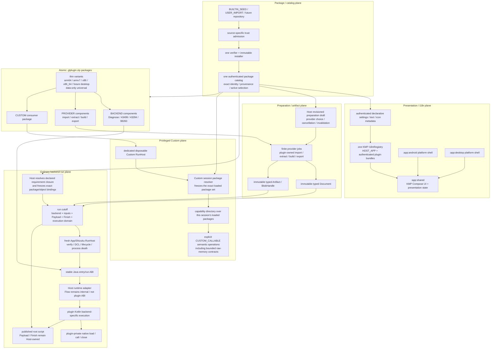
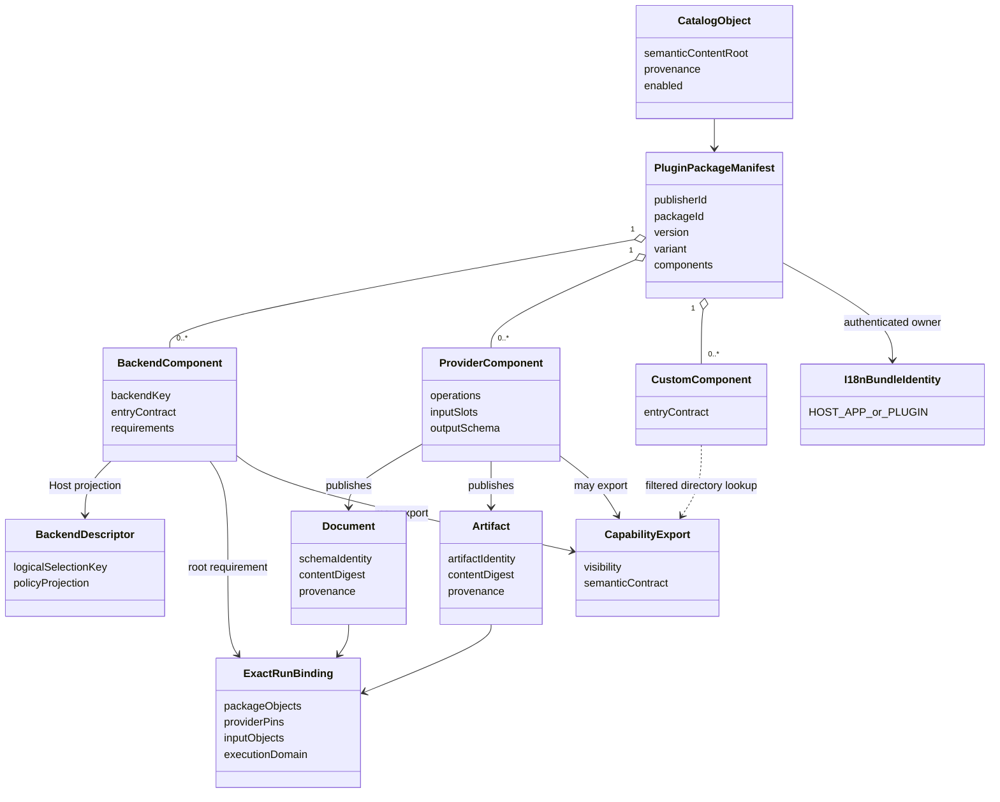
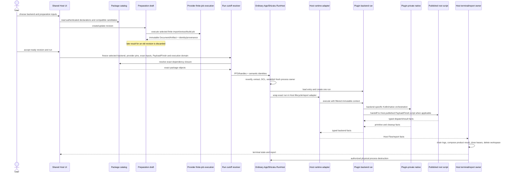
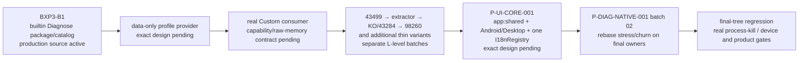

# 活跃计划最终目标全局 UML（**目标时间视点权威图**）

> **时间视点**：当前有效活跃计划按依赖顺序全部完成后的合并目标。当前工作树事实见[当前状态全局 UML](full-process-uml.md#global-current-view)。
>
> **状态边界（2026-11-21）**：本页不声称这些组件均已实现、获 production 授权或通过门禁。`BXP3-B1` 是当前唯一已获 production 实施批准的 plugin vertical；data-only provider、Custom、真实攻击 backend、外部导入、额外 ABI、KMP shared UI/Desktop 和后继压力批仍须按各自真实 consumer 细化、审查、批准和验证。状态与顺序以 P-BACKEND-X-002/决策03及后继顺序（[gl-sfg设计](../../openspec/changes/plugin-architecture/design.md#record-gl-sfg)，`p-backend-x-002-decision-03`） 及 Beads 当前任务/依赖为准；构建优先项 `gl-4on` 的精确实施批准仍待确认。
>
> **未纳入的待裁定差异**：是否删除当前 Host `Flow/SequentialFlow`、将 backend-specific orchestration 完全归入 plugin run，是本轮聊天提出但尚未形成获认可计划的差异；本目标图继续按现行有效计划保留 Host runtime adapter，不预记该差异为目标事实。

## 1. 最终目标组件与职责平面

目标不变量：

- package catalog 是 installed membership、exact object 与 active release 的唯一权威；presentation、preparation 和 runtime 都只是其受限投影。
- builtin 与 imported package 进入 installed object 后共用 verifier、installer、catalog、resolver 与 RunHost；差异只在准入来源、trust、seed 和 update policy。
- provider 只以有限 job 发布 immutable `Document`/`Artifact`；accepted run 不轮询 registry、不热换 provider 或 artifact。
- ordinary backend 只能消费声明并冻结的 dependency view；Custom 只能枚举本 session 已加载 package 明确公开的 `CUSTOM_CALLABLE` 能力。
- 现行获认可目标继续由 Host runtime adapter 承接共享 Flow/report/lifecycle 语义，Flow 不进入 plugin ABI；是否删除它须另行批准，不能由本图预决。
- plugin Kotlin／private DSO始终拥有 backend native load、call、close；Host 不保存 JNA pointer、native symbol 或 plugin-private handle。
- Payload、Finish、terminal、LogHub、product-success 与 RunHost process lifecycle 继续由 Host 拥有。

## 2. 目标 Class / identity 关系

一个 package 可以只含 provider 或 Custom component；上图三个 `0..*` 的并集必须至少有一个有效 component，但 exact schema 留给对应后继批。类名只表达已认可职责，不冻结后继批次的 exact Java/Kotlin 类型名、method、storage schema 或 wire 字段。

## 3. 从准备到运行和收尾的目标 Sequence

## 4. revision、cutoff 与 run 生命周期目标状态

```mermaid
stateDiagram-v2
  [*] --> DRAFT
  DRAFT --> EVALUATING: inputs/provider choice changed; revision + 1
  EVALUATING --> DRAFT: job failed or cancelled; keep NOT_READY
  EVALUATING --> READY: current revision publishes verified immutable outputs
  EVALUATING --> EVALUATING: stale older result discarded
  READY --> EVALUATING: dependency input changed; invalidate affected outputs
  READY --> FROZEN: user accepts run; exact closure and inputs captured
  FROZEN --> RUNNING: fresh RunHost starts backend run
  RUNNING --> TERMINAL: typed success/failure/cancel/unknown facts
  FROZEN --> TERMINAL: prepare rejected before execution
  TERMINAL --> DESTROYED: plugin leases closed, logs drained, workspace cleaned, process gone
  DESTROYED --> [*]
```

`DRAFT/EVALUATING/READY` 是目标职责状态，不是已批准的 exact DTO 名称。后继 provider 批必须用真实 consumer 冻结其字段、存储、execution domain、失败码和门禁。

## 5. 活跃顺序与未完成边界

本顺序图不把后继目标转成当前承诺；每个节点仍服从其计划中的审批和验证状态。
