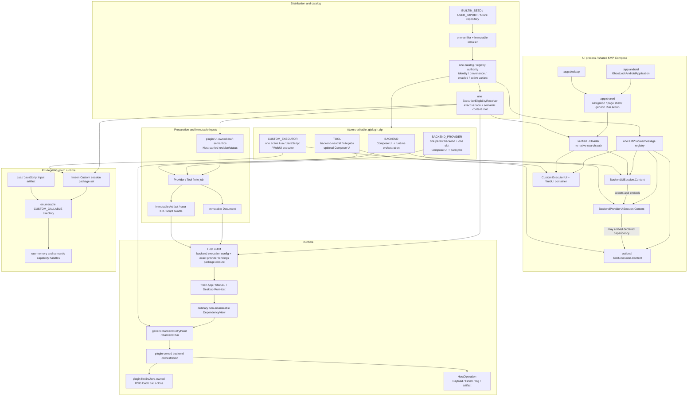
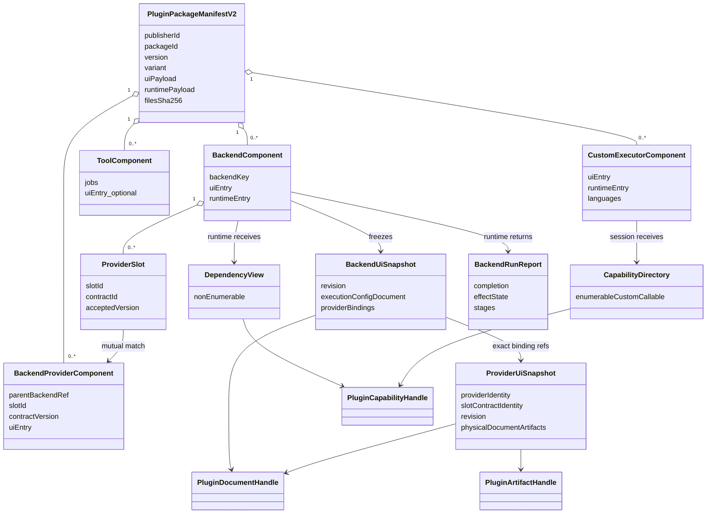
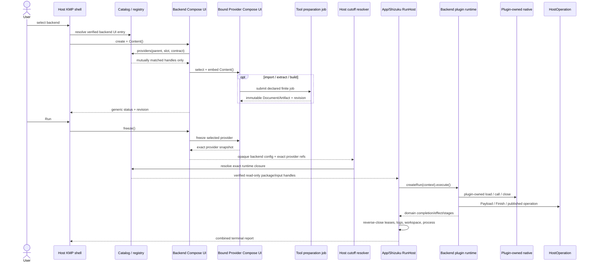

# 活跃计划最终目标全局 UML（**目标时间视点权威图**）

> **时间视点**：当前有效活跃计划按依赖顺序全部完成后的合并目标。当前工作树事实见[当前状态全局 UML](full-process-uml.md#global-current-view)。
>
> **状态边界（2026-11-22）**：本图投影 [P-BACKEND-X-002/决策04](../../tools/engineering/openspec/changes/plugin-architecture/design.md#record-plugin-sdk-v2) 的重新 CDA 设计，不声称 v2 SDK、plugin Compose UI、backend-bound provider、Custom Executor、KMP App 或真实攻击 backend 已实现/获批/通过门禁。当前 `diagnostic-v1`/Host Diagnose UI 仍只能由当前图表达。决策03与 gl-9lz 旧 exact design 只作沿革，不再作为本时间视点的目标 authority。

## 1. 最终目标组件与 owner

目标不变量：

- Catalog 是 installed membership/exact object/provenance/active variant 唯一 authority；UI、preparation、ordinary dependency 和 Custom directory 只是不同权限投影。
- Imported executable 完整性通过后仍需独立 execution grant；UI/preparation/runtime/Custom 共用一个 eligibility resolver，新 version/content root 不继承旧 grant。
- Backend 自己绘制执行配置 UI，并选择/嵌入与自己 parent+slot+contract 双向匹配的 provider UI；Host 不维护 settings schema/DSL。
- Backend configuration Document 只保存 backend-owned execution config；provider identity、physical Document/Artifact 与 revision 只存在于 exact provider binding，不双写。
- Provider 只属于一个 parent backend；Tool 是 backend-neutral；`extractor -> backend-bound provider -> backend` 是领域调用方向。
- Backend runtime 自己编排攻击步骤；Host `Flow` 不是 plugin ABI。plugin Kotlin/Java 始终拥有 native load/call/close，Host 不持有 JNA mapping/pointer/symbol/native handle。
- Custom 是一个 active execution plugin；script/WebUI 是 input artifact，不是 component。Custom 可枚举本 session 已加载 package 的显式 `CUSTOM_CALLABLE` capability，包括指定地址 raw-memory 读写。
- builtin/imported 共用 verifier/installer/catalog/loaders；差异只是 provenance/trust/seed/update/uninstall policy。
- App 与 plugin UI 共用 KMP Compose 和同一 i18n registry；Android `R.string` 不是 plugin ABI。

## 2. 目标 identity/class 关系

## 3. UI 准备、run 与收尾 sequence

## 4. 活跃计划依赖顺序

```mermaid
flowchart LR
  D4["Decision 04 architecture<br/>CDA + Compose feasibility + critic + user approval"]
  EXACT["SDK-v2 exact design gate<br/>complete declarations/schema/state machines<br/>critic + user approval"]
  SDK["SDK-v2 source<br/>api / ui-api / core / testkit / build plugin"]
  HOST["Host-v2<br/>catalog/resolver/UI loader/RunHost<br/>app shared/android/desktop layers"]
  DIAG["Diagnose migration<br/>remove diagnostic-v1 + Host Diagnose UI"]
  B43499["43499 backend + bound provider<br/>CPU/attempts + physical config"]
  TOOLS["generic extractor/serializer/toolchain"]
  CUSTOM["single Custom Executor<br/>Lua/JS/WebUI/raw memory"]
  NEXT["43284 / 98260 / more ABIs / full Desktop"]
  DEVICE["backend-specific AVD/device gates"]

  D4 --> EXACT --> SDK --> HOST --> DIAG --> B43499 --> TOOLS --> CUSTOM --> NEXT --> DEVICE
```

这个顺序不将后继节点自动转为 production 批准。决策04获用户认可后只开放 SDK-v2 exact design gate；该 gate 再获认可后才开放 SDK source。每个后继批仍按它的真实 consumer、证据与门禁单线推进。
