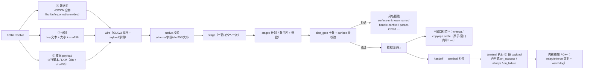
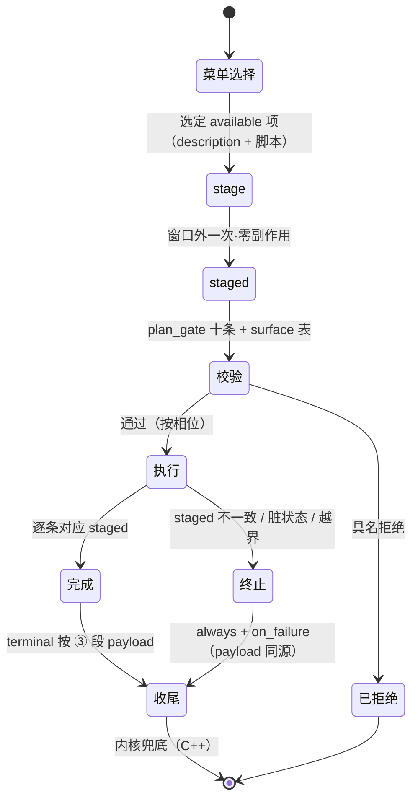
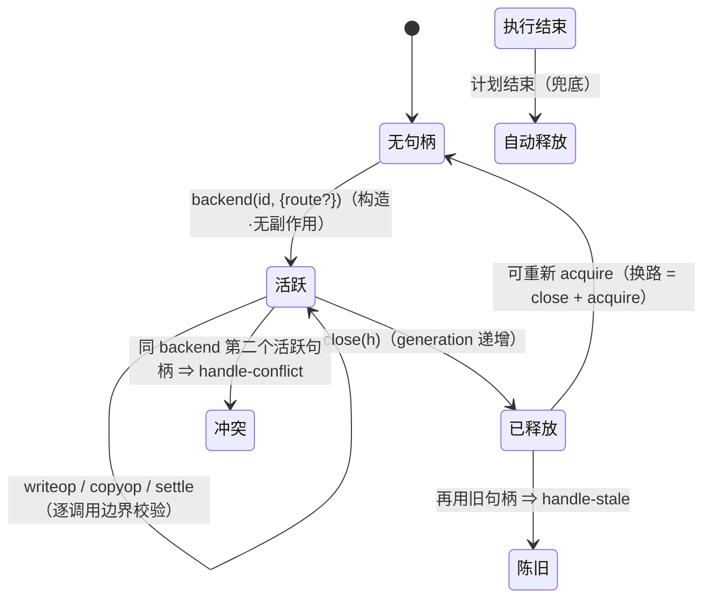
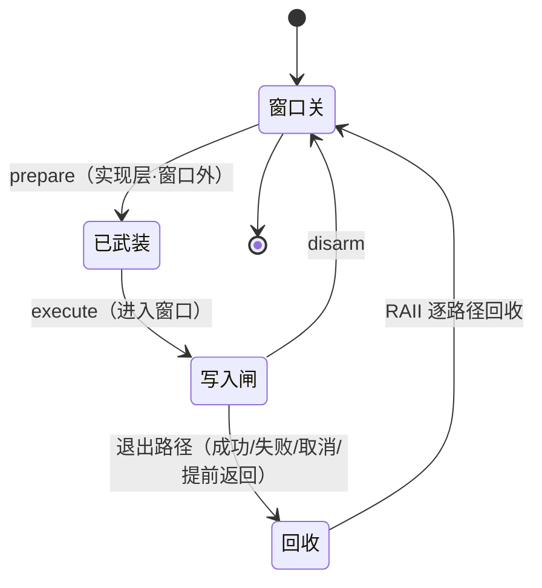
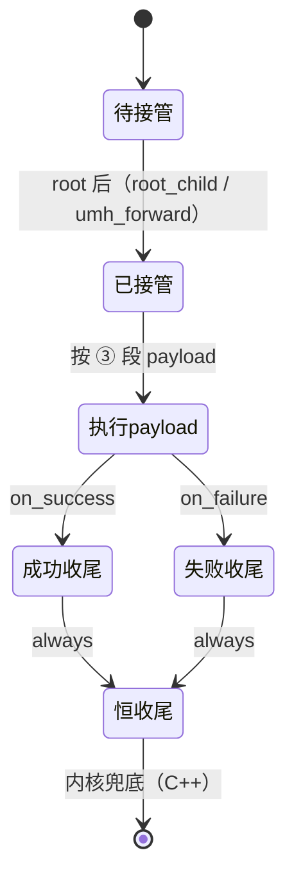
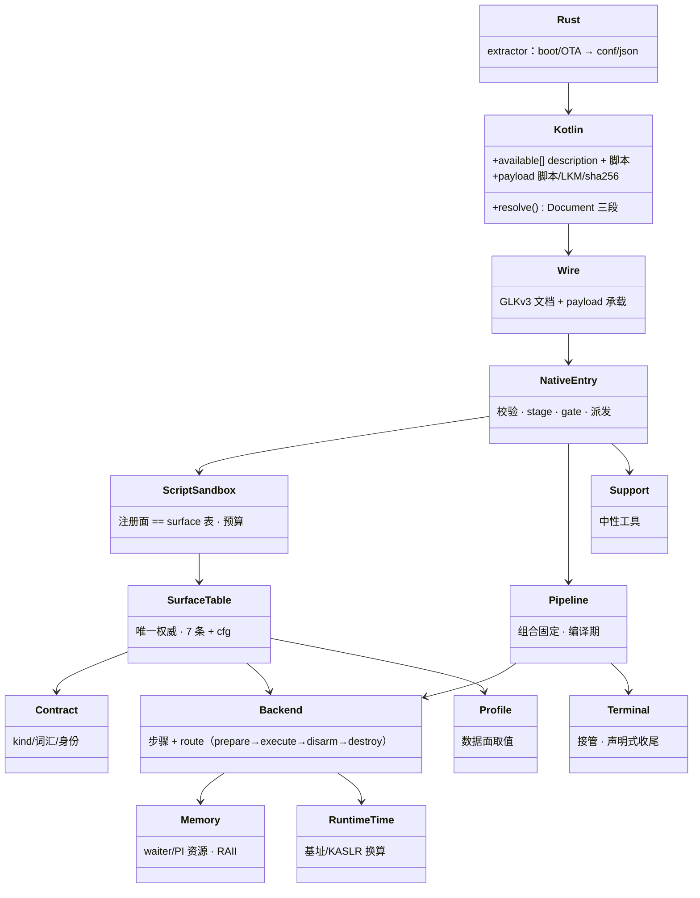
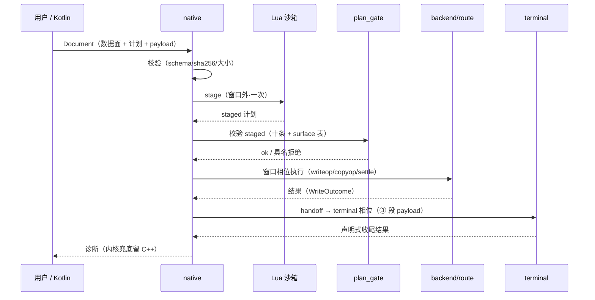
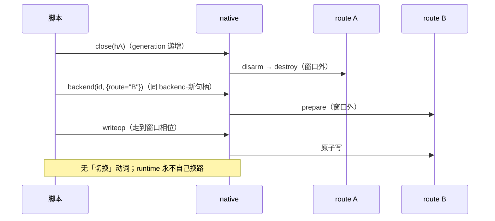
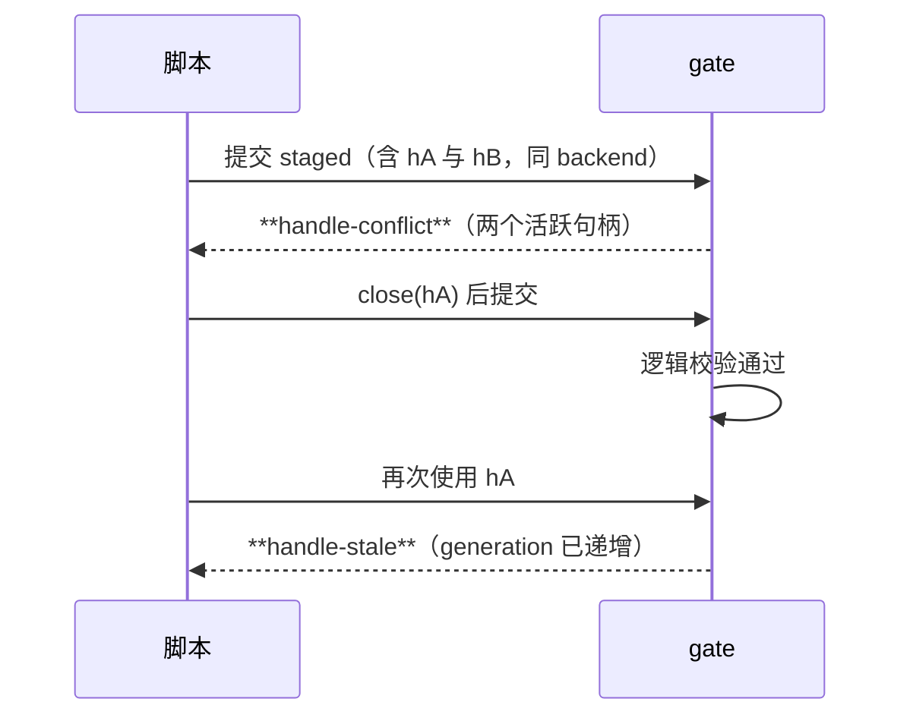
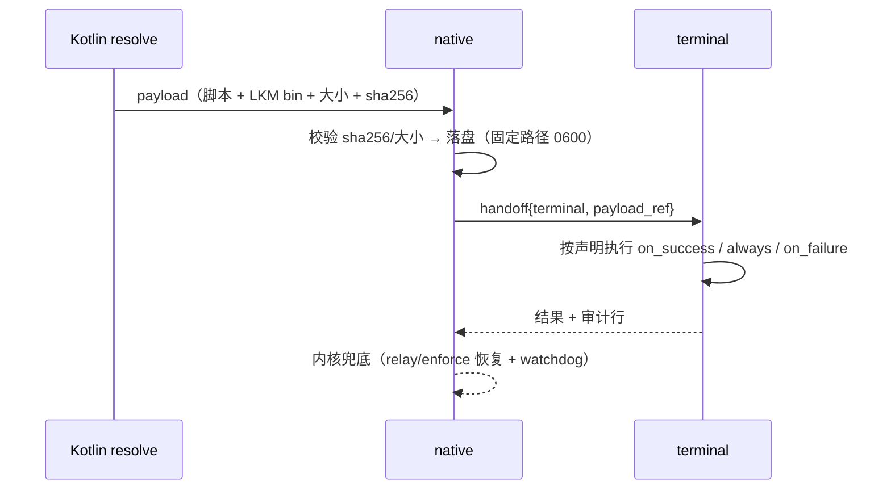

# 全流程 UML（**权威**）· 新架构（A0–A6）

> **本文件是唯一权威 UML**（`docs/development/full-process-uml.md`）；旧的旧实现 UML 已归档为 [old-full-process-uml.md](old-full-process-uml.md)（**仅历史对照**，结构与本件不同）。
> 依据：`rewrite-plan-v2`（A0–A6）· `lua-surface-design`（暴露面 7 条）· `lua-surface-annex-document/-target/-route-switch` · ADR-0008/0009/0010 · `A6-baseline-approval`。日期 2026-10-08。

## 1. IPO（端到端，数据级）

- **不变式**：脚本只在 **stage** 期运行（窗口外）；`writeop`/`copyop`/`settle` 由**实现层**在窗口相位执行；**`run` 不在暴露面**（收尾命令属 ③ 段）。

## 2. 状态机（四组）

### 2.1 计划（脚本）生命周期

### 2.2 句柄生命周期（含换路与冲突）

### 2.3 窗口状态机（PI 窗口）

- **规则**：两条 route **不得同时在窗口内**（串行：先 disarm 再 prepare）；**窗口内零 Lua**。

### 2.4 terminal 状态机

## 3. Class（新树 10 层 + 资源面 + 暴露面映射）

### 3.0 新树模块锚点（A0–A6）

| 新树模块 | 层 | 在本件的位置 |
|---|---|---|
| **`AttackWindow`** | 窗口宿主（窗口相位） | §1 窗口相位 · §2.3 窗口状态机 · §4.1 |
| **`OpRegistry`** | 操作面（暴露面条目的实现登记，与 surface 表同源） | §3 SurfaceTable→实现层 · §3.1 |
| **`script_surface`** | 契约层暴露面（**7 条 + `cfg`**） | §3 SurfaceTable · §3.1 |
| **`plan_gate`** | 校验（校验对象 = staged） | §2.1 · §4.1 · §4.3 |
| **`Document` 三段** | Kotlin resolve 产物 | §1 · §4.4 |

### 3.1 暴露面 7 条 → 实现层

| 条目 | 实现层 | 相位 | 备注 |
|---|---|---|---|
| `backend(id, {route?})` | 组合根/目录 | 窗口外 | **构造 = 无副作用的选择** |
| `close(h)` | 组合根/目录 | 窗口外 | generation 递增；旧句柄 ⇒ `handle-stale` |
| `b:writeop{target={kind,value}, value, width}` | backend route/step | 窗口相位 | **kind = 机制枚举**，value 来自 `cfg` |
| `b:copyop{src,dst={kind,value}, width}` | backend route/step | 窗口相位 | 结构复制（宽度 = profile 声明尺寸） |
| `b:settle{us}` | **`race`**（代码权威：`contract/script_surface.hpp:206` 的 `implements_layer`；层级断言见 `:305`） | 窗口相位 | 参数化（不得 C++ 兜底） |
| `b:handoff{terminal, payload_ref}` | terminal/handoff | 窗口外→terminal | **引用语义**（命令内容属 ③ 段） |
| `cfg`（只读快照） | profile（快照注入） | stage 前 | 只读；不属句柄面 |

### 3.2 拒绝码（gate + 边界校验）

| 码 | 触发 |
|---|---|
| `surface-unknown-name` | 表外名字（默认拒绝） |
| `handle-conflict` | 同 backend 两个活跃句柄 |
| `handle-stale` | 使用已释放/陈旧句柄 |
| `param-invalid` / `param-missing` | 参数越界 / 缺失（不兜底） |
| `width-mismatch` | `copyop` 宽度 ≠ profile 声明尺寸 |
| `geometry-missing` | 数据面缺几何/偏移 |
| `run-form-invalid`（**已随 `run` 移除而作废**） | — |
| `executor-unavailable` / `backend-not-available` | 可用性门禁 |

### 3.3 Kotlin / Rust 位置

| 件 | 位置 | 职责 |
|---|---|---|
| Kotlin | `app/` + `profile-core/` | HOCON 解析/合并/覆盖 · `resolve`（Document 三段）· payload 生成 |
| Rust | `tools/extract_rs/` | boot.img / OTA → profile（`--format conf` / `json`） |

## 4. Sequence（四张）

### 4.1 端到端（选菜单项 → 执行 → 收尾）

### 4.2 换路（方案 2：close + 重新 acquire）

### 4.3 句柄冲突与陈旧

### 4.4 收尾 payload

## 5. 维护约定

- **一处权威**：本文件是唯一权威 UML；其他文档**链接**本件，不重画同一结构。结构变化（新增/删除层、暴露面条目、拒绝码、相位）⇒ **同批**更新本件对应图。
- **引用**：`docs/analysis/adr/README.md` · `handoff-payload-batch-plan.md` · `contract-design.md` · `plugin-runtime-integration-design.md` · `root-manager-selection-design.md` · `docs/archive/*` · `engineering-rules.md` · `AGENTS.md`。
- **两条新纪律（同批留痕）**：本件任何**新条目/新相位/新实现层**必须同时满足 —— ① **无名字→值表**（名字只允许 **dispatch 标识符** 与 **数据面键路径**；见 [target 附件](../analysis/lua-surface-annex-target.md) §C1）· ② **表达一致**（同一件事只允许一种表达，不得「首设 A 语法 / 后续 B 语法」；见 [lua-surface-design](../analysis/lua-surface-design.md) 开头）。
- **历史**：旧实现 UML = [old-full-process-uml.md](old-full-process-uml.md)（归档头含理由与恢复来源；登记见 `docs/archive/INDEX-plans.md` §七）。
