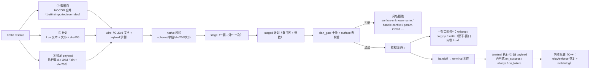
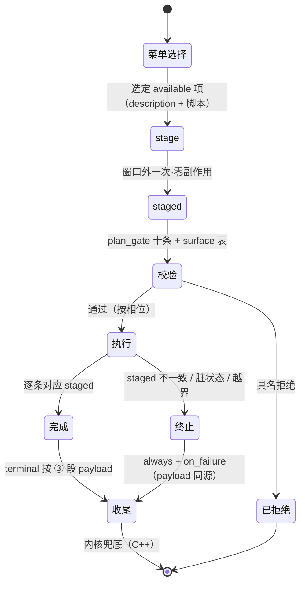
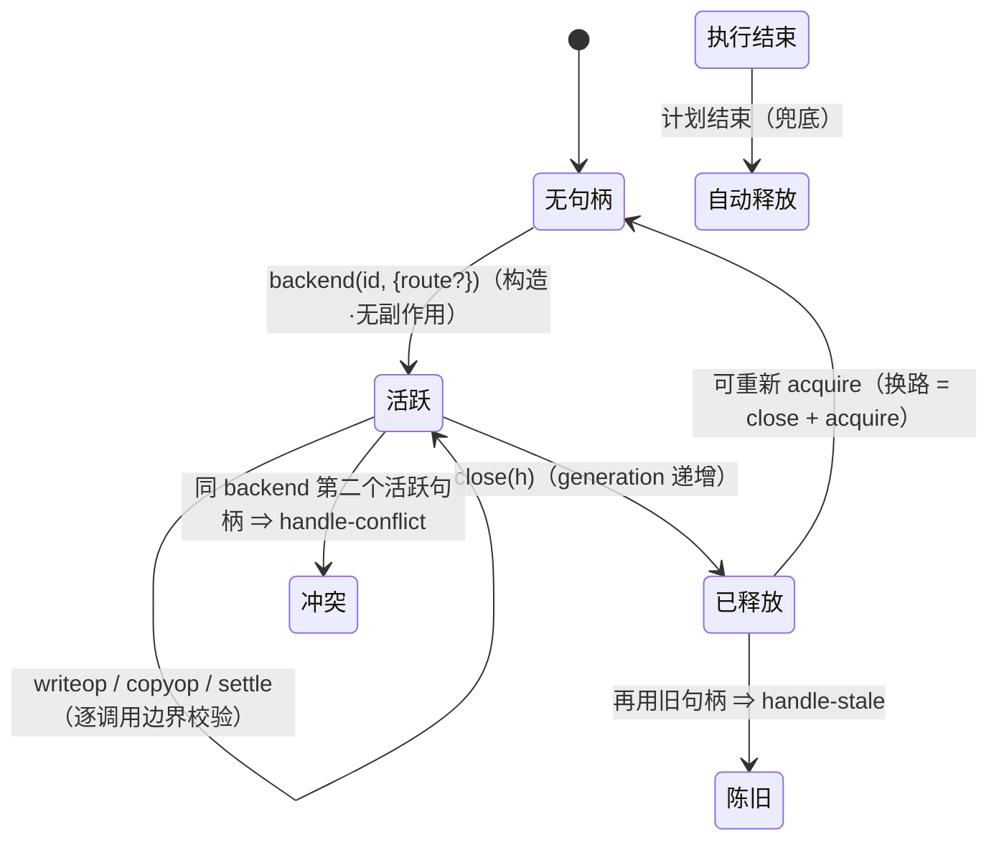
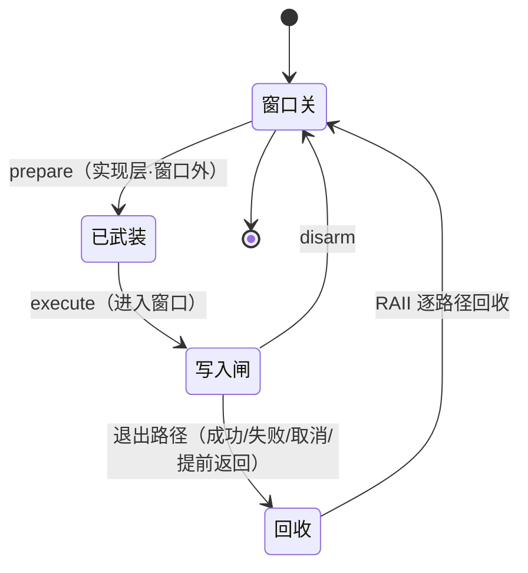
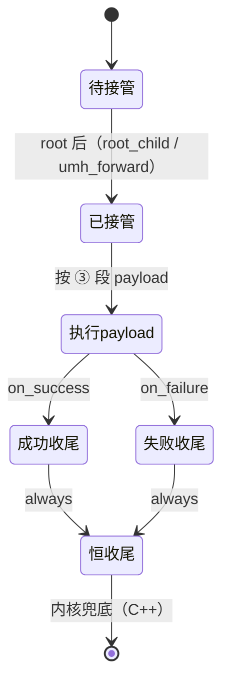
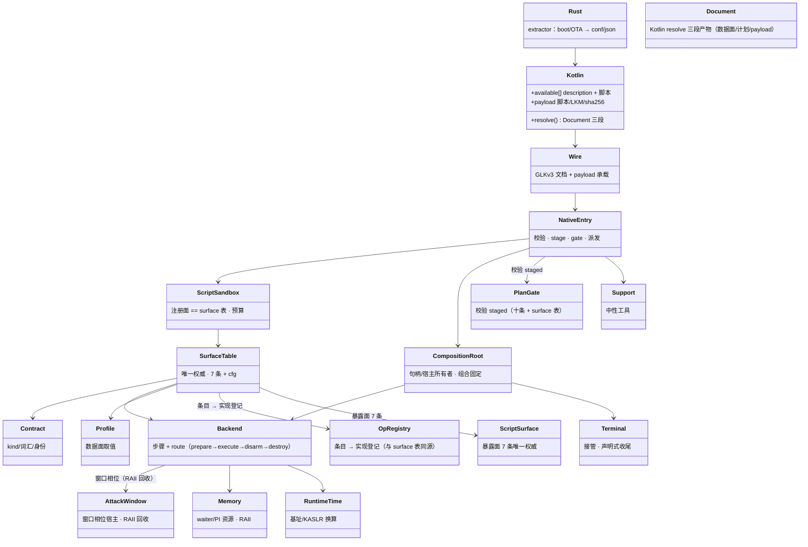
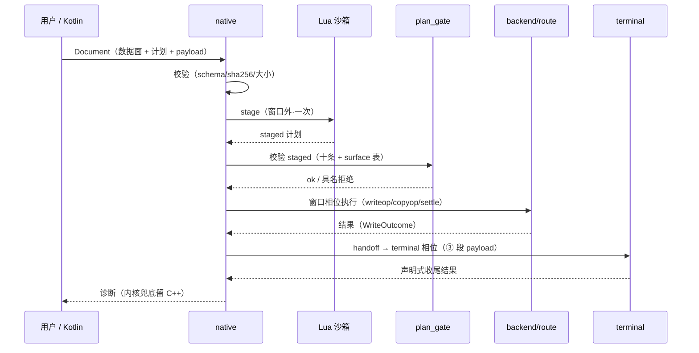
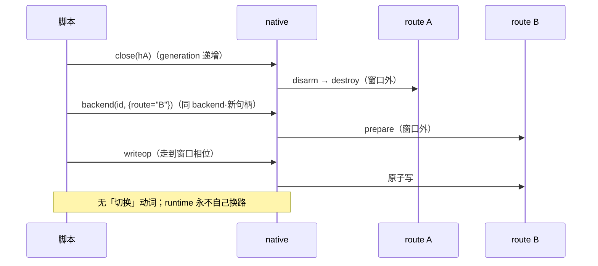
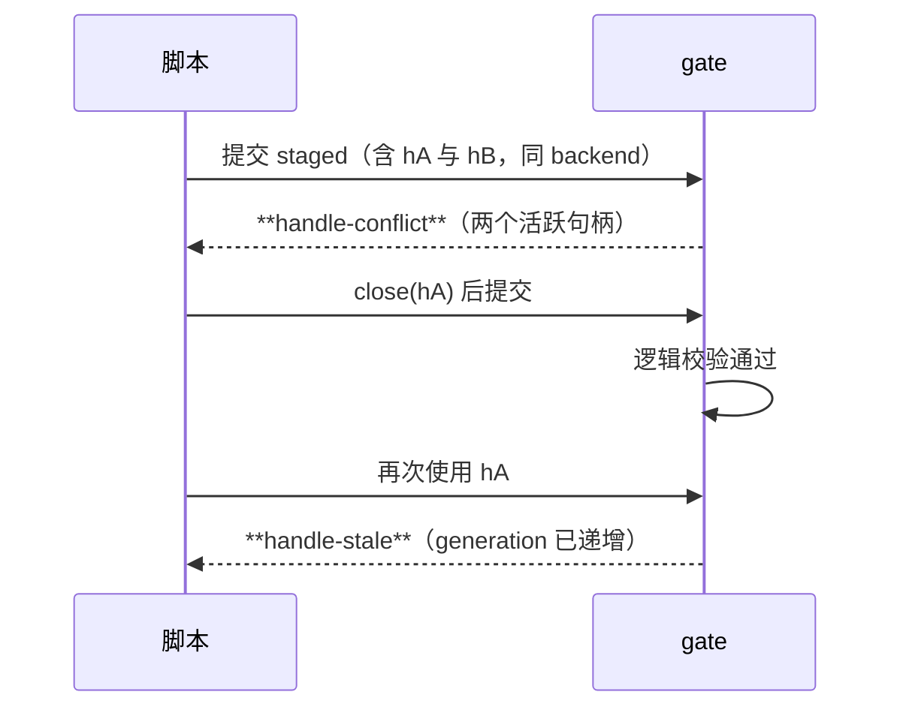
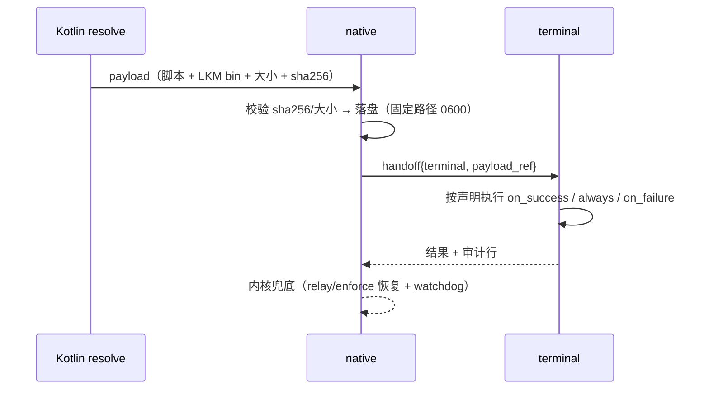

# 全流程 UML（**权威**）· 新架构（A0–A6）

> **本文件是唯一权威 UML**（`docs/development/full-process-uml.md`）；旧的旧实现 UML 已归档为 [old-full-process-uml.md](old-full-process-uml.md)（**仅历史对照**，结构与本件不同）。
> 依据：`rewrite-plan-v2`（A0–A6）· `lua-surface-design`（暴露面 7 条）· `lua-surface-annex-document/-target/-route-switch` · ADR-0008/0009/0010 · `A6-baseline-approval`。日期 2026-10-08。

## 1. IPO（端到端，数据级）



- **不变式**：脚本只在 **stage** 期运行（窗口外）；`writeop`/`copyop`/`settle` 由**实现层**在窗口相位执行；**`run` 不在暴露面**（收尾命令属 ③ 段）。

## 2. 状态机（四组）

### 2.1 计划（脚本）生命周期



### 2.2 句柄生命周期（含换路与冲突）



### 2.3 窗口状态机（PI 窗口）



- **规则**：两条 route **不得同时在窗口内**（串行：先 disarm 再 prepare）；**窗口内零 Lua**。

### 2.4 terminal 状态机



## 3. Class（新树 10 层 + 资源面 + 暴露面映射）



- **沿革（不删）**：旧树的 **`Pipeline` 类**（组合/分派层）**已删** —— 职责并入 **`CompositionRoot`**（接线）+ **`layer_scope`**（编译期校验）；本行即沿革记录（类图中已无该框）。

### 3.0 新树模块锚点（A0–A6）

| 新树模块 | 层 | 在本件的位置 |
|---|---|---|
| **`AttackWindow`** | 窗口宿主（窗口相位） | §1 窗口相位 · §2.3 窗口状态机 · §4.1 |
| **`OpRegistry`** | 操作面（暴露面条目的实现登记，与 surface 表同源） | §3 SurfaceTable→实现层 · §3.1 |
| **`script_surface`** | 契约层暴露面（**7 条 + `cfg`**） | §3 SurfaceTable · §3.1 |
| **`plan_gate`** | 校验（校验对象 = staged） | §2.1 · §4.1 · §4.3 |
| **`Document` 三段** | Kotlin resolve 产物 | §1 · §4.4 |

- **职责权威 = 类图**（§3 的 class 框）；本表仅为**定位索引**（模块 → 本件章节），**不构成第二处权威**。

### 3.1 暴露面 7 条 → 实现层

| 条目 | 实现层 | 相位 | 备注 |
|---|---|---|---|
| `backend(id, {route?})` | **`backend`**（构造经组合根/目录校验） | 窗口外 | **构造 = 无副作用的选择** |
| `close(h)` | **`session`**（句柄表；构造经组合根/目录校验） | 窗口外 | generation 递增；旧句柄 ⇒ `handle-stale` |
| `b:writeop{target={kind,value}, value, width}` | **`backend`**（route/step 为其内部） | 窗口相位 | **kind = 机制枚举**，value 来自 `cfg` |
| `b:copyop{src,dst={kind,value}, width}` | **`backend`**（route/step 为其内部） | 窗口相位 | 结构复制（宽度 = profile 声明尺寸） |
| `b:settle{us}` | **`race`**（代码权威：`contract/script_surface.hpp:206` 的 `implements_layer`；层级断言见 `:305`） | 窗口相位 | 参数化（不得 C++ 兜底） |
| `b:handoff{terminal, payload_ref}` | **`terminal`** | 窗口外→terminal | **引用语义**（命令内容属 ③ 段） |
| `cfg`（只读快照） | **`profile`**（快照注入） | stage 前 | 只读；不属句柄面 |

- **口径（实现层）**：**实现层 = `contract::kLayers` 的层名**（`contract` · `support` · `memory` · `race` · `backend` · `pipeline` · `terminal` · `script` · `session` · `profile`）；**机器可校验**（`script_surface.hpp` 的 `implements_layer` 与 `:305` 断言）；**不得用描述性短语** —— 「**表达一致**」的一个实例。

#### 3.1.1 manifest 原文（**派生源**；`make -C src surface-manifest` 生成，19 行逐字节）

```tsv
backend	call	backend	pre_window	true	true	false	-	-	-
writeop	handle_method	backend	window	false	true	true	handle	true	18446744073709551615
writeop	handle_method	backend	window	false	true	true	target_kind	true	64
writeop	handle_method	backend	window	false	true	true	target_value	true	18446744073709551615
writeop	handle_method	backend	window	false	true	true	value	true	18446744073709551615
writeop	handle_method	backend	window	false	true	true	width	true	8
copyop	handle_method	backend	window	false	true	true	handle	true	18446744073709551615
copyop	handle_method	backend	window	false	true	true	src_kind	true	64
copyop	handle_method	backend	window	false	true	true	src_value	true	18446744073709551615
copyop	handle_method	backend	window	false	true	true	dst_kind	true	64
copyop	handle_method	backend	window	false	true	true	dst_value	true	18446744073709551615
copyop	handle_method	backend	window	false	true	true	width	true	8
settle	handle_method	race	window	false	true	true	handle	true	18446744073709551615
settle	handle_method	race	window	false	true	true	us	true	1000000
handoff	handle_method	terminal	terminal	true	true	true	handle	true	18446744073709551615
handoff	handle_method	terminal	terminal	true	true	true	terminal	true	256
handoff	handle_method	terminal	terminal	true	true	true	payload_ref	true	256
cfg	value	profile	stage	false	true	false	-	-	-
close	handle_method	session	pre_window	false	true	true	handle	true	18446744073709551615
```

- **断言**：本表与 manifest **逐项一致**（`make -C src surface-doc-check DOC=docs/development/full-process-uml.md` ⇒ **EXIT=0**）；**pin** = `src/core/tests/surface_manifest_test.cpp`（19 行）。
- **口径**：上表（§3.1）为阅读视图；**权威 = manifest**（列 = 条目 · 形态 · 实现层 · **phase** · … · 参数名 · 必填 · 上界）。

### 3.2 拒绝码（**唯一完整表**；其余文档只留指针）

| 码 | 触发 | 来源/备注 |
|---|---|---|
| **`surface-unknown-name`** | **表外名字**（默认拒绝，不做近似匹配） | `script_surface.hpp` 的 `SurfaceLookup::UnknownSymbol` ⇒ ****已对齐**（`script_surface.hpp:322` 返回 `surface-unknown-name`；断言 `lookup_refusal_is_pinned()` `:545-547` 钉住）** |
| `surface-unknown-token` | 目录/terminal token 不在词表 | catalog / surface |
| **`handle-conflict`** | 同 backend **两个活跃句柄** | gate（校验 staged） |
| **`handle-stale`** | 使用**已释放/陈旧**句柄（generation 已递增） | 句柄表 · ADR-0010 |
| `param-invalid` | 参数越界（`us`/`width`/`value`） | 边界校验 |
| `param-missing` | 脚本调用**缺参**（`width` **必填**） | 边界校验 |
| `width-mismatch` | `copyop` 宽度 ≠ profile 声明尺寸 | 边界校验 |
| `geometry-missing` | 数据面缺**几何/偏移** | profile 取值 |
| **`tuning-missing`** | 调参键**缺失**（不兜底，见 [a3-tuning-migration](../analysis/a3-tuning-migration.md) §3） | profile 取值 |
| `cfg-unknown-field` | `cfg` 字段不在 manifest 声明集合 | profile 快照 |
| `budget-exceeded` | 超**指令/内存/规模**预算 | 沙箱 |
| `op-not-available` / `backend-not-available` | 可用性门禁（`available=false`） | gate |
| `executor-unavailable` | terminal 执行器不可用 | gate |
| `payload-missing` | `handoff` 的 `payload_ref` 无交付物/校验失败 | handoff 校验 |
| `plan-missing` | 计划为空（无 staged 产物） | gate |
| **`document-invalid`** | **文档不是本构建读的那种**：`schema != kDocumentSchema(=3)`（`profile/glkv3_document.hpp:24`）· 字节非 MessagePack（解析失败）· **未解析就读取** | `glkv3_document.hpp` 的 `DocumentVerdict::Invalid`（`:35-39`，三值 = `ok`/`document-invalid`/`payload-missing`）；测试 `tests/document_reader_test.cpp` |
| **`unknown-op`**（`plan_gate`） | 未知 op token | plan_gate |
| **`route-not-available`**（`plan_gate`） | 该 route 不可用（未接线/未声明） | plan_gate |
| **`capability-missing`**（`plan_gate`） | 能力缺失（所需能力未授予） | plan_gate |
| **`order-violation`**（`plan_gate`） | 步骤**顺序违规** | plan_gate |
| **`hash-mismatch`**（`plan_gate`） | **冻结哈希不符**（payload/计划冻结值） | plan_gate |
| **`seam-in-pi-window`**（`plan_gate`） | **接缝落在 PI 窗口内**（R1） | plan_gate |
| **`target-kind-invalid`** | `writeop`/`copyop` 的 `kind` 不在机制枚举内 | **脚本/代码侧**（边界校验） |
| **`queue-removed`** | 出现 M5 已退役的 `queue`/token 形态 | **plan_gate** |
| **`plan-syntax`** | 脚本**语法错**（装载/stage 期解析失败） | **装载/stage 期** |
| ~~`run-form-invalid`~~ | **作废**（`run` 已移除；双形态校验不存在） | 沿革保留 |

- **判据（**可失败**）**：『**在用码集合 == 冻结清单**』——① 从**代码**（`script_surface.hpp`/`op_registry.hpp`/gate 实现）提取全部拒绝码字面量；② 与本表逐项比对；③ **多一个或少一个都 FAIL**（多 ⇒ 未登记码；少 ⇒ 表内陈码）。**首次执行前须先完成上表首行的代码改名**（否则必然差一项：`unknown-symbol` vs `surface-unknown-name`）。

- **可执行验收（提取源写死）**：对 **`src/core/contract/script_surface.hpp`** · **`src/core/pipeline/plan_gate.hpp`** · **`src/core/profile/glkv3_document.hpp`**（`DocumentVerdict`：`document-invalid`/`payload-missing`）做「`return` + 引号内字面量」**去重提取**（**兜底串单列**）⇒ 与本表**逐项比对**，**多一少一皆 FAIL**。

- **冻结清单的导出口径（2026-10-08 补）**：冻结集合 = **『代码在用码』∪『设计/plan_gate/装载在用码』** —— **surface 側代码 5 个**（`surface-unknown-name` · **`target-kind-invalid`** · `width-mismatch` · `handle-conflict` · `handle-stale`）；**gate 侧提取源 = `src/core/pipeline/plan_gate.hpp` 的 `gate_reason_name()`（`:47+`，与 `GateReason` `:30-44` 一一对应）** = `ok` · **`unknown-op`** · `op-not-available` · **`route-not-available`** · `geometry-missing` · **`capability-missing`** · **`order-violation`** · **`hash-mismatch`** · `param-invalid` · **`seam-in-pi-window`** · `executor-unavailable` · `queue-removed` · `plan-missing`（**另有兜底串 `unknown`**：正常路径不应出现，**若可触达须单独登记**）；设计/装载侧补 **`queue-removed`**（M5 退役）· **`plan-syntax`**（装载/stage）· `surface-unknown-token` · `param-*` · `geometry-missing` · `tuning-missing` · `cfg-unknown-field` · `budget-exceeded` · `op/backend-not-available` · `executor-unavailable` · `payload-missing` · `plan-missing`；**已作废码单列**（~~`run-form-invalid`~~）。**本表自身即来源登记**，新增码须同时改代码与 `plan_gate` 并登记于此。

- **指针**：条目级拒绝码散见 [lua-surface-design](../analysis/lua-surface-design.md) §1 与附件；**完整集合以本表为准**，其他处不另立清单（「表达一致」）。

### 3.3 Kotlin / Rust 位置

| 件 | 位置 | 职责 |
|---|---|---|
| Kotlin | `app/` + `profile-core/` | HOCON 解析/合并/覆盖 · `resolve`（Document 三段）· payload 生成 |
| Rust | `tools/extract_rs/` | boot.img / OTA → profile（`--format conf` / `json`） |

## 4. Sequence（四张）

### 4.1 端到端（选菜单项 → 执行 → 收尾）



### 4.2 换路（方案 2：close + 重新 acquire）



### 4.3 句柄冲突与陈旧



### 4.4 收尾 payload



## 5. 维护约定

- **一处权威**：本文件是唯一权威 UML；其他文档**链接**本件，不重画同一结构。结构变化（新增/删除层、暴露面条目、拒绝码、相位）⇒ **同批**更新本件对应图。
- **引用**：`docs/analysis/adr/README.md` · `handoff-payload-batch-plan.md` · `contract-design.md` · `plugin-runtime-integration-design.md` · `root-manager-selection-design.md` · `docs/archive/*` · `engineering-rules.md` · `AGENTS.md`。
- **两条新纪律（同批留痕）**：本件任何**新条目/新相位/新实现层**必须同时满足 —— ① **无名字→值表**（名字只允许 **dispatch 标识符** 与 **数据面键路径**；见 [target 附件](../analysis/lua-surface-annex-target.md) §C1）· ② **表达一致**（同一件事只允许一种表达，不得「首设 A 语法 / 后续 B 语法」；见 [lua-surface-design](../analysis/lua-surface-design.md) 开头）。
- **历史**：旧实现 UML = [old-full-process-uml.md](old-full-process-uml.md)（归档头含理由与恢复来源；登记见 `docs/archive/INDEX-plans.md` §七）。
