# 全流程 UML（**权威**）· 新架构（A0–A6）

> 2026-10-23 JNI v4 已获用户“按照计划”批准：§11 取代旧的 route/JNI handle/Flow/Finish 局部图。

> **本文件是唯一权威 UML**（`docs/development/full-process-uml.md`）；旧的旧实现 UML 已归档为 [old-full-process-uml.md](old-full-process-uml.md)（**仅历史对照**，结构与本件不同）。
> 依据：`rewrite-plan-v2`（A0–A6）· `lua-surface-design`（暴露面 7 条）· `lua-surface-annex-document/-target/-route-switch` · ADR-0008/0009/0010 · `A6-baseline-approval`。日期 2026-10-08。

## 1. IPO（端到端，数据级）

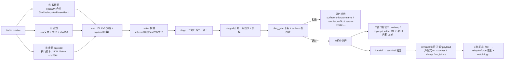

- **步骤顺序**：**声明顺序与执行顺序由 `static_assert` 绑定**（`contract/step_catalog.hpp` 的 `kStepSetOrders` 三条顺序 + 两个 `static_assert`）。
- **新入口（真机已验证 · A6-R1）**：**文档入 → 计划出 → 如实拒绝** —— `--ghostlock-app-call`（stdin，4 字节大端长度前缀）⇒ 文档解析 ⇒ **计划**（`plan chain=… steps=… source=queue`）⇒ 本树机制未实现 ⇒ **`executor-unavailable` / EXIT=4**（门禁记录：[a6-r1-document-to-plan-20261008-pass](../analysis/device-gates/a6-r1-document-to-plan-20261008-pass.md)）。
- **不变式**：脚本只在 **stage** 期运行（窗口外）；`writeop`/`copyop`/`settle` 由**实现层**在窗口相位执行；**`run` 不在暴露面**（收尾命令属 ③ 段）。

## 2. 状态机（四组）

### 2.1 计划（脚本）生命周期

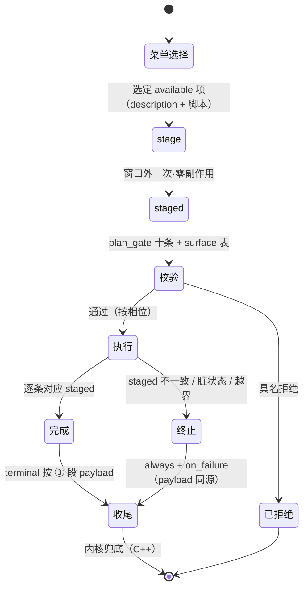

### 2.2 句柄生命周期（含换路与冲突）

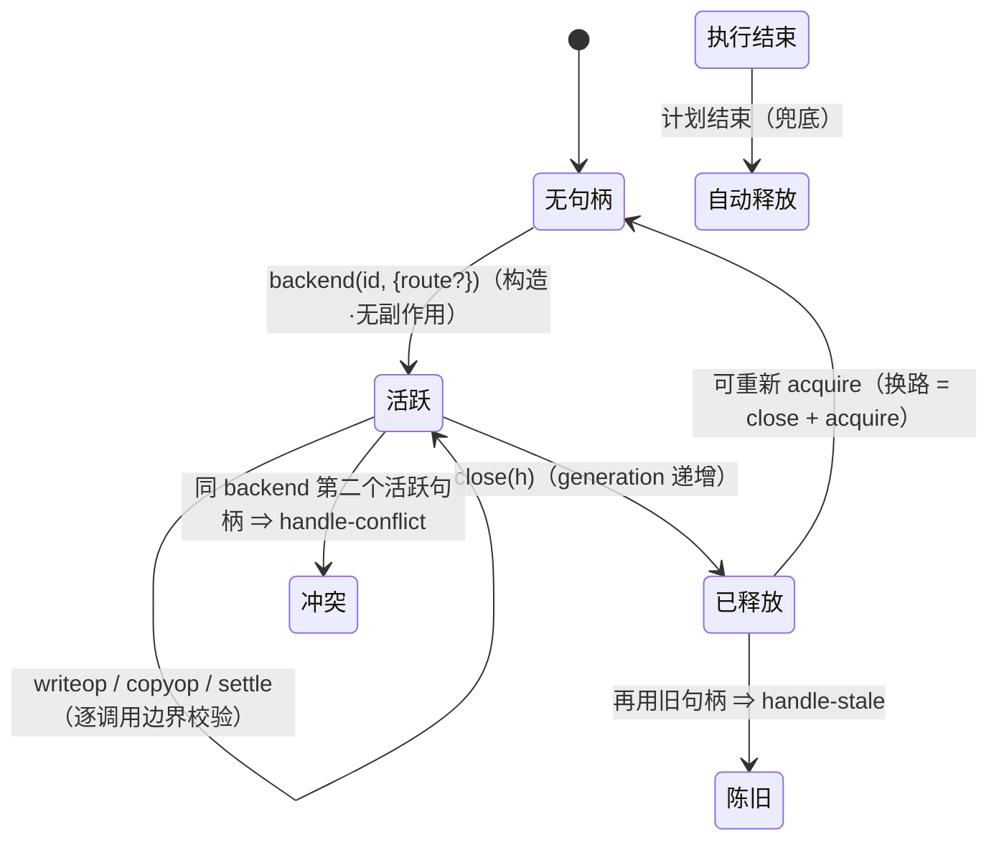

### 2.3 窗口状态机（PI 窗口）

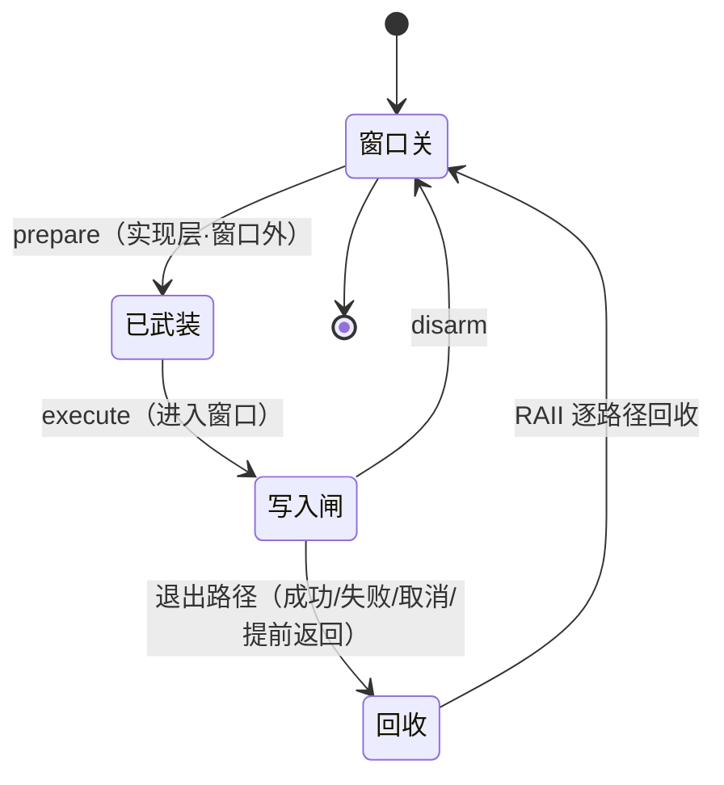

- **规则**：两条 route **不得同时在窗口内**（串行：先 disarm 再 prepare）；**窗口内零 Lua**。

### 2.4 terminal 状态机

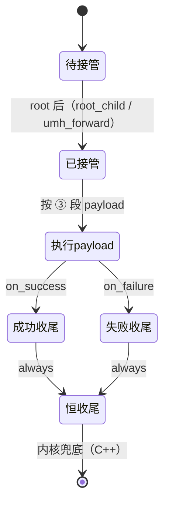

### 2.5 route 生命周期（**五态四步** · `backend/cve_2026_43499/route/lifecycle.hpp`）

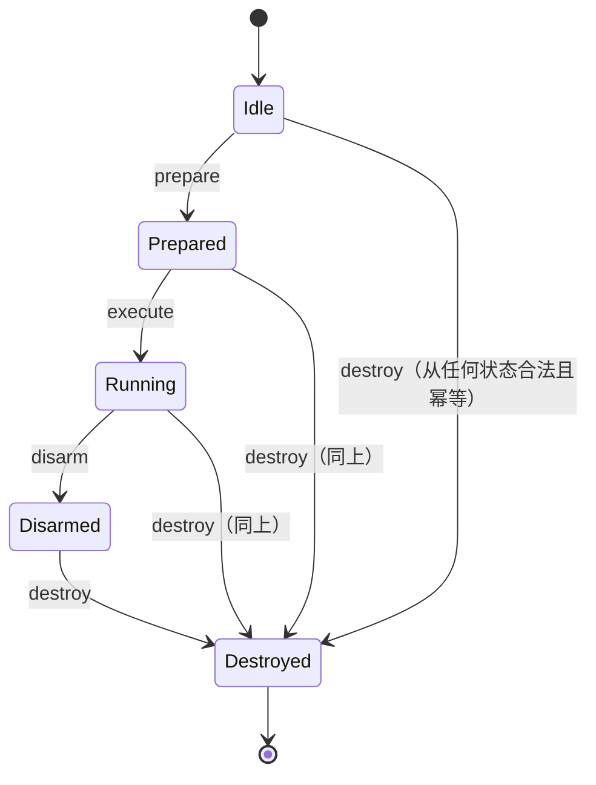

- **类型**：`enum class RouteStage`（Idle · Prepared · Running · Disarmed · Destroyed）· `enum class RouteStep`（prepare · execute · disarm · destroy）· `enum class LifecycleVerdict`（拒绝经 `status` 汇报）。
- **边注**：① **拒绝不改状态**（非法步序 ⇒ 拒绝并保持当前态）；② **`destroy` 从任何状态合法且幂等**。

## 3. Class（新树 **9 层** + 资源面 + 暴露面映射）


- **沿革（不删）**：旧树的 **`Pipeline` 类**（组合/分派层）**已删** —— 职责并入 **`CompositionRoot`**（接线）+ **`layer_scope`**（编译期校验）；本行即沿革记录（类图中已无该框）。

### 3.4 新树模块（A6-4 · A3 前置批次；**按 namespace 分组**）

| namespace | 件 | 主要声明（与代码一致） |
|---|---|---|
| **`profile`** | `glkv3_document.{hpp,cpp}` | `Document` · `DocumentVerdict`（`ok`/`document-invalid`/`payload-missing`）· `PayloadEntry` · `parse()` / `payload()` / `is_open()` / `reset()` |
| **`profile`** | `payload_keys.{hpp,cpp}` | 载荷四键（`.bin`/`.sha256`/`.size`/`.kind`）三 kind + `payload_segment` / `payload_path` / `payload_name_is_valid` / `payload_key_is_declared` |
| **`profile`** | `document_pairs.{hpp,cpp}` | `read_section_pairs` · `PairsVerdict` · `PairsResult` |
| **`memory`** | `write_request.hpp` | `WriteRequest` · `WriteMode` · `check_request` · `RequestVerdict` · `write_mode_of` / `write_mode_token` |
| **`memory`** | `write_encoder.{hpp,cpp}` | `WriteArm` · `WaiterFieldOffsets` · `arm_for` · `encode_waiter_arm` · `EncodeVerdict` |
| **`backend::cve_2026_43499::route`** | `lifecycle.hpp` | `RouteStage`（五态）· `RouteStep`（四步）· `LifecycleVerdict`（图见 §2.5） |
| **`contract`** | `step_catalog.hpp` | `StepId` · `StepEffect` · `kStepCatalog` · **`kStepSetOrders` 三条顺序** + **两个 `static_assert`** |

- **既有件核对（A6-4 三件 + profile 两件）**：`terminal/payload.hpp` · `terminal/payload_store.{hpp,cpp}` · `terminal/execution.{hpp,cpp}` · `memory/target_profile.hpp` · `profile/route_catalog.hpp` —— **均已在图/本表中在位** ✓。

### 3.0 新树模块锚点（A0–A6）

| 新树模块 | 层 | 在本件的位置 |
|---|---|---|
| **`AttackWindow`** | 窗口宿主（窗口相位） | §1 窗口相位 · §2.3 窗口状态机 · §4.1 |
| **`OpRegistry`** | 操作面（暴露面条目的实现登记，与 surface 表同源） | §3 SurfaceTable→实现层 · §3.1 |
| **`script_surface`** | 契约层暴露面（**7 条 + `cfg`**） | §3 SurfaceTable · §3.1 |
| **`plan_gate`** | 校验（校验对象 = staged） | §2.1 · §4.1 · §4.3 |
| **`Document` 三段** | Kotlin resolve 产物 | §1 · §4.4 |

- **职责权威 = 类图**（§3 的 class 框）；本表仅为**定位索引**（模块 → 本件章节），**不构成第二处权威**。

### 3.1 暴露面 7 条 → 实现层

| 条目 | 实现层 | 相位 | 备注 |
|---|---|---|---|
| `backend(id, {route?})` | **`backend`**（构造经组合根/目录校验） | 窗口外 | **构造 = 无副作用的选择** |
| `close(h)` | **`session`**（句柄表；构造经组合根/目录校验） | 窗口外 | generation 递增；旧句柄 ⇒ `handle-stale` |
| `b:writeop{target={kind,value}, value, width}` | **`backend`**（route/step 为其内部） | 窗口相位 | **kind = 机制枚举**，value 来自 `cfg` |
| `b:copyop{src,dst={kind,value}, width}` | **`backend`**（route/step 为其内部） | 窗口相位 | 结构复制（宽度 = profile 声明尺寸） |
| `b:settle{us}` | **`backend`**（**2026-10-08 更正**：`race` 不再成层，PI-futex 机制并入 `backend/cve_2026_43499/race/`；代码权威 `contract/script_surface.hpp` 的 `implements_layer`） | 窗口相位 | 参数化（不得 C++ 兜底） |
| `b:handoff{terminal, payload_ref}` | **`terminal`** | 窗口外→terminal | **引用语义**（命令内容属 ③ 段） |
| `cfg`（只读快照） | **`profile`**（快照注入） | stage 前 | 只读；不属句柄面 |

- **口径（实现层）**：**实现层 = `contract::kLayers` 的层名**（**9 层**：`contract` · `support` · `memory` · `backend` · `pipeline` · `terminal` · `script` · `session` · `profile`）；**机器可校验**（`script_surface.hpp` 的 `implements_layer` 与 `:305` 断言）；**不得用描述性短语** —— 「**表达一致**」的一个实例。

#### 3.1.1 manifest 原文（**派生源**；`make -C core surface-manifest` 生成，19 行逐字节）

```tsv
backend	call	backend	pre_window	true	true	false	-	-	-
writeop	handle_method	backend	window	false	true	true	handle	true	18446744073709551615
writeop	handle_method	backend	window	false	true	true	target_kind	true	64
writeop	handle_method	backend	window	false	true	true	target_value	true	18446744073709551615
writeop	handle_method	backend	window	false	true	true	value	true	18446744073709551615
writeop	handle_method	backend	window	false	true	true	width	true	8
copyop	handle_method	backend	window	false	true	true	handle	true	18446744073709551615
copyop	handle_method	backend	window	false	true	true	src_kind	true	64
copyop	handle_method	backend	window	false	true	true	src_value	true	18446744073709551615
copyop	handle_method	backend	window	false	true	true	dst_kind	true	64
copyop	handle_method	backend	window	false	true	true	dst_value	true	18446744073709551615
copyop	handle_method	backend	window	false	true	true	width	true	8
settle	handle_method	backend	window	false	true	true	handle	true	18446744073709551615
settle	handle_method	backend	window	false	true	true	us	true	1000000
handoff	handle_method	terminal	terminal	true	true	true	handle	true	18446744073709551615
handoff	handle_method	terminal	terminal	true	true	true	terminal	true	256
handoff	handle_method	terminal	terminal	true	true	true	payload_ref	true	256
cfg	value	profile	stage	false	true	false	-	-	-
close	handle_method	session	pre_window	false	true	true	handle	true	18446744073709551615
kernelcall	handle_method	backend	window	false	true	true	handle	true	18446744073709551615
kernelcall	handle_method	backend	window	false	true	true	op	true	64
kernelcall	handle_method	backend	window	false	true	true	target_kind	true	64
kernelcall	handle_method	backend	window	false	true	true	target_value	true	18446744073709551615
kernelcall	handle_method	backend	window	false	true	true	value	true	18446744073709551615
kernelcall	handle_method	backend	window	false	true	true	width	true	8
step	handle_method	backend	window	false	true	true	handle	true	18446744073709551615
step	handle_method	backend	window	false	true	true	name	true	64
log	call	backend	stage	false	true	true	level	true	16
log	call	backend	stage	false	true	true	key	true	256
```

- **断言**：本表与 manifest **逐项一致**（`make -C core surface-doc-check DOC=docs/development/full-process-uml.md` ⇒ **EXIT=0**）；**pin** = `core/src/tests/surface_manifest_test.cpp`（19 行）。
- **口径**：上表（§3.1）为阅读视图；**权威 = manifest**（列 = 条目 · 形态 · 实现层 · **phase** · … · 参数名 · 必填 · 上界）。

### 3.2 拒绝码（**唯一完整表**；其余文档只留指针）

| 码 | 触发 | 来源/备注 |
|---|---|---|
| **`surface-unknown-name`** | **表外名字**（默认拒绝，不做近似匹配） | `script_surface.hpp` 的 `SurfaceLookup::UnknownSymbol` ⇒ ****已对齐**（`script_surface.hpp:322` 返回 `surface-unknown-name`；断言 `lookup_refusal_is_pinned()` `:545-547` 钉住）** |
| `surface-unknown-token` | 目录/terminal token 不在词表 | catalog / surface |
| **`handle-conflict`** | 同 backend **两个活跃句柄** | gate（校验 staged） |
| **`handle-stale`** | 使用**已释放/陈旧**句柄（generation 已递增） | 句柄表 · ADR-0010 |
| `param-invalid` | 参数越界（`us`/`width`/`value`） | 边界校验 |
| `param-missing` | 脚本调用**缺参**（`width` **必填**） | 边界校验 |
| `width-mismatch` | `copyop` 宽度 ≠ profile 声明尺寸 | 边界校验 |
| `geometry-missing` | 数据面缺**几何/偏移** | profile 取值 |
| **`tuning-missing`** | 调参键**缺失**（不兜底，见 [a3-tuning-migration](../analysis/a3-tuning-migration.md) §3） | profile 取值 |
| `cfg-unknown-field` | `cfg` 字段不在 manifest 声明集合 | profile 快照 |
| `budget-exceeded` | 超**指令/内存/规模**预算 | 沙箱 |
| `op-not-available` / `backend-not-available` | 可用性门禁（`available=false`） | gate |
| `executor-unavailable` | terminal 执行器不可用 | gate |
| `payload-missing` | `handoff` 的 `payload_ref` 无交付物/校验失败 | handoff 校验 |
| `plan-missing` | 计划为空（无 staged 产物） | gate |
| **`document-invalid`** | **文档不是本构建读的那种**：`schema != kDocumentSchema(=3)`（`profile/glkv3_document.hpp:24`）· 字节非 MessagePack（解析失败）· **未解析就读取** | `glkv3_document.hpp` 的 `DocumentVerdict::Invalid`（`:35-39`，三值 = `ok`/`document-invalid`/`payload-missing`）；测试 `tests/document_reader_test.cpp` |
| **`unknown-op`**（`plan_gate`） | 未知 op token | plan_gate |
| **`route-not-available`**（`plan_gate`） | 该 route 不可用（未接线/未声明） | plan_gate |
| **`capability-missing`**（`plan_gate`） | 能力缺失（所需能力未授予） | plan_gate |
| **`order-violation`**（`plan_gate`） | 步骤**顺序违规** | plan_gate |
| **`hash-mismatch`**（`plan_gate`） | **冻结哈希不符**（payload/计划冻结值） | plan_gate |
| **`landing-in-pi-window`**（`plan_gate`） | **接缝落在 PI 窗口内**（R1） | plan_gate |
| **`target-kind-invalid`** | `writeop`/`copyop` 的 `kind` 不在机制枚举内 | **脚本/代码侧**（边界校验） |
| **`queue-removed`** | 出现 M5 已退役的 `queue`/token 形态 | **plan_gate** |
| **`plan-syntax`** | 脚本**语法错**（装载/stage 期解析失败） | **装载/stage 期** |
| ~~`run-form-invalid`~~ | **作废**（`run` 已移除；双形态校验不存在） | 沿革保留 |

- **判据（**可失败**）**：『**在用码集合 == 冻结清单**』——① 从**代码**（`script_surface.hpp`/`op_registry.hpp`/gate 实现）提取全部拒绝码字面量；② 与本表逐项比对；③ **多一个或少一个都 FAIL**（多 ⇒ 未登记码；少 ⇒ 表内陈码）。**首次执行前须先完成上表首行的代码改名**（否则必然差一项：`unknown-symbol` vs `surface-unknown-name`）。

- **可执行验收（提取源写死）**：对 **`core/src/contract/script_surface.hpp`** · **`core/src/pipeline/plan_gate.hpp`** · **`core/src/profile/glkv3_document.hpp`**（`DocumentVerdict`：`document-invalid`/`payload-missing`）做「`return` + 引号内字面量」**去重提取**（**兜底串单列**）⇒ 与本表**逐项比对**，**多一少一皆 FAIL**。

- **冻结清单的导出口径（2026-10-08 补）**：冻结集合 = **『代码在用码』∪『设计/plan_gate/装载在用码』** —— **surface 側代码 5 个**（`surface-unknown-name` · **`target-kind-invalid`** · `width-mismatch` · `handle-conflict` · `handle-stale`）；**gate 侧提取源 = `core/src/pipeline/plan_gate.hpp` 的 `gate_reason_name()`（`:47+`，与 `GateReason` `:30-44` 一一对应）** = `ok` · **`unknown-op`** · `op-not-available` · **`route-not-available`** · `geometry-missing` · **`capability-missing`** · **`order-violation`** · **`hash-mismatch`** · `param-invalid` · **`landing-in-pi-window`** · `executor-unavailable` · `queue-removed` · `plan-missing`（**另有兜底串 `unknown`**：正常路径不应出现，**若可触达须单独登记**）；设计/装载侧补 **`queue-removed`**（M5 退役）· **`plan-syntax`**（装载/stage）· `surface-unknown-token` · `param-*` · `geometry-missing` · `tuning-missing` · `cfg-unknown-field` · `budget-exceeded` · `op/backend-not-available` · `executor-unavailable` · `payload-missing` · `plan-missing`；**已作废码单列**（~~`run-form-invalid`~~）。**本表自身即来源登记**，新增码须同时改代码与 `plan_gate` 并登记于此。

- **指针**：条目级拒绝码散见 [lua-surface-design](../archive/20261017-1835-lua-surface-design.md) §1 与附件；**完整集合以本表为准**，其他处不另立清单（「表达一致」）。

### 3.3 Kotlin / Rust 位置

| 件 | 位置 | 职责 |
|---|---|---|
| Kotlin | `app/` + `profile-core/` | HOCON 解析/合并/覆盖 · `resolve`（Document 三段）· payload 生成 |
| Rust | `tools/extract_rs/` | boot.img / OTA → profile（`--format conf` / `json`） |

**Kotlin 能力契约（2026-10-14，接口已编译；backend 尚未接线）**：

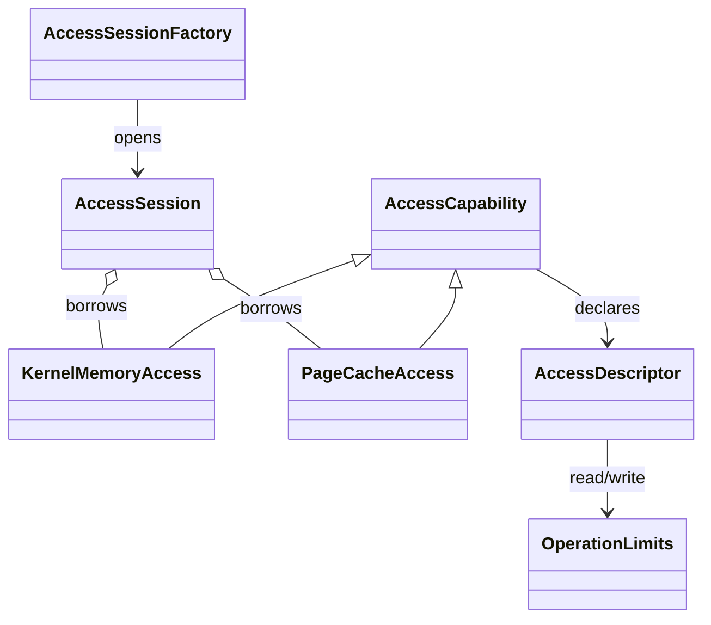

`AccessSession` 在 Kotlin 管生命周期；native backend 仍拥有 native 资源。`AccessDescriptor` 只发布本会话已建立的操作限制，不能由接口存在性推断读写已可用。

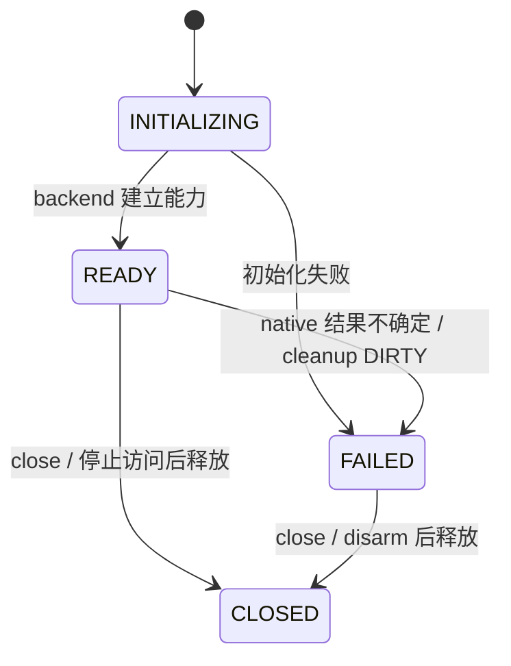

这张状态图仅描述新增 Kotlin 契约的允许迁移；实现、JNI 时序与设备结果仍由后续批次验证。

### 3.5 资产视图（**B1 起**）

| 类别 | 落点 | 描述什么 | 派生/权威 |
|---|---|---|---|
| **计划脚本资产** | `app/src/main/assets/plan/plan-<backend>-<route>.lua` | **顺序**（一个 (backend, route) 的执行顺序） | 每个**已接线** (backend, route) 一份；集合由 **`combination-manifest.tsv` 运行时副本 + `available=1` 去重派生**；`<route>` = manifest **route 列原值**，无 route 轴者写 **`none`** |
| **profile 资产** | `app/src/main/assets/profile/**` | **设备**（几何/偏移/调参/可用性） | 按设备档（`<uname-r>.conf` + `execution-*.conf` 等） |

- **两类资产分离**：前者描述**顺序**、后者描述**设备**（B1 方案 Q1 裁定）；两者**不得互相承载**（顺序不得藏进 profile、设备事实不得藏进 plan）。
- **当前实例（2026-10-08 实测 · kotlin-app）**：**`plan-cve_2026_43284-none.lua`**（43284 **无 route 轴** ⇒ manifest route 列写 `none`，共 3 行）+ 43499 的 3 条 route ⇒ **计划脚本资产共 4 份**（集合由运行时副本 + `available=1` 去重派生）。

## 4. Sequence（四张）

### 4.1 端到端（选菜单项 → 执行 → 收尾）

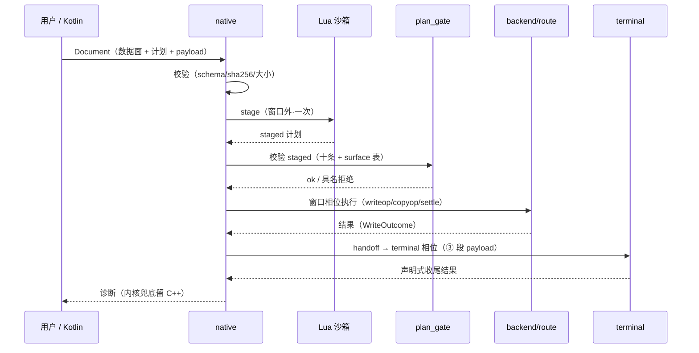

### 4.2 换路（方案 2：close + 重新 acquire）

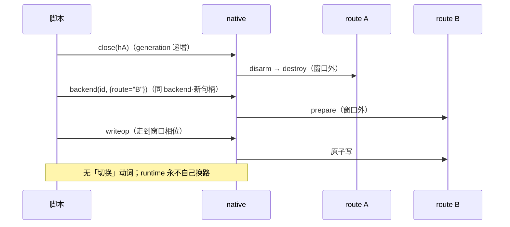

### 4.3 句柄冲突与陈旧

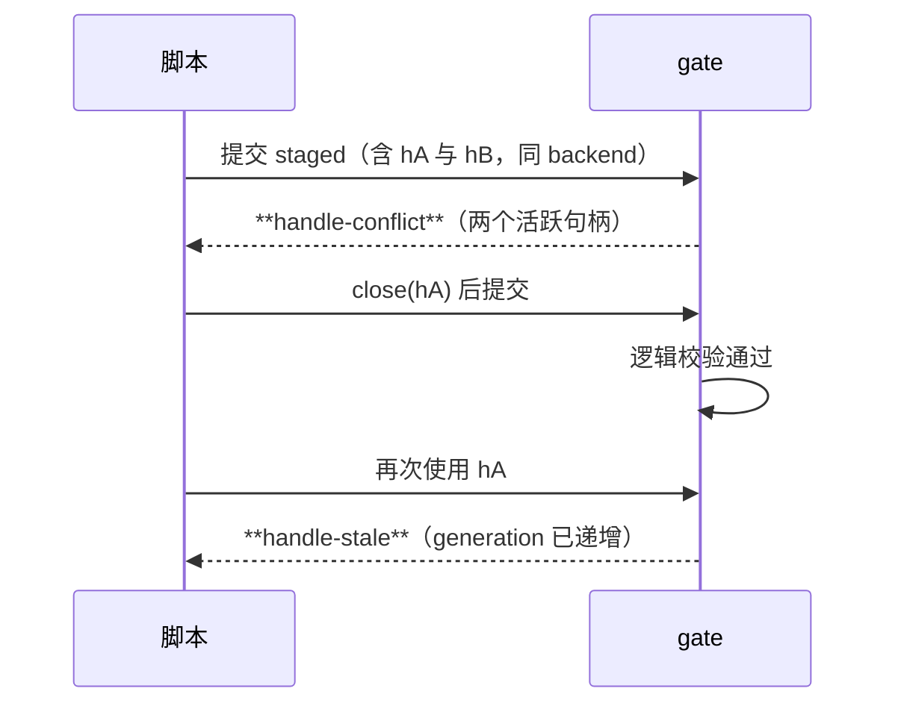

### 4.4 收尾 payload

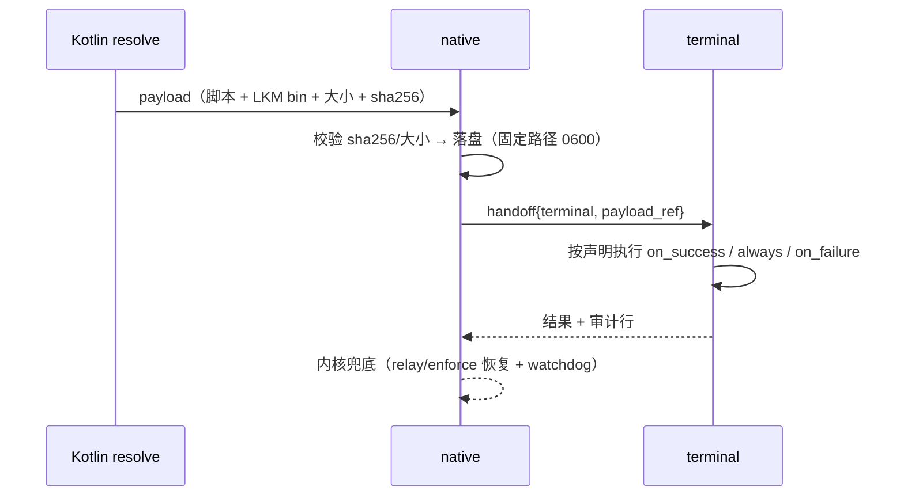

## 4.5 JNI 边界与 Kotlin 步骤（历史；批准后由 §11 取代）

> Round 13 已取代 J1–J7 的 `invoke(op, frame)`：每个 backend 一个 JNI 库，边界只接收普通 JVM
> 字段。D1 只完成参数定义、生成和读取器形状；真实 landing 装配属于 D2，Kotlin 高阶步骤适配属于 D3。

### 4.5.1 Class（边界两侧）

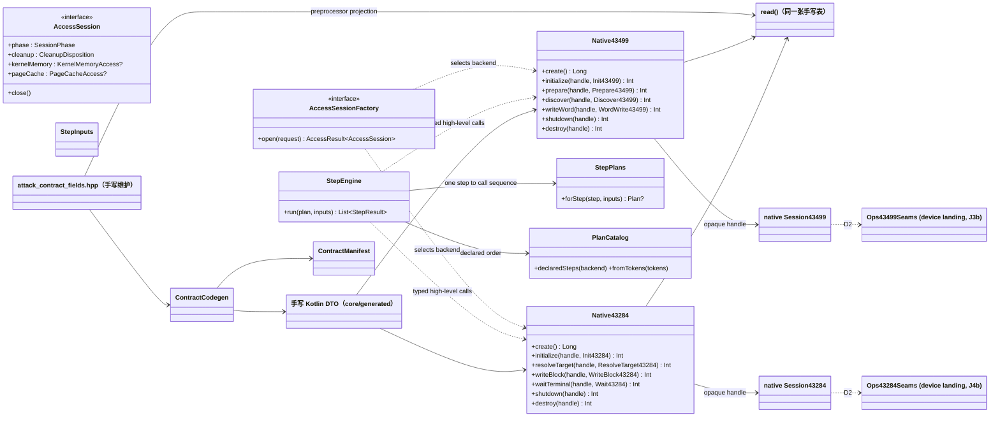

### 4.5.2 状态机（会话相位 + 一步的结局）

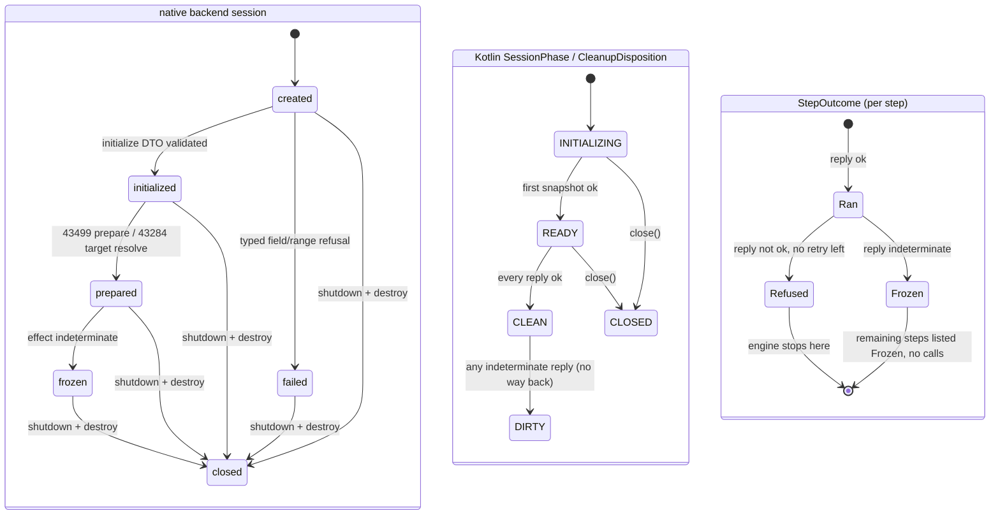

### 4.5.3 Sequence（一笔事务端到端 · 与设备门禁同路径）

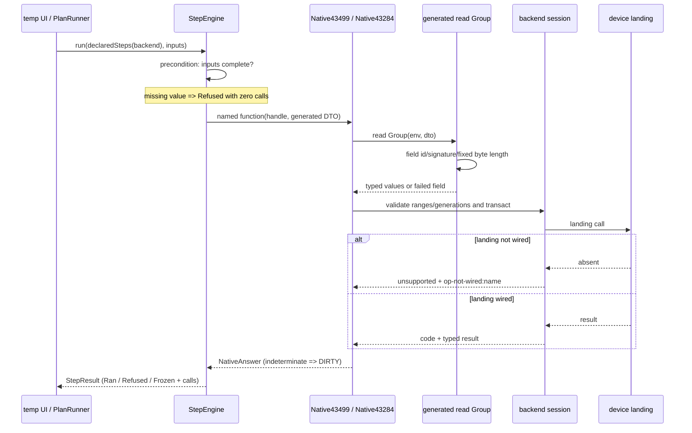

**门禁命令**：D1 = `./gradlew :nativeTestHost :app:testDebugUnitTest
:nativeBuildAndroid`；真机 =
./gradlew deviceGate（装 APK → 起临时界面 → 抓 logcat → 按 native 导出的 manifest **机器校验**）；
两者合起来 = ./gradlew gateAll。

## 5. Kotlin 侧链驱动器（2026-10-16 · 照 `ghostlock-app-ref@5f184760` 移植）

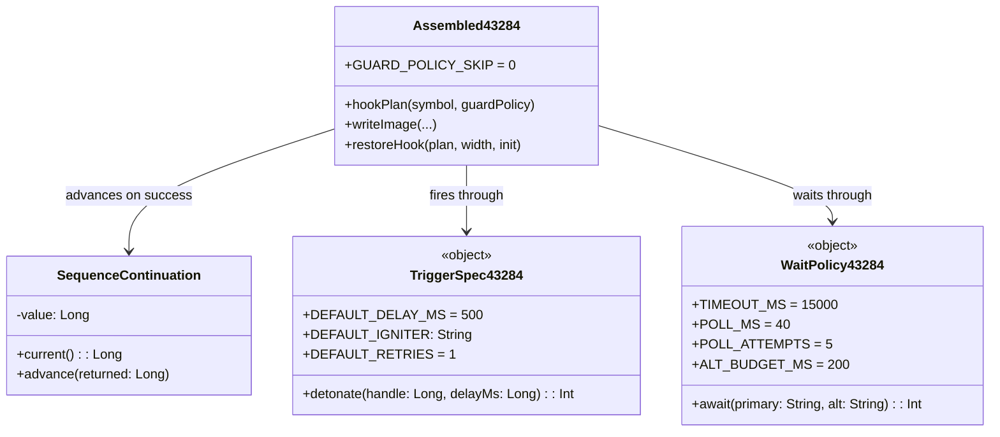

要点：`SequenceContinuation` 是**每次运行一个局部对象**（非全局）；三处写点成功后由 native 返回的序号推进，
日志固定 `seq: <prev> -> <next> (auto)`。`WaitPolicy43284` 先判可读标记（`.ghostlock_lkm_ok|fail`），
仍在飞再判 `/dev/dfm0|dfm1`，两者任一命中即终态。`TriggerSpec43284` 的 igniter 与延迟是**参数**，默认 500 ms。
`GUARD_POLICY_SKIP` 值仍为 0（`bti c` 下 Reject 挂不上钩），只是把裸 0 变成有名字的常量并在日志里打出 `guard=Skip`。

参照位置：`real_ops.cpp:250-257/307-327/339-344`（seq 交棒）、`cve_2026_43284_state.hpp:29-31` 与 `real_ops.cpp:405-415`（wait）、
`real_ops.cpp:355-379` 与 `execution_binding.cpp:170`（trigger）、`execution_binding.cpp:241`（guard）。

## 6. 维护约定

- **一处权威**：本文件是唯一权威 UML；其他文档**链接**本件，不重画同一结构。结构变化（新增/删除层、暴露面条目、拒绝码、相位）⇒ **同批**更新本件对应图。
- **引用**：`docs/analysis/adr/README.md` · `handoff-payload-batch-plan.md` · `contract-design.md` · `plugin-runtime-integration-design.md` · `root-manager-selection-design.md` · `docs/archive/*` · `engineering-rules.md` · `AGENTS.md`。
- **两条新纪律（同批留痕）**：本件任何**新条目/新相位/新实现层**必须同时满足 —— ① **无名字→值表**（名字只允许 **dispatch 标识符** 与 **数据面键路径**；见 [target 附件](../analysis/lua-surface-annex-target.md) §C1）· ② **表达一致**（同一件事只允许一种表达，不得「首设 A 语法 / 后续 B 语法」；见 [lua-surface-design](../archive/20261017-1835-lua-surface-design.md) 开头）。
- **沿革（2026-10-08 · 层族 10 → 9）**：**`race` 不再是层** —— `core/src/race/**`（5 文件）整体移入 **`backend/cve_2026_43499/race/`**，命名空间 `ghostlock::race` → `ghostlock::backend::cve_2026_43499::race`；`contract/layer_scope.hpp` 删 `race` 行（断言 10→**9**、7 保持），`settle` 的 `implements_layer` 由 `race` → **`backend`**。**理由 = 纠错**：PI-futex 是 **43499 专属**机制（43284 为 pagecache/UMH，不含 PI-futex），**旧树本就把 futex 机制放在 `backend/cve_2026_43499/leak/futex_hash.h`**；重写时错误地提为公共层，本次与 AGENTS「backend 按 CVE 分子命名空间」对齐。**守卫实证**：删层行而不改断言 ⇒ **四条 static_assert 同时失败**（`kLayerCount == 10` 与 surface 行指向不存在的层）⇒ 修正后才绿。
- **沿革（2026-10-14 · J1-J7）**：旧形状为四个 extern + GLKJ v1 帧；Round 13 已明确取代，历史实现仍在树中，删除归后续独立批次。
- **沿革（2026-10-14 · typed JNI / D1）**：4.5 改为每 backend 一个 JNI 库与具名函数；`attack_contract_fields.def` 单表投影 C++ 读取器、Kotlin DTO、TSV manifest，宿主逐字段哨兵与字段交换负例锁定顺序。D1 不宣称真实 landing 已接线。
- **历史**：旧实现 UML = [old-full-process-uml.md](old-full-process-uml.md)（归档头含理由与恢复来源；登记见 `docs/archive/INDEX-plans.md` §七）。

## 7. Access capability wrapper（历史；批准后由 §11 与 ADR-0022 决策4取代）

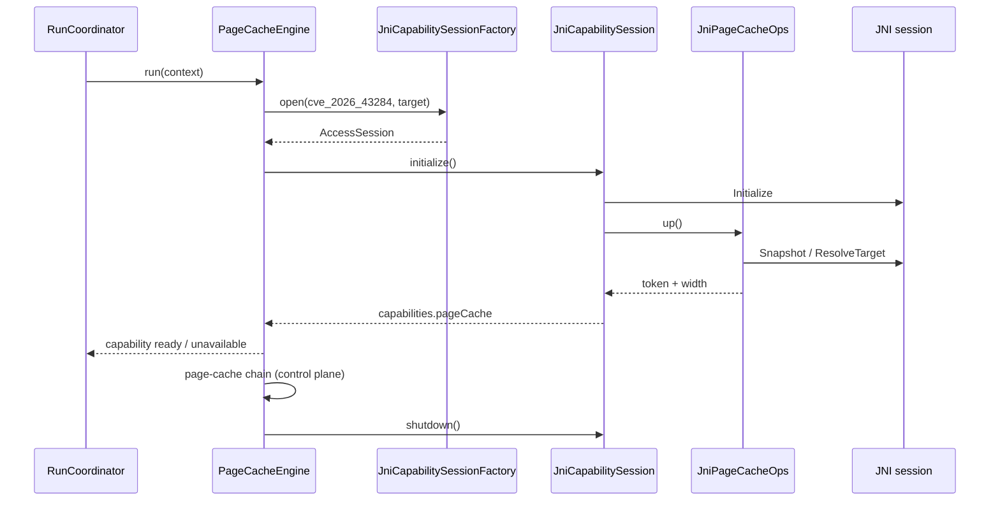

要点：描述符只从 native Snapshot 的 flags/width/generation 发布；没有 page-cache 标志时能力为 null；数据面 `PageCacheOps` 走 JNI 的
`ReadBlock`/`WriteBlock`，控制面（hook/trigger/wait/LKM）仍留在 backend 链中。日志经 `EngineLog`：info 无参数，warn/error 一个 reason，
debug/verbose 参数以 `\t` 分隔。
## 8. Kotlin 直写 / DFRoot 路径（2026-10-19）

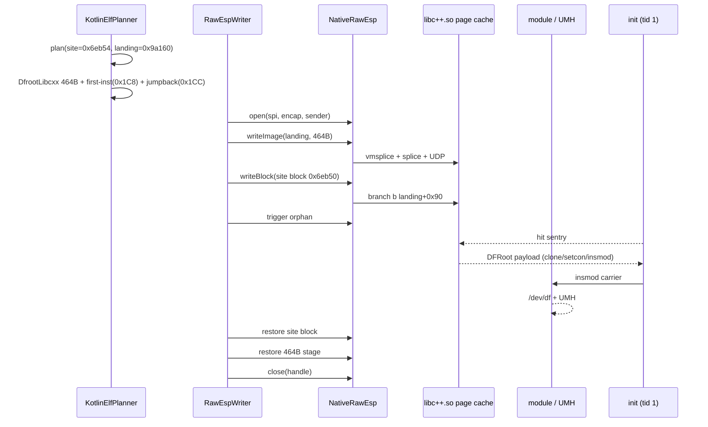

要点：Kotlin 负责 plan、IV/分块、first-inst/jumpback、恢复顺序；JNI 只做 syscall；页缓存目标由 Kotlin 直接指定，不经过 `PageCacheLanding`。

## 9. 执行层权威图（2026-10-21 · 指针，不复制）

> 本文件 §2.1「计划（脚本）生命周期」、§3 的 `script/` 面、§4.4 handoff 等章节属 **Lua/script 时代**（2026-10-17 已删除，见 MASTER-PLAN §0.1），保留作沿革，**不得作为现行结构依据**。
>
> 执行层的结构与状态机权威图已迁至 **`docs/plan/execution-architecture.md`**：
> - 组件图：`ExecutionEngine → BackendRun → PipelineEngine → node（Cve43499OpNode / Cve43284StageNode）` + 数据面 `AccessSession → capabilities`；
> - 状态机：`SessionPhase`（INITIALIZING/READY/FAILED/CLOSING/CLOSED）与 close/shutdown 互斥；
> - 决策记录：`docs/analysis/adr/0018-execution-authority.md`。
>
> 一处结构只留一处权威图 ⇒ 本文件不再复制这两张图，只保留指针。

## 10. 43499 C 核心会话骨架（历史；批准后由 §11 取代）

> 从属 [43499-43284-cpp-parameterization-plan.md](../plan/43499-43284-cpp-parameterization-plan.md) P1；P1a 只新增类型/句柄，旧全局仍在。证据 [p1a-session-skeleton.md](../analysis/p1a-session-skeleton.md)。非生产接线。

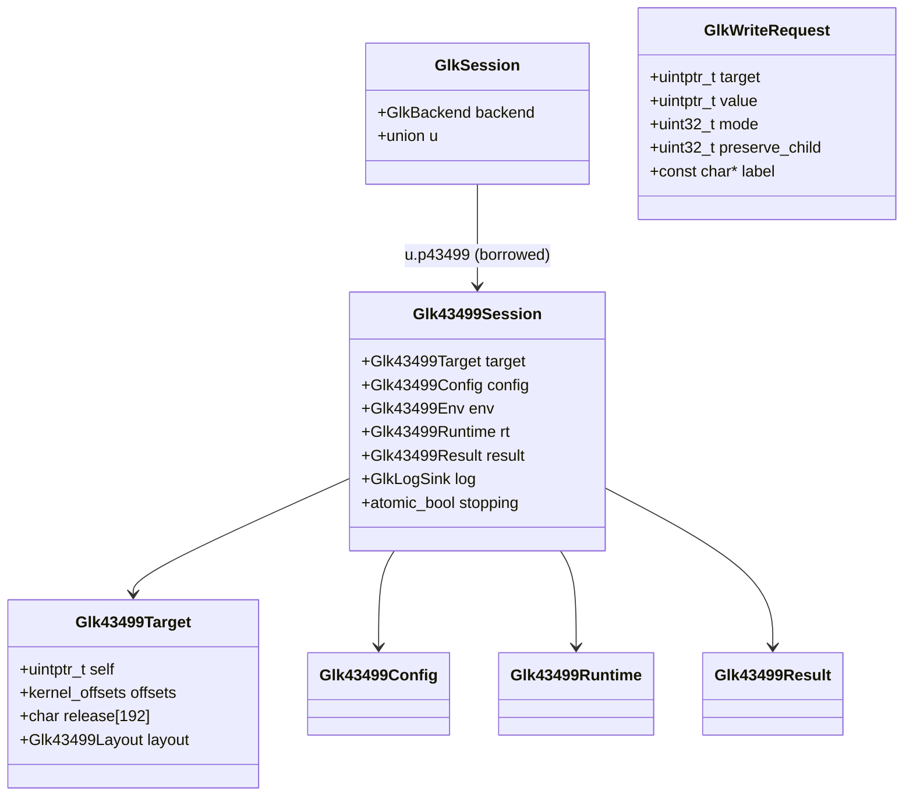

```text
GlkSession* (caller-owned; no process-wide handle)
caller owns Glk43499Session; destroy never frees it
```

## 11. 43499 Placement / Page / Actor 契约（2026-10-26 header-only）

> 头文件批见 [43499-c11-header-contract-plan](../plan/43499-c11-header-contract-plan.md)，JNI transport 见 [43499-jni-transport-plan](../plan/43499-jni-transport-plan.md)。当前 JNI 已接入九入口，但 core 仍是显式 `UNSUPPORTED` 的 unavailable 实现；victim/Finish 不在本批。

### 11.1 IPO / dependency

```mermaid
flowchart LR
  Lua[FlowLuaImpl + RunScope] --> K[Kotlin route/address/payload]
  UI[UI/default Flow] --> K
  K --> C[general JNI discovery]
  C -->|copied DTO| K
  K --> T[具名 Kotlin DTO]
  T --> B4[43499 JNI 显式逐字段翻译]
  B4 --> U[api_unavailable: UNSUPPORTED]
  K --> B2[43284 JNI]
  G[common STATIC] --> C
  G --> B4
  G --> B2
  K --> F[FinishExecution/script]
```

禁止边：general↔backend、backend↔backend。route 仅在 Kotlin/Lua。

### 11.2 Placement / Page / Actor state

```mermaid
stateDiagram-v2
  [*] --> Placement: preparePlacement transaction
  Placement --> Page: landPage CLEAN_SUCCESS; Placement stale
  Placement --> Placement: precommit NOT_APPLIED
  Placement --> Closed: close before commit
  Placement --> Quarantined: postcommit unknown

  Page --> Borrowed: prepareActor binds Primitive
  Borrowed --> Running: executeActor without tag/spec
  Running --> Borrowed: clean execution completed
  Borrowed --> Page: closeActor stop/disarm/join/release borrow
  Page --> Closed: closePage borrow=0
  Running --> Quarantined: reference state unknown
  Quarantined --> [*]: process exit only
```

Actor prepare 在创建线程前深拷贝 Primitive 并绑定具体 Carrier，同时对 Page 建 persistent borrow；仅 clean 在 stop/disarm/join 后解除。dirty 将 Actor、Carrier、Page 的完整依赖闭包一并 quarantine。

### 11.3 Class

```mermaid
classDiagram
  class RunResourceScope
  class NativeGeneralJni
  class Native43499Jni
  class Native43499NamedDtos
  class ApiUnavailable
  class Native43284Jni
  class DiscoveryHandle
  class PlacementHandle
  class PageHandle
  class ActorHandle
  class PrimitiveSpec
  class Carrier
  class AccessView
  RunResourceScope *-- DiscoveryHandle
  RunResourceScope *-- PlacementHandle
  RunResourceScope *-- PageHandle
  RunResourceScope *-- ActorHandle
  AccessView --> PageHandle : borrowed
  NativeGeneralJni --> DiscoveryHandle
  Native43499Jni --> PlacementHandle
  Native43499Jni --> PageHandle
  Native43499Jni --> ActorHandle
  Native43499NamedDtos --> Native43499Jni : explicit fields
  Native43499Jni --> ApiUnavailable : current fail-closed target
  PlacementHandle --> PageHandle : land consumes placement
  ActorHandle --> PageHandle : persistent borrow
  ActorHandle *-- Carrier : owns one bound carrier
  PrimitiveSpec --> Carrier : prepare-time deep copy
  AccessView ..> RunResourceScope : borrowed only
```

### 11.4 Sequence

```mermaid
sequenceDiagram
  participant K as Kotlin/Lua
  participant C as general JNI
  participant B as 43499 JNI
  K->>C: scan(params)
  C-->>K: copied candidates DTO
  K->>B: preparePlacement(physical request)
  alt current unavailable implementation
    B-->>K: UNSUPPORTED + handle 0; stop
  else future real core
    B-->>K: PlacementHandle + candidate facts
    K->>K: calculate addresses and final page bytes
    K->>B: landPage(placement, bytes, geometry)
    B-->>K: PageHandle; Placement stale
    K->>B: prepareActor(page, setup, PrimitiveSpec)
    B-->>K: ActorHandle; Page borrowed; Carrier bound
    K->>B: executeActor(actor)
    B-->>K: call status + effect + resource state + receipt
    K->>B: closeActor(actor)
    B-->>K: Page borrow released
    K->>B: closePage(page)
  end
```
