# 全流程 UML（**权威**）· 新架构（A0–A6）

<a id="run-current-views"></a>

> **代号与视图入口**：本页混合历次结构，A0–A6 与 §11.10 的旧 D7 属各自历史计划；Mermaid 内 D1/R1 等仅为节点变量。当前视图按[主计划语义映射](../plan/backend-root-execution-unification-plan.md#plan-semantic-identifiers)定位：[P-RUN-IO-001/批次01：脚本](#run-view-r2)、[P-RUN-X-001/批次01：执行主干](#run-view-r3)、[P-LOG-X-001/批次01：日志中枢](#run-view-r4c)、[P-BACKEND-X-001/来源S1：既有 common source](#run-view-r5)。原历史、状态和取代关系不变，来源S1不授权接回 carrier；wire 字段仍见 [P-RUN-IPC-001](../plan/backend-root-execution-runhost-wire.md#p-run-ipc-001)。

> 2026-10-23 JNI v4 已获用户“按照计划”批准：§11 取代旧的 route/JNI handle/Flow/Finish 局部图。

> **本文件是唯一权威 UML**（`docs/development/full-process-uml.md`）；旧的旧实现 UML 已归档为 [old-full-process-uml.md](old-full-process-uml.md)（**仅历史对照**，结构与本件不同）。
> 依据：`rewrite-plan-v2`（A0–A6）· `lua-surface-design`（暴露面 7 条）· `lua-surface-annex-document/-target/-route-switch` · ADR-0008/0009/0010 · `A6-baseline-approval`。日期 2026-10-08。

## 1. IPO（端到端，数据级）

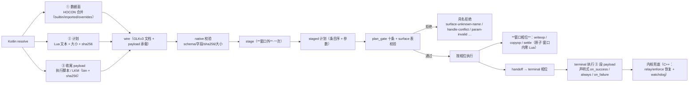

- **步骤顺序**：**声明顺序与执行顺序由 `static_assert` 绑定**（`contract/step_catalog.hpp` 的 `kStepSetOrders` 三条顺序 + 两个 `static_assert`）。
- **新入口（真机已验证 · A6-R1）**：**文档入 → 计划出 → 如实拒绝** —— `--ghostlock-app-call`（stdin，4 字节大端长度前缀）⇒ 文档解析 ⇒ **计划**（`plan chain=… steps=… source=queue`）⇒ 本树机制未实现 ⇒ **`executor-unavailable` / EXIT=4**（门禁记录：[a6-r1-document-to-plan-20261008-pass](../analysis/device-gates/a6-r1-document-to-plan-20261008-pass.md)）。
- **不变式**：脚本只在 **stage** 期运行（窗口外）；`writeop`/`copyop`/`settle` 由**实现层**在窗口相位执行；**`run` 不在暴露面**（收尾命令属 ③ 段）。

## 2. 状态机（四组）

### 2.1 计划（脚本）生命周期

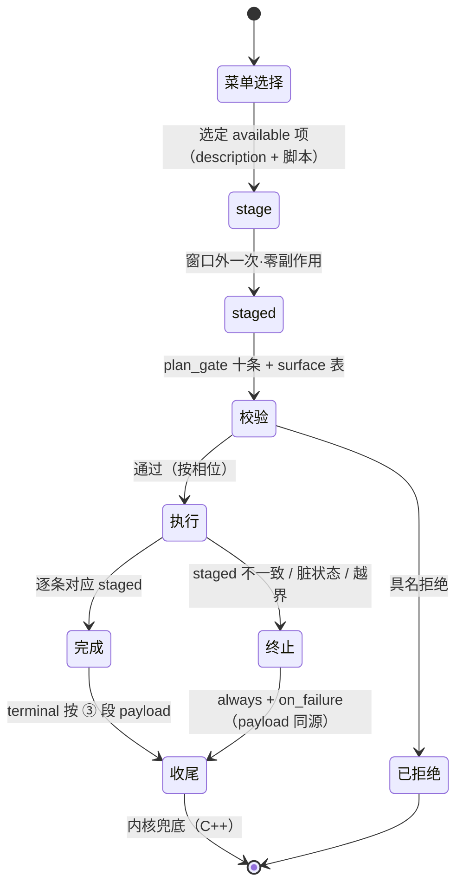

### 2.2 句柄生命周期（含换路与冲突）

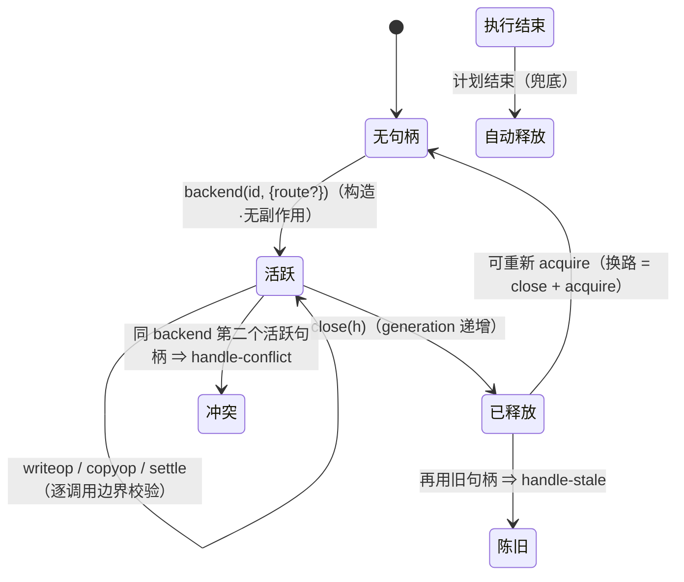

### 2.3 窗口状态机（PI 窗口）

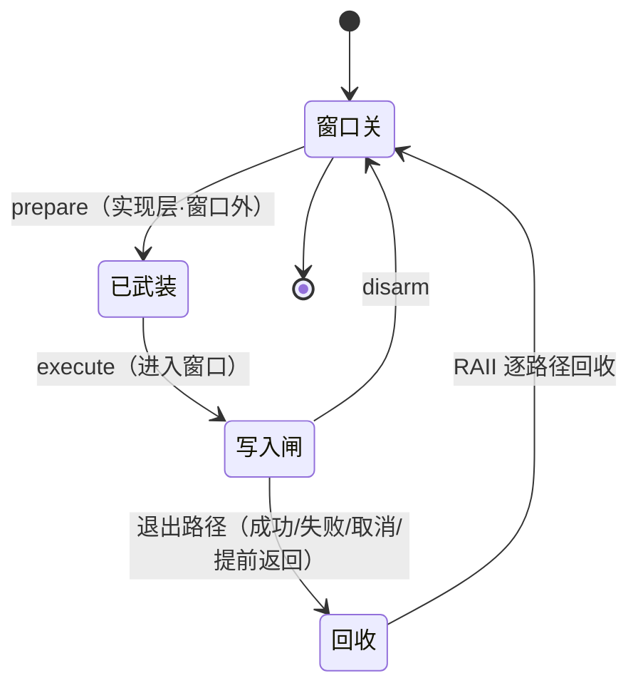

- **规则**：两条 route **不得同时在窗口内**（串行：先 disarm 再 prepare）；**窗口内零 Lua**。

### 2.4 terminal 状态机

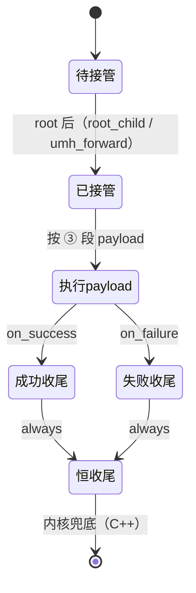

### 2.5 route 生命周期（**五态四步** · `backend/cve_2026_43499/route/lifecycle.hpp`）

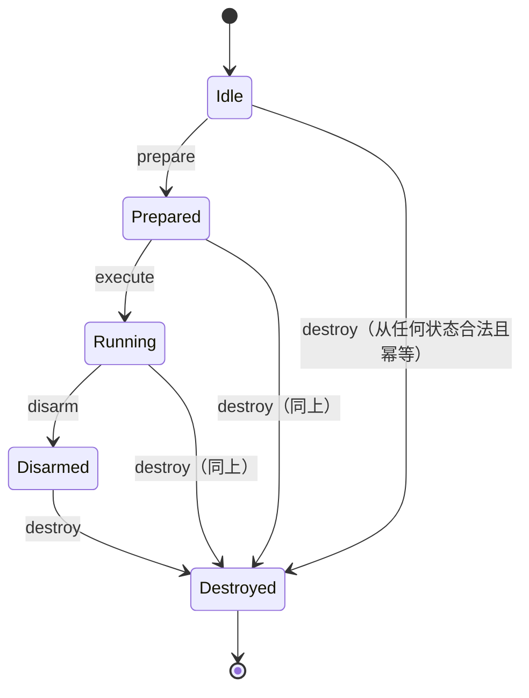

- **类型**：`enum class RouteStage`（Idle · Prepared · Running · Disarmed · Destroyed）· `enum class RouteStep`（prepare · execute · disarm · destroy）· `enum class LifecycleVerdict`（拒绝经 `status` 汇报）。
- **边注**：① **拒绝不改状态**（非法步序 ⇒ 拒绝并保持当前态）；② **`destroy` 从任何状态合法且幂等**。

## 3. Class（新树 **9 层** + 资源面 + 暴露面映射）

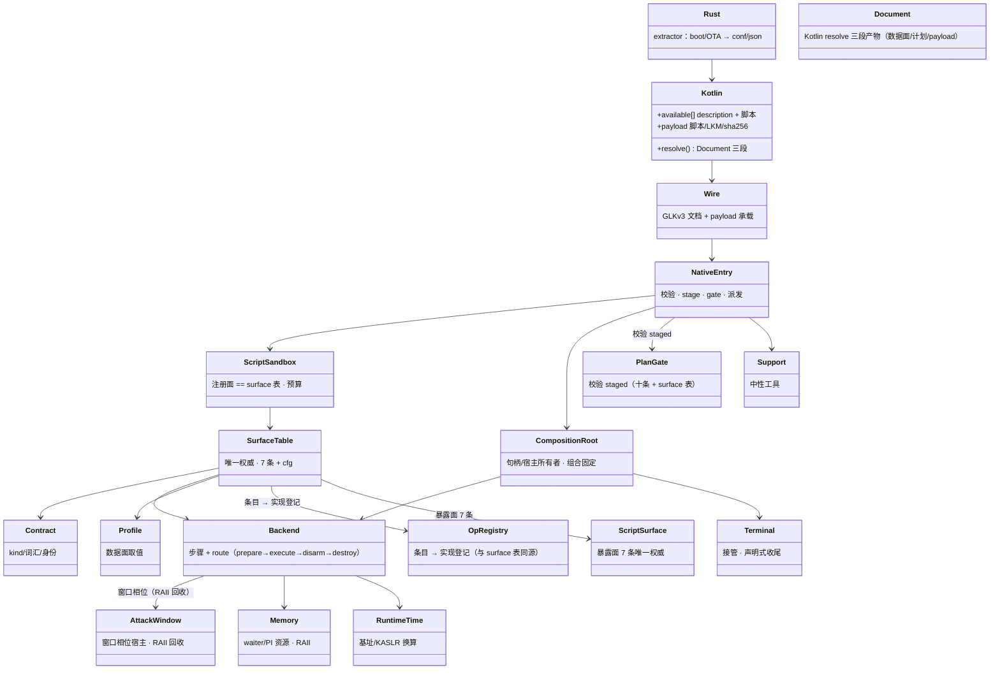

- **沿革（不删）**：旧树的 **`Pipeline` 类**（组合/分派层）**已删** —— 职责并入 **`CompositionRoot`**（接线）+ **`layer_scope`**（编译期校验）；本行即沿革记录（类图中已无该框）。

### 3.4 新树模块（A6-4 · A3 前置批次；**按 namespace 分组**）

| namespace | 件 | 主要声明（与代码一致） |
|---|---|---|
| **`profile`** | `glkv3_document.{hpp,cpp}` | `Document` · `DocumentVerdict`（`ok`/`document-invalid`/`payload-missing`）· `PayloadEntry` · `parse()` / `payload()` / `is_open()` / `reset()` |
| **`profile`** | `payload_keys.{hpp,cpp}` | 载荷四键（`.bin`/`.sha256`/`.size`/`.kind`）三 kind + `payload_segment` / `payload_path` / `payload_name_is_valid` / `payload_key_is_declared` |
| **`profile`** | `document_pairs.{hpp,cpp}` | `read_section_pairs` · `PairsVerdict` · `PairsResult` |
| **`memory`** | `write_request.hpp` | `WriteRequest` · `WriteMode` · `check_request` · `RequestVerdict` · `write_mode_of` / `write_mode_token` |
| **`memory`** | `write_encoder.{hpp,cpp}` | `WriteArm` · `WaiterFieldOffsets` · `arm_for` · `encode_waiter_arm` · `EncodeVerdict` |
| **`backend::cve_2026_43499::route`** | `lifecycle.hpp` | `RouteStage`（五态）· `RouteStep`（四步）· `LifecycleVerdict`（图见 §2.5） |
| **`contract`** | `step_catalog.hpp` | `StepId` · `StepEffect` · `kStepCatalog` · **`kStepSetOrders` 三条顺序** + **两个 `static_assert`** |

- **既有件核对（A6-4 三件 + profile 两件）**：`terminal/payload.hpp` · `terminal/payload_store.{hpp,cpp}` · `terminal/execution.{hpp,cpp}` · `memory/target_profile.hpp` · `profile/route_catalog.hpp` —— **均已在图/本表中在位** ✓。

### 3.0 新树模块锚点（A0–A6）

| 新树模块 | 层 | 在本件的位置 |
|---|---|---|
| **`AttackWindow`** | 窗口宿主（窗口相位） | §1 窗口相位 · §2.3 窗口状态机 · §4.1 |
| **`OpRegistry`** | 操作面（暴露面条目的实现登记，与 surface 表同源） | §3 SurfaceTable→实现层 · §3.1 |
| **`script_surface`** | 契约层暴露面（**7 条 + `cfg`**） | §3 SurfaceTable · §3.1 |
| **`plan_gate`** | 校验（校验对象 = staged） | §2.1 · §4.1 · §4.3 |
| **`Document` 三段** | Kotlin resolve 产物 | §1 · §4.4 |

- **职责权威 = 类图**（§3 的 class 框）；本表仅为**定位索引**（模块 → 本件章节），**不构成第二处权威**。

### 3.1 暴露面 7 条 → 实现层

| 条目 | 实现层 | 相位 | 备注 |
|---|---|---|---|
| `backend(id, {route?})` | **`backend`**（构造经组合根/目录校验） | 窗口外 | **构造 = 无副作用的选择** |
| `close(h)` | **`session`**（句柄表；构造经组合根/目录校验） | 窗口外 | generation 递增；旧句柄 ⇒ `handle-stale` |
| `b:writeop{target={kind,value}, value, width}` | **`backend`**（route/step 为其内部） | 窗口相位 | **kind = 机制枚举**，value 来自 `cfg` |
| `b:copyop{src,dst={kind,value}, width}` | **`backend`**（route/step 为其内部） | 窗口相位 | 结构复制（宽度 = profile 声明尺寸） |
| `b:settle{us}` | **`backend`**（**2026-10-08 更正**：`race` 不再成层，PI-futex 机制并入 `backend/cve_2026_43499/race/`；代码权威 `contract/script_surface.hpp` 的 `implements_layer`） | 窗口相位 | 参数化（不得 C++ 兜底） |
| `b:handoff{terminal, payload_ref}` | **`terminal`** | 窗口外→terminal | **引用语义**（命令内容属 ③ 段） |
| `cfg`（只读快照） | **`profile`**（快照注入） | stage 前 | 只读；不属句柄面 |

- **口径（实现层）**：**实现层 = `contract::kLayers` 的层名**（**9 层**：`contract` · `support` · `memory` · `backend` · `pipeline` · `terminal` · `script` · `session` · `profile`）；**机器可校验**（`script_surface.hpp` 的 `implements_layer` 与 `:305` 断言）；**不得用描述性短语** —— 「**表达一致**」的一个实例。

#### 3.1.1 manifest 原文（**派生源**；`make -C core surface-manifest` 生成，19 行逐字节）

```tsv
backend	call	backend	pre_window	true	true	false	-	-	-
writeop	handle_method	backend	window	false	true	true	handle	true	18446744073709551615
writeop	handle_method	backend	window	false	true	true	target_kind	true	64
writeop	handle_method	backend	window	false	true	true	target_value	true	18446744073709551615
writeop	handle_method	backend	window	false	true	true	value	true	18446744073709551615
writeop	handle_method	backend	window	false	true	true	width	true	8
copyop	handle_method	backend	window	false	true	true	handle	true	18446744073709551615
copyop	handle_method	backend	window	false	true	true	src_kind	true	64
copyop	handle_method	backend	window	false	true	true	src_value	true	18446744073709551615
copyop	handle_method	backend	window	false	true	true	dst_kind	true	64
copyop	handle_method	backend	window	false	true	true	dst_value	true	18446744073709551615
copyop	handle_method	backend	window	false	true	true	width	true	8
settle	handle_method	backend	window	false	true	true	handle	true	18446744073709551615
settle	handle_method	backend	window	false	true	true	us	true	1000000
handoff	handle_method	terminal	terminal	true	true	true	handle	true	18446744073709551615
handoff	handle_method	terminal	terminal	true	true	true	terminal	true	256
handoff	handle_method	terminal	terminal	true	true	true	payload_ref	true	256
cfg	value	profile	stage	false	true	false	-	-	-
close	handle_method	session	pre_window	false	true	true	handle	true	18446744073709551615
kernelcall	handle_method	backend	window	false	true	true	handle	true	18446744073709551615
kernelcall	handle_method	backend	window	false	true	true	op	true	64
kernelcall	handle_method	backend	window	false	true	true	target_kind	true	64
kernelcall	handle_method	backend	window	false	true	true	target_value	true	18446744073709551615
kernelcall	handle_method	backend	window	false	true	true	value	true	18446744073709551615
kernelcall	handle_method	backend	window	false	true	true	width	true	8
step	handle_method	backend	window	false	true	true	handle	true	18446744073709551615
step	handle_method	backend	window	false	true	true	name	true	64
log	call	backend	stage	false	true	true	level	true	16
log	call	backend	stage	false	true	true	key	true	256
```

- **断言**：本表与 manifest **逐项一致**（`make -C core surface-doc-check DOC=docs/development/full-process-uml.md` ⇒ **EXIT=0**）；**pin** = `core/src/tests/surface_manifest_test.cpp`（19 行）。
- **口径**：上表（§3.1）为阅读视图；**权威 = manifest**（列 = 条目 · 形态 · 实现层 · **phase** · … · 参数名 · 必填 · 上界）。

### 3.2 拒绝码（**唯一完整表**；其余文档只留指针）

| 码 | 触发 | 来源/备注 |
|---|---|---|
| **`surface-unknown-name`** | **表外名字**（默认拒绝，不做近似匹配） | `script_surface.hpp` 的 `SurfaceLookup::UnknownSymbol` ⇒ ****已对齐**（`script_surface.hpp:322` 返回 `surface-unknown-name`；断言 `lookup_refusal_is_pinned()` `:545-547` 钉住）** |
| `surface-unknown-token` | 目录/terminal token 不在词表 | catalog / surface |
| **`handle-conflict`** | 同 backend **两个活跃句柄** | gate（校验 staged） |
| **`handle-stale`** | 使用**已释放/陈旧**句柄（generation 已递增） | 句柄表 · ADR-0010 |
| `param-invalid` | 参数越界（`us`/`width`/`value`） | 边界校验 |
| `param-missing` | 脚本调用**缺参**（`width` **必填**） | 边界校验 |
| `width-mismatch` | `copyop` 宽度 ≠ profile 声明尺寸 | 边界校验 |
| `geometry-missing` | 数据面缺**几何/偏移** | profile 取值 |
| **`tuning-missing`** | 调参键**缺失**（不兜底，见 [a3-tuning-migration](../analysis/a3-tuning-migration.md) §3） | profile 取值 |
| `cfg-unknown-field` | `cfg` 字段不在 manifest 声明集合 | profile 快照 |
| `budget-exceeded` | 超**指令/内存/规模**预算 | 沙箱 |
| `op-not-available` / `backend-not-available` | 可用性门禁（`available=false`） | gate |
| `executor-unavailable` | terminal 执行器不可用 | gate |
| `payload-missing` | `handoff` 的 `payload_ref` 无交付物/校验失败 | handoff 校验 |
| `plan-missing` | 计划为空（无 staged 产物） | gate |
| **`document-invalid`** | **文档不是本构建读的那种**：`schema != kDocumentSchema(=3)`（`profile/glkv3_document.hpp:24`）· 字节非 MessagePack（解析失败）· **未解析就读取** | `glkv3_document.hpp` 的 `DocumentVerdict::Invalid`（`:35-39`，三值 = `ok`/`document-invalid`/`payload-missing`）；测试 `tests/document_reader_test.cpp` |
| **`unknown-op`**（`plan_gate`） | 未知 op token | plan_gate |
| **`route-not-available`**（`plan_gate`） | 该 route 不可用（未接线/未声明） | plan_gate |
| **`capability-missing`**（`plan_gate`） | 能力缺失（所需能力未授予） | plan_gate |
| **`order-violation`**（`plan_gate`） | 步骤**顺序违规** | plan_gate |
| **`hash-mismatch`**（`plan_gate`） | **冻结哈希不符**（payload/计划冻结值） | plan_gate |
| **`landing-in-pi-window`**（`plan_gate`） | **接缝落在 PI 窗口内**（R1） | plan_gate |
| **`target-kind-invalid`** | `writeop`/`copyop` 的 `kind` 不在机制枚举内 | **脚本/代码侧**（边界校验） |
| **`queue-removed`** | 出现 M5 已退役的 `queue`/token 形态 | **plan_gate** |
| **`plan-syntax`** | 脚本**语法错**（装载/stage 期解析失败） | **装载/stage 期** |
| ~~`run-form-invalid`~~ | **作废**（`run` 已移除；双形态校验不存在） | 沿革保留 |

- **判据（**可失败**）**：『**在用码集合 == 冻结清单**』——① 从**代码**（`script_surface.hpp`/`op_registry.hpp`/gate 实现）提取全部拒绝码字面量；② 与本表逐项比对；③ **多一个或少一个都 FAIL**（多 ⇒ 未登记码；少 ⇒ 表内陈码）。**首次执行前须先完成上表首行的代码改名**（否则必然差一项：`unknown-symbol` vs `surface-unknown-name`）。

- **可执行验收（提取源写死）**：对 **`core/src/contract/script_surface.hpp`** · **`core/src/pipeline/plan_gate.hpp`** · **`core/src/profile/glkv3_document.hpp`**（`DocumentVerdict`：`document-invalid`/`payload-missing`）做「`return` + 引号内字面量」**去重提取**（**兜底串单列**）⇒ 与本表**逐项比对**，**多一少一皆 FAIL**。

- **冻结清单的导出口径（2026-10-08 补）**：冻结集合 = **『代码在用码』∪『设计/plan_gate/装载在用码』** —— **surface 側代码 5 个**（`surface-unknown-name` · **`target-kind-invalid`** · `width-mismatch` · `handle-conflict` · `handle-stale`）；**gate 侧提取源 = `core/src/pipeline/plan_gate.hpp` 的 `gate_reason_name()`（`:47+`，与 `GateReason` `:30-44` 一一对应）** = `ok` · **`unknown-op`** · `op-not-available` · **`route-not-available`** · `geometry-missing` · **`capability-missing`** · **`order-violation`** · **`hash-mismatch`** · `param-invalid` · **`landing-in-pi-window`** · `executor-unavailable` · `queue-removed` · `plan-missing`（**另有兜底串 `unknown`**：正常路径不应出现，**若可触达须单独登记**）；设计/装载侧补 **`queue-removed`**（M5 退役）· **`plan-syntax`**（装载/stage）· `surface-unknown-token` · `param-*` · `geometry-missing` · `tuning-missing` · `cfg-unknown-field` · `budget-exceeded` · `op/backend-not-available` · `executor-unavailable` · `payload-missing` · `plan-missing`；**已作废码单列**（~~`run-form-invalid`~~）。**本表自身即来源登记**，新增码须同时改代码与 `plan_gate` 并登记于此。

- **指针**：条目级拒绝码散见 [lua-surface-design](../archive/20261017-1835-lua-surface-design.md) §1 与附件；**完整集合以本表为准**，其他处不另立清单（「表达一致」）。

### 3.3 Kotlin / Rust 位置

| 件 | 位置 | 职责 |
|---|---|---|
| Kotlin | `app/` + `profile-core/` | HOCON 解析/合并/覆盖 · `resolve`（Document 三段）· payload 生成 |
| Rust | `tools/extract_rs/` | boot.img / OTA → profile（`--format conf` / `json`） |

**Kotlin 能力契约（2026-10-14，接口已编译；backend 尚未接线）**：

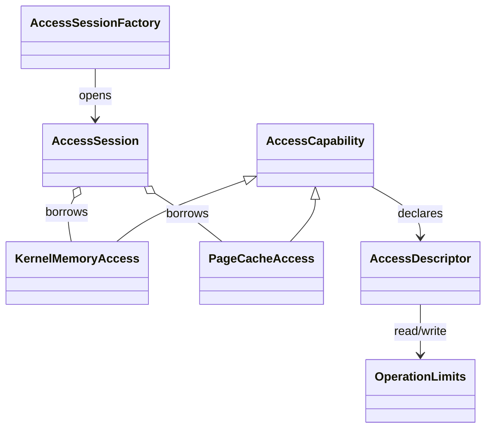

`AccessSession` 在 Kotlin 管生命周期；native backend 仍拥有 native 资源。`AccessDescriptor` 只发布本会话已建立的操作限制，不能由接口存在性推断读写已可用。

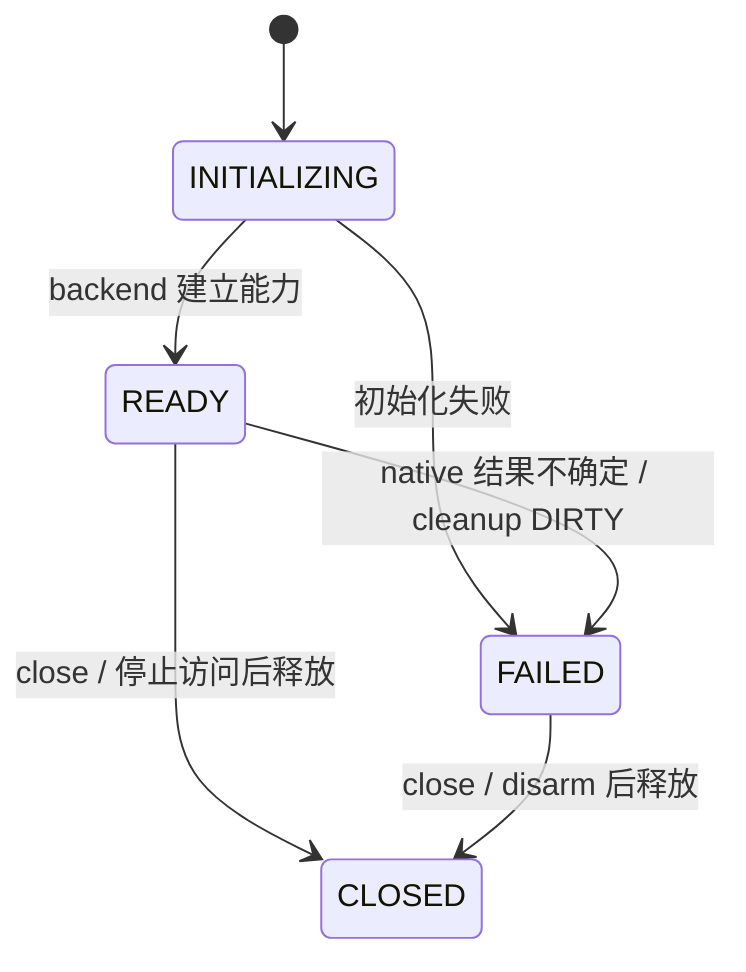

这张状态图仅描述新增 Kotlin 契约的允许迁移；实现、JNI 时序与设备结果仍由后续批次验证。

### 3.5 资产视图（**B1 起**）

| 类别 | 落点 | 描述什么 | 派生/权威 |
|---|---|---|---|
| **计划脚本资产** | `app/src/main/assets/plan/plan-<backend>-<route>.lua` | **顺序**（一个 (backend, route) 的执行顺序） | 每个**已接线** (backend, route) 一份；集合由 **`combination-manifest.tsv` 运行时副本 + `available=1` 去重派生**；`<route>` = manifest **route 列原值**，无 route 轴者写 **`none`** |
| **profile 资产** | `app/src/main/assets/profile/**` | **设备**（几何/偏移/调参/可用性） | 按设备档（`<uname-r>.conf` + `execution-*.conf` 等） |

- **两类资产分离**：前者描述**顺序**、后者描述**设备**（B1 方案 Q1 裁定）；两者**不得互相承载**（顺序不得藏进 profile、设备事实不得藏进 plan）。
- **当前实例（2026-10-08 实测 · kotlin-app）**：**`plan-cve_2026_43284-none.lua`**（43284 **无 route 轴** ⇒ manifest route 列写 `none`，共 3 行）+ 43499 的 3 条 route ⇒ **计划脚本资产共 4 份**（集合由运行时副本 + `available=1` 去重派生）。

## 4. Sequence（四张）

### 4.1 端到端（选菜单项 → 执行 → 收尾）

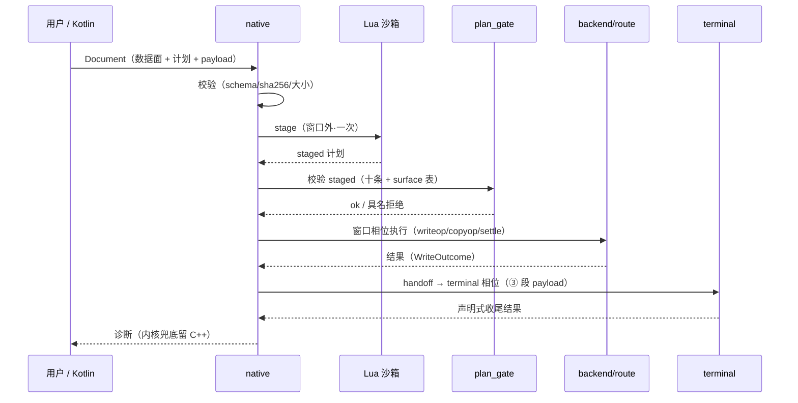

### 4.2 换路（方案 2：close + 重新 acquire）

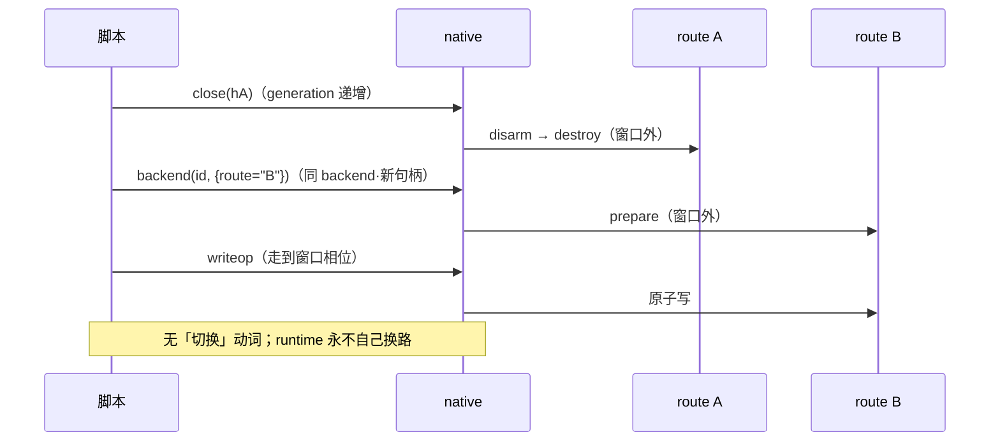

### 4.3 句柄冲突与陈旧

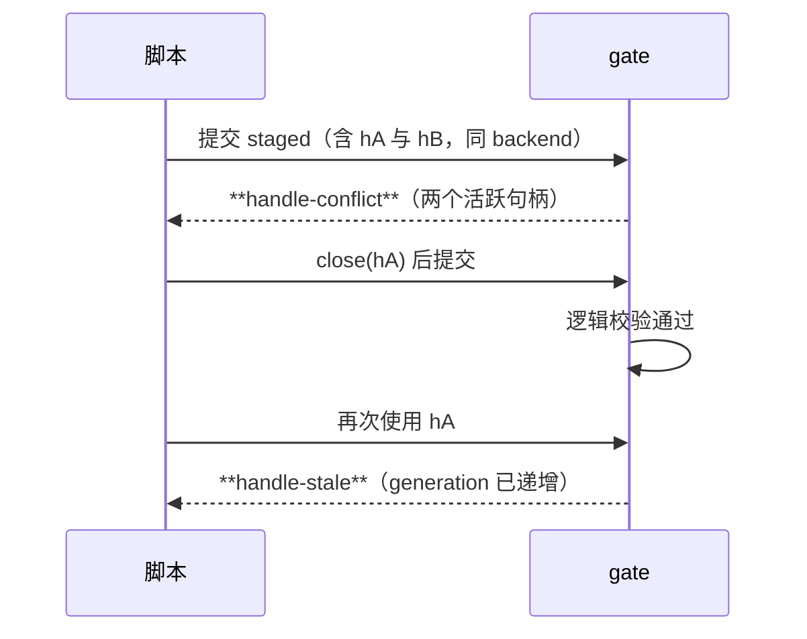

### 4.4 收尾 payload

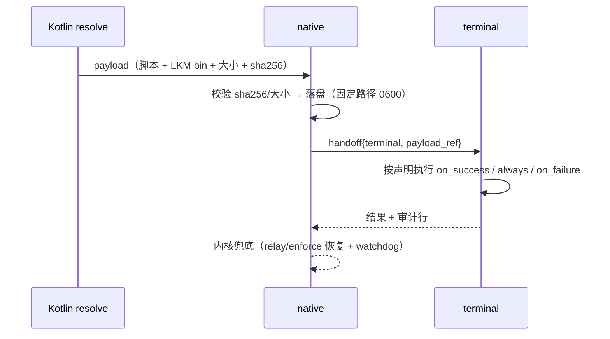

## 4.5 JNI 边界与 Kotlin 步骤（历史；批准后由 §11 取代）

> Round 13 已取代 J1–J7 的 `invoke(op, frame)`：每个 backend 一个 JNI 库，边界只接收普通 JVM
> 字段。D1 只完成参数定义、生成和读取器形状；真实 landing 装配属于 D2，Kotlin 高阶步骤适配属于 D3。

### 4.5.1 Class（边界两侧）

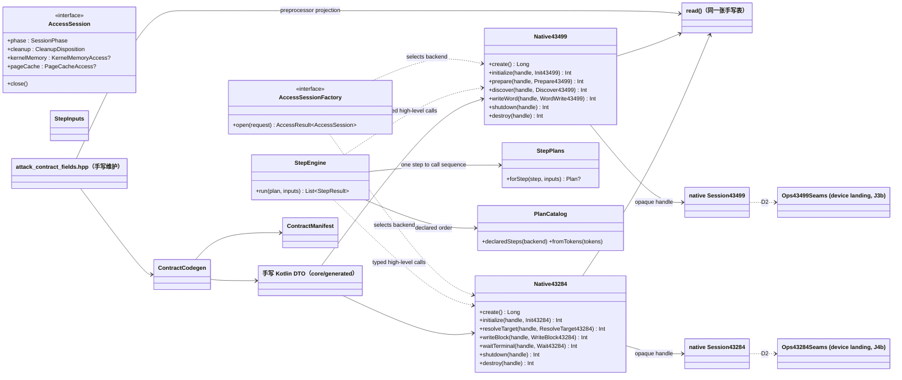

### 4.5.2 状态机（会话相位 + 一步的结局）

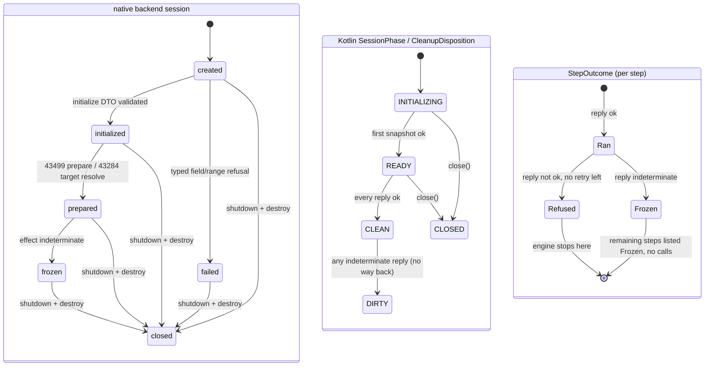

### 4.5.3 Sequence（一笔事务端到端 · 与设备门禁同路径）

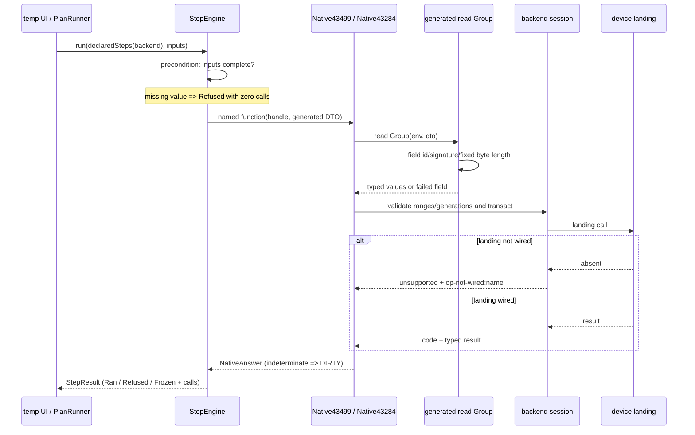

**门禁命令**：D1 = `./gradlew :nativeTestHost :app:testDebugUnitTest
:nativeBuildAndroid`；真机 =
./gradlew deviceGate（装 APK → 起临时界面 → 抓 logcat → 按 native 导出的 manifest **机器校验**）；
两者合起来 = ./gradlew gateAll。

## 5. Kotlin 侧链驱动器（2026-10-16 · 照 `ghostlock-app-ref@5f184760` 移植）

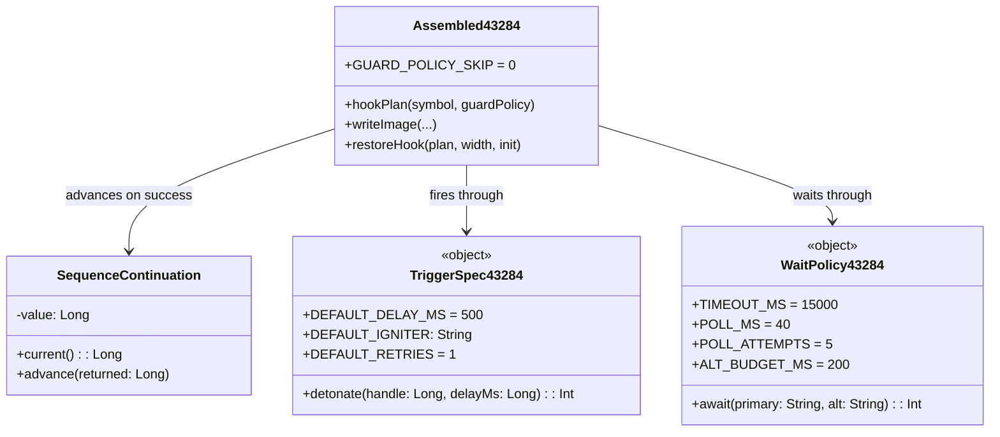

要点：`SequenceContinuation` 是**每次运行一个局部对象**（非全局）；三处写点成功后由 native 返回的序号推进，
日志固定 `seq: <prev> -> <next> (auto)`。`WaitPolicy43284` 先判可读标记（`.ghostlock_lkm_ok|fail`），
仍在飞再判 `/dev/dfm0|dfm1`，两者任一命中即终态。`TriggerSpec43284` 的 igniter 与延迟是**参数**，默认 500 ms。
`GUARD_POLICY_SKIP` 值仍为 0（`bti c` 下 Reject 挂不上钩），只是把裸 0 变成有名字的常量并在日志里打出 `guard=Skip`。

参照位置：`real_ops.cpp:250-257/307-327/339-344`（seq 交棒）、`cve_2026_43284_state.hpp:29-31` 与 `real_ops.cpp:405-415`（wait）、
`real_ops.cpp:355-379` 与 `execution_binding.cpp:170`（trigger）、`execution_binding.cpp:241`（guard）。

## 6. 维护约定

- **一处权威**：本文件是唯一权威 UML；其他文档**链接**本件，不重画同一结构。结构变化（新增/删除层、暴露面条目、拒绝码、相位）⇒ **同批**更新本件对应图。
- **引用**：`docs/analysis/adr/README.md` · `handoff-payload-batch-plan.md` · `contract-design.md` · `plugin-runtime-integration-design.md` · `root-manager-selection-design.md` · `docs/archive/*` · `engineering-rules.md` · `AGENTS.md`。
- **两条新纪律（同批留痕）**：本件任何**新条目/新相位/新实现层**必须同时满足 —— ① **无名字→值表**（名字只允许 **dispatch 标识符** 与 **数据面键路径**；见 [target 附件](../analysis/lua-surface-annex-target.md) §C1）· ② **表达一致**（同一件事只允许一种表达，不得「首设 A 语法 / 后续 B 语法」；见 [lua-surface-design](../archive/20261017-1835-lua-surface-design.md) 开头）。
- **沿革（2026-10-08 · 层族 10 → 9）**：**`race` 不再是层** —— `core/src/race/**`（5 文件）整体移入 **`backend/cve_2026_43499/race/`**，命名空间 `ghostlock::race` → `ghostlock::backend::cve_2026_43499::race`；`contract/layer_scope.hpp` 删 `race` 行（断言 10→**9**、7 保持），`settle` 的 `implements_layer` 由 `race` → **`backend`**。**理由 = 纠错**：PI-futex 是 **43499 专属**机制（43284 为 pagecache/UMH，不含 PI-futex），**旧树本就把 futex 机制放在 `backend/cve_2026_43499/leak/futex_hash.h`**；重写时错误地提为公共层，本次与 AGENTS「backend 按 CVE 分子命名空间」对齐。**守卫实证**：删层行而不改断言 ⇒ **四条 static_assert 同时失败**（`kLayerCount == 10` 与 surface 行指向不存在的层）⇒ 修正后才绿。
- **沿革（2026-10-14 · J1-J7）**：旧形状为四个 extern + GLKJ v1 帧；Round 13 已明确取代，历史实现仍在树中，删除归后续独立批次。
- **沿革（2026-10-14 · typed JNI / D1）**：4.5 改为每 backend 一个 JNI 库与具名函数；`attack_contract_fields.def` 单表投影 C++ 读取器、Kotlin DTO、TSV manifest，宿主逐字段哨兵与字段交换负例锁定顺序。D1 不宣称真实 landing 已接线。
- **历史**：旧实现 UML = [old-full-process-uml.md](old-full-process-uml.md)（归档头含理由与恢复来源；登记见 `docs/archive/INDEX-plans.md` §七）。

## 7. Access capability wrapper（历史；批准后由 §11 与 ADR-0022 决策4取代）

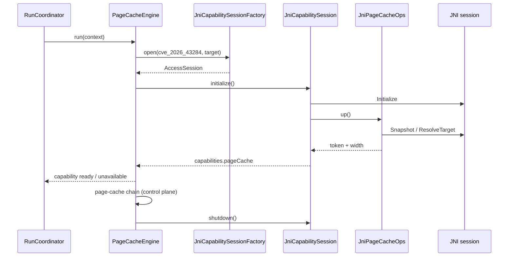

要点：描述符只从 native Snapshot 的 flags/width/generation 发布；没有 page-cache 标志时能力为 null；数据面 `PageCacheOps` 走 JNI 的
`ReadBlock`/`WriteBlock`，控制面（hook/trigger/wait/LKM）仍留在 backend 链中。日志经 `EngineLog`：info 无参数，warn/error 一个 reason，
debug/verbose 参数以 `\t` 分隔。
## 8. Kotlin 直写 / DFRoot 路径（2026-10-19）

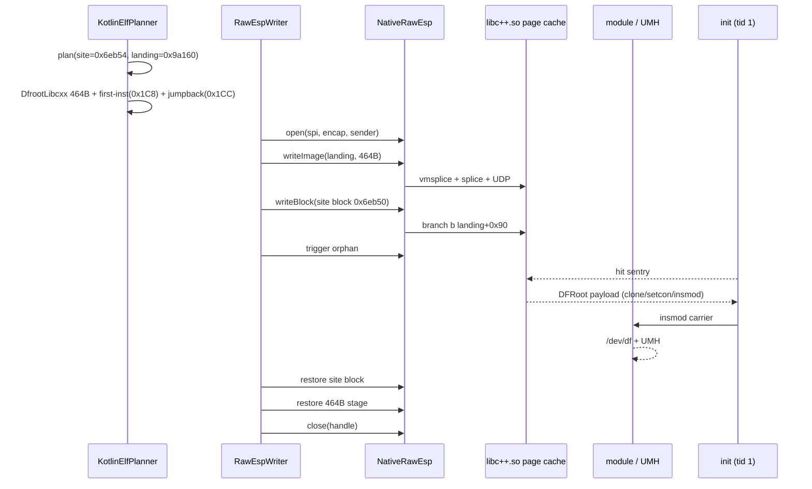

要点：Kotlin 负责 plan、IV/分块、first-inst/jumpback、恢复顺序；JNI 只做 syscall；页缓存目标由 Kotlin 直接指定，不经过 `PageCacheLanding`。

## 9. 执行层权威图（2026-10-21 · 指针，不复制）

> 本文件 §2.1「计划（脚本）生命周期」、§3 的 `script/` 面、§4.4 handoff 等章节属 **Lua/script 时代**（2026-10-17 已删除，见 MASTER-PLAN §0.1），保留作沿革，**不得作为现行结构依据**。
>
> 执行层的结构与状态机权威图已迁至 **`docs/plan/execution-architecture.md`**：
> - 组件图：`ExecutionEngine → BackendRun → PipelineEngine → node（Cve43499OpNode / Cve43284StageNode）` + 数据面 `AccessSession → capabilities`；
> - 状态机：`SessionPhase`（INITIALIZING/READY/FAILED/CLOSING/CLOSED）与 close/shutdown 互斥；
> - 决策记录：`docs/analysis/adr/0018-execution-authority.md`。
>
> 一处结构只留一处权威图 ⇒ 本文件不再复制这两张图，只保留指针。

## 10. 43499 C 核心会话骨架（历史；批准后由 §11 取代）

> 从属 [43499-43284-cpp-parameterization-plan.md](../archive/20261104-2030-43499-43284-cpp-parameterization-plan.md) P1；P1a 只新增类型/句柄，旧全局仍在。证据 [p1a-session-skeleton.md](../analysis/p1a-session-skeleton.md)。非生产接线。

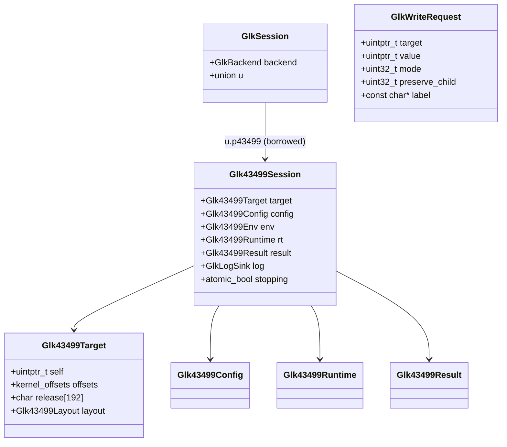

```text
GlkSession* (caller-owned; no process-wide handle)
caller owns Glk43499Session; destroy never frees it
```

## 11. 43499 Placement / Page / Actor 契约（2026-10-26 header-only）

> 头文件批见 [43499-c11-header-contract-plan](../archive/20261104-2030-43499-c11-header-contract-plan.md)，JNI transport 见 [43499-jni-transport-plan](../archive/20261104-2030-43499-jni-transport-plan.md)。当前 JNI 已接入九入口，但 core 仍是显式 `UNSUPPORTED` 的 unavailable 实现；victim/Finish 不在本批。
> 真实实现的线性所有权权威与批次顺序见 [43499-resource-primitives-implementation-plan](../archive/20261104-2030-43499-resource-primitives-implementation-plan.md)。G4L-0已批准；物理实现仍未开始。

### 11.1 IPO / dependency

```mermaid
flowchart LR
  Lua[FlowLuaImpl + RunScope] --> K[Kotlin route/address/payload]
  UI[UI/default Flow] --> K
  K --> C[general JNI discovery]
  C -->|copied DTO| K
  K --> T[具名 Kotlin DTO]
  T --> B4[43499 JNI 显式逐字段翻译]
  B4 --> U[api_unavailable: UNSUPPORTED]
  K --> B2[43284 JNI]
  G[common STATIC] --> C
  G --> B4
  G --> B2
  K --> F[FinishHandoff + root-manager script]
```

禁止边：general↔backend、backend↔backend。route 仅在 Kotlin/Lua。

### 11.2 Placement / Page / Actor state

```mermaid
stateDiagram-v2
  [*] --> Placement: preparePlacement transaction
  Placement --> Page: landPage success; consume Placement token
  Placement --> Placement: precommit NOT_APPLIED
  Placement --> Closed: postcommit CLEAN_FAILURE; consumed and released
  Placement --> Closed: close before commit
  Placement --> Retained: postcommit DIRTY/INDETERMINATE; consumed

  Page --> Actor: prepareActor success; consume Page token
  Page --> Page: prepareActor clean failure
  Page --> Retained: prepareActor dirty; token consumed
  Page --> Closed: closePage before transfer
  Actor --> Running: executeActor without tag/spec
  Running --> Actor: clean execution completed
  Actor --> Closed: closeActor releases Actor Carrier Page
  Running --> Retained: reference state unknown
  Retained --> [*]: process exit only
```

每个token只有一个Kotlin owner。`placementConsumed=1`时Placement置0；`pageConsumed=1`时Page置0；
仅非零Actor token直接拥有Page与Carrier。raw token误用不提供stale/wrong-kind保护。

### 11.3 Class

```mermaid
classDiagram
  class RunResourceScope
  class NativeGeneralJni
  class Native43499Jni
  class Native43499NamedDtos
  class ApiUnavailable
  class Native43284Jni
  class DiscoveryHandle
  class PlacementHandle
  class PageHandle
  class ActorHandle
  class PrimitiveSpec
  class Carrier
  class AccessView
  RunResourceScope *-- DiscoveryHandle
  RunResourceScope *-- PlacementHandle : current owner only
  RunResourceScope *-- PageHandle : current owner only
  RunResourceScope *-- ActorHandle : current owner only
  NativeGeneralJni --> DiscoveryHandle
  Native43499Jni --> PlacementHandle
  Native43499Jni --> PageHandle
  Native43499Jni --> ActorHandle
  Native43499NamedDtos --> Native43499Jni : explicit fields
  Native43499Jni --> ApiUnavailable : current fail-closed target
  PlacementHandle --> PageHandle : ownership move
  PageHandle --> ActorHandle : ownership move
  ActorHandle *-- PageHandle : owns
  ActorHandle *-- Carrier : owns one bound carrier
  PrimitiveSpec --> Carrier : prepare-time deep copy
  AccessView ..> RunResourceScope : independent public primitive
```

### 11.4 Sequence

```mermaid
sequenceDiagram
  participant K as Kotlin/Lua
  participant C as general JNI
  participant B as 43499 JNI
  K->>C: scan(params)
  C-->>K: copied candidates DTO
  K->>B: preparePlacement(physical request)
  alt current unavailable implementation
    B-->>K: UNSUPPORTED + handle 0; stop
  else future real core
    B-->>K: PlacementHandle + candidate facts
    K->>K: calculate addresses and final page bytes
    K->>B: landPage(placement, bytes, geometry)
    B-->>K: Page token + placementConsumed receipt
    alt placementConsumed = 1
      K->>K: zero Placement; own Page only when token is nonzero
    else placementConsumed = 0
      K->>K: retain Placement for close or retry
    end
    K->>B: prepareActor(page, setup, PrimitiveSpec)
    B-->>K: Actor token + pageConsumed receipt
    alt pageConsumed = 1
      K->>K: zero Page; Actor owns Page only when token is nonzero
    else pageConsumed = 0
      K->>K: retain Page for close or retry
    end
    K->>B: executeActor(actor)
    B-->>K: call status + effect + resource state + receipt
    K->>B: closeActor(actor)
    B-->>K: Actor Carrier Page chain released or retained
  end
```

### 11.5 Implementation gates

```mermaid
flowchart LR
  G0[G4L-0 linear contract] --> G1[G4L-1 Placement]
  G1 --> G2[G4L-2 Landing and Page]
  G2 --> G3[G4L-3 Actor owns Page]
  G3 --> G5[G4L-5 Kotlin Lua wrappers]
  G3 --> GM[G4L-4M Multicast]
  G3 --> GP[G4L-4P Pselect]
  G3 --> GT[G4L-4T TCP zerocopy]
  GM --> ANY{Any supported Primitive}
  GP --> ANY
  GT -. independent approval .-> ANY
  G5 --> G6[G4L-6 victim Finish ksud]
  ANY --> G6
```

G4L-5不等待三个Primitive全部完成；G4L-6至少依赖一个已过真机门的Primitive，TCP仍有独立批准点。
Native不含registry，只绑定物理Primitive；route与跨backend顺序由Kotlin/Lua决定。

### 11.6 2026-10-28：CVE-2026-98260 backend（IPO/状态机）

> 执行结构唯一权威：[execution-architecture.md](../archive/20261104-2030-execution-architecture.md) §10；本图只给 IPO 与状态机（AGENTS §9）。
> 拓扑（2026-10-28 R1 修正）：app Flow（唯一编排）→ Shizuku UserService（shell 域，幂等原语）
> → **公用 victim helper `execScript` 启动脚本 → payload（后台 detach）** → payload 内 **rooted victim
> （fake-cred child）直接 exec finish 脚本**；BootSafetyStore 唯一安全闸。
> 直启 JNI `spawnStatic` 已退出生产路径（TD-R1-5）；详见 `98260-r1-progress-20261028.md`。

```mermaid
flowchart LR
  I["app Flow validate<br/>(profile/release/Shizuku/store/boot_id)"] --> P["prepare<br/>(service 预检 + payload/finish 脚本 + journal)"]
  P --> S["start<br/>(公用 victim helper execScript 启动脚本 → payload 后台/pid)"]
  S --> O["poll<br/>(readLog/marker；app 内超时/取消)"]
  O --> V["verify<br/>(/proc/modules + finish 证据)"]
  V --> F["acceptance<br/>(rooted victim finish 验收；成功也 must_reboot=true)"]
```

```mermaid
stateDiagram-v2
  [*] --> Idle
  Idle --> Running: Gate 通过
  Running --> Finished: Ok（KSU 判据+verify；must_reboot=true）
  Running --> Finished: Failed（未 armed：具名；armed 后：must_reboot=true）
  Running --> Refused: 预检/输入拒绝（未 armed）
  Finished --> Idle: 本 boot 拒绝再跑（store 闸）
  Refused --> Idle
```

### 11.7 2026-10-28：exec-glue backend 选择、43499 profile 与双 process launcher（**历史**；执行通道已被 §11.9 取代）

本节是临时 exec-glue app 路径的唯一结构图：enabled 选择列表由 `BackendSpec.selectable` 决定；43499 配置权威来自上游 `kernel_profiles/index.conf` 或用户导入的自包含 `.conf`，执行前转换成当前 GLK1 wire。

```mermaid
flowchart LR
  UI[Backend selector] -->|selectable=true| GLUED[43499-Glued / 43284Glued]
  UI -. grey, no selection .-> OLD[Original 43499 / 43284 / 98260]
  UI -. grey, no selection .-> LUA[Dynamic Lua]
  GLUED --> SPEC[Concrete BackendSpec]
  SPEC --> GATE[BackendRunGate]
  subgraph ProfileInput[43499 card profile input]
    INDEX[kernel_profiles/index.conf] --> ASSET[Selected built-in .conf]
    IMPORT[SAF imported .conf] --> HOCON[HoconSupport]
    ASSET --> HOCON
    HOCON --> LEGACY[LegacyProfileConverter]
    LEGACY --> VALIDATE[ProfileResolver validation]
    VALIDATE --> WIRE[Profile.toBinary / GLK1]
  end
  WIRE --> FLOW[SequentialFlow: one exec step]
  FLOW --> EXEC[ExecutableBackendProcess: app-owned routing]
  EXEC -->|Shizuku binder reachable + permission granted| REMOTE[shared UserService / shell ProcessBuilder]
  EXEC -->|otherwise| LOCAL[app UID ProcessBuilder]
  REMOTE --> HOST[fixed Glued ID + bounded AIDL input]
  LOCAL --> APPARGS[fixed ELF argv + stdin + run files]
  HOST --> HOSTARGS[fixed ELF argv + stdin + run files]
  APPARGS -. 43284 only .-> APPIPSEC[App-domain IpSecRuntime create → exec → close]
  HOSTARGS -. 43284 only .-> HOSTIPSEC[UserService-domain IpSecRuntime create → exec → close]
```

```mermaid
stateDiagram-v2
  [*] --> NoProfile
  NoProfile --> ValidProfile: card selects built-in or imports .conf; parse + validate
  NoProfile --> NoProfile: Run Gate refuses profile-required
  ValidProfile --> NoProfile: card clears selection
  ValidProfile --> InvalidProfile: persisted source no longer resolves
  InvalidProfile --> ValidProfile: choose a valid built-in/import again
  ValidProfile --> ExecStep: Gate allows; 43499 Flow runs one exec step
```

```mermaid
classDiagram
  class BackendSpec {
    +selectable Boolean
    +displayNameRes Int
    +runner BackendFlowRunner
    +readiness() BackendReadiness
  }
  class Backend43499Glued {
    +profileReference String
    +restoreConfig(store)
    +resolveProfile(context)
  }
  class Backend43284Glued
  class Flow43499Glued
  class Flow43284Glued
  class BackendSelection {
    +select(key) Boolean
    +index Int
  }
  class Glued43499ProfileCodec {
    +builtins(context)
    +resolve(context, reference) Resolved43499Profile
  }
  class ExecutableBackendProcess {
    +run(context, backendKey, binaryName, arguments, stdin, files)
  }
  class ExecutableProcessRouting {
    +select(binderReachable, permissionGranted)
    +dispatch(route, appLauncher, shizukuLauncher)
  }
  class ExecutableRunFileStager {
    +stage(runDirectory, fileName, bytes) StagedRunFileEvidence
    +requireUnchanged(runDirectory, evidence) StagedRunFileEvidence
  }
  class StagedRunFileEvidence {
    +sha256Hex String
    +sizeBytes Long
    +device Long
    +inode Long
    +ownerUid Int
    +permissionBits Int
  }
  class AndroidIpSecRuntime {
    +create(selectedDomainContext)
    +arguments List<String>
    +close()
  }
  class IpSecCliArguments {
    +create(encapPort, senderPort, spi, aesKey)
  }
  class ReverseCloseScope {
    +add(resource, closeAction)
    +close()
  }
  class ExecutableShizukuHost {
    +prepare(config, stdin)
    +start()
    +state()
    +readLog(offset, maxBytes)
    +destroy()
  }
  class ShizukuBackendClient
  class GhostlockUserService
  Backend43499Glued ..|> BackendSpec
  Backend43284Glued ..|> BackendSpec
  BackendSelection --> BackendSpec : only selectable
  Backend43499Glued --> Glued43499ProfileCodec
  Backend43499Glued --> BackendConfigStore
  Backend43499Glued --> BackendRunGate
  Glued43499ProfileCodec --> ProfileResolver
  Glued43499ProfileCodec --> LegacyProfileConverter
  Backend43499Glued --> Flow43499Glued
  Backend43284Glued --> Flow43284Glued
  Flow43499Glued --> ExecutableBackendProcess
  Flow43284Glued --> ExecutableBackendProcess
  ExecutableBackendProcess --> ExecutableProcessRouting : one selected launcher owner
  ExecutableBackendProcess --> ExecutableRunFileStager : App-owned per-run inputs
  ExecutableShizukuHost --> ExecutableRunFileStager : shell-owned per-run inputs
  ExecutableRunFileStager --> StagedRunFileEvidence : identity and content facts
  ExecutableBackendProcess --> AndroidIpSecRuntime : 43284 / App route only
  AndroidIpSecRuntime --> IpSecCliArguments : fixed upstream argv
  AndroidIpSecRuntime --> ReverseCloseScope : transform → SPI → encapsulation
  ExecutableBackendProcess --> ShizukuBackendClient : authorized route only
  ShizukuBackendClient --> GhostlockUserService : fixed Glued ID + bounded data
  GhostlockUserService --> ExecutableShizukuHost : fixed backend allowlist
  ExecutableShizukuHost --> AndroidIpSecRuntime : 43284 adapter / UserService context
```

```mermaid
sequenceDiagram
  participant U as User
  participant P as BackendPage
  participant S as BackendSelection/SessionStore
  participant C as 43499 card
  participant H as HOCON + Legacy converter + ProfileResolver
  participant F as SequentialFlow
  participant E as ExecutableBackendProcess
  participant A as App ProcessBuilder
  participant Z as ShizukuBackendClient / UserService
  participant R as Selected-domain IpSecRuntime (43284 only)
  U->>P: choose 43499-Glued
  P->>S: select(key); disabled spec rejected
  U->>C: select indexed built-in or import .conf
  C->>H: parse, convert, validate
  H-->>C: resolved profile + GLK1 bytes
  C->>S: persist profile reference
  U->>F: Run
  F->>H: resolve persisted reference and encode GLK1
  H-->>F: profile.conf text + profile.bin
  F->>E: one exec step, fixed ELF/argv/stdin/run files
  alt Shizuku binder reachable and permission granted
    E->>Z: prepare fixed ID + bounded data
    Z->>Z: exclusively stage allowlisted files in shell-owned runDir
    Z->>Z: optionally seal supplied 43499 root script 0444; retain file identity evidence
    Z-->>E: prepared evidence
    E->>Z: start/poll only after prepare succeeds
    Z->>Z: 43499 child gets three path envs from shell-owned runDir; 43284 gets none
    opt backend is 43284Glued
      Z->>R: acquire transform/SPI/socket; build fixed argv
      R-->>Z: live args + resource owner
    end
    Z-->>E: terminal exit/log facts
    E->>Z: unbind(remove=true); wait for disconnected callback
    Z-->>E: main-thread callback/cache cleanup drained; next bind may start
  else Shizuku unavailable or unauthorized
    opt backend is 43284Glued
      E->>R: acquire transform/SPI/socket; build fixed argv
      R-->>E: live args + resource owner
    end
    E->>E: exclusively stage allowlisted files in App-private runDir
    E->>E: optionally seal supplied 43499 root script 0444; retain file identity evidence
    E->>A: ProcessBuilder fixed ELF/argv
    A->>A: 43499 child gets three path envs from App-private runDir; 43284 gets none
    A-->>E: terminal exit/log facts
  end
  R->>R: release transform → SPI → encapsulation socket after child terminal
  E-->>U: logs + exit status
```

Shizuku 路由被选定后，prepare/start/连接失败不会启动第二个 App child。本图不宣称 Shizuku-host execution 或 a301so 真机验证完成；这些需单独提供运行与设备证据。
`ExecutableRunFileStager` 的固定 `.ghostlock_root.sh` 文件目前只是 allowlist/staging 能力；当前 43499 Flow 尚未提供该文件，故此图不表示 0444 victim handoff、Finish/Payload 或 detached worker 生命周期已接通。
43499 的两个 ProcessBuilder 只注入 `GHOSTLOCK_HOME`、`TMPDIR`、`GHOSTLOCK_KSU_LOG`；HOME/TMPDIR 指向当前 launcher-owned runDir，KSU log 与 stdout/stderr `run.log` 分离。43284 不注入这些 43499 path overrides。
43284Glued 的 `exp.c`/`elf_parser.c` 通过共享 `gl_common` 输出：ProcessBuilder 合并 stdout/stderr，由 launcher collector 写入本次 `run.log`，并同步输出 logcat。DFRoot `bootstrap.c` 是 system-root 独立进程，logger 只写 logcat；它的 stdout 不属于 App/Shizuku `run.log`。既有 `/dev/dfm*` markers 仍是控制信号，日志不替代 marker 状态。
Shizuku `remove=true` 后，客户端等待 binder-disconnected 回调及其所在主线程队列轮次退出，再允许同 tag 的下一次 bind；该等待只串行化 UserService 销毁，不改变 launcher 选择规则。

### 11.8 Real-attack native build disconnection

2026-11-05 用户裁定先断开全部真攻击 backend。根 `app/src/main/cpp/CMakeLists.txt` 仍只做 project/标准设置与两个 `include()` 组装：`include(common/)`、`include(backends/)`；其中 `common/CMakeLists.txt` 只声明 **OBJECT** target `gl_common`，`backends/CMakeLists.txt` 是不声明option、target或chunk include的显式断开边界。43499-Glued、43284-Glued、98260 的chunk继续作为source-only历史candidate保留，但不进入AGP externalNativeBuild target graph，也不会以攻击ELF进入APK。Gradle同时删除对应backend properties、M0 source staging/build task与marker wiring，因此没有build property旁路可以重新接回这些chunk。

2026-11-04 起，CMake 在全部 include 后从当前 target/source graph 自导出 `target/artifact/type/expected_jni` manifest；app-owned `verifyDebugNativeArtifacts` 直接消费 `SingleArtifact.MERGED_NATIVE_LIBS` Provider，并从同一个 `sdkComponents.ndkDirectory` Provider 取得 `llvm-readelf`/`llvm-nm`。因此 artifact 名单只有 CMake target graph 一个权威，root `nativeBuildAndroid` 只依赖 app public verifier，不读取 AGP task 名或 intermediate 路径。断开后manifest只有header、target rows为0；verifier只在merged output同样没有任何native artifact时接受该状态，发现任一文件或symlink即失败，不以“至少一个target”作为隐式前提。

```mermaid
flowchart LR
  GRADLE[":app:externalNativeBuildDebug / assembleDebug"] --> ROOT["cpp/CMakeLists.txt：project/标准 + include()"]
  ROOT --> COMMON["common/CMakeLists.txt → OBJECT gl_common (.o)"]
  ROOT --> BACKENDS["backends/CMakeLists.txt：disconnection boundary"]
  BACKENDS --> NONE["no option / no include / no backend target"]
  SRC["43499glued / 43284glued / 98260 source-only"] -. not included .-> BACKENDS
  ROOT --> MANIFEST["CMake target/source-derived manifest"]
  MANIFEST --> EXPECT["no app-owned attack artifact rows"]
  GRADLE --> MERGE["SingleArtifact.MERGED_NATIVE_LIBS Provider"]
  MANIFEST --> VERIFY["verifyDebugNativeArtifacts"]
  MERGE --> VERIFY
  NDK["sdkComponents.ndkDirectory Provider<br/>llvm-readelf + llvm-nm"] --> VERIFY
  VERIFY --> ROOT_GATE["root nativeBuildAndroid"]
  NONE --> APK["APK contains no project real-attack ELF"]
```

Host CTest 不复用上述 Android production CMake。backend/module 自己拥有最小 TU/stub mapping，root 只做组合；`native-test-disposition.tsv` 同时约束所有 test/probe 的处置，不能把 excluded row 当成测试 PASS。

```mermaid
flowchart LR
  SOURCE["app/src/main/cpp + tools<br/>suffix/prefix test + named probe"] --> INVENTORY["verifyNativeTestInventory<br/>36 candidates exact-set"]
  TSV["native-test-disposition.tsv<br/>machine authority"] --> INVENTORY
  TSV --> C43499["43499glued/tests/CMakeLists.txt<br/>registration drift guard"]
  TSV --> CCONTRACT["tools/tests/CMakeLists.txt<br/>registration drift guard"]
  INVENTORY --> T43499["nativeTest43499GluedHost<br/>configure → build → CTest 27"]
  C43499 --> T43499
  INVENTORY --> TCONTRACT["nativeTestContractsHost<br/>configure → build → CTest 1"]
  CCONTRACT --> TCONTRACT
  INVENTORY --> TAVB["avbcheck typed task<br/>configure → build → CTest 1"]
  T43499 --> HOST_GATE["root nativeTestHost<br/>29/29"]
  TCONTRACT --> HOST_GATE
  TAVB --> HOST_GATE
  HOST_GATE --> CHECK_ALL["root checkAll"]
  ANDROID_GATE["nativeBuildAndroid<br/>real-attack targets disconnected / gate NOT_RUN"] --> CHECK_ALL
  XML["verifyDebugUnitTestXml<br/>152 / 0 / 0 / 0"] --> CHECK_ALL
```

Host CTest仍可把保留source作为测试输入，但它不是APK production graph或registry接线。这张图只表达source/build ownership；本轮没有运行Gradle、CTest、AVD或真机门，因此断开后的构建结果保持`NOT_RUN`，且不宣称任何漏洞ELF可运行。

### 11.9 2026-11-02：新进程 Flow 通道（历史；由 §11.12 typed RunHost 取代）

自 2026-11-02 起，攻击一律启动新进程；2026-11-03 的 Kotlin Clean Architecture 纵切又把 UI 与该执行通道隔开。Material/Miuix renderer 只消费 `RunUiState + RunActions`，`RunViewModel` 只调 `RunBackendUseCase`；唯一 outer adapter 才把 pure command/session 映射到既有 gate、dispatcher 与 launcher。物理 run 由 application-scoped `RunCoordinator` 持有，Activity/VM observer 消失只 detach，不 cancel。symbol 仍只能是 `FlowEntryRegistry` 登记的 Flow 入口（`@FlowEntry` 函数，类必须实现 `Flow<*>`）。

```mermaid
flowchart LR
  UI[Material / Miuix Run renderer] --> SA[RunUiState + RunActions]
  SA --> VM[RunViewModel]
  VM --> UC[RunBackendUseCase]
  UC --> PORT[RunSessionPort]
  PORT --> ADAPTER[BackendRunSessionAdapter]
  ADAPTER --> SPEC[Captured BackendSpec + flowParams]
  ADAPTER --> GATE[BackendRunGate]
  ADAPTER --> COORD[RunCoordinator application scope]
  COORD --> DISP[BackendRunDispatcher]
  DISP --> FLP[FlowLaunchParent.launchSymbol]
  FLP -->|APP executor| APL[AppProcessFlowLauncher]
  FLP -->|SHIZUKU executor| SPL[ShizukuProcessFlowLauncher]
  APL --> HOST[FlowHostService :flowhost app uid]
  SPL --> US[GhostlockUserService shell uid 2000]
  HOST --> REG[FlowEntryRegistry + FlowEntryValidator]
  US --> REG
  REG --> ENTRY[FlowEntry.entry FlowHostEnv]
  ENTRY --> FLOW[Flow.run]
  FLOW -->|43499-Glued| EXEC1[staging profile → exec lib43499-Glued.so]
  FLOW -->|43284Glued| IPSEC[AndroidIpSecRuntime.create context]
  IPSEC --> EXEC2[exec lib43284Glued.so + argv]
  EXEC1 --> EV[FlowHostProtocol verify evidence]
  EXEC2 --> EV
  EV --> MAP[FlowHostProtocol.mapTerminal]
  MAP --> ADAPTER
  ADAPTER --> SESSION[RunSessionState StateFlow]
  SESSION --> VM
  VM --> UI2[同一 state/actions → 两套外观 renderer]
```

关键契约：
- host 注入保留参数 `host.uid/pid/domain/run_dir/native_lib_dir/log_path`；调用方伪造 `host.*` 被拒；run_dir 由 host 创建（app filesDir / shell `/data/local/tmp`）并在终态 evidence 后 best-effort 清理。
- 43499 entry 为 context-free：params(profile.conf/bin/release) → staging → exec 上游 ELF（stdin + 三环境变量）；43284 entry 使用 host-local `FlowHostEnv.context`（B4b 例外）创建 IpSec runtime，正常退出 close；超时/取消 **不 close**（`ipsec=runtime-leaked` + `host_keepalive=true`，host 跳过自杀/清理，A11）。
- 每次 run 新进程（app pid / Shizuku 实例与 pid 变化）；one-shot；终态先回传再回收；无 fallback（执行体二选一）。
- 显式 abort 且 `abortable=true` 时，coordinator 只取消其持有的 launcher job，沿既有 App/Shizuku cancel/finally 顺序回收；rotation/VM clear 不触发这条路径；handoff 后的 late callback 不再写 session state。
- registry membership 由 app、`:flowhost`、Shizuku 三个 composition root 各捕获一次 immutable list；`FlowEntryRegistryAssembly` 只接显式 snapshot，不再自行读 `Backends.all`。三端用同一 canonical encoding 生成 64-bit content version + SHA-256；APP/Shizuku launcher 在 `prepare/prepareFlow` 前读取 host AIDL identity，任一 version/hash 不一致即具名拒绝。仅 debug 构建追加诊断 fixture（release 只允许生产入口）；该新 wire 分支已通过 AIDL/Kotlin compile，设备对拍仍未执行。

已交付证据（2026-11-02）：B2 App `:flowhost` 真机 smoke PASS；B4a 43499 / B4b 43284 生产 entry fixture 门禁 PASS（真实 IpSec create/close）；G9 registry 设备回归 PASS；B5c-1/B5c-2 删除旧 runner/双执行体/旧 ELF host 通道，全量单测 470/0/0，debug/androidTest/release 构建 PASS。**未验证**：真实漏洞 ELF 冷机门禁（待用户授权）、Shizuku flavor 真机（设备无 Shizuku）、release APK 运行、98260 legacy host 通道与 Lua 动态 symbol 注册（遗留 B5c-3/B5a/B5b）。

### 11.9.1 2026-11-02：后端注册表统一（BackendId 删除、单一注册表驱动 UI）

- 每个当前后端由一个 object 实现 Android outer contract `BackendSpec`：`key/selectable/flowSymbol/flowParams/readiness/runtimeSpec/rows/configSchema` 与 nullable `configurationSpec` 同在一个声明里；backend 声明不持有 Composable、renderer 或 frontend state。
- `Backends.all` 是唯一注册集合；AppContainer 启动期复制一次 membership，同一份 list 显式注入 catalog、selection、semantic configuration adapter 与 run adapter。`BackendSessionStore.selectedKey` 是 application-scoped 选择权威；原 process-global `BackendSelection` 已删除。`AndroidBackendConfigurationAdapter` 只能在 captured membership 中查找 `BackendSpec`，并委派标准 `configurationSpec.snapshot/mutate`；它不 import concrete backend，也不按 key/class 分支。
- configuration capability 只暴露 `Static/Toggle/ChoiceDocument/Document` 语义 DTO 与标准 mutation。presentation-owned `RegisteredBackendConfigRenderer` 只按语义 subtype 选择 generic renderer；皮肤只从 `LocalUiMode` 派生的 `LocalUiKit` 读取。R1 已删除 original 43499 的 A301SO/Mondrian config 与 request factory，不把其复制到 UI/domain/core/data。`isSelectable(spec)=spec.selectable`，无对象身份白名单。
- `BackendId` 枚举（旧 `Flow<*>` 绑定）与 `BackendSpec.id`/`customConfig` 已删除；`register` 运行时 fail-closed（空/重复 key、selectable 无 flowSymbol 拒绝）。debug probe 仅 DEBUG 注册，release 菜单不含。
- R1 current membership：`cve43499glued`、`cve43284glued`、`lua`，以及 debug 构建中的 `debugprobe`；original `cve43499`/`cve43284` 已连同手写 JNI 与专用测试从 current graph 删除。Lua 是唯一仍带 `@UnfinishedBackend(reason)` 的 builtin；debug probe 不标注。R1 的 software gate 结果记录在本计划对应批次，不复用旧设备结果冒充。

```mermaid
flowchart LR
  BUILTINS["43499-Glued / 43284-Glued / Lua<br/>+ DEBUG-only probe"] --> REG
  REG[Backends.all 唯一注册集合] --> ROOT[AppContainer 捕获 immutable membership]
  ROOT -->|domain projection| MENU[后端菜单 enabled=selectable]
  MENU -->|stable key| SELECT[BackendSelectionPort]
  SELECT --> SESSION[BackendSessionStore.selectedKey]
  ROOT --> CONFIG[AndroidBackendConfigurationAdapter]
  SPEC[BackendSpec.configurationSpec] --> CONFIG
  CONFIG --> STATE[BackendConfiguration semantic state]
  STATE --> CARD[RegisteredBackendConfigRenderer generic subtype dispatch]
  MODE[LocalUiMode] --> KIT[LocalUiKit]
  KIT --> CARD
  CARD --> UI[PathPage 配置卡]
  ROOT -->|spec.flowSymbol| FL[Run adapter → 新进程入口]
  ROOT -->|spec.readiness/flowParams| GATE[BackendRunGate/Dispatcher]
```

> 注：§11.7 的 exec-glue 类图（含 BackendId/旧 runner）为历史图；本图取代其“UI 选择/卡来源”部分。

### 11.10 2026-11-03：Kotlin Clean Architecture 与统一语义 renderer（D7 source 收口；设备终门待补）

```mermaid
classDiagram
  direction LR
  class Domain {
    UiPreferences / DeviceStatus / BackendRuntimeSpec
    OperationalPreferences / PrivilegeState
    BackendConfiguration / PayloadDefinition / FinishDefinition
    RunCommand / RunSessionState
    Ports + UseCases
  }
  class DataAdapters {
    SharedPreferences / Android device facts
    SharedPreferences operational adapter
    Backend session-selection-config-run adapters
    Android privilege adapter
    PayloadDocumentRepository / FinishDocumentRepository
  }
  class AppContainer {
    captured registry membership
    adapter/use-case ownership
    AppViewModelFactory
  }
  class ViewModels {
    immutable StateFlow
    semantic actions
  }
  class SemanticUI {
    Home / Backend / Settings / Payload / Finish / Run state+actions
  }
  class MaterialRenderer
  class MiuixRenderer
  class OuterExecution {
    BackendSpec / configurationSpec / registry identity
    gate / dispatcher / launcher / host
  }

  AppContainer --> DataAdapters : constructs once
  DataAdapters ..|> Domain : implements ports
  AppContainer --> ViewModels : injects use cases
  ViewModels --> Domain : invokes
  ViewModels --> SemanticUI : publishes state/actions
  SemanticUI --> MaterialRenderer
  SemanticUI --> MiuixRenderer
  DataAdapters --> OuterExecution : maps only at outer boundary
```

```mermaid
stateDiagram-v2
  [*] --> Idle
  Idle --> Running: explicit Start / gate allowed
  Running --> Aborting: explicit Abort and abortable
  Aborting --> Aborted: existing launcher cancellation cleanup returned
  Running --> Done: success / failure / refusal
  Running --> HandoffRequested: handoff terminal
  Done --> RerunReady: first primary action
  Aborted --> RerunReady: first primary action
  HandoffRequested --> RerunReady: first primary action
  RerunReady --> Running: confirm or warn disabled
```

边界与所有权：
- `domain/**` 不依赖 Android、Compose、backend/core/data/ui；Android resource、registry object、`FlowResult` 与 package manager 只在 adapter 外层映射。
- `BackendSessionStore` 是 application-scoped backend selection/config persistence owner；catalog、selection 与 run adapter 读取同一实例，不再经 process-global `BackendSelection`。backend 配置只经 `BackendSpec.configurationSpec` 投影到 `BackendConfigurationPort` 的 `Static/Toggle/ChoiceDocument/Document` 语义状态；UI 不 import backend/data/core，data adapter 不 import concrete backend。
- A301SO/Mondrian debug config 与 43499 finish request factory 是 cve43499 attack-private owner；旧 `data/cve43499/A301SoDebugConfig.kt`、`core/finish/FinishHandoffAdapter.kt` 与零 caller 的 `core/finish/FinishExecution.kt` 已分别 move/move/delete，不再形成 backend→data 或 core→concrete-backend 倒置。
- Shizuku binder、permission listener 与 executor preference 只归 `AndroidPrivilegeAdapter`；Home dialog 与 Run gate/launcher 读取同一个 `PrivilegeState` snapshot，presentation 不再直接调用 Shizuku 或 SharedPreferences。
- Settings 的 log/attack/boot 控件只消费 `OperationalPreferences + SettingsScreenActions`；`SharedPreferencesOperationalPreferencesAdapter` 是既有 `ghostlock.log/attack/boot` store 与 Android picker URI 的唯一 mutable authority。旧 `LogSettings/AttackSettings/BootSettings` singleton 已删除；run adapter 从同一 domain stream 读取 rerun/timestamp/font facts。
- `RunCoordinator` 拥有 launcher coroutine；VM 只订阅 `StateFlow`。renderer 只读 state 并调用 actions，不能持有/close/cancel host、fd、payload 或 attack child。
- R2 已移除 `FinishEditorAdapter` / `FinishConfig` 混合 authority：Payload 与 Finish 分别由 `PayloadDocumentRepository`、`FinishDocumentRepository` 持有 version=3 canonical JSON/JCS 文档；二者不读写 backend profile，也不再以 SharedPreferences 保存副本。
- page-level `LocalUiMode` 分支继续决定 Material/Miuix 外观；Home/Backend/Run/Settings/About/ColorPalette/Payload/Finish 均先绑定同一语义 state/actions，再进入独立 renderer。Payload 使用 `PayloadPageMaterial` / `PayloadPageMiuix`，Finish 设置保持独立页面；共享语义层不抹平两套组件的几何、色彩或 typography。
- `kotlin_architecture_d0.py verify --section architecture` 对 domain 外向依赖、data/backend 反向 UI 依赖、非 UI Compose、UI 直连 data/backend/core、UI 直连 SharedPreferences/Shizuku，以及 UI/data/core 的 concrete-backend edge fail-closed；当前 live 结果为四条 D7 concrete/reverse count 均 `0`、`ARCH_VIOLATIONS=0`。
- R1 最终树软件门（2026-11-04）：`verifyDebugUnitTestXml` = 30 suites / 152 tests / 0 failures / 0 errors / 0 skipped；`nativeTestHost` = 29/29；`nativeBuildAndroid` = 3 件 AArch64 artifact / JNI 0；`compileDebugAndroidTestKotlin` 为 exit 0。三个保留 native tree 的 diff exit 0。R1 没有修改攻击算法，因而没有执行 AVD/真机攻击门；这些普通软件证据不宣称任何 backend 已在设备上取得产品定义的 root 成功。

<a id="run-view-r2"></a>

### 11.11 2026-11-04：Payload / Finish / root-script 单一 authority（P-RUN-IO-001/批次01）

```mermaid
flowchart LR
  PUI[Payload UI state/actions] --> PUC[Payload use cases]
  PUC --> PR[PayloadDocumentRepository]
  PR --> PD["payload-v3.json\nPayloadDocumentV3 / canonical JCS"]

  FUI[Finish UI state/actions] --> FUC[Finish use cases]
  FUC --> FR[FinishDocumentRepository]
  FR --> FD["finish-v3.json\nFinishDocumentV3 / canonical JCS"]

  PD --> FREEZE[future RunHost freezer]
  FD --> FREEZE
  FREEZE --> RENDER[RootScriptRenderer]
  RENDER --> TEMP[exclusive temp writer]
  TEMP --> CLOSE[flush + fsync + close + chmod]
  CLOSE --> MOVE["same-directory atomic move\nAndroid app-data rename; no hard-link"]
  MOVE --> PUB["RootScriptArtifact\nscript object+bytes identity\npre-created result object identity"]
  PUB --> CARRIER[backend-private rooted carrier]
  CARRIER --> SCRIPT["one script: Payload fail-fast → Finish best-effort"]
  SCRIPT --> GLR1["GLR1 fixed-order result\ncomplete / durable handoff"]
  GLR1 --> CODEC[RootScriptResultCodec]
```

```mermaid
sequenceDiagram
  participant UI as Payload/Finish UI
  participant Repo as independent v3 repositories
  participant Preview as PreviewRootScriptUseCase
  participant Renderer as RootScriptRenderer
  participant Workspace as isolated preview workspace

  UI->>Repo: save typed definition
  Repo->>Repo: validate + canonicalize + fsync + atomic publish
  UI->>Preview: request preview
  Preview->>Repo: read PayloadDefinition + FinishDefinition
  Preview->>Renderer: same render contract as production
  Renderer->>Workspace: create result object; write/fsync/close/publish script
  Workspace-->>UI: preview script path
  Note over Preview,Workspace: preview never reuses or overwrites a production run workspace
```

P-RUN-IO-001/批次01 owner 与行为边界：

- `domain/payload` 只拥有主目标、顺序、`required` 与 acceptance；`domain/finish` 只拥有附加动作、`severity` 与 `alwaysRun`。二者都不包含 backend root 原语或 carrier。
- `RootScriptRenderer` 是唯一整脚本 writer；`PayloadScriptRenderer` 与 `PayloadVerifier` 只产生 Payload action/acceptance 片段。没有 `PayloadExecutor`、`FinishExecutor` 或 JVM root session。
- script temp 完成 write/flush/fsync/close/chmod 后才在0700 fresh workspace内以同目录atomic move发布，move保留同一inode；不使用Android `untrusted_app` SELinux禁止的hard-link。`PublishedArtifactIdentity` 从同一 `O_NOFOLLOW` opened fd 取得 device/inode/mode/size/SHA-256。result object 先以 exclusive ordinary file 创建，解析时在同一 opened fd 上重验 object identity并读取bytes。Payload预览动作以`Result<String>`跨ViewModel/UI边界，Material/Miuix只投影成功路径或可见失败Toast，发布异常不得终止主线程。
- `RootScriptResultCodec` 只接受 GLR1 的 ASCII、LF-only、固定顺序、完整 item 四元组与 `complete=1`；unknown/duplicate/missing/out-of-order/partial、非法 state-reason-exit conjunction、Payload fail-fast 违规、Finish alwaysRun 违规或 reboot handoff 违规均整体拒绝，不从日志补猜。
- preview 通过 `PreviewRootScriptPublisher` 调同一个 renderer，但每次使用新的 `root-script-preview/<runId>` workspace；P-RUN-IO-001/批次01 只生成 artifact，不选择 backend、不执行脚本、不把 raw uid 0 投影为产品成功。
- 原R2实施批按用户裁定未做扩展验证；2026-11-05的R2-H1纠错只补了Android 15/内核6.6 AVD上的真实Payload Save发布路径：同目录atomic move成功、Toast显示published path、App进程与`MainActivity`保持存活、crash buffer为空、workspace mode/result/script/无temp均符合合同。完整fault-injection、GLR1语义与替换攻击矩阵仍未执行；后续只补缺失矩阵，不重复R1的SHA/基线检查。

<a id="run-view-r3"></a>

### 11.12 2026-11-05：P-RUN-X-001/批次01 neutral backend 与 typed RunHost（current authority）

本节取代 §11.7、§11.9 与 §11.9.1 的 current execution/membership 图。旧节只保留历史沿革；current tree 不再含动态注册、Flow 反射、registry digest、Bundle host 参数、旧 AIDL 或 Glued Kotlin connector。P-RUN-X-001/批次01 允许 selectable PRODUCT_ROOT backend 数量为 0；debug build 只增加 DIAGNOSTIC_ONLY 的 DebugProbe，CUSTOM 仍 disabled。

#### 11.12.1 Class 与 owner

~~~mermaid
classDiagram
  direction LR

  class BackendSpec {
    +String key
    +BackendPresentationIdentity presentation
    +BackendSelectionPolicy selectionPolicy
    +AbortPolicy abortPolicy
    +ExecutionDomain executionDomain
    +BackendConfigurationSpec configuration
    +BackendParameterRequirements parameterRequirements
    +RunCapability runCapability
  }

  class BackendPlugin {
    -BackendSpec spec
    -readinessProbe
    -flowFactory
    +availability()
    +createFlow() Flow
  }

  class BackendRegistry {
    +List~BackendSpec~ specs
    +spec(key)
    +availability(key)
    -plugin(key)
  }

  class Flow {
    <<interface>>
    +run(BackendFlowInput) BackendRunFacts
    +stop()
  }

  class RunInputFreezer {
    +freeze(BackendSpec) FrozenRunInput
    +release(FrozenRunInput)
  }

  class BackendRunSessionAdapter {
    +refresh()
    +start(RunCommand)
    +abort()
    +shareTerminal()
  }

  class RunCoordinator {
    +StateFlow~RunSessionState~ state
    +start(context, execute)
    +requestAbort()
  }

  class IRunHost {
    <<AIDL>>
    +setCallback(runId, generation, callback)
    +prepare(RunHostRequest)
    +start(runId, generation)
    +getSnapshot(runId, generation)
    +cancel(runId, generation)
    +requestClose(runId, generation)
    +destroy()
  }

  class AppRunHostClient
  class ShizukuRunHostClient
  class RunHostService
  class GhostlockUserService
  class AndroidRunWorkspace
  class RootArtifactStagingAdapter
  class BackendProcessCarrier
  class RunReport {
    +RunCapability runCapability
    +DiagnosticOutcome diagnosticOutcome
    +StageResult backendPrimitive
    +StageResult rootScriptDispatch
    +PayloadItemResult[] payloadItems
    +StageResult payloadOverall
    +FinishItemResult[] finishItems
    +StageResult finishOverall
    +StageResult backendCleanup
    +RunTerminal terminal
    +Boolean isProductSuccess
  }

  BackendRegistry o-- BackendPlugin : immutable membership
  BackendPlugin *-- BackendSpec
  BackendPlugin --> Flow : fresh one-shot instance
  BackendRunSessionAdapter --> BackendRegistry : exact stable key and readiness
  BackendRunSessionAdapter --> RunInputFreezer : freeze once
  BackendRunSessionAdapter --> RunCoordinator : application-lifetime owner
  BackendRunSessionAdapter --> AppRunHostClient
  BackendRunSessionAdapter --> ShizukuRunHostClient
  AppRunHostClient --> IRunHost
  ShizukuRunHostClient --> IRunHost
  RunHostService ..|> IRunHost : app flowhost process
  GhostlockUserService ..|> IRunHost : Shizuku shell process
  RunHostService --> AndroidRunWorkspace
  GhostlockUserService --> AndroidRunWorkspace
  RunHostService --> RootArtifactStagingAdapter
  GhostlockUserService --> RootArtifactStagingAdapter
  RunHostService --> BackendRegistry : internal plugin lookup
  GhostlockUserService --> BackendRegistry : internal plugin lookup
  Flow --> BackendProcessCarrier : optional executable carrier
  IRunHost --> RunReport : typed immutable snapshot
~~~

Owner 边界固定如下：BackendRegistry 拥有 immutable plugin list；application data adapter 拥有 frozen source 与 request PFD；RunHost 在 prepare 时 dup descriptor，并拥有 staged input、workspace、fresh Flow、callback 与 terminal snapshot；App host workspace 位于 app-private no-backup root，Shizuku workspace 位于 shell-owned `/data/local/tmp/<package>-runhost`，两者都核验 non-symlink 与 actual owner；RunCoordinator 拥有 client coroutine；UI/ViewModel 只订阅 neutral state。BackendSpec、RunHostRequest、AIDL snapshot 与 profile 都不携带 BackendPlugin 或 Flow object。

#### 11.12.2 prepare、run 与 result Sequence

~~~mermaid
sequenceDiagram
  autonumber
  participant UI as Run UI
  participant VM as RunViewModel
  participant AD as BackendRunSessionAdapter
  participant RG as BackendRegistry
  participant FR as RunInputFreezer
  participant RC as RunCoordinator
  participant CL as App or Shizuku RunHostClient
  participant RH as typed RunHost
  participant ST as RootArtifactStagingAdapter
  participant FL as fresh Flow
  participant RS as common root script

  UI->>VM: start selected stable key
  VM->>AD: RunCommand(key)
  AD->>RG: exact spec and dynamic availability
  RG-->>AD: neutral BackendSpec and availability
  AD->>FR: freeze spec, profile v3, Payload, Finish
  FR-->>AD: FrozenRunInput(runId, generation, artifacts)
  AD->>RC: start application-owned run
  RC->>CL: typed RunHostRequest plus read-only PFDs
  CL->>RH: setCallback(runId, generation)
  CL->>RH: prepare(request)
  RH->>RH: Parcel budget and structural validation
  RH->>RH: state, identity and semantic fingerprint preflight
  RH->>RG: exact key to internal BackendPlugin
  RG-->>RH: immutable capability, domain, fresh Flow factory
  RH->>RH: capability shape, actual UID plus SELinux domain, readiness validation
  RH->>ST: dup and stage every PFD into host workspace
  ST-->>RH: verified host-owned artifact identities
  RH->>FL: create one fresh Flow
  RH-->>CL: prepare OK
  CL->>RH: start(runId, generation)
  RH->>FL: run(BackendFlowInput)
  FL-->>RH: BackendRunFacts primitive, dispatch, cleanup, diagnostic
  opt PRODUCT_ROOT future carrier
    FL->>RS: dispatch exact published artifact
    RS-->>RH: typed GLR1 Payload and Finish item facts
  end
  RH->>RH: compose immutable six-layer terminal snapshot
  par low-latency callback
    RH-->>CL: onTerminal(snapshot)
  and durable authority polling
    CL->>RH: getSnapshot(runId, generation)
    RH-->>CL: typed current or terminal snapshot
  end
  CL-->>RC: RunReport
  RC-->>VM: RunSessionState(report)
  VM-->>UI: six layers plus independent diagnostic and product projector
  CL->>RH: requestClose(runId, generation)
  RH->>RH: terminal retention decision and workspace cleanup
  RH-->>CL: DESTROYED accepted
  CL->>RH: App unbind or Shizuku remove
~~~

request 不包含 RunCapability。successful prepare 后的 capability 只能由命中的 BackendSpec 投影。callback event 只作 bounded progress；terminal snapshot 才是 result authority。client 不依赖 terminal callback 必达，而是以 getSnapshot 读取持久 authority。late callback 必须匹配 current runId、generation、strictly-increasing sequence 且尚未 terminal，否则 client 丢弃且不得改变 report。

#### 11.12.3 RunHost state

~~~mermaid
stateDiagram-v2
  [*] --> NEW
  NEW --> NEW: setCallback reserves identity
  NEW --> PREPARED: validated prepare and staged ownership commit
  PREPARED --> PREPARED: same identity and fingerprint retry / ALREADY_APPLIED
  PREPARED --> RUNNING: start
  RUNNING --> RUNNING: duplicate start / ALREADY_APPLIED
  RUNNING --> TERMINAL: Flow terminal snapshot published
  NEW --> TERMINAL: safe cancel after identity reservation
  PREPARED --> TERMINAL: cancel before physical start
  RUNNING --> RUNNING: safe cancel reserves cancellation; resources stay live
  RUNNING --> TERMINAL: worker stops access, completes cleanup, publishes cancelled terminal
  RUNNING --> RUNNING: unsafe cancel or requestClose rejected
  NEW --> DESTROYED: requestClose after identity reservation
  PREPARED --> DESTROYED: requestClose
  TERMINAL --> DESTROYED: requestClose after retention decision
  DESTROYED --> DESTROYED: repeated requestClose / ALREADY_APPLIED
  DESTROYED --> [*]: framework destroy or service unbind
~~~

generation 小于 current identity 返回 stale，generation 大于 current 返回 busy，同 generation 不同 runId 返回 mismatch。framework destroy 只在 requestClose 已把状态推进到 DESTROYED 后生效；RUNNING 的直接 destroy 不清理 worker 或攻击资源。

#### 11.12.4 产品结果投影

~~~mermaid
flowchart TD
  S[typed terminal snapshot] --> C{RunCapability}
  C -->|DIAGNOSTIC_ONLY| D[DiagnosticOutcome and DIAGNOSTIC_COMPLETE or UNKNOWN]
  D --> N[isProductSuccess = false]
  C -->|PRODUCT_ROOT| P{RunTerminal = SUCCESS}
  P -->|yes| Y[isProductSuccess = true]
  P -->|no| F[isProductSuccess = false]
  L[stdout, logcat, callback event, raw uid 0, process exit 0] -. diagnostic only .-> N
  L -. cannot upgrade .-> F
~~~

UI 同时显示 capability、diagnostic、backend primitive、root-script dispatch、Payload、Finish、backend cleanup 与 terminal。DebugProbe 的 PASS 加 DIAGNOSTIC_COMPLETE 只证明 typed transport/fixture 完成；它不代表 root 产品成功。首个真实 backend 进入 registry 前，必须由自己的 carrier 子计划提供 root-script identity、六层 facts 与目标设备门。

### 11.13 2026-11-05：R4/R4A 历史纠正记录（runtime topology 已由 §11.14 取代）

本节只保留沿革，不是current topology、current fixture或运行门权威。R4 不改变 §11.12 的 RunHost state 或六层结果语义；caller-zero SessionPhase 已删除，而旧 LogExport 与automatic-export preference、tree picker、ViewModel action、双皮肤controls、strings曾被误删。2026-11-05用户纠正后，R4A曾恢复产品能力但没有恢复旧object；随后R4B推翻R4A runtime topology。当前唯一结构权威见§11.14，运行门仍为`NOT_RUN`。

~~~mermaid
flowchart LR
  S[Settings UI] --> L[log level]
  S --> F[terminal font]
  S --> T[timestamp]
  U[explicit diagnostic action] --> B[AndroidDiagnosticReportBuilder]
  B --> R[RunCoordinator canonical GLLOG1 snapshot]
  X[automatic export preference and picker] --> P[OperationalPreferences]
  P --> C[application RunCoordinator]
  C --> D[data/run MediaStore worker]
  G[architecture source guard] --> A[old AIDL absent]
  G --> J[manual JNI absent outside named frozen candidates]
  G --> C[UI domain core concrete-backend edges absent]
  G --> P[backend product-script generator absent]
~~~

上图只说明R4误删与R4A纠正的历史范围，不描述当前sink实现。旧`log/LogExport.kt=DELETE/ABSENT/R4`事实继续保留；R4B的current source、fixture与`NOT_RUN`边界全部收敛到§11.14，避免两节同时声称current authority。

<a id="run-view-r4c"></a>

### 11.14 2026-11-05：P-LOG-X-001/批次01 single log hub current（P-LOG-IO-001/批次02 sink 拓扑保留）

P-LOG-X-001/批次01 以 `RunCoordinator` 作为唯一应用日志中枢，并保留 P-LOG-IO-001/批次02 已简化的 GLLOG1 与自动导出 sink：每个 accepted 且启用导出的 run 只创建一个 nonblocking sink；sink 内部只有一个 capacity=512 channel 和一个 I/O worker。文件 identity 仍来自 frozen `runId` 与 generation，level threshold 与格式配置仍在 run 接受时冻结。source sequence 只拒绝同一 RunHost callback 的重复/逆序；跨来源总顺序只有 coordinator lock 内 canonical commit order。

~~~mermaid
flowchart LR
  S[Settings UI] --> P[OperationalPreferences<br/>autoExportLogs + relative destination]
  O[AppContainer] --> A[BackendRunSessionAdapter]
  O -->|construct| D[data/run AndroidRunLogSinkFactory]
  D -. implements .-> Q[domain/run RunLogSinkFactory]
  P --> A
  KF[Kotlin Flow/application logs] -->|RunLogDraft / RunLogRecord| C[RunCoordinator<br/>sole log hub<br/>threshold + total order + canonical list]
  NF[Native logs] -->|origin=NATIVE| C
  SF[Shell logs] -->|origin=SHELL| C
  H[App RunHost] -->|validated onLog| C
  Z[Shizuku RunHost] -->|validated onLog| C
  R[Flow-owned RunReport] -->|terminal projection once| C
  A -->|pure RunLogSinkRequest| C
  O -->|inject Q + formatter| C
  C --> I[canonical RunLogDocumentSnapshot<br/>independent of UI clear]
  I --> F[domain/run RunLogDocumentFormatter<br/>GLLOG1 authority]
  F --> M[manual share artifact]
  C --> U[StateFlow entries<br/>Material3 + Miuix ANSI renderer]
  I --> G[AndroidDiagnosticReportBuilder]
  C -->|same lock: commit + format + tryEmit| K[run-scoped RunLogSink]
  K --> B[one bounded channel]
  B --> W[one data/run IO worker<br/>sole URI and stream owner]
  W -->|write row + flush| X[canonical byte prefix or completed .log]
  W -. firstFailure callback + run token .-> C
  C -. presentation warning only .-> U
  C -. cannot change .-> R
~~~

~~~mermaid
sequenceDiagram
  participant UI as Settings/Run UI
  participant A as BackendRunSessionAdapter
  participant C as RunCoordinator
  participant S as RunLogSink
  participant W as Android sink worker
  participant H as typed RunHost client

  UI->>A: start(selected backend key)
  A->>A: freeze runId/generation + export config
  A->>C: start(context, RunLogSinkRequest, execute)
  alt coordinator rejects start
    C-->>A: false (factory create = 0)
  else coordinator accepts start
    C->>C: reserve token + canonical initial state
    C->>S: create(callback) + tryEmit(header) under lock
    Note over C,S: create schedules only; no gateway I/O
    S-->>W: worker insert/open asynchronously
    C->>H: execute(onLog) without waiting for open
    loop each validated log record
      H-->>C: RunHostLogRecord -> RunLogRecord
      C->>C: threshold + canonical append + pure format under same lock
      C->>S: nonblocking tryEmit(row)
    end
    H-->>C: Completed(RunReport) / Refused / TransportFailure / Abort
    C->>C: derive prefixed report records + commit final phase/report under lock
    C->>S: tryEmit(trailer) + finish()
    C-->>A: terminal and active slot release without drain wait
    W->>W: drain accepted prefix; close stream once
    opt first open/write/flush/queue/close failure
      W-->>C: callback(failure, captured token) once
      C->>C: ignore stale token or append one noncanonical warning
    end
  end
~~~

~~~mermaid
stateDiagram-v2
  [*] --> Scheduled: factory create returns
  Scheduled --> Opening: worker starts
  Opening --> Writing: URI and stream opened
  Opening --> Failed: insert/open failure
  Scheduled --> Finishing: finish before worker open
  Opening --> Finishing: finish while provider blocked
  Writing --> Finishing: finish
  Scheduled --> Failed: queue full before open
  Opening --> Failed: queue full before open returns
  Writing --> Failed: write/flush/queue failure
  Finishing --> Closed: drain accepted prefix; close once
  Failed --> Closed: cleanup only; first failure unchanged
  Closed --> [*]
~~~

`RunCoordinator` 是唯一应用日志中枢。它在同一 lock 内统一接受 Kotlin/Native/Shell `RunLogRecord`、冻结 threshold、提交 canonical list、派生有前缀的 terminal report records、纯格式化并 fan-out；commit order 同时就是 UI、manual share 与 automatic channel 的顺序，不按 source timestamp 重排，也不需要第二 queue。`RunReport` 是 Flow 返回的 typed terminal authority，不是第二日志系统；UI 只渲染 canonical records。Coordinator lock 内不做平台 I/O，factory 只分配 sink 并调度 I/O worker；worker 独占 MediaStore insert/open、row write/flush 与 stream close。sink 内 `firstFailure` CAS 只允许首次失败回调一次：queue-full 后迟到 open 失败只做 URI cleanup，write/flush 后 close 失败只做 close 终结，均不改首失败。`finish()` 无 failure 参数且不等待；blocked provider 若永久不返回，cleanup 只能等 provider 返回或进程死亡，系统不再用 timeout/monitor 伪造完成。callback 捕获 run token，旧 run 迟到 failure 不能污染新 run。warning 不进入 canonical document/GLLOG1，也不得修改 backend primitive、root-script dispatch、Payload、Finish、backend cleanup、terminal 或 `isProductSuccess`。successful automatic export 与 manual share 继续由同一 formatter 得到 byte-identical complete bytes；provider 失败文件只保证 canonical byte prefix，最后一行允许不完整。

<a id="run-view-r5"></a>

### 11.15 2026-11-05：R5-S1 common product host closure（source complete / gates NOT_RUN）

本节只描述R5-S1已写入的common host结构。43499 concrete plugin、process exit mapper与native carrier属于R5-S2/S3，尚未进入registry；canonical profile-v3 encoder/decoder仍是独立enable blocker。因此本节不把PRODUCT_ROOT通路标为可达、Ready、selectable或supported。

#### 11.15.1 IPO与单一权威

~~~mermaid
flowchart LR
  P[canonical profile fixture or future v3 source] --> O[OpenedRunInputSource<br/>one O_NOFOLLOW object]
  C[packaged carrier declaration] --> CR[PackagedBackendArtifactResolver]
  M[PayloadRootManagers + PackageManager + uname.release] --> MR[RootManagerArtifactResolver<br/>mandatory executable + actual argv]
  CR --> O
  MR --> O
  O --> L[FrozenRunInputLease<br/>opaque token to master PFD]
  L -->|duplicate only| W[typed RunHost request PFDs]
  W --> S[RootArtifactStagingAdapter<br/>EXECUTABLE 0500 / other 0400]
  S --> A[Map logicalId to PublishedFlowArtifact]
  R[validated RunHostRequestModel] --> N[RootScriptExecutionPlan<br/>kind policy staged path exact argv acceptance]
  A --> N
  N --> E[RootScriptRenderer]
  N --> D[RootScriptResultCodec]
  N --> X[RunReportComposer]
  E --> F[exact RootScriptArtifact + pre-created GLR1 object]
  F --> B[BackendFlowInput<br/>report context + terminal claim + log emitter]
  B --> G[Flow computes BackendRunFacts]
  G --> X
  D --> X
  X --> T[Flow returns six-layer RunReport]
  T --> U[RunHost snapshots and transports report]
  Z[stdout log callback raw uid0] -. diagnostic only; cannot upgrade .-> T
~~~

#### 11.15.2 Class/owner关系

~~~mermaid
classDiagram
  class BackendPlugin {
    +BackendSpec spec
    +BackendCarrierArtifact? carrierArtifact
    +createFlow()
  }
  class FrozenRunInputLease {
    +FrozenRunInput input
    +duplicate(token) ParcelFileDescriptor
    +close()
  }
  class PublishedFlowArtifact {
    +String logicalId
    +RunInputArtifactKind kind
    +String path
    +PublishedArtifactIdentity identity
  }
  class RootScriptExecutionPlan {
    +String runId
    +Long generation
    +List payload
    +List finish
    +validate()
  }
  class RunHostProductPipeline {
    +prepare(workspace, identity, request, staged)
  }
  class RootScriptRenderer
  class RootScriptResultCodec
  class RunReportComposer
  class BackendFlowInput {
    +Map artifacts
    +String? persistentStateDirectory
    +FlowReportContext reportContext
    +FlowTerminalClaim terminalClaim
    +RunLogEmitter logs
    +complete(BackendRunFacts) RunReport
  }
  BackendPlugin o-- BackendCarrierArtifact
  FrozenRunInputLease *-- FrozenRunInput
  RunHostProductPipeline --> PublishedFlowArtifact
  RunHostProductPipeline --> RootScriptExecutionPlan
  RunHostProductPipeline --> RootScriptRenderer
  RunHostProductPipeline --> BackendFlowInput
  BackendFlowInput --> RootScriptResultCodec
  BackendFlowInput --> RunReportComposer
~~~

`FrozenRunInputLease`独占masters；request assembly只取得duplicates。全部duplicate成功或失败后masters立即close，随后只删除app-private profile source；packaged carrier与root-manager ELF永不由lease删除。RunHost独占staged paths/workspace；Flow只借用catalog与stable backend-state path。

#### 11.15.3 App/Shizuku共享sequence

~~~mermaid
sequenceDiagram
  participant A as BackendRunSessionAdapter
  participant L as FrozenRunInputLease
  participant H as App or Shizuku RunHost
  participant S as RootArtifactStagingAdapter
  participant P as RunHostProductPipeline
  participant F as fresh Flow
  participant C as RootScriptResultCodec
  participant R as RunReportComposer

  A->>L: freeze profile + carrier + manager opened objects
  A->>L: duplicate each opaque token into request
  A->>L: close masters and owned private source
  A->>H: prepare typed request
  H->>H: structure/capability/registry/domain/readiness gates
  H->>S: stage owned PFDs and close them
  S-->>H: staged identity list + published catalog
  H->>P: prepare(validated model, staged list)
  P->>P: build and validate one RootScriptExecutionPlan
  P->>P: publish exact script + pre-created result object
  P-->>H: PreparedProductRun
  H->>F: run(BackendFlowInput + catalog + stable state dir)
  F->>F: compute BackendRunFacts and emit RunLogDraft
  F->>H: FlowTerminalClaim.claim() through neutral port
  H-->>F: cancelledBeforeClaim or ownership lost
  alt scriptDispatch is SUCCESS
    F->>C: decode same result object with same plan
    C-->>F: complete GLR1 or malformed
  else dispatch not SUCCESS
    F->>F: choose NotAttempted without reading result object
  end
  F->>R: same plan + backend facts + decode outcome + cancellation
  R-->>F: six-layer RunReport
  F-->>H: RunReport
  H-->>A: immutable terminal snapshot
~~~

App 与 Shizuku 各自保留现有 lifecycle、domain gate 和 callback owner；两者都先用同一个 `RunHostProductPipeline` 发布 plan/script，再由 fresh Flow 自己解码 result、取得中立 terminal claim 并组合 `RunReport`。控制方向始终是 RunHost service 调 Flow；Flow 不调用 `RunHostService` 或 `GhostlockUserService`。APP-only backend 在 Shizuku domain gate 先被拒绝；host 不按 backend key 硬编码分支。

#### 11.15.4 Lease、workspace与retention状态

~~~mermaid
stateDiagram-v2
  [*] --> OPENED: O_NOFOLLOW open + fstat + same-fd digest + rewind
  OPENED --> DUPLICATING: request assembly
  DUPLICATING --> CLOSED: all duplicates created; close masters
  DUPLICATING --> CLOSED: any failure; close partial duplicates and masters
  CLOSED --> OWNED_SOURCE_REMOVED: app-private source only
  CLOSED --> PACKAGED_PRESERVED: packaged carrier or manager
  OWNED_SOURCE_REMOVED --> [*]
  PACKAGED_PRESERVED --> [*]

  state RunWorkspace {
    [*] --> PREPARED
    PREPARED --> TERMINAL_SAFE: known terminal without held state
    PREPARED --> TERMINAL_RETAINED: UNKNOWN or NEEDS_ATTENTION or REBOOT_REQUIRED or REBOOT_REQUESTED
    TERMINAL_SAFE --> DELETED: requestClose
    TERMINAL_RETAINED --> PRESERVED: requestClose releases host owner without deleting evidence
  }
~~~

R5-S1 test source已覆盖same-opened inode、owned-source终结、packaged/root-manager解析、lease-to-wire mandatory executable/actual argv、mixed normalized kinds、同plan render/decode、dispatch未开始合成与six-layer compose。遵用户指令，这些测试及Gradle、instrumentation、AVD、Shizuku和设备门均未运行，状态只记`source complete / NOT_RUN`。
