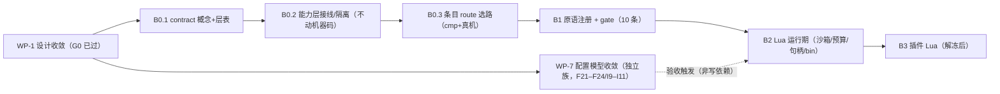

# MASTER-PLAN：GhostLock 主计划（唯一进度入口）

> **2026-10-19 43284 重置**：旧 43284 后端/JNI 具体实现已删除；重构设计与批次见 `docs/analysis/43284-refactor-design-v4.md`、`docs/plan/43284-reset-batch.md`。该文件取代 DFRP P1/P2/P3 旧会话实现；KPLAN 用户裁定不变（Kotlin plan/write，C++ 仅 syscall）。

## §0.1 2026-10-17 用户裁定：Lua / GLKv3 文档 / CLI / script 面删除（取代 §1 目标 1 与 3）

- **裁定**：vendored `lua`、`mpack`、`nlohmann` 三个库从构建中删除，且不引入替代第三方库；「引用它们的都是旧代码」⇒ **不被 JNI 调用的部分直接删**，不重写。
- **已删除**：`core/src/main.cpp`（`ghostlock` CLI）、`script/*`（wire_doc / staged_plan / sandbox 链）、`profile/*` 文档路径（glkv3_document / document_pairs / plan_delivery / run_plan / payload_keys / key_catalog）、`pipeline/run_pipeline_temp`、`terminal/*`、`backend/victim/*`、`contract/{script_surface,op_registry,chain_catalog,layer_scope,kmi_catalog,contract}`、`backend/cve_2026_43499/layout_from_document.hpp` 等；测试 127 → 92。
- **保留**：`contract/kernel_access.hpp` 接口（两个 device JNI 都继承并逐调用透传）、`pipeline/access_factory.cpp`（`KernelAccess::create` 唯一实现）、`contract/{kind,resource_scope,step_catalog}.hpp`、`profile/route_catalog.hpp` 等仍被编译单元包含的部分。
- **影响**：ADR-0008 / 0009 / 0010 / 0011 / 0015 / 0016 / 0017 全部废除（各自文首有废除横幅）；`docs/plan/PENDING-DECISIONS.md` 的 A1 / A2 / B1 / B2 / B4 失去对象。
- **同批删除（只留 JNI 调用）**：`core/src/tools/*.cpp` 的 10 个设备探针与 `GL_PROBES` 选项（它们不在任何 JNI 调用路径上，也不进 APK）。
- **严格归档（2026-10-17）**：30 份随之失效的设计稿 / ADR / 工作包已移到 `docs/archive/20261017-1835-*`，索引见 `docs/archive/INDEX-plans.md` §七；仓内指向它们的链接同批改写（悬空 0）。
- **仍有效的判据**：AGENTS §8（host 测试 + Android 零告警 + 真机门禁）；覆盖率只作诊断（见 `docs/analysis/coverage-20261017.md`）。

**收尾核验（2026-10-17 18:05）**：① 全部生产`.cpp/.hpp` 相对「已编译源 + 传递 include」的闭包，孤儿文件 **0**；
② 三个 .so 的 JNI 导出与 Kotlin `external fun` 一一对应（43284: 36/36 · 43499: 20/20 · ghostlock_jni: 4/4），无死导出、无缺实现。

## §0 依据与权威

- **权威顺序**：`docs/development/软件工程守则.md`（最高思想）> `AGENTS.md` > `engineering-standards.md` / `design-philosophy.md` / `engineering-rules.md` > `docs/analysis/**`。
- **审查依据**：`docs/development/design-review-principles.md`（**v0.2**：D1 判据形式 = 黑盒/白盒 + 极端输入值；C2 扩展点；C3 成本权衡；F2 技术债预判）。
- **策划框架**（守则 §5.1）：**输入** = 《用户需求报告》（`docs/development/requirements.md`）；**输出** = ① 软件开发计划书（**本文件**）② 质量保证计划（`design-review-principles.md` + `engineering-rules.md`）③ 配置管理计划（`AGENTS.md` 文档约定 + 本文件 §8）④ 里程碑及评审计划（本文件 §5）。
- **生命周期模型**（守则 §2.1）：**增量 + 阶段门**（每个批次一类事，上一批验收全绿再进下一批），阶段划分 = 立项 → 需求 → 概要设计 → 详细设计 → 编码 → 测试 → 运行/维护。
- **需求基线状态**：`F21`–`F29` / `I13` / `I14` 已恢复（[确定]）；**`F1`–`F20`、`Q1`–`Q9` 原文在 2026-10-07 事故中丢失**（`requirements.md` 标 [缺失]，见 [incident](../analysis/incident-20261007-agents-requirements-revert.md)），**待用户补写后再据此批准**。
- **待批事项**：`docs/analysis/pending-rulings.md` —— 一页列全当前**等待裁决**的事项，每项含实测依据与代价；相关计划的命令级清单各自指回该页。
  - **当前状态（2026-10-17 修订）**：原始记录（2026-10-09）为「两个 backend 的 kernel access 实现面与可达面均已完成；真机探针与会话帧已落地并通过门禁；代码侧只差在设备上执行一次；待批 = ADR-0016 与 Lua 里程碑」。**其中 ADR-0016 与 Lua 里程碑已随 §0.1 作废**，现行待批项以 `pending-rulings.md` 去掉作废条目后的剩余部分为准。
- **唯一性声明**：本文件是**唯一进度入口**；`docs/plan/**` 其余 28 份已归档到 `docs/archive/20261007-2237-*`（索引见 §11 与 [INDEX-plans](../archive/INDEX-plans.md)）。

## §1 目标与范围

**目标**：把 payload/handoff 运行时、配置模型、插件形态三块收敛为可执行、可验收的批次序列：

1. **payload/handoff 运行时**：contract 化（中性 `WriteOutcome`）→ 原语注册 + gate（10 条静态原因）→ Lua 5.4 运行期（沙箱/预算/句柄/bin 承载）。
2. **配置模型收敛**：三层同形（`ResolvedProfile` 单一权威读入口）+ 注册套件（catalog 编译期投影）+ 校验去重（registry 族 `F21`–`F24`/`I9`–`I11`）。
3. **插件形态**：解冻后按 Lua 控制面（D31）+ `.so`/LKM 内核型保留通道（D32）。

**不在范围**：不改 `schema == 3` 与 canonical 字节；不引入运行期注册表/虚表；不动 520B/784B 与 `CoreSession` 槽位；不恢复旧 `.so` 单一插件通道；不新增 CLI/旁路（`I6`/`R13`）。

## §2 生命周期与阶段门

| 阶段（守则 §2.1） | 本工程活动 | 产物 | 门 |
|---|---|---|---|
| 探索 | 读代码/文档 + 历史门禁；只读取证（`file:line`） | 分析文档（`docs/analysis/**`） | — |
| 需求 | 需求编号与占用（`F21`–`F29`/`I9`–`I14`） | `requirements.md` | — |
| 概要设计 | 三层同形 + 注册套件 + gate 结构 | `handoff-payload-plan.md` / `resolved-profile-registry-plan.md` | **G0 设计批准** |
| 详细设计 | b0/b1b2/queue-schema/kotlin/kotlin-io/params/plugin-lua/verification | 同上 + ADR-0008/0009 | G0 |
| 编码 | 批次 B0.1 → B0.2 → B0.3 → B1 → B2 → B3 | 代码 + 测试 | **G1 批次验收** |
| 测试 | 宿主/native 构建/真机三层判据 | 测试记录 + XML 三桶计数 | **G2 真机门禁** |
| 运行/维护 | 归档、沿革、技术债偿还 | `docs/archive/**` + 本计划 §7 | **G3 归档** |

- **G0**：**design-critic 非作者评审总判 = 可进批准 gate（已过）**；**用户批准 = 待记**（**ADR-0008/0009 状态 = Proposed（待用户批准）**；`requirements.md` 重建后**仅存编号与含义（无状态列）**；批准后**同批回填时间与出处**）。**不得回填未发生的批准**。
- **G1**：批次验收判据全绿（§5 命令），阻断项为零。
- **G2**：攻击路径改动 = **真机门禁唯一判据**（冷机、固定 CPU 对、单 route、KernelSU 未加载；归档 `docs/analysis/device-gates/*.md`）。
- **G3**：批次收口时同批更新 UML、归档门禁记录、登记技术债。
- **裁剪声明（守则 §2.1）**：**无立项/合同阶段**（自研工具、无外部合同）；**测试 = 宿主 / native 构建 / 真机三层**；**退役不在范围**；需求以 `requirements.md` 编号承接，不另立需求规格书。

## §3 工作分解（WBS）

| 工作包 | 目标 | 设计依据 | 写范围（主要） | 验收判据（黑盒/白盒 + 极端值） | 门禁 |
|---|---|---|---|---|---|
| **WP-1 设计收敛** | 三族设计定稿并可评审 | `../analysis/handoff-payload-*.md`（plan/b0/b1b2/queue-schema/kotlin/kotlin-io/params/params-dispatch/plugin-lua/verification）、`../analysis/resolved-profile-registry-plan.md` | 仅文档 | design-critic 总判 = 可进批准 gate；外部引用 0；配额内 | G0 |
| **WP-2 contract 化与层归属** | 中性 `WriteOutcome`；`pipeline`/`script` 层登记 | `handoff-payload-b0-contract.md` §3/§4 | `contract/write_primitive.hpp`、层表、`Capabilities` → POD | 层边界 = 0；窗口 TU 禁 include（文件级扫描）；概念 `static_assert` | G1（**不动机器码**） |
| **WP-3 条目 route 选路** | 条目值 → `switch` → 编译期策略 | `b0` §8（B0.3）、`params-dispatch` §4 | `route_policy.hpp` 调用侧 | 白盒：`op_tu_isolation_test`；`cmp` 无间接 call | **G1 + G2（动机器码）** |
| **WP-4 原语注册 + gate** | `OpSpec`/`OpRegistry` 取代 `StepExecution`；`plan_gate` 10 条 | `b1b2` §B1.1/§B1.2、`ops` §4 | `pipeline/registry.hpp`、`contract/registry_check.hpp` | 极端输入逐条具名（含 `executor-unavailable`）；两处结论冲突 ⇒ 失败（`main.cpp:184`） | G1 |
| **WP-5 Lua 运行期** | vendored Lua 5.4 + 沙箱 + 预算 + 句柄 + `bin` | `b1b2` §B2、`ADR-0008`、`kotlin-io` §1–§2 | `src/lib/lua`、`script/` 绑定层、`glkv3.hpp` 上限 | 超预算/越权 API/伪造句柄/非脚本键 `bin`/插入段 >64 KB ⇒ 均拒；成员表两侧机器对拍 | G1（+G2 若动写路径） |
| **WP-6 插件 Lua 形态** | 解冻后：`_ENV` 沙箱 + 独立预算 + manifest 表 | `handoff-plugin-lua.md`、`ADR-0009`、`plan` D31/D32 | 插件宿主与 `script/` | 单插件超限仅自身失败；未知能力位/非法 stage ⇒ 加载期拒；A 读 B 的 `_ENV` ⇒ 不可达 | 解冻门禁（G1+G2+G3） |
| **WP-7 配置模型收敛** | 三层同形 + 单一读入口 + 注册套件 | `resolved-profile-registry-plan.md` §3–§6 | 按该计划 §4 改动清单 | 见该计划 §6 验证矩阵（3 层同形/路径唯一/行数守恒/单一读入口） | G1（B2 触攻击路径 ⇒ G2） |
| **WP-8 文档与度量** | 配额、同批动作、归档、度量 | 本文件 §5/§8/§9/§10、`batch-plan` §4 | `docs/**` | 外部计划引用 0；配额内；同批清单逐项落地 | G3 |

> **判据集（不复制）**：[verification](../analysis/handoff-payload-verification.md) §1 总则 · §2 样例 · §3 扩展点 · §4 技术债 · §5 CBN；本表只列极端输入摘要。

- **三端打通（R8）**：全流程 host 组装测试计划见 [host-assembled-integration-plan](../analysis/host-assembled-integration-plan.md) —— **归属：B0.0 立计划 · B1 落地**（probe native 腿与 extractor 三方对拍）；**非真机判据**。

## §4 执行顺序与依赖

- **串行纪律**：**单写入流**（AGENTS）；批次 **B0.1 → B0.2 → B0.3 → B1 → B2 → B3**，上批未绿不进下批；**B0.0** 见 [B0.0-REVISION](../archive/20261017-1835-B0.0-REVISION.md)；**重写**见 [rewrite-plan](../archive/20261017-1835-rewrite-plan.md)。
- **并行约束（M2 更正）**：**写入恒为单流**（同一时刻只有一个 writer 改被门禁覆盖的文件）；**并行仅限只读勘察与门禁**，且**共享 `build/**` 与容器缓存的门禁必须串行**。WP-7（registry 族）不得与 WP-2…WP-5 并行写入。
- **依赖**：WP-4 依赖 WP-2（层归属）；WP-5 依赖 WP-4（registry/ParamSpec）；WP-6 依赖 WP-5（同一 VM/沙箱）；WP-3 必须先于 WP-4（选路是 gate 后执行面的前提）。**WP-7 = 独立族**：其验收在 **B2 批触发**（`../analysis/resolved-profile-registry-plan.md` §6 矩阵）；图中 R ⟶ B2 为**触发边**，非写依赖。

## §5 里程碑与门禁

| 里程碑 | 命令（全部需 EXIT=0，失败数读 XML 全量） | 真机 |
|---|---|---|
| B0.1 / B0.2 | `make -C core check`；`make -C core android`（NDK 零告警）；`./gradlew markdownlint` | 否 |
| B0.3 | 同上 + `tools/cmp_disasm.py build/native/ghostlock-B0 build/native/ghostlock`（**可选诊断**） | **是**（动写路径） |
| B1 | **KernelAccess 实现面（2026-10-10 交付）**：`landing/multicast_route{,_linux}.{hpp,cpp}`（43499 路由引擎）· `memory/payload_page.{hpp,cpp}`（载荷页）· 43284 读面（`kernel_access.hpp` + `landing/pagecache_{landing,write}.hpp`）；门禁＝`make -C core check` + `make -C core android` | 否（接线前不动写路径） |
| B2 | 同 B1 + `./gradlew :profile-core:test --tests "*QueueElementShape*"` + `make -C core profile-manifest-v3`（**既有 110 行逐字节不变；payload 新键按新行补充**） | 若动写路径 ⇒ 是 |
| B3 | 插件解冻门禁（`AGENTS.md` 恢复清单 + 真机 + `docs/analysis/device-gates/*.md` 归档） | **是** |
| WP-7 | 按 `resolved-profile-registry-plan.md` §6 矩阵（`make -C core check`、`./gradlew :app:testDebugUnitTest`、5 张 manifest 目标） | B2 批触发 |

## §6 角色与职责

| 角色 | 写范围 | 职责 |
|---|---|---|
| **Lead** | 全局 | 裁决、批次门禁、提交纪律、冲突合并、用户沟通 |
| **native-core** | `core/src/**` | native 设计/实现/门禁（host/NDK/lint/真机）、`file:line` 取证 |
| **kotlin-app** | `profile-core/**`、`app/**`、assets | Kotlin/配置/UI 设计实现与对拍；不碰 native |
| **docs-uml** | `docs/**` | UML/计划/ADR/门禁归档/配额；**唯一文档写者** |
| **design-critic** | **只读** | 非作者评审（`AGENTS.md` 岗位节）：冻结快照 + 固定输出格式 + 总判 |

- 受影响的组（守则 §5.1）：软件工程组 = Lead + 三个常驻流；测试/质量保证 = 门禁命令 + design-critic；配置管理 = docs-uml；文档支持 = docs-uml。

## §7 风险与技术债登记

| # | 风险/债务 | 影响 | 处置 |
|---|---|---|---|
| R-1 | **ADR-0001（20190 B）/ 0003（8512 B）/ 0004（16624 B）超限** | 证据文档超「分析类 ≤8 KiB」 | 独立待办：0001 findings 移交 `architecture-findings-register.md`；0003 压缩 stale 段；0004 拆正文 + 附录 |
| R-2 | **R1 层表未登记 `pipeline`/`script`** | 层约束无机器守卫 | B0.1 验收项（`include_firewall_test.cpp` 层表 + 空账本） |
| R-3 | **判据命令可执行性** | 文档判据与真实目标名不一致会失效 | 每批在 CI/本地跑 §5 命令并记录退出码 |
| R-4 | **payload 白名单触点** | 解冻后 `backend.<id>.payload.*` 会被 fail-closed 拒 | 解冻批次为两个 `Backend*Keys` 增 `payload` + 对拍（`kotlin.md:63`） |
| R-5 | **vacuous 断言风险回归** | 删掉被保护的赋值仍可能全绿 | 由**黑盒/白盒 + 极端值用例**覆盖（原则 v0.2 D1） |
| R-6 | **PI 窗口时序** | 窗口内**越界 syscall**（实测：`sched_setattr` → `rt_mutex_adjust_pi`）、分派/分配/首次触页 ⇒ 不确定性 / panic | E4（实证版：白名单 + 禁项见 [pi-window-constraints](../analysis/pi-window-constraints.md)）+ `cmp` 归因 + 真机门禁（`route_lifecycle.hpp:9-11`）；**沿革**：原表述为「分派/分配/首次触页」，2026-10-08 按 device-gate 栈改写 |
| R-8 | **代码注释悬空计划路径**（审查时实测 **10 处**） | 注释指向**从未存在**的 `docs/analysis/<plan>.md` | owner = **native-core**（`core/src` + `tools/extract_rs`）/ **kotlin-app**（Kotlin）；**时机 = 已随本批交付完成**（见 [INDEX-plans](../archive/INDEX-plans.md) §六 末尾「悬空引用」行）；判据 = 编译通过 + `grep` 无失效引用（**现测 0**） |
| R-7 | **技术债预判六项**（`OpRegistry` 可插拔 / 键上限顶格 / `slot.*` 持久化 / 沙箱 API 扩展 / payload 解冻 / gate 原因码） | 未来扩展成本 | 逐项偿还时机见 `../analysis/handoff-payload-verification.md` §4 |

## §8 配置管理与变更控制

- **沿革**：被推翻的提法**划掉保留** + 一行理由；用户裁决逐条记录（`../analysis/handoff-payload-decisions.md` 与 archive）。
- **变更控制**：设计者必须**逐条回应**审查（接受并改 / 举证反驳），不得沉默忽略；强制确认的越权须同时有**沿革 + 技术债**登记。
- **批次纪律**：`engineering-rules.md` **R22/R14**（一批次一类事；判据分层留记录）；未列入改动清单的代码即冻结。
- **文档配额与增补**：计划 ≤16 KiB、分析 ≤8 KiB（**8 KiB = 8192 B**，`R30`）；**取代而非叠加**；增补策略见 `../analysis/handoff-payload-plan.md` §9.1（冻结清单 + 拆分点 + 命名）。
- **同批动作**：UML 逐图/ADR/需求/测试的对应关系见 `../analysis/handoff-payload-batch-plan.md` §1–§5。

## §9 估计（守则 §5.2 / §5.5(5) / §5.6）

| 估计项 | 值 | 依据 / 口径 |
|---|---|---|
| **规模** | **8 个工作包**（WP-1…WP-8）· **6 个批次**（B0.1→B3）· 设计文档 15 份（家族）+ 3 份 ADR | 守则 §5.5(5)「工作产品规模」；实测 `wc` |
| **工作量** | 以**批次**为单位推进；每批**一类事**，门禁次数 ≥3/批（host / NDK 或 Gradle / lint 或对拍）；真机门禁仅 B0.3 与触及 `steps`/`primitives` 写路径者 | 守则 §5.5(5) 时间表口径 |
| **成本** | **≈ 0**：自研工具、无合同；仅现有工作站 + 一台测试设备（电/时间） | 守则 §5.6「资源估计」（本项目不适用合同/外包） |
| **资源** | 现有工作站（macOS + NDK 30）+ 一台测试设备（真机门禁）+ 容器引擎（LKM 批） | `AGENTS.md` 常用命令 |
| **可度量替代** | 需改文件数上限 = **≤5 文件/WP**（超限 ⇒ 拆包）；门禁次数/批 ≥3；审查阻断关闭 = 0 未闭 | 本计划 §3/§5 与 §10 |

- **说明**：无 CMMI 级测量库 ⇒ 不给「人日」估计（守则 §5.2 说明估计误差与能力成熟度相关），改用**可数计数**（包/批/门禁/文件数）作为可核验替代。

## §10 度量与状态

| 度量 | 当前值（**截至本次更新**；取证快照以 §11 归档与 §7 登记为准） | 目标 |
|---|---|---|
| 设计状态 | **评审已过（可进批准 gate），待用户批准**；阻断 **0** | 批准后回填 |
| 代码改动 | **B1「KernelAccess 实现面」已交付（2026-10-10）**：43499 路由引擎（三线程 + 平台边策略）· 43499 载荷页构建 · 43284 读面；host `check` **101 PASS**（唯一红 `plan-check`，`main.cpp` 清空所致）· `android` 零告警。**未接线**：引擎/载荷页/读面尚未进 `initialize`/`prepare_page`；临时入口 `run_pipeline_temp.cpp` 仍在 | 按批次推进（下一批＝序 1 接线） |
| 审查阻断关闭 | **已全部关闭**（评审结论与沿革见 [decisions](../analysis/handoff-payload-decisions.md)、三族文档与 `docs/archive/20261007-2237-branch-plan.md`） | 0 未闭 |
| 待办计数 | ADR 超限拆分 3 项 · R1 层表登记 1 项 · payload 白名单触点 1 项 · 技术债 6 项 | 按 §7 偿还 |
| 文档配额 | 家族 15 份 + ADR-0008 全部在上限内；[archive README](../archive/README.md)、[INDEX-device-gates](../archive/INDEX-device-gates.md)、[INDEX-plans](../archive/INDEX-plans.md) 各 ≤8 KiB | 保持 |

## §11 归档索引

- **本次归档（28 件）**：`docs/plan/<原名>` → `docs/archive/20261007-2237-<原名>`（头部含原始路径 / 归档原因 / 归档日期）；规则见 [archive README](../archive/README.md)，**计划类索引**见 [INDEX-plans](../archive/INDEX-plans.md)。
- **归档规则指针**：命名 = `YYYYMMDD-HHMM-<原文件名>`；每件头部含原始路径、归档原因、归档日期；历史不删（`AGENTS.md` 文档约定）。
- **`docs/analysis/**` 遗留计划**：**候选为空**——名含 plan 的仅 `handoff-payload-plan.md`、`handoff-payload-batch-plan.md`、`resolved-profile-registry-plan.md`，**全部为保留的设计依据**；**owner = Lead**（决定前不动）。规则与索引见 [archive README](../archive/README.md) §五、[INDEX-plans](../archive/INDEX-plans.md)。

## §12 J7.5：分别用两个 backend 在真机取到 root（在办 · 2026-10-15）

**目标原文**：执行至 J7.5 —— 成功分别用两个 backend 获取 root，可以先内置临时逻辑，真实 profile 还需进一步设计。

### §12.1 已完成（每条都有真机证据在 build/app/device-gate.log 与 device-gates/ 归档里）

| 项 | 提交 | 判据 |
|---|---|---|
| D2 类型化函数面（两库、DTO 参数、具名拒绝） | 7a06db1d / 273a6069 | deviceGate 20/20 → 26/26 |
| 43284 Kotlin 客户端 DTO 化 | 270fb96b | deviceGate 23/23 |
| 43284 数据函数接线（两张图 + 钩子计划） | 273a6069 / 270fb96b | 真机：1440B + 摘要与 manifest 一致、钩子四数 |
| 43284 module_check（真规则） | 563babc9 | 真机：module-check-refused |
| 43284 wait_terminal（真轮询三态） | 2266022c | 真机：wait_terminal:inflight |
| 43284 resolve（真开门 + 票据） | 7ecb906f | 真机：票据 (1<<32)\|1、door-refused |
| 会话参数 → 门材料（零密钥不是凭据） | 0712c906 | 宿主逐字段测试 |
| 更名 R1 / R2 / R4（不用 seam 这种临时名） | fb7cf17b / dfbb942a / 5d40d9a0 | ctest 132/132 + checkAll |

### §12.2 未完成（当前出口）

| 项 | 内容 | 判据 |
|---|---|---|
| J7.5-3a | 会话里建 PageCacheLanding（用 resolve 那扇 fd）+ write_block/read_block 接 land_block/read_block 与 adopt_sequence | 宿主不回归 + 真机写读回 Dispatched → Applied |
| J7.5-3b | CrashDumpBridge + 双 fork 的 trigger | 真机给具名答案 |
| J7.5-4 | 43284 链端到端 | 真机 id 报 uid=0，原始日志归档 |
| J7.5-5 / 6 | 43499 五个设备函数 + 端到端（含 spawn_victim：当前树没有，需按只读方式参考退役树后重写） | 同上 |

### §12.3 留档的教训（写给下一次接手的人）

1. 批量替换脚本**先校验全部锚点、任一不匹配整体不写**（切错过一次：撤回时把相邻的 sa_material_of 定义一起切掉，宿主链接报未定义）；
2. 提交前必须在最终树上跑门禁（有两次红树提交 85ab5e47、3b680b08，随后各自修复）；
3. 跨平台：SOCK_CLOEXEC 是 Linux 专有，宿主（macOS）编译要用 SOCK_DGRAM；
4. DoorOps 的真实命名空间是 ghostlock::backend::cve_2026_43284::landing，且 .cpp 自己的翻译单元要 include 相应头文件。

### §12.4 现场状态（可直接核验）

- 设备：A301SO（QV770MFGJ1），KernelSU 未加载；./gradlew deviceGate → PASS（26 项校验全部命中）；
- 宿主：ctest --test-dir build/cmake/host → 132/132；verifyJniLibs → 三库互不重叠（43499 13 / 43284 16）；
- 计划细节：docs/analysis/jni-two-backend-plan.md §11（批次与判据）、§11.6（ESP 路线装配点与 3a 确切形状）。

### §12.5 2026-10-15 更新：3a 完成（43284 的写路径在真机上走通）

| 项 | 提交 | 真机/宿主判据 |
|---|---|---|
| 43284 trigger 接 steps::trigger_orphan | e5b7ea26 / 834a0813 / e72f35d6 | 真机 code=0（双 fork 真执行） |
| 43284 read_block 接门那扇 fd 的 pread | 17bccc35 | 真机 code=0，读到文件的 16 字节 |
| **43284 write_block 接落地对象（3a 完成）** | 6770ab03 | 真机 writeBlock code=0、sequence=1、flags=0x80004（**无 Applied/Verified 位**） |
| 计划补全（§11.6–§11.11：装配点、驱动器、步骤 API、签名、可套用片段） | c408db85 / 1af66dc9 / 813… / 273811a4 / 3bdd9838 / 7a89aa4e | 文档 |
| 更名收尾（gate reason、探针、测试局部） | 5d40d9a0 | ctest 132/132 |

**真机门禁当前：PASS（29 项校验全部命中）**，APK 956；宿主 132/132；verifyJniLibs 三库互不重叠。

剩余（按顺序）：

1. 3b 收尾：wait_terminal 换 wait_for_module（前提：先通读它的具名原因与三态对应，见 jni-two-backend-plan §11.9 —— 不许盲接）；
2. J7.5-4：patch1 → carrier → hook → trigger → wait 端到端，id 报 uid=0，原始日志归档 device-gates/；
3. J7.5-5 / 6：43499 的设备函数（含需从退役树只读参考后重写的 spawn_victim）与端到端 uid=0。

**用户裁定（在办约束）**：临时逻辑只放 Kotlin；native 只留设备工作；不要用 "seam" 这类临时名（R1/R2/R4 已完成，帧时代的 Ops*Seams 随其整块删除一起消失）。

## §13 43499 生产引擎接入（kt-step · 2026-10-20）

- **生产计划（唯一）**：[43499-kt-step-plan.md](43499-kt-step-plan.md)（全部逻辑 Kotlin、C++ 仅薄 syscall；UI 未接线）。
- legacy 记录：[43499-production-engine-plan.md](43499-production-engine-plan.md)（K1 降 legacy 适配器）、[43499-native-device-ops-plan.md](43499-native-device-ops-plan.md)（C++ N1b/N2/N3 降 legacy，不接入生产）。
- **K1 legacy 记录**：`app/src/main/kotlin/com/ghostlock/app/engine/kernelmemory/` 28 个单测（0 fail/0 error）；它经 `JniBackend43499Port` 调用 C++ `Native43499`，不满足 kt-step 的“C++ 仅 syscall”，不再作为生产路径。
- **native legacy 记录**：N1a 快照字段 + N1b C++ form 路径已实现（`nativeTestHost` 75/75、Android 零告警），但 N1b/N2/N3 逻辑路径降 legacy，不接入生产；旧 `libghostlock43499.so` 必须在 K0 从生产构建/APK 隔离。
- **kt-step K1 已实现**：Kotlin `KernelSyscalls`/`NativeSyscalls43499`；C++ `syscalls_43499` + `native_syscalls_43499` + `gl43499syscalls`；`nativeTestHost` **76/76**、`nativeBuildAndroid` 零告警、Kotlin 3/3、导出 22 个 JNI 符号。
- **K0a APK 隔离已做**：`prepareGhostlockJniLibs` 不再复制旧 43499 库；`packaging.jniLibs` 排除；`KernelMemoryEngine.production()` 移除；APK `unzip -l` 仅见 `libgl43499syscalls.so`，无 `libghostlock43499.so`。
- **K2 已实现**：Kotlin `KernelLayout`（页/凭据/布局/arm/编码）+ `KtStepEngine`/`KtOpsInvoker`/`KernelRoute` 骨架；布局/凭据 7 + 引擎 9；kt-step 合计 **19/19**。C++ `payload_page.cpp` 的 node 覆盖 task/lock 写序 bug 只在 Kotlin 修正，未回写 legacy。
- **N2 PASS（AVD）**：`native_attempt_43499` + JNI `gl43499native` + `NativeJniAttemptPort`；Pixel_5/Android 13 `actorsStarted=true`、`requeue=1`、`wait=0`、`pageStage=0`；记录 [n2-actor-20261020-1020-pass.md](../analysis/device-gates/n2-actor-20261020-1020-pass.md)。host **77/77**。N3 未开始。
- **K3.1–K3.7 已离线移植**：`KotlinPiRace`/`FutexWord` + `SyscallFutexWord`/`KernelFutexWords`/`PiSpike` + `KotlinPiActors` 三线程骨架 + `PiActorsKernelRoute` 诊断 route + `PiProbeRunner` K0b 读数 + `PageWriter`/`K3PageFixture` 边界 + `VictimProbe` uid 校验 + N1 params/result codec（51 测）；kt-step 合计 **70/70**。生产 route/page 写入、K4/K5 未做。
- **K4a 已备**：`ProcessVictim`/`ProcessVictimProbe`/`ProcessVictimSession` 用 Kotlin `ProcessBuilder` 起 shell 回 `id -u`，`KtVictimFlow` 保证 start 失败/route 失败/成功都 close；仍不写 cred，真实 victim pipe 待 K4。
- **K0b PI 探针 PASS（AVD）**：`requeue=1`、`wait=0`、`target-after=TID`、`completed=true`；`page-write=false`、`root=false`。记录 [k0b-probe-20261020-0952-pass.md](../analysis/device-gates/k0b-probe-20261020-0952-pass.md)。仅 actor 探针，不标 supported。
- **K3 生产阻断**：`process_vm_writev` 对 kernel 地址返回 `EFAULT`，Kotlin 薄 syscall 面没有内核页写原语；真实 43499 page landing 仍在 legacy C++ `MulticastRoute`/`PayloadPage`，需要 actor batch/child helper 或把该逻辑迁入 C++ 生产路径。按 [43499-approval-status.md](43499-approval-status.md)：actor batch / child helper 的**原则＝已批准**、**生产启用＝待批准**（第 2 层），故 `KernelPageWriter` 继续 fail-closed `ENOSYS`，不得把 fixture 当生产成功（**不得读成「生产已批准」**）。
- **Discover 命中 + Kotlin 处理**：AVD 直接映射扫描得到 `verdict=1`、`found=0xffffff80002d7800`（mm_struct）、`probes=2911`；`DiscoverProcessor` 产出候选 `pageBase=found`/fake slots。记录 [discover-mmstruct-20261020-1038.md](../analysis/device-gates/discover-mmstruct-20261020-1038.md)。
- **N3 candidate 链路**：discover 命中 `0xffffff80000da400` → Kotlin `DiscoverProcessor` → 页写 16 KiB → actor `requeue=1`/`wait=0`；记录 [n3-candidate-20261020-1040.md](../analysis/device-gates/n3-candidate-20261020-1040.md)。
- **N3 page-send 通道**：`NativeAttemptParams.pageFd` + C++ `write(fd,page,len)`；AVD 回读 16384 字节一致，actor `requeue=1`；短写/bad fd 已改为 `actorsStarted=false`、`pageErrno=9`。记录 [n3-pipe-20261020-1043.md](../analysis/device-gates/n3-pipe-20261020-1043.md)。
- **Prepare 成功 + N3 skb page-send**：AVD `status=0`、`base=-549752602624`、`shapingFd=82`、`snitchFound` 非零；按 `payload_delta=-0xE80` 建 64 KiB skb 页并经 prepare fd 送出，`pageBytesWritten=65536`、actor `requeue=1`。记录 [n3-skb-20261020-1059.md](../analysis/device-gates/n3-skb-20261020-1059.md)。仍无内核页读回/uid=0，N3 未通过。
- **N3 硬缺口**：当前 C++ `prepare_page.hpp:21-24` 明确“payload inside the page 尚未 ported”；`prepare` 只给 base，不产页 payload。discover 只给 mm_struct，`pageBase=found` 不是已证明页。因此 N3 页落点尚未具备生产实现；候选链路只是用户 mapping + actor 形状。
- **N3 验证限制**：AVD root 可登录，但无 `/proc/kcore`、无 `/dev/mem`，不能直接读内核页；页落点必须靠 N4/N5 行为判据（victim uid=0）。记录 [n3-verify-20261020-1100.md](../analysis/device-gates/n3-verify-20261020-1100.md)。
- **N3 验证限制**：AVD root 无 `/proc/kcore`/`/dev/mem`；页落点只能靠 route/victim uid。当前 `prepare`+`shapingFd`+64 KiB skb 页发送已通，但 actor 的 futex 目标仍是独立用户字，**没有 route 把发送页接到 target/cred 写入**；因此 `requeue=1` 不证明页被消费。
- **下一步**：实现 route（multicast stamp/target 或等价页消费者）+ N4 child/N5 victim uid=0；未过真机门禁不得标 supported。
- 技术债（T4）：`exportJniProtocolManifest` 的生成器 `build/host/jni_protocol_manifest` 已不存在，`testDebugUnitTest` 需 `-x` 才能跑；owner=build，偿还=恢复生成器或删除任务并改用静态 manifest 校验；未偿还前全量门禁不能称绿。
- **结构与批准指针（2026-10-21 追加）**：执行层唯一权威 [execution-architecture.md](execution-architecture.md)；43499 批准状态单表 [43499-approval-status.md](43499-approval-status.md)。
