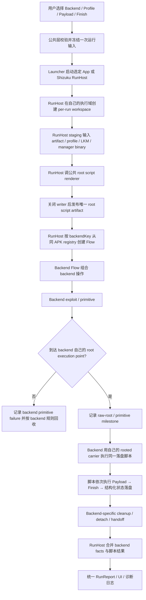

# Backend root execution 统一整理计划（需求基线 · L · 2026-11-04）

<a id="p-run-x-001"></a>

> **计划代号**：`P-RUN-X-001` 是整份执行统一计划的容器身份；决策/批次按实际模块与领域使用各自语义代号，定义仍在本文件。旧 D/R 号仅作来源和兼容别名，映射见[本计划代号表](#plan-semantic-identifiers)。本次改号不拆计划、不重排工作、不改变内容、批准、进度或门禁。

> 状态：D1–D9 与 R0→R4B source implementation 已落地；**automatic export 产品项仍为未完成**。source architecture、Gradle debug compile/unit XML、native host、Android zero-target build、exact instrumentation、AVD真实MediaStore automatic/manual byte gate及Shizuku shell-domain AVD runtime均已通过；真实设备门与最终验收仍为 NOT_RUN。R2 root-script host fault matrix与6.6 AVD ordinary-file staging/identity gate已通过，真实carrier设备门仍为 NOT_RUN。2026-11-06 用户选定 P-LOG-X-001/批次02 的全流式双流模型，并进一步指定 raw/processed+dispatcher 尽快处理、各 sink 独立积压、`RunReport` 展示行只是普通 Info 且服从统一阈值；这取代下文 v2.1 journal candidate；v3 design-critic 阻断=0；2026-11-06 用户批准按 v3 实施，并要求将非必要的 RunLog* 命名收敛为 Log*，LS-D4 已关闭。P-LOG-X-001/批次01的既有门禁仅为旧容量合同证据，不关闭新批。2026-11-05 用户取消 R5-S2/S3 carrier 纵向并要求先断开全部真攻击 backend；当前 Kotlin registry 与 APK native target graph 均不含 43499-Glued、43284-Glued 或 98260。
>
> 本文件冻结产品目标、公共能力、backend 私有边界、owner、文件处置、批次与验证候选。用户已裁定 future native binding 改用 JNA。2026-11-05 用户再次回复“不要验证，继续”，知情强制越过 R3 的标准验证门并授权 R4 source cleanup；该裁定不授权进入 R5，也不把未执行门写成 PASS。
>
> **2026-11-05 用户纠正**：automatic export 是未完成的产品能力，不是应删除的 dead closure。R4 中“删除 LogExport 及设置闭包即完成”的产品判断失效；旧 caller-zero 平台 object 继续退役，但能力、设置语义和完成责任必须以 neutral domain port + data/run adapter 重建，并由 R4A 接入 current RunCoordinator。当前 source 已接线也只表示实现进行中；在 gates 与验收关闭前，automatic export 始终记为 **UNFINISHED**，不得归入“删除完成”或“产品完成”。
>
> **2026-11-05 R5 终止裁定**：用户要求“先断开连接所有真攻击 backend”，并将 R5 收口为“旧 backend 断开 + 必要删除，不改旧 backend 实现”。该裁定取代 R5 child 的 native carrier/Disabled plugin 实施授权。R5-S1 已写入的 neutral common source保持无真实 backend caller；它不构成接线或攻击能力。沿革记录：`2026-11-05 · AGENTS §2 单一活动计划/变更控制 · R5-S2/S3 取消，真攻击 backend build/registry membership 清零`。
>
> **2026-11-07 账本收口**：后继P-LOG-X-001/批次02 LS-V3与P-RUN-HANDOFF-001/批次01 HND-V1的current-tree 4 KiB/16 KiB AVD证据已覆盖P-LOG-X-001/批次01的旧wire/UI/runtime欠账；P-RUN-X-001的正常App/Shizuku transport/runtime亦已有current证据。仍未关闭的是RunHost lifecycle/cancel/host-death专属exact AVD判据、真实carrier设备门，以及automatic export真实设备门/最终产品验收。未执行项继续记`NOT_RUN`，不恢复任何真实攻击backend。
>
> 权威顺序：docs/development/软件工程守则.md > AGENTS.md > engineering-standards.md / design-philosophy.md > 本计划。

## 0. 沿革、取代关系与实时进度

### 0.1 为什么重建，而不是修补旧稿

2026-11-04，用户裁定旧 KBR 计划失效。旧稿把 Payload 与 Finish 建模为 `PayloadExecutor`、`FinishExecutor`、`PostRootExecutor`，进而虚构了通用 `RootExecutionContext`。这与本项目真实攻击链相反：

1. Payload 与 Finish 先由公共层渲染成**同一份落盘 root 脚本**；
2. 每个 backend 只在自己实际取得 root 的位置执行该脚本；
3. backend 并不把 root 交给一个脱离攻击路径的 JVM executor；
4. Payload 是取得 root 后真正要启动的用户目标，Finish 是其后的附加收尾。

因此旧稿不是局部命名错误，而是中心控制流错误，整稿及附件已归档：

- [`../archive/20261104-1935-kotlin-core-backend-vertical-rewrite-plan.md`](../archive/20261104-1935-kotlin-core-backend-vertical-rewrite-plan.md)
- [`../archive/20261104-1935-kotlin-core-backend-vertical-rewrite-annex-a.md`](../archive/20261104-1935-kotlin-core-backend-vertical-rewrite-annex-a.md)
- [`../archive/20261104-1935-kotlin-core-observability-cleanup-plan.md`](../archive/20261104-1935-kotlin-core-observability-cleanup-plan.md)
- [`../archive/20261104-1935-kotlin-core-observability-cleanup-annex-a.md`](../archive/20261104-1935-kotlin-core-observability-cleanup-annex-a.md)

四件只保留沿革，不再提供实施 authority。本文件是唯一新的需求入口；它不继承旧稿中的 executor、post-root lease/receipt、兼容性 parity 或静态 contract digest。

### 0.2 checkbox

- [x] 用户大致批准新的端到端需求清单。
- [x] 补充裁定：raw uid 0 可作为 backend 原语可用性验证，但不单独等于产品成功。
- [x] 归档失效 KBR/KC 主计划及附件，活动目录不保留平行 authority。
- [x] 把需求、共性边界、成功语义与开放问题写入本文件。
- [x] 用户裁定 native binding 改用 **JNA**；未实现 backend 不作为迁移/兼容基线，约束见 §9。
- [x] 完成 current-tree Kotlin/AIDL/UI/data/native/CMake/JNI 只读 ownership inventory。
- [x] 写入 §10 推荐语义、§11 目标架构、§12 exact ledger、§13 生命周期、§14 批次与 §15 门禁候选。
- [x] 生成逐文件候选 ledger：[`backend-root-execution-unification-ledger.tsv`](backend-root-execution-unification-ledger.tsv)；每行含 `path/action/target/batch/scope/reason`，未列 production 文件冻结。
- [x] 冻结 RunHost wire/state 附件：[`backend-root-execution-runhost-wire.md`](backend-root-execution-runhost-wire.md)。
- [x] 生成 80 行活跃计划逐文件处置表：[`backend-root-execution-plan-disposition.tsv`](backend-root-execution-plan-disposition.tsv)；批准前不执行归档。
- [x] 按 design-critic 首轮 BREU-01..08 修订：每批 caller closure、future native 零写冻结、build/tool closure、同一 opened object 身份、typed wire、exact plan disposition、JNA license/loader、技术债触发器。
- [x] design-critic 对冻结快照复评并关闭全部阻断项（第六轮：阻断/重要/建议均为 0）。
- [x] 用户裁定 §10 D1–D9 推荐语义并批准 §14 的 R0→R1 顺序（2026-11-04：回复“批准”）。
- [x] 用户批准首个 production implementation 批次 R1；R0 机械门全绿后方可开始。
- [x] 用户批准继续 R2（2026-11-04：“不要验证，继续”）；不做扩展/重复验证、AVD 或设备门。实施后为关闭实际 compile/manifest 阻断，只在最终树单次执行 Kotlin compile、unit XML 与 architecture manifest gate；未把这些结果外推为 runtime/device 结论。
- [x] 用户知情强制越过 R2 新增 fault-injection、AVD 与设备关闭门并批准进入 R3（2026-11-04：“持续推进，我确认你的任何计划，我们有git历史和timemachine兜底不用怕出问题”）；代价是 R3 在缺少新增 runtime evidence 的情况下先行，欠账最迟须在 R4/release 前偿还，且不得把未执行门禁写成 PASS。
- [x] 用户在 R3 实施中再次裁定“不要验证，继续”（2026-11-05）；本轮只推进 source/fixture/UML/plan 交付，不执行 Gradle、unit、AVD、Shizuku 或设备门，所有 runtime gate 保持 NOT_RUN。
- [x] 用户随后再次要求“不要验证，继续”（2026-11-05）；知情强制越过 R3 标准阶段门进入 R4 source cleanup。代价是 R2-R4 compile/runtime evidence 继续欠账；最迟在 release 或未来重新批准的首个真实 carrier 前偿还。原 R5 后续已被断开裁定取代。
- [x] 用户纠正 automatic export 的处置（2026-11-05）：“不是要删的是没做完的”；撤销“dead feature”结论，R4 重新打开并新增 R4A 纵向补全批次。

<a id="plan-semantic-identifiers"></a>

### 0.3 语义代号与旧号兼容（只改身份显示，不改实施内容）

本表是旧号到现行代号的唯一映射；新标题和当前引用使用语义码，不再以统一 RUN 前缀包装所有条目。词义仍只定义在[工程短词表](../development/documentation-standards.md#engineering-identifiers)，MASTER 只登记根和定义入口。下表顺序沿用原决策/批次顺序，不构成新的排期或批准。

| 旧号（原 P-RUN-X-001 内） | 现行主代号 | 原条目／定义 |
|---|---|---|
| D1 | `P-PAYLOAD-CORE-001/决策01` | [Payload fail-fast](#p-payload-core-001-decision-01) |
| D2 | `P-FINISH-CORE-001/决策01` | [Finish 严重度](#p-finish-core-001-decision-01) |
| D3 | `P-PAYLOAD-CORE-001/决策02` | [Payload 成功判据](#p-payload-core-001-decision-02) |
| D4 | `P-PAYLOAD-IO-001/决策01` | [detached Payload 与 retention](#p-payload-io-001-decision-01) |
| D5 | `P-RUN-IO-001/决策01` | [staging policy](#p-run-io-001-decision-01) |
| D6 | `P-BACKEND-CORE-001/决策01` | [BackendSpec 最小字段](#p-backend-core-001-decision-01) |
| D7 | `P-BACKEND-X-001/决策01` | [旧 backend disposition](#p-backend-x-001-decision-01) |
| D8 | `P-RUN-CORE-001/决策01` | [结果 authority](#p-run-core-001-decision-01) |
| D9 | `P-RUN-CORE-001/决策02` | [取消、host death 与不确定终态](#p-run-core-001-decision-02) |
| R0 | `E-DOC-X-001/批次01` | [设计与 authority 收口（当前批；docs only）](#e-doc-x-001-batch-01) |
| R1 | `P-BACKEND-X-001/批次01` | [删除 disabled manual-JNI / original-backend closure](#p-backend-x-001-batch-01) |
| R2 | `P-RUN-IO-001/批次01` | [Payload / Finish / root-script 单一 authority](#p-run-io-001-batch-01) |
| R3 | `P-RUN-X-001/批次01` | [新 execution spine 纵向替换](#p-run-x-001-batch-01) |
| R4 | `P-RUN-CORE-001/批次01` | [dead generic core 与守卫收口](#p-run-core-001-batch-01) |
| R4A | `P-LOG-IO-001/批次01` | [automatic export 纵向补全（历史设计；运行时拓扑由 R4B 取代）](#p-log-io-001-batch-01) |
| R4B | `P-LOG-IO-001/批次02` | [日志 sink 简化重写（取代 R4A runtime topology）](#p-log-io-001-batch-02) |
| R4C | `P-LOG-X-001/批次01` | [单一日志中枢与 Flow 结果归属修复（取代 R3/R4B 的双轨展示，保留 R4B sink 拓扑）](#p-log-x-001-batch-01) |
| R5 | `P-BACKEND-X-001/批次02` | [真攻击 backend 断开收口（取代首个 carrier 纵向）](#p-backend-x-001-batch-02) |
| R6 | `P-DIAG-NATIVE-001/批次01` | [Diagnose：首个真实 JNA/shared-library 纵向（已完成）](#p-diag-native-001-batch-01) |
| R7 | `P-BACKEND-NATIVE-001/批次01` | [43284-Glued carrier（未来独立 L 子计划）](#p-backend-native-001-batch-01) |
| R8 | `P-BACKEND-NATIVE-002/批次01` | [98260 carrier（未来独立 L 子计划）](#p-backend-native-002-batch-01) |

**兼容边界**：

- 原批准原话、日期记录、literal 命令/输出、历史 finding 和已取代拓扑保留原号；旧 HTML 锚点继续可达。它们是历史证据，不是新码下再次批准。旧 R5 的 carrier 接线授权与后来断开裁定仍按原文取代关系区分，不能以同一映射抹平。
- 原 `D1–D9` 指上表九项决策；原 `R2–R4C` 等区间仍指原批次顺序覆盖范围，不是不同语义根之间的数值区间。当前显示改为语义端点，范围不增减。
- `R2-H1`、`R4A-S5` 等已发生的纠错/运行记录保留为所属语义批次内的旧证据子号，不重新编造执行顺序。
- 文档 ledger 的 `batch` 列改用本表主代号；其余字段和行顺序保持不变。下表只保留三个既有子项的来源区别，不新建工作或改变动作。

| 文档 ledger 旧 batch | 现行显示／归属 | 含义保持 |
|---|---|---|
| R5-S1 | `P-BACKEND-X-001/来源S1` | 旧 carrier child 已交付的 neutral common source；不是断开批次新建，也不恢复接线 |
| R5-DISCONNECT | `P-BACKEND-X-001/批次02/断开` | 原断开子项，不与冻结候选行混为新动作 |
| R4B-S6B-RUNTIME | `P-LOG-IO-001/批次02/运行验证` | 原 runtime 修复/验证子项，四行内容及状态保留 |

工具及 `app/src/test/resources/architecture/` 中的 batch/fixture 字段继续使用原机器键：`R3`、`R4`、`R4A`、`R4B`、`R4C` 按主表定位，`R5-S1` 按来源子项定位；`tools/kotlin_architecture_d0.py` 的精确比较不因显示改号改变。更早 `D1e/D2/D3a/D7.2/D7.4` 属旧 Kotlin 计划，不能套用本表。历史归档、device gates、既有审核记录、已终止 child 与专用任务清单不批量改号。

## 1. 最高目标与产品成功

### 1.1 最高目标

GhostLock 的最高目标是：**通过用户选择的 backend 取得足以执行用户目标的 root 权限，并实际执行用户选择的 Payload**。

这里的“获取 root”不是只把某个进程的数值 UID 变成 0，也不是只证明一次 kernel read/write、cred overwrite、UMH 或 rooted child。它是一个面向产品结果的完整链：

```text
backend 原语成功
  → 到达该 backend 的 root execution point
  → 执行公共层生成并落盘的 root 脚本
  → 用户 Payload 达成请求的效果
  → 执行用户配置的 Finish 附加动作
  → 回报可区分的结果并完成 backend 资源收尾
```

### 1.2 raw uid 0 的准确地位

`getuid()==0`、rooted child、cred 已替换或等价事实可以作为 **backend primitive milestone**：

- 它证明对应 backend 的“取得 root 原语”在该次运行中可用；
- 它适合真机 bring-up、回归定位与 CVE 原语验证；
- 它必须能与脚本派发、Payload、Finish 和 cleanup 结果分别记录。

但 raw uid 0 **不单独等于产品成功**，因为仍可能发生：

- root 进程无法读取或执行脚本；
- SELinux / seccomp / mount namespace / capability 状态不满足 Payload；
- 脚本未派发、shell 启动失败或工作目录已失效；
- Payload 启动失败、目标守护进程未确认、LKM 未加载或用户命令返回失败；
- backend 在 raw uid 0 后崩溃或提前回收了承载进程。

产品成功至少需要**用户 Payload 的成功判据**成立；Finish 的成败按其策略单独回报，不能把 raw uid 0 或“脚本已启动”冒充 Payload 成功。

### 1.3 Payload 与 Finish

- **Payload**：root 权限最终要启动的用户目标，例如 root manager / `ksud`、用户命令、用户脚本或 LKM。它是产品主结果。
- **Finish**：Payload 之后的附加功能，例如恢复某种状态、软重启、写最终标记或其它结束动作。它不拥有 Payload，也不决定 backend 如何拿 root。
- Payload 与 Finish 都不属于具体 backend；二者各自拥有设置、持久化、校验与脚本片段生成。
- backend 配置仍只来自 GLK profile v3；Payload 与 Finish 则各自使用独立的 version=3 typed document/JCS authority，三者分别冻结、互不嵌入、互不反向写回，不用 SharedPreferences 建第二权威。
- 运行时把 Payload 片段与 Finish 片段按固定顺序合成**一份脚本文件**。不存在运行时 `PayloadExecutor` / `FinishExecutor` / `PostRootExecutor` 对象链。

## 2. 统一端到端流程



### 2.1 固定顺序

一次运行的固定顺序是：

1. UI/application 冻结 Backend、Profile、Payload、Finish；
2. launcher 启动所选 App/Shizuku RunHost，并只传 typed run input 与文件描述符；
3. RunHost 在自己的 uid/SELinux/mount namespace 中建立 per-run workspace；
4. RunHost staging 所需普通文件；
5. RunHost 调用公共 renderer 生成一份 root 脚本，关闭 writer 后发布 artifact；
6. RunHost 只按 `backendKey` 从同一 APK 的 immutable registry 创建 Flow；
7. Flow 组合该 backend 的原语和生命周期步骤；
8. backend 到达自己的 root execution point；
9. backend 执行该脚本；
10. 脚本内部执行 Payload，再执行 Finish，再写结构化状态；
11. backend 完成自己的 detach / cleanup / handoff；
12. RunHost 合并 backend facts 与脚本结果并发布分层结果。

顺序修订的原因是执行域可达性：App 私有目录中的文件不能先验地被 Shizuku shell、rooted child 或独立 ELF 读取。workspace 与最终脚本必须由实际 RunHost 执行域拥有；UI 进程只冻结输入和传递文件描述符，不先写一份“可能不可达”的权威脚本。预览使用内存或独立 preview workspace，绝不覆盖 production run artifact。

不允许把第 9 步搬成一个与 backend 分离的通用 executor，因为只有 backend 知道：

- 哪个进程/线程/child 此刻真正有 root；
- 该 root 所在 SELinux domain、namespace、seccomp 与 capability 状态；
- 承载进程能否阻塞等待脚本、必须 detach，还是会在返回后立即被回收；
- 哪些资源在脚本启动前后必须继续存活。

### 2.2 脚本是公共协议，不是公共执行器

公共层统一的是**脚本 artifact 合同**与**结果协议**：

- 运行唯一标识；
- 普通文件路径与访问前提；
- Payload 片段；
- Finish 片段；
- shell 入口；
- 状态文件/退出码/必要确认事实；
- 清理时机所需的最少信号。

backend 统一消费同一类脚本 artifact，但执行动作位于各自 root point。对于不同 backend，实际 carrier 可以是 rooted victim、当前进程、fork child、UMH 或独立 exploit ELF；不能为了表面统一把它们伪装成一个 JVM root session。

## 3. Backend 的共同部分：应抽离复用

### 3.1 BackendSpec 与 catalog

所有随 App 发布的 backend 共同使用标准化、不可变的 `BackendSpec` 描述：

- 稳定 `key`；
- 中性的展示 identity；
- backend profile/config schema 的中性描述；
- 执行域要求（App / Shizuku）与取消策略；
- 可用 Flow 能力声明；
- backend 所需参数集合。

`BackendSpec` 不包含 Payload、Finish、Android `Context`、mutable runtime state、reflection class name、JNA object 或 concrete backend configuration object，也不需要为“App 与 backend 版本错位”制造静态 contract digest。backend 与 App 同产物发布，registry 是同一构建内的 membership authority。

registry 内部保存 `BackendPlugin(spec, readinessProbe, flowFactory)`：

- `spec` 是 UI/domain 能看到的唯一 backend 描述；
- `readinessProbe` 在 composition/data 边界读取运行环境，投影独立的 runtime readiness；immutable `spec` 本身不读取环境；
- `flowFactory` 只在 RunHost 内按 `backendKey` 创建该 backend 的 Flow；
- `BackendPlugin` 不是第二份公开 spec，也不进入 wire/persistence；
- registry 在构建时一次形成 immutable map，拒绝空 key、重复 key 与 unknown key；不再支持运行时 `register/unregister/resetToBuiltins`；
- Lua 脚本是数据，不通过动态注册新的 `BackendSpec`；Lua 使用固定的 Lua spec 与受限 operation catalog。

backend-private 配置（例如 `Cve43499DebugConfig` 及其 A301SO/Mondrian 解析结果）仍留在对应 backend 内；公共层只看其声明的中性 schema 与冻结后的 profile snapshot，不 import 具体类型。旧 P-BACKEND-X-001/决策01 把 `BackendSpec` 固定为 Android outer contract 的决定由本计划候选取代，原因是它仍把 `Context`、资源与 reflection symbol 带进执行合同；最终取代只在本计划获批后生效。

### 3.2 一次运行的准备

以下由公共层统一：

- immutable run input；
- per-run workspace；
- Payload/Finish/依赖 artifact staging；
- 单一 root 脚本的 render、write、close 与只读发布；
- launcher / host / transport；
- 结构化日志与 UI run state；
- 结果分层与最终展示；
- 不含攻击资源的普通文件清理。

公共层不得在多个 backend 中重复生成 KernelSU 启动脚本、重复解析 Payload 设置或重复硬编码 Finish。

### 3.3 Flow

`Flow` 保留。它是 backend 全流程的编排层，不因为当前只有 `run` 就删除：

- 当前：一个 backend Flow 可把现有粗粒度入口组织成完整运行；
- 未来：backend 拆成多个由 JNA 暴露的独立 native operation 后，Flow 组合顺序、重试、条件分支与 cleanup；
- Lua：可按允许的 operation catalog 自行组合这些 native operation，最终仍把同一 root 脚本交给选定 backend/root carrier 执行。

Flow 负责逻辑编排；不可暂停、时序敏感、需要共享 native 资源或 PI/waiter 连续性的物理事务仍保持在单个 native operation 内。

### 3.4 统一 root script generator

公共 root script generator 是本次最直接的复用点：

```text
prologue / run metadata
  → Payload fragment
  → Payload status
  → Finish fragment
  → Finish status
  → epilogue / final marker
```

它只负责生成文件，不执行文件。Payload 与 Finish 可以各有 renderer/fragment model，但最终只有一个 script writer 和一个落盘 artifact。

### 3.5 统一结果模型

一次运行至少区分下列事实，禁止压成单个 Boolean：

1. `backend_primitive`：原语是否到达预期 root milestone；
2. `root_script_dispatch`：backend 是否实际请求 rooted carrier 执行脚本；
3. `payload`：用户目标是否满足自身成功判据；
4. `finish`：附加动作是否完成、跳过或降级；
5. `backend_cleanup`：攻击资源是否按 backend 生命周期完成回收/移交；
6. `run_terminal`：本次运行最终状态及是否需要重启/人工处置。

`backend_primitive=success` 可以成为 backend 可用性证据，但只有 `payload=success` 才能进入产品成功判定。Finish 和 cleanup 是否改变最终等级由 §10 的待裁策略决定。

## 4. 必须留在具体 backend 的部分

以下没有足够共同语义，不能放入公共 core：

- waiter / race / spray / reclaim / leak / fake cred / kernel R/W；
- CVE-specific offsets、结构布局与 route；
- native handle、fd、mapping、thread、child、socket、perf sampler 的所有权；
- PI 窗口与不可暂停物理事务；
- “何时已经取得可执行 root”的判据；
- rooted carrier 的实际形态；
- 脚本启动前后的存活、detach、wait 与回收顺序；
- backend-specific failure recovery 与 reboot requirement。

这些部分可以在**同一个 backend 内**抽小 operation 供其 Flow/Lua 组合，但不能为了共享名字外提到通用层。

## 5. Victim 的处置

公共 `core/victim` 不再作为架构组件保留。

- 若某个 backend 的真实攻击原理需要 victim/helper，它属于该 backend 的私有实现；
- victim protocol/session/transport 与该 backend 的生命周期一起审查；
- 其它 backend 不通过公共 victim façade 复用它；
- 若旧 43499 路径被整体淘汰，其 Kotlin/JNI/helper chain 一起删除，不为“可能以后有用”留公共壳。

这里删除的是错误的公共 ownership，不是提前裁定所有 backend 永远不能 fork helper。

## 6. 脚本落盘与执行域要求

### 6.1 文件必须对真实 rooted carrier 可访问

脚本“已经写到磁盘”不等于 backend 能执行。stager 必须按选定执行域证明：

- carrier 能解析路径；
- carrier 能读取脚本及依赖 artifact；
- mount namespace 中路径指向预期文件；
- SELinux domain 允许必要的 open/read/execute 或 `/system/bin/sh <path>`；
- parent cleanup 不会在 carrier 打开前删除 workspace；
- detached payload 需要的文件不会被过早回收。

因此不能默认使用 App 私有 `filesDir`，也不能为所有 backend 硬编码同一个 `/data/local/tmp`。公共层提供 staging policy 与 artifact 合同，具体执行进程/域决定可用 staging adapter。

### 6.2 普通文件语义

目标语义是：生成完成后关闭 writer，发布绑定 object+bytes identity 的 ordinary file artifact，然后由 backend 执行**同一个已发布文件对象**；不能只凭 path 或发布时 digest 推断 carrier 最终消费了同一对象。

固定不变量：

1. host 以 `O_CREAT|O_EXCL|O_NOFOLLOW` 或平台等价方式创建 temp regular file，完成 write/flush/close/permission 后才发布；workspace directory 不对非 owner 开放写权限。
2. publish identity 至少记录 `device/inode/byteCount/SHA-256/mode`；`contentDigest` 只证明 bytes，不单独证明 object identity。
3. backend 在自己的 namespace 中以 `O_NOFOLLOW` 打开，`fstat` 核对 regular/owner/mode/device/inode/size，并对**同一已打开 fd**重算 bytes identity；随后优先通过 `/proc/self/fd/<fd>` 或等价 pinned handle 交给 shell。
4. carrier 若物理上无法继承同一 fd，backend-specific L 子计划必须提供等价的 pinned-object 证明与 rename/truncate/symlink/namespace replacement 负例；未证明就保持 NotReady。
5. result file 由 host 在不可被非 owner 替换的 workspace 中预创建并记录 identity；脚本只写该 object，RunHost 解析前重验 identity。partial/malformed 不从日志补猜。

这些是 artifact 合同，不是 root executor/lease/receipt。

## 7. 当前实现与目标的差距（只作现状证据）

当前树已经存在部分正确形状，但 authority 分散：

- `app/src/main/kotlin/com/ghostlock/app/core/finish/FinishScript.kt:17-65` 已按 Payload 后接 Finish 的顺序渲染脚本；这证明共同产物应是脚本，不是两个 runtime executor。
- `app/src/main/kotlin/com/ghostlock/app/core/finish/FinishScriptStore.kt:11-44` 把脚本写进 App 私有目录；它不能自动满足 shell/rooted child 的 SELinux 与 namespace 可达性。
- `app/src/main/kotlin/com/ghostlock/app/backend/backends/cve43499/request/Cve43499RequestFactory.kt:52-97` 已生成并保存脚本，但 43499 又保留自己的 handoff 复杂度。
- `app/src/main/kotlin/com/ghostlock/app/backend/backends/cve43499/flow/Flow43499Impl.kt:1545-1679` 在 rooted victim 路径执行脚本，说明执行点天然属于 backend。
- `app/src/main/cpp/backends/43499glued/session/victim_process.cpp:109-166` 已采用 rooted child 执行 `/system/bin/sh <script>` 的正确方向。
- `app/src/main/cpp/backends/43499glued/attack/ops.cpp:226-430` 又在 native 内重复生成整套 KSU 脚本，应改成消费公共层落盘产物。
- `app/src/main/cpp/backends/43284glued/bootstrap.c:13-54,212-268` 硬编码 DFRoot/KSU/soft reboot，仍把 Payload/Finish 塞在 backend。
- `app/src/main/cpp/backends/98260/timer/timer.c:1045-1165,2220-2275` 硬编码 `ksud` 准备、执行与 SELinux 收尾，尚未消费公共 root 脚本。
- `app/src/main/kotlin/com/ghostlock/app/backend/launcher/FlowLaunchParent.kt:55-87` 仍向 launcher 发送空 payload/artifact，公共落盘产物尚未形成完整 transport。

这些只证明需求与重构目标，不证明任一 backend 当前可用，也不授权直接修改攻击路径。

## 8. 明确排除的错误方向

本需求基线排除：

- 通用 `PayloadExecutor`、`FinishExecutor`、`PostRootExecutor`；
- 与真实 backend root carrier 脱节的 `RootExecutionContext` / root lease；
- backend 内再次读取 UI/settings 或生成自己的 KSU/Payload/Finish 脚本；
- 把 raw uid 0、kernel write、脚本 dispatch 或 native exit 0 单独标成产品成功；
- 把 victim、waiter、race、route、cred、native handle 抽成所有 backend 共用的大一统 façade；
- 因当前 Flow 只有 `run` 就删除 Flow；
- 为同 APK 内的 backend registry 增加静态 contract digest/version handshake；
- 在本计划未获批准前修改 production source、启用 backend 或把诊断结果写成产品成功。

## 9. Native binding 裁定：JNA

### 9.1 用户裁定与范围

2026-11-04，用户裁定 future backend native binding 从手写 JNI 改为 **JNA**。

- 未实现 backend 不作为迁移、兼容或行为 parity 基线；不能因旧 `external fun` / `JNIEXPORT` 数量扩大新架构。
- 新 backend 不再新增业务型 `JNIEnv` / `jobject` bridge，也不在 C/C++ 中读取或写回 Kotlin/Java object 字段。
- JNA 只取代 JVM↔native 的 binding/marshalling 层；Flow、root script、Payload/Finish、backend lifecycle 与攻击物理事务的 owner 不因换 binding 改变。
- current-tree inventory 已确认旧 original 43499/43284、KernelSnitch 与全局 NativeLogBridge 不构成可用产品基线；P-BACKEND-X-001/批次01 按闭包删除，不建立兼容桥。

### 9.2 唯一目标边界

```text
Kotlin domain / Flow / Lua operation
  → backend-private Kotlin JNA adapter
  → JNA binding types and library interface
  → extern "C" fixed ABI
  → C/C++ backend implementation
```

边界约束：

1. Kotlin domain DTO 不继承 JNA `Structure`，不暴露 `Pointer` / `Memory`；backend-private adapter 是唯一 domain↔JNA 转换点。
2. JNA binding 只描述普通 C ABI，不映射 C++ class、虚函数、模板、`std::string`、`std::vector`、`std::span` 或异常。
3. C/C++ export 使用 `extern "C"`、固定宽度整数、小型 POD struct、buffer+length 与 opaque handle。
4. C/C++ 不知道 Kotlin package、class、property、JVM descriptor；production backend C/C++ 中不得新增 `JNIEnv*`、`jobject`、`GetFieldID`、`Set*Field` 等业务转换。
5. C++ exception 必须在 C ABI 内截获并转换成稳定状态码；异常、allocator object 与 STL ownership 不跨 ABI。

### 9.3 JNA 负责与不负责的内容

JNA 负责同步调用期间的常规 marshalling：

- primitive 与固定宽度 C 字段；
- JNA `Structure` 调用前写入与调用后读回；
- primitive array 的调用期 buffer；
- `Pointer` / `ByReference` 形式的指针参数；
- native symbol 调用与返回值转换。

JNA 不成为资源 owner，也不替代：

- native handle / fd / child / mapping / thread / waiter 的生命周期；
- native allocation 对应的显式 free/destroy；
- native 在调用返回后继续持有 input pointer 时的 memory owner；
- attack transaction、PI 窗口、停止访问→解除关联→回收顺序；
- Payload/Finish/root script 的业务合同。

### 9.4 内存与调用纪律

- primitive array、String 或临时 `Structure` 对应的 native memory 默认只允许在本次同步调用期间使用；native 需要跨调用保存时，必须在调用内复制到 native-owned storage，或由明确的长期 `Memory` owner 持有。
- variable-length output 优先由 JVM caller 提供 buffer+capacity，native 返回 required/written length；若 native 分配内存，ABI 必须同时提供唯一匹配的 free 函数。
- C++ object 只通过 opaque handle 暴露；create/close/destroy、generation 与并发规则仍显式建模，不能依赖 JVM GC/finalizer。
- callback 不是默认日志/状态通道；跨线程 callback 会重新引入 JVM attach 与生命周期问题。backend 默认返回结果、轮询状态或使用既有 fd/file sink。
- `long`、`size_t`、C++ `bool`、bit-field 与隐式 enum 不进入公共 ABI；使用 `int32_t` / `uint32_t` / `int64_t` / `uint64_t` / `uint8_t` 与显式 padding/version。
- struct field order、alignment、`sizeof` 与 `offsetof` 必须在后续实施设计中形成双侧机械对拍；JNA 自动 marshalling 不等于布局天然一致。

### 9.5 调用粒度

JNA operation 保持粗粒度。不可暂停、时序敏感或共享 native 资源的序列仍封装为一次 native operation；禁止把 race/waiter 内循环拆成 Kotlin 高频 JNA 往返。Flow/Lua 组合的是有物理意义的 operation，而不是 native 内部的每个微步骤。

### 9.6 依赖事实与非目标

JNA 官方说明 interface mapping 会自动处理 `Structure` 字段的调用前后复制，并通过 `libjnidispatch` / libffi 调用 ordinary native symbol；primitive array 若要在函数返回后继续使用，必须改用长期 `Memory` 或 direct buffer。Android artifact 在 Maven Central 发布。

参考：

- [JNA README](https://github.com/java-native-access/jna/blob/master/README.md)
- [JNA Functional Description](https://github.com/java-native-access/jna/blob/master/www/FunctionalDescription.md)
- [JNA Default Type Mappings](https://github.com/java-native-access/jna/blob/master/www/Mappings.md)
- [JNA Pointers and Arrays](https://github.com/java-native-access/jna/blob/master/www/PointersAndArrays.md)
- [JNA Structures and Unions](https://github.com/java-native-access/jna/blob/master/www/StructuresAndUnions.md)
- [Maven Central: net.java.dev.jna:jna:5.19.1](https://central.sonatype.com/artifact/net.java.dev.jna/jna/5.19.1)

本裁定的目标是删除手写 JNI object/memory marshalling，不是宣称所有 native ownership 会自动消失，也不是现在开始 implementation。

### 9.7 JNA 不替代 executable carrier

current tree 的三类 native 产物必须先按角色区分：

| 角色 | 当前例子 | 新边界 |
|---|---|---|
| `JNA_DSO` | 尚无合格 production 例子；旧 original 43499/43284 DSO 是未完成 JNI 岛 | future coarse operation 才建立 `SHARED_LIBRARY + extern "C"`，由 backend-private JNA adapter 调用 |
| `EXEC_CARRIER` | `43499glued`、`43284glued`、`98260` | 保持独立 ELF / self-reentry / park 语义；由 RunHost 的 process carrier 启动，不强改成 DSO |
| `HELPER_EXEC` | `43284glued` bootstrap、旧 victim helper | 只在对应 backend 的真实物理事务需要时保留为 backend-private helper |

因此“换 JNA”的准确含义是：

1. 删除未实现 original 43499/43284 与 KernelSnitch 的手写 JNI bridge，不做 37 个 `external fun` 的一比一迁移；
2. future backend 若拆出可由 Flow/Lua 组合的 native operation，新增真实 shared operation DSO，并只通过 JNA 调 ordinary C symbol；
3. 现有 executable carrier 不通过 `Native.load`，JNA 不替代进程启动、stdout/stderr、park 或 `/proc/self/exe`；
4. 不先加入无业务 consumer 的 probe DSO/JNA dependency。JNA AAR、P-DIAG-NATIVE-001/批次01 shrink/loader gates、artifact verifier、C ABI 与首个真实 operation 必须在同一个纵向批次进入，避免永久临时物。

需要独立可替换 native port 或跨调用 handle 的 JNA backend 私有包使用：

```text
backend/backends/<key>/nativeapi/
  <Key>NativePort.kt          # Flow/Lua 使用；不 import JNA
  <Key>NativeOperation.kt     # 粗粒度 operation/result
  jna/<Key>JnaLibrary.kt      # ordinary C symbol mapping
  jna/<Key>JnaStructs.kt      # wire-only Structure
  jna/<Key>JnaAdapter.kt      # 唯一 DTO↔JNA 转换点/Native.load owner
  jna/<Key>NativeHandle.kt    # 显式 close/destroy owner
```

C/C++ 侧每个 shared operation DSO 使用 backend-private `api/<key>_api.h` 与一份 symbol authority；它同时生成 declaration、linker export list、CMake manifest 与 JNA method 对拍输入，禁止在 C header/CMake/Gradle/Kotlin test 四处手抄 symbol。

P-DIAG-NATIVE-001/批次01 的 Diagnose operation是单一caller、同步、无handle的当前例外：它直接使用纯mapping `DiagnoseJnaLibrary` 与 concrete owner `DiagnoseNativeBinding`，不创建只转发一次的`NativePort`、`NativeOperation`或`NativeHandle`。`DiagnoseFlow`构造器直接构造binding，binding构造器负责constant-name load；调用期fd与Native log注入仍由binding的方法管理。未来出现第二个实现、Lua consumer或跨调用native资源时，再按当时owner建立相应边界；不得把上面的完整目录骨架机械套给无对应生命周期的operation。

### 9.8 JNA 分发许可与两 execution-domain loader owner

JNA 5.19.1 的 Maven POM 与上游 README 都声明 LGPL-2.1-or-later / Apache-2.0 双许可。本项目选择 **Apache-2.0** 作为分发依据；P-DIAG-NATIVE-001/批次01 首个真实 JNA operation 子计划必须在同批完成：

1. 固定 `net.java.dev.jna:jna:5.19.1@aar` 的 dependency verification metadata；不得用动态版本。
2. strict校验Maven POM与AAR；在 APK 的 third-party inventory 中记录 group/artifact/version、上游 URL、Apache-2.0 选择，并逐字打包JNA `5.19.1` source tag中的`LICENSE`、`AL2.0`与`LGPL2.1`。实物核验确认5.19.1 AAR不含许可正文或NOTICE；不创建空NOTICE。若以后所取release/AAR附带NOTICE则逐字保留并纳入APK；缺失inventory/license时release gate失败。
3. 指定 dependency 升级 owner=`backend/native-binding`；触发条件是 CVE/Android ABI 修复、目标 API/16 KiB 不兼容或项目主动升级。升级必须重跑 AAR ABI、license、export/layout 与两execution-domain load gate，不得只改版本号。

原设计在没有真实JNA consumer时为Shizuku预设了PFD staging与独立boot path。P-DIAG-NATIVE-001/批次01现以实际Diagnose consumer取代该推测性分支：两个RunHost都只从同一APK、同一常量library name加载，不向Flow传Context/path，也不扩RunHost wire。加载路径只有下表这一条；AVD失败时停批回设计，不在运行时fallback。

| 进程角色 | loader owner | 唯一路径策略 | 失败语义 |
|---|---|---|---|
| App `:flowhost` | `DiagnoseFlow`构造器中的`DiagnoseNativeBinding()` | JNA Android AAR从APK native-library set加载`libjnidispatch.so`；binding只用常量`ghostlock_diagnose`调用`Native.load` | `plugin.createFlow()`抛错，prepare返回`RunHostCode.IO_FAILURE`；不生成RunReport，不fallback JNI/自由path |
| Shizuku UserService | 同一个`DiagnoseFlow`/binding构造约定 | 使用UserService的APK classloader与相同常量名；不读取App私有路径、不staging、不改system property | prepare返回`RunHostCode.IO_FAILURE`；停止本批并以AVD证据重开loader设计 |

App `:flowhost` load成功不能替代UserService load证据，UI App process不加载该Flow DSO。当前只允许`Native.load("ghostlock_diagnose", ...)`这一处literal调用；禁止`Native.load(userInput)`、任意目录扫描或失败后换路。若以后production backend需要不同DSO/loader lifecycle，由对应L级计划基于P-DIAG-NATIVE-001/批次01实测决定，不预建公共`JnaLibraryLoader`。

<a id="p-run-x-001-decisions"></a>

## 10. 待用户批准的九项推荐语义

以下是本计划的**推荐值**，不是既成用户裁定。它们决定 `RunReport`、脚本协议、workspace retention 与取消语义；design-critic 关闭阻断后，由用户一次批准或逐项修改。

<a id="p-payload-core-001"></a>

<a id="p-payload-core-001-decision-01"></a>

<a id="p-run-x-001-d1"></a>

### P-PAYLOAD-CORE-001/决策01 Payload fail-fast

- 所有 enabled Payload item 默认 `required=true`；按用户顺序执行。
- 首个 required item 出现非成功终态（`FAILED` / `UNKNOWN` / `CANCELLED`）后停止后续 Payload，后续项记 `SKIPPED_DEPENDENCY`，不让不确定或失败状态继续触发更多 root 动作。
- Finish 仍进入 finally-style 阶段；其中 `alwaysRun=true` 的恢复动作必须尝试执行。
- 若未来需要 best-effort item，必须由 item 显式 `required=false`，不能由 renderer 猜测。

<a id="p-finish-core-001"></a>

<a id="p-finish-core-001-decision-01"></a>

<a id="p-run-x-001-d2"></a>

### P-FINISH-CORE-001/决策01 Finish 严重度

- 普通 Finish 失败：保留 `payload=SUCCESS`，run terminal=`DEGRADED`。
- `SAFETY_CRITICAL` Finish 失败：terminal=`NEEDS_ATTENTION` 或 `REBOOT_REQUIRED`，不得显示 Success。
- 每个 Finish item 在 definition 中显式声明 `NORMAL` / `SAFETY_CRITICAL` 与 `alwaysRun`；禁止按命令文本或名称推断。
- backend 自己的 kernel/attack safety cleanup 不属于 Finish；例如 98260 的 kptr/SELinux/readback/park 顺序永远留在 backend cleanup。

<a id="p-payload-core-001-decision-02"></a>

<a id="p-run-x-001-d3"></a>

### P-PAYLOAD-CORE-001/决策02 Payload 成功判据

| Payload 类型 | required success |
|---|---|
| inline command / user script | shell 实际退出码为 0 |
| root manager / daemon | 启动命令成功，且 manager-specific acknowledgement 或 observable daemon state 成立 |
| LKM | load 命令成功，且 `/proc/modules`、`/sys/module/<name>` 或显式声明的等价事实成立 |
| detached process | 启动成功，且 takeover acknowledgement 成立 |

`UNKNOWN`、只看到 stdout 文本、只返回 pid、只 dispatch 脚本均不升级为 Payload 成功。所有 required item 成功才有 `payloadOverall=SUCCESS`。

<a id="p-payload-io-001"></a>

<a id="p-payload-io-001-decision-01"></a>

<a id="p-run-x-001-d4"></a>

### P-PAYLOAD-IO-001/决策01 detached Payload 与 retention

- rooted carrier 只有在目标写出 takeover acknowledgement 后才可把 detached item 记成功。
- RunHost 持有 workspace 到 terminal；detached target 后续仍需要的文件列入 `retainedArtifacts`，由显式 retention policy 回收。
- host 退出、Binder 断开或“已 fork”本身都不是接管证明；缺 acknowledgement ⇒ `UNKNOWN/NEEDS_ATTENTION`。
- 不引入 root lease；retention 只是普通文件 owner 与删除时机。

<a id="p-run-io-001"></a>

<a id="p-run-io-001-decision-01"></a>

<a id="p-run-x-001-d5"></a>

### P-RUN-IO-001/决策01 staging policy

- 不设全局固定目录；App RunHost、Shizuku shell RunHost、backend-private rooted child/ELF 各有 staging adapter。
- UI/application 通过 typed request + `ParcelFileDescriptor` 提供 profile 与输入 artifact；不通过任意 `Bundle`、自由 path 或 reflection class name。
- RunHost 在自己的执行域创建 workspace、复制并核验输入、生成唯一 root script。
- path-based artifact 是默认合同；仅当 carrier 明确继承 fd 且生命周期可证时才使用 inherited read-only fd。
- 每个 backend 设备门必须证明 target carrier 的 path、mount namespace、SELinux open/read、open-before-cleanup；App `filesDir` 与 `/data/local/tmp` 都不是全局默认。

<a id="p-backend-core-001"></a>

<a id="p-backend-core-001-decision-01"></a>

<a id="p-run-x-001-d6"></a>

### P-BACKEND-CORE-001/决策01 BackendSpec 最小字段

`BackendSpec` 只含：

1. `key`；
2. 中性 presentation identity；
3. selection policy；动态 readiness provider 由 internal `BackendPlugin` 持有；
4. `AbortPolicy`；
5. `ExecutionDomain`；
6. neutral profile/config schema；
7. parameter requirements；
8. 互斥 `RunCapability`：`PRODUCT_ROOT` 或 `DIAGNOSTIC_ONLY`；由 registry/spec 投影，caller request 不得覆盖。

它不含 Payload、Finish、Android `Context`、mutable runtime state、reflection class name、save/restore callback、JNA `Pointer/Structure`。registry 的 internal `BackendPlugin` 持有唯一 `flowFactory`，不进入 UI/wire。

<a id="p-backend-x-001"></a>

<a id="p-backend-x-001-decision-01"></a>

<a id="p-run-x-001-d7"></a>

### P-BACKEND-X-001/决策01 旧 backend disposition

- **original 43499 / original 43284**：未实现 Kotlin/JNI/public-victim closure 从 production source、registry、CMake option 与测试中删除，不做 parity migration；Git 历史保留研究来源。
- **43499-Glued / 43284-Glued / 98260**：保留 backend-private native attack/core executable 形态，但先从 selectable registry 与默认 APK native graph 移除；只有完成本计划纵向接线与设备门后再启用。
- 旧 Glued Kotlin connector 不作为接口兼容基线；对应 backend 纵向批按新 `BackendSpec + Flow + RunHost` 重建。
- **Lua**：保留为 operation-composition frontend；删除任意 Java reflection/constructor bridge，只能调用 registry 发布的 typed operation catalog。
- **DebugProbe**：保留为 `RunCapability.DIAGNOSTIC_ONLY` 的 debug-only RunHost/transport fixture；它只能产出 typed `DiagnosticOutcome.PASS/FAIL/UNKNOWN`。即使结果是 `PASS + DIAGNOSTIC_COMPLETE`，产品 success projector 仍为 false。
- 首个 carrier 纵向推荐选择 43499-Glued，因为现有 rooted child 已有 `/system/bin/sh <script>` 执行点；这只减少接线变量，不继承其 KSU hardcode 或旧成功语义。

<a id="p-run-core-001"></a>

<a id="p-run-core-001-decision-01"></a>

<a id="p-run-x-001-d8"></a>

### P-RUN-CORE-001/决策01 结果 authority

- 产品结果由两份 typed facts 合成：① backend 返回的 primitive/dispatch/cleanup facts；②唯一 root script result file 中的 Payload/Finish item facts。
- diagnostic 结果走独立 typed `DiagnosticOutcome`，只在 `RunCapability.DIAGNOSTIC_ONLY` 合法；它不进入上述产品合成，也不能升级为产品 Success。
- stdout/stderr/logcat/全局 `LogFile` 只做诊断，不参与成功判定。
- marker、daemon acknowledgement、module state 是对应 verifier 的输入，不单独等于整次成功。
- result file 是简单 versioned 状态协议，不建立 receipt/lease/executor object graph；RunHost 解析后通过 typed AIDL snapshot 回传。

<a id="p-run-core-001-decision-02"></a>

<a id="p-run-x-001-d9"></a>

### P-RUN-CORE-001/决策02 取消、host death 与不确定终态

- 只有 backend `AbortPolicy` 声明当前阶段可安全取消时，Flow 才调用 backend cancel；不可中止的物理事务只记录 cancel request，不 kill carrier。
- Binder death、poll timeout、park、保留资源、未知 child 状态映射 `UNKNOWN` / `NEEDS_ATTENTION` / `REBOOT_REQUIRED`，绝不伪装成“cleanup 已完成”的 Failed 或 Success。
- terminal 后晚到 callback 按 `runId + generation` 丢弃。
- workspace retention 由 terminal 分类决定；异常态不得为了显示干净而提前删除唯一证据。

## 11. 目标架构与唯一控制流

### 11.1 组件与 owner

| owner | 唯一职责 | 明确不拥有 |
|---|---|---|
| `domain/backend` | neutral `BackendSpec` 投影、selection/readiness/config schema | Flow factory、JNA、Payload/Finish |
| `backend/registry` | 同 APK immutable `BackendPlugin(spec + readinessProbe + flowFactory)` membership | digest/version handshake、runtime register/unregister |
| `domain/payload` | 用户主目标、顺序、required、acceptance 与持久化接口 | backend root 原语、Finish |
| `domain/finish` | Payload 后附加动作、severity/alwaysRun 与持久化接口 | Payload、backend cleanup |
| `core/rootscript` | 合并 Payload/Finish、render 一份脚本、result codec | 执行脚本、选择 workspace |
| `data/run` | per-run workspace、输入 staging、App/Shell adapter、preview 隔离 | exploit/root carrier |
| `core/flow` | backend logical orchestration、step/retry/stop | reflection symbol、UI、具体 CVE |
| `backend/transport` | App/Shizuku RunHost、typed AIDL、进程生命周期、process carrier | 漏洞算法、产品成功推断 |
| `domain/run` / `core/run` | immutable run input、typed event、六层 report、application lifetime | 日志文本解析、native ownership |
| `backend/backends/<key>` | profile→operation 参数、JNA/ELF、root point、carrier、attack cleanup | Payload/Finish renderer |
| `log` | ASCII diagnostic sink/export | success authority、控制流 |

### 11.2 最小运行数据结构

以下名称是实施 authority；字段新增必须先改本计划/对应 batch：

```kotlin
data class FrozenRunInput(
    val runId: String,
    val generation: Long,
    val backendKey: String,
    val profile: ProfileSnapshot,
    val payload: PayloadDefinition,
    val finish: FinishDefinition,
    val inputArtifacts: List<RunInputArtifact>,
)

data class RootScriptArtifact(
    val runId: String,
    val generation: Long,
    val scriptPath: String,
    val resultPath: String,
    val scriptIdentity: PublishedArtifactIdentity,
    val resultIdentity: PublishedArtifactIdentity,
    val retainedArtifacts: List<String>,
)

data class PublishedArtifactIdentity(
    val device: ULong,
    val inode: ULong,
    val byteCount: Long,
    val sha256: String,
    val mode: UInt,
)

data class BackendRunFacts(
    val primitive: StageResult,
    val scriptDispatch: StageResult,
    val cleanup: StageResult,
    val terminalHint: BackendTerminalHint,
    val diagnosticOutcome: DiagnosticOutcome,
)

data class RunReport(
    val runCapability: RunCapability,
    val diagnosticOutcome: DiagnosticOutcome,
    val backendPrimitive: StageResult,
    val rootScriptDispatch: StageResult,
    val payloadItems: List<PayloadItemResult>,
    val payloadOverall: StageResult,
    val finishItems: List<FinishItemResult>,
    val finishOverall: StageResult,
    val backendCleanup: StageResult,
    val terminal: RunTerminal,
)
```

`BackendSpec.runCapability` 是 `RunCapability` 唯一 authority；`BackendRunFacts` 只报告该 run 的 diagnostic outcome，不能改 capability。`PRODUCT_ROOT` 必须报告 `DiagnosticOutcome.NOT_APPLICABLE`；`DIAGNOSTIC_ONLY` 只能按 wire 附件得到 `PASS/FAIL/UNKNOWN/NOT_RUN`。应用层产品成功 projector 只接受 `PRODUCT_ROOT + RunTerminal.SUCCESS`，因此 DebugProbe 的 PASS 不能进入 Home/Run 的产品成功状态。

runtime SHA-256 在 publish 与 carrier 对同一 opened object 验证时各计算一次；它与 device/inode/size/mode 共同证明 identity。它不是普通源码 SHA 清单，也不得被重复轮询。

### 11.3 Flow 合同

`Flow` 概念保留并去掉 reflection/KClass 身份：

```kotlin
interface Flow {
    suspend fun run(input: BackendFlowInput): BackendRunFacts
    fun stop()
}
```

- `BackendFlowInput` 只含 run identity、host-local `RootScriptArtifact`、profile snapshot、typed event sink 与 cancellation view；不含 Android UI/Context。
- registry 的 `flowFactory` 每次 run 创建新 Flow；Flow 不跨 run 复用 mutable state。
- backend 将复杂 native 工作拆成**粗粒度且物理上可暂停的 operation**。PI race、waiter 生命周期、shared handle transaction、98260 self-reentry/park 等不可拆序列仍是单个 operation。
- Lua 通过 `LuaOperationCatalog` 获取批准 operation，不获得 JNA library name、symbol lookup、raw address、`Pointer` 或 `Native.invoke*`。

### 11.4 typed RunHost wire

字段、范围、方法签名、状态转移、稳定错误码与极端值的唯一 authority 是附属设计：[`backend-root-execution-runhost-wire.md`](backend-root-execution-runhost-wire.md)。主计划只保留控制流摘要；两者一起过 E-DOC-X-001/批次01 批准，附件不得自行增加业务能力。

旧 wire `symbol + Bundle + optional byte[] payload + registry digest` 被下列合同取代：

```text
RunHostRequest
  runId
  generation
  backendKey
  FrozenRunInputParcel（只含有界标量/小型列表）
  List<RunInputArtifactParcel>(logicalId, byteCount, digest, read-only PFD)

IRunHost
  setCallback(runId, generation, callback)
  prepare(request)
  start(runId, generation)
  getSnapshot(runId, generation) -> RunHostSnapshotReply
  cancel(runId, generation)
  requestClose(runId, generation)
  destroy()  # 仅 Shizuku framework 固定 transaction
```

- user script、LKM、manager binary、profile 等大内容只走 read-only PFD；Binder 不承载任意大 `ByteArray`。
- request 不含 class name、method name、arbitrary `Bundle`、registry digest 或自由文件 path。
- App 与 Shizuku 使用同一 request/result schema；差异只在 client/binding/workspace adapter。
- host 顺序固定：validate request → duplicate/own fd → stage → close input fd → render/publish script → resolve backend key → create Flow → run → parse result → cleanup/retain → terminal callback。
- 所有 callback/snapshot/control 都用 `runId + generation`；`NEW→PREPARED→RUNNING→TERMINAL→DESTROYED`、重复/并发调用与 Shizuku framework `destroy()` 服从 wire 附件，不由实现临时决定。

### 11.5 root script result protocol

`GLR1` 的唯一 grammar、稳定整数、exit kind/range、unknown/duplicate/partial 规则、reboot durable handoff 与六层 facts→terminal 合成表全部位于 [`backend-root-execution-runhost-wire.md` §6–§7](backend-root-execution-runhost-wire.md#6-稳定数值合同)。主计划不保留第二套字段表或示例整数；任何协议变更先改附件 authority 与 codec golden，再改实现。

用户文本、命令正文、路径与日志不进入 result protocol。writer/flush/fsync/parser 任一失败不影响 backend safety cleanup，但 product terminal 必须按附件降为 UNKNOWN/NEEDS_ATTENTION，不能从 stdout/logcat 补猜。

### 11.6 executable carrier 与 JNA operation 并列

```mermaid
flowchart LR
  F[Backend Flow]
  F -->|shared coarse operation| J[backend-private JNA adapter]
  J --> DSO[extern C operation DSO]
  F -->|independent carrier| P[common process carrier]
  P --> ELF[backend-private ET_EXEC/helper]
  DSO --> RP[root point]
  ELF --> RP
  RP --> SH[/system/bin/sh host-local script]
```

JNA 与 process carrier 是两种 native 形态，不是新旧两条产品路径；每个 backend 只选择其真实物理形态。common process carrier只统一 spawn/fd/stdout/stderr/process-death 观测，不知道 CVE、不生成脚本、不冒充 root executor。

## 12. Current-tree 文件处置 ledger

逐文件 authority 是 [`backend-root-execution-unification-ledger.tsv`](backend-root-execution-unification-ledger.tsv)。列固定为 `path/action/target/batch/scope/reason`；同一文件跨批出现时，`scope` 必须是互不重叠的语义边界，不能用第二行暗中扩大第一批。未列出的 production 文件冻结。本节是其人类可读摘要；任何目录 closure 都不能直接作为删除输入，implementation 只消费用户批准后的 exact TSV rows。

action 只有六种：

- `ADD`：该批新增且当前路径不存在；
- `MOVE_REWRITE`：源路径当前存在，目标路径当前不存在，同批删除源且不留 typealias/compat wrapper；
- `MODIFY` / `DELETE`：只作用于具名 `scope`；
- `FREEZE`：本批显式零写，用于证明 build/test closure 不要求修改该文件；
- `FREEZE_FUTURE_CANDIDATE`：**不是 future 修改授权**。本计划对该文件零写；未来若用户重新批准具名 backend，必须另建 L 子计划、重跑 current-tree inventory，并生成只含实际最小 delta 的新 ledger。

ledger 中已不存在 `MODIFY_LATER`；43499-Glued、43284-Glued、98260 native tree 的旧 P-BACKEND-X-001/批次02/P-BACKEND-NATIVE-001/批次01/P-BACKEND-NATIVE-002/批次01 行现在只记录 source-only 冻结沿革，不形成排期或修改授权。旧 Glued Kotlin connector 已在 P-RUN-X-001/批次01 明确删除，不借“future”保留第二条执行路径。

### 12.1 ADD

#### contracts / run / script

- `app/src/main/kotlin/com/ghostlock/app/backend/declarations/BackendPlugin.kt`
- `app/src/main/kotlin/com/ghostlock/app/core/flow/BackendFlowInput.kt`
- `app/src/main/kotlin/com/ghostlock/app/core/flow/BackendRunFacts.kt`
- `app/src/main/kotlin/com/ghostlock/app/domain/payload/PayloadDefinition.kt`
- `app/src/main/kotlin/com/ghostlock/app/domain/payload/PayloadRepository.kt`
- `app/src/main/kotlin/com/ghostlock/app/domain/payload/PayloadDocumentV3.kt`
- `app/src/main/kotlin/com/ghostlock/app/data/payload/PayloadDocumentCodec.kt`
- `app/src/main/kotlin/com/ghostlock/app/domain/finish/FinishDefinition.kt`
- `app/src/main/kotlin/com/ghostlock/app/domain/finish/FinishRepository.kt`
- `app/src/main/kotlin/com/ghostlock/app/domain/finish/FinishDocumentV3.kt`
- `app/src/main/kotlin/com/ghostlock/app/data/finish/FinishDocumentCodec.kt`
- `app/src/main/kotlin/com/ghostlock/app/core/rootscript/RootScriptArtifact.kt`
- `app/src/main/kotlin/com/ghostlock/app/core/rootscript/PublishedArtifactIdentity.kt`
- `app/src/main/kotlin/com/ghostlock/app/core/rootscript/RootScriptResult.kt`
- `app/src/main/kotlin/com/ghostlock/app/core/rootscript/RootScriptResultCodec.kt`
- `app/src/main/kotlin/com/ghostlock/app/domain/run/FrozenRunInput.kt`
- `app/src/main/kotlin/com/ghostlock/app/domain/run/RunReport.kt`
- `app/src/main/kotlin/com/ghostlock/app/domain/run/RunEvent.kt`
- `app/src/main/kotlin/com/ghostlock/app/core/run/RunInputFreezer.kt`
- `app/src/main/kotlin/com/ghostlock/app/data/run/AndroidRunWorkspace.kt`
- `app/src/main/kotlin/com/ghostlock/app/data/run/RootArtifactStagingAdapter.kt`

#### typed RunHost

- `app/src/main/aidl/com/ghostlock/app/run/IRunHost.aidl`
- `app/src/main/aidl/com/ghostlock/app/run/IRunHostCallback.aidl`
- `app/src/main/aidl/com/ghostlock/app/run/RunHostRequest.aidl`
- `app/src/main/aidl/com/ghostlock/app/run/RunHostSnapshot.aidl`
- `app/src/main/aidl/com/ghostlock/app/run/RunHostSnapshotReply.aidl`
- `app/src/main/aidl/com/ghostlock/app/run/RunInputArtifactParcel.aidl`
- `app/src/main/aidl/com/ghostlock/app/run/PayloadItemParcel.aidl`
- `app/src/main/aidl/com/ghostlock/app/run/FinishItemParcel.aidl`
- `app/src/main/aidl/com/ghostlock/app/run/{RunHostEvent,StageResultParcel,ItemResultParcel}.aidl`
- `app/src/main/kotlin/com/ghostlock/app/backend/transport/RunHostProtocol.kt`
- `app/src/main/kotlin/com/ghostlock/app/backend/transport/RunHostRequest.kt`
- `app/src/main/kotlin/com/ghostlock/app/backend/transport/RunHostSnapshot.kt`
- `app/src/main/kotlin/com/ghostlock/app/backend/transport/RunHostSnapshotReply.kt`

#### Lua

- `app/src/main/kotlin/com/ghostlock/app/backend/backends/lua/LuaOperationCatalog.kt`
- `app/src/main/kotlin/com/ghostlock/app/backend/backends/lua/LuaFlowInput.kt`

JNA-specific Kotlin/C files不在 cleanup 批预建；它们只在 §14 P-DIAG-NATIVE-001/批次01 的首个真实 operation 独立 L 子计划中加入。

### 12.2 MOVE / REWRITE

| current | target | disposition |
|---|---|---|
| `backend/declarations/BackendSpec.kt` | `domain/backend/BackendSpec.kt` | 去 Android Context/R/FlowSymbol/save/restore；变为 immutable neutral spec |
| `backend/registry/Backends.kt` | `backend/registry/BackendRegistry.kt` | immutable plugin map；删除 dynamic mutation |
| `backend/launcher/RunCoordinator.kt` | `core/run/RunCoordinator.kt` | application-scoped lifetime；消费 `RunReport/RunEvent` |
| `backend/host/FlowHostService.kt` | `backend/transport/RunHostService.kt` | key lookup + host-owned workspace；无 reflection |
| `backend/host/HostProcessExec.kt` | `backend/transport/BackendProcessCarrier.kt` | 只统一 executable spawn/observe；保留 no-forced-kill policy |
| `backend/launcher/AppProcessFlowLauncher.kt` | `backend/transport/AppRunHostClient.kt` | typed request/client |
| `backend/launcher/ShizukuProcessFlowLauncher.kt` | `backend/transport/ShizukuRunHostClient.kt` | typed request/client |
| `core/finish/FinishScript.kt` | `core/rootscript/RootScriptRenderer.kt` | Payload→Finish 唯一 renderer；只生成 |
| `core/payload/PayloadRequests.kt` | `core/rootscript/PayloadScriptRenderer.kt` | 从全局 FinishConfig 解耦；只消费 frozen PayloadDefinition |
| `core/payload/PayloadEffects.kt` | `core/rootscript/PayloadVerifier.kt` | typed per-item acceptance |
| `domain/finish/FinishEditor*.kt` + use cases | `domain/payload/**` | 当前所谓 Finish editor 实际编辑 Payload，归还正确 owner |
| `data/finish/FinishEditorAdapter.kt` | `data/payload/PayloadDocumentRepository.kt` | version=3 Payload document/JCS persistence；不读写 backend profile |
| `data/finish/FinishSettingsAdapter.kt` | `data/finish/FinishDocumentRepository.kt` | version=3 Finish document/JCS persistence；不读写 backend profile |
| `backend/backends/debugprobe/FlowDebugProbeEntry.kt` | `backend/backends/debugprobe/DebugProbeFlow.kt` | transport diagnostic only |
| `backend/backends/lua/LuaScriptSelectionStore.kt` | `data/lua/AndroidLuaScriptRepository.kt` | I/O 归 data；Lua backend 只依赖 port |

移动实施时须列出每个源文件/目标文件，不保留 typealias/compat wrapper。

### 12.3 MODIFY

- `core/flow/Flow.kt`：移除 `backendClass: KClass`，改为 §11.3 统一输入/结果；保留 `run/stop`。
- `core/flow/SequentialFlow.kt`：删除 KClass/反射依赖；保留 step/retry/cleanup。
- `core/flow/FlowResult.kt`：改为 backend facts；`Ok` 不再直接等于产品成功。
- `core/flow/FlowProgress.kt`：改 typed `RunEventSink`；text formatting 只在 log/UI 末端。
- `core/flow/{FlowRequest,FlowStep,FlowStepRun,RetryPolicy,Step,StepContext,StepResult,StepTiming}.kt`：按新 input/result 机械适配，职责保留。
- `data/backend/{BackendCatalogAdapter,BackendPresentationAdapter,BackendSelectionAdapter,BackendSessionStore,AndroidBackendConfigurationAdapter}.kt`：只依赖 neutral spec/schema，无 concrete backend import。
- `data/backend/BackendRunSessionAdapter.kt`：冻结 run input、选择 host、提交 typed request、映射 typed report；不再把 Flow `Ok` 直接升为 Success。
- `domain/run/{RunCommand,RunBackendUseCase,RunSessionPort,RunSessionState}.kt`：从仅 `backendKey` 改成 frozen run identity/report。
- `backend/launcher/BackendRunGate.kt`：只保留 neutral readiness/selection/abort gate，不再内置 dispatcher。
- `backend/backends/debugprobe/BackendDebugProbe.kt`：新 spec/plugin；terminal 只能 diagnostic。
- `backend/backends/lua/{BackendCustom,FlowLuaImpl,FlowLuaRequest}.kt`：接 operation catalog；无 arbitrary reflection/JNA pointer。
- `AppContainer.kt`、`AppViewModelFactory.kt`：组合新 repositories/registry/RunHost；`GhostLockApp.kt` 已在 P-BACKEND-X-001/批次01 清除历史 JNI attach，P-RUN-X-001/批次01 不再修改。
- `shizuku/GhostlockUserService.kt`：只实现新 `IRunHost`，删除旧 backend host 与 reflection Flow 双轨。
- Run/Home/Backend/Finish UI/ViewModel：只消费 neutral state/actions；显示六层结果，raw uid0 不显示产品成功。
- `log/{log.kt,FileSink.kt,LogFile.kt,LogOrigin.kt}`：保留 diagnostic；run report export 不再解析全局日志。
- `app/build.gradle.kts`：仅按 P-RUN-X-001/批次01 最终 XML 实数更新四桶 unit-test 精确门，不改弱 verifier。
- `app/proguard-rules.pro`：删除旧 FlowHost/Shizuku AIDL keep，仅保留 typed `IRunHost`/`IRunHostCallback` release 边界；后续 JNA 规则归 P-DIAG-NATIVE-001/批次01 独立子计划。
- `docs/development/full-process-uml.md`：P-BACKEND-X-001/批次01 同批改 membership/native graph，P-RUN-IO-001/批次01 同批改 root-script IPO，P-RUN-X-001/批次01 同批改 Class/Sequence/State，P-RUN-CORE-001/批次01 只做最终 pointer/residue audit；只在该文件保存权威结构图。
- `app/src/main/kotlin/com/ghostlock/app/backend/README.md` 与双语 README：同步新目录/owner/启用判据。

### 12.4 DELETE

#### reflection / digest / dynamic contract

- `core/flow/FlowEntry.kt`
- `core/flow/FlowEntryRegistry.kt`
- `core/flow/FlowHostParams.kt`
- `core/flow/FlowSymbol.kt`
- `backend/declarations/BackendFlowParams.kt`
- `backend/declarations/BackendRegistryIdentityFactory.kt`
- `backend/declarations/FlowEntryRegistryAssembly.kt`
- `backend/declarations/UnfinishedBackend.kt`
- `backend/diagnostics/DiagnosticFlowEntries.kt`
- `backend/host/FlowEntryParams.kt`
- `backend/host/FlowHostProtocol.kt`
- `backend/host/HostRunPaths.kt`
- `backend/launcher/BackendExecutionState.kt`
- `backend/launcher/FlowLaunchParent.kt`

#### old AIDL / Shizuku dual path

- `app/src/main/aidl/com/ghostlock/app/flow/IFlowHost.aidl`
- `app/src/main/aidl/com/ghostlock/app/flow/IFlowHostCallback.aidl`
- `app/src/main/aidl/com/ghostlock/app/shizuku/IGhostlockCallback.aidl`
- `app/src/main/aidl/com/ghostlock/app/shizuku/IGhostlockUserService.aidl`
- `shizuku/ShizukuBackendClient.kt`
- `shizuku/ShizukuFlowHostClient.kt`
- `shizuku/host/ShizukuBackendHost.kt`

#### dead generic core / public victim

- `core/NativeSession.kt`
- `core/SessionPhase.kt`
- `core/access/**` 的 11 个 current files
- `core/nativeabi/NativeCallResult.kt`
- `core/nativehandle/{NativeHandlePort,NativeHandleState,OwnedNativeHandle,RunResourceScope}.kt`
- `core/victim/{VictimCapability,VictimIdentity,VictimNative,VictimNativeJni,VictimProtocol,VictimResult,VictimScriptLauncher,VictimSession}.kt`

这些 generic façades 没有跨 backend 成立的 owner；future native handle/victim 全部 backend-private。

#### old mixed Payload/Finish authority

- `core/finish/FinishConfig.kt`（Payload/Finish repositories 上线后删除）
- `core/finish/FinishScriptStore.kt`（run-scoped workspace 上线后删除）
- `domain/finish/PreviewFinishScriptUseCase.kt`（由 production renderer 的独立 preview use case 取代）
- `data/backend/SharedPreferencesBackendConfigStore.kt`（GLK profile v3 config authority 接管后删除；不迁到另一个 preferences store）

#### manual JNI / dead native bridge

- `jni/Native43499Jni.kt`
- `jni/NativeKernelSnitch.kt`
- `log/NativeLogBridge.kt`
- `log/NativeLogTailer.kt`
- `log/LogExport.kt`：旧 object 在 current RunCoordinator 上 caller-zero，且把 Android MediaStore I/O 放在根级 log 包；该具体实现继续保持 R4 `DELETE/ABSENT`。2026-11-05 用户保留的是 automatic-export 产品能力，不是旧平台 object；R4A 以 `domain/run` neutral port + `data/run/AndroidRunLogExportAdapter` 重建，不能把删除旧实现混写成删除功能。
- automatic-export closure 不是删除项：`OperationalPreferences` 的 auto-export/path 字段、port/use case、SharedPreferences keys/path normalization/tree picker、Settings ViewModel/state/actions、Material/Miuix controls、双语 strings 与 UI fixture 均由 P-LOG-IO-001/批次01 恢复，并与真实 exporter 同批接线；不得先恢复一个仍然无效的开关。显式 diagnostic report 与 manual share 继续独立触发，但三者复用同一 typed formatter，不能各自维护第二份结果格式。
- `app/src/main/cpp/glgeneral/general_jni.c`
- original 43499/43284 的 `jni*.c` 与只服务该 bridge 的 CMake target；不迁成 JNA。

#### original unfinished backend Kotlin closure

- `backend/backends/cve43284/**` 的 3 个 current files。
- `backend/backends/cve43499/**` 的 current Kotlin closure（包括 config/finish/flow/generator/lifecycle/owned/perf/port/request/victim/w3）。
- 对应只服务旧 closure 的 unit/android tests 与 `@UnfinishedBackend` guard。

具体删除执行只以用户批准后的逐文件 TSV 为输入；本节的“directory closure”不能直接喂给删除命令。

#### Lua unsafe bridge

- `backend/backends/lua/LuaReflect.kt`
- `backend/backends/lua/LuaNew.kt`

### 12.5 KEEP / FREEZE

- `LegacyProfileConverter.kt`：继续是 v1/v2→3 唯一迁移点。
- `app/src/main/cpp/backends/43499glued/kernelsnitch/**`：随 43499-Glued native tree 冻结；`app/src/main/cpp/glgeneral/kernelsnitch/**` 与 caller-zero general JNI façade则在 P-BACKEND-X-001/批次01 同 closure 删除，二者不能用同一简称混淆。
- `backends/43499glued/**`、`backends/43284glued/**`、`backends/98260/**` native attack/core：在本计划中逐文件标成 `FREEZE_FUTURE_CANDIDATE`，只保留 executable/self-reentry/park 物理语义且默认 build 关闭；未来子计划重新 inventory 后才可授权实际 delta。
- `backend/backends/cve43499glued/**` 与 `backend/backends/cve43284glued/**` 旧 Kotlin connector **不在冻结集**，P-RUN-X-001/批次01 同执行 spine 删除；未来从 neutral `BackendSpec + BackendPlugin + Flow` 重建。
- `common/gl_log.*` 与 current native aggregate test infrastructure：保留，日志仍不作成功 authority。
- automatic export 产品能力、既有 `ghostlock.log` 的 `auto_export`/`export_location` keys、Downloads-relative destination 语义与两套 Settings UI：保留并在 P-LOG-IO-001/批次01 补完；旧 `log/LogExport.kt` 路径本身不在保留集，不能把 caller-zero 旧实现与产品能力混为同一对象。
- `ui/component/**`：本计划不顺手重写视觉组件。
- profile v3 JSON/JCS/schema authority 与 extractor/KMP 计划：不在本次范围。

## 13. 所有权与生命周期表

| 资源 | 创建者/owner | 借用者 | 终结点 | 失败/取消 |
|---|---|---|---|---|
| `FrozenRunInput` | application `RunInputFreezer` | launcher 只读 | RunHost `prepare` 接受并 own 后，application copy 随 session 结束 | prepare 失败立即关闭 sender PFD；不建 workspace |
| input PFD | launcher sender，Binder duplicate 后转 RunHost | stager | stage 完成且 byte count/digest 校验后关闭 | 任一错关闭全部未消费 fd，删除未发布 staging temp |
| per-run workspace | RunHost | renderer、Flow、carrier | terminal+retention policy | Unknown/NeedsAttention 保留具名证据；不伪清理 |
| script writer/temp | RunHost renderer | 无 | flush/close/permission 完成后才 publish | write/close/publish 任一错，不把 path交给 backend |
| `RootScriptArtifact` | RunHost workspace | Flow/backend carrier 只读 | carrier 已打开且 detached retention 已接管后 | dispatch unknown 时按 policy 保留 |
| root result file | root script 写，RunHost读 | report merger | parse 完成后随 workspace | partial/malformed⇒Unknown，不读日志补猜 |
| Flow instance | RunHost | coordinator | `run` terminal 后 `stop` no-op并释放 | only safe cancel；finally 执行 backend cleanup |
| executable carrier process | backend Flow | process observer | backend-specific wait/detach/park | 不能取消的 carrier不得 `destroyForcibly` |
| JNA `Library` | backend JNA adapter，process lifetime | adapter calls | process end | load/version失败⇒backend NotReady/Failed，不 fallback JNI |
| JNA transient `Structure`/array/String | adapter call scope | native同步调用 | call return | native若需跨调用必须在调用内 copy |
| JNA `Memory` | 显式 backend owner | native按合同借用 | owner close且native停止访问后 | 不由 GC/finalizer决定 correctness |
| opaque native handle | backend Flow/session | coarse operation | 停止访问→join/unlink→`destroy` | double close/stale generation fail-closed |
| waiter/race/mapping/fd/thread | concrete backend native transaction | transaction 内部 | backend审查过的反向顺序 | 只有漏洞目标允许 intentional UAF；辅助对象不得外扩 |
| diagnostic log sink | RunHost/application log owner | UI/export | run/session end | 日志失败不改变攻击控制流或 success facts |
| automatic-export session | `data/run/AndroidRunLogExportAdapter` 为 accepted run 创建；RunCoordinator 是 session owner | dedicated single-consumer I/O worker借用 output stream；coordinator只提交 immutable command | ACTIVE→CLOSING→CLOSED exactly once；timeout/失败走 FAILED；进程死亡由 OS 关闭并保留当时可见的 canonical byte prefix | orphan URI清理；首次失败锁存；成功文件逐行完整且与manual bytes一致；失败文件的最后一行允许因provider partial write而不完整；presentation-only warning≤1且不进canonical document；不得改变 RunReport、terminal、Payload/Finish 或 cleanup |

### 13.1 不可拆物理事务

1. script publish：freeze → stage → render temp → close → permissions → publish path → carrier-domain open proof → backend start。
2. 43499 PI race：consumer/owner/waiter 创建、stop、waiter→owner→consumer join 与 borrowed request lifetime 保持一个 native operation。
3. 43499 rooted handoff：settle → command → fd close → rooted child fork/setsid/open/exec → parent park 不拆成 JNA 往返。
4. 43284：patch helper/KO/libc++ → orphan/root helper → script dispatch → marker/result observation 同一纵向批替换，禁止先删 bootstrap product logic 留空 root point。
5. 98260：trigger → stale timer/held zombie → stage writes → cred/cap/SELinux → child commit → `/proc/self/exe` worker → script dispatch → kernel state restore → report/park 保持 executable transaction。

<a id="p-run-x-001-batches"></a>

## 14. 实施批次与实时 checkbox

每批是可独立编译/验证的 caller closure；定义的 DELETE/MOVE 与全部 production caller 同批，禁止跨批 typealias/compat wrapper 维持假绿。上一批绿并记录后才进入下一批。同一时刻一条 writer；Gradle/native gate 串行。

<a id="e-doc-x-001"></a>

<a id="e-doc-x-001-batch-01"></a>

<a id="p-run-x-001-r0"></a>

### E-DOC-X-001/批次01 设计与 authority 收口（当前批；docs only）

- [x] 需求基线、JNA 决策、current-tree inventory。
- [x] 推荐语义、owner、wire/state ledger、file ledger、lifecycle、批次、验证候选。
- [x] design-critic 阻断归零（第六轮冻结候选总判：可进入用户批准 gate）。
- [x] 用户批准 D1-D9 与 R1（2026-11-04：回复“批准”）。
- [x] 按 [`backend-root-execution-plan-disposition.tsv`](backend-root-execution-plan-disposition.tsv) 归档/标注 72 件被取代 authority，更新三个 pointer 与唯一计划索引；production source 零改动。

<a id="p-backend-x-001-batch-01"></a>

<a id="p-run-x-001-r1"></a>

### P-BACKEND-X-001/批次01 删除 disabled manual-JNI / original-backend closure

- [x] `Backends.kt` 同批移除 original 43499/43284 membership/import；Glued/debug/Lua 暂沿 current execution spine，故删除原版 closure 后仍可编译。
- [x] 删除 original 43499/43284 Kotlin+native/JNI、只服务该 closure 的 `core/access`/`core/nativehandle`/public victim、dead KernelSnitch/general JNI 与 `GhostLockApp` 历史 attach。
- [x] 同批处置 root/app Gradle、CMake、host tests、verifier、architecture fixture、native-test disposition 与所有非历史引用；不留指向被删目录/DSO 的 stale gate。
- [x] 实施闭包补正（2026-11-04）：同批删除仅覆盖被删 `core/access` / `core/nativeabi` 类型的两个单测，将两个保留 registry 守卫的 original membership 断言收缩为 Lua-only，并将 `LogFile` 从已退役 `NativeLogBridge` 共享-fd 描述收口为 Kotlin/Shizuku 所有权；不改日志 fd 的现行 Shizuku 传递。
- [x] Glued/98260 native attack source与物理事务完全冻结；P-BACKEND-X-001/批次01 未改其算法、script hardcode或默认行为（三目录 diff exit 0）。
- [x] 已更新 UML/backend README 中的 membership/native graph；`UNIT_TEST_XML=PASS 30/152/0/0/0`、`NATIVE_TEST_HOST=PASS 29/0`、`NATIVE_ARTIFACTS=PASS 3/AArch64/JNI=0`、androidTest Kotlin compile 均为 exit 0。

<a id="p-run-io-001-batch-01"></a>

<a id="p-run-x-001-r2"></a>

### P-RUN-IO-001/批次01 Payload / Finish / root-script 单一 authority

- [x] 分离 PayloadDefinition/Repository 与 FinishDefinition/Repository；persistence 是各自 version=3 typed document/JCS，不建 SharedPreferences 或 backend profile 副本。
- [x] 建唯一 renderer、published identity、result codec 与 `RootScriptResult` domain model；production run 与 preview workspace 分离。六层 `RunReport` 及其合成只属于 P-RUN-X-001/批次01 execution spine，不在 P-RUN-IO-001/批次01 建半成品。
- [x] 同批改完 `AppContainer`、`AppViewModelFactory`、`MainActivity`、`BackendPage`、Payload/Finish ViewModel/UI/use case/data adapter 全 caller closure，再删除 `FinishConfig` 与旧 editor/store。
- [x] R2-H1 Android 15/内核6.6 AVD纠错：同一故障取得 `avc: denied { link }`、`link failed: EACCES` 与 `RootScriptRenderer.publishExclusiveLink` 崩溃栈；保持“exclusive temp完整write/flush/fsync/close/chmod后才发布、发布后inode/bytes identity不变”合同，只把被`untrusted_app` SELinux禁止的hard-link改为0700 fresh workspace内的同目录atomic move。`PayloadViewModel.savePreview` 同批返回标准`Result<String>`，Material/Miuix共享成功/失败Toast投影，任何publish失败不再越过UI边界杀死进程。验证结果：targeted renderer test与current exact unit gate均exit 0，literal=`UNIT_TEST_XML=PASS FILES=33 TESTS=96 FAILURES=0 ERRORS=0 SKIPPED=0`；architecture verifier exit 0，literal=`D0_VERIFY=PASS`、`ARCH_VIOLATIONS=0`、`UNCLASSIFIED=0`；`:app:assembleDebug`生成1348 APK并成功安装到`GhostLock_6_6`（Android 15、kernel `6.6.30-android15-8-gdd9c02ccfe27-ab11987101-4k`）。最终APK的真实Payload Save显示`Saved: /data/user/0/com.ghostlock.app/files/root-script-preview/...`，进程PID 3838保持存活且`topResumedActivity`仍为`MainActivity`，crash buffer为空；fresh workspace为0700，`root-script.sh`为0500且含预期shebang/result路径，预创建`root-result.glr1`为0600，目录无`.tmp`残留。
- [x] per-item success、required fail-fast、Finish alwaysRun/reboot durable handoff、artifact inode/symlink/path replacement、canonical publish failure、malformed/duplicate/out-of-order/reserved/oversize result 的机械矩阵已执行。2026-11-06 host定点命令exit 0，literal=`ROOT_SCRIPT_MATRIX=PASS FILES=8 TESTS=31 FAILURES=0 ERRORS=0 SKIPPED=0`；`emulator-5556`为Android 15/kernel `6.6.30-android15-8-gdd9c02ccfe27-ab11987101-4k`，exact instrumentation覆盖真实PFD、打开后path replacement、0400/0500 mode、pipe/size/digest/duplicate catalog拒绝、mutation/new-inode/symlink拒绝与失败workspace清理，exit 0，literal=`OK (3 tests)`。
- [x] 本批只生成 artifact，不接 backend root point；已同步更新 UML 的 Payload/Finish/root-script IPO。R2-H1发布路径与本轮host/AVD fault matrix均已验证；真实carrier设备门继续保持`NOT_RUN`，不把AVD结果外推为root或真实backend产品成功。

<a id="p-run-x-001-batch-01"></a>

<a id="p-run-x-001-r3"></a>

### P-RUN-X-001/批次01 新 execution spine 纵向替换

- [x] 用户单独批准 R3，并知情强制暂缓 R2 新增运行时门禁；R3 按 exact ledger 单 writer 实施，不把 Git/Time Machine 恢复能力当成功证据。
- [x] 一批内完成 neutral immutable BackendSpec + internal BackendPlugin/readinessProbe/flowFactory、immutable registry、统一 Flow input/facts。`runtime-reflection` guard只覆盖backend execution spine及其`AppContainer` composition owner；Android/OEM/display compatibility utility不属于该合同，也不使用逐文件allowlist伪装全局禁令。
- [x] 一批内完成 typed RunHost AIDL/state machine、App/Shizuku clients、host-owned workspace/staging/render、process carrier、RunReport application/UI/log 投影；terminal callback 之外由 getSnapshot 轮询 durable authority。
- [x] 同批删除 dynamic registry、reflection `FlowSymbol/KClass`、digest、old AIDL/host/launcher 与 arbitrary Bundle；不留双轨，并把 no-reflection/no-backend-product-script 纳入 architecture source guard。
- [x] `BackendConfig*` 移到 neutral domain 的同批删除 `SharedPreferencesBackendConfigStore`，由 `BackendSessionStore` 收口到 GLK profile v3；fixture/guard 与最后 caller 同批改，不把 ordinary source SHA 当 inventory authority。
- [x] 删除旧 Glued Kotlin connector（native source继续冻结）；registry 仅保留 diagnostic DebugProbe 与受限 Lua，production backend 数量可为 0。
- [x] `RunCommand` 只携 selected stable key，并在 dispatch 前由唯一 `RunInputFreezer` 原子冻结 backend/profile/Payload/Finish；设置漂移不影响 in-flight run；late callback按 `runId+generation+sequence+terminal state` 丢弃；RunCapability只由命中的BackendSpec投影，request不可伪造。
- [x] DebugProbe source 链贯通 bind→prepare→stage→render→Flow→snapshot→requestClose/destroy，只返回 typed `DiagnosticOutcome`；`PASS + DIAGNOSTIC_COMPLETE` 的产品 success projector 固定为 false；UI显示六层产品结果与独立 diagnostic 结果，raw uid0不等于产品成功。
- [x] UML 的 Class/Sequence/State 与 backend README 已同步。
- [x] 后继P-RUN-HANDOFF-001/批次01 current-tree证据已关闭Gradle、unit与正常App/Shizuku transport/runtime欠账：debug/release exact unit各`111/111`，4 KiB/16 KiB AVD的App/direct-JNA/Shizuku full exact class各为`OK (3 tests)`。
- [ ] `RunHostLifecycleTest`、`RunHostCancellationTest`、`RunHostHostDeathTest`专属exact AVD证据及真实carrier设备门仍为`NOT_RUN`；正常Diagnose/Handoff纵向不替代这些判据。

<a id="p-run-core-001-batch-01"></a>

<a id="p-run-x-001-r4"></a>

### P-RUN-CORE-001/批次01 dead generic core 与守卫收口

- [x] 删除 caller-zero `SessionPhase`；proguard/manifest 的 old host symbol 定向审计没有发现待删 row，因此未制造空改动。
- [x] architecture source guard 已加入 UI/domain/core concrete-backend edge、old AIDL transaction、manual JNI object marshalling 与 backend product-script authority；43284-Glued、43499-Glued、98260 frozen candidate 以具名前缀排除。
- [x] 2026-11-05 已把双语 README、backend README、introduction、ledger 与 UML 中“automatic export 永久删除/不恢复”的错误结论改为 R4A 未完成状态；历史上已发生的 R4 删除事实仍保留，不倒写成从未发生。
- [x] automatic-export capability与settings closure已由批准后的P-LOG-IO-001/批次01 source同批重建；旧`log/LogExport.kt`保持退役，neutral port、`data/run` exporter、设置、UI与current run caller已接通。current AVD运行证据已由后继P-LOG-IO-001/批次02/P-LOG-X-001/批次02关闭；真实设备门与最终产品验收仍为`NOT_RUN`。
- [x] 2026-11-05 architecture verifier 已经“首轮 reflection 误覆盖失败 → 第二轮 R5-S1 八个文件未分类失败 → 定点 debug”闭环；R5-S1 主authority已接管 exact 八个 production rows、resolver exact-argv test 与 KSU execution-contract fixture。最终 exact command=`python3 tools/kotlin_architecture_d0.py verify --repo "$PWD" --fixtures app/src/test/resources/architecture`，exit=0，literal=`D0_VERIFY=PASS ... RUNTIME_REFLECTION=0 ... UNCLASSIFIED=0 FILE_ACTION_ROWS=452 ... REMOVE_RESIDUE=0 KEEP_DRIFT=0`。

<a id="p-log-io-001"></a>

<a id="p-log-io-001-batch-01"></a>

<a id="p-run-x-001-r4a"></a>

### P-LOG-IO-001/批次01 automatic export 纵向补全（历史设计；运行时拓扑由 P-LOG-IO-001/批次02 取代）

> 现状注（2026-11-05）：R4A 恢复的产品语义、设置、GLLOG1 格式权威与 canonical document 继续有效；R4A.1/R4A.2 的双队列、显式 opening handoff 与 terminal bounded wait 被 R4B 取代。以下内容保留为沿革，不再作为 current runtime architecture。

- [x] **产品语义**：沿用 2.0/2.0.3 已存在的“每个已接受 run 自动创建 Downloads/MediaStore 日志、逐行 flush、异常退出保留部分日志”语义；`auto_export` 缺省仍为 true，`export_location` 缺省仍为 `Download/ghostlock-log`，不静默改变历史默认。
- [x] **唯一依赖链**：`AppContainer` 构造一个 `data/run/AndroidRunLogExportAdapter`，以 `domain/run/RunLogExportPort` **直接注入 `RunCoordinator` 构造器**；`BackendRunSessionAdapter` 只冻结 `runId/generation/backendKey/autoExport/path/showTimestamp`，并把不含行为对象的纯数据 `RunLogExportRequest` 传给 `RunCoordinator.start(context, exportRequest, execute)`；RunCoordinator 独占每个 run 的 session生命周期。Android `Context`、ContentResolver、MediaStore URI 与 output stream不能上移到domain/core，旧 `log/LogExport.kt` 保持R4 `DELETE/ABSENT`。
- [x] **唯一格式权威**：新增纯 Kotlin `RunLogDocumentFormatter` 与 immutable `RunLogDocumentSnapshot`。RunCoordinator 保留独立于 presentation clear 的 canonical entry ledger；`clearTerminal()` 只清 UI rows，不删除 canonical export rows。manual share 与 automatic export 调同一 formatter 原语，不得从 stdout、logcat 或文本反推产品成功。
- [x] **历史内容边界**：R4A 导出 current coordinator 已接受的 typed `RunLogEntry`、terminal phase 与完整 `RunReport`；全局 `LogFile`/logcat 只进入显式 diagnostic report，不是第二导出源。当前 RunEvent 被 coordinator 投影成 Kotlin origin 就如实写 Kotlin；若未来需要 native/shell origin，必须扩 typed wire，不能从正文猜。R4A 只恢复产品语义，不宣称与 2.0.3 AttackService callback 文件逐字兼容。
- [x] **设置闭包**：恢复 `OperationalPreferences`、port/use case、SharedPreferences keys/path normalization/tree picker、Settings state/ViewModel/actions、Material/Miuix controls、双语 strings 与 UI fixture；真实 exporter caller 与 UI 同批落地，禁止再次出现无 caller 开关。
- [x] **历史边界**：不恢复已删除的 AttackService，不在 RunHost/App/Shizuku 各建一份 exporter，不恢复 `AtomicLong` 或其它可变全局。App 与 Shizuku typed clients 继续汇入同一 application RunCoordinator。

#### R4A.1 acceptance、session 状态与资源终结点

`RunCoordinator.start` 在锁内成功保留 `activeToken`/active slot 是 accepted-run 线性化点。线性化前的 gate reject、selection mismatch、freeze failure、request assembly failure 或 already-running rejection均为 **zero open / zero close**。线性化后，coordinator coroutine 在调用 App/Shizuku host client 前提交一次 export-open；MediaStore open 不在 UI thread 或 coordinator lock 中执行。

每个 run 的唯一状态机固定为：

```text
NEW -> OPENING -> ACTIVE -> CLOSING -> CLOSED
  \       \          \           /
   +-------> FAILED ---+----------+
```

- `NEW→OPENING` 恰好一次；disabled preference 直接形成 no-session，不创建 MediaStore row，也不记失败。
- open task 由 dedicated I/O worker 执行；coordinator把`OPEN_WAIT_MS=2000`传给opening的`awaitWithin(timeoutMs)`，由opening只对**raw open result**执行bounded wait。timeout/external cancellation先原子设置`abandoned=true`并保持document未claimed；只有bounded wait已经返回raw success后，opening才在timeout scope之外线性化claim并构造ACTIVE session。显式失败或超时进入 FAILED，host execution继续。不可中断的ContentResolver调用若迟到成功，必须观察abandoned、关闭local stream并删除刚插入的URI，不能发布ACTIVE或留下孤儿文件；第二次await只能返回`OPEN`失败，不能清理第一次已发布的ACTIVE stream。
- insert 成功但 `openOutputStream` 失败时必须删除 URI。R4A 不使用 `IS_PENDING`：ACTIVE 文件立即可见，逐行 flush 后进程死亡可保留已完成行；open 阶段失败/放弃则删 URI，ACTIVE 后的 write/flush failure 保留 partial file。
- ACTIVE session 的 stream 只归 dedicated worker 所有；producer从不close或直接访问。session含原子 `acceptingCommands`、`failureLatched` 与 `closeAttempted`。首次 enqueue/write/flush failure锁存FAILED并把 `acceptingCommands=false`；RunCoordinator只向presentation state追加至多一条warning，**不写canonical document，也不经过exporter**，避免failure→warning→export failure递归。
- ordered `TerminalFormatWork` 只能由唯一coordinator formatter drainer处理：它成功`trySend(trailer)`后才调用`channel.close()`；queue overflow/write failure同样以out-of-band `channel.close(cause)`通知data worker，不依赖向已满queue再enqueue close command。data worker排空已接受canonical prefix后用`closeAttempted.compareAndSet(false,true)` **调用stream.close恰好一次**。close抛错只记录`CLOSED(closeFailure=true)`并产生presentation-only warning，绝不重试close。
- Completed、Refused、TransportFailure、Aborted、Cancelled 与 HandoffRequested都走统一finally。只有曾进入ACTIVE的stream由上述worker终结；FAILED/open-timeout/no-session不伪造第二次close。ACTIVE后write/flush/overflow failure立即停止接收，worker排空可写前缀并执行同一个CAS-guarded close终结点，不等未来terminal。
- late-open abandoned cleanup使用独立local stream/URI和独立`lateCleanupAttempted` guard：迟到open结果从未发布为ACTIVE，只允许close local stream一次并delete URI；它不能触碰ACTIVE session的`closeAttempted`或形成第二个close owner。
- `clearTerminal()` 不结束 session；selection refresh 不接管 active run；terminal 后新的 selection/run 才替换 canonical document owner。应用进程死亡由 OS 关闭 fd，visible partial file 保留。

#### R4A.2 非阻塞 feed 与 bounded worker

RunCoordinator 在自身 lock 内同时更新 `RunSessionState`、canonical document，并为每次canonical mutation分配严格递增的per-run `documentSequence`，把immutable `FormatWork(sequence, payload)` 追加到有界ordered `formatWorkQueue`。同一lock保护`nextDocumentSequence`、queue与`formatDrainActive`；enqueue方只有在lock内把`formatDrainActive`从false置true时才成为唯一formatter drainer。drainer在lock内按sequence pop、在lock外用唯一`RunLogDocumentFormatter`生成UTF-8/LF row bytes并`trySend`，直到queue为空后在同一lock内把active置false；因此不存在empty-check/新enqueue的lost wakeup，也不存在A先改canonical、B却先发bytes的重排。纯格式化不接触平台I/O；callback/poll/terminal coroutine绝不执行MediaStore write/flush。每个ACTIVE run只有一个coordinator formatter drainer和一个data I/O consumer，保证header→entries→terminal/report顺序。

- command queue capacity 固定为 `512`：current typed host 的 event hard cap 为 256，另加 header、initial entries、terminal 与单一 report command后仍有明确余量；该数字是 runtime resource contract，不是文档长度限制。
- coordinator `formatWorkQueue` 同样固定capacity=512。超出时canonical state仍按typed事实更新，但automatic export原子进入FAILED并以out-of-band channel close终止；不得阻塞或删除canonical facts。`documentSequence`从1开始、每个accepted run重置，溢出Long时fail-closed为export failure，不影响RunReport。
- queue full 立即锁存FAILED并走一次presentation-only warning；`channel.close(cause)`是不占queue slot的终结通知，不阻塞callback、snapshot poll、timeout、cancel或backend attack timing。worker排空已接受command后执行一次CAS-guarded close，留下canonical prefix。
- 每个entry command携带formatter生成的一条完整row bytes；worker一次写整行并flush。terminal时coordinator从immutable final snapshot生成尚未输出的trailer/report row list并作为单一command提交，worker逐row write+flush，不重复entries，也不在data层维护第二个formatter。
- terminal不是调用方直接close channel：terminal canonical mutation只enqueue最后一个`TerminalFormatWork`；唯一formatter drainer按sequence成功发送trailer后才执行`channel.close()`。如果该work发送失败，则同一drainer执行`channel.close(cause)`。terminal之后禁止新的canonical work；export-side-effect diagnostic仍只进presentation state。
- terminal close 请求后最多等待 `TERMINAL_DRAIN_MS=2000`；超时不阻塞 RunReport/terminal 发布，session进入 FAILED，worker晚到时只允许完成 close，不再接受新 command。不得用 StateFlow collector 替代显式 command feed，因为 StateFlow 可合并中间状态。

#### R4A.3 GLLOG1 唯一 byte contract

编码固定 UTF-8、换行固定 LF、完成文件固定 final LF。转义顺序固定为 `\\→\\\\`、CR→`\\r`、LF→`\\n`、TAB→`\\t`；其它 Unicode按 UTF-8保留，任一物理 row 内不得出现原始 CR/LF/TAB。`RunLogFormatConfig(showTimestamp)` 在 accepted run 时冻结；true 时 entry 的 elapsed 字段写十进制毫秒，false 时写 `-`。

canonical row 顺序固定为：

1. `GLLOG1`；
2. `meta\trun_id=<id|->\tgeneration=<positive n|0>\tbackend=<escaped key|->`；只有从未接受过run的manual snapshot使用`-/0/-`，automatic export永远使用完整identity；
3. 每个 canonical entry：`entry\torigin=<enum>\tlevel=<enum>\telapsed_ms=<n|->\tmessage=<escaped>`；
4. `session\tphase=<RunSessionPhase>`；
5. report按下列literal grammar写；任何未列字段都禁止输出；
6. `end\tcomplete=true`。

```text
report\tpresent=false

# 或 report存在时严格按以下顺序：
report\tpresent=true
report\trun_capability=<RunCapability.name>
report\tdiagnostic_outcome=<DiagnosticOutcome.name>
stage\tname=backend_primitive\tstate=<StageState.name>\treason=<ResultReason.name>\texit_kind=<ExitKind.name>\texit_value=<Int>
stage\tname=root_script_dispatch\tstate=<...>\treason=<...>\texit_kind=<...>\texit_value=<Int>
payload\tindex=<zero-based Int>\titem_id=<escaped>\tstate=<ItemState.name>\treason=<ResultReason.name>\texit_kind=<ExitKind.name>\texit_value=<Int>
# payload rows按list order重复0..n-1
stage\tname=payload_overall\tstate=<...>\treason=<...>\texit_kind=<...>\texit_value=<Int>
finish\tindex=<zero-based Int>\titem_id=<escaped>\tstate=<ItemState.name>\treason=<ResultReason.name>\texit_kind=<ExitKind.name>\texit_value=<Int>
# finish rows按list order重复0..n-1
stage\tname=finish_overall\tstate=<...>\treason=<...>\texit_kind=<...>\texit_value=<Int>
stage\tname=backend_cleanup\tstate=<...>\treason=<...>\texit_kind=<...>\texit_value=<Int>
report\tterminal=<RunTerminal.name>
report\tproduct_success=<true|false>
```

`RunReport` 与 item/stage字段均非null；因此report grammar没有隐式空值。唯一optional对象是整个report，只能用exact `report\tpresent=false` 表达；meta的未运行值只能用上面的`-/0/-`，不能用空串、`null`或省略列。enum使用exact `.name`，整数用无前导加号的十进制；只有backend key、message与item_id走上述转义。

`RunLogDocumentFormatter.format(snapshot)` 与 streaming 的 `formatHeader/formatEntry/formatTrailer` 必须由同一实现组成。对**任意 terminal kind**，同一冻结final snapshot且exporter成功完成时，automatic export与manual share必须byte-identical。失败文件只保证是该canonical byte stream的**字节前缀**：每个已经成功返回的row write+flush位于完整LF边界，但正在失败的provider write/flush可能已暴露当前row的部分字节，因此最后一个可见物理row允许不完整且不以LF结尾；不得宣称Java/MediaStore提供整行原子写。export open/write/flush/close/overflow diagnostic只进入presentation state，不进入`RunLogDocumentSnapshot`、GLLOG1或RunReport，避免trailer后晚失败改变canonical bytes。产品成功仍只读取typed `RunReport.isProductSuccess`，formatter没有反向parse API。

#### R4A.4 文件 identity 与 failure 语义

目录保持 `<normalized Download-relative path>/<yyyyMMdd-HHmmss>/`，display name 固定 `ghostlock-run-<runId>-g<generation>.log.txt`；`.txt`与`text/plain`一致，避免Android MediaProvider把请求的`.log`静默改写为`.log.txt`后使查询合同与实际行名分叉。runId/generation消除同秒碰撞，不需要全局 sequence。MediaStore open/append/flush/close、queue overflow、timeout或目录不可用均只影响 diagnostic export；它们不能修改 backend primitive、root-script dispatch、Payload、Finish、backend cleanup、terminal、host cancel/destroy或 `isProductSuccess`。

- [x] exact ledger、UML、current pointers 与 R4A validation matrix 已经 design-critic round 4 复评冻结；AE-R4A-01..08 全部 CLOSED，阻断/重要/建议均为0，可进入用户批准 gate。
- [x] 2026-11-05 用户以“批准R4A和R5”批准 R4A 具体结构与 production source 实施。
- [x] R4A-S1：新增 neutral export port、唯一 GLLOG1 formatter、`data/run` MediaStore worker，并由 application RunCoordinator 独占 session 与 canonical document。
- [x] R4A-S2：BackendRunSessionAdapter 冻结纯数据 request；manual share 改用同一 canonical formatter；旧 `log/LogExport.kt` 保持 ABSENT。
- [x] R4A-S3：恢复 historical preferences、Downloads picker、Material/Miuix 设置、双语资源与 UI action fixture。
- [x] R4A-S4：已补齐ledger指定的五组测试source、architecture generator/current fixture与文档source-state投影；所有运行门仍保持`NOT_RUN`。
- [x] R4A-S5：关闭显式abort与backend同步返回的竞争窗。`RunCoordinator`不再只依赖`CancellationException` catch发布`Aborted`；统一在`finally + NonCancellable`中幂等发布abort terminal、提交最后trailer并走同一个bounded close。新增source regression覆盖“同一execute内requestAbort后立即return”的无挂起路径，禁止session永久停在`Aborting`或漏close。该项修复approved R4A lifecycle的实现偏差，不新增route、wire或第二owner。
- [x] R4A-S6：关闭export worker终止与producer `tryWrite`的竞争窗。`trySend`已关闭不再先锁存伪`QUEUE_OVERFLOW`；worker异常退出时先停止接收、关闭command channel并丢弃已无法消费的排队副本，再由worker执行唯一stream close。补充normal close后的late write=`CLOSED`以及write failure后的late write=`FAILED` source判据，避免无consumer channel继续接收或把正常close误报成overflow。结构、容量与stream owner不变。
- [x] R4A-S7：关闭open timeout与ACTIVE publish的交接竞争。neutral opening contract改为`awaitWithin(timeoutMs)`；Android opening只在raw-result bounded wait确定成功之后claim/创建session，timeout与外部cancel在claim之前统一abandon，迟到open仍由local cleanup close/delete。第二次await返回`OPEN`失败且不触碰第一次ACTIVE owner。补充blocked-open timeout late cleanup与double-await source判据；不新增第二stream owner。
- [x] R4A-S8：R4A-S5新增一个普通unit test后，同批把`verifyDebugUnitTestXml.expectedTests`从168更新为169；R4A-S6/S7新增的是instrumentation methods，不计入该debug unit XML桶。该数值仍须未来实际读取XML确认，当前只完成source inventory闭包。
- [x] R4A-S9：移除每行后立即flush却没有收益的额外`BufferedOutputStream`层，worker直接对MediaStore stream执行一次row write再flush，使WRITE/FLUSH分类对应实际调用点并避免close阶段重放本地buffer。修正失败文件合同为canonical **byte prefix**而非LF-boundary prefix；新增provider写入当前row部分字节后抛错的source判据，允许失败文件最后一行不完整，成功文件合同保持byte-identical/final-LF不变。
- [ ] 按用户“不要验证”指令，R4A 实施后也先保持 compile/unit/AVD/device 为 NOT_RUN，不能以 source presence 记 PASS。

<a id="p-run-x-001-r4a-review"></a>

#### R4A.5 design-critic 首轮逐条回应

| finding | 回应与当前处置 | 状态 |
|---|---|---|
| AE-R4A-01 | fixture 已恢复 current `log/LogExport.kt=DELETE/ABSENT/R4`；planned target只留 ledger；新增 `tools/kotlin_architecture_d0.py` R4A row，source存在时才同批改 generator/fixture | round 2 CLOSED |
| AE-R4A-02 | 固定 `AppContainer` 把neutral port直接注入RunCoordinator；BackendRunSessionAdapter只传pure `RunLogExportRequest`；data/run实现平台I/O | round 3 CLOSED |
| AE-R4A-03 | 增加active-stream worker唯一owner、`closeAttempted` CAS、channel.close out-of-band终结、close抛错不重试与独立late-open cleanup guard | round 3 CLOSED |
| AE-R4A-04 | round 3新发现锁外formatter多producer重排；已增加lock内documentSequence+ordered FormatWork queue、CAS-elected single formatter drain、terminal final work与A/B强制交错判据 | round 4 CLOSED |
| AE-R4A-05 | 补齐每种GLLOG1 report/stage/item literal row、optional token、enum/int/escape规则；export diagnostic改为presentation-only，不改变canonical bytes | round 3 CLOSED |
| AE-R4A-06 | 目标内容收窄为current typed coordinator entries/terminal/report；全局LogFile/logcat仍只属diagnostic report，不宣称旧AttackService内容兼容 | round 2 CLOSED |
| AE-R4A-07 | §15补exact storage/picker结果、clearTerminal canonical稳定、new accepted owner replacement、late close diagnostic判据，并同步test rows | round 3 CLOSED |
| AE-R4A-08 | 四个current入口与R5 child同步为“R5 design沿革有效、production source仍阻断；当前single-writer为R4A” | round 2 CLOSED |

评审记录：`2026-11-05T13:25:01Z | R4A automatic export v1 | 总判=不可批准 | 阻断=7 | 重要=1 | 已完成逐条修订，等待同岗复评`。

复评记录：`2026-11-05T13:34:17Z | R4A automatic export v2 | 总判=不可批准 | 阻断=4 | 重要=0 | AE-01/04/06/08 CLOSED；AE-02/03/05/07 已再次修订，等待同岗定点复评`。

第三轮记录：`2026-11-05T13:42:41Z | R4A automatic export v3 | 总判=不可批准 | 阻断=1 | AE-01/02/03/05/06/07/08 CLOSED；AE-04因锁外formatter producer重排新缺口重新打开，已增加documentSequence/single-drain方案，等待round 4`。

第四轮记录：`2026-11-05T13:46:05Z | R4A automatic export v4 | 总判=可进入用户批准 gate | 阻断=0 | 重要=0 | 建议=0 | AE-R4A-01..08全部CLOSED；运行门保持NOT_RUN`。

<a id="p-log-io-001-batch-02"></a>

<a id="p-run-x-001-r4b"></a>

### P-LOG-IO-001/批次02 日志 sink 简化重写（取代 P-LOG-IO-001/批次01 runtime topology）

#### 现状、基线与计划冲突结论

- 基线：branch=`dev-nocpp`，HEAD=`21d9f53c00ee`。P-LOG-IO-001/批次01 source 已接线但全部运行门仍为 `NOT_RUN`。
- 当前实现同时维护 coordinator `FormatWork` queue 与 data I/O channel，并把 `OPENING` claim/timeout、`documentSequence`/single-drain、terminal drain timeout 暴露给 application owner。两层排队只为修补锁外 formatter 重排；opening handoff 又引入 claim/abandon/late cleanup 竞争，复杂度已经高于产品语义本身。
- 活跃计划核对结论：不新建平行日志计划。本节直接并入唯一 active plan，并明确取代 P-LOG-IO-001/批次01.1/P-LOG-IO-001/批次01.2；P-LOG-IO-001/批次01 的历史评审记录保留，不能再用于证明 P-LOG-IO-001/批次02 topology 已获运行验证。
- [x] 2026-11-05 用户以“按你的推翻旧日志然后重新实施”批准推翻旧 runtime topology，并实施下述单队列 streaming sink；该批准不把任何 `NOT_RUN` gate 改成 `PASS`。

#### 目标与约束

- 保留 UI 实时 typed rows、每个 accepted run 的可选 Downloads 自动导出、manual share、异常退出时已落盘 prefix、GLLOG1 byte contract、historical preferences/path/defaults。
- automatic export failure 仍只形成至多一条 presentation warning；它不得改变 `RunReport`、root 权限事实、Payload、Finish、backend cleanup、terminal 或 `isProductSuccess`。
- `RunCoordinator` 只拥有 canonical document 与当前 sink handle；Android stream/URI/MediaStore 仍只存在于 `data/run`。
- producer 不执行平台 I/O、不等待 open/flush/close、不等待 terminal drain；唯一可能的同步工作是 coordinator lock 内的纯 formatter 与 bounded `tryEmit`。
- 非目标：不改 backend、RunHost wire、profile、攻击算法、设置 UI、GLLOG1 grammar、文件名/path 语义，也不恢复旧 `log/LogExport.kt`。

#### Current contract 与唯一数据流

旧 topology 删除以下对象与状态：`RunLogExportOpening`、`RunLogExportOpenResult`、`awaitWithin`、`abandon`、claim/abandoned flags、`OPEN_WAIT_MS`、`TERMINAL_DRAIN_MS`、coordinator `FormatWork` queue、`documentSequence`、`formatDrainActive`、`lastDequeuedSequence`、terminal drain wait。

新 neutral contract 只有：

1. `RunLogSinkFactory.create(request, onFailure): RunLogSink`：立即返回；factory/create 路径只能分配owner/channel并把worker调度到I/O dispatcher，禁止inline/`UNDISPATCHED` gateway调用与同步failure callback。
2. `RunLogSink.tryEmit(rows): RunLogSinkEmitResult`：只做 immutable copy 与 bounded channel `trySend`，结果收敛为 `ACCEPTED/REJECTED`。queue full由sink内部同一个first-failure authority锁存`QUEUE_FULL`并回调一次；normal `finish`后的reject不产生warning。
3. `RunLogSink.finish()`：幂等停止接收并 out-of-band close channel；无failure参数、不等待worker。
4. `onFailure(RunLogSinkFailure)`：由sink的`firstFailure` CAS authority至多调用一次；kind只有`OPEN/WRITE/FLUSH/QUEUE_FULL/CLOSE`。删除completion result/await API、per-run monitor coroutine、timeout/drain-timeout与coordinator侧第二failure状态机。

accepted-run 线性化后，coordinator 在同一 lock 内依次：建立 canonical identity/initial entry → `factory.create` → `formatHeader` → `tryEmit`。每个 event 也在同一 lock 内完成 canonical append → `formatEntry` → `tryEmit`；terminal 同一 lock 内提交 additions、final phase/report → `formatTrailer` → `tryEmit` → `finish`。因此 canonical commit order 与 channel enqueue order天然相同，不再需要第二 queue、sequence 或 drainer。

Android sink 自创建起只有一个 capacity=512 channel 和一个 IO worker。worker 自己执行 path validate、MediaStore insert/open，再 FIFO 消费已经接受的 rows；stream只由 worker write/flush/close。一个sink只有一个`firstFailure` CAS：首次失败决定kind并回调一次，后续失败只完成URI/stream/channel清理，不改kind、不再次回调。

- insert成功而open失败时删除同一URI一次并丢弃queue；insert本身失败时没有URI可删。
- `finish`发生在blocked open期间时，channel先正常关闭；open后来成功后worker排空关闭前已接受prefix，再close stream一次。
- queue-full发生在blocked open期间时，`QUEUE_FULL`先赢并关闭channel；open后来成功仍排空已接受prefix再close，open后来失败仍执行URI cleanup，但不能把首失败改成`OPEN`。
- write后close也失败时`WRITE`保持首失败；close仍只调用一次。provider在write/flush失败前暴露的字节只保证canonical byte prefix。
- platform insert/open若永久不返回，worker、cleanup与相应callback只能延后到provider返回或应用进程死亡；当前Android API没有可证明的中断终结点。本批如实登记该平台债，不再用timeout或monitor伪造bounded cleanup。

failure callback捕获run token并进入coordinator现有lock；只在token仍为current时发布至多一条非canonical warning，新run自动忽略旧sink迟到failure。active slot释放、abort finalization与terminal publication完全不依赖sink完成。

#### 逐文件改动清单

| 文件 | 动作 | 目的 |
|---|---|---|
| `domain/run/RunLogExportPort.kt` | DELETE | 删除旧 opening/session/timeout topology。 |
| `domain/run/RunLogSink.kt` | ADD | 定义 request、factory、sink、两值emit与first-failure callback的最小 neutral contract。 |
| `domain/run/RunLogDocumentFormatter.kt` | MODIFY | 承接 `RunLogFormatConfig`；GLLOG1 grammar与row primitives不变。 |
| `data/run/AndroidRunLogExportAdapter.kt` | DELETE | 删除 claim/abandon/opening wrapper与旧session。 |
| `data/run/AndroidRunLogSinkFactory.kt` | ADD | 单channel、单worker、worker-owned MediaStore lifecycle。 |
| `core/run/RunCoordinator.kt` | MODIFY | 锁内纯格式化+nonblocking emit；删除第二queue/open wait/terminal wait/completion monitor；token callback只投影warning。 |
| `AppContainer.kt`、`data/backend/BackendRunSessionAdapter.kt` | MODIFY | 注入factory并冻结新的pure request；manual share不变。 |
| `RunCoordinatorLogExportTest.kt`、`AndroidRunLogExportAdapterTest.kt`、`RunLogExportParityTest.kt` | DELETE | 删除只证明旧 opening/double-queue topology 的source。 |
| `RunCoordinatorLogSinkTest.kt`、`AndroidRunLogSinkFactoryTest.kt` | ADD | 保留accepted/rejected/next-accepted/already-running、typed terminal、running/terminal clear、order、abort、single warning、insert/open/write/flush/queue/close与canonical-prefix source判据。 |
| `RunHostDebugProbeSmokeTest.kt` | DELETE | 物理domain verifier生效后，app UID直接构造`GhostlockUserService`只能正确返回`EXECUTION_DOMAIN_MISMATCH`；删除伪装成shell vertical smoke的重复测试，不为测试注入假UID/domain seam。 |
| `RunCoordinatorMediaStoreIntegrationTest.kt` | ADD | 在AVD用真实`AndroidRunLogSinkFactory`接受一次diagnostic run，读取其MediaStore文件并与同一coordinator manual bytes逐字节比较。 |
| architecture fixture/generator、UML、计划/ledger/remaining/review log | MODIFY | 删除旧 delivered-target names，登记P-LOG-IO-001/批次02 current topology与 `NOT_RUN` 边界。 |

#### 兼容性、失败恢复与明确保留

- 这是app内部source contract替换，不保留旧Kotlin接口兼容层；仓库内caller必须同批迁完，禁止双路径。
- 用户可见兼容边界保持：pref keys/defaults、Downloads-relative normalization、directory/display name、GLLOG1 bytes、manual share、partial-file语义不变。
- source恢复只引用Git/Time Machine；仓库内不创建rollback artifact或fixture。
- 明确保留 `RunLogDocumentFormatter`、canonical document、`clearTerminal()`不删canonical、settings closure、MediaStore gateway可替换边界、旧 `log/LogExport.kt=ABSENT`、所有真攻击backend断开状态。

#### 验证矩阵与进度

| 层 | 未来命令/输入 | 预期 | 当前 |
|---|---|---|---|
| source architecture | `python3 tools/kotlin_architecture_d0.py verify --repo "$PWD" --fixtures app/src/test/resources/architecture` | old opening/double-queue symbols与旧文件rows为0；新sink rows齐全 | `PASS`；exit=0；`ARCH_VIOLATIONS=0 RUNTIME_REFLECTION=0 SUPERSEDED_RUN_LOG_TOPOLOGY=0 RUNHOST_CLIENT_LOG_SINK_OWNER=0 UNCLASSIFIED=0 REMOVE_RESIDUE=0 KEEP_DRIFT=0` |
| JVM unit | `./gradlew :app:verifyDebugUnitTestXml --console=plain`并全量读取XML | accepted/rejected/next-accepted/already-running、typed terminal、order、abort、warning与formatter通过且test inventory一致 | `PASS`；exit=0；`FILES=32 TESTS=93 FAILURES=0 ERRORS=0 SKIPPED=0` |
| Android instrumentation | exact class=`com.ghostlock.app.data.run.AndroidRunLogSinkFactoryTest`执行connected test | create先于blocked gateway返回；open/write/flush/queue/close、first-failure precedence、blocked-open finish与partial-prefix通过 | `PASS`；exit=0；XML=`TESTS=7 FAILURES=0 ERRORS=0 SKIPPED=0` |
| settings + App RunHost AVD | exact classes分别为`OperationalPreferencesExportContractTest`与`AppRunHostSmokeTest` | 历史export defaults/path合同通过；DebugProbe经production app client/service进入diagnostic terminal且不构成产品成功 | `PASS`；两命令均exit=0；XML分别=`4/0/0/0`与`1/0/0/0` |
| product runtime | exact class=`RunCoordinatorMediaStoreIntegrationTest`；AVD真实MediaStore accepted diagnostic run | terminal不等待MediaStore；successful automatic bytes与同一coordinator manual bytes一致；测试只删除自身唯一URI | `PASS`；exit=0；XML=`TESTS=1 FAILURES=0 ERRORS=0 SKIPPED=0` |
| Shizuku shell AVD runtime | 用户在已连接Shizuku的Android 14 arm64 AVD从产品界面运行Debug Probe并提供完整typed report与event stream；命令/进程exit未提供 | process uid=2000、SELinux=`u:r:shell:s0`、primitive success、script/payload/finish skipped、cleanup success、diagnostic complete、product success=false | `PASS (USER-OBSERVED)`；literal=`uid=2000`、`domain=u:r:shell:s0\0`、`Diagnostic=PASS`、`Terminal=DIAGNOSTIC_COMPLETE`、`Product success=NO` |

- [x] R4B-S0：唯一active plan已记录取代关系、目标、不变量、exact file scope与验证矩阵。
- [x] R4B-S1：design-critic三轮只读审查已关闭v0.3与P-LOG-IO-001/批次02全部阻断。
- [x] R4B-S2：替换domain/data contract并迁移composition/caller。
- [x] R4B-S3：简化RunCoordinator并删除旧并发状态。
- [x] R4B-S4：重写对应test source与architecture inventory。
- [x] R4B-S5：同步UML/current pointers/review log并移除旧runtime source symbols/files。
- [x] R4B-S6a：用户回复“继续”后恢复 source architecture gate；经两次可定位失败与定点 debug，最终 verifier exit=0。
- [x] R4B-S6b-a：Gradle debug compile/unit XML exact gate已执行并通过；command=`./gradlew :app:verifyDebugUnitTestXml --console=plain`，input=current tree + `expectedTests=93`，exit=0，literal=`UNIT_TEST_XML=PASS FILES=32 TESTS=93 FAILURES=0 ERRORS=0 SKIPPED=0`与`BUILD SUCCESSFUL in 6s`。
- [x] R4B-S6b-b：native host=`NATIVE_TEST_HOST=PASS TOTAL=29 FAILED=0`、Android zero-target build=`NATIVE_ARTIFACTS=PASS COUNT=0 ABI=none JNI=0`、androidTest Kotlin compile、sink instrumentation 7项、settings contract 4项及App RunHost smoke 1项均已exit=0。
- [x] R4B-S6b-runtime：删除无法成立的app-process direct shell-service smoke；首轮真实MediaStore test观测Android把`text/plain + .log`改写为`.log.txt`后超时，机械固定`.log.txt`并重跑通过。exact command的exit=0，XML=`1/0/0/0`，automatic bytes与同一coordinator manual bytes完全一致且唯一URI已删除。
- [x] R4B-S6b-c：用户在已连接Shizuku的AVD完成production Debug Probe运行；typed report与event stream证明UID 2000、shell SELinux domain、diagnostic PASS、cleanup success、diagnostic terminal及product success=false。记录为用户观察的runtime PASS，不补造未提供的命令或exit status。
- [ ] R4B-S6b-d：真实设备门与最终产品验收尚未执行。

R4B-S6b-runtime为M级验证闭包：动机是generic connected suite同时包含必须传`suite`参数的UI capture、只有真实Shizuku shell环境才可运行的smoke，以及一个在物理domain校验后必然被拒绝的direct UserService假shell测试；继续为后者注入假身份会扩大生产接口且违反严防过度设计。影响文件只限删除该伪smoke、新增一个真实MediaStore integration test、把`text/plain`对应display name机械固定为`.log.txt`，以及本计划/ledger/current pointers。攻击/terminal行为不变；文件名从会被MediaProvider现场改写的`.log`输入改为与实际输出一致的`.log.txt`，测试行为从“app UID伪装shell”改为“真实AVD MediaStore + coordinator canonical/manual byte authority”。验收命令固定为exact class connected test，必须读取XML并得到1 test、0 failure/error/skipped，同时查询到唯一display name、automatic bytes与`renderCanonicalDocument()`完全一致并由测试删除自身URI。

source复评按v0.3“严防过度设计”删除了`RunLogSinkParityTest`：该测试把同一个formatter helper调用两次后分别标成App/Shizuku，既没有经过两个client，也没有验证第二条行为路径。为这种标签制造transport seam会增加纯测试抽象；当前直接判据改为architecture guard禁止`AppRunHostClient`/`ShizukuRunHostClient`拥有或构造sink，而canonical byte authority继续由coordinator/formatter测试覆盖。原先的`expectedTests=168`只是断开旧backend前的source投影；批准的backend closure删除完成后，current tree精确为32个test source、93个`@Test`，首轮XML也观测到32个suite、93个test且93项全通过。`expectedTests`据此改为93后exact XML gate已通过。

source最终定点复评记录：`2026-11-05 | R4B-FINAL-03 CLOSED；R4B-FINAL-04 CLOSED；新增阻断=0；总阻断=0 | R4B source批可结束`。该结论只覆盖source、测试source、guard、UML与current pointers；没有执行Gradle、architecture verifier、unit、instrumentation、AVD或device gate。

<a id="p-run-x-001-r4b-review"></a>

#### R4B design-critic round 1 回应

| finding | 回应 | 状态 |
|---|---|---|
| V03-01 | CBN已收窄为复杂方案举证工具；选择direct solution且机制数量严格下降时只填§0.3，不再重复造第二套流程。 | CLOSED |
| R4B-01 | 删除`RunLogSinkCompletion`、`awaitCompletion()`与per-run monitor；改为sink first-failure一次性token callback。 | CLOSED |
| R4B-02 | 固定create无inline I/O、first-failure precedence、blocked-open finish/queue-full、URI cleanup、close-once与永久provider block真实边界。 | CLOSED |
| R4B-03 | §15与current pointers改成R4B；ledger补build inventory、MASTER与ROADMAP。 | CLOSED |
| R4B-04 | emit收敛为`ACCEPTED/REJECTED`，`finish()`无failure参数；failure只由sink CAS authority发布。 | CLOSED |

round 1记录：`2026-11-05T16:30:21Z | design-review-principles v0.3 + R4B v1 | v0.3阻断=1；R4B阻断=3、重要=1 | 已逐条修订，等待同岗复评`。

round 2记录：`2026-11-05T16:38:58Z | design-review-principles v0.3 + R4B v2 | v0.3阻断=0；R4B阻断=1（R4B-03 current pointer） | 其余findings CLOSED`。

round 3定点记录：`2026-11-05 | R4B v3 | R4B-03 CLOSED；总阻断=0 | 可开始production source；所有运行门保持NOT_RUN`。上表V03-01与R4B-01..04现均为`CLOSED`。

<a id="p-log-x-001"></a>

<a id="p-log-x-001-batch-01"></a>

<a id="p-run-x-001-r4c"></a>

### P-LOG-X-001/批次01 单一日志中枢与 Flow 结果归属修复（取代 P-RUN-X-001/批次01/P-LOG-IO-001/批次02 的双轨展示，保留 P-LOG-IO-001/批次02 sink 拓扑）

#### 沿革、动机与取代边界

- 2026-11-05 用户先后裁定：日志系统必须是“一个日志中枢统一收集日志源，按时间排序，再统一分发到各个 sink”；`RunReport` 属于 Flow 结果，不是第二个日志源/子系统；控制方向只能是 `RunHostService` / `GhostlockUserService -> Flow.run(input)`，Flow 不调用任何 service。用户随后以“紧急修日志系统”批准本批立即实施。
- 活跃计划核对：不新建平行计划。本节直接并入唯一 active plan，取代 P-RUN-X-001/批次01 中“typed report 单独渲染 + event rows”及 P-LOG-IO-001/批次02 中 coordinator 将所有 RunHost event 硬投影为 Kotlin/Debug 的部分。P-LOG-IO-001/批次02 已简化的“一个 bounded channel + 一个 Android I/O worker + GLLOG1 唯一 byte contract”保持不变。
- 紧急修复不恢复任何真攻击 backend，不改 profile/root-script/attack 协议，不增加 queue、drainer、monitor、executor 或第二份 report state machine。

#### 唯一目标结构

```text
Flow / RunHost / application
        |
        | RunLogRecord(origin, level, message, hubElapsedMs)
        v
RunCoordinator = 唯一应用日志中枢
  - 单锁内验证、过滤、accept/commit sequence、canonical append
  - 不推断产品成功；RunReport 只作 typed terminal authority
        |
        +--> StateFlow entries --> Material3 / Miuix 同一 terminal renderer
        +--> RunLogDocumentFormatter --> manual share
        +--> RunLogSink -----------> automatic MediaStore export
        +--> diagnostics -----------> 同一 canonical snapshot
```

`RunHostService` 与 `GhostlockUserService` 仍是 Flow 的 caller/transport owner；它们只准备不可变输入、调用 `Flow.run(input)`、转发 Flow 返回的 `RunReport`。Flow 仅依赖注入的 `RunLogEmitter`、纯数据 `FlowReportContext`与一个中立 `FlowTerminalClaim` port；不依赖 Binder、Android service、Compose 或 sink。

唯一 terminal/cancel 线性化点保留在现有 RunHost lifecycle owner：`FlowTerminalClaim.claim()` 在同一 state-machine lock 内执行 `RUNNING -> TERMINAL` 并返回 `cancelledBeforeClaim`；它只是 Flow input 的中立函数 port，不暴露/传入 service 对象。`FlowReportContext` 固定 `runCapability`、PRODUCT_ROOT 时的 `RootScriptExecutionPlan`、已有 `RootScriptArtifact` 与 result identity；Flow 得到 backend facts 后先 claim，再用 claim 的 cancellation 结果一次组合最终 `RunReport`。App/Shizuku 使用同一 input/完成函数，两个 service 不再自行组合 report。Flow 未捕获异常也由同一 Flow completion helper 产生 internal-failure facts、执行同一 claim 并组合 report，不复制第二状态机。

#### 最小合同与行为差异

1. 删除 `RunEventKind` / `RunEventStage` / `RunEventDraft` 这条“进度事件再转日志”双重表达；producer 只发 `RunLogDraft(origin, level, message)`，RunHost wire 只传 `RunHostLogRecord`，通过真实 Binder 边界后投影为唯一 canonical `RunLogRecord`。旧 `RunLogEntry` 同批删除，不与 record 并存。
2. 唯一全局顺序 authority 是 `RunCoordinator` 单锁内的 acceptance/commit list order。RunHost 的 per-run `sequence` 只用于拒绝重复/逆序 callback，`elapsedRealtimeMs` 只作已验证诊断元数据；中枢在 accept 时统一计算 `hubElapsedMs`。不按源时间回溯重排，禁止 reorder buffer/第二 queue。UI、手动导出与自动导出均使用这同一 list order。
3. `Flow.run` 直接返回 `RunReport`。PRODUCT_ROOT 使用现有 `RunReportComposer` 与 root-script result codec；DIAGNOSTIC_ONLY 在同一 Flow 完成边界组合。两个 host 不再复制 report 组合分支。
4. Flow 只返回 typed `RunReport`，不发 report-summary 日志。`RunCoordinator` 在它的同一 lock 内、terminal commit 前一次性把 report 派生为普通 log records 并统一分发。`RunSessionState.report` 继续保留为结果/lifecycle authority，GLLOG1 structured trailer 继续保留，但 UI 删除 `RunReportRows` 的特殊无前缀渲染。threshold 只过滤 records，永远不删除 typed report authority。
5. 唯一中枢根据 frozen `TerminalLogLevel` 在所有 sink 之前统一过滤；旧 `app/log` Kotlin singleton/file sink 不再作第二个活跃中枢。
6. terminal 默认颜色固定为 Verbose=深灰、Debug=浅灰、Info=白、Warn=黄、Error=红。message 可含有界 ANSI SGR 前景色覆盖；reset 回到该级别默认颜色，非法/不支持序列不得破坏 Compose 渲染或伪造级别前缀。
7. 导出保留原始受验证 SGR，GLLOG1 级别/源前缀仍是语义 authority；日志失败永远不修改 `RunReport` 或 `isProductSuccess`。

#### RunHost log wire 与 ANSI exact contract

`RunHostLogRecord.aidl` 字段顺序固定为：`runId:String`、`generation:Long`、`sequence:Long`、`elapsedRealtimeMs:Long`、`origin:Int`、`level:Int`、`message:String`。`IRunHostCallback` 只保留 `onLog(record)` 与 `onTerminal(snapshot)`。snapshot 的诊断计数重命名为 `logSequence` / `droppedLogs`。

- origin wire：`KOTLIN=1`、`NATIVE=2`、`SHELL=3`；level wire：`VERBOSE=1`、`DEBUG=2`、`INFO=3`、`WARN=4`、`ERROR=5`，禁止使用 enum ordinal。
- `runId/generation` 复用现有 exact grammar；sequence 从 1 严格递增，上限 256；message 上限 8 KiB US-ASCII；record parcel 上限 12 KiB。host 侧 validation、budget、parcel 或 callback delivery 失败时 drop 该 record 并增加 host-owned `droppedLogs`；client 对 identity、sequence、timestamp、enum、message 或 parcel 的独立复验失败只在本地忽略，不反向改写 immutable host snapshot，也不改 terminal。
- plain 字符只允许 `0x20..0x7e`。唯一允许的 ESC 形式为 SGR：`ESC [` + 1..4 个十进制参数（每个 1..3 位，`;` 分隔）+ `m`，整个 sequence 最多 16 bytes。允许参数集只有 `0`、`30..37`、`39`、`90..97`；其它 ESC、C0（包括 NUL/CR/LF/TAB）、C1、空参数、超长、未终止或不支持参数全部拒绝。
- Compose 纯 parser 只解释上述集合；`0/39` 回到该 record 级别默认色。前缀在 message 之外单独渲染，所以 message 永远不能伪造前缀颜色。绕过 wire 直接传给 renderer 的 malformed sequence 也只被去除控制序列并安全显示文本，不执行任何其它 ANSI 动作。

#### Exact source ledger（P-LOG-X-001/批次01 唯一写入范围）

| action | exact files | 责任 |
|---|---|---|
| ADD | `domain/run/RunLogRecord.kt`; `aidl/.../RunHostLogRecord.aidl`; `backend/transport/RunHostLogCursor.kt`; `ui/screen/run/AnsiRunLogText.kt`; `test/.../ui/screen/run/AnsiRunLogTextTest.kt` | 最小 producer/canonical/wire record、真实 Binder cursor、纯 ANSI renderer/test。 |
| DELETE | `domain/run/RunEvent.kt`; `aidl/.../RunHostEvent.aidl`; `backend/transport/RunHostEventCursor.kt`; `core/flow/FlowProgress.kt`; `log/FileSink.kt`; `log/LogFile.kt`; `log/LogOrigin.kt`; `log/log.kt`; `core/run/RunReportComposer.kt` | 删除 event-as-log、未使用 progress wrapper、第二 Kotlin hub/file owner；report composer 迁入 Flow owner。 |
| ADD/MOVE | `core/flow/RunReportComposer.kt` | 保留算法不变，改由 Flow package 拥有。 |
| MODIFY domain/core | `domain/run/RunSessionState.kt`; `domain/run/RunLogDocumentFormatter.kt`; `core/flow/{Flow.kt,BackendFlowInput.kt,SequentialFlow.kt,FlowResult.kt}`; `core/run/RunCoordinator.kt` | canonical record/级别过滤、Flow report context+terminal claim、单中枢派生/分发。 |
| MODIFY producers | `backend/backends/debugprobe/DebugProbeFlow.kt`; `backend/backends/lua/FlowLuaImpl.kt` | 直接发 log draft，返回 Flow-owned report；清除 proc NUL/其它非法控制字符。 |
| MODIFY transport | `aidl/.../{IRunHostCallback,RunHostSnapshot}.aidl`; `backend/transport/{RunHostProtocol,RunHostSnapshot,RunHostService,RunHostProductPipeline,AppRunHostClient,ShizukuRunHostClient}.kt`; `shizuku/GhostlockUserService.kt`; `data/backend/BackendRunSessionAdapter.kt` | 两个 host/client 同构；唯一 claim；host 只调用/转运。 |
| MODIFY app/data | `GhostLockApp.kt`; `AppContainer.kt`; `data/settings/SharedPreferencesOperationalPreferencesAdapter.kt`; `data/diagnostics/AndroidDiagnosticReportBuilder.kt` | 断开旧 singleton/file；threshold 由 run context 冻结；diagnostics 读 coordinator canonical bytes。本批不增 logcat sink；现有 Android system logcat capture 仅是外部诊断输入，不是 GhostLock 日志 owner。 |
| MODIFY UI | `ui/screen/run/{RunUiState,RunPage}.kt`; `ui/viewmodel/RunViewModel.kt`; `res/values/strings.xml`; `res/values-zh-rCN/strings.xml` | 删除第二 report renderer/不再读 report labels，两皮肤共用 ANSI-aware record 渲染。 |
| MODIFY tests | `test/.../core/flow/FlowRequestTest.kt`; `test/.../core/run/RunCoordinatorLogSinkTest.kt`; `test/.../domain/run/RunLogDocumentFormatterTest.kt`; `test/.../backend/transport/{RunHostProtocolTest,RunHostStateMachineTest,RunHostSnapshotContractTest,RunHostProductPipelineTest,RunHostSharedWireTest}.kt`; `androidTest/.../backend/transport/{RunHostTestFixtures,AppRunHostSmokeTest,ShizukuRunHostSmokeTest,RunHostCancellationTest,RunHostHostDeathTest,RunHostLifecycleTest}.kt`; `androidTest/.../architecture/UiBaselineFixtures.kt`; `androidTest/.../data/run/RunCoordinatorMediaStoreIntegrationTest.kt` | 迁移现有判据并补顺序、threshold、origin/level、SGR、Flow ownership、App/Shizuku parity。 |
| MODIFY guard/docs | `tools/kotlin_architecture_d0.py`; `test/resources/architecture/*` 中由该 generator 命中的 current rows；`docs/plan/{backend-root-execution-unification-ledger.tsv,backend-root-execution-runhost-wire.md,backend-root-execution-unification-plan.md}`; `docs/development/full-process-uml.md`; `docs/plan/{MASTER-PLAN.md,REMAINING-PLAN.md,ROADMAP.md}` | 删除旧拓扑 authority，固定唯一新结构与 current pointer。 |

实施时若发现新的 production caller，先补本 ledger 并重过 critic；不在 source 中顺手扩范围。

#### 实施批次与 checkbox

- [x] R4C-S0：核对唯一 active plan，记录用户裁定、取代边界、不变项与最小结构。
- [x] R4C-S1：design-critic 只读审查两轮完成；第一轮 R4C-01..05 共 5 个阻断，修订顺序 authority、Flow terminal claim/report context、coordinator-only report projection、exact wire/ANSI 与 source ledger 后，同岗复评 5 项全部 CLOSED，阻断=0，可进入 production source。
- [x] R4C-S2：用最小 typed log record/emitter 取代 event-as-log domain/AIDL/client/host 链，两个 RunHost 保持同构。
- [x] R4C-S3：令 Flow 在中立 terminal claim 后返回最终 `RunReport`，product/diagnostic report 组合归 Flow；两个 service 只调用与转运，report-summary 只由 coordinator 在 terminal commit 内派生。
- [x] R4C-S4：以现有 `RunCoordinator` 充当唯一日志中枢，统一排序/过滤/分发；断开旧 Kotlin `app/log` 中枢与 legacy file sink。
- [x] R4C-S5：删除 report 特殊 UI 通道，Material3/Miuix 共用一个 ANSI-aware terminal renderer，并修正五级默认色。
- [x] R4C-S6：同步 unit/instrumentation fixtures、architecture guard、RunHost wire 文档与 `full-process-uml.md`；不增加为未实现 backend 预留的抽象。
- [x] R4C-S7：执行 current-tree Kotlin/unit、architecture、native host/Android 门，全量读 XML；真攻击 backend 仍断开，因此不运行攻击真机门。

#### P-LOG-X-001/批次01 current-tree 验证记录（2026-11-05）

- Kotlin/unit/androidTest compile：`./gradlew clean :app:testDebugUnitTest :app:verifyDebugUnitTestXml :app:compileDebugAndroidTestKotlin --no-build-cache --rerun-tasks --console=plain`，exit=0，literal=`UNIT_TEST_XML=PASS FILES=33 TESTS=96 FAILURES=0 ERRORS=0 SKIPPED=0` 与 `BUILD SUCCESSFUL`。
- architecture：`python3 tools/kotlin_architecture_d0.py verify --repo "$PWD" --fixtures app/src/test/resources/architecture`，exit=0，literal=`D0_VERIFY=PASS ARCH_VIOLATIONS=0 ... SUPERSEDED_RUN_LOG_TOPOLOGY=0 RUNHOST_CLIENT_LOG_SINK_OWNER=0 ... UNCLASSIFIED=0`。
- native：clean 后首次直接执行 `./gradlew nativeTestHost nativeBuildAndroid --console=plain` 因 CMake manifest 输出被 root `build/` 清除、持久 `.cxx` 未重新生成该外部输出而 exit=1；用 AGP `build_model.json` 的原始 `configurationArguments` 执行一次 CMake configure 后，原 gate 同树重跑 exit=0，literal=`NATIVE_ARTIFACTS=PASS COUNT=0 ABI=none JNI=0`、`NATIVE_TEST_HOST=PASS TOTAL=29 FAILED=0`、`BUILD SUCCESSFUL`。该 producer dependency 属 build gate debt，不改变日志实现结果。
- 2026-11-07账本收口：P-LOG-X-001/批次02 LS-V3已在current tree通过4 KiB AVD storage/UI 7项及App/Shizuku各1项；P-RUN-HANDOFF-001/批次01 HND-V1又在4 KiB/16 KiB AVD通过App/direct-JNA/Shizuku full exact class各3项。两组后继证据共同关闭本批旧wire/UI/runtime复验欠账；本结论不外推为automatic export真实设备/最终验收、真攻击backend或root产品成功。

#### 验收矩阵

| 输入 | 必须观测结果 |
|---|---|
| Kotlin/Native/Shell 各一条 V/D/I/W/E record，并发乱序到达 | coordinator 以单锁提交顺序产生一份 entries；UI/manual/automatic 的记录顺序、origin、level、body 一致；无第二 queue |
| threshold=Info，输入 V/D/I/W/E | V/D 在任何 sink 之前同时被过滤，I/W/E 在 UI 与两种导出中一致 |
| Info 内嵌绿色 SGR + reset + 普通文本 | 前缀与未覆盖文本为 Info 白色，仅指定 span 为绿色；malformed/unsupported SGR 安全退化，不崩溃 |
| Debug Probe diagnostic report | 全部 report summary 都是带 origin/level 前缀的普通日志行；UI 没有独立 `RunReportRows`；typed `RunReport` 仍为 `DIAGNOSTIC_COMPLETE` 且 product success=false |
| PRODUCT_ROOT `primitive=SUCCESS` 但 Payload 失败 | 日志可正确呈现成功/失败色，但 `RunReport.isProductSuccess` 仍为false |
| legacy global logger/file sink symbol scan | production caller=0；diagnostics 只读 coordinator canonical snapshot，不读第二个 log file |

#### 明确保留与不修改

- 保留 P-LOG-IO-001/批次02 `RunLogDocumentFormatter`、`RunLogSinkFactory/RunLogSink`、Android single-channel/single-worker MediaStore lifecycle、manual/automatic GLLOG1 byte 同源与 first-failure 语义。
- 保留 `RunSessionState.report` 作为结构化结果/lifecycle authority；删除的只是它作为第二套日志展示。
- 保留 current Debug Probe/Lua Flow 与所有真攻击 backend 断开状态；不改 root-script schema、Payload/Finish 成功判据、MediaStore path/pref key。
- 不创建 rollback/baseline/diff/verification fixture；恢复来源仍只是用户所有的 Git 历史与 Time Machine。

<a id="p-run-x-001-r4c-review"></a>

#### R4C design-critic 记录

- `2026-11-05T21:30:27Z | R4C v1 | 总判=不可进入 production source | 阻断=5 | R4C-01 顺序双权威；02 terminal/cancel 线性化未冻结；03 Flow/report 展示双 owner；04 wire/ANSI 未冻结；05 exact scope 未闭合`。
- `2026-11-05 | R4C v2 定点复评 | R4C-01..05 全部 CLOSED | 总判=可进入 production source | 阻断=0`。本结论只批准 source gate，不把任何 compile/unit/instrumentation/AVD/device 门标记为 PASS。

<a id="p-log-x-001-batch-02"></a>

### P-LOG-X-001/批次02 旧 v2.1 journal candidate（已由用户全流式裁定取代；仅保留评审沿革）

#### 用户要求、取代关系与范围

- 2026-11-06 用户要求：`256/512` 的既有限额不满足需求；单次执行日志应当为 10 MiB+ 准备，累计记录数与累计字节数不设产品级硬上限；`512` command queue 直接换为 stream 一类的累计无上限结构，并增强 sink 性能。
- 活跃计划核对：不建立平行日志计划。本节是 P-LOG-X-001 的第二批，定点取代批次01的 `sequence<=256` 总条数预算、全量内存 canonical list，以及 P-LOG-IO-001/批次02的 `Channel(capacity=512)`/逐行 flush runtime topology。批次01的一中枢、Flow-owned `RunReport`、origin/level/SGR、commit order 与 GLLOG1 语义继续保留。
- “累计无上限”固定解释为：有效 run 不因记录条数或累计字节达到某个常量而正常截断，至少以 10 MiB+ 为普通验收规模，最终累计上界只来自真实可用存储与平台错误。单条 message 的 8 KiB、单条 Binder parcel 的 12 KiB 以及内存工作集仍有界；超长单行由 producer 拆为多条合法记录。
- 本批不使用 `Channel.UNLIMITED`、无界 `MutableList`、无界 `ByteArrayOutputStream` 或无界 callback backlog。它们不是磁盘 stream，只会把累计日志转成 OOM 风险。
- 本批只改变日志 transport budget、storage 和 presentation projection；不恢复真攻击 backend，不改变 Flow/RootScript/Payload/Finish/产品成功语义，也不把日志故障写回 `RunReport`。

#### direct solution：一个 byte-chunk stream，一个 journal writer

`LogHub` 继续是唯一 acceptance/commit-order authority；Android data 层的一个 run-scoped writer 是唯一文件资源 owner。旧的“每条 record 对应一个 command，最多 512 commands”改为连续 byte stream：producer 只填当前 64 KiB chunk，sealed chunks 由唯一 worker 依序写入 app-private staging journal。

```text
App/Shizuku onLog(record)
        |
        | wire identity/sequence/message validation
        v
LogHub commit lock
  - threshold + hub commitId + elapsed
  - ArrayDeque live viewport
  - format exactly one GLLOG1 row
        |
        | non-blocking append into current 64 KiB byte chunk
        v
RunLogJournal producer ---- Channel<JournalChunk>(15) ---- one IO worker
  no file I/O                    max 960 KiB queued bytes    sole file I/O owner
  no per-record command                                      staging -> finalized
  no cumulative count cap                                   terminal export/snapshot
```

精确工作集为：一个 64 KiB producer chunk，加最多 15 个排队的 64 KiB sealed chunks，再加一个已被worker取出但尚未写完的64 KiB chunk，即最多17 chunks/`1,114,112` bytes 的 journal payload buffer；channel 可重复通过任意数量的 chunks，故它不是累计日志条数/字节上限。chunk 满时 producer 只执行一次 `trySend`，不等待文件 I/O。若瞬时 writer backlog 真的占满该固定工作集，则 journal 锁存 `BACKPRESSURE` first failure、停止接受后续 journal bytes并标为 incomplete，但 `LogHub` 继续提交 bounded viewport、Flow继续运行、terminal继续发布；这属于真实资源故障，不是“第 N 条必截断”的产品策略。10 MiB验收必须证明普通负载不触发它。

worker 对 staging journal 每个 sealed chunk 至多一次 `write(byte[])`，只在活动 snapshot barrier 或 terminal 执行 flush；不逐行 flush。terminal finalized 后，automatic export 使用固定 256 KiB copy buffer复制到一个 `IS_PENDING=1` MediaStore row，close成功且 provider update成功才发布；任何失败都删除未发布 row。禁止再增加第二 record queue、第二日志中枢、数据库、Paging、PFD/batch wire或native reader线程。

#### 顺序、finalization 与 failure 合同

1. 删除 `MAX_QUEUED_LOGS=256` 及所有 `sequence<=256` producer/client/snapshot断言。transport `sequence` 为正 `Long`、从1严格递增；只有 `Long.MAX_VALUE` 物理耗尽时才拒绝新序号并增加 `droppedLogs`。
2. `IRunHostCallback.onLog(record)` 继续是 App/Shizuku 共用的当前 oneway transport。本批不为尚未观测到的 Binder throughput问题加入第二协议；shared cursor/parcel tests覆盖16,384条同构records，真实 App/Shizuku Diagnose smoke继续覆盖两执行域，但因现有Diagnose只合法产生少量日志，本批不伪造“Shizuku 10 MiB端到端”证据。若以后真实volume producer暴露Binder瓶颈，再单独设计wire batch。
3. `LogHub` 锁内只做验证、过滤、commitId、viewport更新、row格式化和非阻塞chunk append；open/write/flush/close/copy/rename/MediaStore操作全部在data-layer worker，不进入hub锁或RunHost callback栈。
4. writer先写同目录不可分享的 `*.staging`。terminal trailer与 `end\tcomplete=true` 写入后，必须依次成功drain、flush、close，再用同文件系统atomic move生成 `*.gllog`；只有finalized路径加marker共同表示complete。任何失败都不得把staging当complete分享。
5. 进程死亡或finalization失败留下的staging在下次store初始化时截断到最后一个完整LF、移除可能存在的complete row并atomic move为 `*.incomplete.gllog`；它成为可分享的previous document，同时UI加入一条Warn说明有恢复的incomplete日志。只保留active/current与immediately previous journal；更旧路径在没有计划中的copy后清理。
6. first failure由单一writer按实际操作顺序CAS锁存exact一次并带run token回调；旧run callback不得污染新run。journal `OPEN/WRITE/FLUSH/CLOSE/FINALIZE/BACKPRESSURE` 与export `INSERT/COPY/PUBLISH` 均只影响日志完整性投影，不改变Flow report、terminal或product success。
7. automatic export只从finalized journal顺序copy并在成功后发布，不再把运行中的partial row暴露到MediaStore。旧P-LOG-IO-001“进程死亡时可能留下公开partial MediaStore文件”的语义由“下次启动恢复可分享的app-private incomplete journal”取代；这是本次性能/完整性方案的明确行为变化，必须包含在LS-D2用户批准中。

#### snapshot、retention 与消费者

1. 活动期manual share/diagnostic不直接暴露正在增长的path。请求先通过同一chunk stream放置barrier；writer flush此前prefix，随后在rotation/rename之前打开本地只读`FileChannel`并把`{openedHandle, exactByteLength, lastCommitId}`的所有权转交data层IO任务。任务只从该handle复制exact length并负责close；后续append、rename或unlink都不改变已打开handle所指的prefix，也不需要PFD wire、path lease或ref-count manager。
2. terminal后消费者使用finalized journal；若finalization仍在进行，ViewModel/diagnostic在IO coroutine等待同一个completion，不阻塞UI、LogHub或RunHost。incomplete run则使用已冻结的incomplete snapshot。
3. manual share变为`suspend` data operation，先生成immutable cache file再启动FileProvider chooser；不再执行`renderCanonicalDocument()->ByteArray->writeBytes()`。chooser获得的unique cache snapshot不受journal rotation影响，由Android cache生命周期回收。
4. diagnostic archive从相同immutable snapshot/finalized journal以256 KiB buffer流式copy，并在archive完成后删除它独占的临时snapshot；它不读取第二日志文件。
5. automatic export在finalized后立即打开source fd再允许rotation删除path；Unix opened fd保持read lifetime。没有打开reader时只保留current+previous，因而无需ref-count manager或额外retention数据库。

#### bounded viewport 与 UI 性能

- `RunSessionState`只携带`RunLogViewportEntry(commitId, record)`；完整历史只在journal。hub内部使用`ArrayDeque`，每行charge=`128 + ASCII message bytes`，同时强制`VIEWPORT_MAX_CHARGED_BYTES=1,048,576`与`VIEWPORT_MAX_ROWS=4,096`；任何0/1-byte消息也至少charge 128/129，不能用短消息绕过有界内存。
- 新record以O(1)入deque并从头淘汰，`clearTerminal()`只清viewport而不截断journal。LogHub最多每50 ms发布一次viewport snapshot；terminal、clear、selection change立即发布，且同时最多只有一个pending publish job。100,000条burst不会触发100,000次全量StateFlow copy。
- `RunViewModel`只在conflated viewport发布时映射；两个renderer共用`LazyColumn.items(key=commitId)`，只组合visible rows并只对visible message解析ANSI。自动滚动以`LazyListState`的last item执行，不再使用`Column + verticalScroll + forEach`。

#### formatter与职责边界

- `RunLogDocumentFormatter`仍是唯一GLLOG1 header/record/trailer编码authority，但删除完整文档一次构造`ByteArray`的API；writer、snapshot、manual、diagnostic、automatic只传/复制同一编码字节。
- `RunLogSink`/`RunLogSinkFactory`/`RunLogSinkEmitResult`/`QUEUE_FULL`删除，由`RunLogJournal` producer与finalization/export结果取代；不留compat wrapper或双实现。
- `RunReport`继续由Flow拥有。journal只持久化LogHub派生的记录和typed trailer；storage状态不得成为第七层执行结果。
- Diagnose exact 768-byte native probe仍是其ABI测试；本批不借日志存储修改扩张native ABI或生产Diagnose行为。

#### exact fixture与性能判据

固定writer fixture为：runId=`00000000000000000000000000000000`、generation=`1`、backend=`DIAGNOSE`、timestamp off、由`RunLogDocumentFormatter`直接编码16,384条`Native/Info` records、每条message为640个ASCII `A`，再编码phase=`Done`、report absent的trailer并交给journal writer；它不经过`LogHub.start()`，也不冒充产品run。每条entry row为693 bytes；header+trailer为140 bytes；finalized GLLOG1必须exact=`11,354,252` bytes（10.8282585 MiB）。

另设production-semantics LogHub volume fixture：使用正常`start(context, request, execute)`，`execute`发出同样16,384条records并返回固定的DIAGNOSTIC_ONLY completed `RunReport`。journal必须包含1条既有`backend run: <label>`、16,384条输入、9条既有report presentation records及真实typed trailer，即exact 16,394条entry rows；只要求完整输入、生产派生行、顺序、完整性与总bytes大于10 MiB，不复用writer-only的`11,354,252`数值，也不增加test-only生产开关。

| 场景 | exact PASS |
|---|---|
| formatter + writer exact fixture | 16,384 input rows全在唯一finalized journal，exact bytes=`11,354,252`，marker仅一次；journal `write(byte[])<=174`、flush=1、close=1。 |
| production-semantics LogHub volume fixture | exact 16,394 entry rows（1 initial + 16,384 input + 9 report presentation），input commitId单调，0 journal failure，finalized bytes>10 MiB；AVD从start到finalized不超过30 s。 |
| automatic sink syscall形状 | MediaStore copy buffer=256 KiB、writer-fixture write calls<=44、flush=1、close=1、publish update=1；禁止16,384次flush。 |
| 100,000条0/1-byte与8 KiB混合records | journal累计不按条数截断；resident viewport rows<=4,096且charged bytes<=1,048,576；in-flight journal payload<=1,114,112；viewport publish<=`ceil(durationMs/50)+2`。 |
| blocked writer/saturation | hub append与terminal调用均不等待worker；first failure=`BACKPRESSURE` exact一次；run/report/terminal继续，journal明确incomplete。 |
| active share/diagnostic | snapshot只含barrier前完整rows，byte length固定，后续append不改变snapshot；share/diagnostic byte-identical。 |
| terminal/failure race | trailer与最后record同一commit顺序；stale callback不污染新run；staging只有flush+close+atomic move全成功才finalized。 |
| crash recovery | staging截断到最后LF且无complete marker，以incomplete previous暴露；UI有Warn；不产生伪complete MediaStore文件。 |
| automatic export enabled/disabled | enabled时published MediaStore与finalized journal逐字节一致；disabled时journal/manual/diagnostic仍完整且不退回全量内存。 |
| 8 KiB+1或12 KiB+1单record | 仍按既有message/parcel grammar拒绝并计transport drop；累计总量无硬上限不放宽单record边界。 |

性能结论以结构性write/flush计数、固定工作集与30 s AVD deadline为准，不用易受GC/设备噪声影响的瞬时heap采样冒充证据。App/Shizuku现有smoke只证明执行域链路；large sink fixture证明本批storage性能，二者不得互相冒充。

#### exact scope authority

本批每一条production/test/tool/doc action均逐路径登记在`backend-root-execution-unification-ledger.tsv`的`P-LOG-X-001/批次02`行；该TSV是exact write scope，下面只概括责任，不再使用“相关tests/docs”等开放集合。实施发现额外caller时先补ledger并重新过critic。

- domain/core：`RunLogSink.kt -> RunLogJournal.kt`，修改`RunLogDocumentFormatter.kt`、`RunSessionState.kt`、`RunSessionPort.kt`、`RunBackendUseCase.kt`、`LogHub.kt`。
- Android data/composition：`AndroidRunLogSinkFactory.kt -> AndroidRunLogJournalStore.kt`，修改`BackendRunSessionAdapter.kt`、`AndroidDiagnosticReportBuilder.kt`、`AppContainer.kt`。
- wire：修改`RunHostProtocol.kt`、`RunHostLogCursor.kt`、`RunHostSnapshot.kt`、`RunHostService.kt`、`GhostlockUserService.kt`；AIDL shape保持不变。
- presentation：修改`RunViewModel.kt`、`RunUiState.kt`、`RunPage.kt`；不增加Paging依赖。
- tests/gates/docs：只改ledger逐路径列出的现有/新增测试、Gradle exact count、architecture fixture、wire/UML和current plan projections。

#### v1/v2 design-critic finding回应

- `LS-01 CLOSED IN CANDIDATE`：file I/O移出hub锁；唯一bounded byte-chunk stream+worker取代per-record 512 queue，backpressure失败不阻塞攻击。
- `LS-02 CLOSED IN CANDIDATE`：staging经flush/close/atomic move才finalized；MediaStore用pending row且仅成功后publish，失败row删除。
- `LS-03 CLOSED IN CANDIDATE v2.1`：active barrier在rename/rotation前转移opened local read handle+exact length，不再返回稍后打开的path；crash恢复为明确可分享incomplete previous；公开live partial语义列入LS-D2取代项。
- `LS-04 CLOSED IN CANDIDATE`：viewport冻结1 MiB+4,096双预算、nonzero charge、commitId、50 ms conflation与Lazy stable key。
- `LS-05 CLOSED IN CANDIDATE v2.1`：exact action进入主ledger；11,354,252-byte判据只属于formatter+writer，另以正常LogHub的1+16,384+9 production rows证明全路径>10 MiB；App/Shizuku与storage gate不互相冒充。
- `V2-BUF-01 CLOSED IN CANDIDATE v2.1`：channel改为15 slots；producer+queued+writer-held最坏17 chunks=`1,114,112` bytes，计划与验收一致。

#### batch02 design-critic记录

- `2026-11-06 | v1 | 总判=仍需修订 | 阻断=5`：LS-01..05分别指出hub锁内I/O、complete marker/finalization、active path snapshot、viewport短消息绕过与开放scope/performance判据。
- `2026-11-06 | v2 | 总判=仍需修订 | 阻断=2 | 重要=1`：LS-01/02/04关闭；LS-03要求barrier转移opened handle，LS-05要求writer exact fixture与production LogHub fixture分层，V2-BUF-01纠正worker-held chunk预算。
- `2026-11-06 | v2.1 | 总判=可进入用户批准及production source gate | 阻断=0`：LS-03、LS-05、V2-BUF-01全部关闭；只批准设计进入LS-D2，不把Gradle、AVD、MediaStore、App/Shizuku或性能门写成PASS。

#### 批次状态

- [x] LS-D0：完成current source、256/512、Binder、canonical/UI、manual/diagnostic消费者与active plan只读盘点；确认不建立平行计划。
- [x] LS-D1：design-critic复评candidate v2.1；owner、I/O隔离、finalization、snapshot、viewport、exact scope与性能阻断全部关闭，最终阻断=0。
- [ ] 旧 LS-D2：v2.1 未获批准；2026-11-06 用户明确选定下述 v3，全套 chunk/journal/viewport/final-copy 规则停止作为实施依据。
- [ ] 旧 LS-I1/LS-V1：v2.1 未实施、未执行对应门禁；实施与验收仅按下述 v3 重新定义。

#### 2026-11-06 用户裁定：v3 双流＋独立 sink 积压（当前唯一实施候选）

用户明确采用全流式双流模型，进一步要求未处理流和已处理/分发流尽最快速度推进，慢 sink 的积压归各 sink 自己；`RunReport` 的日志展示只是一组普通 Info 行，用户的全局阈值高于 Info 时不显示也不导出这些行。此裁定定点取代 v2.1 的 64 KiB/15-slot chunk、staging/finalized journal、bounded viewport、terminal后二次 MediaStore copy、恢复状态机及其 45 行旧 candidate ledger；旧 design-critic 的零阻断结论不自动批准 v3。

```text
Kotlin / Native / Shell -> RunHost typed onLog -> raw Channel.UNLIMITED
    -> one LogHub processor: validate, threshold, monotonic commit order, encode once
    -> processed Channel.UNLIMITED
    -> one nonblocking dispatcher
         |-> UI sink Channel.UNLIMITED -> full append-only rows + keyed LazyColumn
         |-> private file sink Channel.UNLIMITED -> buffered append stream
         `-> optional MediaStore sink Channel.UNLIMITED -> buffered append stream
```

这里的两个主流分别是 raw 与 processed；dispatcher 只做同一 immutable processed event 的非阻塞 `trySend` fan-out，不等待任何 sink `write/flush/close`，也不运行第三套 formatter/排序。不能用零缓冲 `SharedFlow.emit()`：它会等待最慢订阅者，违背用户要求。各 sink worker 是各自 I/O/展示资源的 owner；积压队列属于各 sink，不设人为记录数/累计字节上限。`Channel.UNLIMITED` 仍受进程实际内存约束，持续慢于 producer 的 sink 会在自身队列积压；这项成本是用户在获知 raw 无界积压与最慢 sink 代价后选定的不同权衡，不把它写成固定容量或吞吐保证。技术债 owner=`P-LOG-X-001/批次02`；若 >10 MiB gate出现OOM、应用/host因积压死亡或慢sink阻塞其它sink，下一批必须以实测trace重新裁定容量/磁盘spool，而非悄悄加隐藏阈值；本批不得把这种故障写成产品成功。

1. **接入与顺序控制**：保留现有 RunHost 的 runId/generation、单 record 8 KiB、单 parcel 12 KiB、source sequence递增与非法record诊断；删除 `MAX_QUEUED_LOGS=256` 及 producer/client/snapshot的累计条数上限。唯一raw FIFO事件联合为`Start(token, immutable SinkSet)`、`Record(token, validated record)`、`UiClear(token)`、`FileBarrier(token, completion)`、`End(token, phase)`；所有操作，包括clear/share/terminal，都经同一raw→processed→dispatcher顺序，没有第二控制队列。`SinkSet`仅含本次run的UI、private-file、可选MediaStore producer handles，不是registry；不把 Binder callback、native fd 或 typed report对象当作 sink。
2. **处理与跨run**：唯一 processor以 raw channel 的接收线性化顺序分配 commitId和 elapsed、应用冻结的 level阈值、调用一次 formatter 得到 immutable record row，再 `trySend` 到 processed channel。整个步骤不等待 sink，也不按不同进程的 source timestamp重排。LogHub必须在释放旧active run槽之前把旧run全部Info摘要及`End`按序写入raw；下一run的`Start`只能随后入队。processed dispatcher在匹配token的`Start..End`区间按 FIFO 把同一个event引用`trySend`到该run的SinkSet；`End` fan-out后立即detach该集合，但旧worker自行排空自己的queue，新`Start`必须在processed FIFO中旧`End`之后生效。每个sink发布、first-failure warning与UI state更新都带token，旧run迟到worker不能污染新run；同一encoded bytes不按sink重复复制。
3. **`RunReport`**：Flow继续拥有 typed `RunReport`，供 terminal、产品成功及非日志的执行结果读取；它不能改成仅靠文本重解析。LogHub在收到 Flow 完成事实后把既有 capability/diagnostic/primitive/dispatch/Payload/Finish/cleanup/terminal/product-success 摘要转成**九条普通 Kotlin/Info raw records**，按完全相同的 threshold、commitId、formatter和fan-out处理。没有独立 report renderer、report bypass或 report 专用 sink event；阈值为 Warn/Error 时，这九条 Info 在 UI、private file、MediaStore 与manual/diagnostic日志中都不存在。terminal phase与typed `RunReport` 本身仍独立于日志阈值。
4. **文件格式**：旧 GLLOG1 的 typed report trailer不能在 Info 被过滤后偷偷保留完整 report。新写入的日志使用下述唯一`GLLOG2`物理语法，`LogDocumentFormatter`独占所有row literal/escape规则；已有GLLOG1文件只按首行识别为历史版本，当前app不解析、不迁移，也不混用GLLOG2 formatter。File与MediaStore接收相同ordered encoded rows，各自写自己的buffered stream；不再构造完整文档`ByteArray`或terminal后二次copy。
5. **sink 生命周期与failure**：run接受时先创建 UI 与private-file sink，按 frozen setting决定是否创建 MediaStore sink，再投递 Start。每个sink按自己的 queue FIFO消费；失败只锁存本sink首次故障、取消并丢弃未消费积压，逐一完成其中等待的Barrier/End completion为失败，其他sink和两个主流继续。dispatcher无法投递Barrier时立即完成其completion为失败；成功/失败/取消/关闭都exactly-once完成，share/diagnostic不会无限等一个已死sink。processor或dispatcher意外终止时停止接受并关闭关联channels/等待者，不留下继续积压而没有consumer的流。End使每个sink写剩余记录、session/end、一次flush、一次close；LogHub/Flow terminal发布不等待最慢sink。输出是streaming prefix；`terminal_received`只表示该sink收到End，不证明close成功或已持久化。
6. **UI增量存储**：UI sink保留本次run全部已处理行，不设viewport淘汰。一个app-scoped append-only `ArrayList<LogRecord>`由UI sink独占写入，按批`addAll`；它只向`RunSessionState`发布普通只读view `LogRowsSnapshot(backingRows, fixedSize, token, revision)`，snapshot固定旧prefix长度、只能按index读取，不暴露可变集合。`LogRowsSnapshot`的identity/equality/hashCode只使用token/revision/size等O(1)标量，不递归比较或打印完整backingRows。旧snapshot的prefix从不修改，`UiClear`在UI sink FIFO位置切换到新的backing list，因此旧snapshot仍稳定；读写通过同一个轻量锁保护。`RunViewModel`只透传snapshot，不对完整历史`map`；两个renderer的keyed `LazyColumn.items(count)`按index读取，只转换/解析可见行。append摊销O(1)/record，snapshot O(1)，visible get O(1)，没有每条`entries + record`或全量重映射。页面重建直接订阅最新snapshot，无incremental handshake漏行。`UiClear(token)`在UI sink FIFO内清除其前全部rows；clear后的新row正常出现，private/MediaStore不清。UI queue与历史使用相应内存，不作固定容量承诺。
7. **分享/诊断**：private-file sink始终启用。活动期请求`FileBarrier(token, completion)`，file sink在此前row写完后flush并完成`{stablePath, exactByteLength}`；文件位于app-private稳定路径，本批不rename、不rotate、不在本次run可能的reader前删除。分享/诊断只复制这个长度的前缀到自己的目标，后续append不会进入本次快照，copy使用`use`在取消/错误时关闭文件handle。terminal后异步等待file sink处理End，再分享/复制文件；这些等待只发生在发起操作的coroutine，绝不阻塞processor、dispatcher、Flow或其它sink。sink失败时所有未完成barrier请求显式失败。不需要staging/rename/refcount/recovery状态机；进程死亡可能留下partial文件。
8. **导出**：自动导出只在本次run启用时订阅processed stream，直接写MediaStore buffered output，不读取private file。慢provider仅让MediaStore sink queue积压，不拖慢UI/file或processor。保留已有失败独立于产品结果的原则；失败文件允许是不完整prefix，不将其解释为攻击失败。无额外 logcat sink、数据库、Paging、PFD/batch wire、第二日志中枢或测试专用spam backend。

**当前验收**：用正常run路径发送16,384条640-byte ASCII记录（大于10 MiB）并确认全部合法记录和唯一terminal按顺序进入各启用sink；再以100,000短记录证明snapshot构造、StateFlow发布与ViewModel投影不复制旧prefix，ArrayList整体扩容搬迁总量为O(N)、每条append摊销O(1)，可见行只按index读取。Warn阈值下九条Info report行在所有日志sink均为零而typed `RunReport`与产品成功值不变；阻塞MediaStore fake时，processor/dispatcher可继续把terminal投递给UI/file并完成两者，不等待MediaStore；再检查旧run End排队后立即新run Start、UiClear前积压行不复现、手动Barrier成功/失败/取消exactly-once、文件/media成功时byte identity、每个sink故障隔离、进程死亡partial与close失败不伪称成功。App与Shizuku真实Diagnose smoke分别证明执行域链路，不能代替10 MiB端到端transport证明。性能以无逐行flush、无O(n²) UI append与慢sink不阻塞其它sink的可复现测试为判据，不引入任意吞吐数字或隐藏容量上限。

`GLLOG2` exact grammar（UTF-8、每个物理row恰好一个结尾LF，字段顺序固定）：

```text
GLLOG2
meta\trun_id=<runId>\tgeneration=<generation>\tbackend=<backendKey>
entry\tcommit_id=<positive Long>\torigin=<Kotlin|Native|Shell>\tlevel=<Verbose|Debug|Info|Warn|Error>\telapsed_ms=<nonnegative Long or ->\tmessage=<escaped body>
session\tphase=<RunSessionPhase.name>
end\tterminal_received=true
```

上述代码框每个显示行实际都以单个LF结束，显示的`\t`表示文件中的TAB而不是反斜杠+t；真实文件按该顺序写入header、零或多条entry、terminal时的session/end，最后也有LF且不插入空行。`runId`/`backendKey`与message沿用唯一formatter的反斜杠、CR、LF、TAB转义（分别为`\\`、`\r`、`\n`、`\t`），允许既有受验证SGR原字节；其他内容不被重新解析。未接受run的手动分享沿用`run_id=-/generation=0/backend=-`及两条既有greeting的相同formatter，greeting的commitId固定为1、2且后续idle条目递增，避免让原有idle分享失效。活动期Barrier prefix可以没有session/end；close失败即使已经写入`terminal_received`也仍只是failed/partial sink产物，绝不把marker当持久化证明。formatter/unit、private sink与MediaStore parity都用同一逐字节authority。

**exact source scope**：用户批准后，同批将存活的 `RunLogLevel/Origin/Draft/Record/Emitter`、`RunLogSink*`、`RunLogFormatConfig/DocumentIdentity/DocumentFormatter`、`RunLogMediaStoreGateway` 机械更名为相应 `Log*`；保留有运行域语义的 `RunHost*`、`RunSession*`、`RunReport`、`RunUi*`、`RunCancellationView`。4个日志源码文件和2个同名测试文件随符号更名，额外8个caller已加入ledger；定点只读复评（2026-11-06）无新增架构阻断。只按本计划同名 batch 的 v3 ledger 行实施：`LogSink.kt`、`LogDocumentFormatter.kt`、`LogRecord.kt`、`RunSessionState.kt`、`LogHub.kt`、`AndroidLogSinkFactory.kt`、`BackendRunSessionAdapter.kt`、`AndroidDiagnosticReportBuilder.kt`、`RunSessionPort.kt`、`RunBackendUseCase.kt`、`AppContainer.kt`、`RunHostProtocol.kt`、`RunHostLogCursor.kt`、`RunHostSnapshot.kt`、`RunHostService.kt`、`GhostlockUserService.kt`、`RunViewModel.kt`、`RunUiState.kt`、`RunPage.kt`，以及 ledger逐路径列出的现有测试、architecture fixture、wire/UML和当前进度文档。发现额外caller先补ledger并定点复审；本批不触碰真实攻击 backend。

**v3 design-critic沿革**：`2026-11-06 v3首轮 | 总判=仍需修订 | 阻断=3`；V3-01=跨run旧worker/clear/Barrier终结，V3-02=UI全量List复制，V3-03=GLLOG2字节语法。`2026-11-06 v3定点复评 | V3-01..03 CLOSED | 总判=可进入用户最终确认及production source gate | 阻断=0 | 重要=1`；V3-PERF-01要求把“旧row零复制”限定于snapshot/StateFlow/ViewModel并使用O(1)标量identity，本节已定点修订。此评审只有设计证据，不包含Gradle、AVD或>10 MiB运行PASS。

- [x] LS-D2-CHOICE：用户选定v3双流、两个主流最快处理、各sink自行积压、Info report遵守阈值；旧v2.1实施候选失效。
- [x] LS-D3：design-critic两轮定点复评关闭跨run、Barrier、UI增量表示与GLLOG2物理语法三个阻断；最终阻断=0。v3方案可进入用户最终确认门，但未执行产品门。
- [x] LS-D4：2026-11-06 用户在审阅47文件范围后明确批准实施，并要求同批机械重命名非必要的 RunLog* 日志类型；定点复评新增架构阻断=0，额外8个日志命名调用方及1个UI快照夹具已入ledger。
- [x] LS-I1：获批v3的56行exact scope已落地；日志专用`RunLog*`更名、raw/processed双流、独立sink、GLLOG2、O(1) prefix snapshot与文件Barrier均已接入，旧累计256/512、逐行flush及全量ByteArray路径已从current source移除。
- [x] LS-V1：unit/architecture/native host、>10 MiB sink/LogHub、4 KiB AVD MediaStore与App/Shizuku Diagnose smoke均PASS；用户删除原 native artifact verifier 后，替代的双 variant build/JNA distribution 门亦PASS；真实攻击backend仍断开。

**2026-11-06 统一 sink 定点更正（用户直接授权立即实施且明确免评审）**：上一实现的单个`LogSinkFactory`打包`file/mediaStore`，UI由`LogHub`单独构造，导致生命周期和fan-out仍硬编码三个字段；这与“各sink独立积压、统一分发”的模型不一致。本更正只改当前批次已列出的`LogSink.kt`、`LogHub.kt`、`AndroidLogSinkFactory.kt`、`AppContainer.kt`、三个相应单元/设备测试、Diagnose smoke、§11.14 UML及本计划/进度投影，不修改GLLOG2字节语法、RunHost wire、Flow/Report语义、真实backend或构建系统。`LogHub`构造器改为`List<LogSinkFactory>`；每个factory代表UI/private-file/MediaStore之一并在run接受时至多创建一个sink。UI也经factory创建，三者以带role的同一binding列表由dispatcher分发Start/Entry/End；`UiClear`只到UI、`FileBarrier`只到private-file。private-file的completion仍由具名role取得而非第二日志通道，MediaStore关闭则不创建sink；单sink失败不阻塞其它worker。验证沿用104项debug/release unit、architecture、10 MiB MediaStore/两皮肤UI/App-Shizuku AVD gate，并补核factory列表缺失/重复role、active barrier和慢sink隔离。免评审决定仅覆盖本次sink结构更正，不放宽LS-V1的既有未关闭门。

- [x] LS-I2：UI/file/MediaStore均由`List<LogSinkFactory>`按run创建、进入同一`LogSinkBinding`列表；caller、角色定向control与§11.14 UML已同步。
- [x] LS-V2：本更正的debug/release各104项unit、architecture、native host 30项、debug/test APK及4 KiB AVD 6+1+1项均PASS；用户删除原 native artifact verifier 后，替代的双 variant build/JNA distribution 门亦PASS。

**2026-11-06 用户二次简化裁定（LS-I3，直接实施）**：LS-I2把统一分发误推成LogHub构造器必须持有factory列表，增加了`LogSinkFactory`/`LogSinkContext`及factory-role校验。实际每次run的file/MediaStore由Android data adapter依据冻结的`LogSinkRequest`创建好，再作为`List<LogSinkBinding>`直接传给`LogHub.start`；LogHub仅在接受run后创建与自身StateFlow相连的UI sink，并将它加入同一列表。LogHub构造器只接收formatter，不保留factory；分发、End、UiClear、FileBarrier仍走原双流/role规则。`start`拒绝时必须abort预构造的外部sink，Android worker在收到Start前不得打开文件/MediaStore，以免拒绝run产生副作用；接受后单sink故障仍只报普通Warn，不改变Flow或产品结果。范围限于本批已列出的LogSink/LogHub/Android sink/BackendRunSessionAdapter/AppContainer、对应unit/AndroidTest、backend README、§11.14 UML与本计划进度投影；GLLOG2/RunHost/Native/真实backend均不动。验证覆盖拒绝run零I/O与abort、active barrier、慢MediaStore、>10 MiB parity、双皮肤及App/Shizuku AVD。此裁定取代LS-I2的**构造器factory**形态，但保留其**统一binding列表分发**结果。

- [x] LS-I3：移出LogHub factory注入，`start`接收已创建的存储sink实例，UI在接受后加入同一binding列表；拒绝run abort预构造sink，Android worker只在收到Start后启动。
- [x] LS-V3：最终树debug/release各104项unit、architecture、native host 30项、4 KiB AVD storage/UI 7项与App/Shizuku各1项PASS；适用普通门改为双 variant build/JNA distribution，已PASS；未宣称已执行被删除的 ELF/ABI/JNI verifier。

**2026-11-06 用户对 LS 准出更正**：`verifyDebugNativeArtifacts`、`verifyReleaseNativeArtifacts` 被裁定为不必要检查，直接删除 Gradle task/class、CMake target manifest 生成及 AGP 参数，不以空 manifest 或跳过标志伪造 PASS；`nativeBuildAndroid` 改为实际构建 debug/release 两个 variant 并保留现有 JNA distribution gate。历史 `NATIVE_ARTIFACTS=PASS` 与 manifest 缺失失败均保留为发生过的证据，不再作为当前 LS-V1/V2/V3 的待修 producer 工作。LS 准出继续要求已有 debug/release 104项 unit XML、native host 30项、architecture、>10 MiB 私有文件与 MediaStore parity、双皮肤 UI 以及 App/Shizuku Diagnose AVD 证据；本次 build-logic 变更后重新执行双 variant 构建与适用 source gate，不把 assemble 叫作 ELF/ABI/JNI 精确核验。范围仅 app/root Gradle KTS、app CMake manifest 尾段、AGENTS 当前普通门、§11.8 UML、introduction 当前指针及主/剩余/roadmap 进度投影；不修改 Diagnose JNA ABI、日志流或真实攻击 backend。

**LS-I3本轮证据（2026-11-06）**：`./gradlew :app:compileDebugKotlin :app:compileDebugAndroidTestKotlin --console=plain` exit=0；`./gradlew :app:testDebugUnitTest :app:testReleaseUnitTest :app:verifyDebugUnitTestXml :app:verifyReleaseUnitTestXml nativeTestHost --console=plain` exit=0，debug/release各`UNIT_TEST_XML=PASS FILES=34 TESTS=104 FAILURES=0 ERRORS=0 SKIPPED=0`、native=`NATIVE_TEST_HOST=PASS TOTAL=30 FAILED=0`；architecture verify exit=0、`D0_VERIFY=PASS ARCH_VIOLATIONS=0 ... UNCLASSIFIED=0`；debug/test APK构建与安装均exit=0。首次AVD storage测试是测试迁移遗漏MediaStore `Start`事件，literal=`FAILURES!!! Tests run: 7, Failures: 2`（`adb`自身exit=0）；补齐测试Start后重建、重装，最终storage/MediaStore/两皮肤UI exact class=`OK (7 tests)`，App和Shizuku Diagnose exact class分别=`OK (1 test)`，三者`adb` exit=0。新增测试核对预构造并abort的Android sink未创建私有目录、未调用MediaStore insert。`nativeBuildAndroid`的manifest producer缺口未修改，LS-V3普通门保持未关闭；本轮没有真攻击backend和root成功主张。

**统一sink更正的最终树验证（2026-11-06）**：clean后`./gradlew :app:assembleDebug :app:assembleDebugAndroidTest --console=plain`=`BUILD SUCCESSFUL in 7s`、exit=0；`./gradlew :app:testDebugUnitTest :app:testReleaseUnitTest :app:verifyDebugUnitTestXml :app:verifyReleaseUnitTestXml nativeTestHost --console=plain`=`NATIVE_TEST_HOST=PASS TOTAL=30 FAILED=0`且debug/release各`UNIT_TEST_XML=PASS FILES=34 TESTS=104 FAILURES=0 ERRORS=0 SKIPPED=0`、exit=0；architecture verify=`D0_VERIFY=PASS ... ARCH_VIOLATIONS=0 ... UNCLASSIFIED=0`、exit=0。AVD重新安装本次debug/test APK，storage/MediaStore/两皮肤UI exact class=`OK (6 tests)`，App/Shizuku Diagnose exact class各=`OK (1 test)`，三命令均exit=0。现有unit同时拒绝缺失/重复role，证明`UiClear`/`FileBarrier`不会泄漏至MediaStore。`nativeBuildAndroid`的两个manifest路径在本次clean+assemble后仍缺失；未动该build producer，原失败门继续开放。

**P-LOG-X-001/批次02 current-tree证据（2026-11-06，AVD `emulator-5556`，kernel `6.6.30-android15-8-gdd9c02ccfe27-ab11987101-4k`，page=4096）**：`./gradlew clean --console=plain` exit=0；`./gradlew :app:assembleDebug :app:assembleDebugAndroidTest --console=plain` exit=0、`BUILD SUCCESSFUL in 8s`；debug/release XML gate各为`UNIT_TEST_XML=PASS FILES=34 TESTS=104 FAILURES=0 ERRORS=0 SKIPPED=0`、exit=0；`nativeTestHost`为`NATIVE_TEST_HOST=PASS TOTAL=30 FAILED=0`、exit=0；`python3 tools/kotlin_architecture_d0.py verify --repo . --fixtures app/src/test/resources/architecture --section all`为`D0_VERIFY=PASS ARCH_VIOLATIONS=0 ... SUPERSEDED_RUN_LOG_TOPOLOGY=0 ... UNCLASSIFIED=0`、exit=0。安装同一current-tree debug/test APK均返回`Success`；exact instrumentation指定`AndroidLogSinkFactoryTest,LogHubMediaStoreIntegrationTest,RunPageLogStreamTest`返回`OK (6 tests)`，覆盖阻塞/失败sink、16,384条640-byte记录的>10 MiB私有文件与MediaStore逐字节一致、两套UI的5000行末尾可见；App与Shizuku的`DiagnoseJnaSmokeTest`各返回`OK (1 test)`，均exit=0。此处只证明Diagnose/日志链路，非root产品成功。

**历史普通门失败（已按用户裁定退役）**：`./gradlew nativeTestHost nativeBuildAndroid verifyDebugUnitTestXml verifyReleaseUnitTestXml --console=plain`及重试`./gradlew nativeBuildAndroid --console=plain`均exit≠0，Gradle `VerifyNativeArtifactsTask.manifestFile`输入`build/app/native-artifacts/{debug,release}/manifest.tsv`不存在。CMake的`file(GENERATE)`只在configure时产出该路径，而AGP的`app/.cxx` configure cache在`./gradlew clean`后仍在、`build/`下manifest已被清除；单独`externalNativeBuildDebug/Release --rerun-tasks`不会恢复该输入。此段仅保留当时失败事实；本次用户已删除这两个 verifier 与仅服务它们的 manifest，不再排队修 producer，也不把历史失败改写为 PASS。

**LS 最终收口证据（2026-11-06）**：旧任务在本轮 `./gradlew clean --console=plain` exit=0 后，`./gradlew nativeBuildAndroid --console=plain` exit=0、`JNA_DISTRIBUTION=PASS VERSION=5.19.1 ABI=arm64-v8a LICENSE=3 NOTICE=ABSENT`、`:app:assembleDebug`/`:app:assembleRelease`/`:nativeBuildAndroid` 均实际执行、`BUILD SUCCESSFUL in 31s`；构建任务图不再出现 `verifyDebugNativeArtifacts` 或 `verifyReleaseNativeArtifacts`。`./gradlew :app:testDebugUnitTest :app:testReleaseUnitTest :app:verifyDebugUnitTestXml :app:verifyReleaseUnitTestXml nativeTestHost :app:assembleDebugAndroidTest --console=plain` exit=0，debug/release 各 `UNIT_TEST_XML=PASS FILES=34 TESTS=104 FAILURES=0 ERRORS=0 SKIPPED=0`、`NATIVE_TEST_HOST=PASS TOTAL=30 FAILED=0`。architecture verifier exit=0、`D0_VERIFY=PASS ARCH_VIOLATIONS=0 ... UNCLASSIFIED=0`。本次 debug/test APK 重新安装到 `emulator-5556` 均为 `Success`；storage/MediaStore/两皮肤 UI exact class=`OK (7 tests)`，App 与 Shizuku Diagnose exact class各=`OK (1 test)`，三次 adb 命令 exit=0。新的 build gate 只证双版 APK 构建与 JNA distribution，不证被删除 verifier 的 ELF/ABI/JNI 精确集合；LS-V1/V2/V3 按用户修订准出关闭，真攻击 backend 和产品 root 仍未接通。

<a id="p-backend-x-001-batch-02"></a>

<a id="p-run-x-001-r5"></a>

### P-BACKEND-X-001/批次02 真攻击 backend 断开收口（取代首个 carrier 纵向）

- [x] 用户已知情强制越过“先偿还 R2-R4 evidence debt”顺序门并启动 [`43499-glued-product-carrier-plan.md`](43499-glued-product-carrier-plan.md) 的 design；该沿革未被本次 automatic-export 纠正撤销。
- [x] 2026-11-05 用户以“批准R4A和R5”批准过 child exact ledger；后续“先断开所有真攻击 backend”裁定明确取代该 production 授权。
- [x] R5-S1 neutral common source已写入但没有真实 backend membership或native target；主authority接管八个 production source 的 current architecture inventory，并接管 `RootManagerArtifactResolverTest.kt` 与 `ksu-exec-keep-v1.tsv`，把 resolver 的 exact KMI/`--safe-mode` argv 明确记为 R5-S1 execution contract。这取代 child ledger 误挂到已取消 R5-S3 的 tool/fixture owner，不恢复 plugin、registry membership、Gradle/CMake target 或旧 native 实现。
- [x] `BackendRegistry` 不注册任何真攻击 backend；release 可保持 selectable PRODUCT_ROOT 数量为0。
- [x] `backends/CMakeLists.txt` 删除全部 real-attack option/include；Gradle 删除对应 properties、M0 staging/build task与marker wiring，不留开关旁路。
- [x] R5-S2 的局部新文件/编辑已清零，43499-Glued旧实现保持 source-only 且不修改；R5-S2/S3 checkbox关闭为`CANCELLED`。
- [x] child plan、ledger、backend README、UML、introduction、MASTER/REMAINING/ROADMAP同步为断开状态。

<a id="p-diag-native-001"></a>

<a id="p-diag-native-001-batch-01"></a>

<a id="p-run-x-001-r6"></a>

### P-DIAG-NATIVE-001/批次01 Diagnose：首个真实 JNA/shared-library 纵向（已完成）

> **当前接口纠正**：本节保留初版沿革；其中 `*_v1`、version、size、reserved、layout/header 运行时检查及 Flow 侧独立 shell step 已由 [P-RUN-HANDOFF-001/批次01](#p-run-handoff-001) 明确取代，不得恢复为兼容层或 current gate。当前唯一接口是与 App 同版发布的非版本化 `gl_diagnose_run`。

#### P-DIAG-NATIVE-001/批次01.1 用户裁定、取代关系与边界

2026-11-05，用户明确要求把现有 debug-only `DebugProbe` 拓宽为正式 `Diagnose` backend：debug 与 release 都可用；它必须包含实际 C++ 代码与实际 `.so`，并由同一条 Flow 实际贯通 native、JNA、shared-library load、Native/Shell 日志及 handoff shell。该裁定使本节成为 R6 唯一候选设计，并产生一个当前真实 JNA consumer；§9.7“不得为不存在的 consumer 建 placeholder DSO”继续有效，但不再阻止本 Diagnose 纵向。

本批仍保持 `RunCapability.DIAGNOSTIC_ONLY`。它不取得 root、不执行 Payload/Finish、不接回 43499-Glued/43284-Glued/98260，也不把 native 调用、shell exit 0 或 `DIAGNOSTIC_COMPLETE` 投影成产品成功。旧 `DEBUG-PROBE` key、debug-only registry 分支与只读 Kotlin snapshot fixture由单一 `DIAGNOSE` key/实现取代，不保留双 key 或兼容 alias。

2026-11-05 后续裁定固定日志中枢命名为`LogHub`、`DiagnoseFlow`继承`SequentialFlow`。用户在获知公共`Flow.initialize`会扩散到Flow/Lua/两个RunHost，而构造器加载会发生在prepare、早于start之后，进一步裁定采用代码约定：native-backed Flow在构造器内构造backend-private binding，由binding构造器加载native library；同时明确本决定不再提交design-critic复评。两个RunHost都在prepare事务中执行`plugin.createFlow()`，所以本方案有意接受“prepare即load”：load失败由prepare异常边界返回`RunHostCode.IO_FAILURE`，不会提交PREPARED、不会形成`RunReport`或Flow日志；prepare成功但从未start时，只有process-lifetime DSO mapping，不创建调用期fd/process/thread。2026-11-06 实施检查发现旧顺序会先提交PREPARED再构造Flow，故本批同步修正为：锁外完成Flow/PreparedRun候选，随后在host lock内执行`lifecycle.prepare()`并原子发布`prepared + snapshot`；这是已批准构造器加载合同的必要闭包，不是新增生命周期。

#### P-DIAG-NATIVE-001/批次01.2 直接方案、`LogHub` 与构造器加载边界

具名 native caller 只有 `DiagnoseFlow`。直接方案只有 `DiagnoseJnaLibrary` 与 `DiagnoseNativeBinding` 两个 backend-private Kotlin 类型：前者只描述 JNA ordinary-C mapping，不含 singleton、`INSTANCE`、owner 或日志；后者是 concrete owner，构造时按常量名执行 `Native.load("ghostlock_diagnose", DiagnoseJnaLibrary::class.java)`，接收本次 `RunLogEmitter`，管理本次 native call 的 pipe/fd 与严格解码。DSO/process lifetime 不伪装成可 unload 资源；`DiagnoseNativeBinding.close()` 只终结它实际拥有的调用期资源。

`Flow`公共接口保持`run(input)`与`stop()`，不增加initialize phase；`FlowLuaImpl`保持不动。`BackendDiagnose.flowFactory`调用`DiagnoseFlow()`，而`DiagnoseFlow`主构造器立即创建唯一`DiagnoseNativeBinding()`；binding构造器只执行常量名`Native.load("ghostlock_diagnose", DiagnoseJnaLibrary::class.java)`并保存immutable mapping，不创建fd/process/thread、不接收`RunLogEmitter`。JNA/link/load throwable直接离开Flow构造器，由两个RunHost prepare catch映射为`IO_FAILURE`并删除本次workspace。两个RunHost只改同一处提交顺序：先完整构造本地`candidate`，再在既有host lock内把`lifecycle.prepare()`与`prepared/snapshot`发布合成一个临界区；`start()`观察到PREPARED后取得的`prepared`因此必非空。

Native日志注入不依赖构造器参数：第一项primitive step调用`binding.runProbe(logs = input.logs, nonce = ...)`，由binding在该方法内创建pipe、解码exact Native record并投递`RunLogEmitter`。因此binding同时管理native调用期生命周期与日志source adapter，但prepare-time load本身没有Flow emitter，也不伪造一条load日志。为保持unit test不触发真实Android loader，binding只增加internal构造入口接收一个已映射的`DiagnoseJnaLibrary`；production无参构造器仍是唯一`Native.load` literal，Flow不接收library name/path/loader lambda。

`DiagnoseFlow : SequentialFlow` 只声明两项有物理意义的 step：`diagnose-native` 对应 `BACKEND_PRIMITIVE`，`diagnose-shell-handoff` 对应 `ROOT_SCRIPT_DISPATCH`；它覆盖 `cleanup()` 终结 binding/process，覆盖新签名`diagnosticOutcome(runs, cleanupFact)`从两项step与唯一cleanup fact得出PASS/FAIL/UNKNOWN，并覆盖`stop()`仅设置取消事实、销毁当前active shell process。`SequentialFlow.assembleFacts()`只计算一次cleanup fact并把同一个值同时交给hook和最终`BackendRunFacts`，禁止DiagnoseFlow缓存第二份cleanup状态。shell process仍归Flow，不塞进native binding。

应用侧把现有 `core/run/RunCoordinator.kt` 与类名机械改为 `core/run/LogHub.kt` / `LogHub`，并同步 caller/test名称；其已批准的 accepted-run slot、canonical document、threshold、单锁 total order、report-to-record projection 与 sink fan-out 责任不变，不拆出第二 coordinator/session/interface。`LogHub` 是唯一应用日志中枢；RunHost sequence只拒绝重复/逆序传输，pipe与shell decoder只是 source adapter，不排序、不持久化、不 fan-out。P-LOG-X-001/批次01 的既有历史记录继续保留当时名称，但 P-DIAG-NATIVE-001/批次01 current source、UML、KDoc 与 current pointers不得再把 `RunCoordinator` 写成日志中枢。

此前 §9.8 为尚不存在的 Shizuku JNA consumer预设了“PFD staging + boot path”分支。本批仅验证更直接的同 APK 常量名候选：JNA AAR 与 `libghostlock_diagnose.so` 均由 AGP 合入 APK；binding不接收 Context、profile、环境变量或用户路径。Android JNA预期从 APK native-library set解析 `libjnidispatch.so`，随后按常量名解析项目 DSO；这只是待 runtime gate证实的候选，不在 source gate前写成已证明事实。App `:flowhost` 与 Shizuku UserService 两个实际 Flow execution domain必须分别在 debug/minified release AVD证明两次加载与 round-trip。任一域失败即该域 Diagnose FAIL并停批回设计；禁止临时 fallback、PFD staging或扩 RunHost wire。

本批不增加公共 `NativePort` interface、opaque handle、JNA callback、reader/collector thread、第二 queue、executor、动态 DSO registry、任意 path loader、host publish lock或第二日志中枢。native与shell各只产出一条远小于pipe容量的受控记录，因此同一 Flow在生产者返回后顺序 drain 即可，没必要为当前 caller制造并发机制。

#### P-DIAG-NATIVE-001/批次01.3 唯一控制流与日志流

```mermaid
flowchart TD
  UI[Run UI selects DIAGNOSE] --> HUB[LogHub accepts one run and owns canonical log]
  HUB --> CLIENT[App or Shizuku RunHost client]
  CLIENT --> HOST[RunHost prepare calls plugin.createFlow]
  HOST --> FLOWCTOR[construct DiagnoseFlow]
  FLOWCTOR --> BIND[construct DiagnoseNativeBinding]
  BIND --> LOAD[Native.load constant ghostlock_diagnose]
  LOAD --> CANDIDATE[complete PreparedRun candidate]
  CANDIDATE --> COMMIT[host lock: lifecycle prepare plus prepared/snapshot publish]
  COMMIT --> PREPARED[RunHost prepared]
  PREPARED --> FLOW[accepted start calls DiagnoseFlow.run via SequentialFlow]
  FLOW --> KLOG[Kotlin milestone log]
  FLOW --> JNA[DiagnoseJnaLibrary mapping]
  JNA --> DISPATCH[libjnidispatch.so from the same APK]
  DISPATCH --> DSO[libghostlock_diagnose.so]
  DSO --> CPP[extern C wrapper to C++ implementation]
  CPP --> NPIPE[exactly one gl_log record to borrowed pipe fd]
  NPIPE --> NINGRESS[bounded drain and strict decode as origin Native]
  FLOW --> SH[/system/bin/sh diagnostic-noop.sh]
  SH --> SINGRESS[bounded merged-output drain as origin Shell]
  KLOG --> EMIT[input.logs]
  NINGRESS --> EMIT
  SINGRESS --> EMIT
  EMIT --> PUB[existing RunHost sequence and callback]
  PUB --> HUB
  FLOW --> REPORT[DIAGNOSTIC_ONLY RunReport]
  REPORT --> HOST
  HOST --> HUB
```

顺序固定为：prepare staging → `plugin.createFlow()` → `DiagnoseFlow()` → `DiagnoseNativeBinding()` → constant-name `Native.load` → 完整构造本地`PreparedRun candidate` → host lock内`lifecycle.prepare()`与`prepared/snapshot`原子发布 → prepared；accepted start后才进入`SequentialFlow.run(input)` → Kotlin start → JNA/DSO round-trip → 关闭所有native write端 → 同一Flow bounded drain到EOF → shell handoff → 关闭shell stdin → wait/reap → bounded drain merged output到EOF → cleanup → `input.complete(facts)`。constructor load失败时prepare直接返回`RunHostCode.IO_FAILURE`并删除workspace，lifecycle仍为NEW，run与日志链均不启动；prepare成功后第一项物理step失败才进入typed diagnostic facts。

Native 与 Shell 共用现有 `[V|D|I|W|E/<elapsed>ms] body` grammar，但本纵向把输入冻结得更窄：native输出必须且只能是 ASCII `"[I/<0..9223372036854775807>ms] diagnose:native:roundtrip-ok\n"`，shell输出必须且只能是 `"[I/0ms] diagnose:shell:handoff-ok\n"`。每个stream完整字节数≤768（含最终LF），正文1..511字节；只允许一个最终LF，禁止CR/NUL/第二行/尾随字节。decoder用769字节上限的byte buffer持续drain到EOF，禁止无界`readLine()`；missing、extra、partial、overflow、malformed均在drain完毕后映射为`UNKNOWN/MALFORMED_RESULT/NONE/0`。source adapter显式注入origin并丢弃source elapsed；RunHost拥有transport sequence，`LogHub`在单锁commit时拥有唯一canonical order/time。日志解析/投递失败不得升级任何执行fact或PRODUCT_ROOT语义。

#### P-DIAG-NATIVE-001/批次01.4 C ABI、JNA mapping 与资源所有权

唯一 exported operation 为：

```c
int32_t gl_diagnose_run_v1(
    const gl_diagnose_request_v1 *request,
    gl_diagnose_result_v1 *result
) noexcept;
```

函数返回值是唯一status authority；result中不再重复status。header使用`extern "C"`、固定宽度整数与显式version/size/reserved；C++ wrapper为`noexcept`，不让异常、STL对象或allocator ownership跨ABI。

| struct | 字段顺序 | arm64 contract |
|---|---|---|
| `gl_diagnose_request_v1` | `uint32_t abi_version; uint32_t struct_size; uint64_t nonce; int32_t log_fd; uint32_t reserved;` | size=24、align=8、offset=`0/4/8/16/20` |
| `gl_diagnose_result_v1` | `uint32_t abi_version; uint32_t struct_size; int32_t uid; int32_t pid; uint64_t echoed_nonce; uint32_t reserved0; uint32_t reserved1;` | size=32、align=8、offset=`0/4/8/12/16/24/28` |

status固定为：`0 OK`、`1 NULL_REQUEST`、`2 NULL_RESULT`、`3 REQUEST_VERSION`、`4 REQUEST_SIZE`、`5 REQUEST_RESERVED`、`6 RESULT_VERSION`、`7 RESULT_SIZE`、`8 RESULT_RESERVED`、`9 LOG_ATTACH`、`10 INTERNAL_EXCEPTION`；unknown positive/negative status均保留原始32-bit值进入`ExitKind.NATIVE_STATUS`。caller先把两个struct全量zero，写入version/size、nonce与fd，再显式调用JNA `write()`；native按null→request header/reserved→result header/reserved顺序验证，失败时不修改result payload。成功时才写uid/pid/echoed_nonce，所有出口都detach native duplicate fd；catch-all把异常变为`INTERNAL_EXCEPTION`且不跨ABI。Kotlin在返回后先取function `Int`，再调用result `read()`；function status与result payload不存在第二authority。

JNA `Structure` 只存在于 backend-private `jna` package并显式`@FieldOrder`、`ByReference`；mapping方法返回`Int`，不使用JNA callback、String/native-owned allocation或跨调用pointer。Flow只接收binding返回的Kotlin value。`nonce`按unsigned raw bits逐位回显，contract正例固定覆盖`Long.MIN_VALUE/-1/0/1/Long.MAX_VALUE`；`uid/pid`必须与同一RunHost进程的Kotlin观测相同，reserved必须为0。native status非0、version/size/layout/echo不一致均为typed diagnostic failure。

资源顺序固定如下：

1. `DiagnoseFlow()`在prepare内构造一个`DiagnoseNativeBinding()`；binding无参构造器只完成constant-name load与immutable mapping保存，不持有log emitter或调用期资源。load失败发生在任何PREPARED提交前，抛回RunHost prepare并映射`RunHostCode.IO_FAILURE`，workspace删除、lifecycle保持NEW且没有`backendPrimitive` fact；load成功后Flow进入完整本地candidate，只有host lock内`lifecycle.prepare()==OK`时才与`prepared/snapshot`一起发布。并发同identity loser得到`ALREADY_APPLIED`并删除自己的workspace；其binding只有process-lifetime mapping，没有调用期资源。mapping随本次one-shot Flow存活，DSO本体随process存活。
2. `DiagnoseNativeBinding.runProbe()`创建pipe并独占read/write两端；JNA调用只借用原write fd。C++用现有`gl_log_attach_fd()`复制fd，写exact一条短记录，并在所有出口用`gl_log_attach_fd(-1, ...)`关闭自己的duplicate；native不得在返回后保存pointer/fd或启动线程。
3. JNA返回后binding关闭原write端，同一调用协程以≤769字节buffer把read端drain到EOF并关闭；没有reader thread、join或第二queue。exact一条记录小于pipe容量是该顺序无死锁的显式前提。
4. `DiagnoseFlow`核对host-published diagnostic script identity后只启动`ProcessBuilder("/system/bin/sh", scriptPath).redirectErrorStream(true)`；立即关闭stdin。process一创建即写入atomic active reference，随后立刻复查取消，关闭“start成功但stop先看到null”的竞态。Flow独占process与merged stream，输出由受控脚本冻结为一条短记录，因此先wait/reap、再bounded drain不会填满pipe。正常等待deadline=`5,000 ms`；超时依次执行`destroy()`→等待`1,000 ms`→仍存活则`destroyForcibly()`→等待`1,000 ms`。只有观察到终结并完成`waitFor`后才CAS清空active reference；仍存活则保留给cleanup继续终结并把dispatch记为`FAILED/TIMEOUT/NONE/0`。`stop()`只destroy当前active process，Flow仍是唯一reap owner。
5. `cleanup()`以non-cancellable顺序关闭残留fd/stream；对仍active process执行`destroyForcibly()`并再等待`1,000 ms`，观察到终结并reap后才CAS清空；随后调用binding `close()`。JNA DSO按process lifetime驻留，不建unload/handle状态机。任何不能证明终结的owner只改变cleanup为`FAILED/CLEANUP_INCOMPLETE/NONE/0`，不清空仍live的owner引用、不伪造成功。

同步`Native.load`与native operation都不能被Kotlin coroutine强行中断。load发生于prepare、早于可取消的RUNNING状态，只做linker工作；用户取消不能阻止已开始的constructor load，这是本裁定接受的成本。operation不得loop、sleep、wait、spawn thread或保留borrow。accepted start后在native call前、call返回并完成fd drain后各检查一次取消；若取消发生在native call中，则等待这个有界call返回，drain/close后跳过shell并完成cleanup。shell阶段的取消由`stop()` destroy active process解除阻塞，之后仍由Flow按上述deadline reap。

#### P-DIAG-NATIVE-001/批次01.5 结果语义

所有表项均写全`state/reason/exitKind/exitValue`：

constructor load属于RunHost prepare，不属于下表的Flow facts：成功才产生prepared Flow；失败为`RunHostCode.IO_FAILURE`、workspace删除、run未开始、无`RunReport`且无Flow log。不得把prepare failure伪造成`backendPrimitive`。

| 事实 | PASS值 | 失败值 |
|---|---|---|
| `backendPrimitive` | 已prepare的binding完成C ABI、round-trip与exact native ingress：`SUCCESS/NONE/NONE/0` | call/pipe为`FAILED/IO_FAILURE/NONE/0`；layout/echo/header为`FAILED/INTERNAL_CONTRACT_FAILURE/NONE/0`；malformed record为`UNKNOWN/MALFORMED_RESULT/NONE/0`；function status非0为`FAILED/REJECTED/NATIVE_STATUS/<raw int32>` |
| `rootScriptDispatch` | 非root diagnostic shell退出0且exact Shell ingress完成：`SUCCESS/NONE/PROCESS_EXIT/0` | 未到达为`SKIPPED/NOT_STARTED/NONE/0`；process start为`FAILED/IO_FAILURE/NONE/0`；deadline耗尽为`FAILED/TIMEOUT/NONE/0`；非0为`FAILED/PROCESS_EXIT_NONZERO/PROCESS_EXIT/<exit>`；identity不匹配为`FAILED/ARTIFACT_IDENTITY_MISMATCH/NONE/0`；malformed record为`UNKNOWN/MALFORMED_RESULT/NONE/0` |
| `backendCleanup` | 所有fd/stream/process终结：`SUCCESS/NONE/NONE/0` | 无法证明终结为`FAILED/CLEANUP_INCOMPLETE/NONE/0` |
| `diagnosticOutcome` | 三层均成功时`PASS` | typed `FAILED`或cleanup failure为`FAIL`；任一stage为`UNKNOWN`、取消或终结不确定为`UNKNOWN` |
| terminal/product | `DIAGNOSTIC_COMPLETE` / `false` | `FAIL`仍为`DIAGNOSTIC_COMPLETE/false`；malformed/取消等`UNKNOWN`分别为`UNKNOWN/false`或`CANCELLED/false`；任何日志文本不得升级结果 |

取消/失败矩阵固定如下，不允许靠异常覆盖已取得fact：

| 时间点 | primitive | dispatch | cleanup | outcome / terminal |
|---|---|---|---|---|
| prepare/constructor load失败 | 无Flow fact | 无Flow fact | 无调用期资源；RunHost删除workspace | prepare=`IO_FAILURE`，无RunReport/terminal/log |
| prepare成功后、start前cancel | Flow不进入`run()`；binding已load但无调用期资源 | Flow不进入`run()` | host按既有PREPARED取消路径终结 | 既有RunHost cancelled snapshot；无Flow RunReport |
| native record malformed/overflow/missing/extra | `UNKNOWN/MALFORMED_RESULT/NONE/0` | `SKIPPED/NOT_STARTED/NONE/0` | 按真实cleanup | `UNKNOWN / UNKNOWN` |
| native call前cancel | `CANCELLED/CANCELLED/NONE/0`，不call | `CANCELLED/CANCELLED/NONE/0` | 按真实cleanup | `UNKNOWN / CANCELLED` |
| native call中cancel | call返回、drain、close后保留已完成的native success/failure；不启动shell | `CANCELLED/CANCELLED/NONE/0` | 按真实cleanup | `UNKNOWN / CANCELLED` |
| native成功后、shell前cancel | `SUCCESS/NONE/NONE/0` | `CANCELLED/CANCELLED/NONE/0` | 按真实cleanup | `UNKNOWN / CANCELLED` |
| shell record malformed/overflow/missing/extra | `SUCCESS/NONE/NONE/0` | `UNKNOWN/MALFORMED_RESULT/NONE/0` | 按真实cleanup | `UNKNOWN / UNKNOWN` |
| shell start/wait中cancel | `SUCCESS/NONE/NONE/0` | destroy/reap后`CANCELLED/CANCELLED/NONE/0` | 按真实cleanup | `UNKNOWN / CANCELLED` |
| shell已完成、terminal claim前cancel | 保留两个已完成stage fact | 保留两个已完成stage fact | 按真实cleanup | terminal claim以现有single authority裁定；cancel胜出则`UNKNOWN / CANCELLED` |
| cleanup失败 | 保留此前stage fact | 保留此前stage fact | `FAILED/CLEANUP_INCOMPLETE/NONE/0` | 非取消为`FAIL / DIAGNOSTIC_COMPLETE`；取消为`UNKNOWN / CANCELLED` |

#### P-DIAG-NATIVE-001/批次01.6 Exact source ledger

| action | exact files | 责任 |
|---|---|---|
| ADD | `app/src/main/cpp/backends/diagnose/CMakeLists.txt`; `app/src/main/cpp/backends/diagnose/api/diagnose_api.h`; `app/src/main/cpp/backends/diagnose/diagnose.cpp` | C++实现、ordinary C ABI、`gl_common`日志与单一shared target。 |
| MODIFY | `app/src/main/cpp/backends/CMakeLists.txt`; `app/src/main/cpp/CMakeLists.txt` | 始终包含唯一非攻击 Diagnose DSO；manifest同时服务debug/release且列出ordinary exports。 |
| DELETE | `app/src/main/kotlin/com/ghostlock/app/backend/backends/debugprobe/BackendDebugProbe.kt`; `app/src/main/kotlin/com/ghostlock/app/backend/backends/debugprobe/DebugProbeFlow.kt` | 删除debug-only名称与Kotlin-only fixture，不保留alias。 |
| ADD | `app/src/main/kotlin/com/ghostlock/app/backend/backends/diagnose/BackendDiagnose.kt`; `app/src/main/kotlin/com/ghostlock/app/backend/backends/diagnose/DiagnoseFlow.kt`; `app/src/main/kotlin/com/ghostlock/app/backend/backends/diagnose/jna/DiagnoseJnaLibrary.kt`; `app/src/main/kotlin/com/ghostlock/app/backend/backends/diagnose/jna/DiagnoseNativeBinding.kt` | release可见spec、`SequentialFlow`两step、纯JNA mapping与constructor-load/lifecycle/log adapter。 |
| MODIFY | `app/src/main/kotlin/com/ghostlock/app/core/flow/SequentialFlow.kt` | `diagnosticOutcome(runs, cleanupFact)`消费唯一cleanup fact；公共Flow接口、Lua与两个RunHost不改。 |
| MODIFY | `app/src/main/kotlin/com/ghostlock/app/backend/registry/BackendRegistry.kt`; `app/src/main/kotlin/com/ghostlock/app/data/run/RootArtifactStagingAdapter.kt` | `DIAGNOSE`无build-type分支；diagnostic artifact只输出一条exact Shell record后退出。 |
| MODIFY | `app/src/main/kotlin/com/ghostlock/app/backend/transport/RunHostService.kt`; `app/src/main/kotlin/com/ghostlock/app/shizuku/GhostlockUserService.kt` | 两端先完成constructor-load candidate，再在host lock内原子提交lifecycle与`prepared/snapshot`；factory/load失败不得残留PREPARED。 |
| MOVE_REWRITE | `app/src/main/kotlin/com/ghostlock/app/core/run/RunCoordinator.kt` → `app/src/main/kotlin/com/ghostlock/app/core/run/LogHub.kt`; `app/src/test/kotlin/com/ghostlock/app/core/run/RunCoordinatorLogSinkTest.kt` → `app/src/test/kotlin/com/ghostlock/app/core/run/LogHubSinkTest.kt`; `app/src/androidTest/kotlin/com/ghostlock/app/data/run/RunCoordinatorMediaStoreIntegrationTest.kt` → `app/src/androidTest/kotlin/com/ghostlock/app/data/run/LogHubMediaStoreIntegrationTest.kt` | 机械命名收口，责任/锁/队列/ordering不变；无第二coordinator。 |
| MODIFY | `app/src/main/kotlin/com/ghostlock/app/AppContainer.kt`; `app/src/main/kotlin/com/ghostlock/app/data/backend/BackendRunSessionAdapter.kt`; `app/src/main/kotlin/com/ghostlock/app/domain/run/RunLogRecord.kt`; `app/src/main/kotlin/com/ghostlock/app/backend/transport/RunHostLogCursor.kt` | caller、字段、KDoc统一指向`LogHub`。 |
| MODIFY | `app/build.gradle.kts`; `app/proguard-rules.pro`; `build.gradle.kts` | pinned `net.java.dev.jna:jna:5.19.1@aar`、release keep、debug/release merged-native union verifier、release XML task与root native gate。 |
| ADD | `gradle/verification-metadata.xml`; `app/src/main/assets/third_party/jna/LICENSE`; `app/src/main/assets/third_party/jna/AL2.0`; `app/src/main/assets/third_party/jna/LGPL2.1`; `app/src/main/assets/third_party/jna/INVENTORY.txt` | strict dependency checksums；记录coordinate/upstream/Apache-2.0选择，并逐字打包JNA `5.19.1` source tag的LICENSE、AL2.0与LGPL2.1。Maven AAR实物只含classes、Android资源与各ABI `libjnidispatch.so`，不含许可正文或NOTICE；不创建空NOTICE。 |
| ADD/MODIFY native tests | `tools/tests/diagnose_abi_test.cpp`; `tools/tests/CMakeLists.txt`; `tools/tests/native-test-disposition.tsv` | host C ABI的status/layout/init/mutation/nonce矩阵进入`nativeTestHost`且disposition exact。 |
| ADD/MODIFY Kotlin tests | `app/src/test/kotlin/com/ghostlock/app/backend/backends/diagnose/DiagnoseFlowTest.kt`; `app/src/test/kotlin/com/ghostlock/app/backend/registry/BackendRegistryTest.kt`; `app/src/test/kotlin/com/ghostlock/app/backend/transport/{RunHostProtocolTest,RunHostRequestValidationTest,RunHostSharedWireTest,RunHostStateMachineTest}.kt`; `app/src/androidTest/kotlin/com/ghostlock/app/backend/transport/{RunHostTestFixtures,AppRunHostSmokeTest,ShizukuRunHostSmokeTest}.kt`; `app/src/androidTest/kotlin/com/ghostlock/app/backend/backends/diagnose/DiagnoseJnaSmokeTest.kt`; `app/src/androidTest/kotlin/com/ghostlock/app/architecture/UiBaselineFixtures.kt` | constructor-load/prepare failure、prepare/start交错原子发布、两step/cancel/cleanup、registry、旧key零残留、C/JNA layout、App/Shizuku/runtime/release/log/handoff纵向判据。 |
| MODIFY docs/guards | `README.md`; `README_ZH.md`; `app/src/main/kotlin/com/ghostlock/app/backend/README.md`; `tools/kotlin_architecture_d0.py`; `app/src/test/resources/architecture/kotlin-file-actions-v1.tsv`; `docs/development/introduction.md`; `docs/development/full-process-uml.md`; `docs/plan/backend-root-execution-runhost-wire.md`; `docs/plan/backend-root-execution-unification-ledger.tsv`; `docs/plan/backend-root-execution-unification-plan.md`; `docs/plan/MASTER-PLAN.md`; `docs/plan/REMAINING-PLAN.md`; `docs/plan/ROADMAP.md`; `docs/plan/developer-defined-tasks.md` | current图/名称/membership改为LogHub+Diagnose并保持根README双语；开发者清单只允许在实际完成后切换既有三个Diagnose checkbox，不改文字/增条目。 |

发现新production caller或必须扩RunHost wire时先回到本节改ledger并重过critic；不得在实施中顺手加入library staging、公共native抽象或第二日志通路。

#### P-DIAG-NATIVE-001/批次01.7 验证矩阵

| 层 | 命令/输入 | 必须literal证明 |
|---|---|---|
| dependency/license | 分三次执行：`./gradlew --dependency-verification=strict :app:dependencies --configuration debugRuntimeClasspath --console=plain`；`./gradlew --dependency-verification=strict :app:dependencies --configuration releaseRuntimeClasspath --console=plain`；`./gradlew --dependency-verification=strict :app:verifyJnaDistribution --console=plain` | 两classpath各自只解析`net.java.dev.jna:jna:5.19.1@aar`；metadata checksum匹配；POM声明`LGPL-2.1-or-later`/`Apache-2.0`双许可；AAR含arm64`libjnidispatch.so`且不含LICENSE/LGPL2.1/NOTICE正文；APK assets与JNA `5.19.1` source tag逐字包含LICENSE/AL2.0/LGPL2.1；literal=`JNA_DISTRIBUTION=PASS VERSION=5.19.1 ABI=arm64-v8a LICENSE=3 NOTICE=ABSENT`。 |
| Kotlin/unit/architecture | `./gradlew :app:testDebugUnitTest :app:testReleaseUnitTest :app:verifyDebugUnitTestXml :app:verifyReleaseUnitTestXml --console=plain`；`python3 tools/kotlin_architecture_d0.py verify --repo "$PWD" --fixtures app/src/test/resources/architecture` | XML四桶全量0 failure/error/skipped；`DEBUG-PROBE`、BuildConfig gate、`RunCoordinator` current symbol、JNI export、第二hub、自由path loader、公共`Flow.initialize`命中0；`Native.load`只命中`DiagnoseNativeBinding` production无参构造路径；literal含`D0_VERIFY=PASS ... UNCLASSIFIED=0`。 |
| Native host | `./gradlew nativeTestHost --console=plain` | `diagnose_abi_test`进入CTest/disposition；null/version/size/reserved/status/result-unchanged、size/align/offset与五个raw-bit nonce全绿；literal=`NATIVE_TEST_HOST=PASS ... FAILED=0`。 |
| Native debug/release | `./gradlew nativeBuildAndroid :app:assembleDebug :app:assembleRelease --console=plain` | root task实际依赖两个variant verifier；merged union精确含`libghostlock_diagnose.so`与AAR `libjnidispatch.so`；arm64 ELF；project DSO ordinary export exact且无`Java_*`/意外mangled；两DSO 16KiB alignment；literal分别含`NATIVE_ARTIFACTS=PASS VARIANT=debug COUNT=2`与`... VARIANT=release COUNT=2`。 |
| C/JNA contract | arm64 instrumentation以`Long.MIN_VALUE/-1/0/1/Long.MAX_VALUE` nonce及wrong null/version/size/reserved输入 | JNA/C size/align/offset exact；合法nonce raw bits、uid、pid exact；非法输入返回固定status、result payload不变、fd/pointer不保留；prepare构造Flow时load exact一次，`run()`不重复load。 |
| App `:flowhost` debug AVD | `./gradlew :app:assembleDebug :app:assembleDebugAndroidTest --console=plain`；`adb -s SERIAL install -r -t <debug.apk>`；`adb -s SERIAL install -r -t <androidTest.apk>`；`adb -s SERIAL shell am instrument -w -e class com.ghostlock.app.backend.backends.diagnose.DiagnoseJnaSmokeTest#appFlowHostRoundTrip com.ghostlock.app.test/androidx.test.runner.AndroidJUnitRunner` | `Tests run: 1, Failures: 0`、instrumentation exit=0；Kotlin/Native/Shell三prefix进入同一LogHub；native/shell exact行各1；primitive/dispatch/cleanup=`SUCCESS`；terminal=`DIAGNOSTIC_COMPLETE`；product=false。 |
| Shizuku debug AVD | 同一debug/test APK执行`adb -s SERIAL shell am instrument -w -e class com.ghostlock.app.backend.backends.diagnose.DiagnoseJnaSmokeTest#shizukuRoundTrip com.ghostlock.app.test/androidx.test.runner.AndroidJUnitRunner` | `Tests run: 1, Failures: 0`、instrumentation exit=0；uid=2000/shell domain；constant-name候选在真实UserService成功；两DSO实际参与round-trip；无sequence inversion/drop；结果非产品root。 |
| App/Shizuku minified release AVD | `./gradlew :app:assembleRelease --console=plain`；`adb -s SERIAL install -r -t <release.apk>`；从production UI分别选择App与Shizuku执行域运行唯一`DIAGNOSE`并导出同一LogHub文档 | install=`Success`；release UI中DIAGNOSE可选；两域各出现一次Native/Shell exact行与完整typed report；project/JNA mapping未被P-BACKEND-NATIVE-002/批次01裁剪；product success=`NO`。记录`getconf PAGE_SIZE=16384`、variant、execution domain、`libjnidispatch`角色与project DSO load/round-trip证据；任一缺失为NOT PASS。 |
| failure/cancel | 两个RunHost均在Flow factory/load后才进入host-lock commit；source guard与prepare/start交错测试锁定顺序；binding internal mapped-library构造只服务host unit；decoder/process seam注入malformed/overflow native/shell bytes、native status非0、shell exit非0、各RUNNING取消时间点与cleanup failure | constructor load throwable→`IO_FAILURE`、不提交PREPARED、不进入RunReport/log、workspace删除且后续start不能进入RUNNING；成功commit后任何start观察到的`prepared`非空；其余exact映射到§P-DIAG-NATIVE-001/批次01.5四元组；drain到EOF后判错；无live fd/process/thread；无fallback/重试/第二路径；日志故障不创建产品success。production loader不增加missing/wrong DSO runtime seam或自由library name。 |

AVD只证明Diagnose机制与release包装，不证明任何CVE、root primitive或目标设备supported。真实攻击backend仍须自己的冷机真机门。

2026-11-06首次minified-release production UI运行得到`RunHost rejected: IO_FAILURE`；同次logcat只观测到`libjnidispatch.so`加载，未观测到project DSO round-trip。根因是本批最初只keep `com.sun.jna.Native`与项目mapping，R8仍可改写JNA的reflection/JNI surface。按JNA上游Android ProGuard规则保留`com.sun.jna.*`及其派生mapping类型后，release重新构建、安装并从production UI运行成功，页面逐项显示`diagnose:native:roundtrip-ok`、`diagnose:shell:handoff-ok`、primitive/dispatch/cleanup SUCCESS、`DIAGNOSTIC_COMPLETE`和`Product success: NO`。

同一天在`emulator-5556`（6.6.30、`PAGE_SIZE=4096`）启动真实Shizuku server并授权GhostLock后，debug exact class gate实际执行`shizukuRoundTrip`、`directJnaLayoutAndNonceRoundTrip`与`appFlowHostRoundTrip`，instrumentation输出`OK (3 tests)`、exit=0且`SKIPPED=0`。随后的minified-release production UI在Shizuku执行域也显示同一Native/Shell exact行与完整typed report；logcat证明UserService进程由uid 2000/`u:r:shell:s0`的`shizuku_server`启动、加载`libjnidispatch.so`并输出`GhostLockNative: diagnose:native:roundtrip-ok`。因此4 KiB App/Shizuku debug与release纵向均为PASS；该证据不得外推为16 KiB PASS。

随后安装Android 15 `google_apis_ps16k/arm64-v8a` system image并新建`GhostLock_6_6_16K` AVD。`emulator-5558`实测`PAGE_SIZE=16384`、kernel=`6.6.30-android15-8-gdd9c02ccfe27-ab11987101`。同一debug exact class gate输出`OK (3 tests)`、exit=0且`SKIPPED=0`；minified-release production UI先后以App与Shizuku执行域运行Diagnose，两次均显示Native/Shell exact行、primitive/dispatch/cleanup SUCCESS、`DIAGNOSTIC_COMPLETE`与`Product success: NO`。Shizuku次logcat同时显示UserService加载`libjnidispatch.so`与`GhostLockNative: diagnose:native:roundtrip-ok`，活体domain为uid 2000/`u:r:shell:s0`。因此16 KiB App/Shizuku debug/release runtime也为PASS，V1关闭。

#### P-DIAG-NATIVE-001/批次01.8 进度

- [x] R6-D0：核对active plan与current DebugProbe/JNA/native/log/shell边界，把用户要求写入唯一主计划候选。
- [x] R6-D1：三轮design-critic关闭所有非争议合同阻断；唯一剩余V2-01由用户在已知prepare-time load与公共initialize复杂度差额后，明确选择构造器加载并要求不再提交critic，按AGENTS §1知情强制例外关闭且登记技术债。
- [x] R6-D2：2026-11-06 用户以“继续我们的log/flow/diagnose backend施工”明确批准本批 source 实施；批准不外扩到真实攻击 backend 或绕过本节验证矩阵。
- [x] R6-I1：加入pinned JNA/许可、Diagnose DSO与debug/release artifact gate；strict distribution与两variant native artifact verifier已得到PASS literal。
- [x] R6-I2：以DIAGNOSE替换DEBUG-PROBE，由Flow/binding构造器在prepare加载DSO，并接通`SequentialFlow`两step、JNA/native pipe、production adapter→LogHub与shell handoff；6.6/4 KiB AVD的App/direct-JNA/Shizuku exact class gate=`OK (3 tests)`/`SKIPPED=0`。
- [x] R6-I3：机械改名`RunCoordinator`→`LogHub`并同步tests、architecture fixtures、UML与current pointers。
- [x] R6-V1：debug/release 34 files/102 tests、native host/Android、4 KiB与16 KiB AVD App/Shizuku debug exact gate及minified-release production UI全部PASS；Diagnose仍为`DIAGNOSTIC_ONLY`并且`Product success: NO`。

<a id="p-run-x-001-r6-review"></a>

#### R6.9 design-critic 沿革

- `2026-11-06T02:36:34Z | R6 v1 | 总判=仍需修订 | 阻断=8 | D1-01 thread/lock过度设计；02 C ABI双status与失败合同不完整；03 load/cancel/owner时点未冻结；04 record grammar/EOF未冻结；05 phase×failure/cancel矩阵不完整；06 exact TSV ledger/host ABI test缺失；07 §15.4 staging矛盾；08命令与literal gate不足；重要=constant-name仅为待验证候选`。
- `2026-11-05 用户修订 | R6 v2 candidate | LogHub命名；DiagnoseFlow继承SequentialFlow；选择Flow.initialize而非prepare-time constructor load；DiagnoseNativeBinding constructor在initialize内load并拥有native lifecycle/log ingress`。
- `2026-11-06T03:13:03Z | R6 v2 复评 | 总判=仍需修订 | 阻断=6 | D1-02 malformed tuple违反wire；03 load-cancel与shell deadline未闭合；05 cleanup fact不可见；06根README漏ledger；08命令/AL2.0不完整；V2-01 public Flow.initialize被判为相对首个primitive step的过度设计`。本轮继续关闭前五项；V2-01因直接涉及用户明确提出的Flow interface初始化要求，保留为唯一知情强制裁定点，不由Agent静默改成别的结构。
- `2026-11-06T03:26:36Z | R6 v3 定点复评 | D1-02/03/05/06/08=CLOSED | 新增阻断=0 | 总判=仍需修订 | 阻断=1`。唯一剩余`R6-V2-01`：首个primitive step可在accepted start内直接load，公共`Flow.initialize`会额外扩散到Flow/SequentialFlow/Lua/两个RunHost与专门测试；只有用户明确知情强制保留，或改用primitive-step直接方案，才可关闭并进入source批准gate。
- `2026-11-05 用户知情强制裁定 | R6 v4 | 选择native-backed Flow/binding构造器在prepare加载；删除公共Flow.initialize方案；接受start前load、load不可由RUNNING取消、失败只返回RunHost IO_FAILURE且无RunReport/Flow log；明确要求本决定不再提交design-critic`。由Lead按AGENTS §1记录沿革与技术债，不把“未复评”写成critic PASS；R6-D2 source批准仍独立未通过。
- `2026-11-06T05:43:42Z | R6 prepare-order定点复评 | 总判=仍需修订 | 阻断=2 | P-DIAG-PREP-01：仅把createFlow前移仍会留下prepare/start发布窗口，必须锁外构造完整candidate并在host lock内原子提交lifecycle+prepared+snapshot；P-DIAG-PREP-02：两个host、计划ledger与prepare/start交错判据必须同批补齐`。本批按该最小闭包实施，不增加rollback、loader层、公共接口或新状态。

<a id="p-run-handoff-001"></a>

### P-RUN-HANDOFF-001/批次01：common 无参数脚本 handoff（已完成）

#### P-RUN-HANDOFF-001/批次01.1 用户裁定与取代关系

2026-11-06，用户纠正现有 Diagnose handoff：common `run_handoff` 不接收 `scriptPath`，脚本由统一发布者写入固定位置并带固定 magic，helper 自行定位、验证并执行；helper 不检查 uid，真实产品调用者仍必须是已经取得目标权限的攻击进程或其 victim 子进程，Diagnose 只用非 root 调用验证失败语义与全链路，不得外推为产品 root。用户随后进一步纠正：Flow 不保留独立 `diagnose-shell-handoff` physical step；真实攻击通常必须在仍持有提权上下文的同一次 native operation 内立即完成 handoff，Diagnose 应当复现该边界，而不是由 Kotlin 在第二步重新启动 shell。

本节只取代 P-DIAG-NATIVE-001/批次01 中“`DiagnoseFlow` 直接以 `ProcessBuilder` 接收自由 `scriptPath`、Kotlin 持有 shell process/timeout/cancel”的 current handoff 部分；已经完成的 JNA constant-name load、native round-trip、`SequentialFlow`、LogHub 与两端 RunHost 合同继续有效。历史段落保留沿革，不再作为 handoff current authority。本节并入同一 backend root execution 主计划，不建立第二份 active plan。

#### P-RUN-HANDOFF-001/批次01.2 固定定位、固定 magic 与 common API

固定位置不是一个跨 SELinux 域共享的设备绝对路径，而是唯一运行目录 authority 下的固定相对位置：

```text
GHOSTLOCK_HOME/root-script/root-script.sh
```

App `:flowhost` 与 Shizuku UserService 各自仍拥有 fresh per-run workspace；被接受的 run 在进入 `Flow.run` 前把自己的 `workspace.root.absolutePath` 写为该进程当前 `GHOSTLOCK_HOME`。同一进程不得重叠运行两个 Flow；后续 service 实例只能在前一 handoff child 已同步 reap 且 run 已 terminal 后覆盖此值。prepare loser、未被接受的 candidate 与预览路径均不得写环境。`Os.setenv` 与 `Flow.run` 位于同一 RunHost failure boundary；设置失败必须经唯一 terminal claim 形成失败报告，不得留下 RUNNING 无 terminal。

脚本固定以以下两个 ASCII 行开头：

```text
#!/system/bin/sh
# GHOSTLOCK_HANDOFF_V1
```

product `RootScriptRenderer` 与 diagnostic publisher 使用同一 marker 文本；现有 `root-result.glr1` 的 `GLR1` 是结果协议 magic，不替代脚本类型 marker。common 只提供：

```c
int32_t run_handoff(void);
```

`run_handoff` 只读 `GHOSTLOCK_HOME`，不接收 path、uid、计划、Payload、Finish 或日志对象；不扫描目录，不回退 `TMPDIR`、`/data/local/tmp` 或旧 `.ghostlock_root.sh`，不检查 uid。它用 `open/openat(..., O_NOFOLLOW)` 逐级打开 home、`root-script` 与 `root-script.sh`，在同一 script fd 上验证普通文件和 exact header；随后以 `posix_spawn` file-actions 把该 fd 复制到 child 固定 fd，并执行 `/system/bin/sh /proc/self/fd/<fd>`，避免验证后由 shell 重开路径。helper 不建立 queue、executor、callback、线程、取消协议或第二套 Payload/Finish 串行器；它只同步等待并 reap 自己创建的 shell child，child 自然继承调用进程的 uid/gid/capability/SELinux 上下文。

返回合同冻结为：`0`＝观察到 shell child exit 0；`1..126` 与 `128..255`＝观察到对应 child exit；`127`＝`GL_HANDOFF_CHILD_EXIT_127_AMBIGUOUS`，只记录观察值，不宣称能区分脚本自身、shell 或 Android/Bionic child setup/exec 失败；独立负值分别表示 `HOME_MISSING`、`HOME_INVALID`、`OPEN_HOME`、`OPEN_DIRECTORY`、`OPEN_SCRIPT`、`SCRIPT_TYPE`、`SCRIPT_MAGIC`、`SPAWN_CALL`、`WAIT`、`CHILD_SIGNALED` 与 `INTERNAL`。signal 终止不得伪装成 `128 + signal`，父侧 `posix_spawn` 返回错误不得伪装成脚本 exit。

#### P-RUN-HANDOFF-001/批次01.3 Diagnose 单次 native chain、typed facts 与日志所有权

`DiagnoseFlow : SequentialFlow` 只声明一个有物理意义的 `diagnose-native-chain` step。该 step 只调用一次 `DiagnoseNativeBinding.runChain()`；binding 只调用一次 ordinary-C `gl_diagnose_run(request, result)`。同一次 native operation 内固定执行：验证两个 borrowed log fd → 取得 uid/pid/nonce → Native record → detach Native fd → attach Shell fd → common `run_handoff()` → detach Shell fd → 一次提交 result。Flow 中不再存在 `diagnose-shell-handoff` step，Kotlin 不直接 `ProcessBuilder` shell，也不把 `scriptPath` 传入 native。

2026-11-06用户在实施开始后裁定JNA与project DSO始终随同一版本App发布，不保留旧兼容；因此本批删除request/result中的version、size与reserved字段，删除Kotlin运行时layout/header/size检查，并把唯一符号定为非版本化`gl_diagnose_run`。request只含`nonce`、`nativeLogFd`、`shellLogFd`；result只含`uid`、`pid`、`echoedNonce`、`handoffStatus`。caller仍把`handoffStatus`初始化为`INT32_MIN`，其稳定含义是`HANDOFF_NOT_RUN`，native在调用helper前只验证该执行语义sentinel。function return仍是唯一call status authority，与phase fact不重复：function status非OK时result payload全部不可采信，binding映射primitive failure/unknown与dispatch `SKIPPED/NOT_STARTED`；只有实际进入`run_handoff()`后，native才允许把local handoff return写入`handoffStatus`，helper失败仍是call OK加真实dispatch failure。所有fd与identity前置验证都发生在helper之前；helper返回后只进行无throw字段赋值、detach与return，不留下“已执行但仍标NOT_RUN”的窗口。

binding为一次call创建两条独立短pipe。native只在Native attach窗口向native pipe写一条record；common只能通过现有`gl_log_export_fd()`只读借用Shell attach窗口的fd，并只把它通过`posix_spawn` file-actions `dup2`为shell stdout/stderr，common不close、不保存、不写日志、不调用LogHub。JNA返回后binding分别关闭两条pipe的最后write end并bounded drain到EOF，严格解析后分别以`RunLogOrigin.Native`与`RunLogOrigin.Shell`各投递一次。因此日志仍只有`source fd -> binding decoder -> RunLogEmitter -> RunHost callback -> LogHub -> sinks`一条authority；某一record malformed只降低对应phase fact，不覆盖另一phase的真实结果。

一次physical native operation必须仍能向`RunReport`交付彼此独立的`backendPrimitive`与`rootScriptDispatch`，不能把raw primitive success与产品dispatch混成一个布尔值。为此`FlowStep`把单一`stage`字段最小替换为非空`produces: Set<FlowStage>`，`StepResult`与`FlowStepRun`携带typed `FlowStepFacts(primitive, scriptDispatch)`；facts必须exact覆盖该step声明的producer且不得写未声明fact。`SequentialFlow`在执行前验证整个plan内每个`FlowStage`最多一个producer，重复writer直接合同失败；全局无人生产的fact才是`SKIPPED`。执行前取消把本step全部producer记为`CANCELLED`；unexpected exception把全部producer记为`UNKNOWN/INTERNAL_CONTRACT_FAILURE`；backend已知失败必须显式返回两项fact，例如primitive失败且helper未调用时dispatch=`SKIPPED/NOT_STARTED`。Diagnose唯一step声明`{BACKEND_PRIMITIVE, ROOT_SCRIPT_DISPATCH}`、attempts=1、timeout=0；未来多个native函数仍可由多个互不重叠producer的Flow step顺序组装。

同步 JNA handoff 开始后不增加跨线程 native cancellation 状态；`DIAGNOSE` 的 `AbortPolicy` 因此由 `SAFE_DURING_RUN` 改为 `BEFORE_START_ONLY`。start 前取消仍由 RunHost 拒绝进入 Flow；start 后 helper 必须等待自己的受控短脚本终结并 reap。diagnostic script必须包含固定marker，并用一个受控非零子命令验证shell对失败exit的捕获，再只在捕获值正确时输出唯一`diagnose:shell:handoff-ok` record与exit 0。

#### P-RUN-HANDOFF-001/批次01.4 实施边界与验证

| 类别 | exact scope | 判据 |
|---|---|---|
| common native | 新增 `app/src/main/cpp/common/run_handoff.{h,c}`；修改 `app/src/main/cpp/common/CMakeLists.txt` | 无 path 参数、无 uid gate、无 fallback/scan；same-opened-fd magic 验证与 spawn/wait 返回合同进入 host CTest。 |
| publisher | 修改 `RootScriptRenderer.kt`、`RootArtifactStagingAdapter.kt` 及其 tests | product/diagnostic 都发布固定 `root-script/root-script.sh` 与 exact marker；现有 artifact identity/result authority 保持。 |
| RunHost | 修改 `RunHostService.kt`、`GhostlockUserService.kt` 及状态测试 | 只有 accepted running candidate 设置 `GHOSTLOCK_HOME`；setenv failure 取得 terminal；并发 prepare loser 不写；顺序 run 只能在前一 terminal 后覆盖。 |
| core Flow facts | 修改 `FlowStep.kt`、`StepResult.kt`、`FlowStepRun.kt`、`SequentialFlow.kt` 与 focused tests | `produces`保留计划期fact owner；每项fact最多一个producer；一次physical step可exact交付primitive+dispatch，不增加backend-private缓存或伪projection step。 |
| Diagnose native/JNA/Flow | 修改 Diagnose C ABI/implementation/CMake、JNA mapping/binding、`DiagnoseFlow.kt`、`BackendDiagnose.kt` 与 focused tests | 唯一JNA/native chain内部调用common handoff并返回两项phase fact；`diagnose-shell-handoff` step、Kotlin `ProcessBuilder`、active shell process与自由path seam命中0；Native/Shell独立pipe与origin各一次。 |
| docs/guards | 修改 exact ledger、architecture guard、UML 与 current pointers | 唯一图显示 RunHost home binding -> JNA wrapper -> common locator -> shell fd execution -> LogHub；不恢复任何真实攻击 backend。 |

source gate 至少执行 current exact Kotlin unit/architecture gate、`nativeTestHost`、debug/release Android native build，并在 4 KiB 与 16 KiB AVD 的 App/Shizuku execution domain 各证明：`run_handoff()` 无 path 参数实际到达；magic/缺失 home/错误 magic/脚本非零/exit 127/signaled 返回映射 exact；正常 diagnostic 仍是 primitive/dispatch/cleanup `SUCCESS`、terminal `DIAGNOSTIC_COMPLETE`、product success `NO`。这些结果只证明 handoff infrastructure，不证明 CVE、root primitive 或目标设备 supported。

#### P-RUN-HANDOFF-001/批次01.5 进度

- [x] HND-D0：核对唯一 active plan、现有 per-run workspace、publisher、Diagnose `ProcessBuilder` 与旧 `GHOSTLOCK_HOME/.ghostlock_root.sh` 事实；未建立平行计划。
- [x] HND-D1：五轮定点 design-critic 关闭 process-global single-writer、same-opened-fd、JVM fork、日志 fd、返回值歧义、Flow fact owner与ABI `HANDOFF_NOT_RUN` 阻断；最终总判“可批准进入实施 gate”，阻断数0。
- [x] HND-D2：2026-11-06 用户以“批准并继续P-RUN-HANDOFF-001/批次01”批准本节 exact source scope、固定location/magic、单次native chain与typed multi-fact step合同；批准不外扩到开发者定义的 Payload/Finish 产品任务或任何真实攻击 backend。
- [x] HND-I1：实现并接通 common locator/spawn、publisher marker、RunHost home binding、Flow fact owner与Diagnose单次JNA/native chain；同批current pointers、UML、guard与exact ledger已同步，真实攻击backend保持断开。
- [x] HND-V1：host contracts=`3/3`、native host=`31/0`、debug/release unit各`111/111`、architecture=`ARCH_VIOLATIONS=0`、clean后双variant native build/JNA distribution均PASS；6.6 4 KiB与16 KiB AVD在刷新Shizuku server状态后，App/direct-JNA/Shizuku full exact class各输出`OK (3 tests)`且无skip。真实攻击backend全程保持断开。

#### P-RUN-HANDOFF-001/批次01.6 design-critic 沿革

- `2026-11-06 | handoff v1 | 总判=仍需修订 | 阻断=3 | GHOSTLOCK_HOME process-global写入时点；path验证后重开TOCTOU；ART/JNA进程fork后child不满足async-signal-safe且删除既有取消/reap owner`。
- `2026-11-06 | handoff v2 | 改用same-opened-fd + posix_spawn；accepted run单写home；Diagnose第二JNA operation与BEFORE_START_ONLY | 总判=仍需修订 | 阻断=1 | exit 127与spawn child setup/exec歧义未冻结`。
- `2026-11-06 | handoff v3 | 127显式记为ambiguous；其余exit、signal与父侧错误分域；setenv失败终结及日志borrow闭合 | 总判=可批准进入实施 gate | 阻断=0`。
- `2026-11-06 用户纠正 | handoff v4 | 删除Flow独立shell step；同一次native operation内部调用common handoff；一次physical step仍须分别交付primitive与dispatch fact`。
- `2026-11-06 | handoff v4复评 | 总判=仍需修订 | 阻断=2 | 删除FlowStep.stage会丢失异常/取消时的计划期fact owner且允许last-write覆盖；ABI缺HANDOFF_NOT_RUN，call失败可能把零初始化伪装成dispatch success`。
- `2026-11-06 | handoff v5 | 增加non-empty produces与单producer gate；FlowStepFacts exact覆盖；v2 ABI用INT32_MIN sentinel且仅helper实际调用后提交handoffStatus | 总判=可批准进入实施 gate | 阻断=0`。
- `2026-11-06 用户实施纠正 | handoff v6 | 删除JNA/project DSO version、size、reserved与运行时layout/header检查；唯一同版发布符号改为gl_diagnose_run；保留HANDOFF_NOT_RUN执行语义sentinel与两phase fact`。
- `2026-11-06 | handoff v6定点复评 | 严防过度设计门通过；同版App/DSO不存在独立升级轴，非版本化最小结构可实施；function status、HANDOFF_NOT_RUN、两pipe所有权与单次提交继续保留 | 总判=可实施 | 阻断=0`。
- `2026-11-06 | handoff final gate | 首次connected重跑暴露androidTest等待函数返回类型错误，修正后编译通过；随后Gradle task虽exit=0但两份XML均记录Shizuku assumption failure，定位为APK重装后Shizuku server状态陈旧，单独pm grant不足。刷新两台AVD的Shizuku server后，4 KiB/16 KiB各自full exact class均为OK (3 tests)；host/unit/architecture门同步全绿 | HND-V1=PASS`。

<a id="p-backend-native-001"></a>

<a id="p-backend-native-001-batch-01"></a>

<a id="p-run-x-001-r7"></a>

### P-BACKEND-NATIVE-001/批次01 43284-Glued carrier（未来独立 L 子计划）

- [ ] native tree保持 `FREEZE_FUTURE_CANDIDATE`；独立 exact delta 只替换 bootstrap product hardcode→common script，root helper物理事务保留，同批完成不中断 root point。

<a id="p-backend-native-002"></a>

<a id="p-backend-native-002-batch-01"></a>

<a id="p-run-x-001-r8"></a>

### P-BACKEND-NATIVE-002/批次01 98260 carrier（未来独立 L 子计划）

- [ ] native tree保持 `FREEZE_FUTURE_CANDIDATE`；独立 exact delta 只替换 KSU product hardcode→common script，self-reentry/stage write/restore/park留在 executable。
- [ ] 43499/43284 若未来重建 shared operation，按 P-DIAG-NATIVE-001/批次01 规则另立子计划；不复活旧 JNI。

## 15. 验证矩阵

### 15.1 docs-only E-DOC-X-001/批次01

- local Markdown link、fence、Mermaid block balance；
- plan / wire / ledger / disposition 互相引用且 batch/action vocabulary 一致；
- disposition 的 80 行覆盖所有已识别平行 authority，批准前没有实际归档，批准后 old active-plan scan 必须为 0；
- ledger 每行 6 列、source/target existence 正确、move/add target 唯一、`MODIFY_LATER=0`、future carrier batch 只有 `FREEZE_FUTURE_CANDIDATE`；
- whitespace/diff check；
- design-critic 固定格式复评，阻断 0；
- 不运行攻击/Gradle/device gate，不声称 runtime validation。

### 15.2 每批机械门

| 批 | 核心正向门 | 必须能失败的负向门 | AVD/设备边界 |
|---|---|---|---|
| P-BACKEND-X-001/批次01 | original 43499/43284 Kotlin/native/JNI/test/tool/build caller closure；`Backends.kt` 先去 membership；normal host/build | 任一 deleted path/import/target/task/verifier 残留即 FAIL；恢复一个 `external fun`/`Java_`/`JNIEnv` 或 native-test disposition stale row 时 guard FAIL | 无攻击门；Glued/98260 native source字节零改动 |
| P-RUN-IO-001/批次01 | Payload/Finish v3 JCS round-trip；唯一 renderer golden；strict result codec；preview 使用 production renderer 但 workspace 隔离；所有 UI/composition caller 编译 | malformed/duplicate/partial/out-of-order/unknown item；write/flush/close/publish failure；rename/truncate/symlink/path replacement、inode mismatch、namespace mismatch必须拒绝 | AVD 只核 SAF/staging/preview 与普通文件 identity；不宣称 root |
| P-RUN-X-001/批次01 | neutral key→plugin→Flow；typed RunHost 方法×状态矩阵；App/Shizuku client；DebugProbe bind→prepare→stage→render→Flow→terminal；六层 UI；Lua catalog | empty/duplicate/unknown key；PRODUCT_ROOT empty/all-optional Payload、DIAGNOSTIC_ONLY non-empty Payload/Finish；FlowSymbol/KClass/reflect/digest/old AIDL/Bundle residue；oversize/count/digest/fd/path/host death/late callback；`primitive=success + payload=failed` 与 `diagnostic PASS + DIAGNOSTIC_COMPLETE` 都不得成为产品 Success | AVD 分别核 App/`:flowhost`/Shizuku pid、uid、domain、workspace、cancel/destroy；只能证明 transport/diagnostic |
| P-RUN-CORE-001/批次01 | dead generic core/guard/doc residue=0；旧 `log/LogExport.kt` 仍按 current fact 为 ABSENT；最终 UML/source/ledger pointer一致 | 恢复一个 old victim/nativehandle/JNI object marshalling/backend KSU generator 时 architecture guard FAIL | 无攻击门；automatic-export capability 由 P-LOG-IO-001/批次01 重建，不以恢复旧 object 过门 |
| P-LOG-IO-001/批次02 | neutral factory→coordinator lock内format/tryEmit→single-channel data/run worker；GLLOG1 completed bytes与manual share一致；legacy prefs保留 | create触发inline I/O、第二queue/opening/completion monitor残留、重复callback/close、first-failure被覆盖、orphan URI、terminal等待、bytes分叉或日志升级产品成功均FAIL | instrumentation只核 MediaStore/lifecycle；不接触攻击算法，不替代 P-RUN-IO-001/批次01 至 P-RUN-X-001/批次01（原批次范围）的 transport evidence |
| P-LOG-X-001/批次01 | Kotlin/Native/Shell/RunHost records→单一LogHub commit order→UI/manual/automatic/diagnostic sinks；Flow claim后返回RunReport；两皮肤统一五级色与有界SGR | 恢复RunEvent/legacy logger/独立report renderer、Flow依赖service、unknown origin/level、非法SGR、threshold分叉、source timestamp重排或日志升级产品成功均FAIL | AVD核App/Shizuku typed log callback、prefix/ANSI渲染与MediaStore parity；不接触攻击算法，不替代真实设备门 |
| P-BACKEND-X-001/批次02/断开 | registry=0 real backend；Gradle无backend/M0开关；CMake manifest target rows=0且merged native output为空；三个native tree零写 | 任一真实plugin、option/include、M0 task、攻击ELF或旧backend diff重新出现即 FAIL | 无攻击门；本批只证明断开，不证明漏洞或root能力 |
| P-DIAG-NATIVE-001/批次01 Diagnose JNA（已完成；接口由 P-RUN-HANDOFF-001/批次01 取代） | pinned AAR/license、Flow/binding构造器prepare-time load、完整candidate后原子PREPARED发布、SequentialFlow、非版本化同版发布C call mapping、native fd log、common shell handoff与唯一LogHub | 公共Flow.initialize、run-time重复load、factory throwable后残留PREPARED、prepare/start观察空prepared、恢复version/size/reserved或旧兼容分支、reorder/missing/extra symbol、fd/process未终结、reader/collector thread、`RunCoordinator` current名称、自由path/fallback、sequence inversion或缺license inventory均FAIL | App `:flowhost`/Shizuku × debug/minified release + 16 KiB AVD全绿；Diagnose PASS不是exploit/root validation |
| future executable carrier（未排期） | 若用户重新批准：具名backend自己的host/build、root-script identity、分层facts与完整物理事务 | raw uid0-only、dispatch-only、missing result或改变handoff/self-reentry/restore/park顺序均 FAIL | 对应目标设备冷机门与`device-gates`归档 |

普通 production 批最终树至少执行：

```text
./gradlew :app:testDebugUnitTest --console=plain
./gradlew nativeTestHost --console=plain
./gradlew nativeBuildAndroid --console=plain
```

未来若重新批准app release shrink/JNA或真实攻击路径，其新L级计划仍须分别执行minified release/两个实际Flow execution-domain binding门或AGENTS §8真机门，并归档`docs/analysis/device-gates/*.md`；AVD只能证明机制bring-up，不能替代目标设备supported结论。

### 15.3 P-LOG-IO-001/批次02 exact matrix（source architecture PASS；其余执行项 NOT_RUN）

| 层 | 正向/边界输入 | 必须 literal 证明的结果 |
|---|---|---|
| coordinator fake sink | gate reject、already running、accepted success、Refused、TransportFailure、Abort/Cancel、HandoffRequested；running前/terminal后`clearTerminal()`；rejected start与下一accepted start | reject为create=0/finish=0且不替换canonical owner；accepted为create=1/finish=1；clear只改presentation entries；terminal/abort发布与active slot释放均不等待sink；late callback的旧token不能污染新run；每个terminal保持原RunReport/phase |
| create/open boundary | gateway永久blocked；insert失败；insert成功/open失败；finish-before-open；queue-full-before-open且随后open成功/失败 | create先返回且coordinator lock内无gateway I/O；open失败时同一URI delete exact=1；finish后迟到成功只排空accepted prefix并close一次；queue-full保持首失败，迟到open failure只cleanup；永久blocked只声明等provider返回或进程死亡，不伪造bounded终结 |
| sink failure authority | queue-full→open-fail、write→close-fail、flush→close-fail、normal finish后late emit、failure后late emit | `firstFailure`只第一次CAS成功且callback exact=1；后续失败不改kind；normal closed reject无warning；failure reject不产生第二warning；stream.close调用≤1且close抛错不重试 |
| queue/order | 0、1、256 events；capacity-1、capacity、capacity+1；terminal同时到达；A/B并发event | canonical append、纯format、`tryEmit`在同一coordinator lock线性化；只有sink一个channel；输出commit order与snapshot byte-identical；producer只用nonblocking `trySend`；callback/poll/terminal不等待I/O |
| formatter | 0/1/64 Payload、0/1/32 Finish；report absent/完整；全部RunTerminal；showTimestamp两值；空串、反斜杠、CR/LF/TAB、非ASCII | 成功文件UTF-8/LF/final LF且exact GLLOG1 row grammar/order/escaping；任意terminal的成功完成snapshot与streaming bytes exact equal；presentation-only export diagnostic不进入snapshot；失败文件是canonical byte prefix，provider故障时最后一行允许不完整 |
| preferences storage normalization | 新安装/旧key absent；旧`auto_export=false`；`Download/custom`；空串；`foo`；`Download//ghostlock-log//x`；`.`/`..` segment | absent→`true + Download/ghostlock-log`；false保持false；合法Download path原样；空串或dot traversal→default；`foo`→`Download/foo`；重复slash→`Download/ghostlock-log/x`；不写第二key |
| directory picker | `primary:Download`、`primary:Download/custom`、`primary:`、`primary:Pictures`、`primary:Download/.`、`primary:Download/..` | 前两项返回true并写exact Downloads-relative path；其余返回false且保持此前path不变 |
| MediaStore | insert/open/write/flush/close各失败；ACTIVE进程死亡；同秒两个不同 runId | open孤儿清理；partial可见；display name按 runId/generation唯一；无 `IS_PENDING` 隐藏 partial |
| RunHost client ownership | 扫描`AppRunHostClient`与`ShizukuRunHostClient`的current source | 两client不得引用/构造`RunLogSink`、`RunLogSinkFactory`或`AndroidRunLogSinkFactory`；typed event/report统一进入同一个coordinator/formatter authority，不为测试标签增加第二transport seam |
| authority | `primitive=success + payload=failed`、diagnostic PASS、stdout含 success、export失败 | `isProductSuccess`仅来自 typed RunReport；formatter/export永远不能升级产品状态 |
| fixture/tool | current `log/LogExport.kt=ABSENT/delete/R4`；旧port/adapter/test与opening/FormatWork/await symbols absent；新 domain/data/test files present | planned ledger不冒充current fixture；P-LOG-IO-001/批次02同批更新generator/fixture；stale/missing/extra row或old topology symbol使verifier失败 |

P-LOG-IO-001/批次02/P-LOG-IO-001/批次01保留的exact test files由ledger固定为五组：`RunCoordinatorLogSinkTest`、`RunLogDocumentFormatterTest`、`AndroidRunLogSinkFactoryTest`、`OperationalPreferencesExportContractTest`与`RunCoordinatorMediaStoreIntegrationTest`。source复评删除了一个无真实双client路径的`RunLogSinkParityTest` method；随后批准的backend closure删除使current JVM tree精确变为32个test source、93个`@Test`。首轮XML已观测32个suite、93个test、93项通过，但任务因旧的`expectedTests=168`而失败；该值改为93后exact gate重跑通过，literal=`UNIT_TEST_XML=PASS FILES=32 TESTS=93 FAILURES=0 ERRORS=0 SKIPPED=0`。source architecture、Gradle debug compile/unit exact gate、sink/settings exact instrumentation与AVD MediaStore runtime均为PASS；Shizuku与真实设备判据仍为`NOT_RUN`，且`NOT_RUN`不等于删除判据。

### 15.4 JNA 专项门

1. dependency 固定 `net.java.dev.jna:jna:5.19.1@aar`并由Gradle strict verification metadata校验；resolved coordinate/checksum漂移、third-party inventory或`LICENSE/AL2.0/LGPL2.1`缺失、AAR缺`arm64-v8a/libjnidispatch.so`即失败。
2. merged native artifact expected set = project CMake manifest + approved dependency manifest；foreign ABI/so、symlink、空文件、非 ELF64/AArch64均失败。
3. `libjnidispatch.so`、project DSO、final APK检查 16KiB alignment；16KiB AVD实际 `Native.load`。
4. JNA DSO只导出 symbol authority 中 ordinary C symbols；任何 `Java_*`、意外 C++ mangled、missing/extra symbol失败。
5. JNA `@FieldOrder`只描述当前同版发布的最小request/result字段顺序；接口不定义version、size或reserved，不做`Structure.size`、`sizeof/alignof/offsetof`兼容检查，也不保留旧符号/旧结构分支。direct call test只验证null、`HANDOFF_NOT_RUN`执行语义、字段回显、两条日志与handoff结果；function `int32_t` return是唯一call-status authority。
6. RunHost在prepare执行`plugin.createFlow()`，`DiagnoseFlow`/binding构造器当场constant-name load且只load一次；公共`Flow`不增加initialize，`run()`不重复load。constructor不创建调用期fd/process/thread，call-return后不保留transient pointer/fd；本Diagnose无opaque handle、callback或unload状态机。
7. 实际Flow execution domain只有App `:flowhost`与Shizuku UserService，两域分别在debug/minified release load/round-trip；不要求UI App process加载DSO。Shizuku同样只用APK constant-name候选，禁止PFD staging/fallback；任一域失败停批回设计，不能以另一域成功代表全部。

## 16. 活跃计划关系与取代动作

本计划批准前是 candidate；旧计划只描述 current production/history，不得用于扩大本计划。逐文件唯一 authority 是 [`backend-root-execution-plan-disposition.tsv`](backend-root-execution-plan-disposition.tsv)，而不是通配符或本节的自然语言概括。该表当前 80 行：

| action | 行数 | 批准 E-DOC-X-001/批次01 后的精确效果 |
|---|---:|---|
| `ARCHIVE_AFTER_APPROVAL` | 72 | 按每行 target 移至 `docs/archive/20261104-2030-*`，保留历史，不再是 active authority |
| `KEEP_AUTHORITY` | 3 | 只保留本计划、exact file ledger、RunHost wire 附件作为本重构 authority set |
| `UPDATE_POINTER` | 3 | 更新 `MASTER-PLAN.md`、`REMAINING-PLAN.md`、`ROADMAP.md`，删除被取代的实施指令并只指向本计划 |
| `UPDATE_INDEX` | 1 | 更新 `docs/archive/INDEX-plans.md`，逐项记录 archive target 与 successor |
| `ADD_AUTHORITY` | 1 | 把 disposition TSV 自身登记为 E-DOC-X-001/批次01 authority |

E-DOC-X-001/批次01 执行 disposition 后，机械扫描必须同时证明：

1. 72 个 source path 在 active `docs/plan/` 中不存在，72 个 exact archive target 均存在；
2. active `docs/plan/` 内关于 public victim、FlowSymbol/reflection/digest、backend-owned Payload/Finish、old JNI transport 的实施 authority 只命中本 authority set；
3. extractor/KMP 等 `KEEP` 外且与本次无重叠的计划没有被误归档；
4. 任一 source/target 缺失、重复 target、新发现平行 authority 都使 E-DOC-X-001/批次01 失败，先修 disposition 再继续，不在执行时临时猜测。

计划归档遵守 `docs/archive/YYYYMMDD-HHMM-*` 与索引规则，不删历史。E-DOC-X-001/批次01 之后发现新的平行 authority 时，必须提交独立 L 计划变更并重新过 critic/用户 gate，不能在 production 批顺手扩表。

## 17. 已登记技术债与偿还触发器

本表只登记当前设计为了单变量交付而主动延后的具体责任；不得把“future”当永久占位，也不得在触发后继续靠注释维持。

| debt | owner | 当前有界状态 | 触发器 | 最迟偿还批次/判据 |
|---|---|---|---|---|
| detached Payload retained artifact 回收 | `data/run` + `domain/payload` | P-RUN-IO-001/批次01/P-RUN-X-001/批次01 只支持显式 `retainedArtifacts` 与 terminal retention，不承诺后台自动 GC | 第一个 detached Payload 进入 production catalog | 对应首个 carrier 子计划；证明 takeover ack、owner 转移、重启后扫描与最终回收 |
| root result protocol evolution | `core/rootscript` | `GLR1` 只含稳定 ID/整数状态，unknown field fail-closed | 第二种 result producer 或现有字段无法表达一个 approved success fact | 单独 codec/schema 批；版本分派、golden、旧版只读策略与 malformed matrix 全绿 |
| Shizuku JNA/APK native-library resolution | Diagnose backend + release owner | **已偿还**；同APK常量名load在4 KiB/16 KiB、debug/minified release的Shizuku UserService均实际round-trip，未加staging/fallback | 2026-11-06已触发并关闭 | R6-V1已PASS；未来改JNA/AGP/ABI时按新批重跑同级门 |
| native-backed Flow 构造器提前 load | Diagnose backend owner | 用户知情强制选择prepare-time constructor load并取消本决定的critic复评；代价是start前已load、RUNNING取消不能阻止load、load失败只有RunHost `IO_FAILURE`且无RunReport/Flow log；构造器不得创建fd/process/thread | 出现第二个native-backed Flow、产品要求load失败进入typed RunReport/日志、或要求取消能阻止load | 触发后的首个L级native binding计划；比较constructor convention与显式统一lifecycle后一次偿还，不在P-DIAG-NATIVE-001/批次01内增公共Flow.initialize |
| operation catalog / C symbol authority codegen | `backend/registry` + `backend/native-binding` | 第一个真实 operation 可由一份手工审查的 generated-input authority驱动；禁止多处手抄 | 出现第3个operation、第二个DSO，或symbol/layout信息出现第2处重复 | 新JNA计划或其直接后继ADR；header/export/CMake/JNA/test由一处生成并做stale gate |
| parked/held carrier 的 UNKNOWN 恢复 | `backend/transport` + 对应 backend | P-RUN-X-001/批次01只保留durable terminal snapshot与`REBOOT_REQUIRED/UNKNOWN`，不自动kill/retry；当前无真实carrier | 未来重新批准的production backend可留下parked child/zombie/held kernel state | 对应新L级计划；冷机恢复、重启识别、证据保留与人工处置路径进入device gate |
| production backend catalog 为空的过渡期 | `backend/registry` | 当前production backend count=0，仅release-visible DIAGNOSE diagnostic与受限Lua；UI必须显示Not Ready而非伪成功 | 未来新L级计划通过target device gate | 同一新计划才把backend加回production registry；未过门不得提前selectable/supported |
| old active-plan authority 收口 | docs owner | R0 设计阶段仍保留 72 个待归档 source，只有 exact disposition 决定去向 | 用户批准 D1-D9 与 R0 disposition | R0 production 前置；72 source→72 archive target、pointer/index scan全绿 |
| R2-R4B 运行时门暂缓 | core/rootscript + data/run + backend/transport + log + release owner | source architecture、debug/release exact unit各`111/111`、native host、双variant build/JNA distribution、root-script host fault matrix=`31/31`、6.6 AVD ordinary-file staging/identity=`3/3`、日志storage/UI及4 KiB/16 KiB App/direct-JNA/Shizuku正常纵向均已PASS；RunHost lifecycle/cancel/host-death专属exact AVD、真实carrier设备与automatic export最终产品验收仍未执行 | 用户先要求“不要验证”，随后以“继续”恢复验证；正常host/AVD纵向已完成定点debug | 最迟release或未来重新批准的首个真实carrier前；补齐专属lifecycle matrix、真实设备evidence与最终验收并记录literal result |
| MediaStore provider调用不可中断 | `data/run` | 单worker可在insert/open永久阻塞；finish关闭channel但cleanup/callback只能等provider返回或进程死亡；不增timeout/monitor伪造完成 | 观察到provider永久阻塞，或产品批准“导出终结必须有时限”的新需求 | 独立Android平台设计；只接受可证明取消provider调用或隔离进程的方案，并补URI/FD设备证据 |

## 18. 下一道阶段门

P-RUN-CORE-001/批次01 的 automatic-export 部分已被用户纠正并重新打开。P-BACKEND-X-001/批次02 child只保留为被取代的历史设计；当前没有真实 carrier实施批。下一道门是：

1. R4B已获用户批准、design-critic阻断已清零且single-channel sink source已实施；source architecture、Gradle debug compile/unit XML、native host/Android zero-target、exact instrumentation、AVD真实MediaStore byte gate与Shizuku shell-domain AVD runtime均已PASS。automatic export只因真实设备/最终验收未完成而保持`UNFINISHED`。
2. 用户以“继续”恢复验证；用户随后在已连接Shizuku的AVD提供production Debug Probe完整typed report/event stream，关闭shell-domain AVD runtime门。当前未完成门为RunHost lifecycle/cancel/host-death专属exact AVD证据、release前真实设备证据与最终验收；generic connected suite仍不是判据，因为UI capture需要独立`suite`参数。
3. P-RUN-IO-001/批次01 root-script host fault matrix与6.6 AVD ordinary-file staging/identity gate已经PASS，真实carrier设备门仍保持`NOT_RUN`；P-RUN-X-001/批次01正常App/Shizuku AVD runtime与P-LOG-IO-001/批次02 export AVD runtime matrix已经PASS，但RunHost lifecycle/cancel/host-death专属exact AVD判据仍为`NOT_RUN`，且不把任何AVD结果外推为真实设备、真攻击backend或产品root成功。
4. 不修改或接回43499-Glued、43284-Glued、98260；未来若用户重新启动任一真实backend，必须建立新的L级计划并明确取代本次断开裁定。
5. 2026-11-05新增R6 Diagnose候选；三轮critic关闭全部非争议合同项，用户随后知情强制选择constructor load并要求该决定不再复评，沿革与技术债已登记。2026-11-06完成`P-DIAG-NATIVE-001/批次01` I1→I3与V1，4 KiB/16 KiB App/Shizuku debug/minified-release纵向全绿；真实攻击 backend 仍保持断开。

当前仍不得把 preview、codec、raw uid 0、AVD、DIAGNOSE PASS、source guard implementation 或JNA load冒充真实backend Ready、supported、产品root成功或尚未执行的runtime gate PASS。
