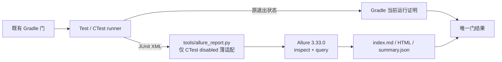
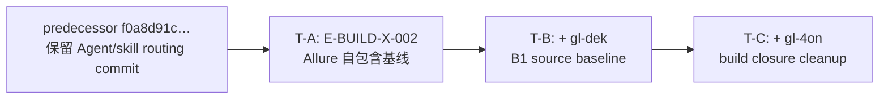

# Allure 报告门与提交基线恢复

## Context and scope

### E-BUILD-X-002/批次01：Allure 报告门薄适配

2026-11-15 用户要求先验证 Allure Report 3 对 Gradle、Android unit test、CTest 与 Agent Mode 的真实接入；在首轮验证发现兼容差异后，用户进一步纠正：固定 test 数量、旧 XML 表头对拍和自制统计器内部结构不是合同，必须只保留真实 runner 失败、跳过与真机门禁，并优先用少量配置或适配解决。最终批准范围是：用 Allure Report 3.33.0 替换手写统计和报告层，继续使用原 Gradle 门，不改业务代码、不增加另一套流程。原批准和当时运行证据只保留在对应 Beads 任务；本文件恢复其完整现行设计，不把历史 PASS 当作当前候选树 PASS。

该实现早于 `gl-dek` 与 `gl-4on`，但未被旧计划迁移收录，也从未独立提交。当前工作树把三批变更叠加在根／App Gradle、工具脚本和文档中。`BXP3-B1-COMMIT-SPLIT-05` 已证明，仅调整 Beads 依赖箭头不能得到可验证提交；必须先给每个共享 hunk 一个唯一 owner，再从固定前驱树构造并验证三棵候选树。

本批真实消费者只有三个既有入口：

- `nativeTestHost`；
- `:app:verifyDebugUnitTestXml`；
- `:app:verifyReleaseUnitTestXml`。

文件名中的 `Xml` 只为兼容现有命令；统计与报告 authority 是 Allure，JUnit XML 只是 Test／CTest 已有交换产物。没有新 aggregate、测试运行器、审批阶段或设备结论。

## Decisions

### 1. 单一执行与报告链

- Gradle 必须继续拥有任务图、current-run producer、原 runner 退出状态和完整 scope 证明；Allure 成功不得覆盖 Test／CTest 失败。
- Allure 必须拥有 XML 读取、状态建模、统计、HTML、Agent index 与 query JSON；Gradle 不再维护另一套 XML 计数器。
- `tools/allure_report.py` 只做两类边界适配：把 CTest `status="disabled"` 投影为 skip；给不同 CTest module 的同名用例加来源，避免被误判为 retry。它不得恢复固定总数、suite header 算术或第二份测试数据库。
- Android debug/release 必须分开报告；任一 failed、broken、unknown、skipped、缺失 producer、损坏 XML、过滤后的非全量运行或 runner failure 均不得使全量门 PASS。
- host native 允许既有 disabled 用例，但必须报告为 skipped／`PASS_WITH_SKIPS`，不得计作 passed；缺少任一声明 module 或 runner failure 仍失败。
- 失败测试可以生成诊断报告，但原门仍以非零退出；报告不存在或生成失败也不得复用旧报告冒充本轮结果。
- Allure CLI 固定为 3.33.0，只安装到根 `build/tooling/allure`；根 `clean` 删除它。`prepareAllure` 必须同时检查 package metadata 与 executable 的实际存在，缺任一文件即重新 provision。
- `cleanBuildPollution` 不跟随 symlink，也不得进入 package manager 拥有的 `node_modules`；它仍可按既有规则删除 `build/**` 中真实同步冲突副本。

### 2. 失败语义

| 观察 | owner | 门结果 |
|---|---|---|
| Test／CTest 非零 | Gradle runner | 失败；Allure 报告只辅助诊断，不吞掉退出状态 |
| current-run producer 缺失、过滤或未完整结束 | Gradle BuildService／任务图 | 失败并删除该 scope 旧报告 |
| XML 缺失、损坏或存在 unknown 状态 | bridge／Allure | 失败，不读历史固定数量补齐 |
| Android 有 failed／broken／unknown／skipped | Allure query＋Gradle gate | 失败 |
| host 只有显式 disabled／skipped，且其余状态完整 | Allure query＋Gradle gate | `PASS_WITH_SKIPS`，skip 不计通过 |
| Allure CLI／依赖在 `clean` 后缺失 | `prepareAllure` | 重新安装固定版本；不得稳定误报 `UP-TO-DATE` |
| report 生成成功但 runner 失败 | Gradle | 仍失败 |

### 3. 唯一 hunk owner

下表以当前提交前驱 `f0a8d91c…` 为共同基线描述语义块；该前驱只在原 `2297d9e7…` 上增加 Agent／skill 路由文档，本批必须保留其全部字节。一个未跟踪文件只能由一个候选整文件加入；共享 tracked 文件按下列具名声明／任务／文档段落拆 hunk。未列 hunk 保持未暂存，不以路径级全选代替审查。

| path | `E-BUILD-X-002` owner | `gl-dek` owner | `gl-4on` owner |
|---|---|---|---|
| `build.gradle.kts` | `cleanBuildPollution` 的 `node_modules` 边界；`AllureReportTask`、`prepareAllure`（含实际输出存在判据）、`NativeTestResults`；三个host CTest task的report/current-run接线与`nativeTestHost` summary；`VerifyNativeTestInventoryTask`只把固定结果文字改为实际group投影，并去掉`nativeTest43499GluedHost`／`nativeTestHost`描述与日志中的预写PASS数字，`expectedHostCounts`机器完整性约束保持HEAD字节 | AGP `9.1.0` 固定值；`nativeTestContractsHost` 的 plugin-owned source inputs；`nativeBuildAndroid` 的 plugin ZIP／debug+release APK boundary 总入口 | 删除无 caller 的旧 ONDK／root NDK resolver、`glCmakeCommon`、`checkAll`及其它只属于构建闭环清理的 hunk；验证前两批任务但不重复拥有 |
| `app/build.gradle.kts` | Allure 所需 imports；`UnitTestXmlRuns`、`UnitTestAllureReportTask`；以 debug/release variant loop 替换旧固定数量 verifier，并保留 runner failure/finalizer/current-run 证明 | builtin plugin asset／APK boundary producer与imports；`:plugin:api`／`:plugin:core`消费；移除 App JNA／active native owner；唯一 assets Provider 及其 test input/property 接线 | 删除断开的 profile/LKM declarations、旧 App NDK resolver与 stale profile 注释；不拥有 Allure 或 plugin producer 代码 |
| `tools/allure_report.py` | 整文件最终字节 | — | — |
| `tools/tests/test_native_test_summary.py` | 整文件最终字节；覆盖 runner failure、module completeness、status、corrupt input 与 pollution cleanup | — | — |
| `tools/tests/test_unit_test_xml.py` | 整文件最终字节；覆盖 stale/filtered/missing producer、失败报告与原门非零 | — | — |
| `plugin/packages/diagnose/build.gradle.kts` | — | 整文件最终字节，包括 AGP 9.1 provider、NDK/SDK tool、AAR provider、CMake staging 与 package gate；这是未跟踪 ADD，不能切给后继批 | 只验证，不拥有其中任何字节 |
| `tools/tests/CMakeLists.txt`、`tools/tests/diagnose_abi_test.cpp` | — | plugin-owned common／Diagnose host contract 接线 | 只验证，不拥有 hunk |
| `settings.gradle.kts` | — | plugin module includes 与直接所需配置 | 删除 stale profile-core 注释／include 提示 |
| `docs/development/engineering-standards.md` | R17 真实结果语义、Allure 报告入口与版本／查询说明 | plugin owner、ZIP/APK／runtime直接事实，以及`nativeBuildAndroid`作为verified plugin ZIP＋debug/release APK boundary总入口的现行命令说明 | toolchain locator、退役`checkAll`与其余构建闭环当前事实；不得把`nativeBuildAndroid`降回裸assemble语义 |
| `docs/development/development-environment.md` | Node/Python/Allure 依赖与报告门准备说明 | plugin 模块直接环境事实 | 其余构建故障／toolchain 清理说明 |
| `docs/development/full-process-uml.md` | `T-A`把测试结果投影从固定计数／手写XML改为Allure current-run报告，删除预写PASS数字；仍保留该候选当时存在的legacy native topology、旧`nativeBuildAndroid`和`checkAll` | `T-B`更新为已落地plugin catalog→PFD→loader→plugin-owned Kotlin/JNA/DSO、teardown与plugin build topology，并把`nativeBuildAndroid`投影为verified ZIP＋两APK boundary入口 | `T-C`只删除旧`checkAll`／profile／CI失效边并收口最终互不聚合gate图；不得覆盖Allure或plugin owner |
| `docs/development/active-plan-target-uml.md` | — | 仅已有 B1 目标内容；本次 owner 修订不改变目标图 | 只删除重复实时批准状态，不改目标架构 |
| `.github/workflows/build.yml`、`.gitignore` | — | — | CI 产物闭包、side-by-side NDK与 `.cxx` 暴露规则 |
| `README*`、`docs/development/introduction.md`、backend／RunHost README及其余148行 ledger source | 只拥有 `introduction.md` 当前任务入口中 `gl-8s7 → gl-dek → gl-4on` 的依赖／状态句 | `gl-dek` 独占其余 B1 current architecture、README 与148行 ledger source hunk | — |
| 本 change、两份被修订 OpenSpec、代号登记、Beads projection | 恢复 Allure 任务与三树 owner／依赖的设计和状态入口 | 后续只追加自己的候选运行证据 | 后续只追加自己的候选运行证据 |

`gl-4on` 原设计中把 `prepareAllure` 判据、Diagnose package producer 修复和 moved native source 接线列为自己的实施 hunk；本表以职责重分配取代这些**源码 owner**，但不删除其“clean 后闭环必须验证这些前置”的验收责任。最终工作树行为不变，变化的是哪个独立提交首先引入相应字节。

当前态文档必须随每棵候选保持真实，不能只在最终 `T-C` 一次修正：

- `T-A` 的 current UML 只投影 Allure/current-run与去固定计数；因为该树尚无plugin modules，必须继续画HEAD的legacy native topology、裸debug/release `nativeBuildAndroid`与仍存在的`checkAll`。
- `T-B` 的 current UML 才切换到plugin package/native owner、generated asset与`nativeBuildAndroid = verifyGlPluginZip + debug/release APK boundary`；这是已批准B1及当前source的canonical定义。
- `T-C` 删除`checkAll`、profile/LKM、旧CI与剩余失效构建边，得到当前工作树最终互不聚合gate图。活跃计划目标 UML 在三棵树中都不改变架构内容。

`engineering-standards.md` 同样按时间点拆 hunk：`T-A`只引入R17／Allure报告段，保留HEAD对旧`nativeBuildAndroid`的说明；`T-B`再把该命令同步为verified plugin ZIP＋两APK boundary；`T-C`不得回写成裸assemble。`VerifyNativeTestInventoryTask`的`expectedHostCounts`仍是source disposition完整性约束，不作为Allure运行结果常量；本批只拥有其logger／description去预写PASS数字的hunk。

因此，候选文档不能直接把当前最终文件整份塞入 `T-A`；必须按上述语义生成并随各候选独立验证。`nativeBuildAndroid`最终只证明已执行的静态plugin ZIP／APK boundary与其依赖构建，不证明RunHost DCL、App／Shizuku进程行为、真机加载、攻击成功或其它backend支持。

### 4. 三棵候选树，而不是当前叠加树

- `T-A` 必须只含本批 hunk；它不得包含 plugin modules、AGP 9.1 或 build-closure cleanup。
- `T-B` 必须以已经验证的 `T-A` 为 parent，只增加 `gl-dek` hunk；`plugin/packages/diagnose/build.gradle.kts` 直接取最终整文件，不产生一个已知不可构建的中间版本。
- `T-C` 必须以已经验证的 `T-B` 为 parent，只增加 `gl-4on` 剩余 hunk。
- 每棵候选用临时 `GIT_INDEX_FILE` 从固定 parent `read-tree`，只应用该 owner patch，再以 `git write-tree` 记录 tree id；不得改真实 index、不得修改当前共享工作树、不得把 `build/**` 或临时 patch 加入仓库。
- 实际本地 commit 只能在对应 tree id、增量 diff、适用门与非作者复审均成立后，从相同字节构造；若候选与工作树继续演化，旧 tree id 失效并须重新验证，不能用当前三批叠加树的绿灯替代。

### 5. 明确保留

- 不改 `gl-dek` 148行 production scope、AGP 9.1 裁定、JNA ordinary license entries 或任何 plugin runtime 合同。
- 不改 `gl-4on` 最终 clean／CI／warning／current-doc 验收，只移除其对前置字节的重复 owner。
- 不固定 test 数量，不要求 Allure 复刻旧 XML parser，不增加 TestOps、server、history service或第二报告工具。
- 不把 host／Android unit gate当作 AVD、Shizuku或真机证据；所有设备任务与状态保持原值。
- 不提交 `build/**`、Allure生成报告、CLI依赖、`.so`、APK、`local.properties`或候选临时 index／patch。

## Verification and authorization

### `T-A` 验收

从 `HEAD` 的临时候选树执行，不能在当前叠加树上代跑：

1. `python3 -B -m unittest tools.tests.test_native_test_summary tools.tests.test_unit_test_xml -v`：所有回归通过；负例不得输出 `ALLURE_GATE=PASS`。
2. `./gradlew clean --console=plain` 后执行 `./gradlew nativeTestHost :app:verifyDebugUnitTestXml :app:verifyReleaseUnitTestXml --console=plain`：三个原入口 exit 0；Allure 固定版本被重新 provision；host 与两个 Android variant 各自生成 fresh report；结果数量按实际读取，不写入验收常量。
3. 再次删除 `build/tooling/allure` 后运行一个原结果门：`prepareAllure` 不得为假 `UP-TO-DATE`，package metadata 与 CLI 都重新出现。
4. `git diff --check`、OpenSpec strict validation与工程文档链接通过；候选 diff 只含本节 owner。

### `T-B` 与 `T-C` 验收

- `T-B` 继续执行 `builtin-diagnose-plugin` 的既有 P0、source architecture、unit、native、ZIP/APK boundary、assemble／AIDL门；设备门状态不因 source commit 改变。
- `T-C` 继续执行 `build-closure-repair` 的 clean→build→final clean矩阵，并保留 Linux CI `NOT_RUN`；它可以观察前置 Allure／plugin gate，但候选 diff 不得重新引入其源码。
- 三棵树的命令、退出码、tree id、增量 path/hunk审计与任何失败只写各自 Beads notes，不在本 design 维护实时 PASS。

### 审查与批准

原 Allure production 改动已由用户于2026-11-15批准；本次不请求新的产品范围批准。由于这次修订实质改变 `gl-dek`／`gl-4on` 的源码 owner、提交依赖与验收输入，作者须先按现行 self-check 核对真实调用者、单一 authority、三候选可构造性及无 scope 扩张，再由既有非作者 design-critic 定点复审 `BXP3-B1-COMMIT-SPLIT-05`。critic 未关闭该 finding 前，不得改真实 index、commit、关闭 Allure任务、`gl-dek` 或 `gl-4on`。

实际批准、任务状态、依赖、candidate tree id、命令与结果只读对应 Beads 任务；OpenSpec artifact ready 不等于候选已验证或可提交。
