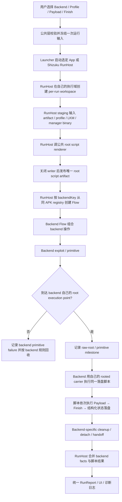

# 公共执行与产品成功基线

## Context and scope

完整迁入的有效设计/范围与验收正文；不是新增实施批。原批准/历史结果按原Beads记录，工具工件齐备不代表实现或门禁通过。

来源：`043fdf6a:.beads/issues.jsonl`；保留语义代号和原锚点。本文中的历史进度/门结果文字仅是其具名输入的沿革，当前状态从proposal列出的Beads读取。旧机制由正文已注明的后继差异取代；基线不重新授权实施。

## Decisions

<a id="record-gl-4tt"></a>

## P-RUN-X-001：产品成功、公共执行边界与资源所有权

<!-- migrated-source: 043fdf6a Beads gl-4tt description -->
2026-11-21迁入的共享设计记录，不是新的执行任务。closed仅表示该记录收录完毕，不表示业务实现、新批准或门禁通过。
公共语义保留。BackendDefinition/static registry、Host持有native、同APK loader及具体旧类名仅为B1前基线；当前批准差异由plugin父决策与B1、后继controller/core设计取代，不按旧路径实施。

<!-- migrated-source: design gl-4tt -->
<!-- source: f882e670:docs/plan/backend-root-execution-unification-plan.md:L110-L339 -->
#### 1. 最高目标与产品成功

##### 1.1 最高目标

GhostLock 的最高目标是：**通过用户选择的 backend 取得足以执行用户目标的 root 权限，并实际执行用户选择的 Payload**。

这里的“获取 root”不是只把某个进程的数值 UID 变成 0，也不是只证明一次 kernel read/write、cred overwrite、UMH 或 rooted child。它是一个面向产品结果的完整链：

```text
backend 原语成功
  → 到达该 backend 的 root execution point
  → 执行公共层生成并落盘的 root 脚本
  → 用户 Payload 达成请求的效果
  → 执行用户配置的 Finish 附加动作
  → 回报可区分的结果并完成 backend 资源收尾
```

##### 1.2 raw uid 0 的准确地位

`getuid()==0`、rooted child、cred 已替换或等价事实可以作为 **backend primitive milestone**：

- 它证明对应 backend 的“取得 root 原语”在该次运行中可用；
- 它适合真机 bring-up、回归定位与 CVE 原语验证；
- 它必须能与脚本派发、Payload、Finish 和 cleanup 结果分别记录。

但 raw uid 0 **不单独等于产品成功**，因为仍可能发生：

- root 进程无法读取或执行脚本；
- SELinux / seccomp / mount namespace / capability 状态不满足 Payload；
- 脚本未派发、shell 启动失败或工作目录已失效；
- Payload 启动失败、目标守护进程未确认、LKM 未加载或用户命令返回失败；
- backend 在 raw uid 0 后崩溃或提前回收了承载进程。

产品成功至少需要**用户 Payload 的成功判据**成立；Finish 的成败按其策略单独回报，不能把 raw uid 0 或“脚本已启动”冒充 Payload 成功。

##### 1.3 Payload 与 Finish

- **Payload**：root 权限最终要启动的用户目标，例如 root manager / `ksud`、用户命令、用户脚本或 LKM。它是产品主结果。
- **Finish**：Payload 之后的附加功能，例如恢复某种状态、软重启、写最终标记或其它结束动作。它不拥有 Payload，也不决定 backend 如何拿 root。
- Payload 与 Finish 都不属于具体 backend；二者各自拥有设置、持久化、校验与脚本片段生成。
- 只有需要系统内核偏移信息的 backend 配置才来自 GLK profile v3；43284、Diagnose 等不需要系统内核偏移的 backend 使用自己的具名 typed authority。Payload 与 Finish 继续独立于 backend，内部持久化按 P-SETTINGS-IO-001 直接序列化完整 data class；各权威分别冻结、互不嵌入、互不反向写回。
- 运行时把 Payload 片段与 Finish 片段按固定顺序合成**一份脚本文件**。不存在运行时 `PayloadExecutor` / `FinishExecutor` / `PostRootExecutor` 对象链。

#### 2. 统一端到端流程



##### 2.1 固定顺序

一次运行的固定顺序是：

1. UI/application 冻结 Backend、Profile、Payload、Finish；
2. launcher 启动所选 App/Shizuku RunHost，并只传 typed run input 与文件描述符；
3. RunHost 在自己的 uid/SELinux/mount namespace 中建立 per-run workspace；
4. RunHost staging 所需普通文件；
5. RunHost 调用公共 renderer 生成一份 root 脚本，关闭 writer 后发布 artifact；
6. RunHost 只按 `backendKey` 从同一 APK 的 immutable registry 创建 Flow；
7. Flow 组合该 backend 的原语和生命周期步骤；
8. backend 到达自己的 root execution point；
9. backend 执行该脚本；
10. 脚本内部执行 Payload，再执行 Finish，再写结构化状态；
11. backend 完成自己的 detach / cleanup / handoff；
12. RunHost 合并 backend facts 与脚本结果并发布分层结果。

顺序修订的原因是执行域可达性：App 私有目录中的文件不能先验地被 Shizuku shell、rooted child 或独立 ELF 读取。workspace 与最终脚本必须由实际 RunHost 执行域拥有；UI 进程只冻结输入和传递文件描述符，不先写一份“可能不可达”的权威脚本。预览使用内存或独立 preview workspace，绝不覆盖 production run artifact。

不允许把第 9 步搬成一个与 backend 分离的通用 executor，因为只有 backend 知道：

- 哪个进程/线程/child 此刻真正有 root；
- 该 root 所在 SELinux domain、namespace、seccomp 与 capability 状态；
- 承载进程能否阻塞等待脚本、必须 detach，还是会在返回后立即被回收；
- 哪些资源在脚本启动前后必须继续存活。

##### 2.2 脚本是公共协议，不是公共执行器

公共层统一的是**脚本 artifact 合同**与**结果协议**：

- 运行唯一标识；
- 普通文件路径与访问前提；
- Payload 片段；
- Finish 片段；
- shell 入口；
- 状态文件/退出码/必要确认事实；
- 清理时机所需的最少信号。

backend 统一消费同一类脚本 artifact，但执行动作位于各自 root point。对于不同 backend，实际 carrier 可以是 rooted victim、当前进程、fork child、UMH 或独立 exploit ELF；不能为了表面统一把它们伪装成一个 JVM root session。

#### 3. Backend 的共同部分：应抽离复用

##### 3.1 BackendDefinition、BackendDescriptor 与 catalog

所有随 App 发布的 built-in backend 由外层 `composition/backend` 的一个不可变 `BackendDefinition` 列表注册。每个 definition 组合三项，但不把它们混入同一层：

- `BackendDescriptor`：domain 中的稳定 `key`、selection、abort、execution-domain 与 capability；
- `BackendRuntime`：backend 层的 dynamic availability 与 fresh `Flow` 创建；
- `BackendUi`：UI 层的 Android 文案、项目图标和可选具名设置页面。

`BackendRegistry` 与 `BackendDefinition` 均位于允许同时装配 domain/backend/UI 的外层 `composition/backend`，不是 `backend/declarations`。registry 私有持有唯一 definition list：RunHost／Shizuku只通过 `runtime(key)` 获得backend层定义的 `BackendRuntimeEntry(descriptor, runtime)`；AppContainer只从同一snapshot取得UI层定义的 `BackendUiEntry(descriptor, ui)` 并构造唯一 `BackendUiCatalog`。两个entry都是由definition即时派生的只读投影，不保存第二份membership/key表。普通inner caller不得import outer registry/definition；唯一例外是框架直接构造的`RunHostService.kt`与`GhostlockUserService.kt`两个物理入口，它们只可调用`BackendRegistry.runtime(key)`并立即只持有`BackendRuntimeEntry`，不得访问definition、UI projection、snapshot/list或其它outer API。现有data层 `BackendCatalogAdapter` 及domain `BackendCatalogPort/GetBackendCatalogUseCase/BackendRegistrySnapshot` 随旧presentation DTO一并删除，Home／Path／BackendPage只消费UI层catalog，data层selection/run adapter只消费descriptor/runtime投影。architecture guard须把上述两个绝对路径作为唯一窄allowlist；除此以外任何inner production source import outer registry/definition均FAIL。现行 `backend/data/core → ui` 与 `ui → backend/data/core` 禁边保持不变，不得因本批放宽。

built-in backend 与 App 同产物发布，不增加 contract digest、interface version、size/reserved 或旧兼容分支。registry拒绝空/重复/unknown key，不支持运行时 `register/unregister/resetToBuiltins`。Lua脚本是数据，只调用受限 operation catalog；它不动态注册新的 built-in definition。

2026-11-08开发者进一步裁定：当前没有需要配置的真实backend，故本批不预建GLK profile repository、manual schema或selected-backend JCS freeze。现有最小diagnostic profile fixture保持原行为，只随`BackendSpec→BackendDescriptor`做必要的类型名迁移；待某个具体backend提出真实配置字段、consumer与运行映射时，再恢复BD-I3并按该backend的实际需求设计。offset/waiter等字段继续只存在于既有backend文件，不进入`BackendDescriptor`或通用Compose模型。现有 `BackendSpec/BackendPlugin` 是本批实施前的current source名；本节与P-BACKEND-CORE-001/决策01-02是下一动作唯一authority，旧spec/plugin模型不得再作为未来重建模板。

##### 3.2 一次运行的准备

以下由公共层统一：

- immutable run input；
- per-run workspace；
- Payload/Finish/依赖 artifact staging；
- 单一 root 脚本的 render、write、close 与只读发布；
- launcher / host / transport；
- 结构化日志与 UI run state；
- 结果分层与最终展示；
- 不含攻击资源的普通文件清理。

公共层不得在多个 backend 中重复生成 KernelSU 启动脚本、重复解析 Payload 设置或重复硬编码 Finish。

##### 3.3 Flow

`Flow` 保留。它是 backend 全流程的编排层，不因为当前只有 `run` 就删除：

- 当前：一个 backend Flow 可把现有粗粒度入口组织成完整运行；
- 未来：backend 拆成多个由 JNA 暴露的独立 native operation 后，Flow 组合顺序、重试、条件分支与 cleanup；
- Lua：可按允许的 operation catalog 自行组合这些 native operation，最终仍把同一 root 脚本交给选定 backend/root carrier 执行。

Flow 负责逻辑编排；不可暂停、时序敏感、需要共享 native 资源或 PI/waiter 连续性的物理事务仍保持在单个 native operation 内。

##### 3.4 统一 root script generator

公共 root script generator 是本次最直接的复用点：

```text
prologue / run metadata
  → Payload fragment
  → Payload status
  → Finish fragment
  → Finish status
  → epilogue / final marker
```

它只负责生成文件，不执行文件。Payload 与 Finish 可以各有 renderer/fragment model，但最终只有一个 script writer 和一个落盘 artifact。

##### 3.5 统一结果模型

一次运行至少区分下列事实，禁止压成单个 Boolean：

1. `backend_primitive`：原语是否到达预期 root milestone；
2. `root_script_dispatch`：backend 是否实际请求 rooted carrier 执行脚本；
3. `payload`：用户目标是否满足自身成功判据；
4. `finish`：附加动作是否完成、跳过或降级；
5. `backend_cleanup`：攻击资源是否按 backend 生命周期完成回收/移交；
6. `run_terminal`：本次运行最终状态及是否需要重启/人工处置。

`backend_primitive=success` 可以成为 backend 可用性证据，但只有 `payload=success` 才能进入产品成功判定。Finish 严重度按[已裁定的 Finish 合同](#record-gl-7c2)，cleanup 与各层事实的最终等级按 [RunHost 公共合同的产品终态优先级](../../specs/runhost-wire/spec.md#product-terminal-precedence)合成；不是待裁事项。

#### 4. 必须留在具体 backend 的部分

以下没有足够共同语义，不能放入公共 core：

- waiter / race / spray / reclaim / leak / fake cred / kernel R/W；
- CVE-specific offsets、结构布局与 route；
- native handle、fd、mapping、thread、child、socket、perf sampler 的所有权；
- PI 窗口与不可暂停物理事务；
- “何时已经取得可执行 root”的判据；
- rooted carrier 的实际形态；
- 脚本启动前后的存活、detach、wait 与回收顺序；
- backend-specific failure recovery 与 reboot requirement。

这些部分可以在**同一个 backend 内**抽小 operation 供其 Flow/Lua 组合，但不能为了共享名字外提到通用层。

#### 5. Victim 的处置

公共 `core/victim` 不再作为架构组件保留。

- 若某个 backend 的真实攻击原理需要 victim/helper，它属于该 backend 的私有实现；
- victim protocol/session/transport 与该 backend 的生命周期一起审查；
- 其它 backend 不通过公共 victim façade 复用它；
- 若旧 43499 路径被整体淘汰，其 Kotlin/JNI/helper chain 一起删除，不为“可能以后有用”留公共壳。

这里删除的是错误的公共 ownership，不是提前裁定所有 backend 永远不能 fork helper。

#### 6. 脚本落盘与执行域要求

##### 6.1 文件必须对真实 rooted carrier 可访问

脚本“已经写到磁盘”不等于 backend 能执行。stager 必须按选定执行域证明：

- carrier 能解析路径；
- carrier 能读取脚本及依赖 artifact；
- mount namespace 中路径指向预期文件；
- SELinux domain 允许必要的 open/read/execute 或 `/system/bin/sh <path>`；
- parent cleanup 不会在 carrier 打开前删除 workspace；
- detached payload 需要的文件不会被过早回收。

因此不能默认使用 App 私有 `filesDir`，也不能为所有 backend 硬编码同一个 `/data/local/tmp`。公共层提供 staging policy 与 artifact 合同，具体执行进程/域决定可用 staging adapter。

##### 6.2 普通文件语义

目标语义是：生成完成后关闭 writer，发布绑定 object+bytes identity 的 ordinary file artifact，然后由 backend 执行**同一个已发布文件对象**；不能只凭 path 或发布时 digest 推断 carrier 最终消费了同一对象。

固定不变量：

1. host 以 `O_CREAT|O_EXCL|O_NOFOLLOW` 或平台等价方式创建 temp regular file，完成 write/flush/close/permission 后才发布；workspace directory 不对非 owner 开放写权限。
2. publish identity 至少记录 `device/inode/byteCount/SHA-256/mode`；`contentDigest` 只证明 bytes，不单独证明 object identity。
3. backend 在自己的 namespace 中以 `O_NOFOLLOW` 打开，`fstat` 核对 regular/owner/mode/device/inode/size，并对**同一已打开 fd**重算 bytes identity；随后优先通过 `/proc/self/fd/<fd>` 或等价 pinned handle 交给 shell。
4. carrier 若物理上无法继承同一 fd，backend-specific L 子计划必须提供等价的 pinned-object 证明与 rename/truncate/symlink/namespace replacement 负例；未证明就保持 NotReady。
5. result file 由 host 在不可被非 owner 替换的 workspace 中预创建并记录 identity；脚本只写该 object，RunHost 解析前重验 identity。partial/malformed 不从日志补猜。

这些是 artifact 合同，不是 root executor/lease/receipt。


<!-- source: f882e670:docs/plan/backend-root-execution-unification-plan.md:L356-L493 -->
#### 8. 明确排除的错误方向

本需求基线排除：

- 通用 `PayloadExecutor`、`FinishExecutor`、`PostRootExecutor`；
- 与真实 backend root carrier 脱节的 `RootExecutionContext` / root lease；
- backend 内再次读取 UI/settings 或生成自己的 KSU/Payload/Finish 脚本；
- 把 raw uid 0、kernel write、脚本 dispatch 或 native exit 0 单独标成产品成功；
- 把 victim、waiter、race、route、cred、native handle 抽成所有 backend 共用的大一统 façade；
- 因当前 Flow 只有 `run` 就删除 Flow；
- 为同 APK 内的 backend registry 增加静态 contract digest/version handshake；
- 在本计划未获批准前修改 production source、启用 backend 或把诊断结果写成产品成功。

#### 9. Native binding 裁定：JNA

##### 9.1 用户裁定与范围

2026-11-04，用户裁定 future backend native binding 从手写 JNI 改为 **JNA**。

- 未实现 backend 不作为迁移、兼容或行为 parity 基线；不能因旧 `external fun` / `JNIEXPORT` 数量扩大新架构。
- 新 backend 不再新增业务型 `JNIEnv` / `jobject` bridge，也不在 C/C++ 中读取或写回 Kotlin/Java object 字段。
- JNA 只取代 JVM↔native 的 binding/marshalling 层；Flow、root script、Payload/Finish、backend lifecycle 与攻击物理事务的 owner 不因换 binding 改变。
- current-tree inventory 已确认旧 original 43499/43284、KernelSnitch 与全局 NativeLogBridge 不构成可用产品基线；P-BACKEND-X-001/批次01 按闭包删除，不建立兼容桥。

##### 9.2 唯一目标边界

```text
Kotlin domain / Flow / Lua operation
  → backend-private Kotlin JNA adapter
  → JNA binding types and library interface
  → extern "C" fixed ABI
  → C/C++ backend implementation
```

边界约束：

1. Kotlin domain DTO 不继承 JNA `Structure`，不暴露 `Pointer` / `Memory`；backend-private adapter 是唯一 domain↔JNA 转换点。
2. JNA binding 只描述普通 C ABI，不映射 C++ class、虚函数、模板、`std::string`、`std::vector`、`std::span` 或异常。
3. C/C++ export 使用 `extern "C"`、固定宽度整数、小型 POD struct、buffer+length 与 opaque handle。
4. C/C++ 不知道 Kotlin package、class、property、JVM descriptor；production backend C/C++ 中不得新增 `JNIEnv*`、`jobject`、`GetFieldID`、`Set*Field` 等业务转换。
5. C++ exception 必须在 C ABI 内截获并转换成稳定状态码；异常、allocator object 与 STL ownership 不跨 ABI。

##### 9.3 JNA 负责与不负责的内容

JNA 负责同步调用期间的常规 marshalling：

- primitive 与固定宽度 C 字段；
- JNA `Structure` 调用前写入与调用后读回；
- primitive array 的调用期 buffer；
- `Pointer` / `ByReference` 形式的指针参数；
- native symbol 调用与返回值转换。

JNA 不成为资源 owner，也不替代：

- native handle / fd / child / mapping / thread / waiter 的生命周期；
- native allocation 对应的显式 free/destroy；
- native 在调用返回后继续持有 input pointer 时的 memory owner；
- attack transaction、PI 窗口、停止访问→解除关联→回收顺序；
- Payload/Finish/root script 的业务合同。

##### 9.4 内存与调用纪律

- primitive array、String 或临时 `Structure` 对应的 native memory 默认只允许在本次同步调用期间使用；native 需要跨调用保存时，必须在调用内复制到 native-owned storage，或由明确的长期 `Memory` owner 持有。
- variable-length output 优先由 JVM caller 提供 buffer+capacity，native 返回 required/written length；若 native 分配内存，ABI 必须同时提供唯一匹配的 free 函数。
- C++ object 只通过 opaque handle 暴露；create/close/destroy、generation 与并发规则仍显式建模，不能依赖 JVM GC/finalizer。
- callback 不是默认日志/状态通道；跨线程 callback 会重新引入 JVM attach 与生命周期问题。backend 默认返回结果、轮询状态或使用既有 fd/file sink。
- `long`、`size_t`、C++ `bool`、bit-field 与隐式 enum 不进入公共 ABI；使用 `int32_t` / `uint32_t` / `int64_t` / `uint64_t` / `uint8_t` 与显式 padding/version。
- struct field order、alignment、`sizeof` 与 `offsetof` 必须在后续实施设计中形成双侧机械对拍；JNA 自动 marshalling 不等于布局天然一致。

##### 9.5 调用粒度

JNA operation 保持粗粒度。不可暂停、时序敏感或共享 native 资源的序列仍封装为一次 native operation；禁止把 race/waiter 内循环拆成 Kotlin 高频 JNA 往返。Flow/Lua 组合的是有物理意义的 operation，而不是 native 内部的每个微步骤。

##### 9.6 依赖事实与非目标

JNA 官方说明 interface mapping 会自动处理 `Structure` 字段的调用前后复制，并通过 `libjnidispatch` / libffi 调用 ordinary native symbol；primitive array 若要在函数返回后继续使用，必须改用长期 `Memory` 或 direct buffer。Android artifact 在 Maven Central 发布。

参考：

- [JNA README](https://github.com/java-native-access/jna/blob/master/README.md)
- [JNA Functional Description](https://github.com/java-native-access/jna/blob/master/www/FunctionalDescription.md)
- [JNA Default Type Mappings](https://github.com/java-native-access/jna/blob/master/www/Mappings.md)
- [JNA Pointers and Arrays](https://github.com/java-native-access/jna/blob/master/www/PointersAndArrays.md)
- [JNA Structures and Unions](https://github.com/java-native-access/jna/blob/master/www/StructuresAndUnions.md)
- [Maven Central: net.java.dev.jna:jna:5.19.1](https://central.sonatype.com/artifact/net.java.dev.jna/jna/5.19.1)

本裁定的目标是删除手写 JNI object/memory marshalling，不是宣称所有 native ownership 会自动消失，也不是现在开始 implementation。

##### 9.7 JNA 不替代 executable carrier

current tree 的三类 native 产物必须先按角色区分：

| 角色 | 当前例子 | 新边界 |
|---|---|---|
| `JNA_DSO` | 尚无合格 production 例子；旧 original 43499/43284 DSO 是未完成 JNI 岛 | future coarse operation 才建立 `SHARED_LIBRARY + extern "C"`，由 backend-private JNA adapter 调用 |
| `EXEC_CARRIER` | `43499glued`、`43284glued`、`98260` | 保持独立 ELF / self-reentry / park 语义；由 RunHost 的 process carrier 启动，不强改成 DSO |
| `HELPER_EXEC` | `43284glued` bootstrap、旧 victim helper | 只在对应 backend 的真实物理事务需要时保留为 backend-private helper |

因此“换 JNA”的准确含义是：

1. 删除未实现 original 43499/43284 与 KernelSnitch 的手写 JNI bridge，不做 37 个 `external fun` 的一比一迁移；
2. future backend 若拆出可由 Flow/Lua 组合的 native operation，新增真实 shared operation DSO，并只通过 JNA 调 ordinary C symbol；
3. 现有 executable carrier 不通过 `Native.load`，JNA 不替代进程启动、stdout/stderr、park 或 `/proc/self/exe`；
4. 不先加入无业务 consumer 的 probe DSO/JNA dependency。JNA AAR、P-DIAG-NATIVE-001/批次01 shrink/loader gates、artifact verifier、C ABI 与首个真实 operation 必须在同一个纵向批次进入，避免永久临时物。

需要独立可替换 native port 或跨调用 handle 的 JNA backend 私有包使用：

```text
backend/backends/<key>/nativeapi/
  <Key>NativePort.kt          # Flow/Lua 使用；不 import JNA
  <Key>NativeOperation.kt     # 粗粒度 operation/result
  jna/<Key>JnaLibrary.kt      # ordinary C symbol mapping
  jna/<Key>JnaStructs.kt      # wire-only Structure
  jna/<Key>JnaAdapter.kt      # 唯一 DTO↔JNA 转换点/Native.load owner
  jna/<Key>NativeHandle.kt    # 显式 close/destroy owner
```

C/C++ 侧每个 shared operation DSO 使用 backend-private `api/<key>_api.h` 与一份 symbol authority；它同时生成 declaration、linker export list、CMake manifest 与 JNA method 对拍输入，禁止在 C header/CMake/Gradle/Kotlin test 四处手抄 symbol。

P-DIAG-NATIVE-001/批次01 的 Diagnose operation是单一caller、同步、无handle的当前例外：它直接使用纯mapping `DiagnoseJnaLibrary` 与 concrete owner `DiagnoseNativeBinding`，不创建只转发一次的`NativePort`、`NativeOperation`或`NativeHandle`。`DiagnoseFlow`构造器直接构造binding，binding构造器负责constant-name load；调用期fd与Native log注入仍由binding的方法管理。未来出现第二个实现、Lua consumer或跨调用native资源时，再按当时owner建立相应边界；不得把上面的完整目录骨架机械套给无对应生命周期的operation。

##### 9.8 JNA 分发许可与两 execution-domain loader owner

JNA 5.19.1 的 Maven POM 与上游 README 都声明 LGPL-2.1-or-later / Apache-2.0 双许可。本项目选择 **Apache-2.0** 作为分发依据；P-DIAG-NATIVE-001/批次01 首个真实 JNA operation 子计划必须在同批完成：

1. 固定 `net.java.dev.jna:jna:5.19.1@aar` 的 dependency verification metadata；不得用动态版本。
2. strict校验Maven POM与AAR；在 APK 的 third-party inventory 中记录 group/artifact/version、上游 URL、Apache-2.0 选择，并逐字打包JNA `5.19.1` source tag中的`LICENSE`、`AL2.0`与`LGPL2.1`。实物核验确认5.19.1 AAR不含许可正文或NOTICE；不创建空NOTICE。若以后所取release/AAR附带NOTICE则逐字保留并纳入APK；缺失inventory/license时release gate失败。
3. 指定 dependency 升级 owner=`backend/native-binding`；触发条件是 CVE/Android ABI 修复、目标 API/16 KiB 不兼容或项目主动升级。升级必须重跑 AAR ABI、license、export/layout 与两execution-domain load gate，不得只改版本号。

原设计在没有真实JNA consumer时为Shizuku预设了PFD staging与独立boot path。P-DIAG-NATIVE-001/批次01现以实际Diagnose consumer取代该推测性分支：两个RunHost都只从同一APK、同一常量library name加载，不向Flow传Context/path，也不扩RunHost wire。加载路径只有下表这一条；AVD失败时停批回设计，不在运行时fallback。

| 进程角色 | loader owner | 唯一路径策略 | 失败语义 |
|---|---|---|---|
| App `:flowhost` | `DiagnoseFlow`构造器中的`DiagnoseNativeBinding()` | JNA Android AAR从APK native-library set加载`libjnidispatch.so`；binding只用常量`ghostlock_diagnose`调用`Native.load` | `plugin.createFlow()`抛错，prepare返回`RunHostCode.IO_FAILURE`；不生成RunReport，不fallback JNI/自由path |
| Shizuku UserService | 同一个`DiagnoseFlow`/binding构造约定 | 使用UserService的APK classloader与相同常量名；不读取App私有路径、不staging、不改system property | prepare返回`RunHostCode.IO_FAILURE`；停止本批并以AVD证据重开loader设计 |

App `:flowhost` load成功不能替代UserService load证据，UI App process不加载该Flow DSO。当前只允许`Native.load("ghostlock_diagnose", ...)`这一处literal调用；禁止`Native.load(userInput)`、任意目录扫描或失败后换路。若以后production backend需要不同DSO/loader lifecycle，由对应L级计划基于P-DIAG-NATIVE-001/批次01实测决定，不预建公共`JnaLibraryLoader`。


<!-- source: f882e670:docs/plan/backend-root-execution-unification-plan.md:L704-L850 -->
#### 11. 目标架构与唯一控制流

##### 11.1 组件与 owner

| owner | 唯一职责 | 明确不拥有 |
|---|---|---|
| `domain/backend` | 纯 `BackendDescriptor`、selection/capability/abort/execution-domain 事实 | Compose、resource ID、Flow factory、配置文件、JNA |
| `backend/declarations` / `backend/backends/<key>` | `BackendRuntime`接口、`BackendRuntimeEntry`只读投影与具名runtime实现；profile→typed request、JNA/ELF、root point与cleanup | UI、membership list、Payload/Finish renderer |
| `ui/backend` | `BackendUi`接口、`BackendUiEntry`/唯一`BackendUiCatalog`与具名Android实现 | runtime factory、JNA、profile文件I/O、membership authority |
| `composition/backend` | 每backend一个 `BackendDefinition` root；唯一immutable definition list与runtime/UI投影 | mutable runtime state、第二key表、动态register/unregister |
| `domain/payload` | 用户主目标、顺序、required、acceptance 与持久化接口 | backend root 原语、Finish |
| `domain/finish` | Payload 后附加动作、severity/alwaysRun 与持久化接口 | Payload、backend cleanup |
| `core/rootscript` | 合并 Payload/Finish、render 一份脚本、result codec | 执行脚本、选择 workspace |
| `data/run` | per-run workspace、输入 staging、App/Shell adapter、preview 隔离 | exploit/root carrier |
| `core/flow` | backend logical orchestration、step/retry/stop；关闭的 option 不返回对应 step | reflection symbol、UI、具体 CVE |
| `backend/transport` | App/Shizuku RunHost、typed AIDL、进程生命周期与 RunHost 日志转运 | 漏洞算法、全局日志排序、产品成功推断 |
| `domain/run` / `core/run` | immutable run input、typed report、单一 `LogHub` commit/fan-out | backend 私有解析、native ownership |
| `ui/icon` | 项目语义 `Icons` 到 Material/Miuix 的唯一人工映射 | backend 状态、导航、字符串资源 |
| log connectors / sinks | source FIFO 接入与独立流式消费 | 产品成功、Flow 控制、跨 source 时间戳重排 |

##### 11.2 最小运行数据结构

以下名称是实施 authority；字段新增必须先改本计划/对应 batch：

```kotlin
data class FrozenRunInput(
    val runId: String,
    val generation: Long,
    val backendKey: String,
    val profile: ProfileSnapshot,
    val payload: PayloadDefinition,
    val finish: FinishDefinition,
    val inputArtifacts: List<RunInputArtifact>,
)

data class RootScriptArtifact(
    val runId: String,
    val generation: Long,
    val scriptPath: String,
    val resultPath: String,
    val scriptIdentity: PublishedArtifactIdentity,
    val resultIdentity: PublishedArtifactIdentity,
    val retainedArtifacts: List<String>,
)

data class PublishedArtifactIdentity(
    val device: ULong,
    val inode: ULong,
    val byteCount: Long,
    val sha256: String,
    val mode: UInt,
)

data class BackendRunFacts(
    val primitive: StageResult,
    val scriptDispatch: StageResult,
    val cleanup: StageResult,
    val terminalHint: BackendTerminalHint,
    val diagnosticOutcome: DiagnosticOutcome,
)

data class RunReport(
    val runCapability: RunCapability,
    val diagnosticOutcome: DiagnosticOutcome,
    val backendPrimitive: StageResult,
    val rootScriptDispatch: StageResult,
    val payloadItems: List<PayloadItemResult>,
    val payloadOverall: StageResult,
    val finishItems: List<FinishItemResult>,
    val finishOverall: StageResult,
    val backendCleanup: StageResult,
    val terminal: RunTerminal,
)
```

`BackendDescriptor.runCapability` 是 `RunCapability` 唯一 authority；`BackendRunFacts` 只报告该 run 的 diagnostic outcome，不能改 capability。`PRODUCT_ROOT` 必须报告 `DiagnosticOutcome.NOT_APPLICABLE`；`DIAGNOSTIC_ONLY` 只能按 wire 附件得到 `PASS/FAIL/UNKNOWN/NOT_RUN`。应用层产品成功 projector 只接受 `PRODUCT_ROOT + RunTerminal.SUCCESS`，因此 DebugProbe 的 PASS 不能进入 Home/Run 的产品成功状态。

runtime SHA-256 在 publish 与 carrier 对同一 opened object 验证时各计算一次；它与 device/inode/size/mode 共同证明 identity。它不是普通源码 SHA 清单，也不得被重复轮询。

##### 11.3 Flow 合同

`Flow` 概念保留并去掉 reflection/KClass 身份：

```kotlin
interface Flow {
    suspend fun run(input: BackendFlowInput): BackendRunFacts
    fun stop()
}
```

- `BackendFlowInput` 只含 run identity、host-local `RootScriptArtifact`、profile snapshot、typed event sink 与 cancellation view；不含 Android UI/Context。
- 外层 registry 的 `runtime(key)` 投影调用 `BackendRuntime.createFlow()`，每次 run 创建新 Flow；Flow 不跨 run 复用 mutable state，RunHost不接收 `BackendUi`。
- backend 将复杂 native 工作拆成**粗粒度且物理上可暂停的 operation**。PI race、waiter 生命周期、shared handle transaction、98260 self-reentry/park 等不可拆序列仍是单个 operation。
- Lua 通过 `LuaOperationCatalog` 获取批准 operation，不获得 JNA library name、symbol lookup、raw address、`Pointer` 或 `Native.invoke*`。

##### 11.4 typed RunHost wire

字段、范围、方法签名、状态转移、稳定错误码与极端值的唯一 authority 是附属设计：[`backend-root-execution-runhost-wire.md`](/openspec/specs/runhost-wire/spec.md)。主计划只保留控制流摘要；两者一起过 E-DOC-X-001/批次01 批准，附件不得自行增加业务能力。

旧 wire `symbol + Bundle + optional byte[] payload + registry digest` 被下列合同取代：

```text
RunHostRequest
  runId
  generation
  backendKey
  FrozenRunInputParcel（只含有界标量/小型列表）
  List<RunInputArtifactParcel>(logicalId, byteCount, digest, read-only PFD)

IRunHost
  setCallback(runId, generation, callback)
  prepare(request)
  start(runId, generation)
  getSnapshot(runId, generation) -> RunHostSnapshotReply
  cancel(runId, generation)
  requestClose(runId, generation)
  destroy()  # 仅 Shizuku framework 固定 transaction
```

- user script、LKM、manager binary、profile 等大内容只走 read-only PFD；Binder 不承载任意大 `ByteArray`。
- request 不含 class name、method name、arbitrary `Bundle`、registry digest 或自由文件 path。
- App 与 Shizuku 使用同一 request/result schema；差异只在 client/binding/workspace adapter。
- host 顺序固定：validate request → duplicate/own fd → stage → close input fd → render/publish script → resolve backend key → create Flow → run → parse result → cleanup/retain → terminal callback。
- 所有 callback/snapshot/control 都用 `runId + generation`；`NEW→PREPARED→RUNNING→TERMINAL→DESTROYED`、重复/并发调用与 Shizuku framework `destroy()` 服从 wire 附件，不由实现临时决定。

##### 11.5 root script result protocol

`GLR1` 的唯一 grammar、稳定整数、exit kind/range、unknown/duplicate/partial 规则、reboot durable handoff 与六层 facts→terminal 合成表全部位于 [`backend-root-execution-runhost-wire.md` §6–§7](/openspec/specs/runhost-wire/spec.md#6-稳定数值合同)。主计划不保留第二套字段表或示例整数；任何协议变更先改附件 authority 与 codec golden，再改实现。

用户文本、命令正文、路径与日志不进入 result protocol。writer/flush/fsync/parser 任一失败不影响 backend safety cleanup，但 product terminal 必须按附件降为 UNKNOWN/NEEDS_ATTENTION，不能从 stdout/logcat 补猜。

##### 11.6 executable carrier 与 JNA operation 并列

```mermaid
flowchart LR
  F[Backend Flow]
  F -->|shared coarse operation| J[backend-private JNA adapter]
  J --> DSO[extern C operation DSO]
  F -->|independent carrier| P[common process carrier]
  P --> ELF[backend-private ET_EXEC/helper]
  DSO --> RP[root point]
  ELF --> RP
  RP --> SH[/system/bin/sh host-local script]
```

JNA 与 process carrier 是两种 native 形态，不是新旧两条产品路径；每个 backend 只选择其真实物理形态。common process carrier只统一 spawn/fd/stdout/stderr/process-death 观测，不知道 CVE、不生成脚本、不冒充 root executor。


<!-- source: f882e670:docs/plan/backend-root-execution-unification-plan.md:L1040-L1067 -->
#### 13. 所有权与生命周期表

| 资源 | 创建者/owner | 借用者 | 终结点 | 失败/取消 |
|---|---|---|---|---|
| `FrozenRunInput` | application `RunInputFreezer` | launcher 只读 | RunHost `prepare` 接受并 own 后，application copy 随 session 结束 | prepare 失败立即关闭 sender PFD；不建 workspace |
| input PFD | launcher sender，Binder duplicate 后转 RunHost | stager | stage 完成且 byte count/digest 校验后关闭 | 任一错关闭全部未消费 fd，删除未发布 staging temp |
| per-run workspace | RunHost | renderer、Flow、carrier | terminal+retention policy | Unknown/NeedsAttention 保留具名证据；不伪清理 |
| script writer/temp | RunHost renderer | 无 | flush/close/permission 完成后才 publish | write/close/publish 任一错，不把 path交给 backend |
| `RootScriptArtifact` | RunHost workspace | Flow/backend carrier 只读 | carrier 已打开且 detached retention 已接管后 | dispatch unknown 时按 policy 保留 |
| root result file | root script 写，RunHost读 | report merger | parse 完成后随 workspace | partial/malformed⇒Unknown，不读日志补猜 |
| Flow instance | RunHost | coordinator | `run` terminal 后 `stop` no-op并释放 | only safe cancel；finally 执行 backend cleanup |
| executable carrier process | backend Flow | process observer | backend-specific wait/detach/park | 不能取消的 carrier不得 `destroyForcibly` |
| JNA `Library` | backend JNA adapter，process lifetime | adapter calls | process end | load/version失败⇒backend NotReady/Failed，不 fallback JNI |
| JNA transient `Structure`/array/String | adapter call scope | native同步调用 | call return | native若需跨调用必须在调用内 copy |
| JNA `Memory` | 显式 backend owner | native按合同借用 | owner close且native停止访问后 | 不由 GC/finalizer决定 correctness |
| opaque native handle | backend Flow/session | coarse operation | 停止访问→join/unlink→`destroy` | double close/stale generation fail-closed |
| waiter/race/mapping/fd/thread | concrete backend native transaction | transaction 内部 | backend审查过的反向顺序 | 只有漏洞目标允许 intentional UAF；辅助对象不得外扩 |
| diagnostic log sink | RunHost/application log owner | UI/export | run/session end | 日志失败不改变攻击控制流或 success facts |
| automatic-export session | `data/run/AndroidRunLogExportAdapter` 为 accepted run 创建；RunCoordinator 是 session owner | dedicated single-consumer I/O worker借用 output stream；coordinator只提交 immutable command | ACTIVE→CLOSING→CLOSED exactly once；timeout/失败走 FAILED；进程死亡由 OS 关闭并保留当时可见的 canonical byte prefix | orphan URI清理；首次失败锁存；成功文件逐行完整且与manual bytes一致；失败文件的最后一行允许因provider partial write而不完整；presentation-only warning≤1且不进canonical document；不得改变 RunReport、terminal、Payload/Finish 或 cleanup |

##### 13.1 不可拆物理事务

1. script publish：freeze → stage → render temp → close → permissions → publish path → carrier-domain open proof → backend start。
2. 43499 PI race：consumer/owner/waiter 创建、stop、waiter→owner→consumer join 与 borrowed request lifetime 保持一个 native operation。
3. 43499 rooted handoff：settle → command → fd close → rooted child fork/setsid/open/exec → parent park 不拆成 JNA 往返。
4. 43284：patch helper/KO/libc++ → orphan/root helper → script dispatch → marker/result observation 同一纵向批替换，禁止先删 bootstrap product logic 留空 root point。
5. 98260：trigger → stale timer/held zombie → stage writes → cred/cap/SELinux → child commit → `/proc/self/exe` worker → script dispatch → kernel state restore → report/park 保持 executable transaction。


<a id="legacy-identifiers"></a>

#### 旧号唯一映射
<a id="plan-semantic-identifiers"></a>

##### 0.3 语义代号与旧号兼容（只改身份显示，不改实施内容）

本表是旧号到现行代号的唯一映射；新标题和当前引用使用语义码，不再以统一 RUN 前缀包装所有条目。词义仍只定义在[工程短词表](/docs/development/documentation-standards.md#engineering-identifiers)，MASTER 只登记根和定义入口。下表顺序沿用原决策/批次顺序，不构成新的排期或批准。

| 旧号（原 P-RUN-X-001 内） | 现行主代号 | 原条目／定义 |
|---|---|---|
| D1 | `P-PAYLOAD-CORE-001/决策01` | Payload fail-fast（Beads [gl-kct](design.md#record-gl-kct)，定位 `p-payload-core-001-decision-01`） |
| D2 | `P-FINISH-CORE-001/决策01` | Finish 严重度（Beads [gl-7c2](design.md#record-gl-7c2)，定位 `p-finish-core-001-decision-01`） |
| D3 | `P-PAYLOAD-CORE-001/决策02` | Payload 成功判据（Beads [gl-kct](design.md#record-gl-kct)，定位 `p-payload-core-001-decision-02`） |
| D4 | `P-PAYLOAD-IO-001/决策01` | detached Payload 与 retention（Beads [gl-2qz](design.md#record-gl-2qz)，定位 `p-payload-io-001-decision-01`） |
| D5 | `P-RUN-IO-001/决策01` | staging policy（Beads [gl-dzp](design.md#record-gl-dzp)，定位 `p-run-io-001-decision-01`） |
| D6 | `P-BACKEND-CORE-001/决策01` | BackendDescriptor 最小领域描述（Beads [gl-dzp](design.md#record-gl-dzp)，定位 `p-backend-core-001-decision-01`） |
| D7 | `P-BACKEND-X-001/决策01` | 旧 backend disposition（Beads [gl-5r9](design.md#record-gl-5r9)，定位 `p-backend-x-001-decision-01`） |
| D8 | `P-RUN-CORE-001/决策01` | 结果 authority（Beads [gl-k6e](design.md#record-gl-k6e)，定位 `p-run-core-001-decision-01`） |
| D9 | `P-RUN-CORE-001/决策02` | 取消、host death 与不确定终态（Beads [gl-k6e](design.md#record-gl-k6e)，定位 `p-run-core-001-decision-02`） |
| R0 | `E-DOC-X-001/批次01` | 设计与 authority 收口（当前批；docs only）（Beads [gl-8zk](../archive/2026-11-21-workflow-history/design.md#record-gl-8zk)，定位 `e-doc-x-001-batch-01`） |
| R1 | `P-BACKEND-X-001/批次01` | 删除 disabled manual-JNI / original-backend closure（Beads [gl-8zk](../archive/2026-11-21-workflow-history/design.md#record-gl-8zk)，定位 `p-backend-x-001-batch-01`） |
| R2 | `P-RUN-IO-001/批次01` | [Payload / Finish / root-script 单一 authority](/docs/archive/20261121-1301-backend-root-execution-unification-plan.md#p-run-io-001-batch-01) |
| R3 | `P-RUN-X-001/批次01` | 新 execution spine 纵向替换（Beads [gl-dzp](design.md#record-gl-dzp)，定位 `p-run-x-001-batch-01`） |
| R4 | `P-RUN-CORE-001/批次01` | [dead generic core 与守卫收口](/docs/archive/20261121-1301-backend-root-execution-unification-plan.md#p-run-core-001-batch-01) |
| R4A | `P-LOG-IO-001/批次01` | [automatic export 纵向补全（历史设计；运行时拓扑由 R4B 取代）](/docs/archive/20261121-1301-backend-root-execution-unification-plan.md#p-log-io-001-batch-01) |
| R4B | `P-LOG-IO-001/批次02` | [日志 sink 简化重写（取代 R4A runtime topology）](/docs/archive/20261121-1301-backend-root-execution-unification-plan.md#p-log-io-001-batch-02) |
| R4C | `P-LOG-X-001/批次01` | [单一日志中枢与 Flow 结果归属修复（取代 R3/R4B 的双轨展示，保留 R4B sink 拓扑）](/docs/archive/20261121-1301-backend-root-execution-unification-plan.md#p-log-x-001-batch-01) |
| R5 | `P-BACKEND-X-001/批次02` | 真攻击 backend 断开收口（取代首个 carrier 纵向）（Beads [gl-5r9](design.md#record-gl-5r9)，定位 `p-backend-x-001-batch-02`） |
| R6 | `P-DIAG-NATIVE-001/批次01` | Diagnose：首个真实 JNA/shared-library 纵向（已完成）（Beads [gl-yhz](../diagnose-handoff-foundations/design.md#record-gl-yhz)，定位 `p-diag-native-001-batch-01`） |
| R7 | `P-BACKEND-NATIVE-001/批次01` | 43284-Glued carrier（未来独立 L 子计划）（Beads [gl-2u2](../plugin-followups/design.md#record-gl-2u2)，定位 `p-backend-native-001-batch-01`） |
| R8 | `P-BACKEND-NATIVE-002/批次01` | 98260 carrier（未来独立 L 子计划）（Beads [gl-2ot](../plugin-followups/design.md#record-gl-2ot)，定位 `p-backend-native-002-batch-01`） |

**兼容边界**：

- 原批准原话、日期记录、literal 命令/输出、历史 finding 和已取代拓扑保留原号；旧 HTML 锚点继续可达。它们是历史证据，不是新码下再次批准。旧 R5 的 carrier 接线授权与后来断开裁定仍按原文取代关系区分，不能以同一映射抹平。
- 原 `D1–D9` 指上表九项决策；原 `R2–R4C` 等区间仍指原批次顺序覆盖范围，不是不同语义根之间的数值区间。当前显示改为语义端点，范围不增减。
- `R2-H1`、`R4A-S5` 等已发生的纠错/运行记录保留为所属语义批次内的旧证据子号，不重新编造执行顺序。
- 文档 ledger 的 `batch` 列改用本表主代号；其余字段和行顺序保持不变。下表只保留三个既有子项的来源区别，不新建工作或改变动作。

| 文档 ledger 旧 batch | 现行显示／归属 | 含义保持 |
|---|---|---|
| R5-S1 | `P-BACKEND-X-001/来源S1` | 旧 carrier child 已交付的 neutral common source；不是断开批次新建，也不恢复接线 |
| R5-DISCONNECT | `P-BACKEND-X-001/批次02/断开` | 原断开子项，不与冻结候选行混为新动作 |
| R4B-S6B-RUNTIME | `P-LOG-IO-001/批次02/运行验证` | 原 runtime 修复/验证子项，四行内容及状态保留 |

工具及 `app/src/test/resources/architecture/` 中的 batch/fixture 字段继续使用原机器键：`R3`、`R4`、`R4A`、`R4B`、`R4C` 按主表定位，`R5-S1` 按来源子项定位；`tools/kotlin_architecture_d0.py` 的精确比较不因显示改号改变。更早 `D1e/D2/D3a/D7.2/D7.4` 属旧 Kotlin 计划，不能套用本表。历史归档、device gates、既有审核记录、已终止 child 与专用任务清单不批量改号。


#### 顺序与取代沿革
##### 19.6 新执行顺序

本轮用户纠正后的顺序为：

1. `P-RUN-X-001/批次02` RunHost owner/package 收口；
2. `P-RUN-CORE-001/批次02` core/data、run coordinator 与 root-script I/O 边界；
3. `P-RUN-X-001/批次03` shared host controller 去重；
4. `P-RUN-X-001/批次04` execution-domain-readable framework entry rename；
5. `P-BACKEND-CORE-001/批次02` 以“未批准、被取代”关闭，不执行旧69行；
6. `P-BACKEND-X-002/决策01` 以未批准／未实施被决策02取代，完整机制只留研究沿革；
7. `P-BACKEND-X-002/决策02` 虽曾获认可，但其filtered Custom、通用`ComponentContext`、Diagnose自用service registry及批次01 exact design在production前被新需求取代；旧240行ledger只留历史；
8. `P-BACKEND-X-002/决策03`作者自检、独立审查及用户认可已完成；它保留唯一package catalog，分离preparation job、ordinary dependency view和privileged Custom capability directory，Custom可调用任意已加载plugin明确公开的raw-memory／operation能力；
9. 当前只细化首个最小vertical且不复用旧exact合同：先以builtin Diagnose package的私有native直调建立package/catalog，完成`BXP3-B1`作者自检、独立critic与production批准gate后，再以data-only profile provider关闭“不重装APK更新输入”的当前痛点，并由真实Custom consumer冻结能力目录与raw-memory contract；
10. 依据真实纵向证据逐批迁移43499、extractor、KO/43284、98260及其他架构；远期PC/OCI/TUF/toolchain/exporter按触发细化，不阻断较早批次；
11. 依据最终plugin owner重新细化并审查 `P-UI-CORE-001/批次01` 的`:app:shared` KMP UI、App builtin catalogs→唯一`I18nRegistry`迁移、Compose Multiplatform非文本资源、`:app:android`／`:app:desktop`平台壳与feature/package迁移，再排定 `P-DIAG-NATIVE-001/批次02`；后续路径改变后重跑适用RunHost regression，真实process-kill、DataStore Android runtime、automatic-export真实设备/最终验收按原判据继续。

前序普通/AVD证据继续作为历史回归基线，但 BackendPackage cutover 后必须在最终树重跑对应 current gate；未重跑项保持 `NOT_RUN`，不因历史 PASS 自动继承。真实攻击 backend 继续断开。

当前先处理gl-4on构建闭环精确设计待批准，B1原批准不撤销。

#### 设计直达
- P-PAYLOAD-CORE-001：Payload fail-fast与成功事实：Beads [gl-kct](design.md#record-gl-kct)
- P-FINISH-CORE-001：Finish严重度与必执行语义：Beads [gl-7c2](design.md#record-gl-7c2)
- P-PAYLOAD-IO-001：接管确认与文件保留：Beads [gl-2qz](design.md#record-gl-2qz)
- P-RUN-IO-001：staging与单一落盘脚本：Beads [gl-dzp](design.md#record-gl-dzp)
- P-BACKEND-CORE-001：领域描述与配置消费者边界：Beads [gl-7yv](design.md#record-gl-7yv)
- P-UI-ICON-001：已完成语义图标设计与验收：Beads [gl-rot](../semantic-icon-catalog/design.md#record-gl-rot)
- P-BACKEND-X-001：成员资格与真攻击backend断开：Beads [gl-5r9](design.md#record-gl-5r9)
- P-RUN-CORE-001：结果、终态与core/data owner：Beads [gl-k6e](design.md#record-gl-k6e)
- P-LOG-X-001 / P-LOG-IO-001：v3双流、独立sink与LogConnector：Beads [gl-s7q](../logging-runtime/design.md#record-gl-s7q)
- P-DIAG-NATIVE-001：已完成JNA诊断纵向：Beads [gl-yhz](../diagnose-handoff-foundations/design.md#record-gl-yhz)
- P-RUN-HANDOFF-001：common固定脚本handoff：Beads [gl-obq](../diagnose-handoff-foundations/design.md#record-gl-obq)
- P-RUN-X-001/批次02：已完成RunHost owner/package收口：Beads [gl-2q8](../runhost-foundations/design.md#record-gl-2q8)
- P-RUN-X-001/批次03：共享controller与双域终结合同：Beads [gl-oaq](../runhost-foundations/design.md#record-gl-oaq)
- P-RUN-X-001/批次04：已完成执行域命名：Beads [gl-i94](../runhost-foundations/design.md#record-gl-i94)
- P-BACKEND-X-002/决策03：分平面插件与真实消费者：Beads [gl-sfg](../plugin-architecture/design.md#record-gl-sfg)
- E-DOC-X-001：已完成旧权威收口沿革：Beads [gl-8zk](../archive/2026-11-21-workflow-history/design.md#record-gl-8zk)

<a id="acceptance-gl-4tt"></a>

### 验收定义与原边界：gl-4tt

<!-- migrated-source: acceptance_criteria gl-4tt -->
保留原文各行为判据、当轮证据和未关闭设备门。此decision收录完成不关闭任何关联业务任务。

批准/审核/实际结果：Beads `gl-4tt` notes；本段不维护实时勾选或新PASS。

<a id="record-gl-kct"></a>

## P-PAYLOAD-CORE-001：Payload fail-fast与成功事实

<!-- migrated-source: 043fdf6a Beads gl-kct description -->
2026-11-21迁入的共享设计记录，不是新的执行任务。closed仅表示该记录收录完毕，不表示业务实现、新批准或门禁通过。
九项语义已于2026-11-04获用户批准；原章节标题待批准是批准前措辞，不撤销已发生批准。

<!-- migrated-source: design gl-kct -->
<!-- source: f882e670:docs/plan/backend-root-execution-unification-plan.md:L500-L512 -->
<a id="p-payload-core-001"></a>

<a id="p-payload-core-001-decision-01"></a>

<a id="p-run-x-001-d1"></a>

##### P-PAYLOAD-CORE-001/决策01 Payload fail-fast

- 所有 enabled Payload item 默认 `required=true`；按用户顺序执行。
- 首个 required item 出现非成功终态（`FAILED` / `UNKNOWN` / `CANCELLED`）后停止后续 Payload，后续项记 `SKIPPED_DEPENDENCY`，不让不确定或失败状态继续触发更多 root 动作。
- Finish 仍进入 finally-style 阶段；其中 `alwaysRun=true` 的恢复动作必须尝试执行。
- 若未来需要 best-effort item，必须由 item 显式 `required=false`，不能由 renderer 猜测。


<!-- source: f882e670:docs/plan/backend-root-execution-unification-plan.md:L526-L540 -->
<a id="p-payload-core-001-decision-02"></a>

<a id="p-run-x-001-d3"></a>

##### P-PAYLOAD-CORE-001/决策02 Payload 成功判据

| Payload 类型 | required success |
|---|---|
| inline command / user script | shell 实际退出码为 0 |
| root manager / daemon | 启动命令成功，且 manager-specific acknowledgement 或 observable daemon state 成立 |
| LKM | load 命令成功，且 `/proc/modules`、`/sys/module/<name>` 或显式声明的等价事实成立 |
| detached process | 启动成功，且 takeover acknowledgement 成立 |

`UNKNOWN`、只看到 stdout 文本、只返回 pid、只 dispatch 脚本均不升级为 Payload 成功。所有 required item 成功才有 `payloadOverall=SUCCESS`。


<a id="acceptance-gl-kct"></a>

### 验收定义与原边界：gl-kct

<!-- migrated-source: acceptance_criteria gl-kct -->
保留原文各行为判据、当轮证据和未关闭设备门。此decision收录完成不关闭任何关联业务任务。

批准/审核/实际结果：Beads `gl-kct` notes；本段不维护实时勾选或新PASS。

<a id="record-gl-7c2"></a>

## P-FINISH-CORE-001：Finish严重度与必执行语义

<!-- migrated-source: 043fdf6a Beads gl-7c2 description -->
2026-11-21迁入的共享设计记录，不是新的执行任务。closed仅表示该记录收录完毕，不表示业务实现、新批准或门禁通过。
2026-11-04九项语义批准保持；backend安全cleanup与Finish职责仍分开。

<!-- migrated-source: design gl-7c2 -->
<!-- source: f882e670:docs/plan/backend-root-execution-unification-plan.md:L513-L525 -->
<a id="p-finish-core-001"></a>

<a id="p-finish-core-001-decision-01"></a>

<a id="p-run-x-001-d2"></a>

##### P-FINISH-CORE-001/决策01 Finish 严重度

- 普通 Finish 失败：保留 `payload=SUCCESS`，run terminal=`DEGRADED`。
- `SAFETY_CRITICAL` Finish 失败：terminal=`NEEDS_ATTENTION` 或 `REBOOT_REQUIRED`，不得显示 Success。
- 每个 Finish item 在 definition 中显式声明 `NORMAL` / `SAFETY_CRITICAL` 与 `alwaysRun`；禁止按命令文本或名称推断。
- backend 自己的 kernel/attack safety cleanup 不属于 Finish；例如 98260 的 kptr/SELinux/readback/park 顺序永远留在 backend cleanup。


<a id="acceptance-gl-7c2"></a>

### 验收定义与原边界：gl-7c2

<!-- migrated-source: acceptance_criteria gl-7c2 -->
保留原文各行为判据、当轮证据和未关闭设备门。此decision收录完成不关闭任何关联业务任务。

批准/审核/实际结果：Beads `gl-7c2` notes；本段不维护实时勾选或新PASS。

<a id="record-gl-2qz"></a>

## P-PAYLOAD-IO-001：接管确认与文件保留

<!-- migrated-source: 043fdf6a Beads gl-2qz description -->
2026-11-21迁入的共享设计记录，不是新的执行任务。closed仅表示该记录收录完毕，不表示业务实现、新批准或门禁通过。
2026-11-04九项语义批准保持；未来retained回收任务gl-68z未完成。

<!-- migrated-source: design gl-2qz -->
<!-- source: f882e670:docs/plan/backend-root-execution-unification-plan.md:L541-L553 -->
<a id="p-payload-io-001"></a>

<a id="p-payload-io-001-decision-01"></a>

<a id="p-run-x-001-d4"></a>

##### P-PAYLOAD-IO-001/决策01 detached Payload 与 retention

- rooted carrier 只有在目标写出 takeover acknowledgement 后才可把 detached item 记成功。
- RunHost 持有 workspace 到 terminal；detached target 后续仍需要的文件列入 `retainedArtifacts`，由显式 retention policy 回收。
- host 退出、Binder 断开或“已 fork”本身都不是接管证明；缺 acknowledgement ⇒ `UNKNOWN/NEEDS_ATTENTION`。
- 不引入 root lease；retention 只是普通文件 owner 与删除时机。


<a id="acceptance-gl-2qz"></a>

### 验收定义与原边界：gl-2qz

<!-- migrated-source: acceptance_criteria gl-2qz -->
保留原文各行为判据、当轮证据和未关闭设备门。此decision收录完成不关闭任何关联业务任务。

批准/审核/实际结果：Beads `gl-2qz` notes；本段不维护实时勾选或新PASS。

<a id="record-gl-dzp"></a>

## P-RUN-IO-001：staging与单一落盘脚本

<!-- migrated-source: 043fdf6a Beads gl-dzp description -->
2026-11-21迁入的共享设计记录，不是新的执行任务。closed仅表示该记录收录完毕，不表示业务实现、新批准或门禁通过。
2026-11-04原批准及当轮实施沿革保持；当前物理I/O owner按core/data后继设计。

<!-- migrated-source: design gl-dzp -->
<!-- source: f882e670:docs/plan/backend-root-execution-unification-plan.md:L554-L571 -->
<a id="p-run-io-001"></a>

<a id="p-run-io-001-decision-01"></a>

<a id="p-run-x-001-d5"></a>

##### P-RUN-IO-001/决策01 staging policy

- 不设全局固定目录；App RunHost、Shizuku shell RunHost、backend-private rooted child/ELF 各有 staging adapter。
- UI/application 通过 typed request + `ParcelFileDescriptor` 提供 profile 与输入 artifact；不通过任意 `Bundle`、自由 path 或 reflection class name。
- RunHost 在自己的执行域创建 workspace、复制并核验输入、生成唯一 root script。
- path-based artifact 是默认合同；仅当 carrier 明确继承 fd 且生命周期可证时才使用 inherited read-only fd。
- 每个 backend 设备门必须证明 target carrier 的 path、mount namespace、SELinux open/read、open-before-cleanup；App `filesDir` 与 `/data/local/tmp` 都不是全局默认。

<a id="p-backend-core-001"></a>

<a id="p-backend-core-001-decision-01"></a>


<!-- source: f882e670:docs/plan/backend-root-execution-unification-plan.md:L1102-L1117 -->

<a id="p-run-x-001-r2"></a>

##### P-RUN-IO-001/批次01 Payload / Finish / root-script 单一 authority

- 原已完成步骤、批准与运行证据：见 Beads `gl-dzp` notes 的迁移前记录；本设计不维护进度checkbox。

<a id="p-run-x-001-batch-01"></a>

<a id="p-run-x-001-r3"></a>


<a id="acceptance-gl-dzp"></a>

### 验收定义与原边界：gl-dzp

<!-- migrated-source: acceptance_criteria gl-dzp -->
保留原文各行为判据、当轮证据和未关闭设备门。此decision收录完成不关闭任何关联业务任务。

批准/审核/实际结果：Beads `gl-dzp` notes；本段不维护实时勾选或新PASS。

<a id="record-gl-k6e"></a>

## P-RUN-CORE-001：结果、终态与core/data owner

<!-- migrated-source: 043fdf6a Beads gl-k6e description -->
2026-11-21迁入的共享设计记录，不是新的执行任务。closed仅表示该记录收录完毕，不表示业务实现、新批准或门禁通过。
已完成基线与原批准/证据保持，PRODUCT_ROOT另门NOT_RUN；B1仅按具名delta覆盖。

<!-- migrated-source: design gl-k6e -->
<!-- source: f882e670:docs/plan/backend-root-execution-unification-plan.md:L681-L703 -->
<a id="p-run-core-001-decision-01"></a>

<a id="p-run-x-001-d8"></a>

##### P-RUN-CORE-001/决策01 结果 authority

- 产品结果由两份 typed facts 合成：① backend 返回的 primitive/dispatch/cleanup facts；②唯一 root script result file 中的 Payload/Finish item facts。
- diagnostic 结果走独立 typed `DiagnosticOutcome`，只在 `RunCapability.DIAGNOSTIC_ONLY` 合法；它不进入上述产品合成，也不能升级为产品 Success。
- stdout/stderr/logcat/全局 `LogFile` 只做诊断，不参与成功判定。
- marker、daemon acknowledgement、module state 是对应 verifier 的输入，不单独等于整次成功。
- result file 是简单 versioned 状态协议，不建立 receipt/lease/executor object graph；RunHost 解析后通过 typed AIDL snapshot 回传。

<a id="p-run-core-001-decision-02"></a>

<a id="p-run-x-001-d9"></a>

##### P-RUN-CORE-001/决策02 取消、host death 与不确定终态

- 只有 backend `AbortPolicy` 声明当前阶段可安全取消时，Flow 才调用 backend cancel；不可中止的物理事务只记录 cancel request，不 kill carrier。
- Binder death、poll timeout、park、保留资源、未知 child 状态映射 `UNKNOWN` / `NEEDS_ATTENTION` / `REBOOT_REQUIRED`，绝不伪装成“cleanup 已完成”的 Failed 或 Success。
- terminal 后晚到 callback 按 `runId + generation` 丢弃。
- workspace retention 由 terminal 分类决定；异常态不得为了显示干净而提前删除唯一证据。


<!-- source: f882e670:docs/plan/backend-root-execution-unification-plan.md:L2627-L2820 -->
<a id="p-run-core-001-batch-02"></a>

###### P-RUN-CORE-001/批次02：core/data 依赖方向修复（完成；PRODUCT_ROOT 另门仍为 NOT_RUN）

###### 19.5.1 基线、取代关系与本批承诺

本设计基于 `4996d25c`。2026-11-08 的两路只读定点审计分别覆盖 application input/root-script 与 session/host preparation，均核对了当前 caller、资源 owner、失败路径和 `git log --all -- <path>`；没有运行 Gradle、AVD 或设备门。设计确认本批不是目录美化，而是关闭下列 current-tree 反向依赖和职责混合：

1. `core/run/RunInputFreezer.kt -> data.run.RootManagerArtifactResolver`，且 freezer/lease 直接依赖 Android `Context`、PFD、`Os` 与 `File`；
2. `core/rootscript` 同时拥有纯 plan/renderer/codec 与 Android ordinary-file publish、identity、result read；
3. `BackendFlowInput.complete()` 在 terminal claim 后直接构造 `File`、重复检查/读取 result object；
4. `AndroidRunSessionAdapter` 同时拥有 admission、cutoff、freeze、AIDL/PFD mapping、host selection、LogHub/sink、share 与字体路径；
5. `ProductRunPreparer` 同时拥有 pure request→plan mapping 与 Android staging/publication；
6. `core/run` 下的 `LogHub`/`KotlinLogConnector` 没有明确 log owner；`FlowRequest` 只有自测 caller。

本节把上一版“后续需求”细化成唯一 exact design；它不取代 §19.4 已完成的 owner 收口，也不开放后续 Host 去重。design-critic 阻断归零且用户明确批准后，production source 已按 106 行 exact ledger 实施；current-tree 证据见 §19.5.8，后续 Host 去重、backend/UI 与 Diagnose 批仍未获实施授权。

本批承诺：

- core 中清除 Android、generated AIDL、PFD、concrete data 与 physical file I/O；
- application `RunSessionCoordinator` 只认识 pure model/port，Android data adapter 独占 descriptor、Binder、FileProvider、workspace 与 filesystem；
- 保留当前 LogHub 单中枢、Flow-owned RunReport、Payload/Finish authority、同一 AIDL、JNA/native handoff 与 RunHost lifecycle；
- 只修复一个已证实的 admission/dispatch 时序缺口：同一次 admission 使用的 `AttackExecutorKind` 作为 immutable dispatch target，不在 freeze 后再次读取 live privilege state；
- physical result reader 改为一次 `O_NOFOLLOW` descriptor 上的 fstat→identity→有界读取→纯 decode，保留现有 outcome 与 terminal priority。

###### 19.5.2 最小目标边界

~~~mermaid
flowchart LR
  UI[RunBackendUseCase] --> SESSION[core.run RunSessionCoordinator]
  UI --> PRESENT[domain RunPresentationPort]
  SESSION --> HUB[core.log LogHub]
  SESSION --> SINK[core.run LogSinkProvider]
  SESSION --> DISPATCH[core.run RunDispatchPort]
  SESSION --> PRESENT
  ANDSINK[data.run AndroidLogSinkFactory] -. implements .-> SINK
  ANDPRESENT[data.run AndroidRunPresentationAdapter] -. implements .-> PRESENT
  ANDDISPATCH[data.runhost.client AndroidRunHostDispatchAdapter] -. implements .-> DISPATCH
  ANDDISPATCH --> FREEZE[data.run AndroidRunInputFreezer]
  ANDDISPATCH --> WIRE[data.runhost.wire RunHostRequestWireCodec]
  ANDDISPATCH --> CLIENTS[App or Shizuku RunHost client]
  HOST[AppRunHostService or GhostlockUserService] --> PREP[data.runhost.host ProductRunPreparer]
  PREP --> PLAN[core.runhost ProductRootScriptPlanMapper]
  PREP --> PUB[data.rootscript RootScriptArtifactPublisher]
  PUB --> TEXT[core.rootscript RootScriptRenderer]
  HOST --> FLOW[core.flow BackendFlowInput]
  FLOW --> READER[core.flow RootScriptResultReader]
  PREP --> ANDREAD[data.rootscript AndroidRootScriptResultReader]
  ANDREAD -. implements .-> READER
  ANDREAD --> CODEC[core.rootscript RootScriptResultCodec]
~~~

只新增三类 application run-start/presentation 边界，加一个 Flow root-result I/O 边界；图中的虚线 `implements` 表示 data 实现由 composition root 注入 core/domain port，不表示 core 对 data 的源码依赖。四类边界均有当前真实消费者，不引入 generic executor/framework：

1. `RunDispatchPort` 与单 owner `RunDispatchLease`：`prepare()` 返回最小 sealed result。`Prepared(lease)` 中的 lease 只暴露 `RunHostIdentity`、backend key、`dispatch(attach)` 与幂等 `close()`；`Failed(stage, causeTypeName)` 的 stage 只有 `FREEZE` 和 `REQUEST_ASSEMBLY`。前者映射现有 `Run input freeze failed: <type>`，后者映射现有 `Typed RunHost request assembly failed: <type>`；core 不依赖 data exception，也不按异常类名推断阶段。PFD、AIDL request 和 clients 全部留在 data implementation。
2. `LogSinkProvider`：按现有 `LogSinkRequest` 返回已经实例化但尚未启动的 storage sinks。它保留当前具名降级：private sink 构造失败时返回 `FailedFileSink`，optional MediaStore 构造失败时报告 failure 并省略该 sink，二者都不阻止 run；只有未被这些既有规则吸收而真正逃逸的异常，provider 才在抛出前 abort 已累计的 prebuilt bindings。它位于 LogHub 之外；`LogHub.start` 仍只接收实例，不恢复 factory 注入。
3. `RunPresentationPort`：把 Android-only 的 FileProvider/chooser、Abort disabled 本地化文案和 app-private terminal font 路径解析集中到一个 presentation I/O 边界；同一个实例同时注入 `RunSessionCoordinator` 与 `RunBackendUseCase`，不再为这三项建立三个小接口。`RunBackendUseCase` 继续提供同名 UI 方法，因此本批不改 Compose 调用合同。
4. `RootScriptResultReader`：PRODUCT_ROOT 的 Flow context 持有一个已绑定 artifact/plan 的单次读取器；DIAGNOSTIC_ONLY 不持有。它只返回现有 decode outcome，不暴露 path、File 或 descriptor。

明确不增加 `FileSystemPort`、`DescriptorPort`、artifact repository、session manager、第二 state machine、第二 registry、第二日志队列或同构 core/data DTO。`FrozenRunInput`、`RootScriptArtifact`、`PublishedArtifactIdentity` 继续是唯一 neutral value；physical methods 从 value 移走，不复制 value。

###### 19.5.3 application run 控制流与所有权

`RunSessionCoordinator.start()` 的固定顺序为：

1. 从 registry projection 解析 selectable descriptor；选择失配、无 descriptor 或 admission denied 时只更新 context 并返回 `false`，不得创建 cutoff、sink、connector 或 host binding。
2. 一次读取 privilege state，得到 admission 与 dispatch 共用的 immutable `AttackExecutorKind`；这关闭当前“admission 读一次、dispatch 稍后再读一次”的 TOCTOU。
3. 同步捕获 OperationalPreferences、Payload 与 Finish actor cutoff；PRODUCT_ROOT 使用 repository snapshot，DIAGNOSTIC_ONLY 保持空 Payload/默认 Finish，UNRESOLVED fail closed。Abort disabled 文案与 terminal font 通过同一个 `RunPresentationPort` 获取，core 不读取 Android resource、`filesDir` 或 `File`。
4. application coroutine 等待 preference cutoff；失败继续输出现有 `Operational settings snapshot failed: <type>` blocked reason，run 未被 LogHub 接受。
5. `RunDispatchPort.prepare(spec, target, cutoff)` 在 data 层完成 profile fixture、root-manager resolution、same-open input、freeze、AIDL request mapping与PFD duplicate；它以 `Failed(FREEZE, type)` 或 `Failed(REQUEST_ASSEMBLY, type)` 保留现有两种 blocked reason，任一失败都不让 run 被 LogHub 接受。
6. coordinator 用 lease identity 与 frozen preferences 创建 `LogSinkRequest`，经 `LogSinkProvider`取得 prebuilt storage sinks，再调用 `LogHub.start`。provider 保留 `FailedFileSink` 与 optional MediaStore omit 两个 modeled degradation；只有其它逃逸异常才 abort 已累计 bindings 后原样抛出。
7. `LogHub.start` 的线性化点是内部 accepted commit，不是方法返回：它在 execute coroutine 启动前完成 sink/context/token/job 的唯一提交。commit 前的 invalid sink、UI sink creation、token exhaustion与其它具名 throw 分支都必须 abort supplied sinks；`false` 或 commit 前 throw 时，dispatch lease仍由coordinator关闭且throw原样传播。accepted commit 后lease立即转移给execute closure，随后才启动coroutine；commit 后 `start()` 不得再向调用方抛异常。所有分支只终结一次，幂等 close 只作防御而不是双 owner。
8. LogHub 接受后 lease ownership 转移给 execute closure。lease 创建唯一 `RunHostLogConnector`，调用 admission 时已固定的 App 或 Shizuku client，等待 connector terminal/drain，映射现有 `RunExecutionResult`，最后关闭 request PFD。

资源终结顺序固定为：

```text
application cutoff handles
  -> AndroidRunInputFreezer owns private profile + source master PFD
  -> AndroidFrozenRunInputLease owns masters
  -> request mapper duplicates every PFD and then lease closes masters/profile
  -> RunDispatchLease owns request duplicates
  -> LogHub false or pre-commit throw: supplied sinks abort + lease.close
  -> LogHub accepted commit: lease transfers before execute starts
  -> accepted execute: client returns + connector drains -> lease.close
```

`AndroidRunInputFreezer.publishProfileFixture()` 在 exclusive create 后若 write/fsync/mode 失败，必须由该函数删除自己的半成品；不新增 GC。当前最小 profile fixture仍按原字节生成，且明确只是 disconnected-product limitation；本批不把 Diagnose 配置塞入 GLK profile，也不设计真实产品 profile encoder。

###### 19.5.4 root-script physical I/O 与 Flow completion

`core/rootscript` 最终只保留：

- `RootScriptExecutionPlan`、Payload/Finish normalized operation；
- `RootScriptRenderer.renderText()`；
- `RootScriptResultCodec.decode(bytes, plan)`；
- result/artifact/identity immutable model。

`data/rootscript` 独占：

- ordinary-file identity capture/match/same-object bounded read；
- 0700 workspace、0600 result、0500 script、fsync、atomic same-directory move 与失败清理；
- diagnostic fixed handoff artifact；
- preview workspace publication；
- Android result-reader implementation。

PRODUCT_ROOT 的 `FlowReportContext` 必须同时携带 plan 与已绑定 artifact/plan 的 `RootScriptResultReader`；DIAGNOSTIC_ONLY 二者必须同时为空。`BackendFlowInput.complete()` 保留“先 `terminalClaim.claim()`，再按 capability/report facts处理”的线性化顺序：dispatch 非 SUCCESS 不调用 reader；SUCCESS 恰好调用一次。

result reader 是预期物理/协议失败不抛出的总函数，只打开一次 result path：

1. `O_RDONLY|O_CLOEXEC|O_NOFOLLOW`；
2. 同一个 descriptor `fstat` 并比较 device/inode/mode；不再为 `matchesObject()` 先全量 hash 一次；
3. 在读取过程中以 `RootScriptResultCodec.MAX_RESULT_BYTES + 1` 为界，防止协议检查之前无界分配；
4. open/no-follow、fstat、非普通文件、device/inode/mode/path/object mismatch → 现有 `IdentityMismatch`；identity 已确认后的 read、size、overflow、codec、grammar或policy failure → 现有 `Malformed`；合法 bytes → `Complete`；
5. 上述预期失败全部在 reader 内吸收，不得在 terminal claim 后抛给 Host 并触发第二次 failure completion；异常结果不能覆盖已完成的唯一 terminal claim；
6. 不新增协议版本、partial salvage、streaming parser或新的 report outcome。

`ProductRootScriptPlanMapper` 放在 `core/runhost`，输入现有 `RunHostIdentity`、`RunHostRequestModel` 与 `PublishedFlowArtifact` catalog，输出唯一 `RootScriptExecutionPlan`。该位置避免 `core.flow <-> core.rootscript` 新包环；`ProductRunPreparer` 只保留 staging/catalog、profile检查、调用 pure mapper、physical publisher、组装 `PreparedProductRun`。`RunTerminal.requiresWorkspaceRetention()` 移入 pure `core/runhost` owner，terminal集合逐项不变。

###### 19.5.5 行为差异、明确保留与失败矩阵

| 场景 | 本批结果 | 保留/变化 |
|---|---|---|
| backend missing/selection changed/admission denied | `false`，无cutoff/sink/host | 保留 |
| preference cutoff失败 | blocked context，`false`，无accepted run | 保留 |
| freeze/profile/request partial duplicate失败 | data owner清理已取得资源，blocked context，`false` | 保留；补齐profile半成品清理 |
| admission后用户切换executor | 本次run仍使用admission时固定target | **修复TOCTOU**；下次run才读新值 |
| LogHub拒绝 | sinks abort，dispatch lease关闭 | 显式补齐线性owner，不改变返回值 |
| host prepare reject | accepted run内映射现有Rejected/TransportFailure | 保留，不与本地prepare失败合并 |
| connector无terminal marker | 现有Incomplete warning与drain顺序 | 保留 |
| result inode/mode/path替换 | `IdentityMismatch` | 保留，改单descriptor实现 |
| same-object超限/读失败/grammar错误 | `Malformed` | 保留；读取前置有界化 |
| share失败 | `false`；保持当前本次partial cache行为 | 保留；不夹入GC/typed error改造 |
| workspace delete返回false | 保留residue且不伪报已删除 | 保留；不增加retry/GC |
| preview | 继续生成现有0500 script但不dispatch | 仅移动owner；不顺手改变mode或处理既登记GC债务 |

明确冻结：

- `app/src/main/aidl/com/ghostlock/app/run/**` 的文件集合、method、field、transaction、integer、PFD owner语义；
- `AppRunHostClient`、`ShizukuRunHostClient` 的 bind/timeout/requestClose 行为与 `RunHostLogConnector` 的terminal marker；
- App/Shizuku 两套 framework entry 的 prepare/start/cancel/close/snapshot state machine；去重只属于 `P-RUN-X-001/批次03`；
- JNA、native common handoff ABI、`GHOSTLOCK_HOME`、`root-script.sh`、`# GHOSTLOCK_HANDOFF_V1`、GLR1字段/顺序、mode与terminal priority；其中直接承载该合同的 Diagnose JNA/API、native handoff与`RunReportComposer`列为定点FREEZE，其余native/攻击路径因不在本批action ledger而禁止修改；
- Payload/Finish data class、DataStore、LogHub双流/sink顺序、BackendDefinition/Descriptor/UI；
- 43499、43284、98260与所有真实攻击backend继续断开，`LegacyProfileConverter.kt`与`ValueModel.kt`不动。

###### 19.5.6 exact source ledger 摘要

逐文件唯一权威是 `backend-root-execution-unification-ledger.tsv` 中 `P-RUN-CORE-001/批次02` 的 106 行。摘要：

- MOVE/REWRITE：两个 log owner文件（`LogHub`在搬迁时补accepted commit前全分支abort）、两个 Android input owner文件、Flow contract test与对应 tests；
- ADD：`RunSessionCoordinator`、cutoff/dispatch/sink ports、share port、Android dispatch/presentation adapters、四个 data/rootscript owner、pure product plan mapper及其 tests；
- DELETE：`AndroidRunSessionAdapter.kt`、caller-zero `FlowRequest.kt`及旧伪owner test；
- MODIFY：composition、session/use-case contracts、wire mapper、host preparer、两端framework entry、Flow completion、root-script pure files、staging、architecture guard/fixtures与current docs；
- FREEZE：AIDL、clients/connector、pure plan/result models，以及直接承载JNA/native handoff/terminal priority的六个文件；其它native/攻击路径不在action ledger中，默认禁止修改，并以相对基线的定点zero-diff验收，不伪称已逐文件枚举整个native树。

实现时 ledger 任一 current path、target path或直接 caller 不匹配，整批停止并回到设计；不得临时扩大 scope。

###### 19.5.7 验证矩阵与设备边界

source/host：

1. architecture guard 要求 `core/** -> android.*|data/**|generated AIDL|ParcelFileDescriptor|java.io.File` 为0，旧/新 freezer、session adapter、publisher、LogHub双owner为0，`FlowRequest` production/test residue为0，exact ledger closure为0；
2. debug/release全量JVM XML，failure/error/skipped四桶为0，不预写变化后的test数；
3. exact tests覆盖 admission target冻结、cutoff顺序、FREEZE/REQUEST_ASSEMBLY两类prepare失败、partial PFD清理、provider escape前累计binding abort、`LogHub.start` false/pre-commit throw、accepted commit早于execute启动、lease单次/幂等终结、share prefix/no-prefix、pure plan mapping、publisher原子性、reader预期失败全不抛、same-object与256 KiB边界；
4. `PreviewRootScriptPublisherTest` 冻结Payload-only、空Finish、不触发dispatch及固定artifact/marker/mode；`RunHostSnapshotContractTest` 精确冻结 retention 仅为 `UNKNOWN`、`NEEDS_ATTENTION`、`REBOOT_REQUIRED`、`REBOOT_REQUESTED`，其余terminal均不保留；
5. `./gradlew nativeTestHost --console=plain` 与 `./gradlew nativeBuildAndroid --console=plain`；AIDL source diff必须为0；六个定点JNA/native/handoff/terminal-priority FREEZE文件及其余native/攻击路径相对本批基线必须zero-diff；
6. current UML、introduction、backend/runhost README与wire owner指针同批更新，但不把target结构提前写成source current事实。

Android/AVD：

1. 新 `AndroidFrozenRunInputLeaseDeviceTest` 与 `RootScriptPhysicalIoTest` exact class，无skip；
2. 现有 `RootArtifactStagingAdapterTest` 与 `AndroidLogSinkFactoryTest` exact class，无skip；后者冻结prebuilt rejection零I/O、`FailedFileSink`与MediaStore omit不破坏private log，以及真正逃逸异常前的累计binding清理；
3. 6.6 AVD上的App与Shizuku `DiagnoseJnaSmokeTest`、App/Shizuku RunHost smoke exact class，证明真实 freeze→PFD→staging→publisher→Flow/log路径；结果仍只代表DIAGNOSTIC_ONLY；
4. 因两端framework entry会修改reader/publisher接线，本批同树执行 `RunHostLifecycleTest`、`RunHostCancellationTest`、`RunHostHostDeathTest` exact class；P-DIAG最终树仍须按AS-V2重跑，不拿本批历史结果提前关闭后继门。

真实设备/产品边界：

- 在用户指定且记录serial的真实Android设备执行上述physical I/O exact class，验证真实`Os`/PFD/ordinary-file/mode/symlink语义；这不要求root，也不宣称PRODUCT_ROOT；
- 当前真实carrier为0，PRODUCT_ROOT获取root后执行脚本的真机门继续`NOT_RUN`，不能用AVD/Diagnose/host unit替代，也不阻止本架构批以“source+ordinary+AVD+非root physical-device gate”收口；
- automatic-export真实设备和最终产品验收继续由AS-V3拥有，本批不关闭。

###### 19.5.8 实时checkbox

- 原已完成步骤、批准与运行证据：见 Beads `gl-k6e` notes 的迁移前记录；本设计不维护进度checkbox。

**P-RUN-CORE-001/批次02 current-tree 证据（2026-11-08/09）**：`python3 tools/kotlin_architecture_d0.py verify --repo . --fixtures app/src/test/resources/architecture --section all` exit=0，literal=`D0_VERIFY=PASS ARCH_VIOLATIONS=0 CORE_OUTER_DEPENDENCY=0 RETIRED_RUN_OWNER=0 UNCLASSIFIED=0 FILE_ACTION_ROWS=598`；debug/release unit XML各为`FILES=50 TESTS=155 FAILURES=0 ERRORS=0 SKIPPED=0`，`compileDebugAndroidTestKotlin`由fresh `assembleDebugAndroidTest`覆盖并exit=0；`nativeTestHost` exit=0、literal=`NATIVE_TEST_HOST=PASS TOTAL=31 FAILED=0`；`nativeBuildAndroid` exit=0、literal=`BUILD SUCCESSFUL in 21s`，语义只为debug/release双variant构建。相对基线`4996d25c`的31个FREEZE文件（含全部本批AIDL与六个定点JNA/native/handoff/terminal-priority文件）为`FREEZE_ZERO_DIFF=PASS FILES=31 EXIT=0`。6.6 AVD `emulator-5554`为`kernel=6.6.30-android15-8-gdd9c02ccfe27-ab11987101-4k`、`PAGE_SIZE=4096`；本节列出的physical I/O、staging/sink、direct/App/Shizuku Diagnose、App/Shizuku smoke与lifecycle/cancel/host-death共23项最终返回`OK (23 tests)`、无`-3` skip，其中新增三项provider用例分别覆盖private construction failure保留`FailedFileSink`、optional MediaStore construction failure只省略可选sink、逃逸setup异常前abort已累计binding。首轮device test使用Android runtime不存在的`Files.writeString`而失败，同批机械改为`File.writeText`；后续source修复后Gradle增量输出出现D8 duplicate class，按既定规则只执行`./gradlew clean --console=plain`并重建debug/test APK，未以源码绕过，整组复跑全绿。source critic最初提出KTC-SRC-01 accepted后execute body进入前取消可能泄漏lease、KTC-SRC-02 descriptor非普通事实可能被path metadata替换且close failure逃逸、KTC-SRC-03 sink provider降级覆盖缺失；修复后同岗增量复审三项均CLOSED，总判PASS、阻断=0、重要=0。具名真实non-root设备`b4541958`（`23013RK75C`、SDK 36、`kernel=5.10.252-gki-gabcbe4b2bc10`、shell uid=2000）重新安装current APK/test APK并执行两个physical I/O exact class，返回`OK (4 tests)`、无skip。上述结果不接回真实攻击backend，不证明root或产品成功；真实carrier/PRODUCT_ROOT仍为`NOT_RUN`。


<a id="acceptance-gl-k6e"></a>

### 验收定义与原边界：gl-k6e

<!-- migrated-source: acceptance_criteria gl-k6e -->
保留原文各行为判据、当轮证据和未关闭设备门。此decision收录完成不关闭任何关联业务任务。

批准/审核/实际结果：Beads `gl-k6e` notes；本段不维护实时勾选或新PASS。

<a id="record-gl-7yv"></a>

## P-BACKEND-CORE-001：领域描述与配置消费者边界

<!-- migrated-source: 043fdf6a Beads gl-7yv description -->
2026-11-21迁入的共享设计记录，不是新的执行任务。closed仅表示该记录收录完毕，不表示业务实现、新批准或门禁通过。
已批准领域描述/配置边界保留。BackendDefinition/static registry与同APK Custom机制是B1前基线，已由plugin决策03和B1替代；BD-I3仅真实consumer触发，见gl-2zi。

<!-- migrated-source: design gl-7yv -->
<!-- source: f882e670:docs/plan/backend-root-execution-unification-plan.md:L572-L647 -->
<a id="p-run-x-001-d6"></a>

##### P-BACKEND-CORE-001/决策01 BackendDescriptor 最小领域描述（已批准）

现有 `BackendSpec` 同时承载领域执行属性、展示文案、配置 schema 与参数要求，已经跨越 domain、Android UI 和 backend 私有配置三个 owner。本决策把它机械改名并收窄为 `BackendDescriptor`；旧标题与旧字段表只保留历史来源，不再指导下一批。

`BackendDescriptor` 只保存同一 APK 内稳定、无 Android/Compose/JNA 对象的领域事实：

1. `key`；
2. `BackendSelectionPolicy`；
3. `AbortPolicy`；
4. `ExecutionDomain`；
5. `RunCapability`。

动态 readiness、`Flow` 构造、配置文件解析、JNA binding、展示名称、图标、页面与本地化均不进入 descriptor。Payload、Finish、mutable runtime state、`Context`、`@Composable`、`ImageVector`、JNA `Pointer/Structure` 与兼容版本字段同样不进入 descriptor。

<a id="p-backend-core-001-decision-02"></a>

##### P-BACKEND-CORE-001/决策02 BackendDefinition 组合权威与 Custom UI 边界（已批准；配置实现延后）

2026-11-07 的旧候选把复杂 backend 设置建模为通用 semantic menu graph，并由 schema 自动投影 Compose。用户随后否定该方向：内置 backend 需要表达复杂状态，但不应把 Compose 节点塞入领域声明，也不应维护一套通用 schema→Compose DSL。该旧候选及其 critic PASS 只保留沿革；本节以更直接的同 APK 组合根取代它。

###### P-BACKEND-CORE-001/决策02.1 唯一 Kotlin 组合根

```text
BackendDefinition
  descriptor: BackendDescriptor
  runtime: BackendRuntime
  ui: BackendUi
```

- `BackendDefinition` 是一个内置 backend 在 Kotlin 侧的唯一注册与导航入口；每个内置 backend 在外层 `composition/backend` 只有一个具名 root definition 文件。由该文件及其显式引用可到达领域描述、运行实现与 Android UI 实现。
- `BackendRuntime` 位于 backend 层，只负责动态 availability、每次 accepted run 创建新 `Flow`，以及读取/转换该 backend 私有配置所需的运行依赖；它不import或渲染 UI。
- `BackendUi` 位于 UI 层，是具名 Android 实现，拥有 selector 文案/图标和可选设置页面。它可直接组合项目现有 Compose 组件，但不把 `@Composable` lambda 或 UI 对象反向写入 `BackendDescriptor`。
- `BackendDefinition` 与 `BackendRegistry` 位于外层 `composition/backend`。registry私有保存一个不可变 `List<BackendDefinition>`；RunHost/Shizuku只取得backend层 `BackendRuntimeEntry`，AppContainer只取得UI层 `BackendUiEntry`并构造 `BackendUiCatalog`。投影不持有第二份membership/key authority，也不允许runtime/UI caller访问另一侧对象或outer definition。`RunHostService`与`GhostlockUserService`是分别由Android与Shizuku框架反射构造的物理入口，无法使用普通constructor injection；两者允许只调用outer registry的`runtime(key)`投影函数并立即持有`BackendRuntimeEntry`，不得取得`BackendDefinition`、UI projection或definition列表，也不为此新增service wrapper、全局locator或第二registry。
- `BackendUiCatalog` 是UI层的一个具体process-local对象：它只保存同一definition snapshot派生的UI entries，并通过AppContainer注入的`selectedKey`与`availability(key)`函数读取domain facts；它不import data/backend/composition实现、不做I/O、不复制本地化文案/图标/设置页为domain DTO。HomeViewModel、PathViewModel与BackendPage直接消费它；旧data catalog adapter与domain catalog port/use case/snapshot没有剩余职责，直接删除。
- `BackendDefinition` 是组合/注册 authority，不是 runtime state、配置值、日志或产品成功 authority。built-in backend 与 App 同版发布，不增加 digest、API version、size/reserved 或旧兼容分支；architecture guard继续拒绝 backend/data/core import UI，只有outer composition可同时引用三层。
- 现有 `BackendPlugin` 由外层 `BackendDefinition` 取代；现有 `BackendCarrierArtifact` 及只消费该声明的`PackagedBackendArtifactResolver`职责与通用 staging/artifact owner 重复，当前没有可运行的`PRODUCT_ROOT` consumer，故连同其测试直接删除，而不是改名重造等价wrapper。需要 carrier 的未来具体 backend 必须在其纵向设计中定义如何请求标准 frozen artifact，再由冻结边界打开、hash并持有，不再复制一层全局声明。

###### P-BACKEND-CORE-001/决策02.2 配置实现延后边界

2026-11-08开发者明确把BD-I3移出本批：当前Diagnose只需要具名信息UI，Custom仍是disabled占位，真实攻击backend全部断开，因此没有真实配置consumer。当前批只删除无consumer的generic `BackendConfiguration`/schema→Compose链，不新增`GlkProfileRepository`、manual schema、shared-reference resolver、selected-backend JCS wire、通用文本/树状editor或Diagnose设置开关，也不改变`LegacyProfileConverter.kt`与现有最小diagnostic profile fixture。

触发BD-I3的条件是某个具体backend进入实施并给出真实配置字段、共享字段、UI/文件入口及Flow/JNA消费关系。届时在同一主计划内重新细化该backend需要的source authority、引用模型、validation和freeze，更新exact ledger并重新经过critic与用户批准；本批不提前固定目录、递归模型或通用配置数据结构。

旧 `BackendConfiguration` 四变体、`BackendConfigurationSpec`、`BackendConfigSchema`、`BackendPresentationAdapter` 与四个generic card仍在本批删除，因为它们当前没有consumer，且保留它们只会继续把未来配置误表述成通用Compose DSL。删除旧DSL不等于BD-I3已经实施。

###### P-BACKEND-CORE-001/决策02.3 多语言与图标

内置 backend 的静态文案使用普通 Android `R.string`，但资源引用只存在于其 `BackendUi`，不进入 domain descriptor、profile、AIDL 或 JNA。动态证据继续使用运行时文本。图标统一引用 P-UI-ICON-001（Beads [gl-7yv](design.md#record-gl-7yv)，定位 `p-ui-icon-001`） 的项目 `Icons` 目录；backend 不直接 import Material/Miuix 图标库，也不另建自己的 resolver。

这避免了 stable text key catalog、反射资源解析、每 backend 翻译映射表与 domain 中的 Android resource ID。若未来 backend 真正迁入 KMP common 或跨 APK 传输，再以新的跨平台需求设计稳定 key；当前 Android/JVM 单 APK 不预建该层。

###### P-BACKEND-CORE-001/决策02.4 Custom backend 包边界

Custom backend 继续保持 disabled，当前批只冻结未来包边界，不实现 loader。未来外部格式采用用途明确的 `*.glbackend` ZIP，借鉴 KernelSU module 的 ZIP、manifest 与 `webroot` 组织方式，但不继承其 boot scripts、system overlay 或 sepolicy 语义：

```text
backend.json
flow/main.lua
config/default.json              # optional
webroot/index.html               # optional
webroot/**                       # optional assets
locales/**                       # optional
icon/**                          # optional
```

- `backend.json` 保存 package `formatVersion`、stable key、入口与资产相对路径；这个版本只服务第三方外部包解析，不扩散到同版发布的 built-in JNA 接口。
- Lua 只组合已发布 operation/JNA 能力；复杂设置统一进入固定 WebUI host。Custom 不声明任意 Compose 元素，也不要求项目维护 Lua→Compose 映射。
- 包内路径必须是相对路径并在解包根内；具体签名、安装、更新与权限模型等出现真实 consumer 后另立设计，不在本批预建。
- 当前 `BackendCustom` 只迁到 `BackendDefinition` 并显示 disabled/未完成入口；旧单一 `script_uri` 假设不再作为未来格式 authority。

<a id="p-ui-icon-001"></a>

<a id="p-ui-icon-001-decision-01"></a>


<!-- source: f882e670:docs/plan/backend-root-execution-unification-plan.md:L1784-L1829 -->
<a id="p-backend-core-001-batch-01"></a>

##### P-BACKEND-CORE-001/批次01 BackendDefinition、BackendDescriptor 与具名BackendUi边界（已批准；BD-I3延后）

###### 目标、行为差异与 owner

本批把现有 `BackendPlugin + BackendSpec + generic configuration renderer` 三条并行权威收敛为外层 `BackendDefinition(descriptor, runtime, ui)`：

- `BackendSpec.kt` 改名为domain `BackendDescriptor.kt` 并删除 presentation/config/parameter 字段；`BackendPlugin.kt` 移到 `composition/backend/BackendDefinition.kt`，新增backend层 `BackendRuntime` 与UI层 `BackendUi` 接口。
- `backend/registry/BackendRegistry.kt` 移到 `composition/backend/BackendRegistry.kt`；Diagnose与Custom各把当前声明移成一个outer root definition，并分别引用backend runtime实现与UI实现。registry私有只列一次definitions；App/Shizuku RunHost两个框架入口只调用`runtime(key)`并取得backend层`BackendRuntimeEntry`，AppContainer取得UI层`BackendUiEntry`并构造`BackendUiCatalog`，任何inner caller都不接收完整definition或outer类型。
- architecture guard新增outer composition分类但不放宽现有 `backend/data/core → ui` 与 `ui → backend/data/core` 禁边；`composition/backend` 是唯一可同时import三层的装配点。
- `BackendCarrierArtifact.kt`、只消费它的`PackagedBackendArtifactResolver.kt`及测试删除；当前无可运行`PRODUCT_ROOT`，不预建替代请求wrapper。未来具体runtime的标准artifact请求与staging随该backend纵向批设计。
- generic `BackendConfiguration` 四变体、spec/schema UI wrapper、presentation adapter、旧data/domain catalog链、generic renderer 与四个 card 清零。Diagnose 使用一个具名 UI；Custom 使用 disabled 占位页，未来 WebUI 包不在本批实现。
- 本批不新增GLK profile repository、manual schema、shared-reference resolver或selected-backend JCS freeze；`RunInputFreezer`只随descriptor改名保持现有diagnostic fixture。BD-I3待具体配置backend出现真实consumer时重新设计、critic和批准。
- Diagnose Flow与RunHost输入行为保持现状；未接通且无consumer的product carrier自动注入分支随旧resolver删除。本批不建立配置`wire` class family，不改RunHost AIDL、Payload/Finish、LogHub或真攻击 backend。

###### Exact source scope 类别

| 类别 | 计划动作 |
|---|---|
| composition/domain | MOVE_REWRITE `BackendSpec.kt→domain/backend/BackendDescriptor.kt`、`BackendPlugin.kt→composition/backend/BackendDefinition.kt`、`backend/registry/BackendRegistry.kt→composition/backend/BackendRegistry.kt`；ADD backend层 `BackendRuntime.kt`、UI层 `BackendUi.kt`；DELETE `BackendCarrierArtifact.kt`及无consumer的声明式packaged resolver/test。 |
| built-in roots/registry | MOVE_REWRITE Diagnose、Custom current declaration为两个 `composition/backend/*BackendDefinition.kt` root；ADD两个backend-private runtime实现与两个UI实现；所有 `BackendSpec/BackendPlugin` caller机械迁移到descriptor/runtime或descriptor/UI投影。 |
| remove generic UI DSL | DELETE `BackendConfiguration.kt`、`BackendConfigurationSpec.kt`、generic UI `BackendConfigSchema.kt`、`BackendPresentationAdapter.kt`、`AndroidBackendConfigurationAdapter.kt`、`BackendConfigRenderer.kt` 与四个 config card。 |
| app/UI | MODIFY `AppContainer`/`AppViewModelFactory`、session/selection adapters、BackendPage/Home/Path caller；ADD UI-owned `BackendUiCatalog`；DELETE旧data catalog adapter与domain catalog port/use case/snapshot。UI只消费同一definition snapshot派生的`BackendUiEntry`与全局`Icons`，不import outer definition。 |
| tests/guards/docs | 改写 domain/registry/UI tests；guard要求零旧类型、零generic schema→Compose、零direct backend icon resolver；更新 backend README、current architecture说明与唯一 UML。 |

逐文件 scope 以 `backend-root-execution-unification-ledger.tsv` 为准；`developer-defined-tasks.md` 继续只接受开发者明确条目，本批不修改。

###### 验收矩阵

| 场景 | 必须观察 |
|---|---|
| registry/root | 每个 key恰有一个 definition；descriptor/runtime/ui均非空且同 root 可达；duplicate key fail-closed；runtime/UI entries均从同一snapshot即时派生且不形成第二membership/key authority；两个框架宿主入口只调用`runtime(key)`投影且不取得outer/UI对象；release PRODUCT_ROOT 可为0。 |
| 层级边界 | `domain/backend` 无 Android/Compose/JNA/resource ID、presentation/config schema或catalog DTO；Flow factory与availability只在runtime；backend/data/core仍不能import UI且UI不能import实现层；除`RunHostService.kt`与`GhostlockUserService.kt`只调用`BackendRegistry.runtime(key)`的exact allowlist外，inner source import outer registry/definition均FAIL；两个例外只收到backend-owned runtime entry且不能调用UI/list/definition API，UI caller只收到UI-owned catalog。 |
| UI | Material3/Miuix selector、Home状态与Backend页从同一 `BackendUiCatalog`/`BackendUi`取得本地化文案和项目Icons；Diagnose显示具名信息UI；Custom仍disabled且不伪装WebUI已实现。 |
| 配置延后边界 | 新profile repository/manual schema/shared resolver/selected-backend JCS及Diagnose配置开关均保持ABSENT；现有diagnostic fixture与`LegacyProfileConverter.kt`行为不变。 |
| cleanup | `BackendCarrierArtifact`、`PackagedBackendArtifactResolver`、`BackendPresentationFact`、generic configuration四变体、四个generic card、`BackendCatalogAdapter/Port/GetBackendCatalogUseCase/BackendRegistrySnapshot`与旧adapter/renderer命中0；无兼容 alias或等价carrier wrapper。 |
| regression | selection、RunHost prepare/Flow构造、Payload/Finish、LogHub、DIAGNOSTIC_ONLY与真攻击backend断开状态不变。 |

- 原已完成步骤、批准与运行证据：见 Beads `gl-7yv` notes 的迁移前记录；本设计不维护进度checkbox。
- **BD-I3（DEFERRED，不属于本批准出）**：待具体backend需要配置时，以其真实字段与consumer重新设计GLK v3 source/freeze；当前不预建repository、schema、shared reference或设置开关。
- 原已完成步骤、批准与运行证据：见 Beads `gl-7yv` notes 的迁移前记录；本设计不维护进度checkbox。

**P-BACKEND-CORE-001/批次01 current-tree实施证据（2026-11-08）**：75行exact ledger的source、caller与用户纠正闭包已落地；同岗source复评在逐token收紧两个framework service的`BackendRegistry.runtime(...)` guard后关闭`BACKEND-GUARD-01/BACKEND-UI-01`，静态阻断=0。debug/release unit各`111/111`、host native=`31/31`、debug/release APK及debug androidTest assemble、6.6 AVD `BackendUiTest`四项（中英资源、Material/Miuix、Backend页/Diagnose/Custom实际Compose）均PASS；architecture all为`D0_VERIFY=PASS ... BACKEND_COMPOSITION_BOUNDARY=0 BACKEND_RETIRED_CONTRACT=0 ... UNCLASSIFIED=0`，旧Kotlin合同与延后配置新文件的production命中均为0，真攻击registry命中0。首次普通门曾被既有`verifyJnaDistribution`阻断；开发者随后裁定该检查不必要并要求删除。current tree已删除task class、注册、两套verification-only configuration/POM依赖及root task dependency，保留普通JNA implementation和许可assets；`./gradlew clean --console=plain` exit=0，随后`./gradlew nativeBuildAndroid --console=plain`直接执行debug/release assemble并exit=0，literal=`BUILD SUCCESSFUL in 39s`、`95 actionable tasks: 54 executed, 39 from cache, 2 up-to-date`。因此BD-I1/I2/V1全部关闭；该结果只证明两variant构建，不声明JNA distribution、ELF、ABI或JNI精确核验。


<a id="acceptance-gl-7yv"></a>

### 验收定义与原边界：gl-7yv

<!-- migrated-source: acceptance_criteria gl-7yv -->
保留原文各行为判据、当轮证据和未关闭设备门。此decision收录完成不关闭任何关联业务任务。

批准/审核/实际结果：Beads `gl-7yv` notes；本段不维护实时勾选或新PASS。

<a id="record-gl-5r9"></a>

## P-BACKEND-X-001：成员资格与真攻击backend断开

<!-- migrated-source: 043fdf6a Beads gl-5r9 description -->
2026-11-21迁入的共享设计记录，不是新的执行任务。closed仅表示该记录收录完毕，不表示业务实现、新批准或门禁通过。
最新断开裁定取代旧carrier接线授权；真实backend保持断开，任何新接线需原目标设备门及新批准。

<!-- migrated-source: design gl-5r9 -->
<!-- source: f882e670:docs/plan/backend-root-execution-unification-plan.md:L664-L680 -->
<a id="p-backend-x-001"></a>

<a id="p-backend-x-001-decision-01"></a>

<a id="p-run-x-001-d7"></a>

##### P-BACKEND-X-001/决策01 旧 backend disposition

- **original 43499 / original 43284**：未实现 Kotlin/JNI/public-victim closure 从 production source、registry、CMake option 与测试中删除，不做 parity migration；Git 历史保留研究来源。
- **43499-Glued / 43284-Glued / 98260**：保留 backend-private native attack/core executable 形态，但先从 selectable registry 与默认 APK native graph 移除；只有完成本计划纵向接线与设备门后再启用。
- 旧 Glued Kotlin connector 不作为接口兼容基线；对应 backend 纵向批按外层 `BackendDefinition`、纯 `BackendDescriptor`、具名 `BackendRuntime + Flow + RunHost` 重建。
- **Lua**：保留为 operation-composition frontend；删除任意 Java reflection/constructor bridge，只能调用 registry 发布的 typed operation catalog。
- **DebugProbe**：保留为 `RunCapability.DIAGNOSTIC_ONLY` 的 debug-only RunHost/transport fixture；它只能产出 typed `DiagnosticOutcome.PASS/FAIL/UNKNOWN`。即使结果是 `PASS + DIAGNOSTIC_COMPLETE`，产品 success projector 仍为 false。
- 首个 carrier 纵向推荐选择 43499-Glued，因为现有 rooted child 已有 `/system/bin/sh <script>` 执行点；这只减少接线变量，不继承其 KSU hardcode 或旧成功语义。

<a id="p-run-core-001"></a>


<!-- source: f882e670:docs/plan/backend-root-execution-unification-plan.md:L1742-L1755 -->
<a id="p-backend-x-001-batch-02"></a>

<a id="p-run-x-001-r5"></a>

##### P-BACKEND-X-001/批次02 真攻击 backend 断开收口（取代首个 carrier 纵向）

- 原已完成步骤、批准与运行证据：见 Beads `gl-5r9` notes 的迁移前记录；本设计不维护进度checkbox。


<a id="acceptance-gl-5r9"></a>

### 验收定义与原边界：gl-5r9

<!-- migrated-source: acceptance_criteria gl-5r9 -->
保留原文各行为判据、当轮证据和未关闭设备门。此decision收录完成不关闭任何关联业务任务。

批准/审核/实际结果：Beads `gl-5r9` notes；本段不维护实时勾选或新PASS。
