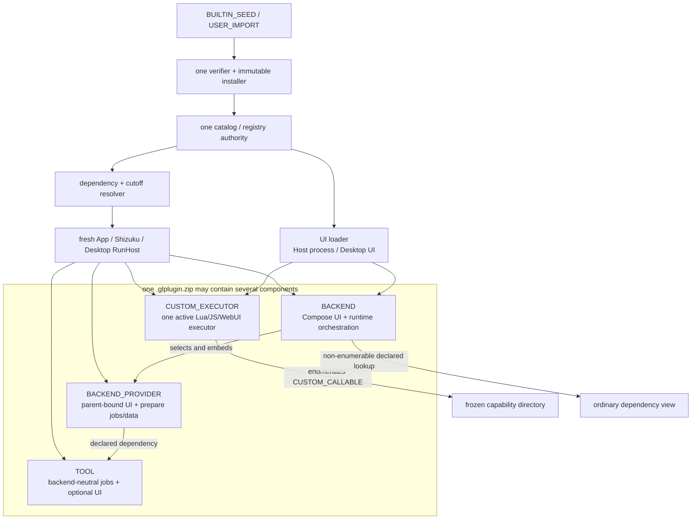

# P-BACKEND-X-002/决策04：完整插件系统架构与 SDK 先行门

<a id="record-plugin-sdk-v2"></a>
<a id="record-gl-sfg"></a>
<a id="p-backend-x-002-decision-03"></a>

> `record-gl-sfg` 与 `p-backend-x-002-decision-03` 是历史链接兼容锚点；所指决策03已被本决策04取代，不代表仍沿用其 Host 声明式 UI 或 consumer-first 顺序。

## 0. 状态、取代关系与 CDA 口径

本文是决策04的完整有效设计，以 **CDA EVOLUTION** 模式作者重做。它整体取代本目录中决策03的现行正文；决策03及 `gl-sfg` 只作沿革，不再是当前架构 authority。已实现 BXP3-B1 仍是当前代码事实，但其 `diagnostic-v1` 只是待替换的 transitional vertical，不是需要维持的发布合同。

本设计完成、OpenSpec strict 通过、作者自检与 critic 关闭，仍只表示可进入用户认可 gate；不是 production 实施批准、编译 PASS 或真机证据。

### 0.1 证据分类

| 分类 | 本设计依据 |
|---|---|
| VERIFIED | 当前 `plugin/api` 只有 `DiagnosticBackend*`；manifest 1.0 限制一个 BACKEND；loader 硬编码 Diagnose/arm64/`diagnostic-v1`；Host 内置 `BackendPresentationRegistry`；`:plugin:core` 已是 Android/JVM KMP；App 仍是 Android application module；Diagnose 的 DSO/JNA 已由 plugin Kotlin 拥有。第 0.2 节已用独立 Desktop JAR 与 Android DEX 关闭最小 Compose entry/session 跨 classloader 可行性。 |
| USER-STATED | plugin UI 必须可用 Compose；43499 的 provider 和 backend 各自拥有 UI；provider 严格属于一个 backend，并由父 backend UI 嵌入；Custom 是一个运行 Lua/JavaScript/WebUI 的执行插件；Custom 可调用其它已加载插件公开能力及 raw memory/指定地址写；Host 不拥有 native；必须先完成长期接口再做正式插件。 |
| DERIVED | UI 与 runtime 需要不同 entry/lifecycle；受验证包会在 UI process 运行 Compose code，在 RunHost 运行 backend/native code；Host 必须传递通用 readiness/cutoff/result 事实，但不得解释领域字段。 |
| ASSUMED | Android 与 Desktop 首版均是 JVM 宿主；plugin UI 与 Host 用同一 GhostLock UI SDK/Compose runtime，plugin 不私带另一份 Compose/Kotlin runtime。 |
| UNKNOWN | Desktop WebUI 容器的最终库；JavaScript engine 的最终库。它们在对应 Custom Executor 批以真实 consumer 选型，不提前写入 SDK。完整 SDK 的 ABI/schema/state machine 仍由第 9 节 exact design gate 关闭。 |

Android 官方明确 DCL 代码与 Host 共享应用权限，且 target 34+ 要求动态加载文件为只读。因此本设计不把 classloader、UI/runtime 入口或 WebView 宣称为恶意 plugin 沙箱；它们是一致性、namespace 和 lifecycle 边界。

### 0.2 Compose 跨 classloader feasibility（2026-11-22）

用户认可 gate 前的隔离 proof 使用本设计拟保留的最小 `BackendUiEntryPoint -> BackendUiSession(Content/freeze/close)`、`BackendUiContext(strings/status)` 子集；同一份 contract/plugin Kotlin source 分别独立编译为 Desktop JAR 与 Android DEX，Host 的 runtime classpath/APK 不链接 plugin implementation。Desktop 使用 parent-first `URLClassLoader`，Android 使用 `DelegateLastClassLoader` 且 DEX 仅定义 `com.example.proof.*`；`com.ghostlock.plugin.ui.*`、Kotlin 与 Compose 都由 parent 提供。

- Desktop：`./gradlew -p build/cda-ui-proof :desktop-host:test --tests com.ghostlock.proof.DesktopPluginComposeProofTest`，1 test PASS。独立 plugin JAR SHA-256 `f3f5f5f55163d0bc19fad4e46c175a437c01e551859740affb87fb3eca419ad8`；真实 Compose semantics 观察到 `proof-en:1`，随后 `freeze()` 得到同值，`close()` 发布 `CLOSED`。
- Android：AGP 9.1.0/Kotlin 2.4.20/Compose 1.12.1/Pixel_5 AVD API 33；先由 D8 36.1.0 将独立 plugin `classes.jar` 转成只含 implementation 的 DEX，再以 `ANDROID_SERIAL=emulator-5554 ./gradlew -p build/cda-ui-proof :android-host:connectedDebugAndroidTest -Pandroid.testInstrumentationRunnerArguments.class=com.ghostlock.proof.host.AndroidPluginComposeProofTest` 执行，1 test、0 failure。DEX SHA-256 `dbbe2d52ddc75fae5a0a81cddc2d1c53ab65d08cdaaba97975d9492ae5c91e9d`；logcat 记录 `snapshot=proof-en:1 close=CLOSED`。
- Host APK/test APK SHA-256 分别为 `add32c2890486973010a75778a1a32d58e32198095510af0cc8ab5bd031e8384` 与 `cd971e407910451713675d2dc2b270fd3df2a98ad51a04c4e1bdfcb00fcda791`。proof 只关闭“这种调用形态在目标工具链可运行”的 UNKNOWN，不代表完整 SDK ABI、恶意代码隔离、Host-v2 或真实 backend 已验证；隔离 proof workspace 在记录证据后删除，避免成为第二套产品 source。

## 1. 需求基线与最简 baseline

### 1.1 不可丢失的产品行为

1. profile/config/KO 可独立于 APK/backend 更新，也可由用户导入或 extractor/toolchain 生成。
2. backend package 包含自己的 Kotlin/Java、Compose UI、C/C++ 源码与构建后 DSO；Host/App 不持有 backend native 实现。
3. 43499 类 backend 的物理配置来自它的专属 provider，执行配置（CPU、尝试次数、route、retry、timeout）由 backend 自己管理。
4. provider 的 Compose UI 由父 backend UI 选择、加载和嵌入；Host 不知道它应出现在哪个卡片或页面。
5. generic extractor/toolchain 是 backend-neutral Tool；backend-bound Provider 依赖 Tool，将 Tool 输出投影成父 backend 能消费的 physical Document/Artifact。
6. Custom 只有一个活动 Custom Executor component。脚本、WebUI assets 和用户程序是其 input artifact，不是新 plugin/component。
7. Host 维护 plugin registry，依赖调用与 Custom 能力发现均从此唯一 authority 投影；不允许第二张 builtin 表或 UI 表制造 membership。
8. builtin/imported 共用 runtime path；多 ABI 使用 thin archive；App/plugin i18n 共用同一 locale/message engine；KMP 支持 Android/Desktop 共享 UI。

### 1.2 最简可行 baseline

最简 baseline 不是“Host 渲染 plugin 描述的字段”，而是：

```text
verified package catalog
  -> Host 按 component 声明创建 UI/runtime loader
  -> Backend plugin 自己绘制 Compose UI
  -> Backend UI 通过受限 provider directory 嵌入专属 Provider UI
  -> Backend UI 冻结 execution config，并引用 exact provider bindings
  -> RunHost 装载同一 backend 的 runtime entry 及已绑定依赖
  -> Backend runtime 自行编排 native/Host operation
  -> Host 组合 transport/lifecycle 事实和 plugin domain result
```

它只需一个 package 模型、一个 catalog、两个装载面（UI/RunHost）、四种有真实调用差异的 component role。不需要 Host UI DSL、通用 reactive pipeline、五张 registry 或“每个 action 一种 component”。

## 2. CDA 候选方案与裁决

| 候选 | 结果 | 理由 |
|---|---|---|
| A. 逐步扩展 `DiagnosticBackend*`/manifest 1.x | 拒绝 | 公开类名、两个固定 stage 和 `DIAGNOSTIC_ONLY` 都是 Diagnose 专用；为它续命会产生双轨 ABI 和假兼容。 |
| B. Host 声明式 UI renderer + provider 返回 fields | 拒绝 | 无法低成本表达 backend-specific 交互、provider 嵌套、动态选项和 Custom WebUI；最终会演变为 GhostLock 自建 UI framework。 |
| C. plugin-owned Compose UI + generic Host lifecycle（选择） | 选择 | 直接使用已有 Compose 能力；保留 Host 的安装/冻结/执行责任，领域组合回到 plugin owner。 |
| D. 每个 plugin 独立 APK/Binder | 暂不选 | 增加 Android-only 安装、签名、UID、Binder DTO 和 Desktop 差异；对当前可编辑 ZIP/thin variant 不是最短路径。只有将来需要真正 OS 权限隔离时重开。 |
| E. 所有 UI 都改为 WebUI | 拒绝 | 为 backend/provider 普通设置增加 Web 运行时与 bridge；WebUI 只是 Custom Executor 的明确用例。 |

设计的失效条件：如果最终 SDK 的独立编译 Compose conformance fixture 在 Android 和 Desktop 无法在单一版本化 SDK/runtime 上稳定运行，或 UI plugin 必须具有不同 OS UID，则重开 C/D 选型；不以局部 adapter 暗中改变架构。

## 3. 总体结构与 owner



### 3.1 Host 拥有

- source-specific admission，ZIP path/type/hash 验证，immutable install，builtin seed，catalog generation 和 active variant。
- manifest/API/target 兼容性，component index，依赖闭包、cycle/missing/ambiguity 拒绝，UI/runtime classloader 创建。
- UI session 的技术生命周期、通用 status 搬运、opaque snapshot 存储、content-addressed Document/Artifact store，但不解释内容。
- preparation job 调度、取消、workspace 和原子发布；run cutoff、PFD/handle 交接、process owner、log/terminal/cleanup 与 product-level 结果组合。
- 一个 registry authority 的两种运行投影：ordinary declared dependency view 与 Custom enumerable capability directory。

### 3.2 Backend 拥有

- backend 显示、执行配置、自身 UI 结构、provider slot 的选择与嵌套位置。
- 只把 backend-owned execution configuration 冻结为自己的 configuration Document；provider selection、physical Document/Artifact、provider identity 与 revision 只存在于 exact provider bindings，不复制进 backend Document。
- runtime orchestration（原 Host `Flow` 的 backend-specific 部分）、本包 helper/native 直调、已声明 capability 调用、backend domain result。

### 3.3 Backend Provider 拥有

- 一个 parent backend 某个 slot 的 physical configuration/Artifact 意义，以及自己的 Compose UI。
- import/extract/adapt/build 的 provider-specific job 与领域验证；可调用已声明 Tool，但不枚举全局 registry。
- 输出父 backend contract 要求的 immutable Document/Artifact，不返回 Host UI field schema。

### 3.4 Tool 与 Custom Executor 拥有

- Tool 拥有 backend-neutral 有限 job，如任意源文件 + 构建参数的 toolchain、extractor、Document serializer/deserializer；可有被 consumer UI 嵌入的 Compose UI。
- 单一 Custom Executor 拥有 Lua/JavaScript engine、editor/runtime UI、script artifact、capability bridge 与 WebUI host。Host 只注入冻结 capability directory，不解析脚本业务。

## 4. package/manifest v2

### 4.1 分发与文件身份

- 扩展名固定为 `.glplugin.zip`；它是普通 ZIP，允许用户用普通 ZIP 工具修改后重新生成 manifest/hash list。
- `manifest.json` 外的每个普通文件都在 `files[]` 中有 path + SHA-256。ZIP 整体字节、压缩大小、payload 大小不另作身份；ZIP CRC 只是容器层校验，不代替 manifest SHA-256。
- 不设人为的 64 MiB/64 entry/128 KiB/32 MiB/96 MiB 上限。安装仍必须拒绝 path traversal、重复 path、symlink/special entry、缺失/多出 hash 和不符合实际平台资源的包。
- 一个 logical release 可发布 `android-arm64-v8a`、`android-armeabi-v7a`、`android-x86`、`android-x86_64`、`desktop-<os>-<arch>` 等 thin archive；纯数据包可为 `universal`。安装只选当前 UI/runtime target 需要的 variant。

### 4.2 v2 逻辑 manifest

下例冻结顶层身份、双 payload、多 component 和文件 hash 的必要形状，不是假装完整 JSON Schema；全部字段 domain、required/optional、错误码和兼容规则由 SDK-v2 exact design gate 补齐。

```json
{
  "formatMajor": 2,
  "formatMinor": 0,
  "publisherId": "com.example",
  "packageId": "com.example.backend43499",
  "versionCode": 12,
  "versionName": "12.0",
  "variant": "android-arm64-v8a",
  "hostApi": { "major": 2, "minMinor": 0 },
  "uiApi": { "major": 2, "minMinor": 0 },
  "files": [{ "path": "...", "sha256": "..." }],
  "payloads": {
    "ui": { "code": ["ui/classes.dex", "ui/classes2.dex"] },
    "runtime": {
      "code": ["runtime/classes.dex"],
      "nativeLibraries": [{ "path": "lib/arm64-v8a/libbackend.so", "logicalLoadName": "backend" }]
    }
  },
  "i18nBundles": [{ "namespace": "backend43499", "path": "i18n/messages.json" }],
  "components": []
}
```

`payloads.ui` 和 `payloads.runtime` 是同一已验证包内的两个装载集，不是两个安装包。multidex 通过有序 `code[]` 直接表达。UI loader 的 native search path 为空；RunHost runtime loader 才获得本 package verified native directory。这是误用防护与 owner 表达，不是恶意代码沙箱。

### 4.3 四种 component

| kind | 必需声明 | 可选声明 |
|---|---|---|
| `BACKEND` | stable `backendKey`、runtime entry、UI entry、execution domains、abort policy、provider slots | ordinary dependencies、capability exports |
| `BACKEND_PROVIDER` | runtime/data entry（二者至少一个）、UI entry（有交互时必需）、`parentBackendRef`、`slotId`、`contractVersion` | Tool dependencies、static Documents/Artifacts |
| `TOOL` | job exports（或纯 data export） | Compose UI entry、ordinary/Custom capability exports |
| `CUSTOM_EXECUTOR` | runtime entry、Compose UI entry、script languages | WebUI support、自身 Tool dependencies |

同一 catalog generation 最多有一个 active `CUSTOM_EXECUTOR`；无或多个时 Custom 入口显式 `NOT_READY`，不按顺序暗选。package 可包含多个 component，包内调用不强制绕 registry；跨 package 必须经 manifest 声明和 registry 投影。

component 公共字段为 `kind/id/uiEntryClass?/runtimeEntryClass?/dependencies[]/exports[]`。`BACKEND` 再加 `backendKey/selectionPolicy/executionDomains/abortPolicy/providerSlots[]`；`BACKEND_PROVIDER` 再加 `parentBackendRef/slotId/contractVersion/jobs[]/staticExports[]`；`TOOL` 再加 `jobs[]/staticExports[]`；`CUSTOM_EXECUTOR` 再加 `languages[]/webUiSupport`。entry class 必须是对应 payload 定义的 public final/concrete class，具有 public zero-argument constructor，并实现 kind 对应的 SDK interface。

### 4.4 provider 与父 backend 双向绑定

Backend slot 声明 `slotId + contractId + accepted major/minor range + required/optional`。Provider 声明 `parent publisherId/packageId/componentId + slotId + contractId + provided major/minor`。只有两边同时匹配才进入该 backend UI 的 provider directory。绑定针对 stable component identity 和 contract version，不钉死某个 ZIP digest，因而同一父 backend 的 provider 可独立更新。43499 provider 不会出现在 98260/43284 目录；Host 只执行比较，不推测“看起来兼容”。

## 5. SDK-v2 exact design 的输入边界

本决策冻结 component 角色、owner、调用方向、生命周期骨架和必须存在的最小方法面；它**不是**可直接发布的完整 ABI/schema。下一批是独立的 **SDK-v2 exact design gate**：必须补齐可编译的全部声明、manifest JSON schema、DTO/value domain、错误码、生命周期/并发/取消/关闭状态机、`abortPolicy` 映射、`HostOperations`、dependency/capability/raw-memory、UI context/handle/snapshot/preparation/WebUI bridge，并再次完成作者自检、独立 critic 与用户认可。该 gate 关闭前不得开始 production SDK source。

### 5.1 module 与源码层次

```text
plugin/
  api/                 :plugin:api          JVM/Java runtime binary contracts
  ui-api/              :plugin:ui-api       KMP Compose UI contracts
  core/                :plugin:core         KMP manifest/catalog/value identities
  testkit/             :plugin:testkit      SDK conformance helpers and fixtures
  packages/
    diagnose/          one plugin source/build/test module
    backend-43499/     future plugin source/build/test module
    provider-43499-*/  future independently distributable provider modules
    custom-executor/   future single Custom Executor module

app/
  shared/              :app:shared          KMP Compose shell and shared state
  android/             :app:android         GhostLockAndroidApplication + Android adapters
  desktop/             :app:desktop         Desktop shell/adapters
```

每个 package module 有自己的 build script、unit/conformance/integration tests 和 `.glplugin.zip` 产物。源码目录存 C/C++ 源码；`.so`/DEX/源码构建 `.ko`/`.glplugin.zip` 只在 `build/`。不保留 Host-owned/common native DSO 模块；若多包需要同一 C/C++ 源码，必须作为可追溯的 source dependency 编译进各自包，owner 仍是该 plugin。

### 5.2 runtime API（Java ABI）

下列是 v2 必须实现的公开角色，名称与方法语义在 SDK 批中冻结；不再发布 `DiagnosticBackendEntryPoint/Run/Context/Result`：

```java
public interface BackendEntryPoint {
    BackendRun createRun(BackendRunContext context) throws PluginException;
}
public interface BackendRun extends AutoCloseable {
    BackendRunReport execute() throws PluginException;
    void requestStop();
    void close() throws PluginException;
}
public interface PreparationEntryPoint {
    PreparationJob createJob(PreparationJobContext context) throws PluginException;
}
public interface PreparationJob extends AutoCloseable {
    PreparationResult execute() throws PluginException;
    void requestStop();
    void close() throws PluginException;
}
public interface CustomExecutorEntryPoint {
    CustomExecution createExecution(CustomExecutionContext context) throws PluginException;
}
public interface CustomExecution extends AutoCloseable {
    CustomExecutionReport execute(ScriptArtifact script) throws PluginException;
    void requestStop();
    void close() throws PluginException;
}
```

Context 是按生命周期分开的不可变 view：

- `BackendRunContext`：run identity、opaque backend configuration Document、exact provider bindings、non-enumerable `DependencyView`、Host operations、cancellation、log sink。
- `PreparationJobContext`：job identity、declared input handles/parameters、non-enumerable Tool dependency view、workspace/output publisher、cancellation、log sink。
- `CustomExecutionContext`：session identity、script inputs、Host operations、read-only enumerable `CapabilityDirectory`、cancellation、log sink。

Context 不暴露 `ClassLoader`、Host DI/container、Compose object、JNA `Pointer/Library/Memory`、native symbol lookup 或任意 JVM reflection。这不限制 raw-memory 能力；raw memory 由显式标准 capability contract 提供。

Context 方法面不使用隐式 service locator，依次冻结为：

```java
public interface BackendRunContext {
    PluginRunIdentity identity();
    PluginDocumentHandle configuration();
    ProviderBindingView providers();
    DependencyView dependencies();
    HostOperations hostOperations();
    PluginCancellation cancellation();
    PluginLogSink logs();
}
public interface PreparationJobContext {
    PluginJobIdentity identity();
    PreparationInputs inputs();
    DependencyView tools();
    PreparationOutputPublisher outputs();
    PluginCancellation cancellation();
    PluginLogSink logs();
}
public interface CustomExecutionContext {
    PluginSessionIdentity identity();
    HostOperations hostOperations();
    CapabilityDirectory capabilities();
    PluginCancellation cancellation();
    PluginLogSink logs();
}
```

### 5.3 value/artifact 与 capability API

SDK 只提供三种跨 component 形态：

1. `PluginDocumentHandle`：schema identity/version、document id、content SHA-256、provenance，每次 `openStream()` 返回 caller-close 的新 stream。
2. `PluginArtifactHandle`：artifact kind/target identity/content SHA-256/provenance 与 caller-close stream/PFD adapter。
3. `PluginCapabilityHandle`：descriptor + lifecycle-bound `invoke(operationId, PluginValue)` + `close()`。

`PluginValue` 是 SDK 管理的不可变 typed tree（null/bool/signed integer/unsigned integer/decimal/string/bytes/list/object），不接收任意 JVM object。大文件/内存不塞入 value tree，而使用 Document/Artifact/region handle。

`DependencyView` 只能用 manifest slot 获得 exact bound handle，不可枚举。`CapabilityDirectory` 可枚举本 Custom session 冻结包集内的 `CUSTOM_CALLABLE` descriptor，并按 exact identity 开启 handle。同一 export 可分别声明 `DEPENDENCY` 和 `CUSTOM_CALLABLE`，一个不暗推另一个。

SDK 预置 `ghostlock.raw-memory/v1` capability：

- address space + target identity + absolute address 的 bounded read/write；宽度、对齐、endianness、partial transfer 和 native error 显式返回。
- owned allocation/query/free 与 external/kernel arbitrary address 是不同 handle/result；关闭 session 不宣称回滚已执行写入。
- 真实 mapping/fd/device/kernel/native handle 由 export provider 的 Kotlin/DSO 拥有；Host 只管理 capability lease 和 session 终结。

### 5.4 result 与 Host operation

`BackendRunReport` 不再固定两个 Diagnose stage。它包含：

- domain completion：`COMPLETED / REFUSED / FAILED / CANCELLED / UNKNOWN`；
- effect state：`NONE / APPLIED / CLEANED / HELD / UNKNOWN`；
- 有序 stage facts（plugin-stable stage id + common state/reason/exit facts）；
- 发布的 Document/Artifact/output refs 及可审计 detail。

Host 另有 transport/process/log/workspace/root-operation 事实。最终 product result 由 Host 组合两者：RunHost death/contract corruption 可将结果提升为 `UNKNOWN`，但 Host 不把 plugin 报告的 backend domain failure改写为 success。Payload/Finish/root-script 由 Host 以稳定 `HostOperation` 提供，backend 决定在自己编排的何处调用并把返回事实写入 report。

## 6. Compose UI API 与状态传递

### 6.1 UI 入口

`:plugin:ui-api` 是 KMP Compose library，终态公开角色为：

```kotlin
interface BackendUiEntryPoint {
    fun create(context: BackendUiContext): BackendUiSession
}
interface BackendUiSession : AutoCloseable {
    @Composable fun Content()
    fun freeze(): BackendUiSnapshot
    override fun close()
}
interface BackendProviderUiEntryPoint {
    fun create(context: BackendProviderUiContext): BackendProviderUiSession
}
interface BackendProviderUiSession : AutoCloseable {
    @Composable fun Content()
    fun freeze(): ProviderUiSnapshot
    override fun close()
}
interface ToolUiEntryPoint {
    fun create(context: ToolUiContext): ToolUiSession
}
interface ToolUiSession : AutoCloseable {
    @Composable fun Content()
    fun freeze(): ToolUiSnapshot
    override fun close()
}
interface CustomExecutorUiEntryPoint {
    fun create(context: CustomExecutorUiContext): CustomExecutorUiSession
}
interface CustomExecutorUiSession : AutoCloseable {
    @Composable fun Content()
    fun freezeScript(): ScriptArtifact
    override fun close()
}
```

Host 应用只在自己的 page/navigation 壳内调用 selected backend `Content()`。Backend `Content()` 通过 `BackendUiContext.providers(slotId)` 取得已互相匹配的 `BackendProviderUiHandle`，选择后在它自己决定的 Compose 位置调用 provider `Content()`。Provider 同理可嵌入已声明 Tool UI。Host 负责创建/缓存/关闭 handle 和验证 slot，不选 provider，不指定嵌套位置。

UI context 只提供具名能力：`BackendUiContext` = strings/status sink/state store/preparation controller/provider directory；`BackendProviderUiContext` = strings/status sink/state store/preparation controller/declared Tool directory/parent-slot facts；`ToolUiContext` = strings/status sink/state store/preparation controller/declared inputs；`CustomExecutorUiContext` = strings/status sink/state store/script artifact store/WebUI platform host。只有 Backend context 能读父 slot provider directory，只有 Custom runtime context 能读可枚举 capability directory。

### 6.2 配置与准备状态

UI plugin 可在内部使用 Compose state/Flow/ViewModel，但跨 SDK 只传递两种通用事实：

- `PluginUiStatus`：`READY / BUSY / NOT_READY / FAILED`、当前 revision、用 plugin message key 表达的人类可读 reason，以及是否允许 `freeze()`。通过 context 的 `UiStatusSink` 发布。
- `BackendUiSnapshot`：只含 backend-owned execution configuration Document、exact selected provider binding refs、revision 与 catalog generation；不得复制 provider physical Document/Artifact。
- `ProviderUiSnapshot`：只含该 provider-owned physical configuration Document/Artifact、provider identity、slot/contract identity 与 revision；Tool output 若成为 physical input，也只由 provider snapshot 引用。Host 只核对这些身份和 freshness，不反序列化领域字段。

因此 43499 CPU/尝试次数由 backend UI 显示并写入 backend configuration Document；物理 profile 由 selected 43499 provider UI 显示并产出 Provider snapshot。Host 只用聚合 status 决定通用 Run 按钮是否 ready，并在用户启动时请求 backend session `freeze()`。

UI session 失败不触发 Host 自动回退为声明式表单；该 component 在当前 catalog generation 中不可用并报告原因。已冻结 run 不读取正在变化的 UI state。

### 6.3 统一 i18n

- App base bundle、builtin plugin 和 imported plugin 的 `i18nBundles` 进入同一 KMP locale/message registry；namespace 绑定 verified package/component identity。
- UI plugin 通过 `PluginStrings`/Compose local 按 message key + typed arguments 读取当前 locale；不把 Android `R.string`、`Context`、resource id 放入 SDK。
- Host 管理 locale 选择、fallback 和 catalog registration；plugin 拥有自己的文案和参数语义。UI status/reason 传 message ref，不传已固化为 Android 语言的 string。

## 7. 从导入/准备到攻击/收尾的全流程

### 7.1 安装与首次 builtin 初始化

1. APK/Desktop distribution 只携带 builtin `.glplugin.zip` object + seed index，不把 implementation class/native 合并进 Host runtime classpath。
2. catalog 首次 READY 前，seeder 将 builtin archive 交给同一 verifier/immutable installer，记录 `BUILTIN_SEED`。中途死亡后下次启动以 exact owned staging 规则幂等恢复。
3. 外部导入使用同一 verifier/object store/catalog。未有 publisher 认证机制时，`publisherId` 对 `USER_IMPORT_UNVERIFIED` 只是声明身份；hash 证明完整性，不证明作者。
4. builtin/imported 的运行差异仅是默认 trust、是否可禁用/卸载、seed reconciliation 和 update channel；selection/resolution/UI/runtime 不分叉。

### 7.2 43499 的 UI/准备示例

1. Host shell 选中 43499 backend，用 UI loader 实例化 `BackendUiEntryPoint`，提供 locale、opaque state store、preparation controller 和受限 provider directory。
2. Backend UI 绘制自己的 CPU/尝试次数/route/retry/timeout，然后读取 `physical-config` slot 的候选。目录只包含双向匹配 43499 的 provider。
3. Backend UI 选择某 provider handle，在自己的“物理配置”区域嵌入 provider `Content()`。Host 不知道这个区域或字段。
4. Provider 可从静态 profile 选择、导入 conf/json/自定义 KO，或调用 backend-neutral extractor/toolchain Tool job。Extractor 可直接产出 Document；serializer Tool 可把 Document 反向写成外部配置文件。
5. Host preparation controller 为 job 提供输入 handle/workspace/cancel/output publisher。Provider/Tool 执行领域逻辑；Host 原子发布 content-addressed output，丢弃旧 revision 迟到结果。
6. Provider 发布 READY 并冻结 exact physical Document/Artifact refs。Backend UI 的 snapshot 同时携带自己的 execution configuration Document 与所选 provider binding refs，但不把 provider output 复制进 backend Document。Host/RunHost 若发现重复 physical payload、stale revision、parent/slot/contract/content identity 不匹配，必须拒绝 freeze/cutoff。任一必需 slot NOT_READY，backend 就不允许 freeze。

### 7.3 run/cutoff/收尾

1. 用户开始 run；Host 请求 selected backend UI session `freeze()`，验证 snapshot revision/catalog generation/exact refs，并冻结 backend、provider outputs、Payload/Finish、execution domain 与 package closure。
2. RunHost 通过只读 PFD/handles 重验证 exact objects，建立 protected-parent classloading；shared SDK/Compose/Kotlin 由 Host parent 提供，plugin 不得重新定义 protected namespace。
3. Resolver 按依赖顺序创建普通 capability/job service，最后创建 backend run。Backend 只看到 slot-bound `DependencyView`，不能枚举 catalog。
4. Backend Kotlin 自己执行编排，直接调用本 package binding/DSO，或调用 declared capability/HostOperation。Host 不声明 native method，不按 symbol 调用，不持有 pointer/handle。
5. Backend 返回 domain report。Host 合并 root-operation、transport、log、cleanup/process-death 事实形成 product report。
6. 正常终结时按 backend run -> capability leases -> provider/tool runtime -> classloaders/workspace 的逆依赖顺序关闭；plugin native owner 在自己 `close()` 中处理 native。Host 治理 process 销毁与资源漏洞，不第二次 close native handle。
7. RunHost 死亡、partial native effect 或不能证明 cleanup 时，effect state 保持 `UNKNOWN/HELD`；不因终止 process 宣称外部/kernel 状态已回滚。

### 7.4 Custom Executor/WebUI

1. Host 启动一个 active `CUSTOM_EXECUTOR` UI session。Custom Executor 绘制 editor、语言选择、脚本参数和运行结果；用户 script/bundle 作为 Artifact 导入。
2. 启动 session 时，Host 从 enabled/trusted/target-compatible packages 解析一个 exact 闭包，装载明示 `CUSTOM_CALLABLE` exports，然后冻结只读 `CapabilityDirectory`。活动 session 不热插拔。
3. Lua/JavaScript bridge 将 script value 映射到 `PluginValue`。raw-memory contract 允许指定地址读写和 owned region 管理；script 不得获得任意 JVM reflection/JNA object，因为那会绕过 identity/lifecycle/result contract，而不是因为要削弱 raw capability。
4. 声明 WebUI 的 bundle 由 Custom Executor 的 Compose UI 在 UI process 中显示 WebView/Web container；执行 script 在 Custom RunHost。二者只经 typed message bridge 交换 JSON-like `PluginValue`/artifact refs。这是 lifecycle/process 分工，不宣称 WebUI 对高权限 Custom 构成安全沙箱。

## 8. classloading、兼容性与安全失败

### 8.1 classloader 规则

- UI loader 和 runtime loader 都从 app-private、immutable、重验证 object 构建。Android DCL 文件在写入前建立只读 inode/权限并在重开后 rehash；Desktop 使用等价只读 materialization。
- `java.*`、`kotlin.*`、`kotlinx.coroutines.*`、`androidx.compose.*`、`com.ghostlock.plugin.api.*`、`com.ghostlock.plugin.ui.*` 是 parent-owned protected namespace。archive verifier 拒绝定义这些 class。
- plugin implementation/dependency 为 child-owned。UI payload 不有 native search path；runtime payload 只有当前 package verified DSO path。跨 package 不传 implementation class，而传 SDK value/handle/capability contract。

### 8.2 API 版本

- runtime API 和 UI API 分别有 major/minor。major 不等拒绝；plugin `minMinor` 高于 Host 拒绝；Host 增加 minor 只能增加可选能力/新接口，不改已发布方法。
- `:plugin:api`、`:plugin:ui-api`、`:plugin:core` 开启 explicit API 和 Kotlin/JVM ABI dump/check。SDK BOM 固定 Kotlin/Compose/coroutines 编译基线；plugin 以 compileOnly/API 方式编译，不把第二份 runtime 打入 payload。
- 不对 `diagnostic-v1` 建 compatibility adapter：它只有同仓 builtin Diagnose consumer，external import 尚未产生可保护用户。v2 落地时 Diagnose 与 Host 同批单轨迁移。

### 8.3 imported code 的统一执行信任

完整性通过只回答“归档内容与 manifest 一致”，不自动授权执行。Catalog 为每个 exact `package version + semantic content root` 保存唯一 `executionTrust`：`BUILTIN_TRUSTED / USER_GRANTED / NOT_GRANTED / REVOKED`。导入含 DEX/JAR/native/WebUI/script engine 等可执行 payload 的包在校验通过后先进入 `NOT_GRANTED`；用户必须经过独立的高风险确认才变为 `USER_GRANTED`。导入动作本身不暗含执行授权。

一个 `ExecutionEligibilityResolver` 是唯一读取点，UI entry、preparation job、runtime backend 与 Custom Executor/capability 在 create/load 前都必须经过它；任何局部 loader 不得自行降低条件。包升级、version 变化或 semantic content root 变化都不继承旧 grant。用户 revoke 后，新的 UI/preparation/runtime/Custom 创建立即拒绝，尚未进入 cutoff 的 session 安全关闭；已经 cutoff 的攻击 RunHost 保留冻结事实并按既定 cancel/cleanup 语义结束，不能伪称 native/kernel effect 已回滚。完全不含可执行 payload 的 data-only 包可不要求 execution grant，但仍保留 `USER_IMPORT_UNVERIFIED` provenance。

### 8.4 失败语义

| 阶段 | 失败 | 结果 |
|---|---|---|
| admission/catalog | manifest/hash/path/API/target/component 无效 | 不发布新 generation；已 READY generation 保持，bootstrap 损坏则 FAILED |
| execution trust | imported executable 未授权、已 revoke，或新 content root 沿用旧 grant | 所有 UI/preparation/runtime/Custom entry 在执行前统一拒绝；活动 cutoff run 按冻结语义终结 |
| UI load/create/render | class/constructor/Compose contract 失败 | component 当前 generation 不可用；不创建 Host 伪 UI，不运行 backend |
| provider binding | parent/slot/contract 不互相匹配 | 不进候选目录；required slot 没有候选则 backend NOT_READY |
| preparation | job cancel/fail/old revision | 不发布新 output；旧冻结 output 不被暗替换 |
| freeze/cutoff | revision/catalog/object 已变 | 拒绝该次 run，返回 UI 重新确认；不自动用新值 |
| runtime load/dependency | entry 错误或 slot missing | plugin code 执行前拒绝；已创建 lease 逆序关闭 |
| backend/native/process | exception/cancel/death/partial effect | 保留 FAILED/CANCELLED/UNKNOWN 及 HELD/UNKNOWN effect；不伪造 cleanup/success |
| Custom capability | descriptor/codec/operation 错误 | 当次 call 失败并记录；session 是否终止由 Custom Executor 明确策略决定 |

## 9. 迁移、实施顺序与回退边界

不并行开展多个正式 backend。每一批验过再进下一批：

1. **决策04可行性关闭**：用本节目标 classloader 与拟保留的最小 `ui-api` 子集，证明独立 Android dynamic DEX 与 Desktop JAR 都能 create session、真实 Compose、完成一次 state change、读统一 i18n、freeze、close；记录命令和 artifact identity。该 proof 不发布 production API。
2. **SDK-v2 exact design gate**：补齐第 5 节列出的完整可编译 contract/schema/state machine，作者自检、critic 和用户认可后才允许 source。
3. **SDK-v2 source batch**：实现 manifest/core/runtime API/UI API/testkit/build plugin 和最小 conformance package。fixture 必须使用已批准 final API，不新增临时 public interface；它验证 Android/Desktop Compose interaction、i18n、multidex、多 component、parent binding、capability/close 和 ABI check。
4. **Host-v2 batch**：catalog/resolver/UI loader/RunHost loader 切到 v2，引入 `:app:shared/:app:android/:app:desktop` 目标层次，同批更新当前 UML。该批未完成前不接真实攻击 plugin。
5. **Diagnose migration batch**：将 builtin Diagnose 从 `diagnostic-v1`/Host UI 迁到 final Backend runtime/UI interfaces；删除 v1 公共类、manifest parser 分支与硬编码 namespace。只在此批结束后宣称 v2 完整替换。
6. **43499 vertical**：backend UI/runtime + 一个 backend-bound profile provider，用真实 CPU/尝试次数/物理配置证明 owner 和独立 provider update。`gl-9lz` 只保留产品目标与可复用 Document 完整性证据，exact contract 重做。
7. **Tool vertical**：用 generic extractor 和 serializer 完成 `extractor -> 43499 provider -> 43499 backend` 与 PC 反向序列化；再引入 43284 KO/toolchain。
8. **Custom Executor vertical**：一个 Lua 和一个 JavaScript 基本执行、一个真实 backend-exported capability、raw-memory contract 和一个 WebUI bridge。删除当前 Host-internal empty/restricted Lua placeholder，不保留两套 Custom。
9. **后续 vertical**：43284、98260、额外 ABI、Desktop 完整运行域、repository/update 按真实 consumer 分批。

回退只在批次 commit 层面使用正常 Git 历史，不为此建双轨 runtime/feature flag/rollback 脚本。迁移到 v2 的某个包不能在同一发布中同时被 v1/v2 加载。未通过相应真机门的 backend/profile 仍不标 supported。

## 10. fitness functions 与验收

### 10.1 静态/构建判据

- public SDK ABI dump 不含 `DiagnosticBackend*`、Host `Flow`、Android `R`、JNA/native pointer；除本决策列出的长期角色外，任何新增 public type/method 都必须能追溯到获批的 SDK-v2 exact design，不由 source 批临场扩张。
- manifest v2 可表达一包多 component/multidex/UI+runtime payload/thin variant；只有文件 SHA-256 列表，无 ZIP-byte identity 或人为 size/entry caps。
- 每个 package 有自己 Gradle module/build/test；App runtime classpath/APK native dir 不含 plugin implementation/JNA/DSO。
- `:app:shared` 不依赖 Android resource API；plugin i18n 不用 Android XML/resource id。
- architecture guard 拒绝 Host 依赖 plugin implementation namespace、provider 指向多个/错误 parent、UI payload native search path、plugin 重定义 protected namespace。

### 10.2 conformance 场景

- 同一 final SDK 编译的外部 fixture 在 Android 动态 DEX 和 Desktop JAR 中渲染 Compose，变更状态，读取同一 i18n bundle，freeze 后运行，并按逆序 close。
- Backend 只能看到互相匹配的 provider；Backend 决定 provider UI 嵌套位置；Host 不存在 provider UI route/schema 分支。
- 准备 job 的旧 revision 结果不能进入新 snapshot；freeze 后 catalog/provider/config 变化不能热替活动 run。
- ordinary backend 不能枚举全局 capability；Custom Executor 能枚举本 session 冻结的 `CUSTOM_CALLABLE` export，并经 standard raw-memory capability 完成指定地址读/写的合同测试。
- UI/runtime/preparation 在 entry 创建中途失败时，已获得资源严格逆序关闭；process death 保留 UNKNOWN/HELD 而不冒充 cleanup。

### 10.3 分层证据

- 本设计批：OpenSpec strict、Markdown/link/UML 结构、author self-check、non-author design-critic；不运行无关 product/device gate。
- SDK/Host 批：ABI checks、JVM/unit、Android host tests、artifact reopen、AVD 交互加载与 process-death、Desktop conformance；详细命令在该批 exact scope 中定义。
- 真实攻击 backend/native/execution-domain 仍按各自 App/Shizuku/真机门证明。Compose fixture/AVD 不替代 43499/43284/98260 真机证据。

## 11. 明确非目标与待触发项

- 本批不选 JavaScript engine、Desktop WebView 库、远程 repository/TUF/OCI、publisher PKI、SAT solver、hot swap 或跨 OS UID sandbox；不选择 publisher PKI 不代表可以跳过第 8.3 节的 explicit execution grant。
- 本批不冻结 43499/43284/98260 的领域 Document schema 字段；只冻结它们使用的 SDK envelope、provider binding 和 UI/runtime lifecycle。
- 不为每个未来 operation 新建 component kind、context 或 registry。新真实角色无法归入四种 role 时，必须用具名 consumer 重开设计。

<a id="acceptance-plugin-sdk-v2"></a>
<a id="acceptance-gl-sfg"></a>

### 决策04设计验收边界

设计交付必须同时具备：OpenSpec proposal/spec/design、同步的活跃计划目标 UML、旧 gl-9lz 的取代说明、跨 classloader Compose 可行性证据、作者自检和非作者 critic 结论。用户明确认可后只开放第 9 节的 **SDK-v2 exact design gate**；该 gate 未再获认可前不得开始 production source，也不自动批准 Host/Diagnose/43499/Custom 后续批。
