# 由真实consumer触发的插件后继需求

> **取代通知（2026-11-22）**：`gl-9lz` 的产品目标（profile 独立更新、typed Document、无需重装 APK）保留，但本文为 Diagnose 专用 consumer 冻结的 format 1.1/API 1.1/Host 编排 data-only provider exact design 已被 [P-BACKEND-X-002/决策04](../plugin-architecture/design.md#record-plugin-sdk-v2) 取代，不再是 production 实施入口。后续在 v2 SDK 落地后，按“backend-bound provider 由父 backend UI 嵌入，generic Tool 依赖由 provider 调用”重新细化；原 critic/验证证据只作历史可复用输入。

## Context and scope

完整迁入的有效设计/范围与验收正文；不是新增实施批。原批准/历史结果按原Beads记录，工具工件齐备不代表实现或门禁通过。

来源：`043fdf6a:tools/engineering/.beads/issues.jsonl`；保留语义代号和原锚点。本文中的历史进度/门结果文字仅是其具名输入的沿革，当前状态从proposal列出的Beads读取。旧机制由正文已注明的后继差异取代；基线不重新授权实施。

## Decisions

<a id="record-gl-2zi"></a>

## P-BACKEND-CORE-001：由真实 consumer 触发配置实现

<!-- migrated-source: 043fdf6a Beads gl-2zi description -->
本节是迁入OpenSpec的现行设计/验收正文；Beads只保存执行状态、原批准和实际证据。历史来源仅作追溯。
真实backend config consumer出现后细化；保留现行typed store和owner，不为无使用者的配置预建框架或迁移。
原始来源（已归档/承接）：docs/archive/20261121-1301-backend-root-execution-unification-plan.md#p-backend-core-001

<!-- migrated-source: design gl-2zi -->
共享OpenSpec设计位置（仅按当前任务疑点展开，不复读所有依赖）：
- OpenSpec [gl-7yv](../runtime-foundations/design.md#record-gl-7yv)；对应Beads只查执行/证据。
- OpenSpec [gl-sfg](../plugin-architecture/design.md#record-gl-sfg)；对应Beads只查执行/证据。

<a id="acceptance-gl-2zi"></a>

### 验收定义与原边界：gl-2zi

<!-- migrated-source: acceptance_criteria gl-2zi -->
真实backend config consumer出现后细化；保留现行typed store和owner，不为无使用者的配置预建框架或迁移。

批准/审核/实际结果：Beads `gl-2zi` notes；本段不维护实时勾选或新PASS。

<a id="record-gl-9lz"></a>

## P-BACKEND-X-002：data-only profile provider / Document

<!-- migrated-source: 043fdf6a Beads gl-9lz description -->
本节是已被决策04取代的历史 exact design；Beads只保存原执行状态、批准和实际证据，不从这些证据推导 v2 实施获批。
原始来源（已归档/承接）：docs/archive/20261121-1301-backend-root-execution-unification-plan.md#p-backend-x-002-decision-03

<!-- migrated-source: design gl-9lz -->
共享OpenSpec设计位置（仅按当前任务疑点展开，不复读所有依赖）：
- OpenSpec [决策04](../plugin-architecture/design.md#record-plugin-sdk-v2)；它是当前架构 authority。
- OpenSpec [gl-dek](../builtin-diagnose-plugin/design.md#record-gl-dek)；对应Beads只查执行/证据。

> **状态（2026-11-21）**：用户在`gl-bvj`记录Shizuku client-death上游阻断后明确要求“上游在做了，先跳过，进入下一阶段”。本节因此只跳过重复排障和Host workaround，不把`gl-bvj`、B1真机门或Shizuku physical death改成PASS。本文按CDA `EVOLUTION`模式在基线`b3f87e695d9a89b6256f58d256322762a8089f5e`上细化Diagnose之后的第二个plugin vertical；完成作者自检、独立critic和用户批准前，不授权production实现。

### 1. 当前痛点、真实consumer与停止条件

当前事实不是“缺少一个万能provider框架”，而是下列已经存在且能定位到源码的断点：

| 当前事实 | 物证 | 直接代价 |
|---|---|---|
| 85个HOCON profile/include仍位于App assets | `app/src/main/assets/kernel_profiles/**` | 上游只新增设备profile也必须重发、重装APK；profile owner错误地落在App分发物 |
| runtime已无profile loader，只有caller-zero迁移残留 | `LegacyProfileConverter.kt`、`ValueModel.kt`无生产caller | assets既不能形成当前run输入，也不能证明未来backend能消费；继续堆文件只扩大假支持面 |
| 所有run仍强制携带单一`ProfileSnapshot(v3)` | `FrozenRunInput`、AIDL、`RunHostRequestModel`、`BackendFlowInput` | Diagnose不需要profile，却由`AndroidRunInputFreezer`每次生成`{"backend_key":"DIAGNOSE","schema_version":3}`假文件 |
| format 1.0只接受一个`BACKEND`且必须有DEX | `PluginPackageManifest.normalized()` | 不能表达无代码、无native、`universal`的data-only provider |
| builtin index只接受一个archive，catalog provenance只接受`BUILTIN_SEED` | `BuiltinPluginIndex`、`PluginCatalogSnapshot`、App asset producer | Diagnose和profile provider不能共同seed，用户也无法安装仅更新数据的包 |
| catalog READY是process-lifetime immutable generation | `PluginCatalogCoordinator` | 这恰好可用于简化首个import：写入下一启动generation，不必提前设计live object pin/lease |

本批的真实consumer是**Diagnose的provider handoff诊断**：如果当前kernel release存在匹配Document，Diagnose必须通过shared API打开本次run冻结的精确Document、读完并核对digest，再记录有界identity事实；没有匹配Document时该slot是可选缺席，Diagnose仍可运行。它诊断的是catalog resolver→cutoff→AIDL/PFD→RunHost→plugin的真实数据链，不解释攻击offset，也不把profile存在等同于设备受支持。未来43499/98260以`required=true`消费同一合同并做自己的领域验证，不复用Diagnose的“可选”产品判据。

本设计在以下问题均有唯一答案时停止，不继续预建完全体：

1. profile package如何独立构建、验证、seed、导入、回退；
2. Document identity、owner、匹配与失败语义；
3. fake profile如何从整个run wire删除而不改写Payload/Finish/terminal owner；
4. 当前process与下一启动generation如何隔离，旧object何时可回收；
5. 哪些文件移动、删除、修改及各门观察什么。

### 2. 本批目标、约束与明确非目标

本批完成后必须同时成立：

- 新增独立`:plugin:packages:kernel-profiles`，其源码是HOCON/profile index，构建产物是无DEX、无DSO、`variant=universal`的普通`.glplugin.zip`；App不再拥有kernel profile源码或runtime HOCON parser。
- APK首次安装仍携带一个builtin profile provider，但它与Diagnose archive分别进入同一个builtin index、verifier、immutable object store和catalog；builtin不是静态旁路。
- 上游只改profile时可单独发布更高`versionCode`的provider archive。用户显式选择该`.glplugin.zip`后无需重装APK；当前process继续使用已发布的旧READY generation，新package只在该App process被完全停止（force-stop、系统回收或其它真实process death）并重新启动后生效，Activity重建/页面重开不算重启。
- package内每个HOCON profile在构建时解析include/substitution并转为immutable typed Document；RunHost与Host production runtime不链接Typesafe Config。未来extractor/importer可直接构造同一Document，未来exporter可反向序列化，但这些job不在本批实现。
- backend manifest声明Document requirement；Host从同一catalog generation精确绑定Document，cutoff后不轮询provider、不换版。Diagnose声明一个可选`kernel-profile` slot。
- B1临时`ProfileSnapshot`、`profileArtifactId`和每run fake JSON从domain、wire、staging及Flow输入中删除，改成零到多个具名Document binding；这不是把旧profile字段改nullable。
- builtin与user import在进入catalog后使用相同resolver与run链；差异只保留在admission、provenance、removable/reset policy和生效时机。

本批明确不做：

- 不实现任意HOCON/JSON文件的runtime importer、Kernel Symbol Extractor Maven consumer、toolchain build、Document exporter或动态选项draft；它们仍由各自真实job consumer触发。
- 不实现READY后的hot catalog publication、运行中package切换、object pin/lease或后台自动更新；这些仍属于[gl-dt8](#record-gl-dt8)。
- 不实现远程repository、publisher签名/TUF、自动下载、网络信任、社区provider并存选择或通用版本求解；本批user import明确显示`USER_IMPORT_UNVERIFIED`。
- 不实现multi-component package/group。format 1.1仍要求一个package恰有一个component；Diagnose与profile provider分别分发。真实紧耦合backend+provider出现后再放宽，不为空目标提前造组包resolver。
- 不实现通用provider DAG、job context、service registry、Custom能力目录、43499/43284/98260、KO、额外ABI、Desktop或KMP UI迁移。
- 不让Host解释offset、route、cred等profile领域字段；Host只验证Document envelope、schema/release最小匹配事实、identity和文件完整性。
- 不新增whole-ZIP SHA-256/byteCount、reproducible ZIP字节、固定archive/entry/document容量配额、第二catalog、rollback脚本或备份树。

### 3. 方案取舍

| 候选 | 结论 | 原因 |
|---|---|---|
| 保留必需`ProfileSnapshot`，让provider总产一个profile | 拒绝 | Diagnose无profile需求；无匹配设备时只能继续制造占位物，错误需求会进入所有未来backend |
| 先实现完整revisioned draft、job DAG、动态UI和hot update | 拒绝 | 当前数据provider不执行job，更新只要求不重装APK；没有caller证明live DAG或热切换 |
| 只把HOCON搬进另一个APK asset目录 | 拒绝 | 分发单位仍是APK且runtime仍缺Document；没有解决上游独立发布 |
| data-only package＋typed Document＋restart-gated import＋可选Diagnose consumer | 采用 | 以一个真实读取者关闭package/catalog/run链；复用READY immutable generation消除live pin/GC设计 |
| 直接用43499作为首个consumer | 暂缓 | 43499仍是断图候选且需要独立攻击路径、native、profile领域和真机设计；把它并入本批会同时改变多个变量 |

### 4. format 1.1与Document合同

#### 4.1 package/component

format major保持`1`，新增minor `1`。Host同时接受现有format `1.0`与本批`1.1`；旧Host会按既有规则拒绝1.1，不能误载。`pluginContentSha256`仍使用`GhostLockPluginContent/1`和normalized manifest，仍不绑定ZIP entry顺序、timestamp、压缩方式或comment。

format 1.1仍只有一个`components[]`元素，并按`kind`使用互斥字段：

| kind | 必需字段 | 禁止字段/载荷 |
|---|---|---|
| `BACKEND` | format 1.0现有字段＋`documentRequirements[]` | `documentExports` |
| `PROVIDER` | `id`＋`documentExports[]` | backend key/entry/selection/abort/domain/runCapability；`code/*.dex`、`lib/**`、`nativeLibraries` |

`BACKEND.documentRequirements`可为空；`PROVIDER.documentExports`必须非空。format 1.0继续按原shape解码为空requirements，不能凭缺字段推断成provider。

Diagnose把manifest升级为1.1、`minHostApiMinor=1`，并声明：

```json
{
  "slotId": "kernel-profile",
  "schemaId": "com.ghostlock.kernel-profile",
  "schemaMajor": 1,
  "minSchemaMinor": 0,
  "required": false
}
```

profile provider固定identity如下：

| 字段 | 值 |
|---|---|
| publisher/package | `com.ghostlock.firstparty` / `com.ghostlock.kernel-profiles` |
| component | `PROVIDER` / `kernel-profiles` |
| variant | `universal` |
| platform/API floor | `minAndroidSdk=0`、`hostApiMajor=1`、`minHostApiMinor=1`；data-only package不伪造Android code requirement |
| code/native | 无 |
| document schema | `com.ghostlock.kernel-profile` `1.x` |
| document id | profile解析后的exact `release`，同时是Host匹配键 |
| document path | `documents/<release>.json`；release必须满足独立的kernel-release安全文件名语法 |

本schema的kernel release语法固定为ASCII正则`[A-Za-z0-9][A-Za-z0-9._+~-]{0,63}`：覆盖Linux `utsname.release`的64-byte上限与当前全部profile，并使`documents/<release>.json`无需第二套转义identity。provider source的release不符合即构建/导入失败；运行设备的`Os.uname().release`不符合时按“0个匹配”处理，optional Diagnose仍可运行，required consumer为`NOT_READY`，不截断或清洗后再匹配。

每个`documentExports[]`只声明`documentId/schemaId/schemaMajor/schemaMinor/path`。`path`必须出现在通用`files[]`，其SHA-256就是Document精确内容identity；不再增加另一份digest字段。一个provider内`(schemaId,schemaMajor,documentId)`必须唯一，`documents/`下每个regular file恰好被一个export覆盖。

#### 4.2 Document envelope

`plugin/core`新增KMP纯模型和strict codec：

```json
{
  "formatMajor": 1,
  "formatMinor": 0,
  "schemaId": "com.ghostlock.kernel-profile",
  "schemaMajor": 1,
  "schemaMinor": 0,
  "documentId": "6.6.118-android15-8-...-4k",
  "body": { "release": "...", "schema_version": 1 }
}
```

- envelope只允许JSON object/list/string/boolean/null与有符号64位十进制整数；拒绝浮点、指数、重复member、越界整数和非有限值，避免offset精度在PC/Android间变化。
- codec按object key排序产生normalized encoding，但import verifier接受合法whitespace和member order；`files[].sha256`仍绑定实际document bytes。重新排ZIP不改变package identity，修改Document文本并同步manifest hash则是新的package内容。
- kernel-profile validator只核`body.release == documentId`、`body.schema_version == schemaMajor`和release安全语法；未知字段原样保留，不在Host复制未来backend schema。
- package producer读取`src/main/profiles/index.conf`列出的profile，限制include在该source root内，并保持现有resolver语义在**构建期**形成self-contained body：先解析profile及其递归include，再以profile为最高优先级，依次fallback到其显式`route`/`fallback.to`对应的已声明route preset和`execution-tuning.conf`，最后resolve substitution并输出上述JSON。当前合法route集合是`select_stack`、`tcp_zerocopy`、`multicast_waiter`；preset映射只有`select_stack → execution-select-stack.conf`、`tcp_zerocopy → execution-tcp-zerocopy.conf`，`multicast_waiter`只继承shared tuning，`fallback.to=null`（template）或`"none"`不选择preset。其它route名构建失败，须由后继真实backend设计同时扩展producer与测试。Host、RunHost和plugin runtime不再合并preset或解析HOCON；未来backend只读取已冻结Document。
- 85个source必须恰好归入四类之一：`index.conf`、index直接登记的profile/template、这些profile递归include到的fragment、producer显式声明的`execution-tuning.conf`与上述两个build-time route preset。index未列的普通profile、重复release、逃逸/循环include、缺失文件、未声明的新增`execution-*.conf`或其它未归类source均使构建失败；这既保留当前shared-default/route-preset语义，也不把任意source悄悄塞进archive。新增route preset必须先在producer映射与测试中显式登记，不由文件名动态发现。
- template也作为Document输出，但只有`documentId == Os.uname().release`的Document会进入当前run，因此template不会被自动选中。

### 5. catalog、导入、回退与旧object生命周期

catalog schema新增minor `1`并保留1.0 decode兼容。provenance改为互斥typed payload：

- `BUILTIN_SEED`：保留`apkVersionCode/indexSha256`；`removable=false`。
- `USER_IMPORT_UNVERIFIED`：无虚构publisher认证字段；exact package/content root已在record；`removable=true`。

安装后仍只有一个`PluginCatalogSnapshot.activeRecords` authority。启动与更新流程是：

```mermaid
sequenceDiagram
  actor User
  participant APK as Builtin index
  participant Host as PluginCatalogCoordinator
  participant Store as Immutable object store/catalog
  participant UI as Path UI

  Host->>Host: clean exact Document pre-unlink transients
  Host->>Store: clean exact catalog staging/scratch transients
  Host->>APK: read Diagnose + profile-provider records
  Host->>Store: verify/install/reconcile both records; GC before publication
  Host-->>UI: publish one READY generation with backend + optional Document
  User->>UI: select newer data-only .glplugin.zip
  UI->>Host: explicit import URI
  Host->>Store: stream, verify, admit exact data-only identity, install object
  Host->>Store: commit next-start catalog record
  Host-->>UI: restart required; current READY view unchanged
  Note over Host,Store: no GC while old process generation may reference old object
  User->>Host: fully stop process and reopen App
  Host->>Store: reverify next generation
  alt every referenced object verifies
    Host->>Store: GC objects unreferenced by the verified next snapshot
    Host-->>UI: publish READY
  else exact imported provider object is corrupt or missing
    Host-->>UI: catalog FAILED; no run and no silent fallback
    User->>UI: explicitly restore bundled provider
    UI->>Store: remove only recoverable imported profile record; verify remainder; commit
    Store-->>UI: restart required; failed process state stays failed
  end
```

bootstrap还必须关闭现有写入协议留下的两个真实崩溃窗口；这不是后台cleaner，也不扩成通用文件GC：

- `PluginCatalogCoordinator.initialize()`在现有`initialization` mutex和`Initializing`状态内，先调用`PluginDocumentSource.cleanupBootstrapTransients()`，再进入`BuiltinPluginSeeder.reconcile()`；后者的第一步调用`AndroidPluginCatalogStore.cleanupBootstrapTransients()`。此时尚未发布backend view、不能import，也没有本process run cutoff。
- catalog store只拥有固定app-private `plugin-catalog/staging/`命名空间。清理只接受canonical lowercase UUID形成的`<uuid>.glplugin.zip`、`<uuid>.scratch/`、`reopen-<uuid>.scratch/`；本批把新verifier writer固定为`glplugin-verify-<uuid>.entry`。为回收升级前真实writer `File.createTempFile("glplugin-verify-", ".entry", scratchDirectory)`的残留，在上述两种exact scratch parent内还接受legacy direct child `glplugin-verify-<non-empty-token>.entry`：token只由direct-child basename界定，不允许路径分隔、空中段或嵌套；该child仍必须是`NOFOLLOW` regular file。先以`NOFOLLOW`遍历并验证整个owned tree：archive/entry必须是regular file，scratch必须是真目录且只能直接包含new/legacy上述entry，未知名、symlink、special file或嵌套目录均使bootstrap失败；验证pass不删除任何对象。第二遍只删除这些transient并fsync staging目录。删除中途失败也进入`FAILED`，已删内容只可能是已验证transient，catalog和`objects/sha256`均不写不删，下一启动重试。
- Document source只拥有既有app-private `run-input/`下`gl-document-<uuid>.tmp`这一前缀；其它Payload/Finish/manager输入不属于它且保持不动。它同样先以`NOFOLLOW`收集并确认每个匹配项为regular file，再删除匹配项并fsync该目录；匹配名若是symlink/special file或删除失败即bootstrap `FAILED`。目录本身不存在是空清理，存在但不是`NOFOLLOW`真目录则失败。
- 唯一顺序是：Document transient cleanup → catalog staging/scratch cleanup → 读取/复验已提交snapshot → 安装/协调builtin并atomic commit → 重新读取/复验最终snapshot → 现有unreferenced-object GC → projection → 发布`READY`。任一步失败都不发布部分membership；不允许为清理另开worker、timer、第二catalog或第二套GC。
- `AndroidPluginCatalogStore`和`PluginDocumentSource`各只增加一个internal、默认no-op的窄test latch：前者位于staged archive已fsync且scratch已创建之后，后者位于0600 regular file成功创建而尚未unlink之前。production composition不注入callback；它们只用于真实process-death instrumentation，不进入plugin API、注册表或运行协议。

规则如下：

1. `GenerateBuiltinPluginAssets`接受Diagnose与profile provider两个outgoing archives，逐包计算semantic content root并生成一个多record index；default backend仍显式为`DIAGNOSE`。index record数量不再硬编码为1，但空index、重复package/variant或default backend非唯一仍拒绝。
2. user import只接受上述exact package identity、`variant=universal`、单`PROVIDER`、无DEX/native且只导出kernel-profile Documents的archive；这是当前准入范围，不是对未来所有imported plugin的伪支持。
3. import只在coordinator已发布`READY`时可调用；它先完整验证并安装immutable object，再从store当前已提交snapshot做version activation，最后AtomicFile commit。任何失败都不改变catalog；若失败发生在object安装后、catalog commit前，该content-addressed object只作为未引用对象保留并由下一次安全bootstrap GC，不做回滚删除。same version/different semantic content继续拒绝，更新必须提高`versionCode`，same version/same content root是保持现有record/provenance/revision不变的幂等成功。同一process在重启前可再导入更高版本，每次version比较以store里已提交的next-start record为准，不以仍在运行的旧READY view为准。
4. import成功只写**下一启动**catalog。application-scoped READY state、backend projection、matched Document和run cutoff在当前process保持原generation；UI明确显示“已安装，重启后生效”，不得静默假装新profile已active。
5. import/reset路径都不调用`deleteUnreferencedObjects`。只有下一次main-process bootstrap在coordinator仍为`Initializing`、尚无本process cutoff且新snapshot已全部验证时，seeder才按该snapshot执行现有GC；GC成功后coordinator才发布新READY。GC失败使bootstrap `FAILED`，不得先发布一个引用集合与磁盘状态不一致的READY。
6. “恢复内置版本”复用同一个窄reset operation：只要store当前已提交record是固定profile identity、`USER_IMPORT_UNVERIFIED`且`removable=true`，无论published process state是READY还是FAILED、该record对本process是active还是next-start pending，都只从下一启动catalog移除它并保留object；其余record必须完整验证后才能commit。重启后builtin seeder重新加入APK record，再GC。它不绕过version比较把旧bytes热写回当前generation，也不改变当前one-shot READY/FAILED state。
7. APK未来携带更高version builtin时按同一version规则正常升级；较低builtin不覆盖user import。用户仍可显式reset。
8. imported archive没有publisher签名保证，UI必须显示“用户导入、发布者未验证”；manifest里的`publisherId`只是namespace声明。不得把逐文件hash或content root描述为作者认证。
9. 若下一次bootstrap因**该固定identity的user-imported provider object**丢失/损坏而进入`FAILED`，Path shell仍可达，但run和新import关闭。上述reset strict-decode/normalize catalog metadata而不打开待移除目标object，确认恰有一条`com.ghostlock.firstparty/com.ghostlock.kernel-profiles` + `USER_IMPORT_UNVERIFIED` + `removable=true` record，只移除该record，重新验证所有剩余object后AtomicFile commit。catalog本身无法strict decode、目标不唯一/不是user import或任一剩余object失败时不做任何写入；不暴露通用unverified snapshot编辑接口。成功后当前process仍保持`FAILED`并要求重启，下一次seeder才恢复builtin并GC；不自动fallback、不删object。

`gl-dt8`边界据此收窄为：只有未来要求**不重启即发布新READY generation**、通用code-bearing import或后台update时，才设计object pin/lease、活动view替换及更强trust。当前restart-gated data-only import不是live update，不需要提前实现这些机制。

### 6. requirement解析、cutoff、wire与shared API 1.1

`BackendCatalogProjection`先从同一normalized snapshot建立Document export index，再投影backend。当前只实现一个resolver policy：对`schemaId=com.ghostlock.kernel-profile`的requirement，用启动时捕获的`Os.uname().release`精确匹配`documentId`；不按前缀、kernel major、catalog顺序或template fallback。

- 0个匹配：optional slot缺席；required slot使backend `NOT_READY`。
- 1个匹配：要求export `schemaMajor`相等且`schemaMinor >= minSchemaMinor`，然后生成`ResolvedDocumentRef(provider PluginObjectRef, componentId, path, slot/schema/document identity, files[].sha256)`；higher minor由声明该minimum的backend负责向后兼容，Host不解释body。
- 多个匹配：catalog bootstrap失败，不能静默挑最高版本或第一项。当前admission只允许一个profile package identity，因此该分支主要防止损坏/未来错误扩展。
- backend compatibility与Document binding来自同一catalog revision。`ResolvedBackendProjection`携带不可变bindings；`RunSessionCoordinator.start`不在异步阶段重新查询catalog。

run链改为：

```mermaid
flowchart LR
  CAT[READY catalog generation] --> PROJ[backend + optional document binding]
  PROJ --> CUT[RunInputCutoff]
  CUT --> SRC[reopen/reverify provider object; stream exact entry]
  SRC --> FRZ[FrozenRunInput documents + artifact source lease]
  FRZ --> AIDL[typed document bindings + DOCUMENT PFD]
  AIDL --> STAGE[RunHost 0400 staged artifact]
  STAGE --> CTX[non-enumerable slot lookup]
  CTX --> DIA[Diagnose plugin reads and verifies exact bytes]
```



exact合同：

- `ProfileSnapshot`删除，替换为`DocumentSnapshot(slotId, artifactId, schemaId, schemaMajor, schemaMinor, documentId, sha256)`列表；`RunInputArtifactKind.PROFILE(1)`原位重命名为`DOCUMENT(1)`，不增加平行legacy kind。`slotId`复用小写logical-id字符集并限制到55字符，Host按`document.<slotId>`生成稳定artifact id；`document.`前缀保留给Host生成的Document artifacts，Payload/Finish item id不得占用，因此同一语义retry不会因随机id改变fingerprint。
- `RunHostRequest.aidl`删除`profileArtifactId`，新增`List<RunDocumentBindingParcel> documents`；ordinary artifact PFD仍只存在于`RunInputArtifactParcel`，binding通过`artifactId`引用，避免重复FD。
- validator要求slot与artifact id全局唯一、每个binding引用一个`DOCUMENT` artifact、schema/ID/digest与frozen metadata一致；request fingerprint按稳定顺序包含全部binding，不包含FD number或Parcel bytes。
- zero-document是合法结构。backend loader在class lookup前把request binding与已验证manifest requirements逐slot核对：未知slot、缺required、schema不兼容或重复均拒绝；plugin不能借wire枚举未声明Document。
- `BackendFlowInput.profile`、`RunHostPreparedCandidate.profile`和product/diagnostic preparer的单profile假设删除，改为immutable slot map。Payload/Finish/root script/report/terminal ownership不变。
- `plugin/api`保持major 1、minor升到1；新增Java interface `PluginDocumentInput`，只暴露`String documentId()`、`String schemaId()`、`int schemaMajor()`、`int schemaMinor()`、`String sha256()`和`InputStream openStream() throws IOException`。`DiagnosticRunContext.findDocument(String slotId)`返回已声明且已冻结的input或`null`；不返回path、provider JVM对象、catalog、全局枚举或安装入口。每次`openStream()`返回plugin必须关闭的新stream；RunHost workspace仍是物理owner并在terminal后统一删除。
- Diagnose在现有cancellation检查之后、调用native chain之前查`kernel-profile`；缺席只记录bounded `profile:none`后继续现有诊断。存在时以`use`读完整stream、核SHA-256并记录有界documentId；open/read失败返回primitive `IO_FAILURE`＋dispatch `SKIPPED`，digest不符返回primitive `ARTIFACT_IDENTITY_MISMATCH`＋dispatch `SKIPPED`，本次不调用native且不得继续报PASS。
- `PluginDocumentSource`对每个`ResolvedDocumentRef`重开并完整验证精确provider object，在现有App-private `run-input`目录以0600、`O_CREAT|O_EXCL|O_NOFOLLOW`创建`gl-document-<uuid>.tmp`唯一regular inode并**立即unlink路径**，再把声明entry流式写入仍打开的FD；写入时计算byte count/SHA-256，与manifest `files[]`不同立即失败。fsync、`fchmod(0400)`、rewind并dup为PFD后，返回现有`OpenedRunInputSource`形状的master/source token。正常路径在写入前已无pathname，最后一个FD关闭即回收inode；若process恰在create→unlink窗口死亡，下一次bootstrap由上述exact-prefix cleanup回收残留，不能宣称崩溃瞬间也绝无pathname。provider ZIP verifier/entry stream在materialize返回前关闭，不缓存ZIP path或handle。`AndroidFrozenRunInputLease`只拥有精确Document masters至dispatch结束，中途任一Document/Payload/Finish/plugin object失败时已开master按逆序close。
- wire duplicate、Binder decode、RunHost 0400 stage和plugin `openStream()`各沿现有逆序close/finally规则；`openStream()`只在该run context生命周期内有效，每次返回plugin caller必须关闭的新stream。workspace是staged file的physical owner，terminal cleanup与RunHost physical destruction不因Document改变。

### 7. UI与状态传递

当前Android UI只增加一个与真实consumer对应的profile provider卡，不提前迁KMP/i18n：

- `BackendPageUiState`携带renderer-neutral `KernelProfileProviderUiState(activeVersion, provenance, currentKernelRelease, matchedDocumentId, importState)`；Material/Miuix共用同一状态和动作。`importState`区分当前active与next-start pending，不把已commit但未重启的版本标为active。
- `activeVersion/provenance/matchedDocumentId`只来自coordinator已发布的immutable READY snapshot/projection；`importState`由同一coordinator mutex下的suspend provider-status use case在IO dispatcher比较该published record与store当前已提交且已验证的record得出。它只形成UI pending/reset投影，绝不替换READY resolver。ViewModel以`Loading`起步，在首次构造、import/reset返回和显式`refresh()`各读取一次，不在主线程读文件、不轮询；因此Activity重建仍能恢复“待进程重启”状态。
- 卡片显示当前active package版本、`BUILTIN_SEED`或“用户导入/未验证”、当前kernel release及“精确匹配/无匹配”。无匹配不使Diagnose不可运行，也不显示supported。
- `OpenDocument`只选择`.glplugin.zip`/ZIP/octet-stream；URI以string传domain port，Android adapter负责ContentResolver。取消选择不产生错误或状态变化。
- 导入成功显示process-restart-required，并明确Activity重建/普通返回首页不生效；失败显示有界原因且active信息不变。reset只在store已提交record为user-import provenance时显示，包括尚未对当前READY生效的pending record。
- catalog `FAILED`时Path shell继续显示既有failure reason；只有窄recovery status strict-decode出上述唯一user-imported profile record时才显示“恢复内置版本”。恢复成功只显示“已修复下一启动catalog，请重启”，本process不从`FAILED`变回`READY`；其它catalog/object损坏不借此通用化修复。
- 当前process不为了“即时刷新”重建catalog、杀自己或轮询store。动态provider选项、revisioned draft和provider job进度留给真正job批。
- 本批新增的英文/简中XML只服务现有Android shell；不把它宣称为终态统一i18n，也不把provider文案放进data-only package。

### 8. module、源码与构建产物布局

```text
plugin/
├── api/                              # Java ABI 1.1；新增Document只读输入
├── core/                             # KMP manifest/catalog/Document纯模型与codec
└── packages/
    ├── diagnose/                     # format 1.1 BACKEND；仍独占Kotlin/JNA/C++
    └── kernel-profiles/
        ├── build.gradle.kts          # 独立data-only producer/verify/outgoing artifact
        └── src/
            ├── main/profiles/        # 从App移动的85个HOCON/index/include源码
            └── test/kotlin/...       # source coverage与Document转换测试
```

`kernel-profiles/build.gradle.kts`使用JVM/Gradle API和构建期`com.typesafe:config`解析source、应用上述fallback顺序；该依赖只在producer build classpath，不进入package、App runtime、plugin API/core或RunHost。任务链为`generateProfileDocuments → packageGlPluginZip → verifyGlPluginZip`，并以独立`glPluginElements`提供archive；所有中间JSON、manifest和ZIP只写`plugin/packages/kernel-profiles/build/`。不新增shell构建脚本、checked-in生成JSON或ZIP。

源码迁移以基线commit为身份：`app/src/main/assets/kernel_profiles/**`下85个tracked文件整体`MOVE_REWRITE`到provider source root，文件名与HOCON内容不因搬迁顺手改写；producer转换结果由test固定。`app/src/test/resources/profile-legacy/**`以及无caller的`LegacyProfileConverter.kt`/`ValueModel.kt`删除，不把旧转换器挪进Host或plugin runtime。`app/src/debug/assets/profile/43499/**`、`98260/**`和legacy native树仍属于各自冻结backend，不在本批移动或宣称清理完毕。

### 9. 顺序、逐文件scope与阶段门

获得用户production批准后只按以下顺序串行实施；前一步适用门通过后才进入下一步：

1. **PDP-A package/core**：format/catalog/Document模型、第二个package producer、multi-record builtin seed，并让`BackendCatalogProjection`把verified `PROVIDER`作为非backend record接受/索引而不是报错；Diagnose此步仍可保持1.0且不绑定Document，不删除fake wire。先证明两个archives和一个catalog可闭合，不提前接run输入。
2. **PDP-B resolver/run consumer**：Diagnose requirement、Document source/cutoff/AIDL/API 1.1、删除fake profile全链；证明zero/one/mismatch document行为。
3. **PDP-C restart-gated import/UI**：显式data-only admission、next-start commit/reset、两套skin状态；证明不重装APK且当前generation不热换。
4. **PDP-V product gates**：普通、包、APK、AVD双域与具名ARM64真机。Shizuku上游阻断仍如实阻断相应physical gate，不回加Host callback/watchdog。

production source ledger如下；测试文件和文档也列入，不以相邻目录自动扩权：

| action | path | exact change |
|---|---|---|
| MODIFY | `settings.gradle.kts` | 只新增`:plugin:packages:kernel-profiles`叶module。 |
| MODIFY | `app/build.gradle.kts` | builtin asset generator接受两个package artifacts并生成多record index；package/APK boundary覆盖data-only archive。 |
| MODIFY | `plugin/api/src/main/java/com/ghostlock/plugin/api/v1/PluginApi.java` | minor `0→1`。 |
| MODIFY | `plugin/api/src/main/java/com/ghostlock/plugin/api/v1/DiagnosticRunContext.java` | 新增按slot查只读Document；不加全局枚举。 |
| ADD | `plugin/api/src/main/java/com/ghostlock/plugin/api/v1/PluginDocumentInput.java` | metadata＋新stream合同。 |
| MODIFY | `plugin/core/src/commonMain/kotlin/com/ghostlock/plugin/core/PluginIdentity.kt` | document/slot/schema grammar与typed identity。 |
| MODIFY | `plugin/core/src/commonMain/kotlin/com/ghostlock/plugin/core/PluginPackageManifest.kt` | 1.0兼容＋1.1 kind-specific component/requirements/exports；data-only shape。 |
| MODIFY | `plugin/core/src/commonMain/kotlin/com/ghostlock/plugin/core/PluginMetadataCodec.kt` | version dispatch与Document strict codec入口。 |
| MODIFY | `plugin/core/src/commonMain/kotlin/com/ghostlock/plugin/core/PluginCatalogSnapshot.kt` | schema 1.1 typed provenance、remove/reset与多kind record。 |
| MODIFY | `plugin/core/src/commonMain/kotlin/com/ghostlock/plugin/core/BuiltinPluginIndex.kt` | 非空多record，取消exactly-one限制。 |
| ADD | `plugin/core/src/commonMain/kotlin/com/ghostlock/plugin/core/PluginDocument.kt` | envelope/requirement/export纯模型与normalization。 |
| MODIFY | `plugin/packages/diagnose/build.gradle.kts`; `plugin/packages/diagnose/src/main/plugin/manifest-source.json` | format/API 1.1与optional requirement；producer仍只产Diagnose code/native。 |
| MODIFY | `plugin/packages/diagnose/src/main/kotlin/com/ghostlock/plugin/diagnose/DiagnoseRun.kt` | 可选Document实际读取/digest诊断。 |
| ADD | `plugin/packages/kernel-profiles/build.gradle.kts`; `plugin/packages/kernel-profiles/src/test/kotlin/com/ghostlock/plugin/profiles/KernelProfilePackageSourceTest.kt` | 独立HOCON→Document→data-only package producer及source coverage。 |
| MOVE_REWRITE | `app/src/main/assets/kernel_profiles/**` → `plugin/packages/kernel-profiles/src/main/profiles/**` | 基线85个tracked source整体转owner；不搬生成物。 |
| DELETE | `app/src/main/kotlin/com/ghostlock/app/data/LegacyProfileConverter.kt`; `app/src/main/kotlin/com/ghostlock/app/data/ValueModel.kt`; `app/src/test/resources/profile-legacy/**` | 删除无caller runtime迁移残留与其旧fixture。 |
| MODIFY | `app/src/main/kotlin/com/ghostlock/app/data/plugin/AndroidPluginArchiveVerifier.kt` | 支持data-only archive并验证Document envelope/export；verifier scratch采用固定owned name；无任意format quota。 |
| MODIFY | `app/src/main/kotlin/com/ghostlock/app/data/plugin/AndroidPluginCatalogStore.kt` | import时从verified manifest推导content root；保留object-before-catalog与显式无GC路径；增加bootstrap exact staging/scratch cleanup和只能移除固定identity user-imported profile record并验证其余object的窄recovery operation。 |
| MODIFY | `app/src/main/kotlin/com/ghostlock/app/data/plugin/BuiltinPluginSeeder.kt` | 先调用store transient cleanup，再reconcile两条builtin records并只从BACKEND找default key。 |
| MODIFY | `app/src/main/kotlin/com/ghostlock/app/data/plugin/PluginObjectSource.kt` | whole backend archive source保持；Document另由具名source处理。 |
| ADD | `app/src/main/kotlin/com/ghostlock/app/data/plugin/PluginDocumentSource.kt` | reopen/reverify exact provider object并流式发布一个Document source lease；只清理自己exact prefix的pre-unlink残留。 |
| ADD | `app/src/main/kotlin/com/ghostlock/app/data/plugin/AndroidDataProviderPackageAdapter.kt` | ContentResolver import、exact admission、next-start commit/reset及有界FAILED recovery；无live publication。 |
| MODIFY | `app/src/main/kotlin/com/ghostlock/app/composition/plugin/PluginCatalogCoordinator.kt` | 同一mutex串行bootstrap/import/reset；bootstrap在任何snapshot读取前串行两类transient cleanup；import仅READY，窄reset可在READY或FAILED但只认store里的精确user-import record；published READY/FAILED都仍one-shot。 |
| MODIFY | `app/src/main/kotlin/com/ghostlock/app/composition/backend/BackendCatalogProjection.kt` | 同revision Document export index、requirement匹配与binding/availability。 |
| ADD | `app/src/main/kotlin/com/ghostlock/app/domain/plugin/DataProviderPackagePort.kt`; `app/src/main/kotlin/com/ghostlock/app/domain/plugin/DataProviderPackageUseCases.kt` | storage-neutral import/reset结果与用例。 |
| MODIFY | `app/src/main/kotlin/com/ghostlock/app/core/run/RunInputCutoff.kt`; `app/src/main/kotlin/com/ghostlock/app/core/run/RunSessionCoordinator.kt` | 同步捕获exact Document refs；不异步重解。 |
| MODIFY | `app/src/main/kotlin/com/ghostlock/app/domain/run/FrozenRunInput.kt` | `ProfileSnapshot`→Document snapshots/list，artifact kind原位改名。 |
| MODIFY | `app/src/main/kotlin/com/ghostlock/app/core/flow/BackendFlowInput.kt`; `app/src/main/kotlin/com/ghostlock/app/core/flow/Flow.kt` | profile字段改为immutable Document slot map；Flow owner不变。 |
| MODIFY | `app/src/main/kotlin/com/ghostlock/app/core/runhost/RunHostRequest.kt`; `app/src/main/kotlin/com/ghostlock/app/core/runhost/RunHostController.kt` | document结构/requirement/fingerprint与candidate input；删除单profile假设。 |
| MODIFY | `app/src/main/aidl/com/ghostlock/app/run/RunHostRequest.aidl`; `app/src/main/aidl/com/ghostlock/app/run/RunInputArtifactParcel.aidl` | request改Document bindings，kind 1语义改DOCUMENT。 |
| ADD | `app/src/main/aidl/com/ghostlock/app/run/RunDocumentBindingParcel.aidl` | slot/schema/document→artifact引用；不重复FD。 |
| MODIFY | `app/src/main/kotlin/com/ghostlock/app/data/run/AndroidRunInputFreezer.kt`; `app/src/main/kotlin/com/ghostlock/app/data/run/AndroidFrozenRunInputLease.kt` | 删除fake file；打开0..n exact Documents并纳入单lease。 |
| MODIFY | `app/src/main/kotlin/com/ghostlock/app/data/run/RootArtifactStagingAdapter.kt` | wire kind 1从`PROFILE`原位改为`DOCUMENT`；其它root artifact staging语义不变。 |
| MODIFY | `app/src/main/kotlin/com/ghostlock/app/data/runhost/wire/RunHostRequestWireCodec.kt`; `app/src/main/kotlin/com/ghostlock/app/data/runhost/wire/RunHostBinderEndpoint.kt` | typed binding编解码与既有PFD逆序owner规则。 |
| MODIFY | `app/src/main/kotlin/com/ghostlock/app/data/runhost/host/AndroidRunHostPreparationAdapter.kt`; `app/src/main/kotlin/com/ghostlock/app/data/runhost/host/ProductRunPreparer.kt` | 发布Document slot map；product不再凭全局字段强制profile。 |
| MODIFY | `app/src/main/kotlin/com/ghostlock/app/data/runhost/plugin/RunHostPluginLoader.kt`; `app/src/main/kotlin/com/ghostlock/app/data/runhost/plugin/PluginBackendFlow.kt` | load前requirements核对；shared API Document adapter。 |
| MODIFY | `app/src/main/kotlin/com/ghostlock/app/AppContainer.kt`; `app/src/main/kotlin/com/ghostlock/app/AppViewModelFactory.kt` | 注入同一catalog/import/document source与use cases。 |
| MODIFY | `app/src/main/kotlin/com/ghostlock/app/ui/viewmodel/PathViewModel.kt`; `app/src/main/kotlin/com/ghostlock/app/ui/screen/module/BackendPageUiState.kt`; `app/src/main/kotlin/com/ghostlock/app/ui/screen/module/BackendPage.kt` | provider状态、OpenDocument import/reset与两skin渲染。 |
| MODIFY | `app/src/main/res/values/strings.xml`; `app/src/main/res/values-zh-rCN/strings.xml` | 当前Android provider状态/警告/restart文案。 |
| MODIFY | `app/src/main/kotlin/com/ghostlock/app/backend/README.md`; `README.md`; `README_ZH.md` | 只在实现后描述第二builtin package、Document链和restart-gated import。 |
| MODIFY | `app/src/test/resources/architecture/kotlin-file-actions-v1.tsv`; `app/src/test/resources/architecture/component-api-v1.tsv`; `app/src/test/resources/architecture/ui-surface-v1.tsv` | 为上述exact生产文件更新单一architecture fixture；不保留旧profile owner例外。 |
| MODIFY | `app/src/test/resources/architecture/ksu-exec-keep-v1.tsv`; `tools/kotlin_architecture_d0.py` | 把旧App asset硬编码改为provider source/build owner与“App散装profile为0”的新不变量；不保留第二份profile清单。 |
| MODIFY | `docs/development/full-process-uml.md` | 仅在production落地同批更新当前状态；设计阶段不提前改。 |
| MODIFY | `docs/development/active-plan-target-uml.md` | 本设计同批把provider节点从“exact design pending”改为本文目标，并标restart边界。 |
| MODIFY | `docs/profile/README.md`; `docs/profile/README_ZH.md`; `docs/profile/defaults.md`; `docs/profile/defaults_ZH.md` | 实现后把profile新增/默认合并/构建路径改为provider module与独立archive，不提前声称新profile已supported。 |

测试scope不用目录通配；本批已知的exact test files是：

- API/core/package：`plugin/api/src/test/java/com/ghostlock/plugin/api/v1/PluginApiSurfaceTest.java`、`plugin/core/src/commonTest/kotlin/com/ghostlock/plugin/core/PluginMetadataCodecTest.kt`、`plugin/core/src/commonTest/kotlin/com/ghostlock/plugin/core/PluginCatalogSnapshotTest.kt`、新建`plugin/core/src/commonTest/kotlin/com/ghostlock/plugin/core/PluginDocumentCodecTest.kt`、`plugin/packages/diagnose/src/test/kotlin/com/ghostlock/plugin/diagnose/DiagnoseRunTest.kt`及上表已列的`plugin/packages/kernel-profiles/src/test/kotlin/com/ghostlock/plugin/profiles/KernelProfilePackageSourceTest.kt`。
- App catalog/cutoff：`app/src/test/kotlin/com/ghostlock/app/data/plugin/AndroidPluginArchiveVerifierTest.kt`、`app/src/test/kotlin/com/ghostlock/app/data/plugin/AndroidPluginCatalogStoreTest.kt`、`app/src/test/kotlin/com/ghostlock/app/data/plugin/BuiltinPluginSeederTest.kt`、`app/src/test/kotlin/com/ghostlock/app/composition/backend/BackendCatalogProjectionTest.kt`、`app/src/test/kotlin/com/ghostlock/app/data/run/AndroidRunInputFreezerTest.kt`、`app/src/test/kotlin/com/ghostlock/app/data/run/AndroidFrozenRunInputLeaseTest.kt`；新建`app/src/test/kotlin/com/ghostlock/app/data/plugin/DataProviderPackageAdapterTest.kt`和`app/src/test/kotlin/com/ghostlock/app/data/plugin/PluginDocumentSourceTest.kt`。store/source unit必须覆盖new canonical entry、由当前`File.createTempFile`实际形成的legacy direct-child entry、两遍验证后删除、unknown/symlink/special拒绝、shared run-input非Document名称保持和cleanup failure不发布READY。
- App flow/wire/RunHost：`app/src/test/kotlin/com/ghostlock/app/core/flow/BackendFlowInputResultReaderTest.kt`、`app/src/test/kotlin/com/ghostlock/app/core/flow/SequentialFlowTest.kt`、`app/src/test/kotlin/com/ghostlock/app/core/runhost/ProductRootScriptPlanMapperTest.kt`、`app/src/test/kotlin/com/ghostlock/app/core/runhost/RunHostRequestValidationTest.kt`、`app/src/test/kotlin/com/ghostlock/app/data/runhost/wire/RunHostRequestWireCodecTest.kt`、`app/src/test/kotlin/com/ghostlock/app/data/runhost/wire/RunHostSharedWireTest.kt`、`app/src/test/kotlin/com/ghostlock/app/data/runhost/wire/RunHostBinderEndpointTest.kt`、`app/src/test/kotlin/com/ghostlock/app/data/runhost/host/AndroidRunHostPreparationAdapterTest.kt`、`app/src/test/kotlin/com/ghostlock/app/data/runhost/host/ProductRunPreparerTest.kt`、`app/src/test/kotlin/com/ghostlock/app/data/runhost/plugin/PluginBackendFlowTest.kt`、`app/src/test/kotlin/com/ghostlock/app/core/runhost/RunHostControllerTest.kt`。
- UI/device：`app/src/test/kotlin/com/ghostlock/app/ui/viewmodel/PathViewModelTest.kt`、`app/src/androidTest/kotlin/com/ghostlock/app/data/plugin/BuiltinPluginBootstrapTest.kt`、`app/src/androidTest/kotlin/com/ghostlock/app/data/run/AndroidFrozenRunInputLeaseDeviceTest.kt`、`app/src/androidTest/kotlin/com/ghostlock/app/data/run/RootArtifactStagingAdapterTest.kt`、`app/src/androidTest/kotlin/com/ghostlock/app/data/runhost/RunHostTestFixtures.kt`、`app/src/androidTest/kotlin/com/ghostlock/app/data/runhost/PluginRunHostProcessLifecycleTest.kt`、`app/src/androidTest/kotlin/com/ghostlock/app/data/runhost/AppRunHostSmokeTest.kt`、`app/src/androidTest/kotlin/com/ghostlock/app/data/runhost/ShizukuRunHostSmokeTest.kt`、`app/src/androidTest/kotlin/com/ghostlock/app/architecture/UiBaselineCaptureTest.kt`、`app/src/androidTest/kotlin/com/ghostlock/app/architecture/UiBaselineFixtures.kt`；新建`app/src/androidTest/kotlin/com/ghostlock/app/data/plugin/DataProviderPackageIntegrationTest.kt`和`app/src/androidTest/kotlin/com/ghostlock/app/data/plugin/PluginTransientCleanupProcessDeathTest.kt`。

实现时这些旧测试按行为修改，不机械保留`profile` fixture。PDP-A只把当批真正修改/新增的exact path写入现有architecture ledger；若实现diff揭示另一个直接consumer，按原scope规则增补并说明，不以本清单对目录扩权。

### 10. 失败、兼容与终结语义

| 时点 | 失败 | 对外事实/恢复 |
|---|---|---|
| builtin bootstrap | 任一index/object/Document损坏 | catalog `FAILED`，run关闭；不发布部分membership |
| bootstrap transient cleanup | owned staging/scratch或Document prefix出现未知shape、symlink/special，或删除/fsync失败 | catalog `FAILED`；不读写catalog、不安装builtin、不做object GC、不发布view。已经删除的只可能是先经整树验证的transient，下一启动可重试 |
| user import verify/admission/commit | ZIP、hash、identity、version、Document或AtomicFile commit不合法/失败 | 返回有界失败；active catalog/object refs不变，staging清理；已安装但未引用的immutable object留待下一安全bootstrap GC，不在当前process回滚删除 |
| import commit后、restart前 | App继续运行 | UI显示restart-required；run仍冻结旧generation，不能声称新profile active |
| restart验证user-imported provider失败 | 固定profile object丢失/损坏 | catalog `FAILED`，run/import关闭；Path shell只在strict metadata识别出唯一可恢复record时允许显式reset。reset移除该record、验证其余object并提交next-start catalog，当前仍FAILED，重启后builtin seeder恢复；不静默fallback/GC |
| catalog、builtin或其它object损坏 | strict decode/剩余object验证失败或target不符 | catalog `FAILED`，窄recovery不可用/不写入；不把user-provider reset扩成通用catalog修复器 |
| exact release无Document | optional Diagnose | 明示“无匹配”，Diagnose可运行且slot absent；不宣称supported |
| required backend无Document（future caller测试） | requirement缺失 | backend `NOT_READY`，class lookup/run均不开始 |
| cutoff后Document object/read/materialize失败 | freeze | start失败，未接受run；已开master逆序close，正常路径已unlink inode随FD回收，不生成fake或改选其它Document；create→unlink进程死亡残留由下一bootstrap exact-prefix cleanup处理 |
| RunHost stage/digest/slot失败 | prepare | typed reject并清理workspace；plugin不执行 |
| plugin open/read/digest失败 | execute | 真实diagnostic failure/unknown＋normal close；不能报PASS |
| process/client death | 任意 | 沿用RunHost physical death与workspace retention事实；Document只读lease关闭不等于攻击副作用回滚 |

本批不改变B1 `APP_OR_SHIZUKU`、one-shot process、plugin-owned DSO、Payload/Finish、LogHub、terminal claim或root script语义。provider没有code/native/handle，因此没有provider runtime close；其owner是immutable catalog object和run source lease。

兼容边界：Host 1.1继续暴露API 1.0的全部class/method并接受format 1.0 BACKEND；这类manifest被规范化为`documentRequirements=[]`，request不得携带Document。新增`findDocument`由Host context实现，既有plugin只消费该interface而不实现它，旧字节码无需调用新method；需要Document的Diagnose明确声明format/API minor 1，旧Host按version门拒绝而不是误载。AIDL只连接同一APK版本启动的fresh RunHost，不承诺跨APK wire兼容，因此kind 1在本批原位从PROFILE改为DOCUMENT并同时删除两侧旧字段，不保留双协议。

### 11. 验证矩阵

设计审查只判断门能否证明目标，不把预期写成PASS。production获批后按PDP-A→B→C→V顺序运行；同一门连续失败两次停批转debug。

| gate | exact method | 必须观察的结果 |
|---|---|---|
| OpenSpec/docs | `npm --prefix tools/engineering run --silent openspec -- validate plugin-followups --strict`及文档链接/UML检查 | proposal/design/spec delta同一合同；当前图不提前混入实现 |
| API/core/provider/App unit | `./gradlew :plugin:api:test :plugin:core:jvmTest :plugin:packages:diagnose:test :plugin:packages:kernel-profiles:test :app:verifyDebugUnitTestXml :app:verifyReleaseUnitTestXml --console=plain` | API 1.1 exact inventory与1.0兼容；Diagnose zero/one/read-failure；1.1 kind互斥；全部source四类coverage（迁移基线85个）、include/substitution与profile→route preset→shared preset fallback顺序、Long/null/unknown字段和release/schema负例；multi-record seed/provenance/import/reset/restart、FAILED窄恢复、cleanup namespace/no-follow/failure、0/1/duplicate matching、cutoff/wire/loader/context/digest、fake profile为0；App debug/release XML各自0 failure/error/skip/unknown |
| package artifacts | `./gradlew :plugin:packages:diagnose:verifyGlPluginZip :plugin:packages:kernel-profiles:verifyGlPluginZip --console=plain` | 两个普通ZIP root独立；provider无DEX/native、Documents/export/files全覆盖；重排ZIP不改semantic root；改Document改变file hash/content root |
| architecture | `python3 tools/kotlin_architecture_d0.py verify --repo "$PWD" --fixtures app/src/test/resources/architecture --section all` | App main assets/profile runtime parser/fake fixture为0；provider source/build owner唯一；App无Typesafe runtime；catalog仍唯一；UNCLASSIFIED=0 |
| Android/APK build | `./gradlew nativeBuildAndroid :app:assembleDebugAndroidTest --console=plain` | APK index恰有Diagnose+profile provider；provider source HOCON不作为App asset散装出现；普通APK DEX/native边界保持；AIDL仅新增Document binding并删除profile field；debug/release App和debug test APK均构建 |
| AVD bootstrap/import | 6.6 arm64 AVD fresh install；构造exact AVD release的provider vN/vN+1与invalid archive；在受控fixture中使next-start imported object丢失/损坏 | fresh两包同catalog；无match Diagnose可跑；显式import不重装APK、restart前旧generation、restart后exact new Document；invalid不改变active；损坏后FAILED shell可显式reset、本process仍FAILED、再重启后builtin恢复 |
| AVD App/Shizuku run | 安装上述debug/test APK；`adb -s <approved-avd-serial> shell am instrument -w -e class <exact-class-or-class#method> com.ghostlock.app.test/androidx.test.runner.AndroidJUnitRunner`分别执行`BuiltinPluginBootstrapTest`、`DataProviderPackageIntegrationTest`、`AndroidFrozenRunInputLeaseDeviceTest`、`PluginRunHostProcessLifecycleTest`、`AppRunHostSmokeTest`和`ShizukuRunHostSmokeTest`；integration test先后提交两个不同semantic root（A含本机exact release，B不含），每次真实结束App process后，同一个root/state依次供App和Shizuku smoke消费 | 每条非触发用例instrumentation exit=0且无skip；A中plugin实际读到manifest digest，B中optional slot缺席且不造artifact；两域同一state，Diagnose原native/handoff结果保持，main不加载plugin code/native；Shizuku上游阻断时相关用例和本批关闭保持NOT_RUN/open |
| bootstrap process death | 在同一approved AVD上，对`PluginTransientCleanupProcessDeathTest`依次执行`killDuringImportStaging`→`verifyImportCleanupAfterRestart`、`killBeforeDocumentUnlink`→`verifyDocumentCleanupAfterRestart`；前一trigger在exact `<uuid>.scratch/`内用当前`File.createTempFile("glplugin-verify-", ".entry", …)`真实生成legacy entry后再杀进程；每个method都用上述exact `adb -s … am instrument -w -e class <class#method> …`命令单独启动 | 两个kill命令必须观察目标PID实际死亡和instrumentation连接中断，**不得计PASS**；随后fresh process的verify method必须exit=0，走真实`PluginCatalogCoordinator.initialize()`并确认清除stage、legacy scratch entry及Document exact owned transient，catalog引用、referenced immutable object及其hash保持，READY可发布；unknown/shared input保持。普通B1 lifecycle仍证明descriptor/stream/workspace关闭和旧RunHost PID physical absence；Shizuku client-death上游阻断不由本门伪闭合 |
| physical ARM64 | 同一具名真机与同一APK，建立两个不同provider content roots/catalog states：A导出该机exact `uname -r`，B明确不导出；root A分别供App/Shizuku运行后再切到root B并分别运行，记录每态的root、catalog revision/provenance、PID/maps/typed result | 证明真实设备matching Document handoff、no-match optional absence和plugin-owned native；不能用同一root同时声称matching/no-match。Shizuku不可用则相应行与本批设备关闭保持NOT_RUN/open |

AVD双域不是一句“跑instrumentation”：获批设备serial代入后使用以下exact入口，任何`AssumptionViolated`/skip都不能关闭该行。`DataProviderPackageIntegrationTest`的两个具名method分别生成并提交不同semantic root；每次状态提交后显式force-stop，随后App与Shizuku使用的是同一个已重启catalog state：

```sh
./gradlew :app:assembleDebug :app:assembleDebugAndroidTest --console=plain
ANDROID_SERIAL=<approved-avd-serial> ./gradlew :app:installDebug :app:installDebugAndroidTest --console=plain
adb -s <approved-avd-serial> shell am instrument -w -e class 'com.ghostlock.app.data.plugin.BuiltinPluginBootstrapTest' com.ghostlock.app.test/androidx.test.runner.AndroidJUnitRunner
adb -s <approved-avd-serial> shell am instrument -w -e class 'com.ghostlock.app.data.plugin.DataProviderPackageIntegrationTest#installMatchingProviderForNextStart' com.ghostlock.app.test/androidx.test.runner.AndroidJUnitRunner
adb -s <approved-avd-serial> shell am force-stop com.ghostlock.app
adb -s <approved-avd-serial> shell am instrument -w -e class 'com.ghostlock.app.data.runhost.AppRunHostSmokeTest#diagnoseCompletesThroughAppRunHost' com.ghostlock.app.test/androidx.test.runner.AndroidJUnitRunner
adb -s <approved-avd-serial> shell am instrument -w -e class 'com.ghostlock.app.data.runhost.ShizukuRunHostSmokeTest#diagnoseCompletesThroughShizukuRunHost' com.ghostlock.app.test/androidx.test.runner.AndroidJUnitRunner
adb -s <approved-avd-serial> shell am instrument -w -e class 'com.ghostlock.app.data.run.AndroidFrozenRunInputLeaseDeviceTest,com.ghostlock.app.data.runhost.PluginRunHostProcessLifecycleTest' com.ghostlock.app.test/androidx.test.runner.AndroidJUnitRunner
adb -s <approved-avd-serial> shell am instrument -w -e class 'com.ghostlock.app.data.plugin.DataProviderPackageIntegrationTest#installNonMatchingProviderForNextStart' com.ghostlock.app.test/androidx.test.runner.AndroidJUnitRunner
adb -s <approved-avd-serial> shell am force-stop com.ghostlock.app
adb -s <approved-avd-serial> shell am instrument -w -e class 'com.ghostlock.app.data.runhost.AppRunHostSmokeTest#diagnoseCompletesThroughAppRunHost' com.ghostlock.app.test/androidx.test.runner.AndroidJUnitRunner
adb -s <approved-avd-serial> shell am instrument -w -e class 'com.ghostlock.app.data.runhost.ShizukuRunHostSmokeTest#diagnoseCompletesThroughShizukuRunHost' com.ghostlock.app.test/androidx.test.runner.AndroidJUnitRunner
```

崩溃窗口使用独立test-owned root且不复用上述active catalog。触发命令的断连是预期观察而非测试成功；只有紧随其后的fresh-process verifier显示`OK (1 test)`、exit 0且断言真实coordinator达到READY，才关闭对应case：

```sh
adb -s <approved-avd-serial> shell am instrument -w -e class 'com.ghostlock.app.data.plugin.PluginTransientCleanupProcessDeathTest#killDuringImportStaging' com.ghostlock.app.test/androidx.test.runner.AndroidJUnitRunner
adb -s <approved-avd-serial> shell am instrument -w -e class 'com.ghostlock.app.data.plugin.PluginTransientCleanupProcessDeathTest#verifyImportCleanupAfterRestart' com.ghostlock.app.test/androidx.test.runner.AndroidJUnitRunner
adb -s <approved-avd-serial> shell am instrument -w -e class 'com.ghostlock.app.data.plugin.PluginTransientCleanupProcessDeathTest#killBeforeDocumentUnlink' com.ghostlock.app.test/androidx.test.runner.AndroidJUnitRunner
adb -s <approved-avd-serial> shell am instrument -w -e class 'com.ghostlock.app.data.plugin.PluginTransientCleanupProcessDeathTest#verifyDocumentCleanupAfterRestart' com.ghostlock.app.test/androidx.test.runner.AndroidJUnitRunner
```

所有artifact证据记录APK SHA-256、两个`pluginContentSha256`、Document path/files SHA-256、catalog revision/provenance与PID；不记录或要求整包`.glplugin.zip` SHA-256。data-only profile存在、解析或匹配本身都不证明攻击backend支持该设备。

<a id="acceptance-gl-9lz"></a>

### 验收定义与原边界：gl-9lz

<!-- migrated-source: acceptance_criteria gl-9lz -->
设计关闭需同时满足：本文通过作者自检、非作者design-critic且获得用户明确production批准；未批准前只可修改设计/任务状态。实现关闭还须满足：

1. profile只改数据时可通过独立provider archive导入并在重启后生效，无需重装APK；当前READY generation绝不热换；
2. builtin/imported进入同一verifier/store/catalog/resolver，provenance和未验证警告真实可见；
3. 85个当前profile source从App迁至provider module，data-only package无DEX/native，App/RunHost无runtime HOCON parser；
4. Diagnose通过API 1.1实际读取可选、精确匹配且冻结的Document；缺失不造假，损坏不报PASS；
5. `ProfileSnapshot/profileArtifactId/publishProfileFixture`及对应fake fixture从production全链删除，Document list/wire的0与1输入均验证；
6. import失败不改变active catalog，正常reset与固定user-imported provider损坏的窄recovery都只写next-start catalog，下一启动恢复builtin，旧object只在下一bootstrap安全GC；
7. catalog staging/scratch和Document create→unlink的真实process-death残留只由下一bootstrap在各自exact owned namespace内回收；cleanup失败不发布READY，也不删除catalog或referenced immutable objects；
8. 适用unit/build/APK/AVD门通过；具名真机App/Shizuku evidence未完成时设备门和总完成保持open/NOT_RUN，不以本设计、AVD或上游承诺替代。

批准/审核/实际结果：Beads `gl-9lz` notes；本段不维护实时勾选或新PASS。

<a id="record-gl-tz3"></a>

## P-BACKEND-X-002：真实 Custom consumer 的公开能力合同

<!-- migrated-source: 043fdf6a Beads gl-tz3 description -->
本节是迁入OpenSpec的现行设计/验收正文；Beads只保存执行状态、原批准和实际证据。历史来源仅作追溯。
按原已认可目标设计公开能力目录与raw-memory语义、专用context；不借录入任务扩大B1批准，不复活旧filtered Custom。
原始来源（已归档/承接）：docs/archive/20261121-1301-backend-root-execution-unification-plan.md#p-backend-x-002-decision-03

<!-- migrated-source: design gl-tz3 -->
共享OpenSpec设计位置（仅按当前任务疑点展开，不复读所有依赖）：
- OpenSpec [gl-sfg](../plugin-architecture/design.md#record-gl-sfg)；对应Beads只查执行/证据。

<a id="acceptance-gl-tz3"></a>

### 验收定义与原边界：gl-tz3

<!-- migrated-source: acceptance_criteria gl-tz3 -->
按原已认可目标设计公开能力目录与raw-memory语义、专用context；不借录入任务扩大B1批准，不复活旧filtered Custom。

批准/审核/实际结果：Beads `gl-tz3` notes；本段不维护实时勾选或新PASS。

<a id="record-gl-r8h"></a>

## P-BACKEND-X-002：外部 extractor Maven consumer

<!-- migrated-source: 043fdf6a Beads gl-r8h description -->
本节是迁入OpenSpec的现行设计/验收正文；Beads只保存执行状态、原批准和实际证据。历史来源仅作追溯。
独立库发布固定版本后在本仓设计consumer/provider/projector与report-only验证；K2/源码/发布在独立库，不复制任务或源码module；本仓consumer尚未授权。
原始来源（已归档/承接）：docs/analysis/kotlin-generic-kernel-extractor-plan.md

<!-- migrated-source: design gl-r8h -->
共享OpenSpec设计位置（仅按当前任务疑点展开，不复读所有依赖）：
- OpenSpec [gl-sfg](../plugin-architecture/design.md#record-gl-sfg)；对应Beads只查执行/证据。

### Kernel Symbol Extractor 计划迁移指针

> 2026-11-18 用户裁定：通用 extractor 改为独立 **Kernel Symbol Extractor** 库，发布到 Maven，再由 GhostLock 固定版本引用。原同仓 module 方案被取代。

计划正文的唯一权威已移动到：

- 当前本地权威：`/Users/nickji/Documents/Program/Project/KernelSymbolExtractor/docs/plan/kernel-symbol-extractor-plan.md`
- 计划中的 repository 路径（尚未 commit／push，当前不能当作已发布入口）：`https://github.com/NickJi2019/KernelSymbolExtractor/blob/main/docs/plan/kernel-symbol-extractor-plan.md`

GhostLock 本仓只保留 Maven consumer、backend/provider request、profile projector 与产品门禁责任；不得从本文件恢复 extractor 源码 module、Capstone CMake include、Git submodule/composite build、checked-in AAR/JAR 或旧 Rust fallback。独立库计划的设计批准、实现、发布与 GhostLock product cutover 仍分别经过各自 gate；本迁移不把任何 `NOT_RUN` 改成 `PASS`。

若GhostLock后续持久化library返回的report/expectation objects，真实性与完整性属于GhostLock自有格式合同：必须先验证自有authenticated envelope／record，再重建Java objects，再调用library semantic verifier，最后进入projector。library verifier不证明caller persistence authenticity，也不能发现对整个dynamic ledger的coherent rewrite。

独立库 K1 已交付 Java 对象合同和内部 Kotlin/JVM 引擎。2026-11-19 首发范围收敛到 `:api/:engine/:android`，桌面 facade 延后。当前构建、签名演练和隔离样例的证据，以及此前四坐标的历史结果，均由独立库权威计划维护。GhostLock 的 Maven consumer 仍按本仓独立批次批准。


<a id="acceptance-gl-r8h"></a>

### 验收定义与原边界：gl-r8h

<!-- migrated-source: acceptance_criteria gl-r8h -->
独立库发布固定版本后在本仓设计consumer/provider/projector与report-only验证；K2/源码/发布在独立库，不复制任务或源码module；本仓consumer尚未授权。

批准/审核/实际结果：Beads `gl-r8h` notes；本段不维护实时勾选或新PASS。

<a id="record-gl-dt8"></a>

## P-BACKEND-X-002：external import/update 与 READY 后对象保护

<!-- migrated-source: 043fdf6a Beads gl-dt8 description -->
本节是现行后继边界；Beads只保存执行状态、原批准和实际证据。历史来源仅作追溯。
`gl-9lz`只新增显式、data-only、restart-gated import：它可以在当前process READY后写入下一启动catalog，但不得替换当前published view，且import/reset均不回收旧object。因而它不需要也不获得live object pin/lease。未来若真实consumer要求不重启即热改catalog、通用code-bearing import或后台update，必须在本任务同批设计cutoff object pin/lease、活动view替换和相称trust后才允许回收旧object。
原始来源（已归档/承接）：docs/archive/20261121-1301-backend-root-execution-unification-plan.md#p-backend-x-002-decision-03-batch-01

<!-- migrated-source: design gl-dt8 -->
共享OpenSpec设计位置（仅按当前任务疑点展开，不复读所有依赖）：
- OpenSpec [gl-sfg](../plugin-architecture/design.md#record-gl-sfg)；对应Beads只查执行/证据。
- OpenSpec [gl-dek](../builtin-diagnose-plugin/design.md#record-gl-dek)；对应Beads只查执行/证据。

<a id="acceptance-gl-dt8"></a>

### 验收定义与原边界：gl-dt8

<!-- migrated-source: acceptance_criteria gl-dt8 -->
保持deferred，直至出现需要当前process热发布新READY generation、通用code-bearing import或后台update的真实consumer；届时同批设计并验证cutoff object pin/lease、活动view替换、旧object回收与相称trust。`gl-9lz`的restart-gated data-only import不得被误记为本任务完成或hot update支持。

批准/审核/实际结果：Beads `gl-dt8` notes；本段不维护实时勾选或新PASS。

<a id="record-gl-2u2"></a>

## 真实 backend 候选：43284 保持断开

<!-- migrated-source: 043fdf6a Beads gl-2u2 description -->
本节是迁入OpenSpec的现行设计/验收正文；Beads只保存执行状态、原批准和实际证据。历史来源仅作追溯。
FREEZE_FUTURE_CANDIDATE：未排期，待用户重新批准新L级exact计划才接回registry/APK graph；保留真实目标设备门后才supported/selectable。对应批处理legacy native物理目录与有实际归属后的AES/HMAC；不复活旧43499 child。
原始来源（已归档/承接）：docs/archive/20261121-1301-backend-root-execution-unification-plan.md#p-backend-x-002-decision-03

<!-- migrated-source: design gl-2u2 -->
<!-- source: f882e670:docs/plan/backend-root-execution-unification-plan.md:L2337-L2346 -->
<a id="p-backend-native-001"></a>

<a id="p-backend-native-001-batch-01"></a>

<a id="p-run-x-001-r7"></a>

##### P-BACKEND-NATIVE-001/批次01 43284-Glued carrier（未来独立 L 子计划）

- native tree保持 `FREEZE_FUTURE_CANDIDATE`；独立 exact delta 只替换 bootstrap product hardcode→common script，root helper物理事务保留，同批完成不中断 root point。


<a id="acceptance-gl-2u2"></a>

### 验收定义与原边界：gl-2u2

<!-- migrated-source: acceptance_criteria gl-2u2 -->
FREEZE_FUTURE_CANDIDATE：未排期，待用户重新批准新L级exact计划才接回registry/APK graph；保留真实目标设备门后才supported/selectable。对应批处理legacy native物理目录与有实际归属后的AES/HMAC；不复活旧43499 child。

批准/审核/实际结果：Beads `gl-2u2` notes；本段不维护实时勾选或新PASS。

<a id="record-gl-2ot"></a>

## 真实 backend 候选：98260 保持断开

<!-- migrated-source: 043fdf6a Beads gl-2ot description -->
本节是迁入OpenSpec的现行设计/验收正文；Beads只保存执行状态、原批准和实际证据。历史来源仅作追溯。
FREEZE_FUTURE_CANDIDATE：未排期，待用户重新批准新L级exact计划才接回registry/APK graph；保留真实目标设备门后才supported/selectable。对应批处理legacy native物理目录与有实际归属后的AES/HMAC；不复活旧43499 child。
原始来源（已归档/承接）：docs/archive/20261121-1301-backend-root-execution-unification-plan.md#p-backend-x-002-decision-03

<!-- migrated-source: design gl-2ot -->
<!-- source: f882e670:docs/plan/backend-root-execution-unification-plan.md:L2347-L2357 -->
<a id="p-backend-native-002"></a>

<a id="p-backend-native-002-batch-01"></a>

<a id="p-run-x-001-r8"></a>

##### P-BACKEND-NATIVE-002/批次01 98260 carrier（未来独立 L 子计划）

- native tree保持 `FREEZE_FUTURE_CANDIDATE`；独立 exact delta 只替换 KSU product hardcode→common script，self-reentry/stage write/restore/park留在 executable。
- 43499/43284 若未来重建 shared operation，按 P-DIAG-NATIVE-001/批次01 规则另立子计划；不复活旧 JNI。


<a id="acceptance-gl-2ot"></a>

### 验收定义与原边界：gl-2ot

<!-- migrated-source: acceptance_criteria gl-2ot -->
FREEZE_FUTURE_CANDIDATE：未排期，待用户重新批准新L级exact计划才接回registry/APK graph；保留真实目标设备门后才supported/selectable。对应批处理legacy native物理目录与有实际归属后的AES/HMAC；不复活旧43499 child。

批准/审核/实际结果：Beads `gl-2ot` notes；本段不维护实时勾选或新PASS。

<a id="record-gl-m0f"></a>

## 真实 backend 候选：43499 保持断开

<!-- migrated-source: 043fdf6a Beads gl-m0f description -->
本节是迁入OpenSpec的现行设计/验收正文；Beads只保存执行状态、原批准和实际证据。历史来源仅作追溯。
FREEZE_FUTURE_CANDIDATE：未排期，待用户重新批准新L级exact计划才接回registry/APK graph；保留真实目标设备门后才supported/selectable。对应批处理legacy native物理目录与有实际归属后的AES/HMAC；不复活旧43499 child。
原始来源（已归档/承接）：docs/archive/20261121-1301-backend-root-execution-unification-plan.md#p-backend-x-002-decision-03

<!-- migrated-source: design gl-m0f -->
共享OpenSpec设计位置（仅按当前任务疑点展开，不复读所有依赖）：
- OpenSpec [gl-5r9](../runtime-foundations/design.md#record-gl-5r9)；对应Beads只查执行/证据。
- OpenSpec [gl-sfg](../plugin-architecture/design.md#record-gl-sfg)；对应Beads只查执行/证据。

<a id="acceptance-gl-m0f"></a>

### 验收定义与原边界：gl-m0f

<!-- migrated-source: acceptance_criteria gl-m0f -->
FREEZE_FUTURE_CANDIDATE：未排期，待用户重新批准新L级exact计划才接回registry/APK graph；保留真实目标设备门后才supported/selectable。对应批处理legacy native物理目录与有实际归属后的AES/HMAC；不复活旧43499 child。

批准/审核/实际结果：Beads `gl-m0f` notes；本段不维护实时勾选或新PASS。
