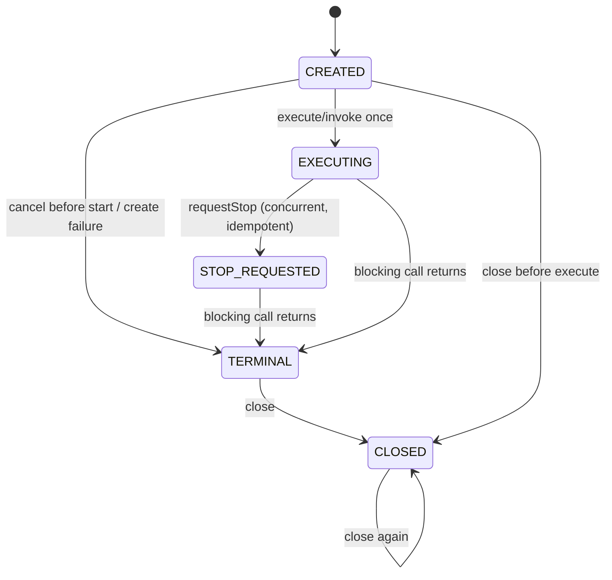
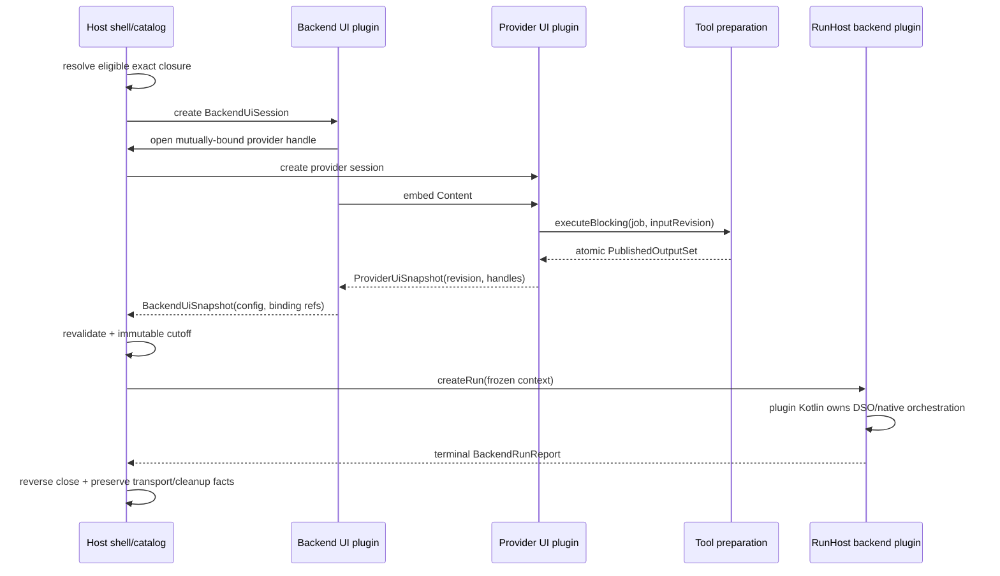

<a id="record-plugin-sdk-v2-exact"></a>

# P-BACKEND-X-002/批次01：SDK-v2 完整合同设计

## Context and scope

### 1. Authority、方法与结论边界

本设计承接已获用户认可的 [P-BACKEND-X-002/决策04](../plugin-architecture/design.md#record-plugin-sdk-v2)，只关闭其明确预留的 **SDK-v2 exact design gate**。方法采用 CDA EVOLUTION：以当前 manifest 1.0、Diagnose v1 vertical、现有 catalog/loader/resource owner 为基线，保持决策04已经冻结的四角色、single catalog、plugin-owned Compose/native、provider parent binding、Custom Executor 和 KMP Android/Desktop 方向，只补齐可独立实现的完整合同。

本批 SHALL NOT 修改 production source、迁移 Diagnose、接入 Host、实现 43499/43284/98260、选择 Desktop WebUI/JavaScript 引擎、引入 repository/PKI/TUF 或声称 AVD/真机攻击链已通过。OpenSpec 保存完整设计；执行状态、审查、认可与实际证据只保存在 Beads `gl-ry9`。

### 2. Evidence ledger

| 类别 | 事实 |
|---|---|
| VERIFIED | `:plugin:api` 当前只有 13 个 `com.ghostlock.plugin.api.v1` Diagnose 专用 Java 类型；`DiagnosticRunResult` 固定两 stage，`DiagnosticBackendRun` 无 stop。 |
| VERIFIED | manifest/core 当前 format 1.0、恰好一个 BACKEND；loader 硬编码 ARM64、`diagnostic-v1`、Diagnose namespace 与单 native directory。 |
| VERIFIED | 当前 verifier/store 已有 strict JSON、semantic root、file hash、ZIP/DEX/protected namespace/ELF 检查、immutable object store 和 READY generation；RunHost 已有 one-shot owner、TCCL 与逆序 cleanup。 |
| VERIFIED | Diagnose Kotlin 自己装载 JNA/DSO、管理 native binding；Host 不持有 plugin-private native handle。 |
| USER-STATED | backend/provider/Tool/Custom Executor 四类；provider 严格隶属 backend；backend 自己嵌 provider UI；Custom 是一个执行插件，执行 Lua/JavaScript/WebUI 并可调用任意已授权 capability，包括指定地址 raw memory。 |
| USER-STATED | `.glplugin.zip` 明示 ZIP；允许用户重打包；identity 不依赖 ZIP bytes；无固定 archive/entry/单文件大小上限；多架构用 thin archive 独立分发。 |
| USER-STATED | Host 无 native；插件 Kotlin 声明并调用自己的动态库；builtin/imported 走相同 runtime path，但 imported executable 需显式授权。 |
| DERIVED | v1 Diagnose API、固定 stage、Host backend UI registry 和 loader 硬编码必须整组替换，不能作为 v2 compatibility layer 保留。 |
| DERIVED | Java runtime 和 KMP UI 都要交换同一 value/handle，因此 `PluginValue` 以 `:plugin:api` 纯 Java定义为唯一 JVM authority；`:plugin:ui-api` 在 Android/Desktop 共享 JVM source set 使用它，不再定义第二棵 value tree。 |
| ASSUMED | 本计划期只支持 Android JVM 与 Desktop JVM UI target；若未来增加非 JVM UI target，必须新开 major/FFI design，不在 v2.0 假装已有。 |
| UNKNOWN | 真实 Desktop Web container、Lua/JavaScript engine 与各 backend 的具体 fields；它们属于消费者实现，不阻断本 ABI。 |

### 3. Constraint system

| 硬约束 | 机械判据 |
|---|---|
| 四角色闭集 | manifest `kind` 只能是 `BACKEND/BACKEND_PROVIDER/TOOL/CUSTOM_EXECUTOR`；job/export/requirement 不是 component。 |
| 单 catalog/registry | catalog 是 package/component/exact object 唯一 authority；UI、runtime、dependency、capability 都是同一 snapshot projection。 |
| plugin-owned UI/native | Host 只渲染 shell、验证/搬运 handle 和治理 process；无 backend field schema、无 common native/JNA owner。 |
| provider parent-bound | parent/slot/contract 双向匹配；backend 选择与嵌入；Host 不路由 provider UI。 |
| cutoff immutable | run 开始前冻结 exact closure；active session/run 不热插拔、不轮询 catalog。 |
| 调用者无异步 | runtime 与 preparation public API blocking；没有 Future/Deferred/poll handle。UI 插件可在自身 coroutine/worker 调 blocking controller。 |
| Host capability 最小化 | ordinary dependencies/HostOperations 不可枚举；Custom 只枚举被冻结且 `CUSTOM_CALLABLE` 的 exports。 |
| 不伪造结果 | domain report、transport/process、cleanup 三类事实分开；kill/exception 不等于 rollback。 |

## Decisions

### 4. Modules、packages 与 compatibility line

| module | owner / public namespace | exact responsibility |
|---|---|---|
| `:plugin:core` | `com.ghostlock.plugin.core.v2` | KMP manifest storage/codec、content-root/catalog internal models；不含 public SPI identity、loader、Compose、Host DI、native。 |
| `:plugin:api` | `com.ghostlock.plugin.api.v2` | Java 17 runtime ABI、全部 public identity/DTO、唯一 `PluginValue`、Document/Artifact、capability、reports、HostOperations、raw-memory standard contract。 |
| `:plugin:ui-api` | `com.ghostlock.plugin.ui.v2` | KMP Android/Desktop Compose ABI；公共声明放在两个 JVM target 共享 source set，并依赖 `:plugin:api` 的唯一 value/handle。 |
| `:plugin:testkit` | `com.ghostlock.plugin.testkit.v2` | schema/ABI/lifecycle/classloader/Compose fixtures；不进入 production runtime。 |
| convention/build logic | 无 runtime namespace | thin archive、manifest/schema validation、ABI dump、plugin tests 与 package assembly。 |

`v1` SHALL NOT 获得 adapter。迁移批在同一 consumer 内原子切换到 v2 后删除对应 v1 path。Host parent-first/protected namespace 至少包含 `java.*`、`javax.*`、`kotlin.*`、`kotlinx.coroutines.*`、`androidx.compose.*`、`com.ghostlock.plugin.api.*`、`com.ghostlock.plugin.ui.*`；精确 Desktop Compose runtime 前缀由 final conformance proof 固定，禁止泛化 `org.jetbrains.*`。

API 版本分别为 runtime `2.0` 与 UI `2.0`。manifest 记录 `major/builtAgainstMinor/minimumHostMinor`。major 不同拒绝；Host minor 小于 minimum 拒绝。minor 只允许新增独立 optional interface、feature id 或新 contract；禁止给已发布 interface 新增 abstract method、改变 DTO invariant、改变 enum 既有值语义或放宽 ownership。任何这些变化必须升 major。

### 5. Manifest 2.0 与 exact identity

唯一规范 JSON Schema 是 [schemas/plugin-package-v2.schema.json](schemas/plugin-package-v2.schema.json)。schema draft 为 2020-12；UTF-8 JSON object；duplicate key 在 schema 前的 parser stage 拒绝；unknown member、显式 `null`、非整数 numeric、非 NFC string 均拒绝。schema 是字段/required/closed union authority；以下是 schema 无法表达的 cross-field semantic rules：

1. 所有 identifier 经 NFC 后必须与原 bytes 等价并大小写敏感；`versionCode` 是发布排序唯一依据，`versionName` 只展示。
2. ZIP 只接收 regular file/directory；拒绝 absolute、`..`、backslash、normalized collision、duplicate entry、symlink/special node。目录 entry 不进入 `files[]`；其余每个 regular file（除根 `manifest.json`）必须与 `files[]` 一一对应并匹配 size/SHA-256。
3. canonical manifest 严格采用 RFC 8785 JSON Canonicalization Scheme（JCS）的 UTF-8 serialization，包括 property UTF-16 code-unit ordering、ECMAScript string escaping、control/non-ASCII/solidus 表示和无 whitespace。GhostLock 在进入 JCS 前额外要求所有 key/string 已是 NFC 且原输入本身就是 NFC，并把全部 JSON integer限制到 I-JSON safe range `[-9007199254740991,9007199254740991]`；本 schema没有负整数。不得先 parse成 IEEE-754 再损失 integer。semantic root 为 `SHA-256(UTF8("GhostLockPluginContent/2") || 0x00 || JCS(manifest))`；manifest 已包含全部 file path/hash/size，所以 root 绑定 payload，ZIP ordering/timestamp/compression/comment/CRC 不参与 identity。
4. 同一 `(publisherId, packageId, versionCode, variant, target)` 出现不同 semantic root 时 SHALL fail internal catalog/admission code `PluginAdmissionCode.CONTENT_CONFLICT`，不得自动覆盖或继承 trust。`PluginAdmissionCode` 属于 `:plugin:core`/Host admission domain，不是 plugin-call `PluginFailureCode`，不会传给已加载 SPI。
5. `resources[]` 是 schema closed union：Document必有 schema id/version，Artifact必有 kind/target，Web bundle必有 entry path，Source必有 source kind；notice/passive不产生 handle。每个 resource path 必须存在于 `files[]`，每个 component `resources[]` 只能引用同包 id。`staticExports[].outputs[]` 以 unique `outputId -> resourceId` 把 Document/Artifact绑定到 stable export id/contract version，供 ordinary dependency或 provider binding 直接取得，不加载代码。`PublishedOutputSet` map key就是 outputId；descriptor objectId=`<semanticRoot>:<resourceId>`、content SHA来自 file、provenance producer是 exact package。Provider的 `physicalStaticExportId` 唯一选择哪个 static export进入 physical outputs；该 export contract id/version必须与 provider binding 相同。缺省表示 physical outputs只来自其 job/UI publication。data-only provider必须声明该 id，且它必须引用本 component static export。若交互式 provider合并 static与job outputs，output id collision直接 `CONTRACT_FAILURE`。其它 static exports只能作为 dependency export。resource/static export 是 package content，不是第五种 component/capability。
6. `BACKEND_PROVIDER` 必须至少有一个 job/runtime path或一个 static export；只有交互式 provider 才有 `uiEntryClass`。`TOOL` 必须至少有一个 job或 static export，UI optional。`target.dataOnly=true` 只在 `payloads` 为空、components 无 entry/jobs/capability exports/WebUI executable declaration且所有 files 都属于 manifest/i18n/declared non-executable resources/static exports时成立；只有此时可使用 `UNIVERSAL` platform/architecture。其余包必须是一个 thin target；target/ELF/DEX 与 variant 必须一致。
7. `payloads.ui.code[]`、`payloads.runtime.code[]` 按数组次序形成 class path；Android DEX 名必须在各 payload 内连续 `classes.dex/classes2.dex/...`。同一 payload 内 duplicate defined class 拒绝；UI/runtime 是隔离 loader/process，可各自携带同名 plugin-private helper，但都不得定义 protected namespace，且跨边界仍只传 SDK types。UI payload 无 native search path；DSO 只能出现在 runtime native list。
8. component id、resource id、dependency slot、capability/static export id、static output id、job id、job input/output id、provider slot、Host-operation slot 在各自 owner 内唯一。所有 file/payload/resource/static-export/i18n/job/entry references 必须存在；static output只能引用 Document/Artifact resource。entry class public concrete、public zero-arg constructor、constructor 无 side effect，并实现声明 implied interface。
9. contract match 为 `provided.major == required.major && provided.minor in [minMinor,maxMinor]`；schema 后另验 `minMinor <= maxMinor`。dependency graph required edge 有 missing/ambiguous/cycle/version conflict 即整体 closure `NOT_READY`；不引入 SAT solver。
10. provider 双向匹配必须同时满足 parent stable component、slot id、contract id/version；一个 slot cardinality 固定 `ONE`。required slot missing 使 backend `NOT_READY`；optional missing 由 backend UI 自行表达。
11. i18n namespace 必须等于 `<publisherId>.<packageId>`；bundle locale 唯一且 canonical BCP-47。fallback 是 exact tag → 去除最后 subtag 逐级 → default locale → Host missing-key marker。

Normative JCS/root vectors（`canonical` 列展示 JSON bytes，`\n`/`\u0000` 是两个 ASCII escape sequences，不是文档换行/NUL）：

| canonical UTF-8 JSON | semantic root hex |
|---|---|
| `{"a":"é\n","b":"/","n":9007199254740991}` | `11086213d42d89629b66859ac995381c363581e5b44af917d33979e83176bc62` |
| `{"A":"\u0000","a":"😀","z":0}` | `241114d9ce18bea7e68b68b364d350276e84f243a0d402ae317711afb28f51d7` |
| `{"files":[{"path":"x","sha256":"0000000000000000000000000000000000000000000000000000000000000000","size":0}],"format":{"major":2,"minor":0}}` | `112bd0a46d587329e18fca4e29d1ba1ec583593464dae933ca53d8e2b61b0bc8` |

身份层次固定如下，不得再用一个 `PluginIdentity` 混用：

```text
StablePackageRef       = publisherId + packageId
PackageReleaseRef      = StablePackageRef + versionCode
TargetVariant          = platform + architecture + abi + variant + minimumPlatformVersion + dataOnly
ExactPackageRef        = PackageReleaseRef + TargetVariant + semanticContentRoot
StableComponentRef     = StablePackageRef + componentId
ExactComponentRef      = ExactPackageRef + componentId + kind
ProviderSlotRef        = parent StableComponentRef + slotId + contract range
ExactExportRef         = ExactComponentRef + exportId + contract version
LifecycleIdentity      = UUID + ExactComponentRef + catalogGeneration
```

这些 public immutable final DTO 只在 `:plugin:api` 以纯 Java定义；`:plugin:core` 的 manifest storage model 不是 SPI，必须通过单一 mapper 生成这些 DTO。`:plugin:ui-api` 的两个 JVM targets直接复用同一 DTO。`equals/hashCode/toString` 基于所有 identity fields，`toString` 不包含用户内容或 secret。

### 6. Java runtime ABI common rules

以下签名是 v2.0 完整 public surface 的 authority。所有 reference parameter/return 默认 non-null；唯一 nullable 位置以 `@Nullable` 明示，本设计不使用 nullable collection element。所有 constructor/factory defensive-copy；list/map 返回 immutable insertion-order view；`byte[]` getter 再复制。所有 SPI call 只抛 checked `PluginException`，任何其它 throwable 是 contract corruption。所有 lifecycle object 单次使用、不得跨 exact closure 复用。

```java
public final class PluginApi { public static final int MAJOR=2, MINOR=0; }
public enum PluginFailureCode {
  INVALID_INPUT, NOT_READY, NOT_AUTHORIZED, UNSUPPORTED_API, UNSUPPORTED_TARGET,
  NOT_FOUND, AMBIGUOUS_BINDING, VERSION_CONFLICT, DEPENDENCY_CYCLE, STALE_REVISION,
  IDENTITY_MISMATCH, RESOURCE_EXHAUSTED, IO_FAILURE, CANCELLED, TIMED_OUT,
  OPERATION_REFUSED, UNKNOWN_EFFECT, CONTRACT_FAILURE, CLEANUP_FAILURE
}
public final class PluginException extends Exception {
  public PluginException(PluginFailureCode code, String technicalDetail);
  public PluginFailureCode code(); public String technicalDetail();
}
public final class PluginOutputIOException extends IOException {
  public PluginOutputIOException(String technicalDetail, Throwable cause);
  public PluginFailureCode code(); // always CLEANUP_FAILURE
}
```

`technicalDetail` single-line UTF-8 ≤4096 bytes，不本地化、不含 secret。普通领域拒绝/攻击失败 SHALL return typed report，不抛 exception。

#### 6.1 Complete public value/identity DTO ledger

除下表和后文显式 lifecycle interface 外，v2.0 SHALL NOT 导出其它 public type。`record` 表示 Java final record；所有 list/map 在 compact constructor 中复制并校验，optional 使用 `Optional<T>`，不使用 `null`。

| type | exact components / invariant |
|---|---|
| `ContractVersion` | `int major, int minor`；major≥1, minor≥0 |
| `ContractVersionRange` | `int major, int minMinor, int maxMinor`；0≤min≤max |
| `Sha256` | lowercase 64-hex `String value` |
| `StablePackageRef` | `String publisherId, String packageId` |
| `PackageReleaseRef` | `StablePackageRef stablePackage, long versionCode`；versionCode≥1 |
| `TargetVariant` | `PluginPlatform platform, PluginArchitecture architecture, String abi, String variant, int minimumPlatformVersion, boolean dataOnly`；enums与 schema 相同 |
| `ExactPackageRef` | `PackageReleaseRef release, TargetVariant target, Sha256 semanticContentRoot` |
| `StableComponentRef` | `StablePackageRef stablePackage, String componentId` |
| `ExactComponentRef` | `ExactPackageRef exactPackage, String componentId, PluginComponentKind kind` |
| `ExactExportRef` | `ExactComponentRef component, String exportId, String contractId, ContractVersion contractVersion` |
| `PluginRunIdentity` | `UUID instanceId, ExactComponentRef component, long catalogGeneration` |
| `PluginJobIdentity` | `UUID instanceId, ExactComponentRef component, String jobId, long catalogGeneration` |
| `PluginSessionIdentity` | `UUID instanceId, ExactComponentRef component, long catalogGeneration` |
| `CustomChannelRef` | `UUID channelId, PluginSessionIdentity uiSession, PluginSessionIdentity runtimeExecution, long catalogGeneration`；两端exact component必须相同 |
| `PluginProvenance` | `ProvenanceKind kind, ExactPackageRef producer, Optional<String> sourceLabel`；kind=`BUILTIN/IMPORTED/PREPARED/RUNTIME`，label只审计不参与 identity |
| `PluginMessageRef` | `String namespace, String key, Map<String,PluginValue> arguments`；args只允许 scalar tags |
| `OutputKind` | enum `DOCUMENT/ARTIFACT` |
| `DeclaredOutputRef` | sealed interface `outputId(), kind()`；permits下列两个 records |
| `DeclaredDocumentOutput` | `String outputId, String schemaId, ContractVersion schemaVersion`，implements `kind(){ return DOCUMENT; }` |
| `DeclaredArtifactOutput` | `String outputId, String artifactKind, TargetVariant target`，implements `kind(){ return ARTIFACT; }` |
| `DeclaredInputRef` | sealed interface `inputId(), kind()`；`DeclaredDocumentInput(inputId,schemaId,schemaVersion)` 固定 `kind()=DOCUMENT`；`DeclaredArtifactInput(inputId,artifactKind,target)` 固定 `kind()=ARTIFACT` |
| `ResolvedPreparationJob` | `PluginJobIdentity identity, ExactComponentRef component, String jobId, List<DeclaredInputRef> inputs, List<DeclaredOutputRef> outputs`；Host根据 manifest产生，不由 plugin 构造 |
| `PublishedOutputSet` | ordered `Map<String,PluginDocumentHandle> documents`, ordered `Map<String,PluginArtifactHandle> artifacts`；key=declared output id，immutable |
| `ExactProviderBinding` | `ExactComponentRef provider, StableComponentRef parent, String slotId, String contractId, ContractVersion contractVersion, long catalogGeneration, long providerRevision, PublishedOutputSet physicalOutputs` |
| `ScriptArtifact` | `String languageId, PluginArtifactHandle source, ExactComponentRef customExecutor, Optional<PluginArtifactHandle> verifiedWebBundle` |
| `PluginCapabilityDescriptor` | `ExactExportRef export, Set<CapabilityVisibility> visibility, List<CapabilityOperationDescriptor> operations` |
| `CapabilityOperationDescriptor` | `String operationId, String requestSchemaId, String responseSchemaId` |
| `HostOperationDescriptor` | `String declaredSlotId, String contractId, ContractVersion contractVersion, List<CapabilityOperationDescriptor> operations` |
| `HostOperationResult` | `CapabilityCompletion completion, PluginValue value, String stableReasonCode, Optional<PluginMessageRef> message, ExternalEffectState effect` |
| `ExitFact` | `ExitFactKind kind, long value`；kind=`PROCESS_EXIT/SIGNAL/NATIVE_STATUS/ERRNO` |
| `PluginDocumentDescriptor` | 如 §7 record；`objectId` 是 Host-issued opaque stable string：prepared/runtime对象可用 UUID text，static resource使用§5 deterministic form；调用者不得解析 |
| `PluginArtifactDescriptor` | 如 §7 record；`objectId` 遵循同一 opaque stable string invariant |

Public enums完整闭集：`PluginPlatform={ANDROID,DESKTOP_LINUX,DESKTOP_MACOS,DESKTOP_WINDOWS,UNIVERSAL}`、`PluginArchitecture={ARM64,ARMV7,X86,X86_64,UNIVERSAL}`、`PluginComponentKind={BACKEND,BACKEND_PROVIDER,TOOL,CUSTOM_EXECUTOR}`、`CapabilityVisibility={DEPENDENCY,CUSTOM_CALLABLE}`、以及后文逐一定义的 completion/effect/stage/log/value enums。Java enum新增值不是 minor-safe；需要新增语义时升 major或新增 optional interface。

共有 identity/value interfaces：

```java
public interface PluginCancellation { boolean isCancellationRequested(); }
public interface PluginLogSink { void emit(PluginLogEvent event); }
public record PluginLogEvent(PluginLogLevel level, PluginLogOrigin origin,
  String stableCode, String technicalDetail) {}
public enum PluginLogLevel { DEBUG, INFO, WARN, ERROR }
public enum PluginLogOrigin { PLUGIN, NATIVE, SCRIPT, HOST_OPERATION }

public abstract class PluginValue {
  public enum Tag { NULL, BOOLEAN, SIGNED, UNSIGNED, DECIMAL, STRING, BYTES, LIST, OBJECT, DOCUMENT_REF, ARTIFACT_REF }
  public abstract Tag tag();
  public static PluginValue nullValue();
  public static PluginValue ofBoolean(boolean value);
  public static PluginValue ofSigned(long value);
  public static PluginValue ofUnsigned(long unsignedBits);
  public static PluginValue ofDecimal(String canonicalDecimal);
  public static PluginValue ofString(String value);
  public static PluginValue ofBytes(byte[] value);
  public static PluginValue ofList(List<PluginValue> value);
  public static PluginValue ofObject(Map<String,PluginValue> value);
  public static PluginValue ofDocument(PluginDocumentHandle value);
  public static PluginValue ofArtifact(PluginArtifactHandle value);
  public boolean booleanValue(); public long signedValue(); public long unsignedBits();
  public String decimalValue(); public String stringValue(); public byte[] bytesValue();
  public List<PluginValue> listValue(); public Map<String,PluginValue> objectValue();
  public PluginDocumentHandle documentValue(); public PluginArtifactHandle artifactValue();
}
public record PluginValueBudget(int maxDepth, long maxNodes, long maxStringUtf8Bytes,
  long maxByteValueBytes, long maxCanonicalBytes) {}
```

`UNSIGNED` 是 `long` 的 unsigned 64-bit bit pattern。Decimal input grammar为 `-?(0|[1-9][0-9]*)(\.[0-9]+)?([eE][+-]?[0-9]+)?`；canonical form用 arbitrary-precision decimal计算后转为**无 exponent** plain form，移除整数 leading zero与 fractional trailing zero、移除空 decimal point，任意 zero写 `0`，禁止 NaN/Infinity。因此 `1`、`1.0`、`10e-1`、`1e+00` 全部编码为 ASCII `1`。object key NFC/unique，按 UTF-8 byte lexical order。

Canonical binary `PluginValue/1` 对每个 value编码 `tag:u8 || payloadLength:uvarint || payload`；uvarint是 unsigned LEB128 shortest form。Tag 固定：`00 NULL, 01 BOOLEAN, 02 SIGNED, 03 UNSIGNED, 04 DECIMAL, 05 STRING, 06 BYTES, 07 LIST, 08 OBJECT, 09 DOCUMENT_REF, 0a ARTIFACT_REF`。payload：NULL empty；BOOLEAN恰一 byte `00/01`；SIGNED恰8-byte big-endian two's-complement；UNSIGNED恰8-byte big-endian bits；DECIMAL/STRING为 canonical UTF-8；BYTES raw；LIST为 `count:uvarint` 后按序连接完整 child TLV；OBJECT为 `count:uvarint` 后按 key 顺序连接 `keyLength:uvarint || keyUtf8 || childTLV`。

Handle payload按 §6.1 record component 顺序编码。Primitive rules：String=`uvarint length+UTF-8`；nonnegative `int/long`=`uvarint`；boolean=`00/01`；UUID=RFC 4122 network-order 16 bytes；version=`major uvarint+minor uvarint`；SHA=32 raw bytes；optional=`00`或`01+value`。所有 nested identity records递归按其列出的 component顺序；Document顺序为 schemaId/version/objectId/SHA/provenance，Artifact顺序为 kindId/target/objectId/SHA/provenance。不存在 map/reflection-derived field order。

Handle-wire enum ordinals are frozen independently of Java declaration layout：`PluginPlatform {ANDROID=0, DESKTOP_LINUX=1, DESKTOP_MACOS=2, DESKTOP_WINDOWS=3, UNIVERSAL=4}`；`PluginArchitecture {ARM64=0, ARMV7=1, X86=2, X86_64=3, UNIVERSAL=4}`；`ProvenanceKind {BUILTIN=0, IMPORTED=1, PREPARED=2, RUNTIME=3}`。No other enum is encoded in a Document/Artifact descriptor。

Normative binary vectors（hex）：NULL=`0000`；true=`010101`；signed 1=`02080000000000000001`；decimal inputs `1/1.0/10e-1/1e+00` 都是 `040131`；string `é`=`0502c3a9`；list `[null,true]`=`0706020000010101`；object `{"a":1}`=`080d01016102080000000000000001`。Java/Kotlin/WebUI conformance必须逐 byte匹配。

Full Document handle vector：schema=`s/1.0`、objectId=`o`、content SHA=`00`×32、provenance=`BUILTIN`、producer=`p/q versionCode=1 target=(ANDROID,ARM64,abi=a,variant=v,min=1,dataOnly=false,root=11×32)`、sourceLabel absent，完整 TLV hex必须为 `095501730100016f00000000000000000000000000000000000000000000000000000000000000000001700171010000016101760100111111111111111111111111111111111111111111111111111111111111111100`。

SDK minimum budget 为 depth 32、nodes 65536、string 1 MiB、single bytes 4 MiB、canonical message 8 MiB；Host 可提高不能降低，调用者可经 context `valueBudget()` 查询。大数据使用 handle。

Accessor only accepts its matching tag；wrong accessor throws `IllegalStateException` and is caller programming error，不是跨边界领域结果。Document/Artifact canonical encoding只含完整 descriptor/object id；解码时必须由当前 lifecycle handle resolver重新绑定，不能凭 object id绕过 closure。

### 7. Document、Artifact 与 atomic publication

```java
public interface PluginDocumentHandle {
  PluginDocumentDescriptor descriptor(); InputStream openStream() throws PluginException;
}
public interface PluginArtifactHandle {
  PluginArtifactDescriptor descriptor(); InputStream openStream() throws PluginException;
  MaterializedArtifactLease materializeReadOnly() throws PluginException;
}
public interface MaterializedArtifactLease extends AutoCloseable {
  String opaquePath(); void close() throws PluginException;
}
public record PluginDocumentDescriptor(String schemaId, ContractVersion schemaVersion,
  String objectId, Sha256 contentSha256, PluginProvenance provenance) {}
public record PluginArtifactDescriptor(String kindId, TargetVariant target,
  String objectId, Sha256 contentSha256, PluginProvenance provenance) {}

public interface PreparationOutputPublisher {
  OutputBatch beginBatch(long inputRevision) throws PluginException;
}
public interface OutputBatch extends AutoCloseable {
  OutputWriter open(String declaredOutputId) throws PluginException;
  PublishedOutputSet publish() throws PluginException;
  void abort() throws PluginException; void close() throws PluginException;
}
public interface OutputWriter extends AutoCloseable {
  OutputStream stream() throws PluginException; void close() throws PluginException;
}
```

每次 `openStream()` 返回 caller-owned fresh stream；关闭 stream 不关闭 handle。handle closure 结束后 open 稳定返回 `NOT_READY`。`materializeReadOnly` 是 lifecycle-bound lease，path 仅对当前 process/workspace 有效，Host storage ownership 不转移；Android PFD 不进入 ABI。

`PreparationOutputPublisher` 在 Host创建 `PreparationJobContext` 时已经绑定 `ResolvedPreparationJob.outputs`；plugin只能按 declared output id打开writer，不能提交新 declaration。一个 job 只允许一个 `OutputBatch`。所有 writers close、每个声明 output 恰有一个完整对象、Host 重算 hash/schema/kind/target且 `inputRevision` 仍 current 后，`publish()` 才一次原子暴露整组 handles；任一失败、cancel、stale 或 close-before-publish 都只删除该 batch owned staging。publish 成功后 batch terminal，第二次调用 `CONTRACT_FAILURE`。

### 8. Entries、contexts 与 lifecycle objects

```java
public interface BackendEntryPoint {
  BackendRun createRun(BackendRunContext context) throws PluginException;
}
public interface BackendRun extends AutoCloseable {
  BackendRunReport execute() throws PluginException;
  void requestStop();
  void close() throws PluginException;
}
public interface PreparationEntryPoint {
  PreparationJob createJob(PreparationJobContext context) throws PluginException;
}
public interface PreparationJob extends AutoCloseable {
  PreparationResult execute() throws PluginException;
  void requestStop();
  void close() throws PluginException;
}
public interface CustomExecutorEntryPoint {
  CustomExecution createExecution(CustomExecutionContext context) throws PluginException;
}
public interface CustomExecution extends AutoCloseable {
  CustomExecutionReport execute(ScriptArtifact script) throws PluginException;
  void requestStop();
  void close() throws PluginException;
}
public interface CapabilityEntryPoint {
  CapabilitySession open(CapabilityOpenContext context) throws PluginException;
}
public interface CapabilitySession extends AutoCloseable {
  PluginCapabilityDescriptor descriptor();
  CapabilityResult invoke(String operationId, PluginValue request) throws PluginException;
  void requestStop();
  void close() throws PluginException;
}
```

每个 manifest job/export 各自声明一个 entry class，因此 context 不再提供第二套 dispatch selector。component runtime entry 只创建 Backend/Custom lifecycle；job/export entry 独立。它们都 public zero-arg、无构造副作用。

完整 context getters：

| type | exact getters |
|---|---|
| `BackendRunContext` | `PluginRunIdentity identity()`、`PluginDocumentHandle executionConfiguration()`、`ProviderBindingView providers()`、`DependencyView dependencies()`、`HostOperations hostOperations()`、`PluginCancellation cancellation()`、`PluginLogSink logs()`、`PluginValueBudget valueBudget()` |
| `PreparationJobContext` | `PluginJobIdentity identity()`、`String jobId()`、`long inputRevision()`、`PreparationInputs inputs()`、`DependencyView dependencies()`、`HostOperations hostOperations()`、`PreparationOutputPublisher outputs()`、cancellation/logs/budget |
| `CustomExecutionContext` | `PluginSessionIdentity identity()`、`CapabilityDirectory capabilities()`、`HostOperations hostOperations()`、`CustomRuntimeInbox messages()`、cancellation/logs/budget |
| `CapabilityOpenContext` | `PluginSessionIdentity identity()`、`ExactExportRef export()`、`DependencyView dependencies()`、`HostOperations hostOperations()`、cancellation/logs/budget |

这些 context 均为 public interface，除上表 getters 外无方法。辅助 view 的 exact signatures 是：

```java
public interface PreparationInputs {
  PluginDocumentHandle document(String declaredInputId) throws PluginException;
  PluginArtifactHandle artifact(String declaredInputId) throws PluginException;
}
public interface ProviderBindingView {
  ExactProviderBinding binding(String providerSlotId) throws PluginException;
}
public interface CustomRuntimeInbox {
  CustomChannelRef channel();
  CustomRuntimeMessage receive() throws PluginException;
  void respond(CustomRuntimeResponse response) throws PluginException;
}
public record CustomRuntimeMessage(long requestId, String methodId, PluginValue payload) {}
public record CustomRuntimeResponse(long requestId, CapabilityCompletion completion,
  PluginValue payload, String reasonCode) {}
```

两者按 manifest id non-enumerable；missing optional provider 也以 `NOT_FOUND` 表达，不返回 null。每个 `ExactProviderBinding` 如 §6.1，backend execution Document SHALL NOT duplicate physical payload。

### 9. Dependency、capability、HostOperations

```java
public interface DependencyView {
  PluginCapabilityHandle openCapability(String dependencySlotId) throws PluginException;
  PublishedOutputSet openStatic(String dependencySlotId) throws PluginException;
}
public interface CapabilityDirectory {
  List<PluginCapabilityDescriptor> list();
  PluginCapabilityHandle open(ExactExportRef export) throws PluginException;
}
public interface PluginCapabilityHandle extends AutoCloseable {
  PluginCapabilityDescriptor descriptor();
  CapabilityResult invoke(String operationId, PluginValue request) throws PluginException;
  void requestStop(); void close() throws PluginException;
}
public record CapabilityResult(CapabilityCompletion completion, PluginValue value,
  String stableReasonCode, Optional<PluginMessageRef> message) {}
public enum CapabilityCompletion { COMPLETED, REFUSED, FAILED, CANCELLED, UNKNOWN }

public interface HostOperations {
  HostOperationHandle open(String declaredSlotId) throws PluginException;
}
public interface HostOperationHandle extends AutoCloseable {
  HostOperationDescriptor descriptor();
  HostOperationResult invoke(String operationId, PluginValue request) throws PluginException;
  void requestStop(); void close() throws PluginException;
}
```

ordinary dependency 与 HostOperations 均不可枚举，只能按 manifest slot open；dependency `mode=CAPABILITY` 只允许 `openCapability`，`mode=STATIC` 只允许 `openStatic`，错用稳定 `CONTRACT_FAILURE`。static outputs 是 exact package resources 的 immutable handles，不创建 plugin code session。Custom `CapabilityDirectory.list()` 只显示 session cutoff 时 trusted、target-compatible、visibility 含 `CUSTOM_CALLABLE` 的 capability exports；static export 不混入 callable list。一个 capability export 标 `DEPENDENCY` 不自动获得 `CUSTOM_CALLABLE`，反之亦然。跨 package 只传 SDK DTO/value/handle，plugin-private class 不成为 dependency classpath。

Host operation contract id/version、operation id、request/response schema、timeout/cancel、effect/partial/retry facts由独立 versioned contract定义。v2.0 预留 `ghostlock.payload.dispatch/v1`、`ghostlock.finish.execute/v1` 与 `ghostlock.process.invoke/v1` id，但没有 consumer contract 时不在 SDK 填万能实现。HostOperation 不是 service locator：不能枚举、取 root manager/shell/filesystem/DI/class/reflection。

同一 capability/Host-operation session 内 invocation 串行；第二个并发 invoke 返回 `CONTRACT_FAILURE`。`requestStop` 可并发，close 不可并发。open/partial construction failure 时 acquired leases严格逆序 close。

### 10. Standard raw-memory capability

`ghostlock.raw-memory/v1.0` 是 SDK 内唯一标准 typed capability，不是 Host native API：

```java
public final class RawMemory {
  public static RawMemoryCapability open(PluginCapabilityHandle ownedHandle) throws PluginException;
}
public interface RawMemoryCapability extends AutoCloseable {
  PluginCapabilityDescriptor descriptor();
  List<RawAddressSpace> addressSpaces() throws PluginException;
  RawTransferResult read(RawAddressSpaceId space, UnsignedAddress address, int length) throws PluginException;
  RawTransferResult write(RawAddressSpaceId space, UnsignedAddress address, byte[] bytes) throws PluginException;
  OwnedMemoryRegion allocate(RawAddressSpaceId space, long length, long alignment) throws PluginException;
  RawRegionFacts query(RawAddressSpaceId space, UnsignedAddress address) throws PluginException;
  void requestStop(); void close() throws PluginException;
}
public interface OwnedMemoryRegion extends AutoCloseable {
  RawRegionFacts facts(); RawTransferResult read(long offset, int length) throws PluginException;
  RawTransferResult write(long offset, byte[] bytes) throws PluginException;
  void free() throws PluginException; void close() throws PluginException;
}
```

Manifest export仍由 `CapabilityEntryPoint`/`CapabilitySession` 建立，并必须声明 contract id `ghostlock.raw-memory` version `1.0` 与完整 operation ids `address-spaces/read/write/allocate/query/region-read/region-write/region-free`；schema id为 `ghostlock.raw-memory.<operation>.request/v1` 与 `.response/v1`。`RawMemory.open` checked-validate exact descriptor/operation set后接管 generic handle ownership并返回唯一 typed adapter；失败时关闭传入 handle并抛 `UNSUPPORTED_API/CONTRACT_FAILURE`。成功后 caller不得再直接调用/close原 handle，adapter close逆序free所有仍-owned region再关闭 underlying session。Custom路径是 `CapabilityDirectory.open(export) -> RawMemory.open(handle) -> typed absolute read/write`，不允许 cast或第二套 registry。

Raw standard `PluginValue` schemas是 closed objects（extra/missing/wrong tag拒绝）：

| operation | request object | response object/value |
|---|---|---|
| `address-spaces` | NULL | LIST of `{id:STRING,targetIdentity:STRING,addressWidth:SIGNED,byteOrder:STRING,minimumAlignment:UNSIGNED,maxTransfer:UNSIGNED,readable:BOOLEAN,writable:BOOLEAN,allocatable:BOOLEAN,externalAbsoluteAddress:BOOLEAN}` |
| `read` | `{space:STRING,address:UNSIGNED,length:UNSIGNED}` | transfer object |
| `write` | `{space:STRING,address:UNSIGNED,bytes:BYTES}` | transfer object（bytes field empty） |
| `query` | `{space:STRING,address:UNSIGNED}` | region-facts object |
| `allocate` | `{space:STRING,length:UNSIGNED,alignment:UNSIGNED}` | `{regionToken:STRING,facts:region-facts}` |
| `region-read` | `{regionToken:STRING,offset:UNSIGNED,length:UNSIGNED}` | transfer object |
| `region-write` | `{regionToken:STRING,offset:UNSIGNED,bytes:BYTES}` | transfer object（bytes field empty） |
| `region-free` | `{regionToken:STRING}` | NULL |

transfer object固定 `{requested:UNSIGNED,transferred:UNSIGNED,bytes:BYTES,partial:BOOLEAN,error:STRING,nativeStatus:NULL|SIGNED,effect:STRING}`；error token与 `RawErrorCategory` enum name相同，effect token与 `EffectCertainty` 相同。region-facts固定 `{space:STRING,base:UNSIGNED,length:UNSIGNED,owned:BOOLEAN,readable:BOOLEAN,writable:BOOLEAN}`。`regionToken` 是 export session内 Host/SDK opaque stable string，不是 pointer/address，不能跨 exact capability session；`OwnedMemoryRegion`只保存该token并通过三项 region operations实现。Successful free使token永久 invalid；repeat free由adapter本地no-op，不再次invoke。external absolute address从不伪造成region token。

Adapter mapping：`REFUSED→OPERATION_REFUSED`、`CANCELLED→CANCELLED`、`FAILED→IO_FAILURE`。`COMPLETED` 解码各 operation response。合法 `UNKNOWN` 按 operation保留而不伪装 contract corruption：

- `read/write/region-read/region-write` 的 UNKNOWN 必须仍返回合法 transfer object且 `effect=UNKNOWN`；adapter原样返回 `RawTransferResult`，即便 transferred为0也不声称未发生写入。
- `address-spaces/query` 是 read-only；UNKNOWN抛 `PluginException(IO_FAILURE,"unknown read result")`，session保持OPEN。
- `allocate` UNKNOWN表示可能已有无法命名的新 allocation。Adapter先记录该 unnamed ownership-unknown fact并进入 `OWNERSHIP_UNKNOWN`；随后对**此前已成功且仍有 token 的 child regions按 acquisition逆序**执行一次 `region-free`：COMPLETED→`FREED`，REFUSED/FAILED→`FREE_FAILED`，CANCELLED/UNKNOWN→`FREE_UNKNOWN`，任一失败都继续处理其余 child且绝不重试同一 token。之后关闭 underlying session，把 children变为 `CLOSED_RELEASED/CLOSED_FAILED/CLOSED_UNKNOWN` terminal disposition，最后抛 `PluginException(UNKNOWN_EFFECT,...)`。Parent fact始终包含本次 unnamed allocation uncertainty，并分别附加每个 named child与session-close cleanup fact；后续 parent call `NOT_READY`、close幂等。
- 普通 `region-free`：COMPLETED→FREED；REFUSED/FAILED保持ALLOCATED并抛对应异常，允许caller稍后重试；CANCELLED/UNKNOWN→FREE_UNKNOWN且不得重试，分别抛 `CANCELLED/UNKNOWN_EFFECT`。Parent adapter close不再次free FREE_UNKNOWN token并报告ownership-unknown fact。

Malformed/extra/wrong-tag response才是 `CONTRACT_FAILURE`并taint session。Transfer-level native/partial failure仍作为 `RawTransferResult` 返回，不被异常抹掉。

`RawAddressSpace` 固定 id、target/device/process identity、addressWidth 32/64、byteOrder、minimumAlignment、maxTransfer、readable/writable/allocatable、`externalAbsoluteAddress`。`UnsignedAddress` 是 width + unsigned bits；range overflow、alignment、maxTransfer 在进入 plugin native 前拒绝。`RawTransferResult` 包含 requested/transferred、bytes（read）、partial、stable error category、optional native errno/status、effect certainty。owned region close 可释放自有 allocation；external/kernel absolute write 完成后绝不声称 rollback，Host 永不持有 pointer/fd/mapping。

上述 raw types 为 records：

- `RawAddressSpaceId(String value)`；
- `RawAddressSpace(RawAddressSpaceId id, String targetIdentity, int addressWidth, ByteOrder byteOrder, long minimumAlignment, int maxTransfer, boolean readable, boolean writable, boolean allocatable, boolean externalAbsoluteAddress)`；
- `UnsignedAddress(int width, long bits)`；
- `RawRegionFacts(RawAddressSpaceId space, UnsignedAddress base, long length, boolean owned, boolean readable, boolean writable)`；
- `RawTransferResult(int requested, int transferred, byte[] bytes, boolean partial, RawErrorCategory error, OptionalLong nativeStatus, EffectCertainty effect)`；
- `RawErrorCategory={NONE,INVALID_ADDRESS,PERMISSION_DENIED,UNMAPPED,PARTIAL,NATIVE_FAILURE,CANCELLED}`；`EffectCertainty={NONE,APPLIED,UNKNOWN}`；`ByteOrder={LITTLE_ENDIAN,BIG_ENDIAN}`。

Read success `bytes.length==transferred`；write result bytes为空。`transferred≤requested≤maxTransfer`。Any violation is contract corruption。

### 11. Reports、failure composition 与 abort

```java
public enum DomainCompletion { COMPLETED, REFUSED, FAILED, CANCELLED, UNKNOWN }
public enum ExternalEffectState { NONE, APPLIED, CLEANED, HELD, UNKNOWN }
public enum StageState { COMPLETED, REFUSED, FAILED, CANCELLED, UNKNOWN, SKIPPED }
public record PluginStageFact(String stageId, StageState state, String reasonCode,
  Optional<PluginMessageRef> message, Optional<ExitFact> exitFact) {}
public record BackendRunReport(DomainCompletion completion, ExternalEffectState effect,
  List<PluginStageFact> stages, PublishedOutputSet outputs) {}
public record PreparationResult(DomainCompletion completion, long inputRevision,
  PublishedOutputSet outputs, String reasonCode, Optional<PluginMessageRef> message) {}
public record CustomExecutionReport(DomainCompletion completion, ExternalEffectState effect,
  PluginValue result, List<PluginStageFact> stages) {}
```

合法矩阵：`COMPLETED` 可配 `NONE/APPLIED/CLEANED/HELD`，不得配 `UNKNOWN`；`REFUSED` 只能 `NONE`；`FAILED/CANCELLED` 可 `NONE/CLEANED/HELD/UNKNOWN`；`UNKNOWN` 只能 `HELD/UNKNOWN`。stage id/reason code由 plugin 稳定定义，不扩公共 enum。published outputs 只来自已原子 publish 的 handles。

manifest abort policy 只有两个，避免重复 process policy：

| policy | cutoff 前 | execute 后 | Host deadline / emergency death |
|---|---|---|---|
| `BEFORE_EXECUTE_ONLY` | 可取消并不创建/不调用 execute | UI 不提供 normal abort；Host 不调用 `requestStop` | Host 仍可因 process/安全治理终止 disposable RunHost；结果按证据为 failure/unknown，绝非 cancel/rollback。 |
| `COOPERATIVE` | 可取消 | Host 标 cancellation、并发幂等调用 `requestStop()`，等待 Host policy deadline | 超时后可终止 disposable RunHost；无有效 report/cleanup proof 则 completion/effect 为 `UNKNOWN/HELD` 或 `UNKNOWN/UNKNOWN`。 |

Host final result 合并但不覆写三个层面：plugin domain report、Host transport/process/workspace facts、cleanup facts。uncaught throwable/malformed report/process death 是 contract/transport failure；可降低可信度到 UNKNOWN，不能把 failure 改 success。report 返回后 close 失败保留原 report并附 cleanup failure。

### 12. Closed lifecycle and threading

BackendRun、PreparationJob、CustomExecution 三种 one-shot 工作对象共享状态机：



`execute` 只允许一次并在 caller owner thread blocking；第二次稳定 `CONTRACT_FAILURE`。只有 `requestStop` thread-safe、non-blocking、idempotent且不得抛。Host 不与 live execute并发 close：先 requestStop/等待/必要时 process terminate；正常返回后才 close。第一次 close 可抛 `CLEANUP_FAILURE`，但对象仍 CLOSED；后续 close no-op。`cancellationRequested` 只证明请求，不证明停止/cleanup/rollback。

UI entry/session create、`Content`、freeze、composition disposal、close 均在 platform UI thread；一个 session 同时最多一个 active composition。status sink thread-safe；locale/state signal可触发 UI recomposition。Host先 dispose child compositions，再 parent composition，再逆序 close Host-owned child leases，最后 close parent session。render throwable invalidates session generation，不能 freeze，也不制造 fallback backend UI。

#### 12.1 Complete lifecycle/lease call table

表中未列调用一律 `CONTRACT_FAILURE`（UI为 `PluginUiException`）；`close` 例外地始终幂等。只有标明 concurrent 的方法可跨 owner thread。

| public object | states | legal calls / transition | owner, concurrency, post-terminal |
|---|---|---|---|
| `CapabilitySession` / `PluginCapabilityHandle` / `HostOperationHandle` | `OPEN ↔ INVOKING → CLOSED` | invoke使 OPEN→INVOKING→OPEN，可多次串行；`requestStop`只作用当前 call；`close` OPEN→CLOSED | opener owns；call blocking；only requestStop concurrent；close不与call并发；closed后 descriptor可读，其它call `NOT_READY` |
| `RawMemoryCapability` | `OPEN ↔ INVOKING → OWNERSHIP_UNKNOWN/CLOSED` | addressSpaces/read/write/query/allocate串行；allocate UNKNOWN→OWNERSHIP_UNKNOWN并立即关闭underlying session；normal close→CLOSED | adapter owns；requestStop only concurrent；OWNERSHIP_UNKNOWN/CLOSED后descriptor可读、其它call NOT_READY；close幂等且不得猜测free unknown allocation |
| UI entry session | `OPEN ↔ COMPOSED → INVALID/CLOSED` | 首次 Content进入 COMPOSED、composition dispose回 OPEN；freeze仅 latest READY且 OPEN/COMPOSED；render error→INVALID；close仅在composition已dispose后 | Host owns/UI thread；最多一 composition；close idempotent；INVALID只允许 close |
| Provider/Tool UI handle | `CURRENT → RETIRING → CLOSED` | select得到 CURRENT；replace/release/parent-close→RETIRING；最后 composition dispose→CLOSED；freeze仅CURRENT | Host directory sole owner；backend/provider只有 select/Content/freeze；CLOSED所有call `NOT_READY` |
| `OutputBatch` | `OPEN → PUBLISHED/ABORTED → CLOSED` | open writer仅OPEN；全部 writers成功closed且revision current时 publish原子 OPEN→PUBLISHED；abort OPEN→ABORTED；close OPEN先abort再CLOSED，terminal close→CLOSED | job owns，single thread；publish/abort不并发；repeat publish是 CONTRACT_FAILURE；repeat abort在ABORTED no-op、PUBLISHED为 CONTRACT_FAILURE；abort/close cleanup失败先terminal再抛 `CLEANUP_FAILURE`，Host捕获为独立 cleanup fact；close idempotent |
| `OutputWriter` | `OPEN → CLOSED_OK/CLOSED_FAILED` | 第一次 `stream()` lazily创建并返回唯一 OutputStream，重复调用返回同一实例；stream.close或writer.close中先发生者执行唯一flush/hash transition；第二个close no-op | batch owns，single thread。stream-first failure：writer先进入CLOSED_FAILED、Host记录cleanup fact、stream抛 `PluginOutputIOException(CLEANUP_FAILURE)`，后续writer.close no-op。writer-first内部close stream：同一失败被翻译为 `PluginException(CLEANUP_FAILURE)`，后续stream.close no-op。batch观察CLOSED_FAILED，publish只抛CLEANUP_FAILURE且不提交，只允许abort/close staging；after close其它stream operation抛IOException |
| `MaterializedArtifactLease` | `OPEN → CLOSED` | opaquePath仅OPEN；close撤销路径/删除owned materialization | caller owns，single thread；close idempotent；after close `NOT_READY` |
| Document/Artifact opened `InputStream` | `OPEN → CLOSED` | JDK InputStream read/close | caller owns；不并发；close idempotent；after close IOException；stream close不影响 handle |
| Document/Artifact handle | `ACTIVE → EXPIRED` | descriptor始终可读；open/materialize仅ACTIVE；owner context/lease close→EXPIRED | context owns；EXPIRED open/materialize `NOT_READY`，descriptor仍可审计 |
| `OwnedMemoryRegion` | `ALLOCATED → FREED/FREE_UNKNOWN/FREE_FAILED → CLOSED_RELEASED/CLOSED_UNKNOWN/CLOSED_FAILED` | `facts/read/write`仅ALLOCATED；normal free按§10 mapping；parent shutdown/allocate-UNKNOWN执行至多一次逆序free并冻结terminal disposition | RawMemoryCapability child owner；single thread；所有 CLOSED_* 后 facts/read/write/free为 NOT_READY、close幂等no-op；UNKNOWN/FAILED disposition作为Host cleanup fact保留且不重试；external addresses从不产生 region |
| `WebUiSession` | `OPEN ↔ COMPOSED → CLOSED` | Content UI thread；dispose回OPEN；close须先dispose，取消 outstanding并CLOSED | Host UI owns；close idempotent；late request/response稳定 CANCELLED，不调用 bridge |
| `CustomRuntimeGateway/Inbox` | `UNBOUND → BOUND → CLOSING → CLOSED` | Host bind exact UI/runtime identities；send/receive/respond仅BOUND；runtime terminal、UI close或 trust revoke→CLOSING并拒绝新请求，取消outstanding后CLOSED | Host transport owns；ordered bounded queue；plugin只处理typed messages；revoke后的 blocked receive为 `NOT_AUTHORIZED`，normal terminal/close为 `CANCELLED`；late response丢弃并记 contract fact |

cleanup error合成：对象先进入其 terminal/closed state再报告 `CLEANUP_FAILURE`，不得因抛出回到 OPEN；父 owner继续逆序关闭剩余 children，并把各 cleanup fact附加到 domain report而不覆盖它。

### 13. KMP Compose UI ABI

公共声明放在 `:plugin:ui-api` 的 Android/Desktop JVM shared source set：

```kotlin
interface BackendUiEntryPoint { fun create(context: BackendUiContext): BackendUiSession }
interface BackendUiSession {
  @Composable fun Content()
  fun freeze(expectedRevision: Long): BackendUiSnapshot
  fun close()
}
interface BackendProviderUiEntryPoint { fun create(context: BackendProviderUiContext): BackendProviderUiSession }
interface BackendProviderUiSession {
  @Composable fun Content(); fun freeze(expectedRevision: Long): ProviderUiSnapshot; fun close()
}
interface ToolUiEntryPoint { fun create(context: ToolUiContext): ToolUiSession }
interface ToolUiSession {
  @Composable fun Content(); fun freeze(expectedRevision: Long): ToolUiSnapshot; fun close()
}
interface CustomExecutorUiEntryPoint { fun create(context: CustomExecutorUiContext): CustomExecutorUiSession }
interface CustomExecutorUiSession {
  @Composable fun Content(); fun freezeScript(expectedRevision: Long): ScriptArtifact; fun close()
}
```

Contexts exact members：

| context | members |
|---|---|
| `BackendUiContext` | exact component/catalog generation、`PluginStrings`、`UiStatusSink`、namespaced `PluginUiStateStore`、`PreparationController`、`BackendProviderUiDirectory` |
| `BackendProviderUiContext` | exact component + parent/slot/contract、strings/status/state、preparation、declared `ToolUiDirectory` |
| `ToolUiContext` | exact component + declared inputs、strings/status/state、preparation |
| `CustomExecutorUiContext` | exact component、strings/status/state、`ScriptArtifactStore`、optional `WebUiPlatformHost` |

严禁 Host ViewModel/navigation/Android Context/resource id/Desktop window/filesystem/DI。Compose state、Flow、coroutine可留在 plugin implementation，不跨合同。

`UiStatusSink.publish(UiStatus)` 接受 `revision: Long`（从0单调递增）、`state: READY/BUSY/NOT_READY/FAILED`、optional component-bound `PluginMessageRef`；同/旧 revision 拒绝。`canFreeze` 只由 `latest.state==READY` 且 snapshot validation 推导，不另设矛盾字段。freeze 仅 UI thread、只接收 latest READY revision；否则 `STALE_REVISION/NOT_READY`。snapshot immutable：

- `BackendUiSnapshot` = exact backend、catalog generation、revision、backend-owned execution configuration Document、exact selected provider binding refs。
- `ProviderUiSnapshot` = exact provider/parent/slot/contract、catalog generation、revision、provider-owned physical Document/Artifact refs。
- `ToolUiSnapshot` = exact tool、revision、published Documents/Artifacts。
- `ScriptArtifact` = language id、content hash、exact Custom component、optional verified local WebUI bundle ref。

Backend only gets mutually matched provider candidates. `select(slotId, exactProvider)` atomically declares the per-slot selection and returns a non-closeable `BackendProviderUiHandle` with descriptor/`@Composable Content()`/`freeze(revision)`；Host directory is sole lease owner. Re-selecting the same exact provider returns the same current handle。Selecting another provider atomically makes the old handle `RETIRING` and the new handle `CURRENT`；`release(slotId)` similarly retires current。`Content()` internally registers a composition lease with Host on enter and unregisters on Compose disposal；a retiring handle closes exactly once after its last composition disposes, or immediately if never composed。freeze only works on CURRENT。Parent backend session close first disposes root/child compositions, then Host force-retires and reverse-closes all remaining handles。Backend chooses and places Content but never calls close or retains handle beyond parent session。Tool directory uses the same per-dependency-slot select/release protocol。

For `interactive=false` data-only provider，Host handle的 `Content()` 是稳定 empty composition，`latestStatus=READY revision 0`，`freeze(0)`只投影已验证 static exports；它不生成字段、默认值或 fallback form。这样上游可只发布新 profile/config package而不重发 backend/APK。`interactive=true` 才装载 provider UI entry并接受动态 revision。

`PreparationController.executeBlocking(PreparationRequest): PreparationResult` is finite/blocking and rejects UI/composition thread. Plugin UI MAY call it from its own worker/coroutine, publish BUSY then READY；controller has `requestStop(jobIdentity)` but no Future/poll API。`PreparationRequest` carries exact job、input revision、declared input handles。stale completion cannot publish into newer revision。

#### 13.1 Complete UI support surface

以下是 v2.0 剩余 public UI declarations；Kotlin type 后的 `?` 是唯一 nullable 位置，collections均为 immutable snapshots：

```kotlin
enum class UiReadiness { READY, BUSY, NOT_READY, FAILED }
data class UiStatus(val revision: Long, val state: UiReadiness, val message: PluginMessageRef?)
fun interface UiStatusSink { fun publish(status: UiStatus) }

interface PluginStrings {
  val localeGeneration: Long
  fun resolveCurrent(message: PluginMessageRef): String
  @Composable fun text(message: PluginMessageRef): String
}
interface PluginUiStateStore {
  fun read(key: String): VersionedUiValue?
  fun compareAndSet(key: String, expectedVersion: Long?, value: PluginValue): VersionedUiValue
  fun remove(key: String, expectedVersion: Long?): Boolean
}
data class VersionedUiValue(val version: Long, val value: PluginValue)

data class BackendUiContext(
  val identity: PluginSessionIdentity, val strings: PluginStrings, val status: UiStatusSink,
  val state: PluginUiStateStore, val preparation: PreparationController,
  val providers: BackendProviderUiDirectory)
data class BackendProviderUiContext(
  val identity: PluginSessionIdentity, val parent: StableComponentRef, val slotId: String,
  val contractId: String, val contractVersion: ContractVersion, val strings: PluginStrings,
  val status: UiStatusSink, val state: PluginUiStateStore,
  val preparation: PreparationController, val tools: ToolUiDirectory)
data class ToolUiContext(
  val identity: PluginSessionIdentity, val declaredInputs: PreparationInputDescriptors,
  val strings: PluginStrings, val status: UiStatusSink, val state: PluginUiStateStore,
  val preparation: PreparationController)
data class CustomExecutorUiContext(
  val identity: PluginSessionIdentity, val strings: PluginStrings, val status: UiStatusSink,
  val state: PluginUiStateStore, val scripts: ScriptArtifactStore,
  val webUi: WebUiPlatformHost?, val runtime: CustomRuntimeGateway)

interface BackendProviderUiDirectory {
  fun candidates(slotId: String): List<ProviderUiDescriptor>
  fun select(slotId: String, provider: ExactComponentRef): BackendProviderUiHandle
  fun current(slotId: String): BackendProviderUiHandle?
  fun release(slotId: String)
}
interface BackendProviderUiHandle {
  val descriptor: ProviderUiDescriptor
  val latestStatus: UiStatus
  @Composable fun Content()
  fun freeze(expectedRevision: Long): ProviderUiSnapshot
}
data class ProviderUiDescriptor(
  val provider: ExactComponentRef, val parent: StableComponentRef, val slotId: String,
  val contractId: String, val contractVersion: ContractVersion, val interactive: Boolean)

interface ToolUiDirectory {
  fun select(dependencySlotId: String): ToolUiHandle
  fun current(dependencySlotId: String): ToolUiHandle?
  fun release(dependencySlotId: String)
}
interface ToolUiHandle {
  val tool: ExactComponentRef
  val latestStatus: UiStatus
  @Composable fun Content()
  fun freeze(expectedRevision: Long): ToolUiSnapshot
}

data class BackendUiSnapshot(
  val backend: ExactComponentRef, val catalogGeneration: Long, val revision: Long,
  val executionConfiguration: PluginDocumentHandle,
  val providers: Map<String, ExactProviderBinding>)
data class ProviderUiSnapshot(
  val provider: ExactComponentRef, val parent: StableComponentRef, val slotId: String,
  val contractId: String, val contractVersion: ContractVersion,
  val catalogGeneration: Long, val revision: Long, val physicalOutputs: PublishedOutputSet)
data class ToolUiSnapshot(
  val tool: ExactComponentRef, val catalogGeneration: Long, val revision: Long,
  val outputs: PublishedOutputSet)

data class PreparationRequest(
  val job: ResolvedPreparationJob, val inputRevision: Long, val inputs: PreparationInputHandles)
data class PreparationInputDescriptors(
  val documents: Map<String, PluginDocumentDescriptor>,
  val artifacts: Map<String, PluginArtifactDescriptor>)
data class PreparationInputHandles(
  val documents: Map<String, PluginDocumentHandle>,
  val artifacts: Map<String, PluginArtifactHandle>)
interface PreparationController {
  fun resolve(component: ExactComponentRef, jobId: String): ResolvedPreparationJob
  fun executeBlocking(request: PreparationRequest): PreparationResult
  fun requestStop(job: PluginJobIdentity)
}
interface ScriptArtifactStore {
  fun importArtifact(languageId: String, source: PluginArtifactHandle, webBundle: PluginArtifactHandle?): ScriptArtifact
  fun create(languageId: String, utf8Source: ByteArray, webBundle: PluginArtifactHandle?): ScriptArtifact
}
class PluginUiException(val code: PluginFailureCode, val technicalDetail: String) : RuntimeException(technicalDetail)
```

`PreparationController.resolve` 只接受当前 UI context声明可见的 exact component/job；Host从 manifest产生 fresh `PluginJobIdentity` 和 typed inputs/outputs。`PreparationInputDescriptors`/`PreparationInputHandles` 的 map是 ordered immutable snapshots，key为 manifest input id，execute前逐项匹配 resolved declarations。`PluginUiStateStore.compareAndSet` version mismatch 抛 `STALE_REVISION`；UI service methods contract failure统一抛 unchecked `PluginUiException`，因为 Compose signature不暴露 checked Java exception。它与 runtime `PluginException` 共享 code/detail invariant，普通 readiness仍由 status表达。

### 14. Unified i18n and state

`PluginMessageRef(namespace,key,args)` uses verified namespace; plugin cannot construct Host/protected/other-package namespace. key grammar equals identifier segments; args are immutable `Map<String,PluginValue>` limited to null/bool/numeric/string. `PluginStrings.resolveCurrent(ref)` resolves the current Host-selected locale；`PluginStrings.text(ref)` also observes locale generation and recomposes Host/plugin UI from the same engine/fallback decision。bundle format is strict JSON object `{schema:1,messages:{key: ICU-message}}`；unknown root field/duplicate key invalid。ICU named args/plural/number/date use Host formatter；missing key renders bounded `[namespace:key]` marker and logs once per locale generation。

`PluginUiStateStore` only reads/writes versioned `PluginValue` under Host-supplied package/component namespace；no Java/Kotlin serialization objects。It is UI preference state, never runtime cutoff authority；freeze copies required values into Documents/snapshots。

### 15. Custom WebUI typed bridge

WebUI belongs only to Custom Executor UI. `WebUiPlatformHost.createSession(VerifiedWebBundle, CustomRuntimeGateway)` returns `WebUiSession` with `@Composable Content()` and `close()`。Host固定 local-only policy，拒绝 network/file/navigation/popup/download/clipboard/custom URL/direct JVM bridge；only verified local assets load。Concrete Android/Desktop engines remain implementation choices。

Bridge request is `(sessionId, monotonicallyIncreasingRequestId, methodId, PluginValue payload)`；response is exactly one `(requestId, completed/error, PluginValue)`。per-session ordered delivery、Host-fixed max 32 in-flight、active value budget和30 s timeout；close cancels outstanding and rejects late request/response。WebUI JSON projection对**每个** value使用 envelope `{ "t": token, "v": payload }`，NULL省略 `v`。token固定 `null/bool/i64/u64/decimal/string/bytes/list/object/document/artifact`；i64/u64/decimal的 `v` 是 canonical decimal string，bytes是RFC 4648 base64url无 padding，list是 envelope array，object是按 canonical key排序的 `[key,envelope]` array。Document/Artifact `v` 使用上述 descriptor字段名及顺序；provenance shape固定为 `{kind,producer:{publisherId,packageId,versionCode,platform,architecture,abi,variant,minimumPlatformVersion,dataOnly,semanticContentRoot},sourceLabel}`，`sourceLabel` absent时为 JSON null。target shape固定 `{platform,architecture,abi,variant,minimumPlatformVersion,dataOnly}`，version shape `{major,minor}`，SHA为lowercase hex。未知 token/field、duplicate field、非canonical number/base64/key order均拒绝。Malformed/over-budget input fails before Custom handler。

Normative JSON vectors：NULL=`{"t":"null"}`；unsigned max=`{"t":"u64","v":"18446744073709551615"}`；bytes `ff00`=`{"t":"bytes","v":"_wA"}`；object `{"a":true}`=`{"t":"object","v":[["a",{"t":"bool","v":true}]]}`。JSON→PluginValue→binary与binary→PluginValue→JSON必须得到上述唯一形式。

Web page cannot access CapabilityDirectory directly；it sends typed request to Custom Executor, which validates script/domain and uses the frozen runtime capability directory。This bridge is lifecycle separation, not malicious-code sandbox。

Exact WebUI/runtime transport surface：

```kotlin
data class VerifiedWebBundle(val artifact: PluginArtifactHandle, val entryPath: String, val sha256: Sha256)
data class WebUiResponse(val requestId: Long, val completion: CapabilityCompletion,
  val payload: PluginValue, val reasonCode: String)
interface CustomRuntimeGateway {
  val channel: CustomChannelRef?
  fun sendBlocking(methodId: String, payload: PluginValue): WebUiResponse
}
interface WebUiPlatformHost {
  fun createSession(bundle: VerifiedWebBundle, gateway: CustomRuntimeGateway): WebUiSession
}
interface WebUiSession { @Composable fun Content(); fun close() }
```

Web container固定 local-only，无 public permission knobs；network/file/navigation/popup/download/clipboard/custom scheme/direct JVM bridge全部 Host-internal deny。`sendBlocking`由container worker thread串行调用，不在 UI thread；UNBOUND时 `NOT_READY`，late/duplicate request id是 `CONTRACT_FAILURE`。

Binding protocol：Custom UI freeze产生 `ScriptArtifact`；用户开始执行时 Host在同一 immutable cutoff中创建 runtime `PluginSessionIdentity`，验证 UI/runtime exact Custom component、catalog generation、script owner和trust完全相同，再创建一个 `CustomChannelRef`。Host把该 ref的 UI端绑定到原 `CustomRuntimeGateway`，把 runtime端 `CustomRuntimeInbox` 放入 `CustomExecutionContext`；plugin-private object/ClassLoader从不跨端。`CustomExecution.execute(script)` 保持 blocking；需要WebUI的 executor在该调用内通过 `receive()` 取下一请求、用 frozen `CapabilityDirectory` 执行并 `respond()`。Host只复制 request id/method id/PluginValue canonical bytes，不解释method或取得capability。

Queue protocol：request id从1严格递增；Host每channel最多32个outstanding，按request顺序交付，response必须引用仍 outstanding id且每id一次；`sendBlocking` 30 s Host deadline，timeout取消该request但不声称runtime effect rollback。runtime terminal/UI session close使channel进入CLOSING：拒绝新send、唤醒blocked `receive` 为 `CANCELLED`、取消outstanding，然后CLOSED。late/duplicate response被丢弃并记录contract fact，不回流到新session。

Trust revoke mapping是唯一且与 abort policy分离：未 cutoff UI/preparation/WebUiSession立即dispose/close，gateway从 UNBOUND/CLOSED拒绝；已经 cutoff 的 active Custom execution保留 frozen runtime trust和capability closure，**revoke本身不调用 cancellation/requestStop、不杀process**，无论 `BEFORE_EXECUTE_ONLY` 或 `COOPERATIVE` 都允许runtime继续headless结束。为阻止已撤销UI继续注入输入，Host立即关闭其 WebUiSession/Gateway/channel、取消未完成/排队请求；blocked `receive` 得到 `NOT_AUTHORIZED`，executor可自行返回 domain failure或继续不依赖UI的工作。只有另一个显式 user abort 才按§11映射：BEFORE_EXECUTE_ONLY不stop，COOPERATIVE requestStop；两者都不热换绑channel。revoke与abort同时发生时先执行channel revoke，再执行显式abort policy。

### 16. Trust、eligibility、classloading and cutoff

`ExecutionEligibilityResolver` is the only gate before any UI/preparation/runtime/Custom/capability entry class load。Input：exact package/component、catalog generation、enabled、runtime/UI API、target、resolved closure、execution trust。Output is immutable eligible closure or closed reason；no caller reimplements it。

Trust key = publisher/package/versionCode/variant/target/semantic root。builtin seed grants only exact APK-indexed objects；publisher/name alone never trusted。Imported executable（DEX/JAR/class/native/WebUI active content/script engine）after integrity verification remains `NOT_GRANTED`；Host-owned confirmation UI grants exact object。content/version/target change never inherits。revoke denies new entries and closes non-cutoff UI/preparation；already cutoff run retains frozen runtime closure and continues，只有独立的显式 abort才按§11取消。WebUI channel按§15停止新输入，revoke从不声称rollback。Trust is not publisher authenticity or sandbox。

Before RunHost creation Host freezes：backend execution Document、provider exact bindings/revisions、dependency/export/Host-operation exact bindings、all package versions/variants/roots、catalog generation、UI revision、execution domain and trust decision。Run reads no live catalog/UI。At runtime each exact package gets isolated child loader；UI/runtime loaders separate；UI no native path；runtime only own verified DSO directory。plugin dependencies never join JVM classpath。JNA ships inside needing plugin and remains child-owned。



### 17. Failure ownership table

| condition | authority / stable outcome |
|---|---|
| schema/path/hash/target/duplicate/protected namespace | admission verifier；package rejected before catalog |
| unsupported API/target | eligibility `UNSUPPORTED_API/TARGET` before class load |
| trust absent/revoked | eligibility `NOT_AUTHORIZED` |
| provider/dependency missing/ambiguous/cycle/version | resolver `NOT_READY/AMBIGUOUS_BINDING/DEPENDENCY_CYCLE/VERSION_CONFLICT` |
| stale UI/preparation/catalog revision | UI/freezer `STALE_REVISION`，no partial publish/run |
| handle digest/identity mismatch | object store `IDENTITY_MISMATCH`，object excluded |
| ordinary domain refusal/failure | typed report/result, not exception |
| undeclared operation/wrong contract | `NOT_AUTHORIZED/UNSUPPORTED_API` before effect |
| illegal lifecycle/malformed return/uncaught throwable | `CONTRACT_FAILURE`; disposable owner process/component generation tainted |
| process death after possible effect | Host transport failure + domain/effect UNKNOWN/HELD as evidence allows |
| close failure after valid report | preserve report + separate `CLEANUP_FAILURE` |
| WebUI malformed/over budget | bridge closed error before handler |

### 18. Explicit rejected alternatives

- no fifth Requirement/Information Provider/Action component;
- no Host-owned form schema/UI DSL/backend ViewModel/native module;
- no second registry、global reactive pipeline、runtime DI/service locator or SAT solver;
- no active-session hot swap、v1 adapter、arbitrary reflection/JVM/JNA bridge;
- no PKI/TUF/repository、Desktop Web engine selection、backend-specific fields in SDK;
- no ZIP byte hash、fixed archive/entry/file limits or deterministic ZIP requirement;
- no promised rollback for arbitrary memory/kernel effects;
- no arbitrary parallel invocation until a real consumer requires it。

### 19. Source implementation batches unlocked only after approval

本 design 获作者自检、critic 关闭和用户明确认可后，只开放后继 SDK source batch：

1. `:plugin:core` v2 identity/manifest codec + generated schema conformance；
2. `:plugin:api` v2 exact Java types/interfaces + ABI dump；
3. `:plugin:ui-api` Android/Desktop shared Compose contract；
4. `:plugin:testkit` valid/invalid packages、lifecycle、classloader、Compose fixtures；
5. convention plugin thin package assembly。

它仍不自动授权 Host integration、Diagnose migration 或真实 backend。每个后继批继续按依赖串行、各自验证/审查/设备门执行。

## Verification and authorization

### 20. Design-gate verification

本批只运行文档/设计相关门：

1. JSON Schema 自身必须能被标准 JSON parser 读取；四个 valid role fixtures 与 invalid duplicate/unknown/cross-reference/path/target fixtures属于后继 `:plugin:testkit` source conformance，不在本纯设计批伪造实现 PASS。
2. OpenSpec strict validation；proposal、五组 specs、schema、design 的 requirement/decision/capability 一致。
3. 作者使用 `ghostlock-author-self-check` 检查 scope、single authority、owner、state machine、failure、verification、source boundary。
4. 非作者 design-critic 按守则/AGENTS/CDA 独立审查；blocking finding 必须按原条件关闭。
5. 用户明确认可本 exact design；工具 `ready`、critic 通过和 Beads status都不替代用户认可。

### 21. Source conformance required by the next batch

| area | required observable proof |
|---|---|
| ABI | Java reflection/API dump exact matches section 6–13；public runtime无 Kotlin/Compose/Android/JNA/Host implementation type。 |
| schema | JSON Schema + strict parser + semantic validator同源 fixtures；duplicate key/path/class、undeclared file、wrong hash/target/ABI、four-role union、provider mutual match。 |
| values | canonical codec round trip/golden bytes；uint/decimal/bytes/order/budget/WebUI tagged JSON。 |
| lifecycle | model tests cover one-shot、concurrent stop、no concurrent close、idempotent close、partial construction reverse close、close failure composition。 |
| publication | partial/cancel/stale/multi-output atomicity and exact handle digest。 |
| resolution/trust | missing/ambiguous/cycle/version、ordinary non-enumeration、Custom frozen enumeration、root-change grant loss、revoke/cutoff。 |
| classloading | protected namespace、duplicate class、UI/runtime split、UI no native path、plugin-private JNA/DSO owner。 |
| Compose | same final API Android dynamic DEX and Desktop JAR create/recompose/status/freeze/dispose/close；provider embedding and sole Host lease close owner。 |
| reports/raw memory | legal result matrix、unknown preservation、partial transfer、owned vs external address cleanup。 |

上述是 SDK source 的 host/build conformance，不是攻击成功。真实 backend/native/设备行为继续服从适用 AVD/真机门。

<a id="acceptance-plugin-sdk-v2-exact"></a>

### 22. Acceptance and authorization boundary

本批只有同时满足以下条件才可关闭：

- manifest schema、全部 public type/method/value/error/threading/ownership/state/abort/trust/classloader/WebUI contracts无待源码临场决定的 public seam；
- 五份 OpenSpec specs 与本 design strict PASS；
- 作者自检完成并修正；
- non-author design-critic 的 blocker 均按原条件关闭；important/suggestion 按上位审查规则接受、反驳或有理由延期，不自行升级为阻断；
- 用户明确认可 `P-BACKEND-X-002/批次01`。

关闭只表示“允许开始 SDK-v2 source batch”。它不表示 source、Host、Diagnose、43499/43284/98260、Custom、AVD 或真机已实现/通过。任何改变四角色、owner、调用方向、trust/cutoff、公开 ABI 或验收判据的差异都必须重开相应设计 gate；机械实现不得借 source 偏离本合同。
