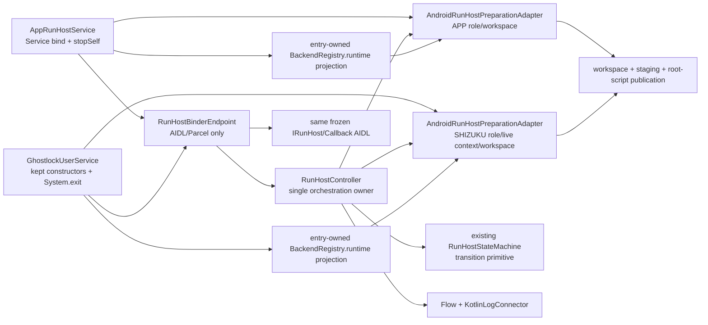

# RunHost owner、controller与entry基线

## Context and scope

完整迁入的有效设计/范围与验收正文；不是新增实施批。原批准/历史结果按原Beads记录，工具工件齐备不代表实现或门禁通过。

来源：`043fdf6a:tools/engineering/.beads/issues.jsonl`；保留语义代号和原锚点。本文中的历史进度/门结果文字仅是其具名输入的沿革，当前状态从proposal列出的Beads读取。旧机制由正文已注明的后继差异取代；基线不重新授权实施。

## Decisions

<a id="record-gl-2q8"></a>

## P-RUN-X-001/批次02：已完成RunHost owner/package收口

<!-- migrated-source: 043fdf6a Beads gl-2q8 description -->
2026-11-21迁入的共享设计记录，不是新的执行任务。closed仅表示该记录收录完毕，不表示业务实现、新批准或门禁通过。
已完成基线；原文当时唯一当前批是历史时态。后继controller与B1差异优先，历史scope不作为新实施白名单。

<!-- migrated-source: design gl-2q8 -->
<!-- source: f882e670:docs/plan/backend-root-execution-unification-plan.md:L2483-L2626 -->
<a id="p-run-x-001-batch-02"></a>

#### 19. Kotlin production tree Clean Architecture 纠正（2026-11-08 用户纠正）

##### 19.1 取代关系、阶段与当前授权边界

用户本轮明确指出，前一轮只删除 `data/` 中旧 43499 HOCON/profile/route 残留并不构成完整整理；新的目标是扫描整个 production Kotlin tree，并按真实职责与依赖方向归位。该纠正：

- **保留**已经完成的 caller-zero HOCON/profile/wire/route 删除以及 typed DataStore、BackendDefinition、LogHub、Diagnose/Handoff 的产品合同；
- **取代** `introduction.md`、backend README 与本计划中把 `backend/transport`、混合 Android I/O 的 `core/run` 描述为合理 current owner 的条款；
- **暂停细化** `P-DIAG-NATIVE-001/批次02` 的逐文件 ledger，保留 native/Kotlin producer churn、动态 FD、>10 MiB、drain 后 handoff 与产品 false 的需求；Kotlin owner 清理完成后再按新路径重生 ledger；
- 不改 AIDL method/field/integer、RunReport 成功语义、Payload/Finish、JNA ABI、native source、攻击 backend 或设备支持结论。

本节经 design-critic 两轮复审在 2026-11-08 得到阻断=0、重要=0 的 PASS，随后用户明确批准 `P-RUN-X-001/批次02`进入实施。该批准只覆盖§19.4 和 exact ledger；后续批只登记需求与 owner，不因本节存在而自动获准。

##### 19.2 全树事实与必须修复的问题

2026-11-08 对 `app/src/main/kotlin` 的当前工作树扫描得到 266 个 production Kotlin 文件、124 个 package；下列结论均来自显式 import/caller 与历史核对，而不是仅凭目录名：

1. `backend/transport` 有 15 个文件，却同时包含 pure RunHost contract/state、AIDL codec、App/Shizuku client、Android Service、host staging/root-script preparation、通用 FD reader 与 caller-zero process carrier；它不是 concrete backend implementation。
2. `backend.transport -> data.run -> backend.transport` 是直接 package 环；`core/run/RunInputFreezer.kt -> data.run.RootManagerArtifactResolver` 是 inner-ish core 对具体 Android adapter 的反向依赖。
3. `RunHostService.kt` 与 `GhostlockUserService.kt` 分别复制 prepare/start/cancel/close、snapshot、log publication 与 terminal callback。Shizuku 实现的 16 个 override/private 方法名全部能在 App 实现中找到；这不是两个独立业务实现。
4. `RunHostService.kt` 文件尾部拥有共享 wire encode/decode，Shizuku entrypoint 再跨 package import；共享 codec 被错误挂在 App framework class 上。
5. `BackendRunSessionAdapter.kt` 位于 `data/backend`，实际实现 `domain.run.RunSessionPort`，并同时承担 admission、input freeze、AIDL request mapping、host selection、LogHub 与 Android share；owner 与名称都失真。
6. `BackendProcessCarrier.kt`、`core/flow/FlowRequest.kt`、`backend/backends/lua/FlowLuaRequest.kt` 均无 production caller；前者只有自测，且全部真实攻击 backend 已断开。
7. `ui/component/profile/**`、`ui/component/rebootlistpopup/**` 与 `ui/component/miuix/effect/**` 在包外 production/test/androidTest caller 都为 0；旧 component fixture 仍把它们视为必须保留，不能继续用旧 fixture 证明其必要性。
8. UI 现有 `ui.screen <-> ui.viewmodel` 与 `ui.backend <-> ui.component <-> ui.kit` 包环；`ui/screen/module` 还是旧 KernelSU “module” 命名，不表达 Backend/Payload/Finish feature。
9. `tools/kotlin_architecture_d0.py` 目前硬编码多处 `backend/transport` 路径与 host allowlist；当前 `D0_VERIFY=PASS` 只验证旧规则，没有检查上述环、`core -> data` 或 caller-zero protected package。
10. 根 package 也混合了 framework、composition 与 presentation：`AppContainer.kt` 同时装配 backend/core/data/domain/UI，`AppViewModelFactory.kt` 属于 UI factory；Home、Run、Backend、Payload、Finish、Settings、ColorPalette 等页面又各自通过 `LocalContext -> GhostLockApp.container` 做 service location，形成 root/composition 对 UI 的依赖与 UI 对 root/container 的反向依赖。
11. `BackendRunSessionAdapter.kt` 同时承担 admission、freeze、wire request、transport selection、LogHub 与 Android share；`RunHostProductPipeline.kt` 同时承担 product plan 映射、staging、root-script publish 与 workspace。批次02只把它们移出错误 owner，不把“移动目录”冒充职责拆分；二者由后续 `P-RUN-CORE-001/批次02` 具名承接。

历史来源为 `64a56cd6 refactor(app): unify backend execution and run logging` 与后继 `f878ba08 refactor(run): finalize log hub and diagnose handoff`。前者把执行主干一次性放入按功能集合命名的 package，后者沿用该位置；这解释来源，但不使当前 owner 合理。

##### 19.3 采用的最小目标边界

本轮不为了“看起来像教科书”而把 266 个文件全部换成 `presentation/application/infrastructure` 名称。项目继续使用已有的 `domain/core/data/backend/composition/ui/shizuku` 词汇，但每个词只表达一种职责：

~~~mermaid
flowchart LR
  UI[ui presentation] --> D[domain pure models ports use cases]
  UI --> C[core application orchestration]
  C --> D
  B[backend concrete implementations] --> D
  B --> C
  B -->|shared outer adapters such as data.log| DATA
  DATA[data shared Android file DataStore PFD IPC adapters] --> D
  DATA --> C
  APPHOST[runhost App framework entry] --> REG[composition root]
  SHI[shizuku framework entry] --> REG
  APPHOST --> DATA
  SHI --> DATA
  REG --> UI
  REG --> B
  REG --> DATA
~~~

固定边界：

- `domain/**` 继续持有纯 model、port 与当前 use case；它不得依赖 Android、Compose、AIDL、data、backend implementation 或 composition。本轮不做无行为收益的“把全部 UseCase 改放 application”大搬家。
- `core/**` 只持有 platform-neutral application orchestration、Flow、LogHub、pure root-script/runhost contract；不得 import `android.*`、AIDL Parcelable、`data/**`、Compose 或 `BackendRegistry`。
- `data/**` 持有跨 backend 复用的 Android/DataStore/file/PFD/Binder client/wire codec 等 outer adapter；它可以依赖 domain/core，但不得成为 backend membership authority。backend-private JNA binding 留在对应 concrete backend，只有出现多个 backend/application caller 的真实共享边界才提升到 `data`。
- `backend/**` 只持有 backend API 与 concrete Diagnose/Custom implementation；通用 RunHost、日志 transport 与 Android Service 不再放入 backend。concrete backend 可以消费具名且跨 backend 复用的 outer adapter，例如 `data.log.FdLogConnector`；不得依赖 RunHost framework entry、AIDL host implementation、membership 或 UI。
- `composition/**` 仍是唯一跨层装配与 backend membership owner。
- `runhost/AppRunHostService` 与 `shizuku/GhostlockUserService` 是 Android/Shizuku framework entrypoint；它们可以在 framework 构造边界调用 `BackendRegistry.runtime(key)`，但不得拥有第二份 membership/UI catalog。
- `ui/**` 只持有 presentation；按 feature 共置 Screen/ViewModel/UiState 可以消除 UI 内部环，不把所有 UI 文件改名为 `presentation`。
- 根 package 只保留 Android framework entry（`GhostLockApp`）；`AppContainer` 归 composition owner，`AppViewModelFactory` 归 UI composition owner，页面不再各自向上 cast Application 取得 container。

明确拒绝的过度设计：

- 不新增 Gradle module、DI framework、第二 registry、兼容 alias、旧 package facade、动态 class lookup 或 schema/codegen；
- 不移动 `app/src/main/aidl/com/ghostlock/app/run/**`，因为它已经是中立 same-APK wire namespace；
- 不批量删除所有 `RunHost` 前缀。`RunHostRequest/Snapshot/Code/State/Client` 与实际跨进程合同一致，继续保留；只改失真实现名；
- 不在 package move 同批重写 state machine/lifecycle；App/Shizuku 去重作为下一单变量批次；
- 不移动或修改 `LegacyProfileConverter.kt`、`ValueModel.kt`、native backend source、Payload/Finish data class 与 JNA ABI。

##### 19.4 P-RUN-X-001/批次02：RunHost owner/package 收口（本次唯一细化批）

本批只改变 owner/package、共享 codec 的文件归属和失真名称；AIDL、状态转换、方法顺序、错误码、超时、日志顺序、workspace/root-script 行为逐项保持。App/Shizuku 两份 host orchestration 暂不去重，避免把机械归位与生命周期重写混为一个变量。

| current | target / action | 本批边界 |
|---|---|---|
| `backend/transport/RunHostProtocol.kt` | `core/runhost/RunHostProtocol.kt` | 类型名、整数与状态机不变；同时承接 App/Shizuku/FD producer 共用的单行 ASCII/SGR 校验和 source-sequence 预留，避免通用 FD adapter 反向依赖 client-private cursor |
| `backend/transport/RunHostRequest.kt` | `core/runhost/RunHostRequest.kt` | normalized model、validator、fingerprint 保持 |
| `backend/transport/RunHostSnapshot.kt` | pure model/invariant → `core/runhost/RunHostSnapshot.kt`；AIDL conversion → `data/runhost/wire/RunHostSnapshotWireCodec.kt` | RunReport 投影与合法组合不变 |
| `backend/transport/AppRunHostClient.kt` | `data/runhost/client/AppRunHostClient.kt` | 名称保留 |
| `backend/transport/ShizukuRunHostClient.kt` | `data/runhost/client/ShizukuRunHostClient.kt` | 名称、Shizuku lifecycle 与 service tag 不变 |
| `backend/transport/RunHostLogConnector.kt` | `data/runhost/client/RunHostLogConnector.kt` | connector drain/incomplete 合同不变 |
| `backend/transport/RunHostLogCursor.kt` | `data/runhost/client/RunHostLogCursor.kt` | 只保留 callback identity、parcel、连续序列与terminal-prefix检查；共用 message/sequence producer grammar 上移 `core/runhost`，规则本身不变 |
| `backend/transport/RunHostSnapshotPoller.kt` | `data/runhost/client/RunHostSnapshotPoller.kt` | completion deadline 不变 |
| `backend/transport/RunHostSnapshotReply.kt` | client outcome → `data/runhost/client/RunHostClientOutcome.kt`；reply decode → `data/runhost/wire/RunHostSnapshotWireCodec.kt` | 只拆 owner，不增 wrapper |
| `backend/transport/RunHostParcelBudget.kt` | `data/runhost/wire/RunHostParcelBudget.kt` | package 是唯一 wire owner；不把 request/snapshot/budget 强塞进一个 god codec |
| `backend/transport/RunHostProductPipeline.kt` | `data/runhost/host/ProductRunPreparer.kt`，类改 `ProductRunPreparer` | staging/render/plan 次序不变；删除含糊 pipeline 名 |
| `backend/transport/RunHostExecutionDomainVerifier.kt` | `data/runhost/host/ExecutionDomainVerifier.kt` | package 已表达 RunHost，去掉冗余前缀；role 数值/判断不变 |
| `backend/transport/RunHostService.kt` | framework class → `runhost/AppRunHostService.kt`，类改 `AppRunHostService`；request decode/PFD ownership → `data/runhost/wire/RunHostRequestWireCodec.kt`；snapshot encode → snapshot codec | manifest 与 App client 同步；framework entrypoint 与 Shizuku 名称明确区分 |
| `backend/transport/FdLogConnector.kt` | `data/log/FdLogConnector.kt` | 通用 FD source，不再冒充 backend/RunHost transport |
| `backend/transport/BackendProcessCarrier.kt` + test | DELETE | production caller=0；未来真实 carrier 出现实际 consumer 后重建 |
| `backend/launcher/BackendRunGate.kt` | `core/run/RunAdmissionPolicy.kt` | application/session admission，不下沉 domain；`RunPageContext` 改为中立 `RunAdmissionContext`，现有英文 reason 文案与规则本批不变 |
| `data/backend/BackendRunSessionAdapter.kt` | `data/run/AndroidRunSessionAdapter.kt` | 只改 owner/name与 import；职责拆分留给后续批次 |

必须同批迁移的直接 caller/fixture：

- `AppContainer.kt`、`AndroidManifest.xml`、`GhostlockUserService.kt`；
- `data/run/AndroidRunWorkspace.kt`、`RootArtifactStagingAdapter.kt`；
- `backend/backends/diagnose/jna/DiagnoseNativeBinding.kt`；
- `app/src/test/kotlin/**/backend/transport`、`app/src/androidTest/kotlin/**/backend/transport`、`DiagnoseJnaSmokeTest.kt` 中对应 package/import；
- `app/src/test/kotlin/com/ghostlock/app/core/run/LogConnectorTest.kt`、`app/src/androidTest/kotlin/com/ghostlock/app/data/run/RootArtifactStagingAdapterTest.kt` 与 `data/backend/BackendRunSessionAdapterTest.kt`；
- `tools/kotlin_architecture_d0.py` 与 `kotlin-file-actions-v1.tsv`；`component-api-v1.tsv`与其 exact-count test 在inventory证明数值不变后保持冻结；
- `backend/README.md` 只保留 backend 职责，新增 `runhost/README.md` 承接 current host/IPC 说明；
- `introduction.md`、`full-process-uml.md`、本计划与 `backend-root-execution-runhost-wire.md` 的 current path 指针；
- `docs/analysis/kotlin-clean-architecture-d0.md` 只在文件头标为历史分析并指向本节，不重写旧正文。

本批逐文件 MOVE/ADD/DELETE/MODIFY/FREEZE 的唯一权威是 `backend-root-execution-unification-ledger.tsv` 中 `P-RUN-X-001/批次02` 行；本节表格解释职责，不替代 ledger，也不允许实施时临时扩大 caller/test 闭包。

本批完成时：

- `app/src/main/kotlin/com/ghostlock/app/backend/transport/` 与 `backend/launcher/` 必须不存在；
- production/test/androidTest 中 `com.ghostlock.app.backend.transport` import/package 命中必须为 0；
- `data.run -> backend.transport` 与 concrete backend → RunHost AIDL/host implementation 反向边为 0；
- AIDL 文件集合、字段顺序、transaction ID、wire integer、state transition 与公开运行行为逐项不变；
- 不保留 deprecated typealias、转发类或旧 class 名兼容层。

###### 19.4.1 本批验证

1. 扩展现有 `kotlin_architecture_d0.py`，直接拒绝旧 package、`core/runhost -> data/android/AIDL`、`data.run -> backend` 和新旧双 owner；guard 须使用真实 target path，不以旧 fixture 白名单放行。其它 `core/run`/`core/rootscript` 已知 Android/data 债务由 `P-RUN-CORE-001/批次02` 承接，不在本机械归位批次伪造全局 PASS。
2. 执行 architecture inventory/verify，记录 literal。guard 的非法样例只复用已有测试设施；仅在发现判据可能 vacuous 时把定点证伪作为 debug 手段，不再作为通用准出门槛。
3. 执行 `:app:verifyDebugUnitTestXml`、`:app:verifyReleaseUnitTestXml` 与 `:app:compileDebugAndroidTestKotlin`，全量 XML 四桶为 0 failure/error/skipped；不预写改变后的 test 数。
4. 执行 `./gradlew nativeTestHost --console=plain` 与 `./gradlew nativeBuildAndroid --console=plain`。
5. AVD 只跑 App/Shizuku RunHost smoke，证明 manifest class、Shizuku service class、same AIDL 和 LogConnector 路径仍可达；本批不宣称 lifecycle 专项、真实设备、root 或攻击 backend 成功。
6. 同步 current UML；历史 §11.7 等只保留沿革，不批量改写。

###### 19.4.2 实时 checkbox

- 原已完成步骤、批准与运行证据：见 Beads `gl-2q8` notes 的迁移前记录；本设计不维护进度checkbox。

##### 19.5 后续需求：只登记边界，不自动实施

下列工作都由本轮全树扫描发现，但依照滚动细化规则不在批次02预写逐文件 ledger，也不以需求登记替代后续批准：


<a id="acceptance-gl-2q8"></a>

### 验收定义与原边界：gl-2q8

<!-- migrated-source: acceptance_criteria gl-2q8 -->
保留原文各行为判据、当轮证据和未关闭设备门。此decision收录完成不关闭任何关联业务任务。

批准/审核/实际结果：Beads `gl-2q8` notes；本段不维护实时勾选或新PASS。

<a id="record-gl-oaq"></a>

## P-RUN-X-001/批次03：共享controller与双域终结合同

<!-- migrated-source: 043fdf6a Beads gl-oaq description -->
2026-11-21迁入的共享设计记录，不是新的执行任务。closed仅表示该记录收录完毕，不表示业务实现、新批准或门禁通过。
已完成设计与当轮5 tests证据保留；真实process-kill仍NOT_RUN，B1的execution lease/物理destroy为已批准增量。

<!-- migrated-source: design gl-oaq -->
<!-- source: f882e670:docs/plan/backend-root-execution-unification-plan.md:L2821-L3116 -->
<a id="p-run-x-001-batch-03"></a>

###### P-RUN-X-001/批次03：App/Shizuku Host 去重

> 状态（2026-11-17）：**完成**。用户在design-critic最终`PASS`后批准91行exact ledger；shared `RunHostController`、Android preparation adapter、Binder endpoint与两个thin entry均已落地。source critic首轮提出的`KTH-SRC-01/02/03`（非法report的quiescence、live-context错误优先级及focused覆盖）全部关闭，最终总判`PASS`、阻断/重要/建议/新增finding均为0。KTH-I1/V1/V2均由current-tree普通门、70个FREEZE零漂移与6.6 AVD五个exact class关闭；真实process-kill、carrier、root与`PRODUCT_ROOT`继续`NOT_RUN`。

###### 19.5.7 现状、目标与停止边界

批次输入树中`AppRunHostService.kt`为479行、`GhostlockUserService.kt`为490行；两份文件各自拥有一套lock、`RunHostStateMachine`、coroutine scope、prepared candidate、callback/snapshot、cancellation、log sequence/drop计数，以及prepare/start/cancel/requestClose/Flow/log/terminal helper。对orchestration tail归一化比较得到284行完全相同，两个尾部的序列相似度为0.9311。App entry是Android `Service + inner IRunHost.Stub`，Shizuku entry本身是`IRunHost.Stub`；重复来自同一业务编排，而不是两个不同产品合同。批次完成后这两套owner已由本节三组件取代。

本批唯一产品目标是让两条 framework 路径使用同一个 RunHost 会话编排 owner。AIDL、stable integer、状态转换、错误优先级、backend 投影、Flow、root-script、日志与终态 authority保持不变；current service 跨阶段捕获所有 `IllegalArgumentException` 并统一报 `ARTIFACT_INVALID` 的做法与现行 wire authority冲突，本批按 `ARTIFACT_INVALID / IO_FAILURE / INTERNAL_CONTRACT_FAILURE` 的既有阶段语义修复该实现漂移，并在测试中冻结可观察 code。

1. `RunHostController` 是 lock、状态机、prepared candidate、callback、snapshot、cancellation、Flow worker 与 host-side log 计数的唯一 owner。
2. `AndroidRunHostPreparationAdapter` 是 Android 进程域验证、workspace、PFD staging、product/diagnostic publication 与 fresh Flow materialization 的唯一 owner。
3. `RunHostBinderEndpoint` 是 Parcel budget/decode、AIDL callback 映射、wire log/snapshot encode 与 descriptor duplication closure 的唯一 owner。
4. `AppRunHostService` 与 `GhostlockUserService` 只保留各自真实 framework 构造、context/workspace 选择、六个一行 business-method delegate，以及各自本地的第七个 `destroy()` override。

本批明确停止于 Host 去重：不改 backend package、UI/root composition、Diagnose stress/JNA/native/handoff、Payload/Finish、DataStore、真实 backend 接线或产品成功语义；不触碰 `developer-defined-tasks.md`。`BackendRegistry.kt` 按 current tree 冻结，本批不会整理其现有未提交差异。

###### 19.5.8 直接方案比较与选型

| 方案 | 机制成本 | 当前收益／问题 | 结论 |
|---|---|---|---|
| A：一个 Android/data concrete controller 同时处理 AIDL、PFD、workspace 与会话 | 文件最少 | 仍把应用会话 owner 绑定到 Android/AIDL；App/Shizuku framework 差异、物理准备和业务状态继续混在一个类中；data 还会成为 application lifecycle owner | 不采用 |
| B：pure controller + Android preparation adapter + Binder endpoint | 新增 3 个 production 文件，窄类型同文件放置 | 三个组件分别对应 current tree 已真实存在的会话状态、Android 物理 I/O 与 AIDL 边界；两条 entry 共用同一编排，data 不反向依赖 composition | **采用** |
| C：BaseService／继承层次／反射式 generic host framework | 类型或魔法分派更多 | App 是 `Service`，Shizuku 是 `Stub`，构造、context 与 destroy 都不同；继承不能消除这些差异，只会隐藏它们 | 拒绝 |

B 是保持同一行为的最小可行分解，不为第三种 host、plugin 或未来 backend 预建机制。若实现时发现 controller 必须 import Android/AIDL，或任一 adapter 开始维护独立 lifecycle/prepared/callback/snapshot 状态，则本设计失效：在 source 写入前回到本节合并职责，不新增第四层补偿。

###### 19.5.9 组件与依赖边界



依赖规则：

- `core/runhost/RunHostController.kt` 只 import Kotlin coroutine、`core/flow`、`core/log`、`core/rootscript`、`core/runhost` 与 neutral `domain`；禁止 Android、AIDL generated class、data、composition、`File`、`ParcelFileDescriptor`。
- `data/runhost/host/AndroidRunHostPreparationAdapter.kt` 可以使用 Android/data/neutral core-domain，但不得 import `composition.backend.BackendRegistry`。两个 framework entry 各自保留一次 direct `BackendRegistry.runtime(key)`，立即映射成同文件内的窄 `AndroidRunHostRuntime` 值。
- `data/runhost/wire/RunHostBinderEndpoint.kt` 可以使用 AIDL generated class、Parcel helpers 与 controller surface；不得拥有 `RunHostStateMachine`、prepared state、Flow、workspace、registry、queue、timeout 或 retry。
- 两个 framework entry 不再拥有业务 lock、state machine、scope、staging/publisher/preparer、prepared data class、snapshot/log helper 或 Flow worker。

三个窄边界类型与 controller 同文件放置，避免为单一消费者扩散文件：

```kotlin
internal interface RunHostEventSink {
    fun publishLog(identity: RunHostIdentity, sequence: Long, draft: LogDraft): Boolean
    fun publishTerminal(snapshot: RunHostSnapshotModel): Boolean
}

internal interface RunHostWorkspaceLease {
    fun activateExecutionEnvironment()
    fun deleteAfterTerminal(): Boolean
}

internal data class RunHostPreparedCandidate(
    val identity: RunHostIdentity,
    val abortPolicy: AbortPolicy,
    val flow: Flow,
    val workspace: RunHostWorkspaceLease,
    val rootScript: RootScriptArtifact,
    val profile: ProfileSnapshot,
    val artifacts: Map<String, PublishedFlowArtifact>,
    val persistentStateDirectory: String,
    val reportContext: FlowReportContext,
)

internal sealed interface RunHostCandidateResult {
    data class Prepared(val candidate: RunHostPreparedCandidate) : RunHostCandidateResult
    data class Rejected(val code: RunHostCode) : RunHostCandidateResult {
        init { require(code != RunHostCode.OK && code != RunHostCode.ALREADY_APPLIED) }
    }
}

internal data class RunHostSnapshotResult(
    val code: RunHostCode,
    val snapshot: RunHostSnapshotModel?,
)
```

这些类型不是第二份 wire 或 registry：candidate 只携带本次 run 已解析的 neutral facts；capability 的唯一 authority 是 `candidate.reportContext.runCapability`，prepared/cancel/terminal snapshot都从该字段读取，不在 candidate 再保存镜像。controller 接受 `Prepared` 前必须确认 candidate identity 与本次 identity 相同、capability不是 `UNRESOLVED`，否则清理 candidate workspace并返回 `INTERNAL_CONTRACT_FAILURE`；`Rejected` 禁止携带 `OK/ALREADY_APPLIED`。`AndroidRunHostRuntime` 只是在 framework composition point 对 `BackendRuntimeEntry` 做的一次窄投影，包含 descriptor、availability closure 与 fresh-Flow factory，不保存 membership 或 mutable run state。

###### 19.5.10 controller surface、线性化与回调

controller 只暴露当前 AIDL 业务动作对应的直接方法；不增加 initialize、session registry、generic command、timeout、retry 或 background monitor：

```kotlin
internal class RunHostController(
    private val scope: CoroutineScope = CoroutineScope(SupervisorJob() + Dispatchers.Default),
) {
    fun setCallback(identity: RunHostIdentity, sink: RunHostEventSink): RunHostCode
    fun prepare(
        model: RunHostRequestModel,
        materialize: (RunHostRequestModel, RunHostIdentity) -> RunHostCandidateResult,
    ): RunHostCode
    fun start(identity: RunHostIdentity): RunHostCode
    fun snapshot(identity: RunHostIdentity): RunHostSnapshotResult
    fun cancel(identity: RunHostIdentity): RunHostCode
    fun requestClose(identity: RunHostIdentity): RunHostCode
    fun frameworkDestroyAuthorized(): Boolean
}
```

controller 的一个 mutex 包住 local state、所有 state-machine transition，以及一个最小 quiescence 事实：`inFlightPhysicalOperations` 计数与当前 0→1 epoch 的单次 completion barrier。该计数不是第二状态机或队列，只回答“是否仍有最后访问者”；materializer、`Flow.stop()`、workspace delete、event sink 与 coroutine launch 都在 mutex 外调用，barrier await 也必须先释放 mutex。materializer、worker、safe-stop 与 close cleanup 都只登记到这一份计数；不为任一动作再建状态、队列或第二 barrier。

- `prepare` 在 mutex 内做 structure、identity、fingerprint、`preparePreflight` 并登记一个 materializer in-flight owner，然后才在锁外执行物理工作。candidate 完整构造后，commit 在 mutex 内一次完成 `lifecycle.prepare + prepared + snapshot`；两个并发 materializer 的 winner 唯一，loser workspace在锁外清理。candidate ownership已转移或 loser cleanup完成后才减少 in-flight并完成epoch，故 `start` 不会观察到 PREPARED但candidate为null，`requestClose/destroy` 也不会越过未关闭PFD或workspace。
- `start` 在同一 mutex 内完成 transition、取得 candidate并登记一个 worker in-flight owner，随后在锁外启动唯一 worker。登记后若 launch 本身失败，同一 owner负责映射failure、发布terminal并终结计数，不能遗留永久非quiescent状态。
- `cancel` 在线性化点同时取得 before-state 与 candidate。NEW/PREPARED 仍提交唯一 CANCELLED snapshot；若已有materializer，cancel在锁外等待该epoch完成后才交付terminal callback并返回。RUNNING只在abort policy允许时设置cancellation，并在同一锁内先为本次safe stop登记一个in-flight owner，再在锁外按现有`runCatching`语义调用`Flow.stop()`；`finally`无条件终结该owner，stop异常仍被吞掉且不改已经接受的cancel code。不安全取消保持原code。
- worker 使用现有 `RunHostStateMachine.claimTerminal` 作为唯一 terminal claim；claim只禁止第二terminal，不代表资源已经静止。worker继续完成result compose、`finishInput → await collector → close`和terminal snapshot commit；`close`放进finally。它在mutex内提交snapshot、捕获当时event sink并终结worker in-flight，释放锁后才调用terminal callback，因此同步或跨线程callback触发`requestClose`时不可能等待同一个worker自己。
- `requestClose` 先在mutex内执行identity/state优先级。RUNNING且尚未claim terminal时仍立即返回`UNSAFE_TO_DESTROY`；NEW/PREPARED/TERMINAL若in-flight非零，则捕获当前epoch barrier、释放锁等待并从头重验。第一次close把lifecycle转成DESTROYED、分离candidate/callback，并在同一临界区、释放锁前为需要的workspace cleanup登记in-flight owner，故不存在DESTROYED但cleanup尚未登记的窗口。DESTROYED且in-flight非零的重复close也必须捕获同一epoch barrier、锁外等待并从头重验；达到quiescence后才允许返回`ALREADY_APPLIED`。cleanup在锁外删除workspace并于`finally`终结owner，第一次close只在cleanup quiescent后返回`OK`；删除返回false仍保留residue，不加retry/GC。因此任何`OK/ALREADY_APPLIED`都意味着close cleanup已经静止。
- `frameworkDestroyAuthorized` 只有在lifecycle为DESTROYED且in-flight计数为0时才为true。即使有另一线程在`requestClose`已转DESTROYED但仍执行workspace delete，premature framework `destroy()`也保持no-op；accepted `requestClose` 返回前，所有materializer、worker finalization、safe stop与close cleanup均已完成。

这个barrier不串行Flow步骤，不产生后台worker，也不等待RUNNING攻击事务：它在原合同已允许close的NEW/PREPARED/TERMINAL状态阻止终结者越过最后访问者，并在DESTROYED但第一次close cleanup尚未结束的窗口阻止重复close/destroy越过同一owner。每次等待后必须重新验证identity/state，防止materializer完成并被并发`start`抢先转入RUNNING。

controller 保持 log sequence/drop facts 的唯一 owner。它先按现有 grammar 校验 draft，再预留 sequence；没有 callback、wire 超限或 callback 失败都增加 dropped count。endpoint 在交付时创建 `SystemClock.elapsedRealtime()` 与 `RunHostLogRecord`，并返回 Boolean。失败只按 reference equality 清除同一个 captured sink；terminal sink在snapshot commit时捕获、在quiescence建立且mutex释放后调用。terminal callback失败不改已经提交的immutable snapshot，也不被当作产品失败。

###### 19.5.11 prepare 数据流与物理资源所有权

```mermaid
sequenceDiagram
    participant F as App/Shizuku entry
    participant E as Binder endpoint
    participant C as RunHostController
    participant P as Android preparation adapter
    participant R as entry runtime projection
    participant W as Android workspace/staging

    F->>E: prepare(RunHostRequest)
    E->>E: actual Parcel bytes + toModel
    E->>C: prepare(model, deferred descriptor closure)
    C->>C: structure/identity/fingerprint/preflight
    C->>C: register materializer in-flight owner
    C->>P: materialize(model, identity, duplicate closure)
    P->>R: resolve key, capability, domain, readiness
    P->>E: invoke duplicate closure only after gates
    E-->>P: owned PFD copies
    P->>W: create role-specific workspace
    P->>W: transfer all PFD ownership to staging
    P->>W: publish diagnostic or product artifacts + fresh Flow
    W-->>P: complete candidate
    P-->>C: Prepared(candidate)
    C->>C: atomic lifecycle/candidate/snapshot commit
    alt commit loser
        C->>W: delete candidate once
    end
    C->>C: transfer/cleanup complete; finish in-flight epoch
    C-->>E: stable RunHostCode
    E-->>F: wire integer
```

终结顺序另由同一个controller owner保证：

```mermaid
sequenceDiagram
    participant Q as cancel/requestClose/destroy caller
    participant C as RunHostController
    participant X as materializer or terminal worker
    participant W as workspace
    participant B as terminal callback

    X->>C: in-flight registered before external work
    Q->>C: requestClose(identity)
    alt lifecycle is RUNNING before terminal claim
        C-->>Q: UNSAFE_TO_DESTROY
    else NEW/PREPARED/TERMINAL, or DESTROYED cleanup, and in-flight exists
        C-->>C: capture epoch barrier; release mutex
        C->>X: await cleanup/finalization outside mutex
        X->>C: owner transfer or cleanup + snapshot commit
        C->>C: finish in-flight; capture sink; signal barrier
        C->>B: terminal callback outside mutex after quiescence
        C->>C: revalidate identity/state; requestClose
        C->>W: delete non-retained workspace outside mutex
        W-->>C: deletion result; finish close owner
        C-->>Q: OK only after quiescence
    end
    Q->>C: frameworkDestroyAuthorized
    C-->>Q: true only DESTROYED and in-flight=0
```

PFD owner 必须逐点唯一：

1. Binder request 仍拥有原 descriptor；endpoint closure 调用 `duplicateDescriptors(model)` 后，adapter 立即拥有全部副本。
2. workspace 创建前 adapter 保留副本 owner；创建失败时 adapter 逐一关闭副本。真实 filesystem／OS 创建失败映射`IO_FAILURE`，而已通过验证的 package/backend namespace仍触发`IllegalArgumentException`时属于`INTERNAL_CONTRACT_FAILURE`。这关闭当前两份 service 在 lines 204–208／216–220 之间的 confirmed leak。
3. 调用 `RootArtifactStagingAdapter.stage` 前，adapter 明确把整批副本 owner 转移给 staging；staging 现有 finally 继续负责成功／失败关闭，adapter 不做 double-close。
4. workspace 创建后任一 staging/publish/Flow factory/candidate build 失败，adapter 删除 workspace；candidate 返回 controller 后，只有 controller commit loser、requestClose 或终态 retention policy 能终结 workspace。
5. Shizuku 的 context/workspace closure 每次调用都读取当前 volatile `context`；禁止在 property initialization 时捕获初始 null。缺 context 保持 `NOT_READY`。

Android workspace 由 adapter 的 private lease wrapper 暴露 `activateExecutionEnvironment` 与 `deleteAfterTerminal`；`AndroidRunWorkspace.kt` 本批冻结，不为一个 wrapper 改写既有文件。

###### 19.5.12 故障矩阵

| 阶段 | 失败 | 对外结果 | owner 终态 |
|---|---|---|---|
| generated Binder | Parcelable在进入endpoint前解码失败 | transport exception，不伪装RunHostCode | endpoint未调用；未复制PFD |
| endpoint | 已生成对象的actual Parcel重测失败，或logical enum/null/reference decode非法 | `INVALID_REQUEST` | 未复制PFD、未建workspace |
| endpoint | actual request Parcel超限 | `LIMIT_EXCEEDED` | 未复制PFD、未建workspace |
| controller | structure／identity非法 | 现有validator code／`INVALID_REQUEST` | materializer不调用 |
| controller | lifecycle/fingerprint preflight拒绝 | 现有优先级code | materializer不调用 |
| adapter | key未命中 | `UNKNOWN_BACKEND` | 未复制PFD |
| adapter | capability shape非法 | 现有validator code | 未复制PFD |
| adapter | UID／SELinux／role不符 | `EXECUTION_DOMAIN_MISMATCH` | 未复制PFD |
| adapter | Shizuku context缺失／availability NotReady | `NOT_READY` | 未复制PFD |
| endpoint closure | descriptor duplication失败 | `ARTIFACT_INVALID` | wire codec关闭partial copies |
| workspace factory | mkdir/stat/chmod等物理失败 | `IO_FAILURE` | adapter关闭全部owned PFD并清残留workspace |
| workspace factory | 已验证namespace仍触发argument/precondition异常 | `INTERNAL_CONTRACT_FAILURE` | adapter关闭全部owned PFD并清残留workspace |
| staging | PFD type/size/digest/object identity/staging policy失败 | `ARTIFACT_INVALID` | staging关闭PFD；adapter删除workspace |
| staging | fstat/open/read/write/fsync等其它物理失败 | `IO_FAILURE` | staging关闭PFD；adapter删除workspace |
| product candidate | staged catalog/profile/plan在先前验证后仍不一致 | `INTERNAL_CONTRACT_FAILURE` | adapter删除workspace |
| diagnostic/product publication | render/write/fsync/move/result publication物理失败 | `IO_FAILURE` | adapter删除workspace |
| fresh Flow factory/native constructor | 任一构造或load异常 | `IO_FAILURE` | adapter删除workspace |
| runtime/candidate invariant | capability为UNRESOLVED、identity或capability不一致 | `INTERNAL_CONTRACT_FAILURE` | adapter/controller删除workspace |
| controller | concurrent prepare commit loser | lifecycle返回的现有code | loser workspace清理恰好一次 |
| worker | environment activation／Flow异常 | 现有`completeFailure`路径 | connector finally关闭；terminal claim仍唯一 |
| callback | null／oversize／Binder异常 | log drop；terminal snapshot不变 | 只清除同一captured sink |
| requestClose | RUNNING且worker未claim terminal | `UNSAFE_TO_DESTROY` | 不等待、不改状态 |
| safe cancel | `Flow.stop()`仍在执行或抛异常 | accepted cancel code保持；异常按现有语义吞掉 | stop调用先登记同一in-flight owner并在`finally`终结；close/destroy不得越过 |
| requestClose | NEW/PREPARED/TERMINAL但materializer/finalizer/safe-stop仍in-flight | 同步等待quiescence后重验，最终返回现有state code | 不越过PFD/workspace/result/log/backend最后访问者 |
| requestClose | retention terminal | `OK` | quiescent后workspace保留、candidate引用释放 |
| requestClose | non-retention terminal／prepared close | `OK` | quiescent后workspace删除一次；失败residue不伪报成功 |
| repeated requestClose | lifecycle已DESTROYED但第一次close cleanup仍in-flight | 等待同一epoch，cleanup完成后`ALREADY_APPLIED` | 不提前关闭binding；workspace delete恰好一次 |
| framework destroy | 未经requestClose或close cleanup仍in-flight | no-op | worker与资源不被framework kill |
| framework destroy | 已授权 | App `stopSelf()`／Shizuku `System.exit(0)` | 业务资源已由controller requestClose处理 |

`AndroidRunHostPreparationAdapter.materialize` 对上述每个阶段都是 total `Prepared/Rejected`：预期失败不得抛过 Binder；每段使用自己的 catch 边界，禁止恢复 current 跨 workspace/staging/publication/Flow factory 的一把 `IllegalArgumentException → ARTIFACT_INVALID`。该 current broad catch 是本批按既有 wire authority 修复的实现漂移，不再描述成“可观察失败行为完全不变”。Shizuku 当前 `destroy()` 中的第二次 workspace cleanup 在 authorized requestClose 后实际不可达，因为 requestClose 已清空 prepared；删除这段 dead repetition 不改变可观察行为，也不引入 controller cleanup API。

###### 19.5.13 framework entry 保留项

`AppRunHostService` 保留：Android `Service` 基类、private inner `IRunHost.Stub`、`onBind`、APP role、`applicationInfo.uid`、`AndroidRunWorkspace.createApp(this, ...)`、authorized `stopSelf()`，以及 Manifest 中 class/process/exported/stopWithTask 原值。

`GhostlockUserService` 保留：class 本身继承 `IRunHost.Stub`、default constructor、`@Keep constructor(context)`、volatile live context、SHIZUKU_SHELL role、`AndroidRunWorkspace.createShizukuShell(packageName, ...)`、authorized `System.exit(0)`，以及 client 的固定 `SERVICE_CLASS` 字符串。两者的 `setCallback/prepare/start/getSnapshot/cancel/requestClose` 六个 business override 只是 endpoint delegate；各自第七个 `destroy()` 只查询 controller 授权，再分别执行 `stopSelf()` 或 `System.exit(0)`。endpoint 不得拥有 framework identity 或进程终结动作；不通过共同基类、反射或隐藏 framework identity 去重。

###### 19.5.14 exact source ledger 与冻结边界

逐文件唯一authority是`backend-root-execution-unification-ledger.tsv`中`P-RUN-X-001/批次03`的91行（`ADD=6 / MODIFY=15 / FREEZE=70`）。批准后实施前核对发现`app/build.gradle.kts`已由前批改为fresh XML动态发现与四桶零失败门，不再存在可更新的固定总数；因此该行只作机械`MODIFY→FREEZE`收窄，不改路径数、测试判据或产品行为，也不恢复stale fixed count。六个ADD目标在批次输入时均不存在；MODIFY只允许本节具名职责，FREEZE不得产生本批新增diff，已有前序current-tree差异保持原样。

结构 guard 在既有 `runhost-owner-boundary` 内增强，不创建第二条同义规则：

- production `RunHostStateMachine()`、`BackendFlowInput(`、`KotlinLogConnector()` 与 prepared-candidate declaration 各只有 controller 内一处；
- `BackendRegistry.runtime(` 恰好两处，且只在两个 framework entry 的 direct projection lambda；
- 两个 service 中上述业务 owner、`duplicateDescriptors`、staging/preparer/publisher 与 snapshot/log helper 命中均为 0；
- controller 的 Android/AIDL/data/composition/`File`/PFD import 为 0；只允许一个 in-flight count 与一个当前epoch completion barrier，禁止第二 lifecycle、Channel/queue、timeout/retry/monitor；
- endpoint 的 state machine/registry/Flow/workspace/framework destroy owner为0；preparation adapter 的 lifecycle/callback/snapshot owner为0；`stopSelf()`与`System.exit(0)`只允许分别位于两个entry的本地`destroy()`；
- Manifest service identity、Shizuku `SERVICE_CLASS` 与 11 个 AIDL 文件零漂移；inventory 无 duplicate/missing/unclassified/target conflict。guard 不使用行数上限。

###### 19.5.15 测试与验证矩阵

新增三个 focused test 文件，不用 service copy 或第二套 fake lifecycle：

1. `RunHostControllerTest.kt`：真实controller的prepare原子发布、materialize failure不commit、并发loser cleanup一次、NEW/PREPARED/RUNNING safe/unsafe cancel、PREPARED cancel snapshot/callback/close、terminal race exactly once、Flow exception completeFailure、已claim后非法report fail-closed且quiescent、callback replace/failure、retention close、invalid/no-callback log/drop facts，以及`finishInput → drain → close → terminal`顺序。另用确定性latch覆盖四条quiescence竞态：materialize阻塞时`cancel → requestClose`不得完成close/destroy authorization，释放后PFD/workspace cleanup先完成；worker已claim terminal但result/drain阻塞时`requestClose`不得删除workspace或授权destroy，释放后只提交一次snapshot；第一次close阻塞于workspace delete时，第二次close不得提前返回`ALREADY_APPLIED`且destroy仍未授权，释放后一次`OK`、一次`ALREADY_APPLIED`、delete恰好一次；`Flow.stop()`阻塞且worker已完成terminal finalization时，close/destroy必须继续等待到stop返回。另证RUNNING未claim时`requestClose`仍立即`UNSAFE_TO_DESTROY`。
2. `AndroidRunHostPreparationAdapterTest.kt`：先冻结runtime key/capability、再取live environment/domain/readiness的错误优先级，并证明三种compound rejection均未duplicate descriptor；用injected duplication closure返回真实`ParcelFileDescriptor`，分别令workspace factory抛物理异常与`IllegalArgumentException`，断言得到`IO_FAILURE`和`INTERNAL_CONTRACT_FAILURE`且duplicate关闭；staging artifact-policy异常映射`ARTIFACT_INVALID`、真实staging I/O映射`IO_FAILURE`、diagnostic/product publication与Flow factory映射`IO_FAILURE`、PRODUCT_ROOT catalog/plan及runtime projection invariant映射`INTERNAL_CONTRACT_FAILURE`，每项都清理workspace。Robolectric只以test-local `Os.fstat` shadow补回host runtime遗漏的Unix regular-file type/size bits，production仍调用真实`RootArtifactStagingAdapter`，不新增production test-only factory层；candidate identity由真实controller test覆盖。
3. `RunHostBinderEndpointTest.kt`：invalid identity/model、已生成对象的actual request/log Parcel budget、callback throw/false、post-commit oversized snapshot的bounded typed-unknown fallback、terminal callback failure不改变durable snapshot及stable code mapping；generated Parcelable在endpoint前的transport decode不伪装业务code。

既有 `RunHostStateMachineTest`、request/wire/product tests全部冻结并作回归。现有 `RunHostLifecycleTest`、`RunHostCancellationTest`、`RunHostHostDeathTest` 直接实例化 state machine 或验证 client 首次 Binder call death，不宣称它们证明新 controller；它们只在最终树 exact class 中确认既有行为不回归。App/Shizuku smoke 才负责两种真实 wrapper → AIDL → controller → Flow → terminal 接线，Shizuku XML 的 skipped 必须为 0。真实 process kill 的完整 lifecycle 仍留在原后续最终门，不在本结构批伪造。

实施获批后的 gate：

| 判据 | 命令／证据 | 通过含义 |
|---|---|---|
| exact ledger/依赖边界 | `python3 tools/kotlin_architecture_d0.py verify --repo . --fixtures app/src/test/resources/architecture --section all` | 上述唯一 owner、两处 composition lookup、entry瘦身、inventory与禁止边全为0 finding |
| controller/adapter/endpoint | debug/release unit XML 全量计数，failure/error/skipped均0 | pure orchestration、Android resource failure与Binder mapping按矩阵工作 |
| Android test源码 | `:app:compileDebugAndroidTestKotlin` | 两个 framework wrapper和现有exact classes可编译 |
| 普通门 | `./gradlew nativeTestHost --console=plain` 与 `./gradlew nativeBuildAndroid --console=plain` | native 31项与debug/release双variant不回归；不声称ELF/JNA精确核验 |
| frozen contract | 11个AIDL、七个clients、Flow/log/backend/JNA/native/handoff与具名fixture相对本批输入零新增diff | 本批没有借去重改wire、client、backend或native |
| 6.6 AVD wrapper | exact运行 `AppRunHostSmokeTest`、`ShizukuRunHostSmokeTest`，总计2项且skip=0 | 两种真实framework入口都进入同一controller并得到terminal |
| 6.6 AVD regression | exact运行 `RunHostLifecycleTest`、`RunHostCancellationTest`、`RunHostHostDeathTest` | 既有client/state-machine行为不回归；不替代后续真实process-kill门 |
| 产品／攻击 | 保持 `NOT_RUN` | 本批不证明root、carrier、PRODUCT_ROOT或设备支持 |

不为本批创建 baseline/rollback/verification包装产物；实现完成时直接更新唯一 UML 的 RunHost controller/class/sequence view、简介、wire owner pointer和本计划证据。

###### 19.5.16 实时 checkbox

- 原已完成步骤、批准与运行证据：见 Beads `gl-oaq` notes 的迁移前记录；本设计不维护进度checkbox。


历史审批/实际证据见 Beads [gl-oaq](design.md#record-gl-oaq) notes（原文保留，不作为实时状态副本）。


<a id="acceptance-gl-oaq"></a>

### 验收定义与原边界：gl-oaq

<!-- migrated-source: acceptance_criteria gl-oaq -->
保留原文各行为判据、当轮证据和未关闭设备门。此decision收录完成不关闭任何关联业务任务。

批准/审核/实际结果：Beads `gl-oaq` notes；本段不维护实时勾选或新PASS。

<a id="record-gl-i94"></a>

## P-RUN-X-001/批次04：已完成执行域命名

<!-- migrated-source: 043fdf6a Beads gl-i94 description -->
2026-11-21迁入的共享设计记录，不是新的执行任务。closed仅表示该记录收录完毕，不表示业务实现、新批准或门禁通过。
M级名称与package对称结构已完成，原用户免独立critic裁定保持；不按旧清单未勾项重新实施。

<!-- migrated-source: design gl-i94 -->
<!-- source: f882e670:docs/plan/backend-root-execution-unification-plan.md:L3117-L3137 -->
<a id="p-run-x-001-batch-04"></a>

###### P-RUN-X-001/批次04：执行域可读的 RunHost framework entry 类名与包层级（M级）

> 状态（2026-11-17）：**完成**。用户明确要求实施并裁定为M级、无需独立design-critic；在类名完成后，用户纠正指出文件夹／package层级也必须直接表达执行权限。本节已将同一命名批收敛到最终对称结构，RunHost行为、owner与wire未改变。

动机：`AppRunHostService`只表达“App入口”，`GhostlockUserService`只表达“Shizuku UserService”；仅把类改成`AppUidRunHostService`与`ShizukuShellRunHostService`后，`runhost/`与`shizuku/`仍是不对称且不完整表达执行域的叶目录。最终采用以下名称与路径：

| 批次前类／文件 | 最终类／文件 | 类名与叶目录共同表达的执行身份 |
|---|---|---|
| `runhost/AppRunHostService.kt` / `AppRunHostService` | `runhost/appuid/AppUidRunHostService.kt` / `AppUidRunHostService` | package application UID及其已验证SELinux app domain |
| `shizuku/GhostlockUserService.kt` / `GhostlockUserService` | `runhost/shizukushell/ShizukuShellRunHostService.kt` / `ShizukuShellRunHostService` | Shizuku提供的shell UID 2000及`shell` SELinux domain |

结构选择：两个entry直接作为`runhost/`下的`appuid/`与`shizukushell/`对称叶目录；不再增加只有一层转发意义的`entry/`、兼容package、别名类或registry。`core/runhost`、`data/runhost/{client,host,wire}`继续表达职责层，不按权限域复制。

最小改动范围：机械移动两个Kotlin文件并更新package声明，同步Android Manifest component、App显式Intent import、Shizuku `SERVICE_CLASS`、R8 keep class、current architecture guard/inventory、current README/UML/owner文档和进度投影。AIDL、七个business/framework method、`:flowhost`进程名、exported/stopWithTask、Shizuku constructor/keep要求、`RunHostRole`、UID/SELinux机械校验、workspace、controller/adapter/endpoint、状态/错误码/资源终结与产品成功语义全部保持不变。历史记录保留当时旧名，不批量重写。

验证计划：中间package identity `com.ghostlock.app.runhost.AppUidRunHostService`与`com.ghostlock.app.shizuku.ShizukuShellRunHostService`在production、Manifest、R8和current guard中归零；运行architecture all、debug/release unit XML门、androidTest Kotlin compile、双variant Android build，并在6.6 AVD重跑App/Shizuku RunHost smoke。该M级命名批不触发design-critic，也不接入backend/UI/Diagnose后续实现。


历史审批/实际证据见 Beads [gl-i94](design.md#record-gl-i94) notes（原文保留，不作为实时状态副本）。


<a id="acceptance-gl-i94"></a>

### 验收定义与原边界：gl-i94

<!-- migrated-source: acceptance_criteria gl-i94 -->
保留原文各行为判据、当轮证据和未关闭设备门。此decision收录完成不关闭任何关联业务任务。

批准/审核/实际结果：Beads `gl-i94` notes；本段不维护实时勾选或新PASS。
